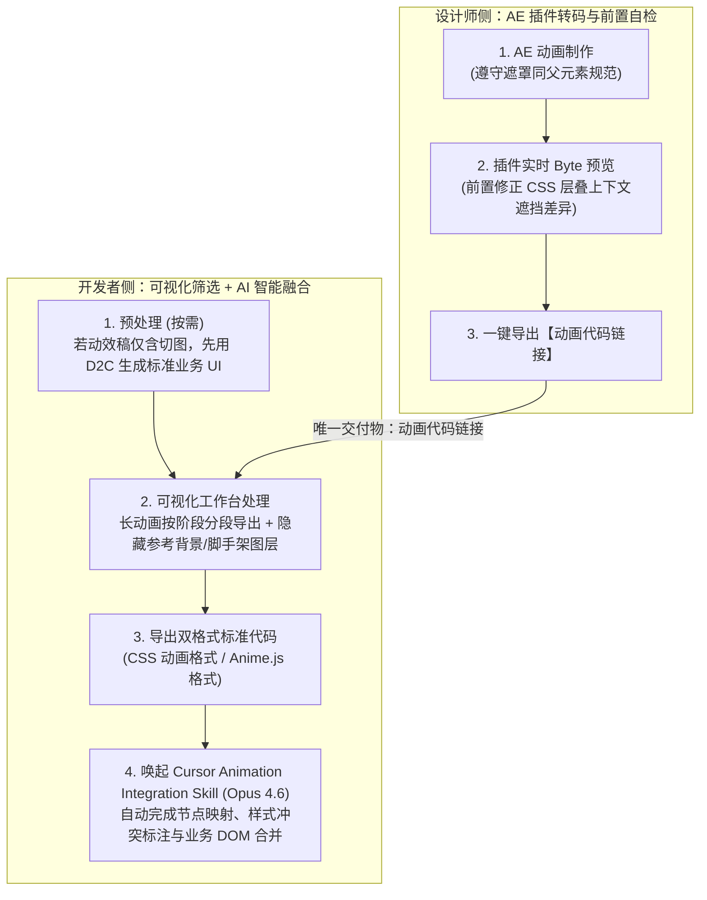

# AI 动画辅助实现（实践篇）：从 AE 到可运行代码的全链路方案

> [!abstract] 导读
> **一句话总结**：淘天集团营销&交易技术团队（作者：香芋）针对电商营销动效开发中“传统手写 DOM 动画耗时费力且还原度低、Lottie 体积大且难以支持动态业务状态交互”的两难困境，构建了 **“AE 插件一键转码与实时预览 + 可视化图层筛选导出（CSS / Anime.js 双格式） + Cursor `Animation Integration Skill` 智能融合业务 DOM + `Clip` 分层产物编排”** 的全链路方案，在淘宝秒杀砸金蛋、一元购等场景中将单次动画开发耗时从 **2–4 小时压缩至 15–30 分钟**，视觉还原度从 **70%–80% 跃升至 95%+**。
> **阅读价值**：精准切中了前端 AI 提效的“最后一公里”难题——**用确定性的编译器/插件解决“AE 关键帧到纯净动画代码”的精准数值转换，再用大模型（Cursor Skill）解决无法规则化的“动画节点与存量复杂业务 DOM 智能合并”**。

## 1. TL;DR

- **核心范式转变**：将传统“设计师交付视频/Lottie $\rightarrow$ 前端人肉反推手写或静态播放”重构为**“设计师通过 AE 插件直接交付经预览确认的可运行动画代码链接，前端通过 AI Skill 自动融合进业务组件”**。
- **为什么传统两条路线都走不通？**
  1. **路线 A（纯手写 DOM 动画）**：从视频/GIF 中无法精确提取缓动曲线与坐标，1 个组合动画需反复试错 **2–4 小时**，来回返工 2–3 次，且动效代码与业务逻辑重度耦合。
  2. **路线 B（Lottie 播放）**：复杂粒子与形变只能退化为序列帧（单动画轻易破百 KB），且本质是静态播放器，面对倒计时、实时接口数据驱动的价格变化等多状态交互需大量额外改造。
- **全链路三大技术支点**：
  1. **设计侧（AE 插件转码 + Byte 实时预览闭环）**：制定两条核心前置规范（遮罩图层与被遮罩父元素合一、提前通过插件真实 DOM 预览排查 CSS 层叠上下文遮挡差异），一键导出动画代码链接。
  2. **开发侧（可视化预处理 + Cursor `Animation Integration Skill`）**：支持分段导出与剔除参考脚手架图层，输出开箱即用的 **CSS / Anime.js 双格式代码**；再由 Cursor Skill（推荐搭配 `Opus 4.6`）按 **“DOM 优先”** 或 **“动画优先”** 策略自动完成节点映射、样式冲突检测与代码合并。
  3. **攻克多模块事件串联（`Clip` 分层产物方案）**：针对“红包飞入 $\rightarrow$ 等待点击 $\rightarrow$ 调接口砍价 $\rightarrow$ 价格变化”等跨业务事件的串联动画，将产物拆分为 `index.tsx` + `clips/clip.1-xxx.ts`（纯动效函数，时间轴归零、元素入参化），配合 AI 自动生成的**胶水层（Glue Layer）**实现动画、业务与编排逻辑彻底解耦。

## 2. 问题定义与背景

### 2.1 设计表达与工程实现之间的结构性鸿沟
在淘宝秒杀、百亿补贴、大促互动玩法中，营销动效不仅追求高视觉冲击力，还强依赖实时业务数据（如动态抽奖金额、实时倒计时、接口返回触发下一段动效）。

| 方案对比 | 还原度 | 开发耗时 | 包体积与性能 | 动态业务数据与多状态交互能力 |
| :--- | :--- | :--- | :--- | :--- |
| **传统路线 A：纯手写 DOM 动画** | 低（**70%–80%**，靠肉眼猜缓动） | 慢（**2–4 小时/个**，返工 2–3 次） | 轻量，但手写代码易冗余 | 强，但动效代码与业务代码严重耦合，极难维护 |
| **传统路线 B：Lottie 导出播放** | 高（静态播放时） | 中 | 重（序列帧轻易 **>100 KB**） | **极弱**（静态黑盒，动态替换文案/金额或按接口回调分段控制极繁琐） |
| **本文方案：AE 直出代码 + AI 集成 + Clip 分层** | 极高（**95%+**，AE 参数直转） | 极快（**15–30 分钟/个**） | 轻量原生 DOM（CSS / Anime.js） | **极强**（天然支持业务 DOM 绑定与 Promise/事件级分段编排） |

## 3. 知识框架

```mermaid
mindmap
  root((从 AE 到可运行代码的全链路 AI 动画方案))
    核心分工哲学
      确定性转码归插件：AE 工程图层/关键帧/缓动曲线 -> 标准 CSS/Anime.js 代码
      非规则融合归 AI：动画 DOM 与存量业务组件 DOM 的语义映射与冲突消解
      唯一交付契约：设计师与前端仅通过“动画代码链接”交接
    设计师侧链路（AE 插件端）
      规范1：遮罩图层与被遮罩父元素必须保持同一层级
      规范2：利用插件 byte 实时预览排查 AE 拍平渲染 vs CSS 层叠上下文遮挡差异
      一键转码生成可交互预览的动画代码链接
    开发者侧链路（平台 + Cursor Skill）
      Step 1：安装 Cursor Animation Integration Skill
      Step 2：按需先跑 D2C 生成标准业务 UI 组件底座
      Step 3：可视化筛选（长动画分段导出 + 剔除设计师参考背景/脚手架干扰图层）
      Step 4：导出 CSS 或 Anime.js 双格式纯净动画代码
      Step 5：Cursor Skill 五步智能融合（DOM 优先 vs 动画优先，推荐 Opus 4.6）
    进阶突破：Clip 分层产物与胶水层编排
      痛点：多模块跨用户点击/接口回调的串联动画无法靠单组件表达
      结构：index.tsx + clips/clip.1-xxx.ts（纯动效函数，时间轴归零，DOM 入参化）
      胶水层（Glue Layer）：用 Promise (.then) 与事件回调串联各 Clip，AI 自动生成胶水代码
```

## 4. 核心内容拆解

### 4.1 设计师侧与开发者侧的双轨协同流水线



#### 1. 为什么设计师必须在 AE 插件里做“实时代码预览”？
- **AE 拍平渲染 vs. 浏览器 CSS 层叠上下文（Stacking Context）的本质差异**：AE 内部预览是将所有图层按时间轴直接拍平渲染的，不存在 DOM 树父子层级约束；而转码生成的真实前端代码受制于浏览器 CSS `z-index` 与层叠上下文规则，且遮罩动画（Mask）要求遮罩层与被遮罩元素的父节点严格对齐。
- 通过将 **Byte 实时代码渲染预览**内嵌进 AE 插件，设计师在导出前就能亲眼看到浏览器真实 DOM 的渲染结果，当场调整遮挡或遮罩层级，将过去“前端写完发现遮罩不对再打回设计改稿”的跨角色返工彻底归零。

#### 2. 为什么“最后一公里集成”必须交给大模型（Cursor Skill）？
插件转出的动画代码拥有自己的 DOM 结构，而前端工程里往往已经存在由 D2C 生成或历史沉淀的业务组件 DOM（绑定了复杂的点击事件、埋点与动态商品名/价格字段）。**如何把转码出来的动画精准“贴”到业务 DOM 上，无法用死板的 AST 规则写死**。
- 当开发者在 IDE 中提供目标业务 `div` 上下文并唤起 `Animation Integration Skill`（实测使用 **Claude Opus 4.6** 效果最佳）时，AI 自动执行五步闭环：
  1. **解析动画节点树与关键帧属性**；
  2. **建立动画节点与现有业务 DOM 节点的语义映射关系**；
  3. **智能决策集成策略**：
     - **DOM 优先策略（DOM-First）**：当业务组件内目标元素已基本齐备时，以现有业务 DOM 为骨架，将动画样式与时间轴挂载上去；
     - **动画优先策略（Animation-First）**：当动效稿包含大量全新特效节点、与现有业务 UI 差异巨大时，以导出的动画代码为骨架，将业务数据绑定与交互逻辑迁移注入进去。
  4. **主动排雷与注释**：自动识别潜在的样式污染、硬编码绝对坐标（Hardcode Coordinates）等边界隐患并在代码注释中高亮提醒；
  5. **输出可直接运行的完整集成组件**。

### 4.2 攻克多模块事件串联缺口：`Clip` 分层产物与胶水层（Glue Layer）

在真实电商营销场景（如砍价、砸金蛋）中，动画往往不是一播到底的，而是被**用户交互**和**后端接口异步回调**打断串联的：
$$\text{红包飞入（自动播放）} \xrightarrow{\text{动画结束触发}} \text{红包持续抖动} \xrightarrow{\text{等待用户点击}} \text{砸开/砍价动效} \xrightarrow{\text{等待接口返回数据}} \text{金额数字跳动变化}$$

如果只导出一个庞大的整体动画组件，开发者仍然要痛苦地去拆解时间轴、手写状态机。为此团队推出了 **`Clip` 分层产物方案**：

```text
输出目录/
├── index.tsx                     # 完整组件（适用于无复杂外部中断、UI 完整的一体化动效）
└── clips/                        # 按业务阶段切分的独立纯动效函数库
    ├── clip.1-red-packet.ts      # 第一段：红包飞入（0ms–800ms，时间轴独立从 0 重置）
    ├── clip.2-shake.ts           # 第二段：红包循环抖动
    └── clip.3-price.ts           # 第三段：价格滚动变化
```

- **每个 `Clip` 的三不原则**：只负责“怎么动”，**不感知业务状态、不硬编码 DOM 选择器（通过函数入参接收 `cardRef.current` 等业务 DOM 引用）、不关心下一段什么时候播**，且返回标准可链式调用的控制器（支持 `.play()` 与 `.then()`）。
- **AI 自动生成胶水层（Glue Layer）**：大模型先对长段 AE 动画智能切分阶段（每段时间轴归零并支持独立预览），随后自动生成一段简洁的 Cursor Prompt 产出胶水层代码，将所有时序编排收敛在一处：
  ```ts
  // 胶水层：清晰表达“动画结束自动接下一段 + 用户点击触发 + 接口返回触发”
  const clip1 = playRedPacketClip({ card: cardRef.current, ... })
  clip1.then(() => playShakeClip({ card: cardRef.current }).play())
  clip1.play()

  const handleUserClick = () => playFadeOutClip({ card: cardRef.current })
  const handleApiSuccess = (data) => playPriceChangeClip({ price: priceRef.current, ... })
  ```

## 5. 数据速查表

| 评估维度 | 改造前（传统手写 / Lottie） | 改造后（AE 直出 + Cursor Skill + Clip） | 核心业务验证场景 |
| :--- | :--- | :--- | :--- |
| **单次动画开发耗时** | **2–4 小时**（反复对比视频微调关键帧） | **15–30 分钟**（效率提升约 **6–8 倍**） | 淘宝秒杀砸金蛋、一元购等核心营销互动 |
| **视觉还原度** | **70%–80%**（缓动曲线与路径靠猜） | **95%+**（AE 元数据直接编译转换） | 支持 SVG 形状图层、遮罩、矢量、APNG 序列帧 |
| **跨角色返工频次** | 常态化来回返工 **2–3 次** | **前置清零**（设计师在 AE 插件内实时预览真实 DOM） | 提前暴露遮罩父子层级与 CSS 层叠遮挡问题 |
| **代码输出与推荐模型** | 耦合代码或百 KB 级黑盒 JSON | **CSS / Anime.js** 双格式 + `clips/` 分层函数；集成推荐 **Opus 4.6** | 动画实现、业务 DOM、编排胶水层三者彻底解耦 |

## 6. 踩坑与教训 / 可迁移的设计原则

- **核心认知 1：区分“确定性编译问题”与“语义融合问题”，切忌让大模型包办一切**
  - **教训**：如果直接把 AE 视频或庞大的原始工程文件丢给大模型让它从头写动画，大模型既算不准贝塞尔缓动曲线，又极其耗费 Token。
  - **可迁移原则**：**“编译器干脏活（AE 插件确定性转码为 CSS/Anime.js），大模型干巧活（Cursor Skill 将纯净动画代码与千差万别的存量业务 DOM 智能对齐合并）”**——这种“传统编译转码 + AI 最后一公里粘合”的混合架构，是所有 D2C / 动效转代码工程落地的最优解。
- **核心认知 2：在可视化导出台增加“人工剔除脚手架图层”卡点**
  - 设计师在 AE 中做动画时，常常会垫入静态背景截图或参考辅助线图层；如果在转码导出前不在可视化界面把这些参照图层隐藏剔除，AI Skill 在融合时会误以为这也是要新增的业务 UI 元素，从而污染业务组件。
- **核心认知 3：复杂时序交互必须做“原子能力（Clips）与编排逻辑（Glue）分离”**
  - 把长动画切分为入参化的纯函数 `clip.N.ts`，让动画本身保持 100% 纯净无状态，把與业务接口、用户点击耦合的异步状态机收敛在短短十几行胶水层中，极大降低了后续迭代维护成本。

## 7. 记忆锚点

- **一条极简交付链**：**AE 插件实时预览转码 $\rightarrow$ 交付动画代码链接 $\rightarrow$ 可视化剔除杂层导出 CSS/Anime.js $\rightarrow$ Cursor Skill（Opus 4.6）智能融合业务 DOM**。
- **两种融合策略与一个分层方案**：**DOM 优先 vs. 动画优先**；跨事件多段串联靠 **`Clip` 分层纯函数 + AI 胶水层编排**。
- **两组硬核提效数字**：开发耗时从 **2–4 小时降至 15–30 分钟**，视觉还原度从 **70%–80% 升至 95%+**。

## 8. 复习卡片

Why do both traditional hand-coded DOM animations and Lottie playback fall short in complex e-commerce marketing scenarios?::Hand-coding DOM animations from video/GIF references takes 2–4 hours per animation with only 70–80% fidelity and tight business coupling, while Lottie files suffer from large bundle sizes (>100KB with image sequences) and inflexible static playback that struggles with dynamic countdowns or API-driven state transitions.
What two pre-export rules must designers follow in After Effects to prevent rendering discrepancies in browser DOM output?::1. Keep mask layers and their masked target elements under the exact same parent element; 2. Use the AE plugin's real-time Byte preview to inspect and fix element occlusion issues caused by differences between AE's flattened rendering and browser CSS stacking contexts.
During the developer workflow, why is it sometimes necessary to run D2C before running the `Animation Integration Skill`, and what cleanup is done in the visual workspace?::If the designer's AE file only uses static sliced images as UI placeholders, developers first use D2C to build standardized business UI components; in the visual workspace, developers split long animations into segments and hide non-animation reference/scaffold layers so the AI Skill doesn't mistakenly merge them into production code.
What are the two integration strategies used by the Cursor `Animation Integration Skill` (powered by Opus 4.6) when merging exported animation code with business code?::1. DOM-First (maps animation properties onto existing business DOM nodes when the UI structure already exists); 2. Animation-First (uses the exported animation DOM structure as the base and injects business logic into it when the design differs drastically from existing UI).
How does the `Clip` layered artifact architecture solve the problem of multi-stage animations driven by asynchronous user clicks and API callbacks?::Instead of exporting a single monolithic component, it exports `index.tsx` alongside modular, zero-indexed pure animation functions (`clips/clip.1-xxx.ts`) that accept business DOM refs as parameters and return chainable promises, allowing a clean AI-generated Glue Layer to orchestrate transitions across user events and API responses.
What quantitative improvements in development time and visual fidelity were achieved in Taobao Flash Sale and 1-Yuan Purchase campaigns using this pipeline?::Single animation development time dropped from 2–4 hours to 15–30 minutes, while visual fidelity increased from 70–80% to over 95%.

## 9. 知识关联

- **本批同主题精读**：
  - [Tarot Pixel：面向多端研发的视觉稿高还原代码生成实践](../Tarot Pixel视觉稿还原+26.6.24/AI_Tarot Pixel视觉稿还原.md)：本文第 4.1 节提到的“预处理先通过 D2C 出标准业务 UI，再贴上塔罗动画 Skill”的静态 UI 还原基座正是 Tarot Pixel（塔罗 D2C 体系），两者共同构成了大淘宝营销前端“静态高还原 UI + 动态高还原 AE 动效”的完整双璧。
  - [百亿补贴 C 端 AI Coding 实战：端到端 CodingAgent 设计与实践](../百补C端CodingAgent+26.8.2/AI_百补C端CodingAgent.md)：可对比百亿补贴前端 `visual-analyzer` 与本文塔罗动画 Skill 在连接设计工具（MasterGo / After Effects）与前端工程代码上的异曲同工之处。
  - [AI Agent 的 Skill 系统设计](../Agent Skill系统设计+26.7.1/AI_Agent Skill系统设计.md)：本文的 `Animation Integration Skill` 正是“用确定性工具产出标准化素材 + 用 Skill 约束大模型完成复杂上下文融合”的典范应用。
- **主题索引（`20_topics`）**：
  - [AI研发协同](../../20_topics/AI研发协同.md)
  - [跨端开发与性能](../../20_topics/跨端开发与性能.md)
  - [Skill设计与治理](../../20_topics/Skill设计与治理.md)
- **本目录归档文件**：[原始 PDF](RAW.pdf) · [逐页转写文本](MD.md)
- **候选概念双链**：[[AE转代码]] · [[前端动效工程]] · [[Lottie]] · [[CSS层叠上下文]] · [[Anime.js]] · [[Cursor-Skill]] · [[D2C设计稿转代码]]

## 10. 原文参考资料

- **原文出处**：大淘宝技术公众号，《AI 动画辅助实现（实践篇）：从 AE 到可运行代码的全链路方案》（作者：香芋，淘天集团-营销&交易技术团队，发布日期：2026-06-28）
- **前序姊妹篇提及**：《AI 动画辅助实现的方案与实践》

> [!note]- 校对报告
> - **页码溯源（1-based 物理页码）**：
>   - 篇首标题、作者（香芋，营销&交易技术团队）、传统动画交付三大痛点、手写 DOM vs Lottie 路线瓶颈及全链路提效核心数据（耗时 2–4h $\rightarrow$ 15–30min，还原度 70–80% $\rightarrow$ 95%+）：源自 `RAW.pdf` `p.1–3`（对应 `MD.md` 第 1–3 页）。
>   - 设计师侧链路（AE 遮罩同父元素规范、Byte 实时预览排查 CSS 层叠上下文遮挡、一键导出动画代码链接）：源自 `RAW.pdf` `p.4–5`（对应 `MD.md` 第 4–5 页）。
>   - 开发者侧五步链路（安装 Cursor `Animation Integration Skill`、D2C 预处理、可视化分段与剔除脚手架图层、导出 CSS/Anime.js 双格式、使用 Opus 4.6 执行 DOM 优先/动画优先融合）：源自 `RAW.pdf` `p.6–10`（对应 `MD.md` 第 6–10 页）。
>   - 多模块串联动画缺口分析、`Clip` 分层产物结构（`index.tsx` + `clips/clip.1-red-packet.ts` 等）、胶水层代码示例与淘宝秒杀砸金蛋/一元购落地验证总结：源自 `RAW.pdf` `p.10–14`（对应 `MD.md` 第 10–14 页）。
> - **一致性核验**：原文共 14 页（含 13 页操作录屏截图与架构图），无独立长篇 `SKILL.md` 原文需额外剥离。全文零正文内页码引用，所有核心流程与量化指标均与 `MD.md` 严格一致。
