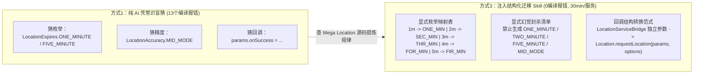

# 用 AI Skills 打通中间件迁移：定位服务从 Android 到鸿蒙的完整实践

> [!abstract] 导读
> **一句话总结**：淘天集团用户终端技术团队（作者：开益）针对穿搭业务从 Android 向鸿蒙（HarmonyOS）迁移 154 个端侧服务时“纯 AI 翻译凭常识瞎猜反直觉枚举与回调位置导致满屏编译报错、纯人工查源码耗时且经验无法跨人沉淀”的痛点，提出了 **“AI 通用代码生成 + Skills 可执行领域知识包”** 的协同范式——将内部二方包（如 Mega Location）的反直觉枚举映射、回调参数结构差异与高频幻觉黑名单显性化为结构化 Skill，实现单服务迁移 **30 分钟零编译错误**，在 **154 个服务规模化迁移中净省 25 小时**，并提出了“未来内部二方包接入文档将全面从面向人转向面向 AI（以 Skill 形式交付）”的核心洞察。
> **阅读价值**：用极具代表性的端侧跨平台 API 迁移案例（`ONE_MIN` vs `ONE_MINUTE`、独立参数回调 vs `options` 内嵌回调），直观证明了为什么通用大模型在企业内部二方包面前必然幻觉，以及如何用一张结构化正反映射表彻底根治。

## 1. TL;DR

- **两大核心工程暴论**：
  1. **随着基座模型能力增强，冗余的通用知识库应当减负**，知识库只需保留“AI 凭通用常识一定会猜错”的企业私有反直觉约定。
  2. **未来企业内部各类二方包（SDK/中间件）的接入文档都将以 Skill 形式交付**，实现从“面向人类阅读”到“面向 AI 索引执行”的范式转移。
- **问题本质（通用智能 vs. 私有领域知识断层）**：
  - 让 AI 直接将 Android 的 `LBSService` 翻译为鸿蒙代码时，AI 会基于公网命名常识猜出 `LocationExpires.ONE_MINUTE`、`FIVE_MINUTE`、`LocationAccuracy.MID_MODE`，并将回调挂载到 `params.onSuccess`，直接触发 **13 个编译错误**。
  - 查阅鸿蒙端 Mega Location 二方包源码才发现，其实际枚举命名极为反直觉（1~5 分钟居然简写为 `ONE_MIN`、`SEC_MIN`、`THR_MIN`、`FOR_MIN`、`FIR_MIN`），且回调必须封装在第二个参数 `options: Location.LocationRequestOptions` 内部。
- **三种迁移模式硬核对比（基于 154 个 Android 服务迁移实测）**：
  - **纯 AI 翻译**：快而不准（单服务 **13 个编译错误**，调试耗时不可控）。
  - **人工查源码修正**：准而不快（单服务 **0 编译错误**，但每次需耗费 **40 分钟** 翻源码，且知识留在个人脑中）。
  - **AI + Skills 模式**：又快又准（单服务耗时缩至 **30 分钟** 且 **0 编译错误**；在 154 个服务规模化迁移中，总耗时从 **102 小时降至 77 小时，净节省 25 小时**，新人零学习成本复用）。

## 2. 问题定义与背景

### 2.1 为什么强大的大模型在跨平台中间件迁移中频频犯“低级错误”？
在淘宝穿搭业务从 0 到 1 将 154 个 Android 端服务迁移至鸿蒙原生（ArkTS）的过程中，绝大多数业务逻辑（状态流转、数据加工）属于通用编程范畴，大模型驾轻就熟；但一旦触及**集团内部跨端二方包（如 Mega Location 定位服务）**，大模型立刻失灵：
1. **私有 SDK 不在预训练语料中**：大模型从未见过内部鸿蒙二方包的 TypeScript/ArkTS 声明。
2. **人类开发者的命名并非总是符合“公网直觉”**：当内部二方包作者把“2分钟、3分钟、4分钟、5分钟”定义为 `SEC_MIN`（Second）、`THR_MIN`、`FOR_MIN`、`FIR_MIN` 时，任何靠概率推理的大模型都会百分之百猜成 `TWO_MINUTE`、`FIVE_MINUTE`。
3. **软件工程知识的三种状态断层**：
   - **隐性知识（Tacit）**：只存在于踩过坑的老员工脑子里（*“记住这里千万别用 `ONE_MINUTE`，要用 `ONE_MIN`”*）。
   - **显性知识（Explicit）**：散落在滞后、难搜索的语雀文档里，AI 不会主动去翻。
   - **可执行知识（Executable）**：封装在结构化、带触发条件与反例警告的 **Skills** 里，AI 每次生码前自动挂载对齐。

## 3. 知识框架

```mermaid
mindmap
  root((AI + Skills 跨端中间件迁移体系))
    核心洞察与暴论
      模型越强，通用冗余知识越要减负，聚焦反直觉私有约定
      二方包交付新形态：从“给人看的文档”转向“给AI用的Skill”
      知识三态跃迁：隐性知识(人脑) -> 显性知识(文档) -> 可执行知识(Skills)
    定位服务迁移经典反差案例
      反直觉枚举映射：ONE_MIN / SEC_MIN / THR_MIN / FOR_MIN / FIR_MIN
      高频幻觉黑名单：显式列出不存在的 ONE_MINUTE / FIVE_MINUTE / MID_MODE
      回调签名重构：Android 独立 Lambda 参数 vs 鸿蒙 LocationRequestOptions 内嵌属性
    五步闭环工作流
      1. 输入阶段：AI 自动加载对应二方包迁移 Skill
      2. 生成阶段：严格依据映射表与正反例生成鸿蒙代码
      3. 验证阶段：编译器静态类型与运行验证（0 编译错误）
      4. 反馈阶段：新踩坑问题提炼规律
      5. 沉淀阶段：增量更新回 Skill 实现一人踩坑全员免疫
    规模化收益与未来演进
      154 个服务总耗时：102小时 -> 77小时（净省 25 小时）
      演进路线：文档化 Skills -> 跨模块知识图谱 -> IDE 编译前主动预警 -> 源码变更自动生成 Skill
```

## 4. 核心内容拆解

### 4.1 Android 到鸿蒙定位服务迁移的“反直觉”真相与 Skill 结构化封装



在编写定位服务迁移 Skill 时，作者没有堆砌冗长的背景说明，而是直接用**高对比度 Markdown 映射表 + 显式幻觉黑名单 + 双端代码对照**锁死 AI 行为：

#### 1. `LocationExpires` 反直觉枚举映射与幻觉黑名单

| Android 原始常量 | 鸿蒙 Mega Location 真实枚举 | 关键说明与防幻觉警告 |
| :--- | :--- | :--- |
| `"1m"` | `LocationExpires.ONE_MIN` | ⚠️ 绝不是 `ONE_MINUTE` |
| `"2m"` | `LocationExpires.SEC_MIN` | ⚠️ `SEC` 代表 Second（第2），绝不是 `TWO_MIN` 或 `TWO_MINUTE` |
| `"3m"` | `LocationExpires.THR_MIN` | ⚠️ `THR` 代表 Three，绝不是 `THREE_MIN` |
| `"4m"` | `LocationExpires.FOR_MIN` | ⚠️ `FOR` 代表 Four，绝不是 `FOUR_MIN` |
| `"5m"` | `LocationExpires.FIR_MIN` | ⚠️ `FIR` 代表 Five，绝不是 `FIVE_MIN` 或 `FIVE_MINUTE` |
| **AI 常犯幻觉黑名单** | ❌ **严禁使用以下不存在的枚举** | `ONE_MINUTE`, `TWO_MINUTE`, `FIVE_MINUTE`, `TEN_MINUTE`, `MID_MODE` |

#### 2. 定位请求调用与回调挂载位置对比
- **Android 端（Kotlin，回调作为独立尾随 Lambda 参数）**：
  ```kotlin
  LocationServiceBridge.requestLocation(
      params,
      { result -> ... }, // 成功回调作为第2个参数
      { error -> ... }   // 失败回调作为第3个参数
  )
  ```
- **鸿蒙端（ArkTS，回调必须封装在 `options` 对象内部）**：
  ```typescript
  const options: Location.LocationRequestOptions = {
      bizName: 'TB_SHOPPING_PROCESS',
      onSuccess: (result: LocationData) => { ... }, // ✅ 必须在 options 内
      onFail: (error: string) => { ... }
  };
  Location.requestLocation(params, options);
  ```

### 4.2 构建 AI 友好型中间件 Skill 的三大工程原则与演进蓝图
1. **原则一：表格化与正反例对照优先（AI-Friendly Structuring）**
   - 摒弃长篇大论的自然语言段落，一律采用 `源平台 API | 目标平台 API | 差异与陷阱说明` 的结构化表格，并专门单列 **“❌ AI 经常错误生成的不存在枚举/方法”**。
2. **原则二：踩坑即资产的持续演进闭环**
   - 固化 `遇到编译报错 → 查二方包源码 → 提炼映射规律 → 更新 Skill → 团队同步` 飞轮，确保同一个二方包的坑全团队只踩一次。
3. **原则三：四阶段未来演进路线**
   - **从文档化 Skills 到知识图谱（Knowledge Graph）**：让 AI 理解多个二方包模块间的依赖关系并自动推荐组合 Skills；
   - **从被动查询到 IDE 主动预警**：IDE 插件实时扫描代码，命中 Skill 中的常见陷阱（如误写 `ONE_MINUTE`）在编译前直接标红提醒；
   - **从人工编写到源码变更自动生成**：当二方包发布新版本时，由 AI 直接对比 SDK 源码 AST 自动生成/更新配套 Skill，达成零人工维护成本；
   - **从个人提效工具升维至组织级知识中台**。

## 5. 数据速查表

| 评估维度 | 方式 1：纯 AI 翻译 | 方式 2：人工查源码 + 修正 | 方式 3：AI + Skills 协同 |
| :--- | :--- | :--- | :--- |
| **单服务编译错误数** | **13 个**（枚举与回调全错） | **0 个** | **0 个** |
| **单服务迁移耗时** | 生成快，但排障调试时间不可控 | **40 分钟 / 服务** | **30 分钟 / 服务**（效率提升 **25%**） |
| **154 个服务总耗时** | 无法直接交付 | **102 小时** | **77 小时**（**净节省 25 小时**） |
| **知识留存与新人上手** | 无沉淀，下次继续报错 | 留在老员工脑中，新人需重查源码 | **永久沉淀为组织资产，新人 0 学习成本** |

## 6. 踩坑与教训 / 可迁移的设计原则

- **核心认知 1：二方包提供方的交付标准必须升级为“SDK 源码 + 配套 AI Skill”**
  - **教训**：过去中间件团队交付二方包只给 jar/har 包和一份简陋的语雀 Wiki，业务方用 AI 编码时因为没有结构化上下文，家家都在重复查源码、重复踩同样的坑。
  - **可迁移原则**：任何内部基础组件、跨端桥接 API 或私有 SDK 在发布时，都应在包内或统一仓库随附一份面向 Coding Agent 的 `SKILL.md`（重点写清**非直觉命名、破坏性变更与常见错误写法黑名单**）。
- **核心认知 2：在 Skill 里显式写出“❌ 不存在的 API 黑名单”比只写正例更有效**
  - 大模型在预训练中形成了极强的命名惯性（如看到 `ONE_` 就想补全 `MINUTE`）；仅给出正例 `ONE_MIN` 时模型有时仍会滑向高频词，只有同时加上 `⚠️ 严禁生成 ONE_MINUTE / FIVE_MINUTE` 的负向约束，才能实现 100% 零编译错误。

## 7. 记忆锚点

- **两个暴论**：**通用知识库要减负**（只留反直觉私有规则）；**未来二方包接入必以 Skill 形式面向 AI 交付**。
- **一个经典反直觉案例**：鸿蒙定位枚举 1~5 分钟是 **`ONE_MIN / SEC_MIN / THR_MIN / FOR_MIN / FIR_MIN`**（不是 `ONE_MINUTE / FIVE_MINUTE`），回调在 **`options` 对象内**（不在 `params` 上）。
- **一组实测战果**：单服务 **13 个编译错误降为 0**，耗时 **40 分钟降至 30 分钟**，**154 个服务净省 25 小时（102h $\rightarrow$ 77h）**。

## 8. 复习卡片

Why did pure AI translation produce 13 compilation errors when migrating the Android `LBSService` to HarmonyOS?::Because the internal HarmonyOS Mega Location SDK uses counter-intuitive enum names (`ONE_MIN`, `SEC_MIN`, `THR_MIN`, `FOR_MIN`, `FIR_MIN`) and places callbacks inside a second `options` object, whereas the LLM guessed standard English names (`ONE_MINUTE`, `FIVE_MINUTE`, `MID_MODE`) and attached `onSuccess` directly to `params`.
What are the two "bold claims" (暴论) proposed by the author regarding knowledge bases and internal second-party (2P) SDKs in the AI era?::1. Many existing knowledge bases are bloated and must be slimmed down as models grow stronger, keeping only domain-specific rules that AI cannot infer from common sense; 2. In the future, all internal 2P libraries will be delivered with AI Skills, shifting documentation from human-oriented to AI-oriented.
In the HarmonyOS Mega Location SDK, what are the exact enum values for 1, 2, 3, 4, and 5 minutes in `LocationExpires`?::`ONE_MIN` (1m), `SEC_MIN` (2m, from "second"), `THR_MIN` (3m), `FOR_MIN` (4m), and `FIR_MIN` (5m)—none of which use the full word `MINUTE`.
What are the three states of software engineering knowledge described in the article, and how does `AI + Skills` transform them?::1. Tacit knowledge (trapped in senior engineers' heads), 2. Explicit knowledge (scattered in lagging, hard-to-search docs), and 3. Executable knowledge (structured, indexed, AI-readable Skills that automatically guide code generation).
What quantitative efficiency gains were achieved across the migration of 154 Android services to HarmonyOS using the `AI + Skills` approach?::Single-service migration time dropped from 40 minutes (manual source lookup) to 30 minutes with 0 compilation errors, reducing total effort across 154 services from 102 hours to 77 hours (saving 25 hours) while enabling zero-onboarding-cost reuse for new team members.
Why is it crucial to explicitly list "non-existent enum values" (like `ONE_MINUTE` and `MID_MODE`) inside a migration Skill?::Because LLMs have strong pretraining priors toward conventional naming patterns; explicitly blacklisting the hallucinated names that the model naturally gravitates toward prevents it from reverting to common-sense guesswork.

## 9. 知识关联

- **本批同主题精读**：
  - [面向Skills编程-淘宝企业购端对端研发提效实践](../企业购面向Skills编程+26.6.16/AI_企业购面向Skills编程.md)：与本文相隔仅两天发布，从端侧跨平台迁移延伸到服务端/全栈企业购对接场景的“面向 Skills 编程”完整体系。
  - [Agent skill 迭代式编写实战](../Agent Skill迭代式编写+26.6.12/AI_Agent Skill迭代式编写.md)：系统总结了编写高质量 Skill 时“负向约束必须配合法替代方案”与三层渐进披露原则，与本文的 API 映射表设计高度契合。
  - [百亿补贴 C 端 AI Coding 实战：基于 SDD 的服务端 AI Coding 实践](../百补服务端SDD实践+26.7.27/AI_百补服务端SDD实践.md)：文中提出的 `artifact7`（从阿里内部二方包源码自动解析接口定义喂给 AI）正是本文第 5 章展望“从人工写二方包 Skill 走向源码自动解析生成”的工程实现。
- **主题索引（`20_topics`）**：
  - [Skill设计与治理](../../20_topics/Skill设计与治理.md)
  - [跨端开发与性能](../../20_topics/跨端开发与性能.md)
  - [AI研发协同](../../20_topics/AI研发协同.md)
  - [决策知识结构化](../../20_topics/决策知识结构化.md)
- **本目录归档文件**：[原始 PDF](RAW.pdf) · [逐页转写文本](MD.md)
- **候选概念双链**：[[鸿蒙原生迁移]] · [[Agent-Skill]] · [[二方包治理]] · [[可执行知识]] · [[负向约束]]

## 10. 原文参考资料

- **原文出处**：大淘宝技术公众号，《用 AI Skills 打通中间件迁移：定位服务从 Android 到鸿蒙的完整实践》（作者：开益，淘天集团-用户终端技术团队，发布日期：2026-06-14）

> [!note]- 校对报告
> - **页码溯源（1-based 物理页码）**：
>   - 篇首标题、作者（开益，用户终端技术团队）、两个核心暴论与纯 AI 迁移 Android 定位服务触发 13 个编译错误的场景还原：源自 `RAW.pdf` `p.1–2`（对应 `MD.md` 第 1–2 页）。
>   - 知识工程三态定义（隐性/显性/可执行知识）、AI + Skills 分工模型与五步闭环工作流：源自 `RAW.pdf` `p.2–5`（对应 `MD.md` 第 2–5 页）。
>   - 穿搭业务 154 个 Android 服务迁移实战、三种方式对比、`LocationExpires` 反直觉枚举真相（`ONE_MIN / SEC_MIN / THR_MIN / FOR_MIN / FIR_MIN` vs `ONE_MINUTE`）、`options` 回调差异及规模化收益（单服务 40min $\rightarrow$ 30min，总耗时 102h $\rightarrow$ 77h 净省 25h）：源自 `RAW.pdf` `p.5–9`（对应 `MD.md` 第 5–9 页）。
>   - 构建 Skills 三大原则与未来四阶段演进展望（知识图谱、主动预警、动态生成、组织中台）：源自 `RAW.pdf` `p.9–15`（对应 `MD.md` 第 9–15 页）。
> - **一致性核验**：原文共 15 页（含 13 页思维导图与对比表截图），第 7–8 页展示了 24 行 API 映射表与代码片段（已在笔记第 4.1 节完整收录），无独立长篇外部 `SKILL.md` 全文需单独剥离。全文零正文内页码引用，核心数据与 `MD.md` 完全一致。
