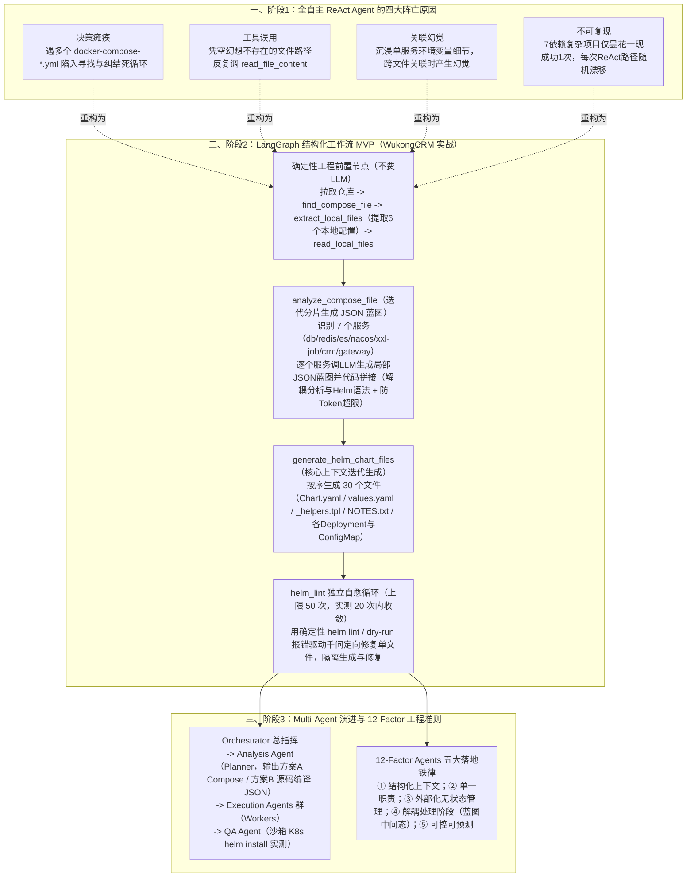

# 初探：从0开始的AI-Agent开发踩坑实录

## 1. TL;DR

1. **核心任务与初探阵亡**：作者入职面临“将上百个开源应用适配部署至 K8s（输入 GitHub 仓库输出可直接部署的 **Helm Chart**）”的需求；初期试图构建“给 LLM 一篮子工具（克隆、读写文件、跑 Shell）让它全自主 ReAct 决策”的万能 Agent，结果陷入**多 `docker-compose` 文件决策瘫痪、幻想不存在的文件路径、沉浸环境变量细节产生幻觉**，仅在某次为含 **7 个依赖**的项目昙花一现成功过一次后便再也无法复现。
2. **范式破局（从“全自主 ReAct”转向“LangGraph 结构化工作流 + 迭代分片 JSON 蓝图 + `helm lint/dry-run` 自愈循环”）**：
   - **人定骨架（Workflow）、AI 填血肉**：用确定性 Python 节点完成克隆仓库、寻找 `docker-compose.yml`、提取并读取关联本地配置文件（如 `WukongCRM-11.0-JAVA` 的 **6 个**本地配置文件与 **7 个**服务：`db/redis/elasticsearch/nacos/xxl-job-admin/crm/gateway`）；
   - **“JSON 蓝图（Blueprint）”中间态与迭代分片生成**：不让 AI 从 `docker-compose` 直接写 30 个 Helm YAML，而是**逐个服务迭代调用 LLM 生成结构化 JSON 蓝图并拼接**（既避免撑爆单次输出 Token 上限，又将“架构理解”与“Helm 语法翻译”解耦，最终按序生成 **30 个** Chart 文件）；
   - **隔离的自愈循环（Self-Healing Loop）**：引入确定性的 `helm lint` / `dry-run` 作为外部反馈，将生成与修复解耦（最大尝试上限设为 **50 次**，实践中 **20 次内**即可修复大部分 YAML 缩进、模板引用与语法错误）。
3. **演进与工程反思（Multi-Agent + 12-Factor Agents + 三大深水区痛点）**：进一步规划 `Orchestrator + 分析专家(Planner) + 执行专家群(Docker Compose / 源码编译 Workers) + 质检专家(QA Agent 沙箱 helm install)` 多智能体架构；结合 **12-Factor Agents** 提炼出“结构化上下文、单一职责、外部化无状态管理、阶段解耦、可控可预测”五原则，并深刻复盘了 **LangSmith 绿灯假象（缺业务级 Token 超限根因定位）、Prompt 改一坏五的“炼丹/版本管理噩梦”与 `temperature=0` 下依然存在的复杂推理路径漂移**。

## 2. 问题定义与背景

### 2.1 业务背景：上百个开源应用的 K8s Helm Chart 自动适配

团队面临将上百个开源项目批量适配至 Kubernetes 的任务，目标是构建一个 Agent：输入开源项目 GitHub 地址，自动分析其服务拓扑、存储挂载与配置依赖，输出符合最佳实践的完整 **Helm Chart 包**。

### 2.2 AI 角色认知纠偏：分析者（Analyst）vs 决策者（Decision-Maker）

1. **为什么第一个坑是“让 LLM 控制一切”？**
   - 跳过 LangChain 提出的 `Stage 1: Define（界定 AI 与工程代码的边界）` 直接冲向 `Build MVP`，让 AI 自己写 Shell 扫目录、自己决定先看哪个文件，导致输出极度不可控。
2. **两类角色的成熟度差异**：
   - **分析者（Analyst，当前最擅长）**：不直接执行变更，而是阅读海量监控/日志/配置提炼结构化洞察；
   - **决策者（Decision-Maker，强依赖框架约束）**：不能只给一句模糊目标（如“生成 Helm Chart”），必须配齐清晰的工具边界、固定的工作流骨架与细化到每个决策节点的触发条件，**任务粒度越小越清晰，Agent 越可控**。

### 2.3 三大主流 Agent 行为范式对比

| 范式名称 | 核心执行机制 | 优势 | 局限与适用边界 |
| --- | --- | --- | --- |
| **ReAct** (`arXiv:2210.03629`) | `Thought -> Action -> Observation` 单步循环反馈 | 灵活，LangGraph 预置提示即可零样本启动 | 长链条任务中任一步 Thought 偏差就会钻进死胡同；每步调工具都要调一次 LLM |
| **Plan-and-Execute** | `规划阶段（生成多步清单） -> 执行阶段 -> 重规划（Replan）` | 全局视野好（如 Manus 思路），减少盲目试探 | 仍需在重规划阶段频繁更新状态 |
| **ReWOO** (`Reasoning WithOut Observation`) | `Planner（一次性生成含占位符蓝图） -> Worker（纯工具并行收集证据，无LLM） -> Solver（汇总蓝图与证据一次性求解）` | Worker 阶段不查看中间结果、无需 LLM 驱动，大幅节省 Token 与延迟 | 蓝图固定、缺乏中途动态重规划（Replan）能力 |

## 3. 知识框架

## 4. 核心内容拆解

### 4.1 为什么在 `docker-compose` 与 `Helm Chart` 之间必须插入一层“JSON 蓝图（Blueprint）”？

在 `WukongCRM-11.0-JAVA` 实战案例中（含 **6 个**本地配置文件与 `db`、`redis`、`elasticsearch`、`nacos`、`xxl-job-admin`、`crm`、`gateway` 共 **7 个服务**，最终需生成 **30 个** Chart 文件），作者没有让 LLM 直接从 `docker-compose.yml` 生成 YAML，而是设计了 `analyze_compose_file` 节点生成结构化 JSON 蓝图（含 `main_application` 与 `dependencies` 的 `Init Containers` 启动顺序、`PersistentVolumeClaim`/`ConfigMap`/`Secret` 映射），原因有三：
1. **降低单步认知负荷**：让 AI 在分析阶段只当“云原生架构师”理解服务依赖与存储挂载意图，不必同时分心处理琐碎的 Helm Go Template（`{{ .Values... }}`）语法，分析准确率大幅提升。
2. **“迭代分片法”突破输出 Token 限制**：一次性输出 30 个文件或整套复杂蓝图必超模型单次输出上限；先用代码解析出 7 个服务列表，再**逐个服务循环调用 LLM 生成单服务蓝图片段**，最后在代码层拼接为完整蓝图。
3. **提供可观测、可调试的稳定中间态**：当最终 Chart 出错时，能一眼定位究竟是“架构理解（蓝图）错了”还是“蓝图转写为 YAML 模板时错了”，彻底告别黑盒盲调。

### 4.2 基于 `helm lint` / `dry-run` 确定性反馈的“自愈循环”

- **生成与修复物理隔离**：AI 初次生成的 30 个 Chart 文件不可避免存在 YAML 第 42 行非法字符或模板命名引用错误；团队将 `helm_lint` 拆为独立闭环节点（设置最大重试上限 **50 次**），把 `helm lint` 和 `dry-run` 返回的精确报错行号与原因喂给通义千问做定向单文件修复；
- **实测效果**：在 **20 次循环以内**即可自动修平绝大多数语法、缩进与模板引用错误，把“盲目生成”变成了“带编译器反馈的闭环收敛”。

### 4.3 12-Factor Agents 工程感悟与三大实战深水区痛点

1. **借鉴 `12-Factor Agents`（`humanlayer/12-factor-agents`）的五条核心准则**：
   - **结构化上下文**：结构化的输出是为了下一步结构化的输入；
   - **单一职责**：告别样样通样样松的“瑞士军刀 Agent”；
   - **外部化状态管理**：Agent 的思考过程应是无状态的，所有执行状态交由外部工作流引擎（如 LangGraph）托管，支持单步独立重试与回放；
   - **解耦处理阶段**：将“分析理解（蓝图） $\to$ 代码生成（YAML） $\to$ 检查修复（Lint）”彻底解耦；
   - **可控性与可预测性优先于惊艳感**：大部分由确定性工程代码构成，仅在关键分析/转换节点嵌入 LLM。
2. **一线踩出的三大深水区痛点**：
   - **AI 可观测性的“绿灯假象”**：使用 `LangSmith` 追踪链路时，虽然能看清每一步 Thought 和 Tool 调用，但当底层因 Token 超限或 LLM 逻辑截断导致输出异常时，**LangSmith 里的 Trace 依然是一片祥和的绿色**，缺乏从“工具返回过大 $\to$ Token 溢出 $\to$ 推理退化”的自动根因归因。
   - **Prompt 调优的“改一坏五”版本管理噩梦**：为了修复一个 `env_file` 路径解析的 Bad Case 微调了 Prompt，结果该 Case 过了，原本正常的**另外 5 个 Case 全挂了**！凸显出 Prompt 迫切需要像代码一样的回归测试基准集与 A/B 版本对比工具。
   - **`temperature = 0` 下依然存在的非确定性**：即使将 `temperature` 设为 `0`，在长链路复杂推理中不同时间点仍可能走出截然不同的推理分支；工程设计必须在“发散分析阶段容忍有益的不确定性”与“收敛生成阶段强制确定性校验”之间划清边界。

## 5. 数据速查表

| 指标 / 维度 | 原文数值 / 设定 | 语境 / 条件 |
| --- | --- | --- |
| 业务目标规模 | **上百个开源应用的 K8s Helm Chart 自动适配** | 输入 GitHub 仓库输出可部署 Chart 包 |
| 全自主 ReAct 偶发成功案例复杂度 | **含 `7 个`依赖的复杂项目（仅成功 1 次无法复现）** | 暴露纯 ReAct 长链路路径随机漂移缺陷 |
| `WukongCRM-11.0-JAVA` 实战解析规模 | **提取 `6 个`本地配置文件 / 识别 `7 个`服务 / 生成 `30 个` Chart 文件** | 服务含 `db, redis, elasticsearch, nacos, xxl-job-admin, crm, gateway` |
| `helm lint` 自愈循环最大上限与实际收敛 | **代码设置上限 `50 次`（`1/50`） / 实践中 `20 次内`修复大部分问题** | 结合 `helm lint` 与 `dry-run` 确定性报错反馈 |
| Prompt 回归劣化典型案例 | **修好 `1 个` `env_file` Bad Case，搞挂原本正常的 `5 个` Case** | 揭示缺乏回归测试集的 Prompt“炼丹”困境 |

## 6. 踩坑与教训 / 可迁移的设计原则

| 错误做法 | 失败表现或原因 | 原文应对（可迁移的设计原则） |
| --- | --- | --- |
| **跳过 Define 阶段边界划分，直接给 LLM 一堆 Shell/文件工具让它全自主跑 ReAct** | 遇到多个 `docker-compose` 文件时决策瘫痪，凭空捏造文件路径死循环，偶发成功一次也无法复现 | **人类定确定性骨架（LangGraph Workflow），AI 填局部分析与生成血肉**：文件扫描、路径提取、拼接与 Lint 校验全部用确定性 Python 代码完成 |
| **让大模型直接从复杂的 `docker-compose.yml` 一步到位生成 30 个 Helm YAML 文件** | 模型同时背负“架构依赖分析”与“Helm 模板语法”双重认知负荷，且单次输出极易超出 Token 上限 | **引入“JSON 蓝图（Blueprint）”中间态 + 按服务迭代分片生成**：先逐个服务生成架构蓝图 JSON 并由代码拼接，再分步翻译为 30 个 Chart 文件 |
| **指望 AI 一次生成 100% 语法正确的 K8s / Helm 模板** | YAML 缩进、非法字符或 `_helpers.tpl` 引用错误频发 | **构建独立的 `helm lint / dry-run` 自愈闭环**：将生成节点与修复节点解耦，用确定性编译器/Linter 报错驱动模型在 20 步内自愈 |
| **发现一个 Bad Case 就直接手改线上 Prompt 而不跑回归测试** | 改好 1 个 `env_file` 案例却导致另外 5 个原本正常的案例集体崩溃 | **建立固定回归测试集与阶段解耦**：通过蓝图中间态隔离问题范围，避免在单一巨型 Prompt 上盲目“炼丹” |

## 7. 记忆锚点

1. **工程化 Agent 核心格言**：“**好的 Agent 不是给 LLM 一堆工具让它自由发挥，而是大部分由确定性代码构成，仅在关键认知点嵌入 LLM（人搭骨架、AI 填肉、Linter 兜底）**”。
2. **Helm 生成三步解耦法**：$\text{确定性代码提文件} \xrightarrow{\text{按服务迭代分片}} \text{结构化 JSON 蓝图} \xrightarrow{\text{按文件迭代生成}} 30\text{ 个 YAML} \xrightarrow{\texttt{helm lint / dry-run}} \text{20 步内自愈收敛}$。

## 8. 复习卡片

1. 为什么作者最初设计的“全自主决策 ReAct Agent”在生成 Helm Chart 任务上彻底失败了？暴露了哪四个典型症状？::因为把一个多步骤、严密的长链条工程任务完全交给短期记忆的 LLM 自由探索，任何一步 Thought 偏差都会走进死胡同；暴露了四大症状：① 面对多个 `docker-compose` 文件时决策瘫痪陷入死循环；② 幻想不存在的文件路径反复调 `read_file_content`；③ 沉浸于单个服务的环境变量而在跨文件关联时产生幻觉；④ 路径随机不可控（7 个依赖的项目仅侥幸成功 1 次便再也无法复现）。
2. `ReAct`、`Plan-and-Execute` 和 `ReWOO` 三种 Agent 范式的核心区别是什么？::`ReAct` 是单步 `Thought -> Action -> Observation` 循环，每调一次工具都要调一次 LLM；`Plan-and-Execute` 先生成全局多步计划再执行，并支持根据结果动态重规划（Replan）；`ReWOO`（Reasoning WithOut Observation）分为 `Planner -> Worker -> Solver`，其 `Worker` 按固定蓝图并行调用工具收集证据时**无需 LLM 参与也不看中间细节**，最后由 `Solver` 一次性汇总蓝图与证据求解，省 Token 但无动态重规划能力。
3. 在 LangGraph 结构化工作流中，为什么不让 AI 直接把 `docker-compose.yml` 转成 Helm YAML，而是先生成一份“JSON 蓝图（Blueprint）”并采用“迭代分片法”？::有三个核心原因：① **降低认知负荷**：让 AI 先专注识别主应用、Init Containers 依赖顺序与 PVC/ConfigMap/Secret 挂载意图，不与 Helm 模板语法混杂；② **突破 Token 限制**：通过代码拆出 7 个服务，逐个服务调用 LLM 生成蓝图分片再拼接，防止单次输出截断；③ **提供可调试中间态**：出错时能立刻分清是“架构分析错了”还是“YAML 翻译错了”。
4. 结构化工作流是如何解决 AI 生成的 30 个 Helm Chart 文件存在语法与模板引用错误的？::设计了与生成环节解耦的独立“自愈循环（Self-Healing Loop）”：在代码写盘后自动调用确定性的 `helm lint` 与 `dry-run` 检查，若失败则将精确报错日志喂给大模型定向修复对应文件并重跑 Lint（设置最大重试 50 次，实践中 20 次以内即可修复绝大部分错误）。
5. 结合 `12-Factor Agents` 理念，作者总结出的构建生产级 Agent 的五条核心原则是什么？::① 结构化上下文（结构化输出服务于下一步结构化输入）；② 单一职责（拆解小任务，拒绝全能瑞士军刀 Agent）；③ 外部化状态管理（Agent 思考保持无状态，状态全交外部工作流引擎托管以便单步重试）；④ 解耦处理阶段（分析蓝图、生成代码、Lint 修复三者分离）；⑤ 可控性与可预测性优先（大部分由确定性代码构成）。
6. 在实践中，作者在“AI 可观测性（LangSmith）”和“Prompt 迭代”上遇到了什么痛点？::① **可观测性的“绿灯假象”**：当底层因工具返回过大引发 Token 超限或推理静默退化时，LangSmith 的 Trace 依然全绿，缺乏错误因果链根因定位；② **Prompt“改一坏五”噩梦**：无回归基准时，为修好 1 个 `env_file` 路径 Bad Case 改了一个词，却导致另外 5 个原本正常的 Case 产生幻觉全挂；③ 即使设 `temperature=0`，复杂推理路径仍会随时间发生非确定性漂移。

## 9. 知识关联

- **本库主题关联**：
  - [Agent工程循环](../../20_topics/Agent工程循环.md)：完整对比 ReAct、Plan-and-Execute、ReWOO 与 LangGraph 结构化工作流，通过“确定性前置节点 + 迭代分片 JSON 蓝图 + `helm lint` 自愈循环”实现复杂 K8s 部署物生成。
  - [Prompt优化](../../20_topics/Prompt优化.md)：揭示自然语言强约束词（“必须/重要”）的概率失效与“改一坏五”回归难题，提出用阶段解耦与结构化 JSON 中间态降低单步 Prompt 负荷。
  - [异常监控与稳定性](../../20_topics/异常监控与稳定性.md)：指出纯 LLM Trace（LangSmith 绿灯假象）与业务可观测体系脱节的痛点，强调建立“工具失败 $\to$ Token 超限 $\to$ 超时”根因诊断链。
  - [解决问题](../../20_topics/解决问题.md)：展现从“妄想全自主超级 Agent 阵亡”到“做减法拆解 MVP、用确定性工程锚定不确定性 AI”的务实排障演进。
- **候选双链**：`[[LangGraph工作流]]`、`[[ReWOO范式]]`、`[[12-Factor-Agents]]`、`[[HelmChart自动生成]]`、`[[编译器反馈自愈循环]]`

## 10. 原文参考资料

- **原文标题**：《初探：从0开始的AI-Agent开发踩坑实录》
- **发布渠道与日期**：微信公众号「大淘宝技术」，2025-10-15
- **作者与团队**：文想（淘天集团）
- **原文引用论文与开源项目**：
  - Shunyu Yao et al., *《ReAct: Synergizing Reasoning and Acting in Language Models》*: `https://arxiv.org/pdf/2210.03629`
  - Binfeng Xu et al., *《ReWOO: Decoupling Reasoning from Observations for Efficient Augmented Language Models》*
  - LangChain Blog, *《How to think about agent frameworks》*: `https://blog.langchain.com/how-to-build-an-agent/`
  - HumanLayer, *《12-Factor Agents》*: `https://github.com/humanlayer/12-factor-agents`
  - OpenAI Prompt Engineering Best Practices & Nextra Prompting Guide (`https://www.promptingguide.ai/zh`)

> [!note]- 校对报告
> - **页码溯源汇总**：
>   - 上百个开源应用 K8s Helm Chart 自动生成背景、第一个大坑（跳过 Define 阶段让 LLM 控制一切）及 AI 作为分析者 vs 决策者的边界：`p.1–3`
>   - 三种 Agent 行为范式详解（ReAct、Plan-and-Execute、ReWOO `Planner-Worker-Solver`）与结构化 Prompt 的三大“模型叛逆”现象：`p.3–7`
>   - 全自主 ReAct Agent 的四大阵亡表现（决策瘫痪、工具误用、幻觉频出、7 依赖项目昙花一现无法复现）：`p.8–9`
>   - LangGraph 结构化工作流 MVP：`WukongCRM-11.0-JAVA` 执行日志（提取 6 个本地文件、识别 7 个服务、生成 30 个 Chart 文件、`helm lint` 1/50 自愈循环）、JSON 蓝图三大设计理由与 20 次内自愈闭环：`p.9–14`
>   - 多 Agent 协作设计（Orchestrator + 分析专家 + 执行专家群 + 质检专家）与 `12-Factor Agents` 五大感悟：`p.14–16`
>   - 实践三大痛点：LangSmith 绿灯假象、Prompt 改 1 个 `env_file` 坏 5 个 Case 的版本管理噩梦、`temperature=0` 下的非确定性及总结：`p.16–19`
> - **关键数值一致性核查**：
>   - 偶发成功项目依赖数 `7个`、`WukongCRM` 提取本地文件 `6个`、识别服务 `7个`、生成 Chart 文件 `30个`、Lint 尝试上限 `50次`（`1/50`）、实际收敛 `20次内`、Prompt 改坏案例数 `5个`、`temperature=0` 均与原文完全一致。
> - **图像与版面质量说明**：
>   - `p.2, 4, 5, 6, 10, 14, 16, 17` 含 LangChain 阶段图、ReAct/Plan-and-Execute/ReWOO 架构图、MVP 时序图与 LangSmith 截图（位于 PDF 图像层），`p.20` 为空白尾页；全部执行日志与核心思考均在文本层完整保留。
