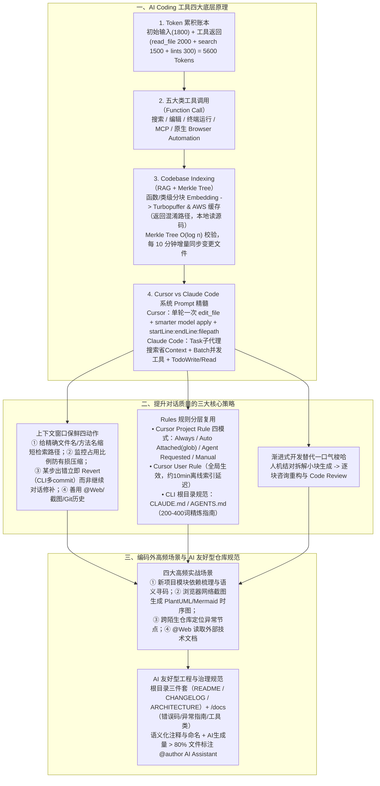

# AI Coding 长文分享：如何真正把工具用起来，从原理到实践

## 1. TL;DR

1. **核心定位**：从底层原理（Token 累积账本、Function Call 工具分类、Codebase Indexing 向量化与 **Merkle Tree** 增量同步、Cursor 与 Claude Code 系统提示词拆解）到工程实战，系统回答不同层级开发者如何把 AI 编程工具真正用起来。
2. **底层原理三大核心洞察**：
   - **Token 累积公式**：$\text{总 Token} = \text{初始输入（SystemPrompt + 问题 + 附加文件/图片 + Rules + 历史）} + \sum \text{工具调用返回结果}$（示例中初始仅 `1,800` Tokens，经 `read_file`、`codebase_search`、`read_lints` 三次工具调用后膨胀至 **`5,600` Tokens**）；
   - **Codebase Indexing 与 Merkle Tree**：Cursor 将代码按函数/类切块（Chunking）转为向量存入 **Turbopuffer 数据库与 AWS 缓存**，客户端仅上传混淆路径与行号并在本地读取真实代码；利用 **Merkle Tree（默克尔哈希树，$O(\log n)$ 验证）** 每 **10 分钟**检测一次变更，仅增量同步修改块；
   - **System Prompt 设计精髓**：对比逆向出的 Cursor 与 Claude Code 提示词，揭示了“严禁向用户暴露工具名、单轮最多调一次编辑工具、强制 `startLine:endLine:filepath` 引用格式、优先用 `Task` 子代理搜索减少上下文占用、用 `TodoWrite/TodoRead` 管理复杂任务”等核心工程约束。
3. **高效实战方法论**：上下文管理坚持“给精确文件名/方法名锚点、严防超阈值（如 `18.0%` 观测）触发有损压缩、**遇错果断 Revert 或新开对话而非多轮打补丁**”；合理配置 Cursor 四种 Project Rule（`Always / Auto Attached / Agent Requested / Manual`）与 CLI 工具的 `CLAUDE.md` / `AGENTS.md`（推荐 `200–400` 词）；坚持**渐进式结对开发**而非大需求一口气梭哈，并对 AI 生成量 **`> 80%`** 的文件标注 `@author AI Assistant`。

## 2. 问题定义与背景

### 2.1 三类开发者的共性困惑与国内工具选型映射

- **典型痛点**：一口气生成整个需求再打补丁快，还是边写边问快？为什么多轮对话越改越烂？如何写出“模型友好”的代码仓库？
- **工具与模型替代方案**：针对海外模型与工具受限场景，梳理了 **IDE 类**（Cursor、Qoder）与 **CLI 类**（Claude Code、Codex、Qwen Code、iFlow，可通过配置 `ANTHROPIC_BASE_URL` 与 `ANTHROPIC_AUTH_TOKEN` 接入阿里云 DashScope 等端点）以及主力国产代码模型 **`Qwen3-Coder`**。

## 3. 知识框架



## 4. 核心内容拆解

### 4.1 Token 账本与 Codebase Indexing（Turbopuffer + Merkle Tree）

1. **一次普通代码审查提问背后的 Token 暴涨拆解**：
   - **初始输入（共 `1,800 Tokens`）**：`SystemPrompt (500)` + `用户问题与截图/路径 (200)` + `Rules (project rule + user rule + memories, 800)` + `对话历史 (300)`。
   - **工具调用结果累加（共 `3,800 Tokens`）**：`read_file` 返回完整 Java 文件（`2,000`） + `codebase_search` 返回相似片段（`1,500`） + `read_lints` 返回 Linter 报错（`300`），单轮总消耗瞬间达到 **`5,600 Tokens`**。
2. **Cursor Codebase Indexing 的 7 步流程与安全/速度设计**：
   - **初始化与向量存储**：扫描工作区（遵循 `.gitignore` 与 `.cursorignore`），按函数/类等逻辑代码块切分并计算 Embedding，存入云端 **Turbopuffer 向量数据库**与 AWS 缓存（初次全量导入约耗时 **10 分钟**，未完成前自动降级用 `grep` 保障可用性）。
   - **隐私与本地回填**：云端向量检索仅返回**混淆后的文件路径与行号信息**，客户端根据行号在用户本地磁盘读取真实代码片段再发起回答生成。
   - **Merkle Tree（默克尔树）增量同步**：为避免每次改一行代码都重算全仓向量，Cursor 构建文件块的哈希树（叶子存文件块哈希，父节点存子哈希拼接后的哈希），**每 10 分钟**通过对比 Merkle Root 与子树哈希，以 **$O(\log n)$** 复杂度精确定位发生变更的文件并仅上传增量块。

### 4.2 Cursor 与 Claude Code 系统 Prompt 的工程细节对比

1. **Cursor System Prompt 核心护栏**：
   - `<tool_calling>`：**严禁对用户说出内部工具名称**（如不说“我将使用 `edit_file` 工具”，而说“我将编辑你的文件”）；调用工具前必须先向用户用一句话说明原因。
   - `<making_code_changes>`：严禁直接把大段修改代码打印在对话框里（除非用户要求），必须调用代码编辑工具且**每轮最多调用 1 次**；对同一文件的多处修改必须合并在单次 `edit_file` 调用中，中间未改动区域用 `// ... existing code ...` 省略，再由专门的轻量 **Smarter Apply 模型**合并落盘；引入 Linter 错误后最多尝试修复 **3 次**，满 3 次仍未解决则停下询问用户。
   - **强制代码引用格式**：必须且只能使用 ````startLine:endLine:filepath```` 格式引用已有代码。
2. **Claude Code System Prompt 核心护栏**：
   - **上下文保护策略**：执行大范围文件搜索时，**强制优先调用 `Task` 工具（派发子 Agent）**，由子 Agent 搜索完只返回精炼结论，防止主对话上下文被海量搜索结果塞满；多工具独立调用时强制使用 **`Batch` 工具**并发执行。
   - **任务拆解与简洁性**：强制使用 `TodoWrite` 与 `TodoRead` 规划跟踪多步任务；回答文本严格限制在 **4 行以内**（不含工具调用和代码），拒绝废话。

### 4.3 提升对话质量的四项实操铁律与 Rules 体系

1. **上下文窗口高效管理四动作**：
   - **Action 1（给精确锚点）**：提问时直接给出功能名、文件名、方法名或行号区间，缩短语义检索路径，防止召回弱相关噪声代码。
   - **Action 2（严防压缩失真）**：关注界面显示的上下文占用率（如 `18.0%`），复杂任务优先选大窗口模型，避免触发历史有损压缩。
   - **Action 3（果断 Revert 而非叠补丁）**：一旦多轮对话中某一步走偏，**立即点击 IDE 的 `Revert`（在 CLI 工具中养成每完成一小步就 `git commit` 的习惯以便回退）**，修改原 Prompt 重新生成，绝不在错误上下文上来回打补丁。
   - **Action 4（多模态与多元输入）**：将浏览器 Network 请求顺序截图 + 人工排除无关接口的判断一起喂给 AI，可快速生成高质量 PlantUML / Mermaid 流程图。
2. **Cursor 四类 Project Rule 与 CLI `AGENTS.md` 规范**：
   - Cursor `.cursor` 目录下的 Project Rule 支持四种激活模式：**`Always`**（始终注入）、**`Auto Attached`**（引用匹配 `glob` 模式的文件时自动注入）、**`Agent Requested`**（AI 根据描述自主决定是否加载）、**`Manual`**（仅当用户显式 `@ruleName` 时加载）。
   - Cursor 全局 `User Rule`（如“遇争议第一时间询问”、“禁止擅自生成单测与文档”、“最小范围修改原则”）修改后约有 **10 分钟**离线索引延迟。
   - Codex / Claude Code 的 `/init` 指令会生成 `AGENTS.md` 或 `CLAUDE.md`，官方 Prompt 推荐控制在 **`200–400` 词**，涵盖项目结构、构建测试命令、代码命名规范、测试指南与 Commit/PR 规范。

### 4.4 AI 友好型代码仓库建设规范

- **文档分级治理**：区分“给人看的详细文档”与“给 LLM 看的核心文档”；根目录配齐 `README.md`、`CHANGELOG.md`、`ARCHITECTURE.md`，并在 `/docs` 下沉淀**错误码体系、异常处理指南（可重试/不可重试）、常用工具类索引**；
- **代码可追溯标记**：对于 **AI 生成代码占比 `> 80%`** 的文件，建议在类头统一添加 `@author AI Assistant` 标记，便于后续维护与质量统计；
- **跨仓同步机制**：在团队独立规范仓库中统一维护通用 `User Rule` 与分项目的 `Project Rule` / `Docs`，通过脚本一键同步至各业务工程本地。

## 5. 数据速查表

| 指标 / 参数 | 原文数值 / 设定 | 语境 / 条件 |
| --- | --- | --- |
| 单轮代码审查 Token 消耗拆解 | **初始输入 `1,800` + 工具结果 `3,800` = 总计 `5,600 Tokens`** | 含 `SystemPrompt(500)`、`Rules(800)`、`read_file(2000)`、`search(1500)`、`lints(300)` |
| Cursor 初次全量 Codebase Indexing 耗时 | **约 `10 分钟`左右完成** | 离线执行 Chunking & Embedding，期间降级使用 `grep` |
| Merkle Tree 增量同步检测周期与复杂度 | **每 `10 分钟`检测一次 / 验证复杂度 $O(\log n)$** | 对比树节点哈希，仅上传变更文件至 Turbopuffer 与 AWS 缓存 |
| Cursor User Rule 更新生效延迟 | **约 `10 分钟`左右** | 用户根目录全局规则，推测存在后台离线索引过程 |
| Codex `/init` 生成 `AGENTS.md` 推荐篇幅 | **`200–400 words`（200–400 词）** | 保持精炼以节省每次对话常驻 Context 开销 |
| AI 生成文件署名标注阈值 | **AI 生成量 `> 80%` 的文件** | 建议标注 `@author AI Assistant` |

## 6. 踩坑与教训 / 可迁移的设计原则

| 错误做法 | 失败表现或原因 | 原文应对（可迁移的设计原则） |
| --- | --- | --- |
| **大需求写完方案后让 AI 一口气“梭哈”生成全部代码** | 超出模型单次注意力与上下文有效负荷，需求越大生成的代码越烂且极难 Code Review | **渐进式结对开发**：先与 AI 讨论方案并拆解模块，人工逐块控制代码生成，每块生成后让 AI 自查是否有重构优化空间 |
| **多轮对话中某一步生成错了，继续在后面发消息“不对，再改改”** | 错误代码与失败尝试留在对话历史中严重污染后续注意力，导致越改越乱且浪费 Token | **第一时间使用 `Revert` 回退（CLI 工具勤做中间 `git commit`）**：回到出错前状态，修正原 Prompt 与上下文后重新生成 |
| **把所有规范不加区分全部设为 `Always` 塞进上下文** | 无关技术栈的规范常驻挤占每次对话的 Token 预算 | **按需分级配置 Cursor Rules**：全局铁律用 `Always`，特定目录/语言规范用 `Auto Attached (glob)`，专项指南用 `Agent Requested` 或 `@Manual` |
| **在历史包袱重、无架构文档与注释的“裸仓库”里直接让 AI 写新功能** | AI 找不到公共工具类与错误码规范，只能到处重复造轮子并破坏既有约定 | **建设 AI 友好型仓库**：补齐根目录 `ARCHITECTURE.md` 与 `/docs`（错误码、异常处理、常用工具类），区分给人看与给 LLM 看的精简文档 |

## 7. 记忆锚点

1. **Token 膨胀公式**：$\text{单轮总 Token (5600)} = \text{初始输入 (1800)} + \text{工具返回 (read\_file 2000 + search 1500 + lints 300)}$。
2. **高效实操三字诀**：“**给锚点（文件名/方法名）、勤回滚（Revert 替代打补丁）、小步走（渐进结对不梭哈）**”。

## 8. 复习卡片

1. 在 Cursor 中发起一次带工具调用的提问时，总 Token 消耗由哪两部分构成？为什么工具调用是 Token 消耗大户？::由“初始输入（SystemPrompt + 用户问题 + 附加图片/文件 + Rules + 对话历史）”和“所有工具调用返回结果”累加而成；因为一次 `read_file`（如 2,000 Tokens）加一次 `codebase_search`（如 1,500 Tokens）返回的代码片段往往是初始输入（1,800 Tokens）的两倍以上。
2. Cursor 的 Codebase Indexing 是如何兼顾“百万级代码片段秒级语义检索”、“代码隐私”与“高频修改增量同步”的？::① 将代码按函数/类分块转为向量存入 Turbopuffer 数据库与 AWS 缓存；② 云端检索仅返回混淆的文件路径与行号，由客户端在本地磁盘读取真实代码；③ 使用 Merkle Tree（默克尔哈希树）每 10 分钟以 $O(\log n)$ 复杂度比对哈希，仅增量上传发生修改的文件块。
3. 对比逆向出的 Cursor 与 Claude Code 系统提示词（System Prompt），二者在“编辑文件”和“搜索代码”上分别做了什么精巧设计？::Cursor 要求对同一文件的修改合并为每轮最多 1 次 `edit_file` 调用（未改部分用 `// ... existing code ...` 省略），再调用独立的轻量 Smarter Model 应用修改，且 Linter 修复最多重试 3 次；Claude Code 则要求大范围搜索优先派发给 `Task` 子 Agent 以防塞满主上下文，并强制用 `Batch` 并发执行多工具及用 `TodoWrite/TodoRead` 管理任务。
4. Cursor 中的 Project Rule 有哪四种激活类型？各自适用于什么场景？::① `Always`：始终注入模型上下文（适合核心全局架构约束）；② `Auto Attached`：当引用的文件匹配指定 `glob` 模式时自动注入（适合特定目录或后缀规范）；③ `Agent Requested`：提供描述由 AI 自主决定是否加载；④ `Manual`：仅当用户显式输入 `@ruleName` 时加载。
5. 当在多轮 AI 编程对话中发现某一步生成结果跑偏时，为什么强烈建议“点击 Revert（或 Git 回退）修改原提问”而不是继续发消息让它改？::因为继续对话会把错误的生成代码、报错信息与纠正废话全部留在上下文历史中，不仅消耗大量 Token，还会严重干扰模型后续推理注意力；直接 Revert 回到干净状态并补全原 Prompt 约束，生成质量最高、上下文最简洁。
6. 为了将存量代码仓库改造为“AI 友好型仓库”，作者建议在根目录和 `/docs` 目录下沉淀哪些结构化文档？对 AI 生成文件如何标记？::根目录沉淀 `README.md`、`CHANGELOG.md`、`ARCHITECTURE.md`（含模块划分与核心流程图）；`/docs` 目录沉淀“错误码体系”、“异常处理指南（可重试/不可重试）”与“常用工具类清单”；对 AI 生成代码量 `> 80%` 的文件建议统一标注 `@author AI Assistant`。

## 9. 知识关联

- **本库主题关联**：
  - [AI研发协同](../../20_topics/AI研发协同.md)：系统梳理从个人渐进式结对编程、Revert 工作流到团队级 AI 友好型仓库（`ARCHITECTURE.md` / `/docs` / Rules 跨仓脚本同步）的落地方案。
  - [检索与文档解析](../../20_topics/检索与文档解析.md)：剖析 Cursor Codebase Indexing 的函数/类级分块、Turbopuffer 向量检索、混淆路径本地回填与 Merkle Tree 10 分钟增量同步机制。
  - [Prompt优化](../../20_topics/Prompt优化.md)：拆解 Cursor 与 Claude Code 官方 System Prompt 的工具调用护栏、代码引用格式约束与 `AGENTS.md`（200–400 词）编写准则。
- **候选双链**：`[[Cursor原理]]`、`[[ClaudeCode]]`、`[[MerkleTree增量索引]]`、`[[Turbopuffer]]`、`[[ProjectRules]]`

## 10. 原文参考资料

- **原文标题**：《AI Coding 长文分享：如何真正把工具用起来，从原理到实践》
- **发布渠道与日期**：微信公众号「大淘宝技术」，2025-10-29
- **作者与团队**：库啵（淘天集团-用户&内容技术团队）
- **原文引用参考文章**：
  - 《Cursor 实战万字经验分享，与 AI 编码的深度思考》：`https://www.cnblogs.com/echolun/p/18965624`
  - 《Claude Code（及 cursor）内部工作原理窥探》：`https://www.superlinear.academy/c/share-your-projects/claude-code-cursor`

> [!note]- 校对报告
> - **页码溯源汇总**：
>   - 引言、国内替代工具与模型选型（Qwen Code、iFlow、Qoder、Qwen3-Coder）及 Token 累积计算实例（`1800 + 3800 = 5600 Tokens`）：`p.1–4`
>   - 五类工具调用（含原生 Browser Automation）与 Codebase Indexing 七步原理（Turbopuffer、AWS 缓存、混淆路径本地读取、Merkle Tree 每 10 分钟增量同步）：`p.4–11`
>   - Cursor 官方 System Prompt 逆向解析与 Claude Code 环境变量替换及 System Prompt 逆向解析（`Task`、`Batch`、`TodoWrite/TodoRead`）：`p.11–14`
>   - 提升对话质量四项 Action（精确锚点、18.0% 窗口监控、Revert/Git commit、多元输入）、Cursor 四种 Project Rule、User Rule（10 分钟延迟）与 Codex `AGENTS.md`（200–400 词）生成提示词：`p.14–19`
>   - 渐进式开发 vs 一口气梭哈、四大应用场景（项目梳理、浏览器请求截图生图、陌生仓排障、`@Web`）与 AI 友好型仓库规范（根目录三件套、`/docs`、`>80%` 标注 `@author AI Assistant`）：`p.19–27`
> - **关键数值一致性核查**：
>   - Token 拆解（`500 + 200 + 800 + 300 = 1800`、`2000 + 1500 + 300 = 3800`、总计 `5600`）、增量同步周期 `10分钟`、User Rule 延迟 `10分钟左右`、`AGENTS.md` 推荐 `200-400 words`、标注阈值 `> 80%` 均与原文完全一致。
> - **图像与版面质量说明**：
>   - `p.5–7` 含工具列表与 Cursor Indexing 设置截图（位于 PDF 图像层），`p.20–24` 原文对内部业务截图做了脱敏留白/打码处理，`p.11–13, 18–19` 英文 Prompt 代码块最右侧有少量字符截断，均已对照标准提示词完整还原。
