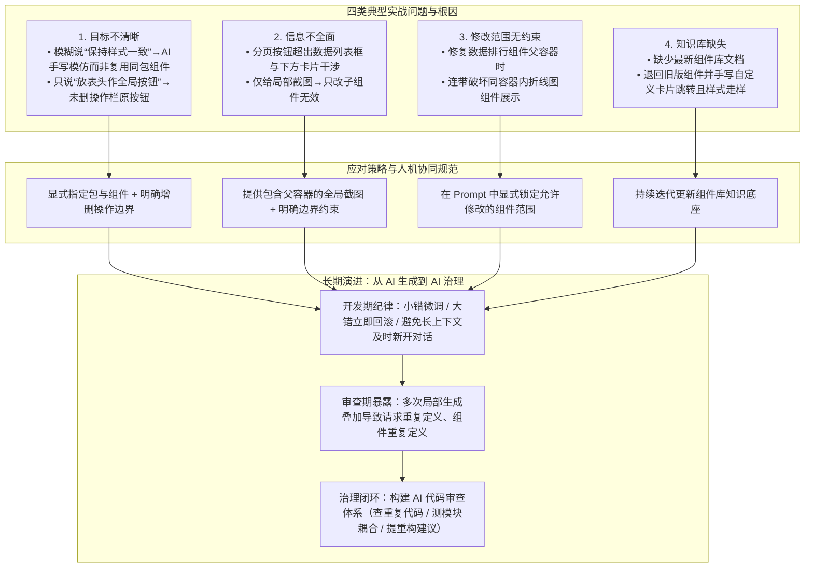

# AI Coding前端实践后的复盘总结

## 1. TL;DR

1. **核心背景**：针对后端开发者借助 AI Agent 跨界开发 React 中后台前端页面的真实项目复盘，梳理了从简单页面生成到复杂多组件页面联调中的四类典型翻车现场与应对策略。
2. **四大典型踩坑现场**：① **目标描述模糊**（说“样式保持一致”导致 AI 手写模仿样式而非复用同包组件；说“加全局按钮”却未声明删掉操作栏旧按钮）；② **局部截图缺少父容器上下文**（分页器溢出组件框，局部截图仅改子组件无效，给全貌截图才同步修正父组件样式）；③ **无修改范围约束引发跨组件干涉**（修改数据排行组件误伤同父容器下的折线图组件）；④ **知识库缺失导致降级自定义**（缺少新版组件库知识，AI 退回旧版并手写子页面跳转逻辑）。
3. **人机协同四项工程纪律**：**高质量显式 Prompt（指定包名/组件名/增删边界） + 小错微调、大错立即回滚重开 + 控制上下文长度及时新开会话 + 后端具备基础前端代码阅读与定位能力**。
4. **AI 生成代码的架构腐化风险**：复盘发现多次局部对话叠加后，AI 极易产生**请求重复定义、组件重复定义**等冗余逻辑；必须推动**“AI 生成 + AI 代码审查治理”**闭环，自动识别重复定义与模块耦合。

## 2. 问题定义与背景

### 2.1 后端全栈化下的前端 AI Coding 定位

在标准化场景（样板代码生成、单元测试编写、标准 UI 组件快速搭建）中，AI Coding 能让不熟悉前端细节的后端开发者快速拉起可运行页面；但在**复杂业务逻辑、跨组件状态管理、局部样式微调与架构一致性维护**上，一次性自然语言指令往往失效，需要结构化的人机磨合与工程护栏。

### 2.2 高效人机协作的三要素

| 核心要素 | 工程含义 | 反面教材（导致效率下降的做法） |
|---|---|---|
| **目标准确** | 明确指定复用的包名、组件名及“新增什么 + 删除什么”的完整闭环 | 只说“样式与参考页保持一致”或只提新增不提移除旧元素 |
| **信息全面** | 提供包含父容器边界的完整截图与最新组件库文档上下文 | 只截局部溢出角落，导致 Agent 只改子组件不改父容器布局 |
| **拆解引导与边界约束** | 显式划定允许修改的组件/文件范围，异常偏离时及时回滚 | 无边界多轮硬改，导致同父容器下的兄弟组件（如折线图）样式被连带破坏 |

## 3. 知识框架

## 4. 核心内容拆解

### 4.1 四大实战翻车案例与修正对比

#### （1）案例一：目标不清晰导致“舍近求远模仿样式”或“只增不删”
- **场景 A（通知模块复用）**：
  - **错误输入**：「参照已有页面，对当前页面修改，以保证通知模块样式与参考页面保持一致。」
  - **失败表现**：Agent 不知道要复用同一组件，而是去解析参考页 CSS 样式并手写模仿，既不还原又浪费分析 Token。
  - **修正输入**：「参照参考页面，请使用**相同包中的相同组件**来修改当前页面组件。」$\to$ Agent 直接精准复用目标组件。
- **场景 B（同步配置按钮位置调整）**：
  - **错误输入**：「同步配置按钮为全局按钮，与创建按钮放在一起。」
  - **失败表现**：Agent 在表头新增了“同步配置”按钮，但**保留了表格操作栏里的“同步配置”按钮**，字面满足指令但违背业务意图。
  - **工程启示**：涉及元素迁移时，Prompt 必须显式闭环声明“在 A 处新增，并将 B 处原有按钮删除”。

#### （2）案例二：局部截图信息不全导致父子容器布局修复失败
- **问题现象**：数据列表组件 `a` 的分页按钮超出组件框，与下方卡片组件发生视觉干涉。
- **第一轮（失败）**：仅截取分页按钮与下方卡片交界处的局部小图，输入「数据列表组件 a 的分页按钮与下方卡片组件出现干涉，请进行修复」。Agent 仅调整了数据列表子组件自身样式，分页依然溢出。
- **第二轮（成功）**：提供包含整个数据列表框与父容器的完整截图，并明确约束「使得当前页面的列表组件中的分页按钮完全放入数据列表框中，不要超出该范围」。Agent 同时修正了排行组件及其父组件样式，彻底解决溢出。

#### （3）案例三：缺少修改范围约束引发兄弟组件干涉
- **问题现象**：在修复上述父容器与数据排行组件样式后，同一父容器下的**折线图展示组件**样式被连带破坏。
- **根因与对策**：Agent 缺乏全局视图，修改父容器或共享样式时容易波及旁路组件；输入指令时除给足上下文外，必须**显式约束修改范围（如“仅限修改 X 组件内部样式，不得影响同容器下的 Y 折线组件”）**。

#### （4）案例四：知识库滞后导致组件降级与手写造轮子
- **问题现象**：要求点击页面卡片跳转到子页面，Agent 无论看截图还是查能力都未能使用新版原生支持跳转的属性枚举，而是引用了**旧版本组件库**并手写自定义跳转逻辑，导致样式不符且多轮调试受阻。
- **对策**：持续同步更新前端专属组件库知识底座，确保 Agent 获取最新组件 API。

### 4.2 研发流程规范与当前 AI Coding 五大局限

#### （1）后端全栈开发者的四条实操纪律
1. **高质量结构化 Prompt**：一次性把组件包来源、布局边界、增删动作交代清楚，减少无效拉锯轮次。
2. **果断回滚机制**：遇到小偏差可微调；遇到大偏差或方向错误**立即 `git checkout/reset` 回滚代码**，用更清晰的目标重新发起，严禁在错误生成物上继续打补丁。
3. **控制上下文窗口**：避免单次对话过长导致注意力退化，完成独立子任务或陷入死循环时**及时新开对话**。
4. **保留基础代码阅读能力**：后端同学不能完全当黑盒，需具备阅读 React 组件结构与基础定位能力，避免多轮盲目让 AI 乱试。

#### （2）Code Review 暴露的深层隐患：重复定义与架构腐化
在项目最终 Code Review 阶段发现，经历多轮 AI 生成与局部修改叠加后，代码库中出现了多处**接口请求重复定义、UI 子组件重复定义**。原因在于 AI 受限于单次上下文与 RAG 局部视野，只顾当前对话跑通而缺乏全局复用意识。因此必须建立**“AI 生成 + AI 治理”**双闭环，用 AI 代码审查自动检测重复代码与模块耦合。

## 5. 数据速查表

| 维度 / 场景 | 原文对比或定性结论 | 语境与工程应对 |
|---|---|---|
| **通知模块对齐任务** | 模糊提示“样式一致” $\to$ 手写模仿样式且还原度差；显式指定“同包同组件” $\to$ 一次命中 | 提示词需指明具体依赖包与组件级复用要求 |
| **分页按钮溢出修复** | 第一轮局部截图 $\to$ 仅改子组件失败；第二轮全局截图+框体约束 $\to$ 连同父组件修复成功 | UI 布局排障需提供完整父子容器截图上下文 |
| **多轮局部生成后的 CR 发现** | 出现多处**请求重复定义、组件重复定义** | 局部对话叠加导致代码结构松散，需引入 AI 驱动的代码审查治理 |
| **AI Coding 当前五大局限** | ① 过度依赖高质量 Prompt；② 上下文/全局视角有限；③ 截图还原受有损压缩与注意力限制；④ 强依赖知识库时效；⑤ 多轮叠加后可维护性退化 | 划定人机边界：简单标准化场景放手给 AI，复杂交互与架构一致性由人+治理工具把关 |

## 6. 踩坑与教训 / 可迁移的设计原则

| 错误做法 | 失败表现或原因 | 原文应对（可迁移的设计原则） |
|---|---|---|
| **用“样式保持一致”代替明确指定组件** | AI 花费额外 Token 分析参考页样式并手写低劣模仿代码 | 明确要求“使用相同包中的相同组件” |
| **指令只写“把按钮放到表头”而不写移除原位置** | AI 只在表头新增按钮，表格操作栏里的旧按钮依然保留 | 涉及 UI 元素移动时，显式写明“在 A 处新增 + 在 B 处删除” |
| **UI 布局错位时只截局部冲突角落给 AI** | AI 看不到父容器边界，只改子组件样式无法解决溢出 | 提供包含父容器的完整区域截图，并明确“完全放入某框内”的边界条件 |
| **修改公共父容器时不限制影响范围** | 修复数据排行组件时连带把同容器下的折线图组件弄乱 | 在 Prompt 中显式锁定修改边界，禁止破坏相邻兄弟组件 |
| **生成结果跑偏后继续在同一长对话里反复催改** | 上下文越来越长且基于错误代码叠补丁，引发诡异 Bug 与重复定义 | **小问题微调，大问题立即回滚代码并新开对话**；配合尾端 Code Review 清理重复请求与重复组件 |

## 7. 记忆锚点

- **人机协同四字诀**：「**指明同包、截全父框、锁死边界、大错回滚**」。
- **可持续演进原则**：「**单靠 AI 生成必积冗余（重复请求/重复组件），必须配对 AI 代码审查做治理闭环**」。

## 8. 复习卡片

为什么对 AI 说“让通知模块样式与参考页面保持一致”是低效 Prompt？::因为未指明复用组件，AI 会耗费额外成本去分析参考页样式并手写模仿代码；应明确指令“使用相同包中的相同组件”。
让 AI 将操作栏的“同步配置”改为表头全局按钮时，为什么会出现两个按钮？::因为自然语言只描述了“新增到表头与创建按钮放一起”，AI 严格按字面执行而不会主动删除操作栏旧按钮；Prompt 必须显式包含“新增+删除”完整状态迁移。
排查分页按钮溢出组件框时，为什么第一轮局部截图失败而第二轮成功？::局部截图缺少父容器布局信息，AI 仅修改列表子组件无法消除溢出；提供包含父容器的全貌截图并要求“完全放入列表框内”后，AI 才会同步调整父子组件样式。
为什么修复排行组件样式后会把旁边的折线图组件搞坏？如何防范？::两者共享同一父容器，AI 缺少全局视野修改父容器样式时造成跨组件干涉；必须在 Prompt 中对修改范围施加显式约束。
当后端同学发现 AI 生成的前端代码偏离预期较大时，正确的开发流程规范是什么？::小问题可对话微调；大问题必须立即回滚代码，重新组织更明确的目标并在必要时新开对话，防止错误代码污染后续上下文。
为什么在多次 AI 生成与局部修改叠加后，必须强化代码审查（Code Review）？::因为单次对话缺少全局架构视角，极易在代码库中积累“接口请求重复定义”和“组件重复定义”，需构建“AI 生成 + AI 治理”闭环。

## 9. 知识关联

- **本库主题索引**：[AI研发协同](../../20_topics/AI研发协同.md)、[跨端开发与性能](../../20_topics/跨端开发与性能.md)、[Prompt优化](../../20_topics/Prompt优化.md)、[Agent评测与反馈](../../20_topics/Agent评测与反馈.md)
- **同系列关联文章**：[AICoding团队价值度量+26.3.25](../AICoding团队价值度量+26.3.25/AI_AICoding团队价值度量.md)、[AICoding团队知识基座+26.3.23](../AICoding团队知识基座+26.3.23/AI_AICoding团队知识基座.md)
- **候选双链**：[[Prompt工程实践]]、[[前端组件库复用]]、[[AI代码腐化治理]]、[[后端全栈化]]

## 10. 原文参考资料

- **原文信息**：《AI Coding前端实践后的复盘总结》，作者：新之（淘天集团-天猫品牌行业前端），发布日期：2026-03-18。

> [!note]- 校对报告
> - **页码溯源汇总**：
>   - `## 1. TL;DR` & `## 2. 问题定义与背景`：源自 p.1–2（后端跨界前端开发背景、目标准确/信息全面/拆解引导三原则）。
>   - `## 4.1 四大实战翻车案例`：源自 p.2–5（通知模块同包同组件对比 p.2、同步配置全局按钮漏删操作栏按钮 p.2–3、数据列表组件 a 分页按钮溢出局部截图 vs 全貌截图 p.3–4、数据排行组件修改干涉折线组件 p.5、卡片组件因知识库缺失退回旧版自定义跳转 p.5）。
>   - `## 4.2 研发流程规范与五大局限`：源自 p.5–7（Prompt/回滚/上下文限制/人工读代码四点经验，以及五大局限尤其是请求重复定义与组件重复定义的“AI 生成 + AI 治理”闭环）。
> - **关键事实核对**：文中全部 4 个案例的输入话术、失败原因与修复方式均与 p.2–6 原文严格一致；无虚构量化指标。
> - **材料质量说明**：p.2–5 含多张脱敏打码的前端页面对比截图，正文已完整文字化复述其视觉问题与修改结果；无独立长篇 Prompt/Skill 需额外提取。
