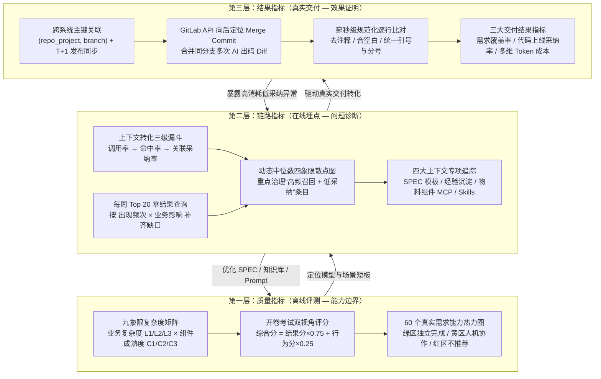

# 拒绝“感觉有效”：用数据证明 AI Coding 的真实团队价值【天猫AI Coding实践系列】

## 1. TL;DR

1. **核心痛点**：当 AI Coding 从个人尝鲜走向团队规模化落地（如近 200 名后端工程师零前端基础的“后端全栈”试点），凭感觉的评价陷入**幸存者偏差、归因错误与个体差异**；而业界方案（Copilot Metrics 止于 IDE 内接受补全、SWE-bench 只评后端二元测试结果）无法闭环回答“能力边界在哪、过程卡在哪、最终上线贡献多少”。
2. **三层相互校验度量体系**：构建**质量指标（离线评测）+ 链路指标（在线埋点）+ 结果指标（真实交付）**三层闭环，打通“发现问题 → 定位原因 → 验证效果”。
3. **质量指标（复杂度矩阵 + 开卷考试双评分）**：针对中后台前端场景建立 **业务复杂度（L1 标准化 / L2 有联动 / L3 复杂交互）× 组件成熟度（C1 完善 / C2 部分 / C3 缺失）** 九象限矩阵；评分融合 **结果分（75%，`refAnswers + testCases`）+ 行为分（25%，是否调用 MCP 与查阅文档）**，识别“不查资料却碰巧写对”的高风险隐患。
4. **链路指标（调用→命中→采纳漏斗 + 四象限散点）**：放弃不可行的“单条软内容显式引用追踪”，改用会话级关联分析与动态中位数四象限图定位“高频低效”知识；优化后关联代码采纳率从 **18% 提升至 35%**，L2-C2 象限得分从 **55 分提升至 70 分**。
5. **结果指标（跨系统关联 + 规范化 Diff 比对）**：以 `(repo_project, branch)` 关联 AI 任务与迭代需求，向后定位 Merge Commit，将同一分支多次 AI 出码 Diff 合并后经去注释、合空白、统一引号分号的毫秒级规范化逐行比对计算真实上线代码采纳率，并按 Task / 迭代 / 需求多维聚合 Token ROI。

## 2. 问题定义与背景

### 2.1 为什么“感觉有效”在团队落地时失灵

2025 年 11 月起，天猫品牌行业前端在多个业务域启动“后端全栈”试点，让零前端基础的后端工程师借助 AI 独立交付中后台前端需求。团队规模化推广时面临三大归因陷阱：
- **幸存者偏差**：成功案例被反复宣传，失败尝试无人统计。
- **归因错误**：交付变快究竟是 AI 赋能还是需求本身简单，缺乏基线对照。
- **个体差异**：少数超级个体拉高均值（例如平均提效 30% 实为 3 人提效 100%、7 人几乎无变化）。

### 2.2 核心概念与业界方案对比

| 方案 / 概念 | 追踪终点与评判方式 | 核心局限或本文改进 |
|---|---|---|
| **Copilot Metrics** | 止于 IDE 内“接受代码补全” | 无法验证接受的代码是否被删改、是否真正合并上线 |
| **SWE-bench** | 2294 个 Python 后端 GitHub Issue，单元测试二元判定 | 不适配前端多解性（多种等价实现）、交互测试成本高、忽略 Agent 是否查阅规范的过程盲区 |
| **本文三层度量体系** | 离线 60 个真实历史需求 + 在线上下文三级漏斗 + Merge Commit 上线 Diff | 覆盖能力边界（质量）、过程诊断（链路）与交付价值（结果） |
| **行为分（Behavior Score）** | 量化 Agent 是否调用知识库 MCP、是否查阅组件文档（权重 25%） | 借鉴 OpenAI PRM（过程监督）理念，区分“稳定正确”与“碰巧正确” |

## 3. 知识框架

## 4. 核心内容拆解

### 4.1 质量指标：垂直化离线评测与九象限复杂度矩阵

#### （1）为什么一维 `pageType` 分类不够用
早期按“简单列表页、简单表单页、详情页、配置页”一维分类时，发现同样是“简单表单页”，使用标准 `Form / Input / Select` 组件时 AI 表现极佳，但遇到需自定义封装组件时表现断崖式下跌。因此引入二维正交矩阵：
- **维度一：业务复杂度（Complexity Level）**
  - **L1（标准化）**：CRUD 列表、简单表单（$\le 15$ 字段）、详情展示页、简单配置页；特征是“组件库即答案”，无复杂状态管理。
  - **L2（有联动）**：表单联动、多级筛选（省市区/类目树）、复杂表格（合并单元格、行内编辑）、审批流转；组件间有依赖与状态流转。
  - **L3（复杂交互）**：拖拽排序、画布类、虚拟滚动、富文本定制、微前端集成；超出常规组件库覆盖范围，需架构级改造。
- **维度二：组件成熟度（Component Maturity）**
  - **C1（完善）**：物料库中存在且 API 文档、使用示例、最佳实践完整。
  - **C2（部分）**：组件存在但缺少示例、文档过时或缺少特定场景指导。
  - **C3（缺失）**：物料库无对应组件，需从零开发或深度改造。

#### （2）九象限分区与业务分流
- **绿色推荐区（`L1-C1`、`L1-C2`、`L2-C1`）**：热力图得分 **85+ 分**，预期高成功率，适合 AI 独立完成。
- **黄色调试区（`L1-C3`、`L2-C2`、`L3-C1`）**：需多轮调试，建议人机协作；通过完善文档与 SPEC 可将 C2/C3 推向 C1（如 `L2-C2` 补充联动规则表与流程图后从 **55 分提升至 70 分**）。
- **红色挑战区（`L2-C3`、`L3-C2`、`L3-C3`）**：超出当前 AI 有效辅助边界，管理业务预期不盲目强推。

#### （3）“开卷考试”双评分模型
$$\text{综合得分} = \text{结果分} \times 0.75 + \text{行为分} \times 0.25$$
- **结果分（75%）**：由 LLM-as-a-Judge 依据每个用例预置的若干 `refAnswers`（参考答案点）逐项打 `0 / 0.5 / 1` 三档分，解决前端实现多解性；对数据处理或 API 调用逻辑则结合 `testCases` 客观测试加权融合。人工抽检显示 LLM 评分与人工复核一致性 **$> 90\%$**。
- **行为分（25%）**：受 OpenAI *Let's Verify Step by Step*（MATH 数据集上 PRM 78.2% vs ORM 72.4%）启发，评估 Agent 是否调用知识库 MCP 与查阅组件文档。团队对比了 `80/20`、`70/30`、`75/25` 三组权重，验证 `75/25` 在**区分度**（识别结果 1.0 但行为 0.0、综合分 0.75 的 `eval-002`“碰巧正确”样本）与**多次评测一致性**上达到最佳平衡。

### 4.2 链路指标：在线三级漏斗与上下文四象限治理

#### （1）工程取舍：为什么用会话关联采纳率替代单条显式引用
知识库返回的是软文本，强制 Agent 在代码中显式标注引用哪条知识会干扰自然生成，且缺乏线上 A/B 对照组。因此采用**会话关联分析**（命中某知识的会话最终代码采纳率）衡量上下文有效性。

#### （2）三级转化漏斗与诊断映射
- **调用率低** $\to$ Agent 不知道要查资料 $\to$ 检查 System Prompt 工具引导或在离线评测中加入行为分约束。
- **命中率低** $\to$ 调用了但无结果 $\to$ 检查组件命名对齐（如 `DatePicker` vs `Calendar`）、知识覆盖度或索引质量；每周汇总 **Top 20 零结果查询**，按 `出现频次 × 业务影响` 排序定向补齐。
- **采纳率低** $\to$ 查到了但不好用 $\to$ 用横轴“命中次数”、纵轴“关联采纳率”的**动态中位数四象限图**锁定“高频低效”条目。例如某条 `tsconfig` 知识仅写“配置 `baseUrl` 可简化导入”而无具体配置，补充 `paths` 映射规则与示例后采纳率大幅跃升；全批高频低效知识优化后关联采纳率从 **18% 提升至 35%**。

#### （3）四大上下文专项追踪
1. **SPEC 技术方案模板**：追踪列表页、表单、多场景、基础四类模板的关联采纳率。针对“基础模板”采纳率偏低、AI 常漏字段映射与状态逻辑的问题，新增**“数据流转说明”与“状态变更规则”**两个必填项后采纳率显著回升。
2. **经验沉淀知识库**：覆盖踩坑记录、编码规范、业务规则三类，核心准则是**可操作性**（给具体配置与代码而非泛泛概念）。
3. **物料组件知识库（MCP）**：提供组件查询、API 文档（Props/事件/插槽）、使用示例三类能力；重点扫描“调用 MCP 返回空结果”补齐业务组件与新组件文档。
4. **Skills 标准工作流**：当前追踪使用率与采纳率，下一版本规划引入**触发率**（符合条件场景是否触发，反映场景识别）与**完成率**（触发后是否跑完，反映工作流设计）。

### 4.3 结果指标：从 IDE 补全延伸到 Merge Commit 上线代码

#### （1）跨系统关联与多次出码合并
- **关联主键**：以 `(repo_project, branch)` 打通 AI 编码平台任务数据与内部迭代/需求系统；AI 出码后实时上报 Diff，发布记录 **T+1 同步**后定时匹配。
- **Merge Commit 定位**：发布记录中的 `repo_commit_id` 往往只是分支最后一次提交；系统通过 GitLab API 获取 commit 历史，从 `repo_commit_id` 向后查找第一个标题含 `"Merge commit"` 的提交以获取完整分支变更。
- **多次出码聚合**：将同一 `(repo_project, branch)` 下所有 AI Diff 记录合并后再与 Merge Commit Diff 比对（例如第 1 次出码 1 行、第 2 次出码 1 行、用户手写 1 行，AI 新增 2 行全部保留上线，则 AI 代码采纳率 $= 2/2 = 100\%$；若 AI 共生成 3 行、最终上线保留 2 行，则采纳率 $= 66.67\%$）。

#### （2）毫秒级规范化逐行比对算法
为消除 Prettier/ESLint 格式化引起的空格、引号、分号差异，采用纯工程化规范化比对（不依赖 AI，毫秒级完成）：
1. 预处理两边代码：**去除注释 $\to$ 合并空白字符 $\to$ 统一引号与分号风格**。
2. 逐行比对计算：
   $$\text{需求覆盖率} = \frac{\text{关联 AI 任务的需求数}}{\text{总需求数}}, \quad \text{代码采纳率} = \frac{\text{AI 生成代码被上线的行数}}{\text{AI 生成代码总行数}}$$

#### （3）多维 Token 成本聚合
基于统一网关底层调用，按 **Task 维度（单次对话效率） / 迭代维度 / 需求维度** 聚合 Token 消耗；采用**“允许重复计算”策略**（当一个 Task 关联多个需求时，各需求独立累加该 Task 的 Token），贴合产品经理核算“单需求总消耗”与排查“高消耗低采纳”异常的视角。

## 5. 数据速查表

| 指标 / 实验项 | 原文数值 | 语境 / 条件说明 |
|---|---|---|
| **离线评测集规模** | **60 个用例** | 全部来自真实历史需求，覆盖 $3 \times 3$ 九象限，经人工审核 |
| **主力模型离线评测总分对比** | **模型 A：84.9 分 vs 模型 B：57.0 分** | 差距近 28 分，热力图定位模型 B 在组件文档不完善（C2/C3）场景明显吃力 |
| **过程监督学术对照（MATH）** | **PRM 78.2% vs ORM 72.4%** | 引用 OpenAI 2023 年 5 月 *Let's Verify Step by Step* 论文 |
| **综合评分权重** | **结果分 75% + 行为分 25%** | 对比 `80/20`、`70/30`、`75/25` 后确定；金融/医疗可提行为分至 `30%–40%` |
| **LLM 评分与人工复核一致性** | **$> 90\%$** | 配合多模型交叉验证、版本基线对比与轨迹存档复盘 |
| **绿色推荐区热力图得分** | **85+ 分** | 覆盖 `L1-C1`、`L1-C2`、`L2-C1`，适合 AI 独立完成 |
| **`L2-C2` 象限专项调优提分** | **55 分 $\to$ 70 分** | 针对表单联动补充 SPEC 联动规则表/流程图 + Prompt 优化 + 知识库补充 |
| **知识库在线调用率** | **43.2%** | 在线埋点稳定调用率，整体代码采纳率初期徘徊在 50% 左右 |
| **高频低效知识优化后采纳率** | **18% $\to$ 35%** | 针对频繁召回但初期采纳率仅 20%–30% 的条目补充可操作配置与示例 |

## 6. 踩坑与教训 / 可迁移的设计原则

| 错误做法 / 常见误区 | 失败表现或原因 | 原文应对（可迁移的设计原则） |
|---|---|---|
| **仅凭“感觉挺好用”或个体均值评估团队效果** | 受幸存者偏差与少数高手极值拉动，无法回答真实上线贡献与能力边界 | 建立 **质量（离线）+ 链路（在线）+ 结果（上线 Diff）** 三层互相校验的数据闭环 |
| **用一维 `pageType`（列表/表单）划分前端评测集** | 同一表单页在标准组件与自定义组件下表现差异巨大，一维分类无法区分 | 引入 **业务复杂度（L1–L3）× 组件成熟度（C1–C3）** 九象限复杂度矩阵 |
| **离线评测只看最终代码跑通（只看结果分）** | Agent 不查文档碰巧写对（`eval-002`），进入复杂业务场景后错误率飙升 | 采用 **75% 结果分 + 25% 行为分** 的“开卷考试”评分，将工作流合规纳入稳定性预测 |
| **试图在代码中强制追踪单条知识的显式引用** | 知识为软文本，强制打标破坏 Agent 自然生成，且缺乏线上 A/B 对照 | 改用 **会话级关联分析 + 动态中位数四象限图**，聚焦治理“高频召回、低采纳”条目 |
| **直接用原始 Git Diff 或单次 commit 计算上线采纳率** | 格式化（空格/引号/分号）导致大面积误判，且漏算同分支多次出码与完整合并变更 | 通过 `(repo_project, branch)` 向后定位 **Merge Commit**，合并多次 AI Diff 后做**毫秒级规范化预处理逐行比对** |

## 7. 记忆锚点

- **三层度量闭环口诀**：「**离线九宫格定边界（75 结果 + 25 行为），在线四象限抓高频低效（调用→命中→采纳），上线 Merge Diff 算真采纳**」。
- **开卷考试铁律**：「**能跑通 $\neq$ 能力可靠；不查文档碰巧写对的 Agent，比报错停机的更危险**」。

## 8. 复习卡片

为什么 Copilot Metrics 和 SWE-bench 都不能直接拿来做企业前端 AI Coding 度量？::Copilot Metrics 止于 IDE 内接受补全，无法验证代码最终是否合并上线；SWE-bench 针对 Python 后端二元单测判定，不适配前端“一题多解”、交互测试成本高及过程合规检查需求。
中后台前端复杂度矩阵的两个正交维度及九象限分区是什么？::维度一为业务复杂度（L1 标准化 / L2 有联动 / L3 复杂交互），维度二为组件成熟度（C1 完善 / C2 部分 / C3 缺失）；绿区（L1-C1/L1-C2/L2-C1）适合独立完成，黄区（L1-C3/L2-C2/L3-C1）建议人机协作，红区（L2-C3/L3-C2/L3-C3）不推荐。
离线评测为什么要引入 25% 权重的“行为分”？::受过程监督（PRM）启发，用于识别“不查 MCP 文档却碰巧写对代码”的隐患（如 eval-002），量化评估工作方式健康度以预测复杂场景下的稳定性。
链路指标中“调用率低 / 命中率低 / 采纳率低”分别对应什么根因？::调用率低说明 Agent 不知道查资料（Prompt 引导或触发条件问题）；命中率低说明知识覆盖不足、命名不匹配或索引差；采纳率低说明召回内容缺乏可操作性或召回精度差。
为什么链路指标不直接追踪单条知识是否被采纳，而是用四象限关联分析？::知识库返回的是软文本，Agent 不一定显式标注引用，强制标注会干扰生成；因此改按会话统计“使用频率 × 关联采纳率”，用动态中位数四象限锁定“高频低效”条目。
SPEC“基础模板”早期关联采纳率偏低的原因与改进手段是什么？::早期仅含简单功能描述框架，AI 常遗漏接口字段映射和状态管理逻辑；补充“数据流转说明”和“状态变更规则”两个必填项后采纳率显著提升。
结果指标如何准确计算同一分支多次 AI 出码的最终上线代码采纳率？::以 (repo_project, branch) 为关联键，通过 GitLab API 从发布 repo_commit_id 向后找到第一个 Merge Commit，将该分支所有 AI Diff 合并后经去注释、合空白、统一引号分号的规范化逐行比对计算。
Token 成本聚合为什么要采用“允许重复计算”策略？::因为 Task 与需求存在多对多关系，产品经理关心“该需求一共消耗多少 Token”而非“该 Token 被几个需求分摊”，独立累加更契合业务 ROI 核算与高消耗低采纳异常定位。

## 9. 知识关联

- **本库主题索引**：[AI研发协同](../../20_topics/AI研发协同.md)、[Agent评测与反馈](../../20_topics/Agent评测与反馈.md)、[检索与文档解析](../../20_topics/检索与文档解析.md)、[Agent工程循环](../../20_topics/Agent工程循环.md)
- **同系列姊妹篇**：[AICoding团队知识基座+26.3.23](../AICoding团队知识基座+26.3.23/AI_AICoding团队知识基座.md)、[天猫新品AI编码实战指南下+26.5.8](../天猫新品AI编码实战指南下+26.5.8/AI_天猫新品AI编码实战指南下.md)
- **候选双链**：[[AI研发效能度量]]、[[LLM-as-a-Judge]]、[[Process Reward Model]]、[[复杂度矩阵]]、[[知识库四象限运营]]、[[规范化Diff比对]]

## 10. 原文参考资料

- **原文信息**：《拒绝“感觉有效”：用数据证明 AI Coding 的真实团队价值【天猫AI Coding实践系列】》，作者：珈文（淘天集团-天猫品牌行业前端），发布日期：2026-03-25。
- **文内提及基准与论文**：
  - GitHub Copilot Metrics
  - SWE-bench / HumanEval / Aider Benchmark
  - OpenAI (Lightman et al., Ilya Sutskever et al., 2023-05): *Let's Verify Step by Step*（Process Reward Model vs Outcome Reward Model）

> [!note]- 校对报告
> - **页码溯源汇总**：
>   - `## 1. TL;DR` & `## 2. 问题定义与背景`：源自 p.1–6（后端全栈试点背景、60 个需求评测模型 A 84.9 vs 模型 B 57.0、三大凭感觉陷阱、三层度量体系设计）。
>   - `## 4.1 质量指标`：源自 p.6–14（SWE-bench 对比表、各技术栈二维复杂度矩阵、中后台前端 L1–L3 × C1–C3 九象限、PRM 78.2% vs ORM 72.4%、75% 结果分 + 25% 行为分、`eval-001~003`、人工复核一致性 $>90\%$、L2-C2 从 55 分升至 70 分）。
>   - `## 4.2 链路指标`：源自 p.3–5、p.14–19（调用率 43.2%、高频低效知识关联采纳率从 18% 升至 35%、调用→命中→采纳三级漏斗、动态中位数四象限、SPEC 基础模板新增两个必填项、每周 Top 20 零结果查询、Skills 触发率与完成率规划）。
>   - `## 4.3 结果指标`：源自 p.19–23（`(repo_project, branch)` 跨系统关联、T+1 同步、GitLab API 向后查找 Merge Commit、毫秒级规范化比对算法、多次出码 66.67% 示例、Task/迭代/需求三维 Token 成本允许重复计算策略）。
> - **关键数值核对**：模型 A `84.9` vs 模型 B `57.0`（p.2–3）、调用率 `43.2%`（p.4）、高频低效优化后采纳率 `18% -> 35%`（p.5）、PRM `78.2%` vs ORM `72.4%`（p.11）、结果分 `75%` / 行为分 `25%`（p.11–12）、人工复核一致性 `> 90%`（p.13）、绿区 `85+` 分（p.14）、L2-C2 `55 -> 70` 分（p.14）全部与原文逐字核对一致。
> - **材料质量说明**：p.2–5、p.7、p.9、p.13–22 含数据看板、热力图与四象限散点图截图，核心结论与指标口径均已在正文文本层完整交代；全文无完整可独立提取的 Prompt 或 Skill 正文。
