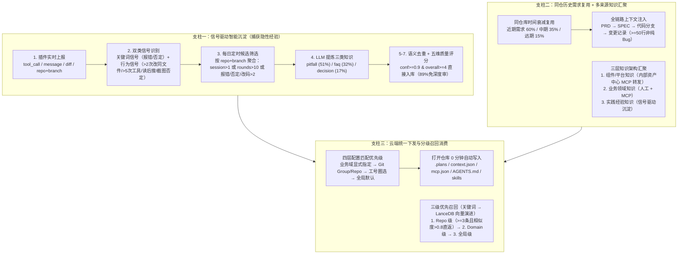

# 知识基座：让“AI 越用越懂业务”的团队经验实践【天猫AI Coding实践系列】

## 1. TL;DR

1. **核心问题**：AI Coding 催生了效率 5X–10X 的“超级个体”，但本地记忆（Cursor Memory / Claude Memory）锁在单机单仓且全量压缩混杂噪声，导致团队内同一 `ProTable` 列宽或 `tsconfig` 坑被不同后端同学反复踩（5 分钟 vs 2 小时），且 **90%+ 代码由 AI 生成但知识沉淀仍卡在人工维护瓶颈**。
2. **核心公式与三大支柱**：提出 **$\text{超级团队} = \text{超级个体} \times \text{知识共享} \times \text{智能沉淀}$**，构建 **信号驱动智能沉淀 + 云端统一配置下发 + 多来源知识汇聚** 三位一体的团队知识运营体系。
3. **信号驱动智能沉淀（用 1% 会话提炼 90% 价值）**：摒弃全量会话存储（99% 为简单问答噪声），通过关键词信号（报错/否定）与行为信号（单文件 $>2$ 次修改、工具调用 $>5$ 次、读后搜索、截图+否定）在 `(repo, branch)` 粒度筛选“有料会话”，自动提炼 `pitfall / decision / faq` 并经五维质量评估分级入库。
4. **同仓库历史需求复用与云端零配置下发**：利用同仓库需求代码相关性随时间距离衰减规律（近期 60% / 中期 35% / 远期 15%）自动注入历史 `SPEC + 代码变更 + 知识`；通过 Git Group/Repo 匹配业务域实现四层优先级云端配置下发（初次配置从 30 分钟降至 0 分钟）与物理隔离。
5. **落地实测收益**：1 个月自动捕获 **128 条**经验（`pitfall` 占 51%，平均置信度 **0.92**，**89%** 免审或抽查直接入库），在线召回率达 **85%**（`pitfall` 达 **88%**），`tsconfig` 等典型排障从 **30–60 分钟降至 1–2 分钟**，后端全栈周反馈问题从 **10+ 个降至 1–2 个**。

## 2. 问题定义与背景

### 2.1 从“超级个体”到“超级团队”的鸿沟

在天猫 3 个业务域、近 200 名后端工程师（试点覆盖近 40 人，月均交付 20–30 个前端需求）的“后端全栈”实践中，面临两大结构性矛盾：
1. **个体经验无法跨人跨仓复用**：中后台前端采用“一页一微应用、独立仓库部署”模式，单业务域有上百个仓库；本地 `.cursorrules` 或个人 Memory 无法跨人同步。
2. **知识生产速度跟不上 AI 出码速度**：AI 写代码与代码废弃速度均放大 10 倍，人工维护文档必然过期。

### 2.2 本地个人记忆 vs 团队云端知识基座对比

| 对比维度 | Cursor Memory / Claude Memory | 本文团队知识基座方案 |
|---|---|---|
| **存储位置** | 本地存储，绑定个人设备 | 云端存储，全团队共享 |
| **作用范围** | 单仓库、单用户 | 跨仓库、跨用户，按业务域物理隔离 |
| **沉淀机制** | 全量记忆压缩（保存对话摘要） | **信号驱动提取**（只捕获 1%“踩坑现场”） |
| **知识质量** | 混杂大量无价值日常问答 | 聚焦特定场景 + 边缘情况 + 官方文档未覆盖的隐性经验 |
| **知识消费者理念** | 面向人阅读（追求精简、全人工精审） | **面向 AI 消费**（先扩充基数，靠 AI 毫秒级检索筛选 + 评测验证有效性） |

## 3. 知识框架

## 4. 核心内容拆解

### 4.1 信号驱动的会话知识沉淀：8 步闭环

#### （1）界定什么是“真正的隐性经验”
并非所有问答都应入经验库：组件基础用法（如 `ProTable` 的 `columns` 配置）属于组件官方文档职责；框架标准配置（如 `strict` 含义）属于 TypeScript 官方文档。**真正的隐性经验 = 特定场景 + 边缘情况 + 官方文档不会涵盖**：
- **特定场景边缘问题**：低代码平台导出的 `code-diff` 组件名（`Button/Dialog`）属于平台自有体系，与源码仓库的 `@internal/next` 组件库不对应。
- **内部基建特殊行为**：POST 请求接口地址必须以 `/` 开头，否则被内部网关拦截。
- **多技术栈交叉问题**：`tsconfig.json` 只配 `"types": ["react"]` 会导致 `tsc --noEmit` 报错 `Cannot find type definition file for 'react-native'`，需配 `"lib": ["es2015", "dom"]` + `"skipLibCheck": true`（沉淀后排障从 30–60 分钟降至 1–2 分钟）。

#### （2）双类信号识别与候选池准入规则
- **关键词信号（消息文本）**：
  - **报错信号**：含 `error`、`exception`、`报错`、`failed`、`undefined`、`cannot read` 等。
  - **否定信号**：含 `不对`、`不是`、`错了`、`换一个`、`重新`、`还原` 等。
- **行为信号（工具调用模式）**：
  - **同一文件多次编辑**：同一 `path` 出现 $> 2$ 次 `replace_in_file`。
  - **工具调用密集**：`tool_call_count > 5`。
  - **读后搜索模式**：`read_file` 后紧跟 `search_files`（定位问题特征）。
  - **用户截图反馈**：消息含图片 + 否定表达（典型 UI 问题报告）。
- **每日定时聚合准入**：按 `仓库 + 分支` 聚合会话，满足任一条件即进入候选池：`session_count > 1`、`total_rounds > 10`、有报错、有否定、`code_change_count > 2`。

#### （3）五维质量评估与分级审核
每条提炼出的知识（`pitfall / decision / faq`）包含五维评分：**`confidence`（LLM 置信度）、`accuracy`（与原会话一致性）、`reusability`（通用性）、`completeness`（上下文完整度）、`actionability`（可执行性）**，汇总为 `overall`（1–5 分）：
- `confidence >= 0.9` 且 `overall >= 4`：**直接入库**（`review_priority: low`）。
- `0.7 <= confidence < 0.9`：人工快速确认。
- `confidence < 0.7`：深度审核（后台支持直接查看原始会话与远程代码，免 clone 仓库）。

### 4.2 三级召回策略与同仓库历史需求复用

#### （1）MCP `search-knowledge` 三级范围召回
1. **第一优先级（当前仓库 `scope = repo`）**：若找到 $\ge 3$ 条且相似度 $> 0.8$ 则直接返回。
2. **第二优先级（业务域级 `scope = domain`）**：同 Git 组织下的通用知识，与仓库级合并且仓库级排前。
3. **第三优先级（全局知识）**：仍不足时放宽过滤条件。
- **检索演进**：知识量 $< 1000$ 时采用关键词检索，正向 **Embedding + LanceDB** 向量检索迁移，以捕捉“页面白屏”与“组件渲染失败”这类无词面重合的语义关联。

#### （2）同仓库历史需求的时间距离衰减规律
同仓库共享同一套技术架构、组件体系与代码规范，需求间具备强连贯性：
- **较近需求（需求 3 $\to$ 需求 4）**：实现模式高度相似，约 **60%** 代码可直接参考。
- **中等距离需求（需求 2 $\to$ 需求 4）**：设计思路相关，约 **35%** 架构决策可借鉴。
- **较远需求（需求 1 $\to$ 需求 4）**：仅基础架构相关，约 **15%** 底层模式可参考。
- **沉淀门槛**：需求上线后定时扫描，仅沉淀**代码变更 $\ge 50$ 行、非纯 Bug 修复、有完整对话记录**的需求，将其历史 `SPEC + 代码变更 + 关联知识` 压缩注入新需求上下文。

### 4.3 云端统一下发与三层知识汇聚

#### （1）配置跟仓库走：四层优先级与四条数据通道
针对中后台“一页一微应用、一人维护几十个仓库”的痛点，通过 Client 插件、MCP Server 与管理端建立四条通道（**配置下发、知识库调用、数据上报、内容同步**）：
- **四层配置匹配优先级**：`业务域配置（显式指定） -> 仓库规则匹配（Git Group/Repo 静态匹配） -> 人群配置（按工号圈选） -> 全局默认配置`。
- **三大原则**：仓库维度（配置跟仓库走不跟人走）、增量更新（保留用户自定义内容）、自动写入（打开 VS Code 自动写入 `.plans`、`context.json`、`mcp.json`、`AGENTS.md` 与 `skills/`，初次配置从 **30 分钟降至 0 分钟**）。
- **物理隔离与分层加载**：各业务域（如用 `@internal/pro-components` 的业务域 C 与用 `@internal/supply-chain-libs` 的业务域 B）物理隔离；基础配置（`AGENTS.md`、MCP 配置）全局自动加载，专项经验（踩坑、选型）通过 MCP 按需检索并过滤低相关性结果，防止上下文污染。

#### （2）三层知识边界与多来源汇聚
- **组件/平台知识**：对接集团内部资产中心（被 **10+** 个业务域依赖），由 MCP Server 实时转发查询，组件升级时文档自动同步；对缺失文档的历史存量组件，用 LLM 输入 `组件源码 + Props 定义 + 使用示例` 自动提取后人工审核。
- **业务领域知识**：业务术语、15+ 个子市场标识码映射等，由业务域负责人维护或 API 对接。
- **实践经验知识**：信号驱动沉淀，定位为**“上游缺陷发现机制”**——若某组件基础用法频繁出现在经验库，说明上游组件文档缺失，应反向推动组件方补齐文档而非堆积在经验库。

## 5. 数据速查表

| 指标 / 维度 | 原文数值 | 语境 / 条件说明 |
|---|---|---|
| **研发背景规模** | **3 个业务域、近 200 名后端工程师** | 试点覆盖近 40 名后端同学，月均交付 20–30 个前端需求 |
| **超级个体效率倍数** | **普通开发者的 5X 甚至 10X** | 具备个人方法论、工作流与 Skills 沉淀 |
| **有价值会话占比洞察** | **约 1% 会话藏着真正知识** | 99% 会话为“帮我写个按钮”等简单问答 |
| **候选会话准入阈值** | `session > 1` 或 `rounds > 10` 或 `code_change > 2` | 或含报错/否定信号；单文件修改 $>2$ 次、工具调用 $>5$ 次 |
| **单月自动沉淀规模** | **12 月单月近 150 条 / 截至 1 月 128 条** | 其中 `pitfall` 51%、`faq` 32%、`decision` 17% |
| **自动提取质量评分** | **平均置信度 0.92，83% $\ge 0.90$，89% 免深度审** | `confidence >= 0.9` 且 `overall >= 4` 直接入库 |
| **在线知识召回效果** | **总召回率 85%（`pitfall` 88%），均返 2.3 条** | 零结果查询占 15%，作为知识缺口信号；Repo 级 $\ge 3$ 条且相似度 $>0.8$ 直返 |
| **同仓库历史需求相关性衰减** | **近期 60% / 中期 35% / 远期 15%** | 历史需求沉淀门槛：代码变更 $\ge 50$ 行、非纯 Bug 修复、有完整对话记录 |
| **工程提效对比** | **初次配置 30 分钟 $\to$ 0 分钟；排障 30–60 分钟 $\to$ 1–2 分钟** | 试点 2 个月后每周反馈给前端的问题数从 **10+ 个降至 1–2 个** |

## 6. 踩坑与教训 / 可迁移的设计原则

| 错误做法 / 常见误区 | 失败表现或原因 | 原文应对（可迁移的设计原则） |
|---|---|---|
| **直接把全量 AI 对话会话压缩存入知识库** | 99% 是简单问答噪声，淹没真正有价值的排障经验，检索信噪比极低 | **信号驱动 > 全量沉淀**：通过报错/否定关键词与高频修改/搜索行为信号只捕捞 1%“踩坑现场” |
| **靠本地 `.cursorrules`、脚手架或按人圈选下发配置** | 中后台上百个微应用仓库、一人跨多域开发时配置严重错配，存量项目无法覆盖 | **配置跟仓库走 + 云端四层优先级下发**：基于 Git Group/Repo 自动识别业务域并增量写入 |
| **把组件基础用法、技术栈约束和高频变动业务码全塞进一份人工文档** | 频繁变动部分迅速过期，各业务域重复维护通用基建文档导致版本冲突 | **三层知识分治 + 源头对接**：通用基建由 MCP 转发内部资产中心，经验库只存特定场景边缘坑并充当上游文档缺陷探测器 |
| **跨仓库按关键词盲目检索“相似历史需求”** | 跨仓库架构、组件封装与代码规范不同，召回的代码难以直接复用 | **同仓库时间距离优先**：优先复用同仓库近期完成需求（60% 代码可参考）并注入完整 `SPEC + 代码变更` |
| **把所有规则一次性全量塞入上下文** | 上下文膨胀导致注意力分散与跨业务域污染 | **业务域物理隔离 + 分层加载**：基础规范全局加载，专项经验通过 MCP 按需检索并过滤低分结果 |

## 7. 记忆锚点

- **超级团队公式**：「**$\text{超级团队} = \text{超级个体} \times \text{知识共享（云端跟仓走）} \times \text{智能沉淀（1\% 信号捕捞）}$**」。
- **知识边界铁律**：「**源头在哪就从哪取（MCP 转发资产中心）；经验库不是组件说明书，而是上游文档缺口的探测器**」。

## 8. 复习卡片

为什么 Cursor Memory 或 Claude Memory 无法解决团队级知识复用问题？::它们存储在个人本地设备、局限于单仓单用户，且采用全量对话摘要压缩混杂大量日常噪声，无法跨人跨仓共享真正的排障经验。
什么样的知识才算值得沉淀到团队经验库的“隐性经验”？::必须同时满足“特定场景 + 边缘情况 + 官方文档不会涵盖”（如低代码平台 code-diff 组件名与源码库不对应、内部网关要求接口以 / 开头），而非组件基础 API 用法。
信号驱动沉淀如何通过关键词信号与行为信号筛选“有料会话”？::关键词信号捕捉报错词与否定词；行为信号捕捉单文件 >2 次修改、工具调用 >5 次、read_file 后紧跟 search_files、截图+否定；按 repo+branch 每日聚合满足 session>1、rounds>10 或代码变更>2 等条件即入池。
自动提炼的知识如何做质量门禁与分级审核？::评估 confidence、accuracy、reusability、completeness、actionability 五维指标；confidence >= 0.9 且 overall >= 4 直接入库（89% 免深度审核），0.7–0.9 快速确认，<0.7 深度审核。
MCP search-knowledge 的三级召回优先级是什么？::第一优先级为当前仓库（repo 级找到 >=3 条且相似度 >0.8 直接返回）；第二优先级为同 Git 组织的业务域级（domain）；第三优先级为全局通用知识。
同仓库历史需求复用的时间衰减规律与沉淀门槛是什么？::近期需求约 60% 代码可参考、中期约 35% 架构可借鉴、远期约 15% 底层模式可参考；仅沉淀代码变更 >=50 行、非纯 Bug 修复且有完整对话记录的上线需求。
云端配置下发的四层匹配优先级是什么？为什么强调“配置跟仓库走”？::优先级依次为：业务域显式指定 → Git Group/Repo 静态匹配 → 按工号人群圈选 → 全局默认配置；因为中后台一页一微应用，开发者常跨多个业务域维护几十个仓库，按人下发会导致配置错乱。
为什么说经验知识库的核心作用是“发现机制”？::当某组件用法或规范问题在经验库中被反复捕获时，说明上游组件官方文档或业务规范存在缺口，可反向推动组件维护方修复或补齐文档。

## 9. 知识关联

- **本库主题索引**：[AI研发协同](../../20_topics/AI研发协同.md)、[检索与文档解析](../../20_topics/检索与文档解析.md)、[Skill设计与治理](../../20_topics/Skill设计与治理.md)、[Agent工程循环](../../20_topics/Agent工程循环.md)
- **同系列姊妹篇**：[AICoding团队价值度量+26.3.25](../AICoding团队价值度量+26.3.25/AI_AICoding团队价值度量.md)、[天猫新品AI编码实战指南下+26.5.8](../天猫新品AI编码实战指南下+26.5.8/AI_天猫新品AI编码实战指南下.md)
- **候选双链**：[[信号驱动知识沉淀]]、[[MCP知识检索]]、[[LanceDB向量检索]]、[[云端配置下发]]、[[全栈研发转型]]

## 10. 原文参考资料

- **原文信息**：《知识基座：让“AI 越用越懂业务”的团队经验实践【天猫AI Coding实践系列】》，作者：珈文（淘天集团-天猫品牌行业前端），发布日期：2026-03-23。
- **文内提及工具与技术栈**：Cursor、Qoder、GitHub Copilot、Claude Code、MCP (Model Context Protocol)、LanceDB、React 18、TypeScript 5.0。

> [!note]- 校对报告
> - **页码溯源汇总**：
>   - `## 1. TL;DR` & `## 2. 问题定义与背景`：源自 p.1–6（3 个业务域、近 200 名后端、近 40 名试点月交 20–30 需求、5X–10X 超级个体、Cursor Memory 对比表、`tsconfig` 排障 30–60 分钟降至 1 分钟、12 月单月沉淀近 150 条、90%+ 代码由 AI 生成）。
>   - `## 4.1 信号驱动沉淀`：源自 p.6–13（99% vs 1% 会话洞察、隐性经验分类表、8 步闭环、关键词与行为信号阈值、五维质量评分、截至 2026 年 1 月 128 条分布 51%/32%/17%、置信度 0.92、83%/89% 比例、召回率 85%/88%、均返 2.3 条、零结果 15%）。
>   - `## 4.2 历史需求复用`：源自 p.10–15（Repo/Domain/Global 三级召回、`<1000` 关键词向 LanceDB 演进、同仓近期 60% / 中期 35% / 远期 15% 衰减规律、`>=50` 行沉淀门槛）。
>   - `## 4.3 云端统一下发与多来源汇聚`：源自 p.15–25（初次配置 30 分钟 $\to$ 0 分钟、四条数据通道、四层配置匹配优先级、三层知识架构、周反馈问题从 10+ 降至 1–2 个）。
> - **关键数值核对**：`200` 名后端 / `40` 名试点 / `20~30` 个需求（p.1–2, 22）、`5X`–`10X`（p.2）、`30-60` 分钟 $\to$ `1-2` 分钟（p.3–5, 12）、`150` 条（p.5）、`128` 条 / `51%` / `32%` / `17%` / `0.92` / `83%` / `89%`（p.11）、`85%` / `2.3` 条 / `88%` / `15%`（p.12）、`60%` / `35%` / `15%`（p.13）、`>=50` 行（p.15）、`10+ -> 1-2` 个（p.22）全部与原文逐字核对一致。
> - **材料质量说明**：p.3–5、p.13–20、p.22 含会话记录、配置管理后台与趋势图截图，核心流程与配置字段均已在正文中完整提炼；无独立长篇 Prompt/Skill 文件需额外拆分。
