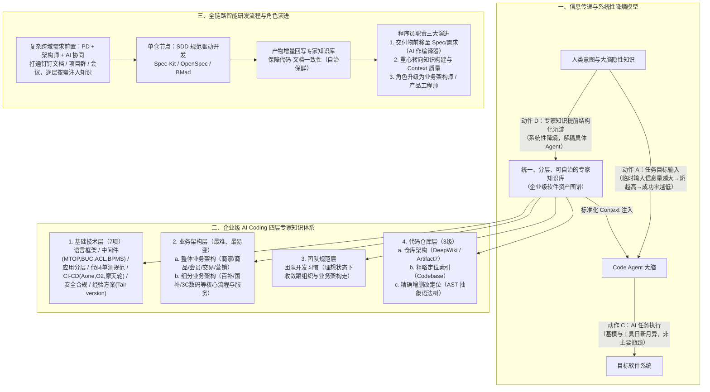

# AI Coding思考：从工具提效到范式变革，我们还缺什么？

## 1. TL;DR

1. **核心诊断**：当前企业级业务生产研发中的 AI Coding 仍停留在“Eclipse 升 IDEA、EJB 升 Spring”式的**工具提效**阶段，尚未发生“机器码升高级语言”式的**范式质变**（生产流程与角色职责未变，前置上下文准备与调试成本高昂）。
2. **第一性原理（目标传达复杂度 vs 执行复杂度）**：从 `人 -> 系统` 变为 `人 -> AI -> 系统` 增加了信息传递节点与失真概率；在基模与 Code Agent 执行能力（动作 C）飞速迭代的今天，企业级研发（第一象限：双高）的真正瓶颈不在于 AI 写代码，而在于**人类如何低失真、低成本地将复杂意图与背景传达给 AI（动作 A）**。
3. **系统性降熵（专家知识体系化沉淀）**：套用信息论，向 AI 传达任务所需临时输入的信息量越大，系统信息熵越高、成功概率越低（对比自动驾驶只需输入终点坐标、信息熵近乎 0）。唯有将人脑中的隐性专家知识提前结构化外化（动作 D），才能实现系统性“降熵”。
4. **四层专家知识架构与自治保鲜**：面向“新入职扎实全栈程序员”构建**基础技术层（7 子类）+ 业务层（整体与细分业务架构，最难最易变）+ 团队层 + 代码仓库层（架构 DeepWiki/Artifact7 + Codebase 索引 + AST 精确修改）**；知识库必须独立于单一 Agent、结构化为“企业级软件资产图谱”，并靠“AI 自动化 + 人工确认”自治更新，绝不能指望反人性的纯人肉维护。
5. **全流程协同与角色演进**：单仓编码采用 **SDD（Spec-Driven Development，如 Spec-Kit / OpenSpec / BMad）** 保障代码-文档一致性，复杂跨域需求前置到 PRD 与技术方案协同；程序员交付物从“高级代码”前移至“Spec 与需求”（AI 充当 Spec 到代码的编译器），角色向**全栈化、业务架构师、产品工程师**演进。

## 2. 问题定义与背景

### 2.1 工具提效 vs 范式质变的区别

| 维度 | 长尾 / 轻量场景（已发生质变） | 企业级核心业务生产研发（尚处量变工具提效） |
|---|---|---|
| **典型任务** | PD 用 Web VibeCoding 生成原型、HR 做文化活动页、应用升级 JDK 11 | 实现“百补超链定品功能”、跨商品中心与 BUC 用户中心的商品审核需求 |
| **核心特征** | 目标传达极简、低耦合、容错高 | 强依赖领域专家知识、跨系统跨仓协同、要求高正确性与长期可高效运维 |
| **类比定位** | 机器/汇编语言 $\to$ 高级语言（硬件操作员变为程序员，角色与流程巨变） | Eclipse $\to$ IDEA、EJB $\to$ Spring（局部效率提升，但流程与角色职责未变） |
| **当前乱象** | — | 内部（Aone Copilot、通义灵码、OneDay、Aone Agent、Qwen Code、Qoder）与外部（Cursor、Claude Code、Gemini CLI、Codex）工具百花齐放，但知识库跟工具绑死、重复建设、Context 靠手艺活拼接 |

### 2.2 AI 任务四象限模型（目标传达复杂度 × 执行复杂度）

- **第四象限（目标传达简单 × 执行复杂）**：如“帮我升级 JDK 11”、自动驾驶（只需输入终点坐标，信息熵 $\approx 0$）。区别于传统规则自动化，现代 AI 在感知、推理、泛化与复杂执行上极具优势，已率先落地。
- **第一象限（目标传达复杂 × 执行复杂）**：如“实现百补超链定品功能”。收益上限最高，但若每次都要靠人脑临时组织庞大的业务背景、中间件规范与上下游约束，系统能力上限就会被锁死在“人类临时表达输出能力的上限”。

## 3. 知识框架

## 4. 核心内容拆解

### 4.1 信息论视角：为什么“目标传达”比“Agent 执行”更卡脖子

1. **沟通链路加长导致失真**：传统研发是 `人 -> 系统`，AI 时代变成 `人 -> AI -> 系统`。若一个场景解决前半段（人向 AI 准确传达目标）的长期成本大于后半段（AI 自动执行）的收益，该场景就不适合 AI 替代，甚至在宏观上会降效。
2. **业务研发团队与基础设施团队的分工边界**：
   - **基础设施团队**：重点在于打磨 Code Agent 引擎与底层工具链（动作 C）。
   - **业务研发团队**：在自研通用 Agent 上无比较优势，但可直接享受最新基模与 IDE 红利；其真正的核心壁垒与投入重点应是**专家知识沉淀机制建设（动作 D，系统性降熵）**。

### 4.2 培养“新入职高级全栈程序员”的四层专家知识拆解

假设把 Code Agent 当作基本功扎实但对公司内部一无所知的新员工，要让它独立完成“商品审核需求”，必须供给四层知识：
1. **基础技术层面（7 类）**：
   - **a. 技术栈规范**：Java、Spring、前端框架（大模型已内化的强项）。
   - **b. 基础设施规范**：公司中间件、微服务框架、单元化架构、网关接入（`MTOP`）、OA 基建（`BUC / ACL / BPMS`）。
   - **c. 应用选型与分层规范**：单体应用、Serverless、FaaS 分类及代码分层建议。
   - **d. 代码质量规范**：基本编码规范、单测规范。
   - **e. CI/CD 平台与流程**：`Aone`、`O2`、`摩天轮` 等平台发布流程。
   - **f. 安全合规规范**：数据安全脱敏与合规红线。
   - **g. 解决方案经验**：消息重试保证最终一致性、`Tair version` 解决分布式并发冲突等实战模式。
2. **业务层面（最核心、最隐性、最易腐化）**：
   - **a. 整体业务架构**：电商核心域（商家、商品、会员、交易、营销）的产品架构、核心领域模型、核心流程与 API。
   - **b. 细分业务架构**：所属垂直域（如百亿补贴、国补、3C 数码）的领域知识、应用拓扑与核心服务。
3. **团队层面**：团队特定开发习惯（在理想 AI Coding 下应逐步消亡，统一收敛至公司与业务架构规范）。
4. **代码仓库层面（由粗到精三级定位）**：
   - **a. 仓库代码架构**：项目概要、模块划分、数据模型、部署配置（对应 `DeepWiki`、`Artifact7` 等）。
   - **b. 仓库代码索引**：理解需求后对项目代码做粗略定位（对应 `Codebase` 向量/全文检索）。
   - **c. 精确代码定位**：编码时对现有代码做精准增删改（对应 **抽象语法树 AST** 等结构化解析）。

### 4.3 专家知识库的三条铁律与全流程 SDD 闭环

1. **知识库建设的三大铁律**：
   - **独立统一，解耦 Agent**：不随 Cursor / Claude Code / Qoder 的切换而推倒重建，消除各团队重复维护阿里基础中间件与淘天通用领域知识的浪费。
   - **资产图谱化（物理真相 + 架构抽象）**：将软件生产资料与关系在线化、语义化，构建**企业级软件资产图谱**。
   - **半自动/全自动“自治”保鲜**：历史早已证明指望架构师或研发“用爱发电”人肉维护文档是反人性的，必须通过研发流程产物自动回写 + 人工确认实现知识自治。
2. **全链路节点按需供给与单仓 SDD 落地**：
   - 研发全流程（需求 $\to$ 技术方案 $\to$ 单仓设计 $\to$ 编码 $\to$ 验收）每个节点只按需加载对应层级的精简知识，而非一次性塞入大而全的上下文；简单需求可裁剪前置节点直接从右侧切入。
   - **单仓库节点**采用 **SDD（Spec-Driven Development，规范驱动开发，如 `Spec-Kit`、`OpenSpec`、`BMad`）**，并在需求完成后将各节点产物增量回写至专家知识库，确保代码与文档同源演进。

## 5. 数据速查表

| 维度 / 分类 | 原文要素与枚举 | 核心语境与设计定位 |
|---|---|---|
| **内部与外部 AI 工具生态** | 内部：`Aone Copilot`、`通义灵码`、`OneDay`、`Aone Agent`、`Qwen Code`、`Qoder` 外部：`Cursor`、`Claude Code`、`Gemini CLI`、`Codex` | 工具迭代极快，业务团队不应绑定单一工具或重复造 IDE 轮子 |
| **基础技术层知识（7 项）** | 技术栈、基础设施（`MTOP/BUC/ACL/BPMS`）、应用分层（单体/Serverless/FaaS）、质量单测、CI/CD（`Aone/O2/摩天轮`）、安全合规、方案经验（`Tair version`） | 构成企业级研发的通用工程底座约束 |
| **代码仓库层知识（3 级）** | 仓库架构（`DeepWiki / Artifact7`）$\to$ 粗略索引（`Codebase`）$\to$ 精确增删改（`AST`） | 支撑 Agent 从宏观模块理解到微观语法树级代码修改 |
| **单仓规范驱动开发工具** | `Spec-Kit`、`OpenSpec`、`BMad` | 落地 SDD 模式，并在交付后将 Spec 增量回写以保障代码-文档一致性 |
| **程序员演进三维度** | 交付物：高级代码 $\to$ **Spec 与需求**（AI 作编译器） 重心：代码细节 $\to$ **知识构建与 Context 质量** 角色：高效打字员 $\to$ **全栈 / 业务架构师 / 产品工程师** | 警惕把“AI 生成代码量占比”等同于“真实组织提效占比”的虚假繁荣 |

## 6. 踩坑与教训 / 可迁移的设计原则

| 错误做法 / 认知误区 | 失败表现或原因 | 原文应对（可迁移的设计原则） |
|---|---|---|
| **业务研发团队把重心放在自研通用 Code Agent 或频繁追新 IDE** | 组织架构或工具风向一变就面临高昂切换成本，且重复造轮子无法跑赢基模演进 | **聚焦“动作 D（专家知识沉淀降熵）”**：将知识库与具体端侧 Agent 解耦，享受外部最强 Agent 红利 |
| **各小团队在本地 `.cursorrules` 或私库中重复编写中间件与通用电商知识** | 3 个团队维护 3 套高度重叠却格式各异的半成品知识，Context 拼接沦为个人手艺活 | **全局统一分层管理（企业级软件资产图谱）**：按基础技术、业务架构、团队、仓库四层标准化复用 |
| **指望靠行政命令让研发/架构师纯人肉编写和更新业务知识库** | 违背人性，文档必然迅速脱离代码沦为僵尸文档，甚至拖慢整体研发效率 | **流程内嵌 + SDD 增量自治回写**：把需求、方案与 SDD 过程产物结合 AI 自动提炼 + 人工确认回写知识库 |
| **把“AI 生成代码量占比”直接当成组织研发提效考核指标** | 编码只是企业研发链条的后半段，忽略前半段沟通与返工成本会产生“喜大普奔”的提效幻觉 | 打通**需求 $\to$ 设计（Spec）$\to$ 编码 $\to$ 验收**全链路度量，关注端到端交付效率与知识资产复利 |

## 7. 记忆锚点

- **第一性原理公式**：「**企业级 AI Coding 瓶颈不在执行（C），而在目标传达（A）；破局唯有专家知识体系化沉淀（D）实现系统性降熵**」。
- **角色与交付演进口诀**：「**AI 是 Spec 到代码的编译器；交付物前移到 Spec，人升级为业务架构师与产品工程师**」。

## 8. 复习卡片

为什么作者认为当前企业级业务研发的 AI Coding 只算“工具提效”而尚未发生“范式质变”？::因为质变意味着生产流程与角色职责发生根本改变（如汇编升高级语言，或 PD 用 VibeCoding 直接出原型替代程序员），而当前企业级生产研发流程与职责未变，仅相当于 Eclipse 升 IDEA。
从“目标传达复杂度”和“执行复杂度”四象限看，为什么“升级 JDK 11”容易提效而“实现百补超链定品”难？::“升级 JDK 11”属于目标传达简单、执行复杂的第四象限（类似自动驾驶只需输入终点坐标，信息熵近乎 0）；而“百补超链定品”处于双高的第一象限，包含大量隐性业务规则与跨系统约束，目标传达的信息熵极高。
在“人 -> AI -> 系统”链路中，业务研发团队与基础设施团队的发力重点有何不同？::基础设施团队重点攻克动作 C（提升 Agent 规划与执行能力）；业务研发团队应重点攻克动作 D（构建分层、统一的专家知识沉淀机制，对任务目标传达做系统性降熵）。
企业级 AI Coding 的专家知识库应分为哪四个层次？其中哪一层挑战最大？::分为基础技术层、业务层（整体业务架构+细分业务架构）、团队层、代码仓库层（仓库架构 DeepWiki/Artifact7 + Codebase 索引 + AST 精确修改）；其中业务层最复杂、最易变且最隐性，挑战最大。
为什么说“不能指望靠人来搞文档、搞知识库”？正确的保鲜机制是什么？::纯靠人肉维护文档是反人性的，必然导致文档脱离代码；必须结合全流程 AI 协同与 SDD（Spec-Driven Development），将研发各节点经人工确认的过程产物自动/半自动增量回写至知识库，实现知识自治。
在 AI Coding 范式变革下，程序员的交付物、研发重心和角色定位会发生哪三项转变？::① 交付物从高级代码前移到设计（Spec）与需求，AI 成为 Spec 到代码的编译器；② 研发重心转向专家知识构建质量与 Context 转化质量；③ 角色向全栈、业务架构师与“产品工程师”演进。

## 9. 知识关联

- **本库主题索引**：[AI研发协同](../../20_topics/AI研发协同.md)、[检索与文档解析](../../20_topics/检索与文档解析.md)、[Agent工程循环](../../20_topics/Agent工程循环.md)、[解决问题](../../20_topics/解决问题.md)
- **本库关联文章**：[AICoding团队知识基座+26.3.23](../AICoding团队知识基座+26.3.23/AI_AICoding团队知识基座.md)、[淘系交易Spec范式编程+26.3.30](../淘系交易Spec范式编程+26.3.30/AI_淘系交易Spec范式编程.md)、[AI时代工程师范式演进+26.1.21](../AI时代工程师范式演进+26.1.21/AI_AI时代工程师范式演进.md)
- **候选双链**：[[信息熵与上下文工程]]、[[Spec-Driven Development]]、[[企业级软件资产图谱]]、[[产品工程师]]

## 10. 原文参考资料

- **原文信息**：《AI Coding思考：从工具提效到范式变革，我们还缺什么？》，作者：书牧（淘天集团-天猫技术），发布日期：2026-03-02。
- **文内提及工具与方法框架**：
  - 内部工具：`Aone Copilot`、`通义灵码`、`OneDay`、`Aone Agent`、`Qwen Code`、`Qoder`、`DeepWiki`、`Artifact7`
  - 外部工具与 SDD 框架：`Cursor`、`Claude Code`、`Gemini CLI`、`Codex`、`Spec-Kit`、`OpenSpec`、`BMad`

> [!note]- 校对报告
> - **页码溯源汇总**：
>   - `## 1. TL;DR` & `## 2. 问题定义与背景`：源自 p.1–5（内外部 AI Coding 工具盘点、机器语言升高级语言 vs Eclipse 升 IDEA 类比、目标传达复杂度 × 执行复杂度四象限、人 $\to$ AI $\to$ 系统信息论降熵模型与自动驾驶类比）。
>   - `## 4.2 四层专家知识体系`：源自 p.5–7（基础技术层 a–g 七项含 `MTOP/BUC/ACL/BPMS`、`Aone/O2/摩天轮`、`Tair version`；业务层整体与细分；团队层；代码仓库层 `DeepWiki/Artifact7`、`Codebase`、`AST`；企业级软件资产图谱与自治保鲜）。
>   - `## 4.3 全流程协同与角色演进`：源自 p.8–10（研发全流程橙色/红色节点图、单仓 SDD `Spec-Kit/OpenSpec/BMad`、交付物前移至 Spec、AI 作编译器、产品工程师与业务架构师、警惕 AI 代码量占比幻觉）。
> - **材料质量说明**：p.3–5、p.8 含四象限图、信息传递链路图与全流程专家知识协同图，核心文字与节点逻辑已在正文中完整还原；p.11–13 读者留言区亦印证了“知识库自动化构建”与“产品工程师”的核心讨论。
