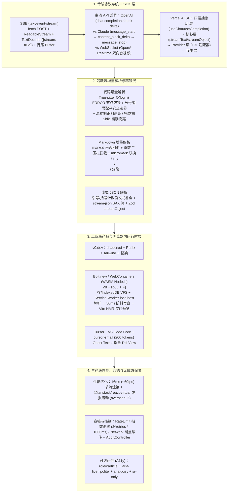

# AI-Generated UI 技术深度解析：模型流式输出与 UI 渲染实践

## 1. TL;DR

1. **流式传输协议选型（SSE 压倒性优势 vs WebSocket）**：在 LLM 单向流式输出场景下，基于 HTTP 原生的 **Server-Sent Events (`text/event-stream`)** 具备断线重连、CDN 友好与调试简便等优势；由于原生 `EventSource` 仅支持 `GET`，工程生产普遍采用 **`fetch (POST) + ReadableStream + TextDecoder({stream: true})`** 按行缓存解析，而 WebSocket 仅用于 OpenAI Realtime API 等双向语音/高频协作场景。
2. **四大标杆架构剖析（Vercel AI SDK / v0.dev / Bolt.new / Cursor）**：
   - **Vercel AI SDK**：通过四层架构统一 19+ 模型提供商，核心提供 `streamText`、`useChat` Hook 及基于 Zod Schema 的 `streamObject`（`partialObjectStream` 流式部分对象生成）。
   - **v0.dev**：采用非黑盒的 `shadcn/ui + Radix UI + Tailwind CSS + TypeScript` 组件体系，并以 `<v0_artifact>` XML 标签隔离说明文本与可热重载的 React 代码。
   - **Bolt.new / Bolt.diy**：依托编译为 WebAssembly 的 **WebContainers** 在浏览器标签页内运行完整 Node.js（V8 + libuv + 内存/IndexedDB 虚拟文件系统 + Service Worker 虚拟网络栈），解析 `<bolt_file>` 标签并通过 **50ms 防抖写入**触发 Vite HMR 毫秒级预览。
   - **Cursor**：基于 VS Code（Monaco + Electron）构建 AI Integration Layer，使用 `cursor-small`（`max_tokens: 200`）驱动 Ghost Text 半透明补全与增量 Diff View 更新。
3. **残缺流式内容的三大增量解析方案**：
   - **代码流**：采用 **Tree-sitter**（$O(\log n)$ 增量 AST 更新并插入 `ERROR` 节点容错）、安全边界延迟渲染（分号/括号配平/换行）及“流式期正则轻量高亮 + 完成期 Shiki/Prism 精确高亮”双轨策略。
   - **Markdown 流**：采用 `marked` 乐观渲染回退、未闭合 ` ``` ` 代码块检测或基于 GitHub **micromark** 的双换行（`\n\n`）段落安全边界增量渲染。
   - **JSON 流**：采用引号/方括号/花括号未闭合计数启发式补全、`stream-json` SAX 事件流解析或 `streamObject`。
4. **生产级渲染性能、容错与无障碍（A11y）最佳实践**：通过 **`16ms`（~60fps）节流渲染**与 `@tanstack/react-virtual` **虚拟滚动**防止 DOM 爆炸；通过区分 `RateLimitError`（$2^{\text{retries}} \times 1000\text{ms}$ 指数退避，最多 3 次）与 `NetworkError`（断点续传）保障流式高可用；并配置 `AbortController` 流式中断与 `aria-live="polite"` + `aria-busy` 无障碍支持。

## 2. 问题定义与背景

### 2.1 为什么 AI-Generated UI 不是简单的“接收文本并显示”？

从 v0.dev、Bolt.new 到 Cursor、Windsurf，大模型以 Token 为粒度逐块吐出代码、Markdown 或结构化 JSON 时，前端渲染层面临四大核心挑战：
1. **多字节字符截断与半行粘包**：TCP/HTTP 流可能在任意字节边界切分 UTF-8 中文字符或 SSE `data:` 行。
2. **语法残缺无法直接编译/解析**：流式中间态（如 `"function hello("`、`**加粗未闭合`、`{"name": "John", "addre`）会导致标准 AST 解析器、`JSON.parse()` 与预览沙箱频繁崩溃闪烁。
3. **高频 Token 触发重排风暴**：若每收到一个 Token 就触发一次全量 DOM 重渲染、语法高亮（Shiki/Prism）或虚拟文件系统磁盘写入，主线程将迅速卡死。
4. **浏览器端缺乏安全隔离的全栈运行时**：生成的 React/Node 全栈代码若依赖远端容器编译预览，网络往返延迟高且算力成本昂贵。

## 3. 知识框架



## 4. 核心内容拆解

### 4.1 传输层细节：SSE 流式解码与 OpenAI / Claude 协议差异

1. **为什么不用原生 `EventSource`？**
   - 浏览器原生 `new EventSource('/api/stream')` 极其简单且自带断线重连，但**仅支持 `GET` 请求**，无法携带大体积的 `messages` 历史与 JSON Body。
   - **生产标准解法（`fetch` + `ReadableStream` + Generator）**：
     - 必须在 `decoder.decode(value, { stream: true })` 中传入 **`{ stream: true }`**，防止多字节 UTF-8 字符在网络分包边界被截断成乱码；
     - 维护 `buffer` 字符串，每次按 `\n` 切分后用 `buffer = lines.pop()` 保留末尾未接收完整的半行；
     - 通过 `async function*` 与 `yield` 将流封装为异步迭代器供上层消费。
2. **OpenAI vs Anthropic Claude 流式事件结构对比**：
   - **OpenAI**：扁平 `chat.completion.chunk` 结构，内容位于 `choices[0].delta.content`，可通过 `stream_options: { include_usage: true }` 获取 Token 用量，以 `data: [DONE]` 结束。
   - **Anthropic Claude**：采用精细的状态机事件流（`message_start` $\rightarrow$ `content_block_start` $\rightarrow$ 多次 `content_block_delta` $\rightarrow$ `content_block_stop` $\rightarrow$ `message_delta` $\rightarrow$ `message_stop`），天然支持在单次流中清晰区分**普通文本块、工具调用块（Tool Use）、图像块与 Extended Thinking 思考链块**。

### 4.2 工业级标杆架构：v0.dev、Bolt.new（WebContainers）与 Cursor

1. **v0.dev 的三大架构选型**：
   - **为什么首选 `shadcn/ui + Radix UI + Tailwind CSS + TypeScript`？** 组件源码直接内联非黑盒、Radix 自带无障碍（A11y）、Tailwind 原子类将结构与样式耦合在同一标签内极易被 LLM 局部生成与修改、TypeScript 提供静态类型校验。
   - 使用 `<v0_artifact type="react" title="...">` XML 标签从自然语言对话流中精准剥离代码产物。
2. **Bolt.new / Bolt.diy 与 WebContainers 底层原理**：
   - **WebContainers 三大核心层**：将 **Node.js Runtime（V8 + libuv 事件循环 + Node API Polyfills）编译为 WebAssembly**；构建**虚拟文件系统（内存存储为主 + 可选 IndexedDB 持久化 + `fs.watch` 监听）**；通过 **Service Worker 拦截请求模拟虚拟网络栈与 `localhost` HTTP/HTTPS 服务**。
   - **流式文件同步机制**：解析 AI 输出的 `<bolt_file path="src/App.tsx">` 标签为 `create / update / delete` 操作，通过 `StreamingFileWriter` 执行 **50ms 防抖写入（Debounce）** 到 `webcontainer.fs.writeFile`，自动触发容器内 Vite 开发服务器的原生 **HMR（热模块替换）** 更新预览 `iframe`。
   - **WebContainers 四大工程限制**：依赖浏览器 `SharedArrayBuffer` 与跨源隔离（Cross-Origin Isolation）、无法运行含 C++ 原生编译模块的 npm 包、仅能访问带 CORS 头的外部 API、WASM 执行性能略低于原生 Node.js。
3. **Cursor 编辑器的流式集成**：
   - 在 VS Code Core（Monaco + Electron）之上构建 **AI Integration Layer**（负责收集光标前后缀 `prefix/suffix`、文件路径与 `imports` 上下文，通过 Model Router 路由至 Claude、GPT-4 或自研小模型）。
   - **Tab Completion** 调用极速小模型 `cursor-small`（限制 `max_tokens: 200`）流式返回补全，通过 Monaco Decoration API 渲染半透明 **Ghost Text**；多行修改则通过 **增量 Diff View** 仅更新变化的 DOM 节点（`.diff-added` / `.diff-removed`），彻底消除整块重绘闪烁。

### 4.3 核心难点突破：残缺代码、Markdown 与 JSON 的增量解析

1. **残缺代码流的三种处理策略**：
   - **Tree-sitter 容错增量解析**：即使输入 `"function hello() {"` 语法不完整，Tree-sitter 也会在缺失处插入 `ERROR` 节点生成可用部分 AST，并在后续 Chunk 到达时通过 `tree.edit(&edit)` 以 **$O(\log n)$ 时间复杂度**仅重解析变更字节区间。
   - **延迟渲染安全边界（`findSafeBoundary`）**：缓冲未完成 Token，仅当检测到分号 `;`、花括号配平（`braceBalance === 0`）或换行符 `\n` 时才推进已渲染游标。
   - **双轨语法高亮**：在流式传输过程中使用轻量级正则表达式高亮关键字/字符串/注释，待流结束（`isComplete === true`）后再切换为 **Shiki / Prism** 做全量精确语法高亮。
2. **流式 Markdown 渲染三策**：
   - `marked.parse` 乐观渲染 + 异常时 `escapeHtml` 回退；
   - **未闭合代码块拦截**：统计 ```` ``` ```` 出现次数，若为奇数（`openFences % 2 !== 0`），将最后一个 ```` ``` ```` 之前作为 `complete` 渲染，之后作为 `pending` 暂存；
   - **GitHub `micromark` 增量分段**：以双换行符 `\n\n`（段落边界）切分已完成 HTML 与待处理缓冲区。
3. **流式 JSON 解析三策**：
   - **启发式括号/引号配平补全（`parsePartialJson`）**：统计未闭合的双引号 `"`（奇数则补 `"`）、方括号 `[` 与 `]` 差值、花括号 `{` 与 `}` 差值并自动追加尾部闭合符后尝试 `JSON.parse`；
   - **SAX 风格事件流（`stream-json`）**：在 Node.js 中通过 `jsonParser() + streamValues()` 逐键值触发 `data` 事件；
   - **Vercel AI SDK `streamObject`**：基于 Zod Schema 直接消费 `result.partialObjectStream`。

### 4.4 生产级渲染优化、异常恢复与可访问性（A11y）

1. **16ms 帧率对齐节流与虚拟滚动**：
   - 在 `StreamingUIManager` 中设置 **`MIN_RENDER_INTERVAL = 16`（对应 ~60fps）**，将两帧之间到达的多个 Token 合并至一次 DOM 更新；
   - 长对话列表采用 `@tanstack/react-virtual` 的 `useVirtualizer`（配置 `estimateSize: () => 100, overscan: 5`）实现绝对定位虚拟滚动。
2. **分级重试与断点续传（`robustStream`）+ `AbortController`**：
   - 最多重试 `MAX_RETRIES = 3` 次：遇到 `RateLimitError` 执行 **$2^{\text{retries}} \times 1000\text{ms}$ 指数退避**；遇到 `NetworkError` 立即重试并保留 `lastSuccessfulChunk` 输出 `[Connection restored, continuing...]`；
   - 使用 `AbortController` 的 `signal` 绑定 `fetch`，支持用户随时点击 Stop 按钮无损终止流並捕获 `AbortError`。
3. **屏幕阅读器无障碍（A11y）规范**：
   - 流式容器设置 `role="article"`、动态切换 `aria-live={isStreaming ? "polite" : "off"}` 与 `aria-busy={isStreaming}`，并内嵌 `<span className="sr-only">` 提示视障用户 AI 正在生成回复。

## 5. 数据速查表

| 模块 / 技术参数 | 关键设定值 / 复杂度 | 工程作用与原理说明 |
| :--- | :--- | :--- |
| **`TextDecoder` 流式参数** | **`{ stream: true }`** | 防止多字节 UTF-8 字符在网络 Chunk 边界被截断成乱码 |
| **Bolt.new 文件防抖写入间隔** | **`50 ms`** (`debounce(50)`) | 避免每个 Token 都触发 `webcontainer.fs.writeFile` I/O 与 Vite HMR 风暴 |
| **Tree-sitter 增量更新复杂度** | **`O(log n)`** | 通过 `InputEdit` 仅重解析变化字节范围，语法残缺处插入 `ERROR` 节点 |
| **Cursor Tab 补全模型与预算** | `cursor-small`，**`max_tokens: 200`** | 结合光标 `prefix/suffix/imports` 实现极低延迟 Ghost Text 流式补全 |
| **UI 帧率节流间隔** | **`16 ms`（约 `60 FPS`）** | `MIN_RENDER_INTERVAL = 16`，合并高频 Token 避免浏览器主线程重排卡死 |
| **虚拟滚动预渲染缓冲** | `estimateSize: 100`, **`overscan: 5`** | 基于 `@tanstack/react-virtual` 控制长对话 DOM 节点数恒定 |
| **流式容错重试与退避公式** | `MAX_RETRIES = 3`，**`2^retries * 1000 ms`** | 针对限流错误做指数退避（1s, 2s, 4s），网络闪断直接续传 |

## 6. 踩坑与教训 / 可迁移的设计原则

1. **手写 SSE 消费循环时，永远不要漏掉 `{ stream: true }` 和 `lines.pop()` 半行缓冲**：中文字符占 3 个字节，TCP 分包极大概率把一个汉字拆在两个 `Uint8Array` chunk 中，漏写 `{ stream: true }` 必然偶发乱码；同理，SSE 事件行可能被拦腰截断，必须将 `split('\n')` 的最后一项留回 `buffer`。
2. **流式代码高亮必须采取“流式期轻量正则 + 完结期重型 AST（Shiki）”双阶段切换**：Shiki 基于 TextMate 语法完整解析，若在 60fps 的流式输出中每帧对几百行代码跑一次 Shiki，CPU 会瞬间飙满；流式期仅用正则染色关键字，收到 `[DONE]` 后再做一次 Shiki 精染。
3. **浏览器沙箱写文件必须加 50ms 防抖，UI 渲染必须加 16ms 节流**：大模型吐 Token 速度可达每秒上百个，前端状态更新频率绝不能被网络包到达频率直接绑架，必须对齐显示器 16ms 刷新周期与打包器 HMR 节拍。

## 7. 记忆锚点

- **一套 SSE 标准消费范式**：`fetch (POST)` + `ReadableStream` + `TextDecoder({stream: true})` + `lines.pop()` 半行缓存 + `AbortController`。
- **三大残缺流解析利器**：代码用 **Tree-sitter**（$O(\log n)$ + `ERROR` 节点 + 正则/Shiki 双轨高亮）；Markdown 用 **奇数 ```` ``` ```` 围栏拦截 + `micromark` 双换行分段**；JSON 用 **引号/括号差值补全 + `streamObject`**。
- **四个关键工程常数**：`16ms`（60fps UI 节流）、`50ms`（WebContainers 写盘防抖）、`200 tokens`（`cursor-small` 补全上限）、`overscan: 5`（虚拟滚动缓冲）。

## 8. 复习卡片

1. 为什么在 AI 文本流式输出场景中普遍选择 SSE 而非 WebSocket？为什么实际开发中常使用 `fetch + ReadableStream` 替代浏览器原生的 `EventSource`？::SSE 基于标准 HTTP 单向推送，原生支持断线重连且对 CDN 友好、调试简单；但浏览器原生 `EventSource` 仅支持 `GET` 请求，无法发送包含多轮对话历史的复杂 `POST` JSON 请求体，因此需用 `fetch + ReadableStream`。
2. 在使用 `ReadableStream` 和 `TextDecoder` 解析 SSE 数据流时，为什么必须传入 `{ stream: true }` 并保留 `lines.pop()`？::`{ stream: true }` 告知解码器当前为流式分块解码，防止多字节 UTF-8 字符（如中文）在网络包边界被截断产生乱码；`lines.pop()` 用于将尚未收到换行符的不完整末行留存到下一轮拼接，防止 `JSON.parse` 报错。
3. Anthropic Claude 的流式 API 事件设计与 OpenAI 的 `chat.completion.chunk` 相比有什么结构优势？::Claude 采用 `message_start → content_block_start → content_block_delta → content_block_stop → message_stop` 的结构化状态机事件流，能够在单次流中清晰区分文本块、工具调用块、图像块与 Extended Thinking 思考链块。
4. Bolt.new 是如何利用 WebContainers 在浏览器内实现 AI 流式生成代码与实时预览同步的？WebContainers 有哪些底层限制？::WebContainers 将 Node.js（V8+libuv）编译为 WebAssembly，配合内存/IndexedDB 虚拟文件系统与 Service Worker 虚拟网络栈；Bolt 解析 `<bolt_file>` 标签后通过 50ms 防抖写入虚拟文件系统，触发容器内 Vite 原生 HMR 刷新预览。其限制是依赖 `SharedArrayBuffer`/跨源隔离、不支持 C++ 原生 npm 模块、外部请求受限于 CORS。
5. 当 AI 流式输出不完整的代码、Markdown 和 JSON 时，前端分别如何实现增量解析与容错？::代码采用 Tree-sitter（$O(\log n)$ 增量更新并在残缺处插入 `ERROR` 节点）、分号/括号配平安全边界及“流式正则+完成期 Shiki”双轨高亮；Markdown 采用奇数 ` ``` ` 代码块拦截与 `micromark` 双换行段落切分；JSON 采用未闭合引号/方括号/花括号计数启发式补全或 Zod `streamObject`。
6. 生产级 AI 流式 UI 在渲染性能、异常重连与无障碍（A11y）方面有哪些关键实践？::性能上采用 16ms（~60fps）节流合并 Token 渲染并用 `@tanstack/react-virtual`（`overscan: 5`）做虚拟滚动；容错上对限流错误做 $2^{\text{retries}} \times 1000\text{ms}$ 指数退避、对网络闪断做断点续传；无障碍上配置 `role="article"`、`aria-live="polite"` 与 `aria-busy`。

## 9. 知识关联

- **所属主题**：
  - [跨端开发与性能](../../20_topics/跨端开发与性能.md)
  - [AI研发协同](../../20_topics/AI研发协同.md)
  - [Harness与模型协同](../../20_topics/Harness与模型协同.md)
- **本地跃迁**：[原始 PDF](RAW.pdf) · [逐页转写文本](MD.md)
- **候选双链**：[[卡片式对话协议方案探索]] · [[场景营销前端AI Coding方案]] · [[营销中后台生码工作流实践]] · [[Tarot Pixel视觉稿还原]]

## 10. 原文参考资料

1. **核心协议与框架文档**：Vercel AI SDK Documentation (`ai`, `@ai-sdk/react`)、OpenAI Streaming Guide & Realtime API、Anthropic Claude Messages Streaming API
2. **解析器与浏览器运行时**：WebContainers API (`@webcontainer/api`)、Tree-sitter Incremental Parsing、GitHub `micromark`、`stream-json`、`@tanstack/react-virtual`
3. **标杆产品与开源实现**：Vercel `v0.dev` (`shadcn/ui` + Radix UI + Tailwind CSS)、StackBlitz `Bolt.new` / `Bolt.diy`、Cursor Editor

> [!note]- 校对报告
> - **页码溯源**：p.1–5（AI-Generated UI 崛起背景、SSE 协议格式、原生 `EventSource` GET 限制、`fetch + ReadableStream + TextDecoder({stream: true})` 实现、OpenAI vs Anthropic Claude 流式事件对比、SSE vs WebSocket 选型与 OpenAI Realtime API）；p.6–12（Vercel AI SDK 四层架构、`streamText` / `useChat` / Zod `streamObject`；v0.dev `shadcn/ui` + `<v0_artifact>` 设计；Bolt.new / Bolt.diy 技术栈、`<bolt_file>` 解析与 `StreamingFileWriter` 50ms 防抖写入触发 Vite HMR）；p.12–18（不完整代码 Tree-sitter $O(\log n)$ 增量解析、安全边界延迟渲染、正则/Shiki 双阶段语法高亮；Markdown `marked` 乐观回退、奇数 ` ``` ` 围栏检测、`micromark` `\n\n` 分段解析；流式 JSON 引号/括号启发式补全、`stream-json` SAX 流与 `streamObject`）；p.19–24（Cursor 架构、`cursor-small` 200 tokens Tab Completion、Ghost Text 与增量 Diff View；WebContainers V8+libuv WASM 架构、挂载安装启动示例及 4 项关键限制）；p.24–31（16ms 60fps 节流、`@tanstack/react-virtual` 虚拟滚动、`robustStream` 3 次重试与指数退避、打字机效果、`AbortController` 流式中断、`aria-live`/`aria-busy` 无障碍设计及多模态/MCP 展望）。
> - **一致性核验**：作者（祥子，淘天集团-私域技术团队）、发布时间（2026-05-13）、全部代码示例、API 名称与时间常数均逐页核对一致；正文中无任何内联页码引用。
> - **质量边界**：全文代码与架构框图全部位于 PDF 文本层内，已完整提取核心工程模式与参数细节。
