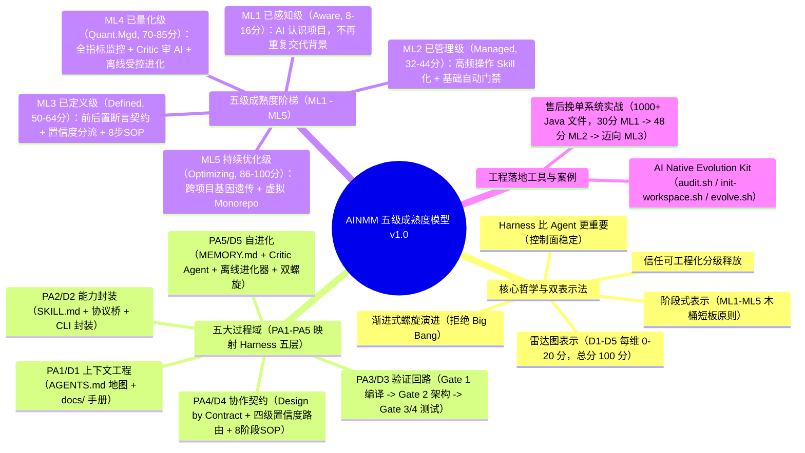
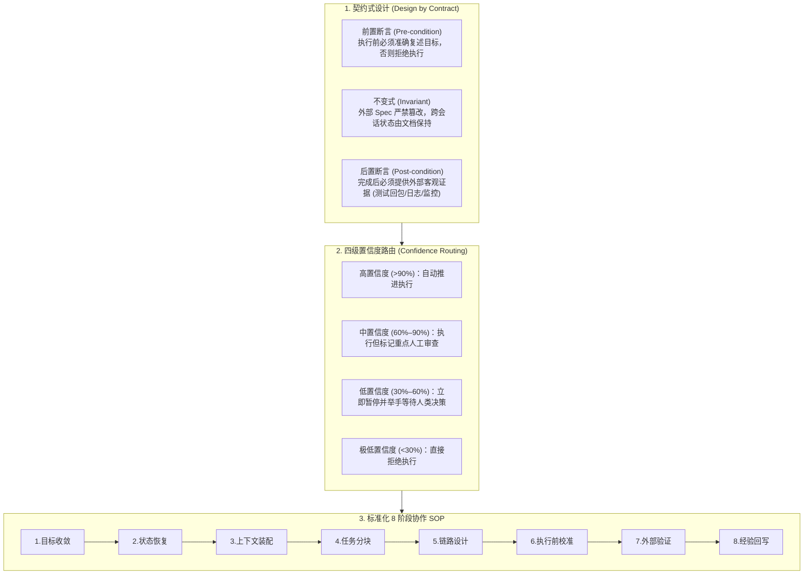

# AINMM：存量生产级工程向 AI Native 演进的五级成熟度模型

> [!abstract] 导读
> **一句话总结**：淘天集团供给技术团队（作者：木直）借鉴 CMMI（能力成熟度模型集成）与 OpenAI Harness Engineering 思想，针对“AI 单点生成代码很快、但存量生产级工程端到端交付效率并未同步提升（Harness Gap）”的结构性矛盾，提出了 **AI Native 能力成熟度模型（AINMM v1.0）**——围绕**五大过程域（上下文工程、能力封装、验证回路、协作契约、自进化）**定义从 **ML1（已感知级）到 ML5（持续优化级）** 的渐进式演进阶梯、双表示法评分体系（阶段式 + 五维 100 分雷达图）与配套开源工具 `AI Native Evolution Kit`，并在千余个 Java 文件的存量“挽单系统”中完成了从 ML1（30 分）到 ML2（48 分）并向 ML3 演进的实证闭环。
> **阅读价值**：为企业级存量复杂工程（Brownfield）提供了一套不搞“推倒重来（Big Bang）”、可量化审计、可横向对标的 AI Native 转型路线图与工程字典。

## 1. TL;DR

- **核心问题（Harness Gap）**：行业数据显示全球新增代码中 42% 由 AI 辅助生成，但代码搅动率（Churn Rate）近乎翻倍、重复代码增长近 4 倍，84% 开发者使用 AI 却仅 29% 信任 AI 产出。**模型能力已不是瓶颈，为 AI 搭建确定性工作环境（Harness）的工程化成熟度才是决定端到端交付效率的核心缺口**。
- **三大设计哲学**：
  1. **Harness 比 Agent/Model 更重要**：模型每天在变，但包裹模型的控制面（Harness）是稳定的组织资产。
  2. **信任是可以工程化分级释放的**：通过上下文、封装、门禁、契约与自进化五层约束，按成熟度等级逐步扩大 AI 的自治半径。
  3. **渐进式螺旋上升，拒绝 Big Bang 重构**：存量生产系统无法停机重写，必须从 0.5 天建立一份 200 行 `AGENTS.md`（ML1）开始逐级叠加。
- **五级成熟度（ML1–ML5）与五大过程域（PA1–PA5 / D1–D5）**：
  - **五大维度（各 0–20 分，满分 100 分）**：**PA1/D1 上下文工程**、**PA2/D2 能力封装**、**PA3/D3 验证回路**、**PA4/D4 协作契约**、**PA5/D5 自进化**。
  - **五个等级**：**ML1 已感知级（Aware，仓库即真相源） $\rightarrow$ ML2 已管理级（Managed，Skill 封装 + 基础门禁） $\rightarrow$ ML3 已定义级（Defined，契约式协作 + 置信度路由 + 8 阶段 SOP） $\rightarrow$ ML4 已量化级（Quantitatively Managed，数据驱动 + Critic 对抗审查 + 离线自进化） $\rightarrow$ ML5 持续优化级（Optimizing，Evolution Kit 双螺旋知识遗传 + 虚拟 Monorepo）**。
- **配套工具与实战验证**：研发命令行工具框架 `AI Native Evolution Kit`（含 `audit.sh` 审计评分、`init-workspace.sh` 初始化、`evolve.sh` 生成五层 Harness），在售后“挽单系统”（1000+ Java 文件）落地双循环改造，使系统评分从 **30 分（ML1）跃升至 48 分（ML2）**，打通 `a1` 部署 Skill、ArchUnit 架构门禁与 HSF 协议桥端到端自检。

## 2. 问题定义与背景

### 2.1 行业结构性矛盾：代码生成通胀 vs. 交付信任赤字
作者援引多项权威工程调研，揭示了当前软件组织引入 AI 后的真实困境：
- **Sonar 2025 报告**：全球新增代码中 **42%** 由 AI 辅助生成，但存在严重的**验证缺口（Verification Gap）**。
- **GitClear 2025 纵向研究（基于 1.53 亿行代码）**：AI 辅助代码导致**代码搅动率（Churn Rate，短期内被频繁修改或删除重写）近乎翻倍**，**重复代码增长近 4 倍**，开发者花在 Code Review 上的时间首次超过编写代码的时间。
- **Stack Overflow 2025/2026 调查**：**84%** 的开发者已使用或计划使用 AI 编码工具，但仅 **29%** 信任 AI 产出（同比下滑 11 个百分点）。
- **OpenAI Harness Gap 定义（2026.02）**：将“AI 代码产出能力快速增长，但端到端交付效率未同步提升”的结构性断层正式定义为 **Harness Gap**。

### 2.2 存量生产级工程（Brownfield）转型的四大特殊约束
不同于从零搭建的纯 Agentic 新项目，企业核心存量工程面临严苛限制：
1. **历史代码面向人而非 AI**：大量业务状态机、RPC 链路与潜规则散落在口口相传与群聊中，缺乏面向 AI 的结构化上下文与执行约束。
2. **生产级高稳定性红线**：容错率极低，任何改动都必须经过严格回归验证。
3. **跨端跨组织复杂协同**：前后端、移动端、配置中心分离，横跨多个仓库与团队。
4. **业务持续高频迭代**：绝不可能“停下业务半年去重构”，只能“在飞行中换引擎”。

## 3. 知识框架

## 4. 核心内容拆解

### 4.1 五大过程域与五级成熟度全景矩阵

AINMM 完整继承了 CMMI **“逐级递进、不许跳级、木桶短板定级（各维度最低分阈值 AND 关键过程域特定目标 SG 全部达成）”** 的严密逻辑：

| 等级 | 名称与定位 | 核心特征与工程标志 | 五维基准分阈值（D1–D5，满分 100） | 演进冲刺抓手（Sprint） |
| :--- | :--- | :--- | :--- | :--- |
| **ML1** | **已感知级（Aware）** 仓库即真相源 | 具备 100~200 行 `AGENTS.md`（遵循“地图而非手册”原则）+ `docs/` 目录；编码规范与禁止事项入库，AI 能认识项目全貌，无需每次对话重新介绍背景。 | `D1≥8`, `D2<8`, `D3<4`, `D4<4`, `D5<4` （典型总分 **8–16 分**） | **Context Day**（借助 AI 约 **0.5 天**完成） |
| **ML2** | **已管理级（Managed）** 行为可预测可复制 | 高频操作封装为 `SKILL.md`（含触发条件、步骤、验证标准、Gotchas）；建立 **Gate 1（编译）+ Gate 2（ArchUnit 架构约束，存量建基线只拦新增）**；启用 `MEMORY.md`；通过协议桥触达生产/预发 API。 | `D1≥12`, `D2≥8`, `D3≥8`, `D4<8`, `D5≥4` （典型总分 **32–44 分**） | **Skill Sprint + Gate Sprint**（天级日常抽象） |
| **ML3** | **已定义级（Defined）** 契约式人机协作 | 引入 **Design by Contract**（前置断言复述目标、后置断言外部证据验证、外部 Spec 不变式）；运行**四级置信度路由**；推行标准化 **8 阶段协作 SOP** 与 4 类偏航检测信号；门禁扩展至 Gate 1–4 全链路。 | `D1≥16`, `D2≥12`, `D3≥12`, `D4≥10`, `D5<8` （典型总分 **50–64 分**） | **Contract Sprint**（周维度迭代沉淀） |
| **ML4** | **已量化级（Quantitatively Managed）** 数据驱动与受控自进化 | 持续采集 Gate 通过率、Review 修改率、AI 自主完成率、举手频率；自进化与主运行时解耦（在线产轨迹、离线进化器分析、人工确认写回）；部署 **Critic Agent（AI 审 AI）+ 橡皮图章检测（大 diff + 零 issue 预警）**。 | `D1≥18`, `D2≥16`, `D3≥16`, `D4≥12`, `D5≥8` （典型总分 **70–85 分**） | **Metrics Sprint + Evolution Sprint**（月维度沉淀） |
| **ML5** | **持续优化级（Optimizing）** 进化可遗传与生态化 | 低风险进化（Gotchas 追加）自动生效；个体项目沉淀的 Skill/阈值回流 `Evolution Kit` 形成**“双螺旋”**赋能新项目（≤3 天达 ML2）；建立打通代码/产品/设计/运维的**虚拟 Monorepo**；人员轮岗能力下降 ≤10%。 | `D1≥18`, `D2≥18`, `D3≥18`, `D4≥16`, `D5≥16` （典型总分 **86–100 分**） | **Ecosystem Sprint**（组织级持续演进） |

### 4.2 ML3 核心机制深潜：契约式协作、四级置信度路由与 8 阶段 SOP

从 ML2（AI 能当工具干活）跨越到 ML3（AI 与人建立清晰信任边界）是存量团队最关键的分水岭：

同时，ML3 明确定义了 **4 个 AI 偏航检测信号（Drift Signals）**，一旦命中立即熔断预警：
1. **绕过阶段目标直接谈总目标**；
2. **跳过中间产物（如 Spec/Plan）直接动手改代码**；
3. **用主观自信语气（“我已经完美修复了”）替代客观验证证据**；
4. **混淆单阶段完成与全局任务完成**。

### 4.3 存量“挽单系统”演进实战（从 30 分 ML1 到 48 分 ML2+）

团队选择承载售后挽回业务的核心存量 Java 系统（1000+ 个 Java 源文件，横跨 H5、后端微服务、小程序与配置平台）作为试验田，采用**“外层循环沉淀 AINMM 框架 $\leftrightarrow$ 内层循环改造挽单工程”的双循环方法论**：
1. **第一阶段（迈向 ML1，建立项目语义层）**：
   - 提炼 150 行 `AGENTS.md` 充当“指路地图”，按“AI 不知道就会写错”的标准建设 `docs/` 手册；将 182 行 `MEMORY.md` 按 `问题 → 根因 → 解法` 重排并建立 `Gotchas` 清单；更重要的是在 `AGENTS.md` 中显式声明内部 CI/CD 工具 `a1` 的调用权限与发布规约，让 AI **“不仅认识项目代码，还认识自己的工具边界”**。
2. **第二阶段（ML1 $\rightarrow$ ML2，总分从 30 升至 48）**：
   - **踩坑复盘**：首次让 AI 自主跑 `拉分支 → 改代码 → 提交 → a1 部署` 全流程时，AI 在 `a1` 部署环节连续报错，因为它不知道预发部署规则及“必须先过门禁再发布”的强制时序。
   - **三板斧破局**：
     1. **给 `a1` CLI 封装领域层 Harness Skill**：固化 `先跑 Gate 1-2 → 提交 → 调 a1 部署 → 部署后自检` 铁律，并将 `a1` 晦涩报错翻译为 AI 可读修复指引。
     2. **建立增量基线门禁（Gate 1 编译 + Gate 2 ArchUnit 架构检查）**：针对存量老代码已有大量历史警告的问题，**建立存量基线（Baseline），只拦截本次新增违规**，避免一上来几千条报错劝退 AI 与开发者。
     3. **自研 HSF 协议桥（Protocol Bridge）**：将内部私有 HSF RPC 接口封装为 AI 可直接调用的标准协议，让 AI 部署预发后无需人工介入即可自动发起接口连通性与业务回包自检。

## 5. 数据速查表

| 维度 / 引用来源 | 关键数据 / 命令 / 阈值 | 说明与工程含义 |
| :--- | :--- | :--- |
| **行业基线数据** | 新增代码 **42%** AI 生成（Sonar）；搅动率 **~2x**、重复代码 **~4x**（GitClear）；**84%** 使用率 vs **29%** 信任度（Stack Overflow） | 证明单纯生成代码无法兑现端到端效能，亟需跨越 **Harness Gap** |
| **Evolution Kit CLI** | `./audit.sh <path> --detail` / `./init-workspace.sh` / `./evolve.sh <path> --output <ws>` | 自动化完成五维雷达图评分、工作空间初始化与五层 Harness 生成 |
| **ML1 达标硬指标** | `AGENTS.md` 控制在 **100–200 行**（地图非手册），耗时约 **0.5 天** | 能正确回答“项目做什么、特定领域知识是什么、哪些事绝对不能做” |
| **ML3 置信度路由阈值** | `>90%` 自动推进 / `60%–90%` 标记审查 / `30%–60%` 暂停等人 / `<30%` 拒绝执行 | 将模糊的“信不信 AI”转化为可量化的分流协议 |
| **挽单系统演进实测** | 规模：**1000+ Java 文件**、**6 个 Qoder Skills**、**182 行 MEMORY.md**；AINA-C 评分从 **30 分（ML1）提升至 48 分（ML2）** | 精准暴露出 `D1/D2 领先、D3/D4 滞后` 的结构性短板并定向补齐 |

## 6. 踩坑与教训 / 可迁移的设计原则

- **核心认知 1：`AGENTS.md` 必须是“地图（Map）”而非“百科全书（Manual）”**
  - **原则**：严格将 `AGENTS.md` 控制在 150~200 行以内，只放全局目录索引、核心架构红线与文档指路链接；详细规范下沉到 `docs/`。筛选写入 `AGENTS.md` 的唯一标准是：**“如果 AI 不知道这句话，它是会直接写错（放 `AGENTS.md`），还是仅仅写得不够优雅（放 `docs/`）？”**
- **核心认知 2：存量工程上质量门禁（Gate），必须实行“老账建基线、新账零容忍”**
  - **教训**：在十年陈旧代码库上一上来开启全量 ArchUnit 或 Linter 检查，瞬间爆出几千条历史违规，AI 会陷入疯狂修老代码的死循环。
  - **原则**：先扫描冻结存量问题基线（Baseline），门禁只对当前 PR 的增量改动报错，并且每一条门禁报错信息都必须结构化包含 **`违反了什么规则 + 为什么是问题 + 推荐怎么修`**。
- **核心认知 3：诚实面对存量工程迈向 ML4/ML5 的三大深水区缺口**
  - 作者坦诚指出当前仍待攻克的三大基础设施硬骨头：**（1）跨仓库子工程（H5/后端/小程序）的虚拟 Monorepo 上下文贯通**；**（2）复杂电商状态机（订单/退款/权益）的测试数据自动构造与全自动业务验收**；**（3）线上异常监控与 SRE 运维数据自动回流触发开发态修复的闭环**。

## 7. 记忆锚点

- **一个核心缺口**：**Harness Gap**（AI 写代码极快 $\neq$ 工程交付极快，缺的是包裹 AI 的五层控制面）。
- **五大过程域（PA1–PA5）**：**D1 上下文工程 $\rightarrow$ D2 能力封装 $\rightarrow$ D3 验证回路 $\rightarrow$ D4 协作契约 $\rightarrow$ D5 自进化**（每项 20 分，共 100 分）。
- **五级成熟度阶梯**：**ML1 认识项目（Aware） $\rightarrow$ ML2 会用工具过门禁（Managed） $\rightarrow$ ML3 按契约和置信度协作（Defined） $\rightarrow$ ML4 量化监控与 Critic 对抗自进化（Quant.Mgd） $\rightarrow$ ML5 跨项目双螺旋遗传（Optimizing）**。
- **一个实战破局金句**：**人看代码理解业务，AI 看 `AGENTS.md` 理解约束；`AGENTS.md` 做地图，`docs/` 做手册**。

## 8. 复习卡片

What is the "Harness Gap" cited in the AINMM paper, and what industry statistics illustrate it?::Defined by OpenAI in early 2026, the Harness Gap is the disconnect between rapid growth in AI code generation (42% of new code per Sonar) and stagnant end-to-end delivery efficiency—evidenced by nearly doubled code churn, 4x duplicate code (GitClear), and developer trust in AI output dropping to 29% despite 84% adoption (Stack Overflow).
What are the five Process Areas (PA1–PA5) in AINMM that correspond to the five layers of Harness Engineering?::PA1 Context Engineering (D1), PA2 Capability Encapsulation (D2), PA3 Verification Loop (D3), PA4 Collaboration Contract (D4), and PA5 Self-Evolution (D5), each scored from 0 to 20 points on a 100-point radar chart.
How are the Staged Representation (ML1–ML5) and Radar Representation (D1–D5 scores) combined to determine a team's AINMM maturity level?::A maturity level is achieved only when BOTH conditions are met (logical AND): every individual dimension score (D1–D5) meets or exceeds the minimum threshold for that level, AND all Specific Goals (SG) of the required Process Areas for that level are fully satisfied.
What is the "Map, Not Manual" principle when creating `AGENTS.md` at Maturity Level 1 (ML1)?::Keep `AGENTS.md` concise (~100–200 lines) as a high-level index and boundary map containing only rules where "if AI doesn't know this, it will write broken code," while placing detailed manuals in `docs/` for on-demand lookup.
What are the three core mechanisms introduced at Maturity Level 3 (ML3: Defined) to govern human-AI collaboration?::1. Design by Contract (pre-condition goal restatement, post-condition external evidence check, spec invariance); 2. Four-tier Confidence Routing (>90% auto-proceed, 60–90% flag for review, 30–60% pause for human, <30% reject); 3. A standardized 8-stage collaboration SOP with drift detection signals.
When upgrading the legacy Java "Order Retention System" (挽单系统) from ML1 to ML2, how did the team enable end-to-end verification and prevent legacy warnings from overwhelming the AI?::They built a baseline filter in Gate 1/2 (ArchUnit) so only newly introduced issues were reported, wrapped the `a1` deployment CLI into a domain Skill with explicit gate ordering, and introduced an HSF Protocol Bridge so the AI could directly invoke internal RPC interfaces for post-deployment self-checking.

## 9. 知识关联

- **本批同主题精读**：
  - [重构协同：关于AI Native团队的思考](../重构协同AI Native团队+26.8.13/AI_重构协同AI Native团队.md)：从 TOC 约束理论、阿姆达尔定律与康威定律解释了组织为什么要向 AI Native 演进，与本文的 AINMM 五级成熟度模型互为表里。
  - [复杂业务团队的 AI Coding 交付实践：知识库、RD 流程和质量门禁](../复杂业务AI Coding交付+26.8.4/AI_复杂业务AI Coding交付.md)：物流团队的“四层知识库 + 五步流程 + 三道门禁”正是存量工程从 ML1 稳步迈向 ML3 的典型标杆实现。
  - [百亿补贴 C 端 AI Coding 实战：基于 SDD 的服务端 AI Coding 实践](../百补服务端SDD实践+26.7.27/AI_百补服务端SDD实践.md)：将 SDD 映射到 Harness 四层架构（约束层/上下文层/执行层/记忆层），与本文五大过程域高度同构。
  - [高价率运营 AI 工作台：约定驱动与 AI 编排的评测优化实践](../高价率工作台评测优化+26.7.16/AI_高价率工作台评测优化.md)：深入揭示了当系统演进到 ML3/ML4 自进化飞轮阶段时，评测入口、归因出口与迭代记忆所面临的真实深水区挑战。
- **主题索引（`20_topics`）**：
  - [AI研发协同](../../20_topics/AI研发协同.md)
  - [Harness与模型协同](../../20_topics/Harness与模型协同.md)
  - [Skill设计与治理](../../20_topics/Skill设计与治理.md)
- **本目录归档文件**：[原始 PDF](RAW.pdf) · [逐页转写文本](MD.md)
- **候选概念双链**：[[AINMM成熟度模型]] · [[Harness-Gap]] · [[CMMI]] · [[AGENTS.md]] · [[契约式设计]] · [[置信度路由]] · [[ArchUnit]]

## 10. 原文参考资料

- **原文出处**：大淘宝技术公众号，《AINMM：存量生产级工程向 AI Native 演进的五级成熟度模型》（作者：木直，淘天集团-供给技术团队，发布日期：2026-07-14）
- **原文引用文献**：
  1. [Sonar: State of Code Developer Survey Report 2025](https://www.sonarsource.com/blog/state-of-code-developer-survey-report-the-current-reality-of-ai-coding)
  2. [GitClear: AI Copilot Code Quality 2025 Research](https://www.gitclear.com/ai_assistant_code_quality_2025_research)
  3. [Stack Overflow Blog: Closing the developer AI trust gap (2026-02-18)](https://stackoverflow.blog/2026/02/18/closing-the-developer-ai-trust-gap/)
  4. [OpenAI: Harness engineering: leveraging Codex in an agent-first world (2026)](https://openai.com/index/harness-engineering/)
  5. [CMMI Institute: CMMI for Development v2.0](https://cmmiinstitute.com/)

> [!note]- 校对报告
> - **页码溯源（1-based 物理页码）**：
>   - 篇首标题、作者（木直，供给技术团队）、战略背景与存量工程转型痛点、AINMM 定义与四大外部统计引用（Sonar 42%、GitClear 搅动率翻倍/重复代码 4 倍、Stack Overflow 84% vs 29%、OpenAI Harness Gap）：源自 `RAW.pdf` `p.1–6`（对应 `MD.md` 第 1–6 页）。
>   - 三大设计哲学、双表示法（阶段式 + 雷达图）、五大过程域（PA1–PA5）与五级成熟度（ML1–ML5）完整定义及分数阈值：源自 `RAW.pdf` `p.6–14`（对应 `MD.md` 第 6–14 页）。
>   - 等级提升路径（Context Day / Skill & Gate Sprint / Contract Sprint / Metrics & Evolution Sprint / Ecosystem Sprint）与 AINA 评估框架：源自 `RAW.pdf` `p.15–22`（对应 `MD.md` 第 15–22 页）。
>   - 售后“挽单系统”（1000+ Java 文件）双循环演进实战（从 30 分 ML1 到 48 分 ML2，含 `AGENTS.md`、`a1` 部署 Skill、ArchUnit 基线门禁、HSF 协议桥及三大配套缺口反思）：源自 `RAW.pdf` `p.22–38`（对应 `MD.md` 第 22–38 页，其中 `p.29–31` 为大图页）。
> - **一致性核验**：原文共 38 页（含 30 页图表与架构图），无独立可剥离的 `PROMPT.md`/`SKILL.md` 原文。所有分值阈值、8 阶段 SOP 名称、置信度路由区间及外部引用链接均与 `MD.md` 完全一致。
