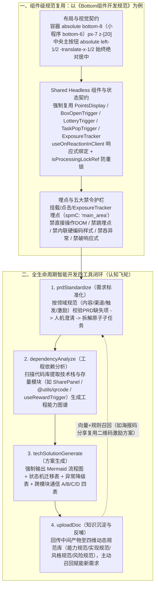

# AI互动前端开发的思考和实践

## 1. TL;DR

1. **核心痛点**：前端互动玩法（养成、签到、任务、分享、抽奖等十几种核心模式）在跨 IP 项目（如“蛋仔派对”与“种地吧”）复用时，传统的“代码级组件复用（Component is Code）”为了兼容千变万化的视觉样式与特异逻辑，往往演变成拥有几十个配置项、内部逻辑极度臃肿且生命周期短暂的“万能巨型组件”。
2. **核心理念跃迁（从“代码复用”转向“规范复用”，`Component is Spec`）**：当 AI 让编写新组件的边际成本趋近于零时，不再强行维护大而全的万能代码组件，而是复用**设计理念、接口契约与最佳实践规范（Spec）**，让 AI 结合 D2C 与项目上下文为每个场景按需生成逻辑纯粹的专用组件（在 Bottom 组件实战中视觉还原度达 **90% 以上**）。
3. **全生命周期四工具认知飞轮（MCP 闭环）**：将规范驱动从单组件扩展至需求全生命周期，通过四个核心工具构建自进化闭环——① **`prdStandardize`**（基于领域规范识别 PRD 模糊点、交互澄清并拆解为高内聚原子任务） $\to$ ② **`dependencyAnalyze`**（静态/动态扫描代码库生成“工程上下文快照”与能力图谱，对齐存量组件如 `SharePanel` / `useRewardTrigger`） $\to$ ③ **`techSolutionGenerate`**（强制以 `mermaid` 流程图、状态机表与 A/B/C/D 四张跨模块通信表生成可执行技术方案契约） $\to$ ④ **`uploadDoc`**（将中间产物回传至包含**能力规范、实现规范、风格规范、风险规范**的四维动态知识库，反哺后续需求）。

## 2. 问题定义与背景

### 2.1 为什么传统前端互动组件“代码复用”总是失败？

1. **互动业务的表象与本质矛盾**：淘宝互动业务的核心玩法虽然只有养成、签到、任务、分享、抽奖等十几种，但不同 IP 活动（如“蛋仔派对” vs “种地吧”）的按钮样式、色彩动效、体力/经验等特有资产展示截然不同。
2. **“万能组件”的腐化死循环**：传统模式试图通过抽象一个支持所有场景的通用代码组件来实现复用，结果为了兼容各业务线特例不得不塞入**几十个 Props 配置项**与海量 `if/else` 分支，导致内部复杂度失控、维护者疲于奔命，最终在新项目来临时大家宁可推倒重写。

### 2.2 范式转移：从 `"Component is Code"` 到 `"Component is Spec"`

- 在 `"Code is cheap, Spec is valuable"` 的 AI 时代，编写新组件代码的边际成本趋近于零；
- **语义复用优先于代码复用**：不再追求跨项目共用同一份臃肿的 `.tsx` 源码，而是制定高水准的《组件开发规范（Spec）》，规定统一的布局契约、Shared 触发器组件、状态锁定、埋点规范与异常处理，由 AI 按需生成针对当前项目的**轻量专用组件**。

## 3. 知识框架

## 4. 核心内容拆解

### 4.1 实战案例一：《Bottom 组件开发规范》的工程颗粒度

为了看清“什么叫能真正指导 AI 写出生产级代码的 Spec”，文中完整展示了 IP 互动项目《Bottom 组件开发规范》的六个核心维度：
1. **布局绝对居中契约**：
   - 外层容器统一采用 `w-full absolute bottom-8`（在 PHA 小程序环境通过 `isPhaH5` 切换为 `bottom-6`），水平内边距 `px-7`（`28px`），基础层级 `z-[20]`（弹窗 `z-[25]`、引导气泡 `z-[30]`）；
   - **核心铁律**：中央主操作按钮必须采用 `absolute left-1/2 top-1/2 transform -translate-x-1/2 -translate-y-1/2` **始终保持绝对水平居中**，绝不能因左右两侧次要按钮（抽奖 `80×105px`、盲盒 `104×104px`、任务 `60×60px`）的动态显隐而发生偏移。
2. **强制复用 Headless Shared 触发器组件**：
   - 规定必须从 `@/ace/shared/component/*` 导入 `PointsDisplay`（Headless UI 设计，支持 `$(points)` 模板占位符与 `render` prop）、`BoxOpenTrigger`、`BlindBoxPopTrigger`、`LotteryTrigger`、`TaskPopTrigger` 与 `ExposureTracker`，保持 Bottom 组件自身的纯展示性。
3. **响应式 Store 绑定与防重入锁**：
   - 强制使用 `useOnReactionInClient(props.mainStore, ...)` 监听数据变化，严禁直接裸读 Store；
   - 主按钮点击通过 `props.isProcessingLockRef.current` 在 `try...finally` 中加解锁防止连点并发。
4. **全链路埋点与五条红线禁令**：
   - 曝光（`useEffect` 挂载与 `<ExposureTracker>`）与点击均须调用 `Logger.ins.reportBiz('[业务标识]_home_...', { from, scene_code }, { spmC: 'main_area' })`；
   - **五条禁止事项**：① 不得直接操作 DOM；② 不得跳过埋点；③ 不得硬编码内联样式（统一用 Tailwind 类名）；④ 不得忽略异步错误处理（需捕获并调用 `showToastText('操作失败，请重试')`）；⑤ 不得破坏多端安全区域响应式适配。
- **落地验证**：结合 D2C 输入新 IP 视觉稿 + 该 Bottom 规范约束，AI 生成的定制组件**视觉还原度达 90% 以上**，且一次性具备完整数据绑定、埋点与防重锁。

### 4.2 迈向全生命周期：围绕“规范”运转的四大核心工具

团队进一步将“规范驱动”从前端 UI 组件扩展为覆盖需求全生命周期的 MCP 工具链：
1. **起点：`prdStandardize`（需求标准化与澄清拆解）**
   - 原始自然语言需求进入后，工具对照领域规范（例如“分享玩法规范”要求的四大要素：**内容类型、分发渠道、触发机制、激励策略**）做完备性校验；
   - 发现缺失时自动向产品/研发发起结构化追问（如：*“检测到‘社交分享’未指定具体路径。当前项目常用方式包括微信唤端、复制链接、二维码海报，请确认是否支持多渠道？是否包含奖励激励？”*），对齐后拆解为高内聚原子任务（如“二维码生成子能力”、“奖励弹窗触发逻辑”）。
2. **上下文注入：`dependencyAnalyze`（工程依赖分析与能力图谱）**
   - 对目标代码库做静态与动态分析，提取存量可复用资产生成**“工程上下文快照 / 工程能力图谱”**；
   - 例如在“二维码分享”任务中，自动识别出工程内已有通用容器 `SharePanel`（支持 `type` 注入）、二维码模块 `@utils/qrcode` 以及统一激励 Hook `useRewardTrigger`，从而指导 AI 走“复用 `SharePanel` 注册新类型 + 调用 `useRewardTrigger`”的最小改动路径，杜绝重复造轮子。
3. **方案生成：`techSolutionGenerate`（可视化契约固化）**
   - 整合原子需求与工程上下文快照，自动生成可执行的技术方案文档，并强制执行两项结构化标准：
     - **核心交互必须画 `mermaid` 流程图与状态机表**（如 `idle -> generating -> success / error`，禁止纯文字描述分支）及异常降级表（如 `>5s` 超时自动降级为“复制链接”并上报 `qrcode_fallback`）；
     - **跨模块通信 A/B/C/D 四表**：A 表（事件总线如 `mx:share:triggered`）、B 表（响应式 Store 如 `useShareConfig().channels`）、C 表（路由 & URL Query 如 `share_mode`）、D 表（跨上下文通道如 `BroadcastChannel` 的 `share:sync`）。
4. **闭环反馈：`uploadDoc`（知识沉淀与四维动态规范库自生长）**
   - 将每次交付的待确认点、标准化需求、依赖快照与技术方案回传至规范知识库；当后续接到“带积分奖励的海报码分享”时，系统基于向量相似度与规则自动召回此前的“二维码+激励弹窗”方案，给出*“复用现有激励流程，仅扩展海报码生成器并注册新类型至 SharePanel”*的精准增量建议。
   - 规范知识库由此演进为四维认知中枢：**能力规范**（养成/签到/分享等功能原型）、**实现规范**（跨项目最佳实践管线）、**风格规范**（学习特定工程目录与状态管理偏好实现千人千面）、**风险规范**（自动归纳网络异常、兼容性与性能瓶颈降级策略）。

## 5. 数据速查表

| 维度 / 规范项 | 原文数值 / 设定 | 语境 / 条件 |
| --- | --- | --- |
| 互动业务常见核心玩法数量 | **十几种（养成、签到、任务、分享、抽奖、盲盒等）** | 玩法内核稳定但跨 IP 视觉与局部逻辑千变万化 |
| Bottom 组件规范标准尺寸体系 | **小型按钮 `60×60px` / 标准 `80×105px` / 大型 `104×104px` / 主按钮 `200×80px`** | 容器高 `80/120/160px`，水平内边距 `px-7 (28px)`，底部间距 `32px (bottom-8)` |
| Bottom 组件 Z-index 三级规范 | **基础层 `z-[20]` / 弹出内容 `z-[25]` / 引导气泡 `z-[30]`** | 通过外部 `className` 控制防止层级冲突 |
| D2C + Bottom 规范生成还原度 | **视觉样式还原度达到 90% 以上** | 新 IP 互动项目实战验证，具备完整数据绑定与交互 |
| 二维码分享方案动效与超时降级参数 | **进入动画 `150ms ease-in-out` / 生成超时 `> 5s` 自动降级为“复制链接”** | `techSolutionGenerate` 生成方案中的异常与无障碍（`Esc` 关闭、`prefers-reduced-motion`）规范 |

## 6. 踩坑与教训 / 可迁移的设计原则

| 错误做法 | 失败表现或原因 | 原文应对（可迁移的设计原则） |
| --- | --- | --- |
| **试图封装一个兼容所有 IP 视觉与玩法特例的“万能代码组件”** | Props 膨胀到几十个、内部充满分支特判，维护者疲于奔命且最终无人敢改 | **从“代码复用（Component is Code）”转向“规范复用（Component is Spec）”**：沉淀高标准 Spec + Headless Shared 触发器，让 AI 为每个项目按需生成轻量专用组件 |
| **底部操作栏用普通 Flex 顺序流排布左、中、右按钮** | 当左侧或右侧活动入口按条件动态隐藏时，中央主操作按钮发生左右偏移 | **中央主按钮采用 `absolute left-1/2 top-1/2 -translate-x-1/2 -translate-y-1/2` 绝对居中**，彻底与左右功能区内容变化解耦 |
| **拿着一句话模糊 PRD 直接让 AI 写业务模块代码** | 缺失分享渠道、激励联动或异常降级定义，且 AI 不了解项目内已有公共组件而重复造轮子 | **前置串联 `prdStandardize`（按领域规范反问澄清）+ `dependencyAnalyze`（扫描工程存量组件生成能力图谱）** |
| **技术方案仅用大段自然语言描述交互逻辑与跨模块调用** | 状态流转边界不清、跨模块事件与 URL 参数散乱，AI 生码易遗漏异常分支 | **强制要求 `techSolutionGenerate` 输出 Mermaid 流程图 + 状态机迁移表 + 异常降级表 + 跨模块通信 A/B/C/D 四表** |

## 7. 记忆锚点

1. **复用范式跃迁口诀**：“**Code is cheap, Spec is valuable——从复用臃肿代码（Component is Code）转向复用设计契约（Component is Spec）**”。
2. **全生命周期四工具飞轮**：$\text{prdStandardize（澄需求）} \to \text{dependencyAnalyze（扫工程）} \to \text{techSolutionGenerate（生契约）} \to \text{uploadDoc（反哺四维规范库）}$。

## 8. 复习卡片

1. 为什么在前端 IP 互动开发中，传统的“代码级组件复用”往往会走向失败？AI 时代提出了什么替代范式？::因为不同 IP 项目的视觉样式与玩法变体差异极大，传统通用组件为了兼容所有场景会膨胀出几十个配置项和极高的内部逻辑复杂度；AI 时代当写代码的边际成本趋近于零时，应转向“规范复用（Component is Spec）”，复用设计理念、接口契约与最佳实践，让 AI 按规范为每个具体场景生成简洁的专用组件。
2. 在《Bottom 组件开发规范》中，如何保证中央主操作按钮不受左右两侧次要功能按钮动态增减的影响？又是如何保持组件纯粹性的？::中央主操作区使用 `absolute left-1/2 top-1/2 transform -translate-x-1/2 -translate-y-1/2` 绝对居中定位，右侧功能区用 `ml-auto` 右对齐；组件内部强制复用 `@/ace/shared/component/*` 下的 Headless 触发器组件（`PointsDisplay`、`BoxOpenTrigger`、`LotteryTrigger`、`TaskPopTrigger`、`ExposureTracker`），使 Bottom 自身保持纯展示与布局组装职责。
3. 全生命周期智能开发框架由哪四个核心工具组成？各自的核心职责是什么？::① `prdStandardize`（基于领域规范校验 PRD 缺失维度、发起人机澄清并拆解为原子任务）；② `dependencyAnalyze`（扫描当前代码库提取技术栈与存量模块，生成“工程上下文快照/能力图谱”）；③ `techSolutionGenerate`（生成含 Mermaid 流程图、状态机表与跨模块通信表的可执行技术方案）；④ `uploadDoc`（将中间产物结构化回传至规范知识库实现闭环反哺）。
4. 以“实现二维码分享子能力”为例，`dependencyAnalyze` 扫描工程后为 AI 提供了哪些关键上下文信息以避免重复造轮子？::识别出三项存量资产：① 已存在通用 `SharePanel` 组件（支持通过 `type` 参数注入渠道）；② 二维码生成已封装于 `@utils/qrcode` 模块；③ 奖励弹窗统一由 `useRewardTrigger` Hook 控制。AI 据此直接生成“复用 `SharePanel` 注册新类型 + 调用 `useRewardTrigger`”的方案。
5. `techSolutionGenerate` 生成的技术方案文档中，除了 Mermaid 流程图、状态机表和异常降级表外，还通过哪“四张表（A/B/C/D 表）”规范跨模块通信？::① A 表：事件总线（如 `mx:share:triggered` 事件名、触发时机与负载结构）；② B 表：响应式 Store（如 `useShareConfig().channels`）；③ C 表：路由与 URL Query 参数（如 `share_mode`）；④ D 表：跨上下文通道（如基于 `BroadcastChannel` 的 `share:sync`）。
6. 随着需求不断通过 `uploadDoc` 回流沉淀，动态规范系统演化出了哪四类规范？::① 能力规范（积累养成、签到、分享等业务功能原型）；② 实现规范（沉淀高性能动画管线、分享回流激励等跨项目最佳实践）；③ 风格规范（学习不同工程的状态管理与目录偏好，实现千人千面适配）；④ 风险规范（自动归纳网络异常、兼容性规避与超时降级策略）。

## 9. 知识关联

- **本库主题关联**：
  - [AI研发协同](../../20_topics/AI研发协同.md)：提出 `"Component is Spec"` 规范复用理念，并通过 `prdStandardize -> dependencyAnalyze -> techSolutionGenerate -> uploadDoc` 四工具打通需求到知识沉淀的全生命周期飞轮。
  - [跨端开发与性能](../../20_topics/跨端开发与性能.md)：沉淀淘宝 IP 互动前端 Bottom 组件规范（Tailwind 布局契约、Headless Shared 触发器、PHA 小程序适配与埋点规范），结合 D2C 实现 90%+ 视觉还原。
  - [Skill设计与治理](../../20_topics/Skill设计与治理.md)：将静态规范模板升级为包含能力、实现、风格、风险四维度的自生长动态认知中枢。
- **候选双链**：`[[ComponentIsSpec]]`、`[[规范驱动开发]]`、`[[HeadlessUI]]`、`[[前端互动组件]]`、`[[工程能力图谱]]`

## 10. 原文参考资料

- **原文标题**：《AI互动前端开发的思考和实践》
- **发布渠道与日期**：微信公众号「大淘宝技术」，2025-11-24
- **作者与团队**：业勤（淘天集团-用户&内容技术团队）
- **核心提及工具与内部模块**：`prdStandardize`、`dependencyAnalyze`、`techSolutionGenerate`、`uploadDoc`、`@/ace/shared/component/*`（`PointsDisplay`、`BoxOpenTrigger`、`LotteryTrigger`、`TaskPopTrigger`、`ExposureTracker`）

> [!note]- 校对报告
> - **页码溯源汇总**：
>   - 互动前端组件复用困境（十几种核心玩法、万能组件配置爆炸与腐化）及从“代码复用（Component is Code）”向“规范复用（Component is Spec）”的转变：`p.1–4`
>   - 《Bottom 组件开发规范》全文（设计原则、绝对居中布局、Shared 组件导入、尺寸与 Z-index 规范、`useOnReactionInClient` 状态绑定、`isProcessingLockRef` 防重锁、曝光/点击埋点、五大禁止事项）及 D2C+规范实战验证（还原度 90%+）：`p.4–18`
>   - 全生命周期智能开发框架（`"Code is cheap, Spec is valuable"`）与四大工具详解：`prdStandardize`（分享玩法四维度澄清拆解）、`dependencyAnalyze`（`SharePanel` / `@utils/qrcode` / `useRewardTrigger` 工程能力图谱）、`techSolutionGenerate`（二维码分享 Mermaid 流程图、状态机、>5s 超时降级与跨模块通信 A/B/C/D 四表）、`uploadDoc`（海报码分享案例召回与能力/实现/风格/风险四维规范库演进）：`p.19–26`
> - **关键数值一致性核查**：
>   - 按钮尺寸（`60×60px`、`80×105px`、`104×104px`、`200×80px`）、容器高度（`80/120/160px`）、间距（`px-7 = 28px`、`bottom-8 = 32px`）、层级（`z-[20]/z-[25]/z-[30]`）、视觉还原度 `90%以上`、进入动画 `150ms`、超时阈值 `>5s` 均与原文完全一致。
> - **图像与版面质量说明**：
>   - `p.1, 2, 4, 17, 18, 20` 含蛋仔派对/种地吧底部截图、新项目设计稿、16 秒演示视频帧与四工具闭环图（位于 PDF 图像层），`p.27` 为空白尾页；全部 TSX/CSS 规范代码与 Markdown 技术方案契约均在 PDF 文本层完整保留。
