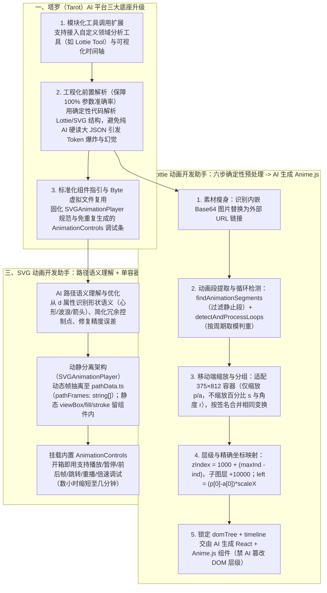

# AI动画辅助实现的方案与实践

## 1. TL;DR

1. **核心痛点**：淘宝秒杀业务高频涉及卡券、红包、价格扫光等伴随组件状态切换（点击、倒计时结束、领取成功）的微动效；直接用 Lottie 存在**加载慢/失败风险、不规则形变导出序列帧体积近 `1MB`、动态倒计时/多状态干预繁琐**三块短板，而前端手写 DOM/SVG 动画又面临**“与设计师黑盒视频沟通难（靠猜参数）、肉眼逐帧比对试错慢（简单 3 元素 5 段动画需 `2–4 小时`）、SVG 复杂 `path` 形变手写成本极高”**三大难题。
2. **核心机制（塔罗平台双动画开发助手：确定性工程前置解析 + AI 代码生成）**：
   - **Lottie 动画开发助手**：不把原始大 JSON 直接丢给 AI，而是先用**确定性工程代码做 100% 准确的静态解析与标准化**——① 剥离内嵌 Base64 大图替换为外链；② 提取有效动画段（`findAnimationSegments`）、检测重复循环周期（`detectAndProcessLoops`）并按 `propKey|isLoop|loops|segments` 签名聚合相同变换；③ 按移动端 `375 × 812` 容器对位移 `p` 与锚点 `a` 做比例缩放（`finalLeft = (position[0] - anchor[0]) * scaleX`），按 `zIndex = 1000 + (maxInd - layer.ind)`（有父节点时 `+ 10000`）预生成**不可篡改的 `domTree` 与 `timeline`**，最后交由 AI 转换为基于 **Anime.js + React** 的轻量代码；
   - **SVG 动画开发助手**：通过预设《SVG 帧动画处理指引》与 Byte 虚拟文件内置的 `AnimationControls`（播放/暂停/前后帧/跳转/倍速），将 Sketch 复制的多帧 SVG 路径序列抽离至独立的 `/src/components/SVGAnimationPlayer/pathData.ts`（`pathFrames: string[]`），由 AI 识别形状语义、简化冗余路径点并产出统一的 **`SVGAnimationPlayer`（单 SVG 容器 + 帧切换 + CSS Modules）** 组件。
3. **量化效果**：将以往耗时 **`2–4 小时`（数小时）** 的微动效分析、编码与调试缩短至 **`几分钟`内自动完成**；在优惠券动画（还原度 **`100%`**）、红包浮标倒计时（**`100%`**）、红包 Pop（**`95%`**）、红包膨胀（**`95%`**）、价格扫光缩放（**`90%`**）与浮层红包膨胀（**`80%`**）实测中取得高还原度交付。

## 2. 问题定义与背景

### 2.1 为什么淘宝秒杀微动效既不愿全用 Lottie，又苦于手写 DOM/SVG？

1. **Lottie 在交互微动效场景的三大局限**：
   - **加载性能与失败兜底负担**：外部 JSON 与图片资源加载存在延迟或失败风险；
   - **不规则形变体积膨胀**：遇到复杂路径形变（如红包膨胀/液态形变）时，Lottie 往往退化为导出序列帧图片，单文件体积接近 **`1MB`**；
   - **动态状态耦合重**：面对倒计时数字跳动、点击中断、多状态切换，需设计师前置预留图层名并由前端引重型 `lottie-web` 做运行时接管，远不如原生 React/DOM 灵活。
2. **手写 DOM / SVG 动画的三座大山**：
   - **沟通难（黑盒参数靠猜）**：从 AE 视频或 GIF 中无法直接获知元素在第几秒出现、从 `0.8` 放到 `1.2` 还是 `0` 到 `1`、贝塞尔控制点数值以及多元素重叠延迟；
   - **实现慢（肉眼比对试错）**：一个仅含“按钮弹出 + 图标旋转 + 文字渐显”（**3 个元素、5 段动画**）的常规组合动效，开发+调试+设计验收往往耗费 **`2–4 小时`**；
   - **SVG 形变门槛极高**：SVG `d` 属性路径指令与变换矩阵可读性极差，手动对齐关键帧路径节点几乎不可行。

## 3. 知识框架

## 4. 核心内容拆解

### 4.1 Lottie 动画开发助手：为什么坚持“工程前置解析 + 锁定 `domTree`”？

如果把整份原始 Lottie JSON 直接塞给大模型，内嵌的 Base64 图片会瞬間撑爆 Token，且大模型在换算 Lottie 锚点坐标系与图层遮挡关系时极易算错。因此团队用确定性工程代码完成了 **6 步前置处理**：
1. **素材映射（Base64 转外链）**：扫描 `assets`，自动将体积庞大的内嵌 Base64 图片提取替换为轻量外部图片 URL，大幅压缩输入体积。
2. **动画段提取（`findAnimationSegments`）与循环检测（`detectAndProcessLoops`）**：
   - 从关键帧数组中提取有效变化区间，识别 `Linear`、`Hold`、`cubic-bezier` 缓动类型，并**过滤掉数值未发生变化的静止段**；
   - 通过遍历候选周期 `for (let period = 1; period <= segments.length / 2; period++)`，当 `segments.length % period === 0` 时比对各周期片段是否完全一致，自动归纳出 `isLoop` 与 `loopCount`。
3. **移动端容器（`375 × 812`）属性差异化缩放（`normalizeValueForKey`）**：
   - 仅对画布绝对坐标属性 **`p`（`position`）**与 **`a`（`anchorPoint`）**执行 `shouldScaleX = true; shouldScaleY = true` 比例缩放；
   - 对相对百分比属性 **`s`（`scale`）**与角度属性 **`r`（`rotation`）**保持原值不缩放。
4. **相同变换分组聚合（`animationKey`）**：
   - 构造签名 `prop:${propKey}|isLoop:${isLoop}|loops:${loopCount}|sf:${startFrame},ef:${endFrame}...`，将不同元素上完全相同的动画轨迹归并为同一组，贴合人类前端编码习惯。
5. **图层遮挡 `z-index` 公式与父子层级还原（`calculateZIndex`）**：
   - Lottie 中图层索引 **`ind` 越小代表层级越高（越靠前）**；故定义基础公式：
     $$\text{zIndex} = \text{baseZIndex}(1000) + (\text{maxInd} - \text{layer.ind})$$
     （例如 `maxInd = 15` 时，`ind = 1` 得 `1014/1015` 在最前，`ind = 15` 得 `1000/1001` 在最后）；
   - 若图层存在父图层（`layer.parent !== undefined`），则额外 **`+ 10000`** 确保子元素始终渲染在父容器之上，并按 `parent` 指针递归构建嵌套 `domTree`。
6. **左上角绝对定位精确换算公式（`calculatePosition`）**：
   - Lottie 的 `ks.p` 表示元素**锚点（`ks.a`）**在原始画布（如 `750 × 1624`）中的坐标，而 CSS `left / top` 表示元素**左上角**坐标；
   - 因此核心转换公式为：
     $$\text{finalLeft} = (\text{position}[0] - \text{anchor}[0]) \times \frac{\text{targetWidth}}{\text{compWidth}}, \quad \text{finalTop} = (\text{position}[1] - \text{anchor}[1]) \times \frac{\text{targetHeight}}{\text{compHeight}}$$
   - 仅当 `|scale - 1| > 0.001` 或 `|rotation| > 0.001` 时才拼接 `transform: scale(...) rotate(...deg)`，避免冗余样式。
7. **锁定 `domTree` + `timeline` 交由 AI 生成 Anime.js 组件**：
   - 强制规定 **AI 严禁调整预生成的 `domTree` DOM 结构**，只需将 `timeline` 中的 `segments`、`easing`、`duration/delay` 与 `loop` 映射为 **Anime.js** 配置并导出为可在塔罗平台实时预览或粘入 Cursor 的 React 组件。

### 4.2 SVG 动画开发助手：动静分离与虚拟文件控件复用

针对设计师从 Sketch 导出的多帧复杂路径形变 SVG 片段，团队制定了《SVG 帧动画处理指引》：
1. **AI 三大赋能点**：① 从密密麻麻的 `d="M10 10 H 90..."` 中识别出“心形”、“波浪”、“箭头”等形状语义；② 自动串联多帧起止过渡逻辑；③ 自动简化冗余路径控制点、修复浮点精度误差以压缩代码体积。
2. **数据与视图动静分离约定**：
   - 将所有帧中动态变化的 `d` 属性字符串数组统一抽离至 `/src/components/SVGAnimationPlayer/pathData.ts`（`export const pathFrames: string[] = [...]`）；
   - 将不变的 `viewBox`、`width`、`height`、`fill`、`stroke` 静态保留在默认导出的 **`SVGAnimationPlayer`** 组件内（采用 CSS Modules 样式与“单 SVG 容器 + 帧切换”渲染逻辑）。
3. **Byte 虚拟文件注入 `AnimationControls`**：
   - 利用塔罗底层 Byte 环境的虚拟文件能力，预先内置通用的 `AnimationControls` 调试组件；AI 无需每次重复生成控制条代码，直接通过 `props` 挂载即可获得**播放/暂停、上一帧/下一帧、指定帧跳转、重播、倍速调节**全套调试能力。

## 5. 数据速查表

| 指标 / 测试案例 | 原文数值 / 还原度 | 语境 / 条件 |
| --- | --- | --- |
| 不规则形变 Lottie 序列帧文件体积 | **接近 `1 MB`** | 引发移动端加载缓慢与衔接卡顿 |
| 传统手写 3 元素 5 段组合微动效耗时 | **`2 – 4 小时`（开发+调试+验收）** | 按钮弹出 + 图标旋转 + 文字渐显 |
| AI 动画助手端到端生成耗时 | **缩短至 `几分钟`内自动完成** | 含解析、生成 React + Anime.js / SVG 组件与实时预览 |
| 塔罗移动端目标容器与原始画布尺寸 | **目标容器 `375 × 812` / 原始画布如 `750 × 1624`** | 用于计算 `scaleX` 与 `scaleY` 坐标映射 |
| 图层 `zIndex` 计算基准值 | **`baseZIndex = 1000` / 子元素额外 `+ 10000`** | `zIndex = 1000 + (maxInd - layer.ind)` |
| 实测案例 1 & 2：优惠券动画 / 红包浮标倒计时 | **UI 与动画还原度 `100%`** | 时间轴、关键帧与视觉表现完全对齐 |
| 实测案例 3 & 4：红包 Pop / 红包膨胀 | **UI 与动画还原度 `95%`** | 淘宝秒杀核心红包互动微动效 |
| 实测案例 5 & 6：价格扫光动画 / 浮层红包膨胀 | **价格动画还原度 `90%` / 浮层红包膨胀还原度 `80%`** | 含扫光、价格缩放与 Tip 缩放多段复合动效 |

## 6. 踩坑与教训 / 可迁移的设计原则

| 错误做法 | 失败表现或原因 | 原文应对（可迁移的设计原则） |
| --- | --- | --- |
| **把包含内嵌 Base64 图片的原始 Lottie JSON 直接全文喂给大模型** | Base64 字符串瞬间撑爆上下文窗口，且大模型做浮点坐标换算与图层遮挡推导极易产生幻觉 | **工程前置解析 + 素材外链化**：用确定性代码将 Base64 替换为图片 URL，并精确算出 `domTree` 与 `timeline` 再喂给 AI |
| **让 AI 根据动画描述自由发挥构建 DOM 树层级与 CSS 定位** | 生成的 DOM 父子关系错乱、锚点偏移未扣除（直接把 `ks.p` 当 `left/top`），导致元素位置严重跑偏 | **解析系统预生成不可篡改的 `domTree`**：通过 `(position - anchor) * scale` 算准左上角坐标，通过 `1000 + (maxInd - ind)` 算准 `z-index`，AI 仅负责写 Anime.js 动画逻辑 |
| **在缩放适配移动端容器时把 Lottie 所有属性一刀切乘上缩放系数** | 把原本就是百分比的 `scale (s)` 和角度 `rotation (r)` 也乘了容器缩放比，导致动画变形 | **按属性物理量纲差异化归一化（`normalizeValueForKey`）**：仅对位移 `p` 和锚点 `a` 乘缩放系数，保留 `s` 和 `r` 原值 |
| **让 AI 每次生成 SVG 帧动画时都把几十帧超长 `d` 路径和播放控制条混写在同一个组件文件里** | 单文件几千行难以阅读维护，且每次生成的播放/倍速控制条逻辑不一致 | **数据与控制条双抽离**：路径数组强制抽离至 `pathData.ts`，控制条通过 Byte 虚拟文件直接复用预置的 `AnimationControls` |

## 7. 记忆锚点

1. **Lottie 转 DOM 两大核心公式**：
   - **左上角坐标**：$\text{Left/Top} = (\text{Position} - \text{Anchor}) \times \text{Scale}_{\text{container}}$；
   - **遮挡层级**：$\text{zIndex} = 1000 + (\text{maxInd} - \text{ind}) + (\text{hasParent} ? 10000 : 0)$。
2. **分工铁律**：“**确定性工程代码管解析算坐标（保 100% 准），AI 大模型管写 Anime.js 与优 SVG 路径（从 2–4 小时缩至几分钟）**”。

## 8. 复习卡片

1. 在淘宝秒杀等高频营销场景中，为什么轻量微动效（如卡券呼吸、红包状态切换）不适合全部直接用 Lottie 播放，而希望转为原生 DOM/SVG 代码？::因为 Lottie 存在三大痛点：① 文件加载慢或失败需额外容错；② 遇到不规则形变时只能导出序列帧，体积接近 1MB；③ 当微动效需与 React 组件的多状态切换、实时倒计时、点击中断紧密耦合时，在 Lottie 上做运行时改造极其繁琐，远不如原生 DOM/SVG + Anime.js 灵活轻量。
2. 为什么塔罗平台的 Lottie 动画开发助手不直接把原始 Lottie JSON 扔给大模型，而是先用工程代码做前置解析？::因为原始 Lottie JSON 常内嵌庞大的 Base64 图片导致 Token 爆炸，且纯靠大模型心算坐标转换、缓动曲线与属性冲突准确率低；通过工程代码前置剥离 Base64、提取有效动画段、检测循环周期并预生成标准 `domTree` 与 `timeline`，能保证分析阶段 100% 准确并大幅节省 Token。
3. 在将 Lottie 图层适配到 `375 × 812` 的移动端容器时，哪些属性需要按画布比例缩放？哪些属性不能缩放？元素左上角的 `left/top` 是如何计算的？::位置 `p`（`position`）和锚点 `a`（`anchorPoint`）需要乘缩放比例（`targetWidth / compWidth`），而缩放比例 `s`（`scale`，本身是百分比）和旋转角度 `r`（`rotation`）不需要缩放；由于 Lottie 的 `p` 是锚点在画布中的位置，故元素左上角坐标公式为 `finalLeft = (position[0] - anchor[0]) * scaleX`、`finalTop = (position[1] - anchor[1]) * scaleY`。
4. Lottie 图层的 `ind` 字段与 CSS 的 `z-index` 层级顺序有什么关系？`calculateZIndex` 是如何处理普通图层与父子嵌套图层的？::Lottie 中 `ind` 越小代表图层越靠上（最前面），`ind` 越大越靠底层；因此基础公式为 `zIndex = 1000 + (maxInd - layer.ind)`；若该图层存在父图层（`layer.parent !== undefined`），则在结果上额外 `+ 10000`，确保子元素始终渲染在父元素之上。
5. SVG 动画开发助手是如何通过“架构约定”与“虚拟文件”保证生成的路径形变组件既轻量又好调试的？::通过《SVG 帧动画处理指引》强制约定：① 仅导出一个采用“单 SVG 容器 + 帧切换”的 `SVGAnimationPlayer` 组件（固定 `viewBox/fill/stroke`）；② 将多帧变化的 `d` 属性字符串数组抽离至独立的 `pathData.ts`；③ 利用 Byte 虚拟文件直接复用预置的 `AnimationControls` 组件，开箱即用支持播放/暂停、前后帧、跳转与倍速调试。
6. 引入 Lottie 与 SVG 两个 AI 动画助手后，微动效的开发耗时与实测还原度表现如何？::将原本需要 2–4 小时（分析、手写关键帧、肉眼逐帧比对调试）的流程缩短至**几分钟**内自动完成；在优惠券动画与红包浮标倒计时上达到 **100%** 还原度，在红包 Pop 与红包膨胀上达到 **95%** 还原度，在价格扫光与浮层红包膨胀上达到 **80%–90%** 还原度。

## 9. 知识关联

- **本库主题关联**：
  - [跨端开发与性能](../../20_topics/跨端开发与性能.md)：将近 1MB 的重型 Lottie/SVG 动效自动转化为轻量的 React + Anime.js / 单容器帧切换 SVG 组件，精确处理 `375×812` 坐标映射与 `z-index` 层级。
  - [AI研发协同](../../20_topics/AI研发协同.md)：在塔罗平台落地“确定性工程前置解析（锁死 `domTree` 几何精度）+ AI 后置生成代码”的人机协同范式，将 2–4 小时动效开发缩短至几分钟。
  - [Skill设计与治理](../../20_topics/Skill设计与治理.md)：将 Lottie 解析器封装为标准 Tool，并通过《SVG 帧动画处理指引》与 Byte 虚拟文件（`AnimationControls`）约束 AI 输出结构。
- **候选双链**：`[[Lottie转DOM]]`、`[[SVG路径动画]]`、`[[塔罗平台]]`、`[[AnimeJS]]`、`[[微动效工程化]]`

## 10. 原文参考资料

- **原文标题**：《AI动画辅助实现的方案与实践》
- **发布渠道与日期**：微信公众号「大淘宝技术」，2025-10-13
- **作者与团队**：香芋（淘天集团-用户场景营销技术团队）
- **核心提及平台与技术**：塔罗（Tarot）AI 平台、Byte 虚拟文件环境、Lottie、Anime.js、React、CSS Modules、Sketch SVG

> [!note]- 校对报告
> - **页码溯源汇总**：
>   - 淘宝秒杀微动效背景、Lottie 三大局限（加载风险、形变帧动画近 `1MB`、动态状态复杂）与手写 DOM/SVG 三大痛点（黑盒参数靠猜、3 元素 5 段动画耗 `2–4 小时`、SVG `path` 难写）：`p.1–5`
>   - 塔罗平台三项升级与 Lottie Tool 工具定义：`p.5–8`
>   - Lottie 动画助手六步工程实现：`findAnimationSegments`、`detectAndProcessLoops`、`normalizeValueForKey`（`375 * 812` 容器）、`animationKey` 分组、Base64 转外链、`calculateZIndex`（`1000 + maxInd - ind`，子元素 `+10000`）、`calculatePosition`（`(position - anchor) * scale`）及锁定 `domTree` + `timeline` 转 Anime.js：`p.9–15`
>   - SVG 动画助手实现（语义理解、`SVGAnimationPlayer`、`pathData.ts` 抽离、Byte 虚拟文件挂载 `AnimationControls`）：`p.16–18`
>   - 6 个真实业务测试案例还原度评测表（优惠券 `100%`、红包浮标倒计时 `100%`、红包 Pop `95%`、红包膨胀 `95%`、浮层红包膨胀 `80%`、价格动画 `90%`）：`p.18–21`
> - **关键数值一致性核查**：
>   - Lottie 序列帧体积 `接近 1MB`、手写耗时 `2–4 小时`（3 个元素、5 段动画）vs AI `几分钟`、容器尺寸 `375 * 812` vs 画布 `750×1624`、`baseZIndex = 1000` 与子元素 `+ 10000`、6 个案例还原度（`100% / 100% / 95% / 95% / 80% / 90%`）均与原文完全一致。
> - **图像与版面质量说明**：
>   - `p.1–3, 6, 8, 10–12, 16–21` 含秒杀微动效视频帧、塔罗平台截图、时间轴预览与 6 个评测案例录屏帧（位于 PDF 图像层），`p.22` 为尾页；全部核心 JS/TS 解析源码与数学公式均在文本层完整保留。
