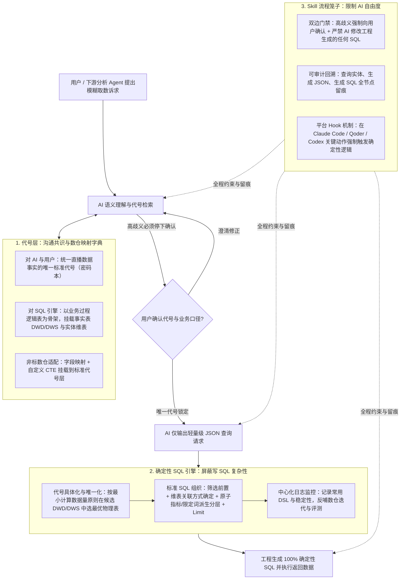

# 信任需要基础设施：如何让AI可靠的取数

## 1. TL;DR

面对复杂冗余数仓中直接让大模型写 SQL 易产生“语法完美但语义错误”幻觉、且非技术用户（运营、产品或下游 Agent）无法靠审阅 SQL 判别真伪的痛点，淘天直播数据团队提出了**“AI 思考能力 + 工程确定性”**的可靠取数基础设施。方案由三层基建构成：① **标准化代号层**（以业务过程逻辑表为骨架，将同一事实行为在明细表/DWS 汇总表中的多处冗余物理字段挂载到唯一标准代号下，消除一词多义与多词同义）；② **确定性 SQL 引擎**（AI 仅输出轻量级 JSON 查询请求，由工程引擎按“最小参与计算数据量”原则自动选表并按标准规则组装 SQL）；③ **Skill 流程笼子**（强制高歧义时停下向用户确认代号、严禁 AI 修改工程生成的 SQL、全程留痕可审计回溯并配合平台 Hook 强制执行）。这使数据研发从“重复写 SQL 的人”转型为“建设高复用语义资产与信任基建的人”。

## 2. 问题定义与背景

### 2.1 为什么“取个数而已”在生产数仓中极难完全信任 AI

1. **取数的本质是双重代号对齐**：
   - **指标（业务主体行为的度量，如“成交金额”）**与**维度（业务主体行为发生的环境，如“渠道名称”）**本质上都是物理世界真实事件行为的“代号”。
   - 真实取数必须完成两步：① **代号与事实口径对齐**（用户说“我要 GMV”，数仓里只有“成交金额”，且存在限制 `字段A='Y'` 与不限制两个不同口径的指标，必须先与用户确认具体事实行为）；② **物理取数执行**（找到对应物理表并写出正确 SQL）。
2. **直接让 AI 理解物理数仓并写 SQL 的三大致命缺陷**：
   - **数仓演化导致冗余与多义性爆炸**：随业务视角不断变化，数仓表持续膨胀冗余，同一指标代号对应多种计算方式，AI 直接读取物理表极易产生严重幻觉。
   - **SQL 决策链过长**：写出一条语法与语义双正确的 SQL 需要连续做指标口径选择、物理表选择、维度表关联、筛选前置等多步决策。
   - **“80%–90% 准确率”在生产环境的信任悖论**：即便 AI 生成 SQL 达到 `70%–90%` 的评测准确率，对不懂 SQL 的运营、产品或下游分析 Agent 而言，意味着**永远有 10%–30% 的概率拿到语法完美但口径错误的数字，且用户根本不知道哪一次是对的、哪一次是错的**。若系统可靠性依赖“有人会审 SQL”，用户就并未真正被解放。

## 3. 知识框架

## 4. 核心内容拆解

### 4.1 角色分工重构：AI 思考能力 + 工程确定性

**核心主张**：将“自然语言模糊理解”交给 AI，将“数仓口径映射与 SQL 生成”交给确定性工程，让每一环都由具备真实判断力的角色把关。

| 协作环节 | 核心任务 | 负责角色 | 为什么该角色具备可靠判断力 |
| :--- | :--- | :--- | :--- |
| **1. 代号对齐环节** | 将模糊诉求映射到唯一标准代号并确认业务含义 | **AI + 业务用户（产运）** | 用户无需懂 SQL，但完全有能力判断“这个标准代号的业务定义是不是我想要的” |
| **2. 代号-数仓映射环节** | 定义每个标准代号在底层数仓中的准确计算口径与物理字段绑定 | **数据研发工程师** | 数仓同学最清楚底层表结构与业务过程，负责维护高内聚、无二义性的“密码本” |
| **3. SQL 生成与执行环节** | 将轻量级 JSON 查询请求转化为最优物理表选择与标准 SQL 语句 | **确定性 SQL 引擎** | 选表策略与 SQL 语法组装属于确定性规则，由工程代码执行可保证 100% 语法与映射一致 |

- **对用户与代号层的新要求**：传统流程中用户可以丢一句极模糊的话或一张截图，全靠研发发挥主观能动性多轮沟通澄清；在 AI 取数链路中，**用户必须对 AI 对齐出的标准代号做出明确判断与确认**，这也倒逼代号层建设必须消除二义性、保证每个代号含义的唯一性。

### 4.2 代号层设计：以逻辑表为骨架挂载冗余物理数仓

**核心主张**：代号层对上（AI 与用户）是消除歧义的“无线电密码本”，对下（SQL 引擎）是屏蔽物理冗余的“数仓映射层”。

- **逻辑表骨架与物理数仓的挂载关系**：
  - **事实表（按业务过程组织）与维表（按业务实体组织）**：例如“成交”业务过程与“观看”业务过程各自包含明细表（DWD）和不同粒度的汇总表（DWS）；维表则包含主播维表、用户维表、商品维表等。
  - **冗余物理字段收敛绑定到唯一代号**：冗余存储是数仓的核心特性——例如“成交金额”这一代号，在成交明细表中是一个字段，在各粒度 DWS 汇总表中也是对应字段，它们表达的是同一个业务事实。代号层将这些等价的物理表字段全部绑定到“成交金额”这唯一代号下（维度代号同理）。
  - **非标数仓的兼容挂载**：若底层数仓完全按业务过程标准建设则可直接完美对接；针对不标准的存量数仓表，代号层通过**字段映射**与**自定义 CTE** 将其从逻辑上抽象并挂载到标准代号层，不要求推倒重建物理数仓。

### 4.3 确定性 SQL 引擎与 Skill 流程笼子

**核心主张**：不让 AI 写一行 SQL，也不允许 AI 修改一行工程生成的 SQL，用“JSON 请求 + 最小计算量选表引擎 + Skill 门禁与 Hook”彻底关住模型幻觉。

- **SQL 引擎的两步选表与标准化组织**：
  1. **代号具体化与唯一化（最优物理表选择）**：当同一个代号挂载了多张明细表和 DWS 汇总表时，引擎收集本次查询所需的全部指标与维度要求，在所有能满足需求的候选物理表中，**按“参与计算的数据量最小（计算最快）”原则唯一选定最优物理表**。
  2. **标准 SQL 语法组装**：按数仓加工规范确定性地组织 SQL 细节——**筛选条件提前下推（谓词下推）**、确定维表关联（JOIN）方式、**派生指标严格遵循“先加工原子指标与限定词，再做外层派生加工”的分层顺序**，并在结尾按需添加 `LIMIT` 语法。
  3. **中心化日志监控**：忠实记录所有用户的查询请求与 DSL，用于高频 DSL 分析、工程稳定性监控、数仓 DWS 沉淀迭代与评测集构建。
- **Skill 机制：把 AI 拴在流程的笼子里**：
  - 可直接集成安装于 `Claude Code`、`Qoder`、`Codex` 等主流 Agent 平台，包含三道硬约束：
    1. **双边门禁机制（Gatekeeping）**：**输入端**在检索资产层遇到二义性或多义性高歧义时，强制停下向用户确认，严禁 AI 擅自替用户做决定；**输出端**强制 AI 只接收并透传 SQL 引擎生成的 SQL，**严禁 AI 对工程生成的 SQL 做任何字符级修改**，将 AI 的自由发挥空间压缩到最小。
    2. **全节点可审计回溯**：在查询实体、生成轻量级 JSON 请求、生成最终 SQL 等关键节点强制落盘留痕，支持事后审计与 AI 自检。
    3. **工程钩子（Hook）强制执行**：利用 Agent 平台的 Hook 机制，在 Agent 执行到特定动作节点时强制触发确定性校验逻辑，不依赖模型自觉遵守提示词。

## 5. 数据速查表

| 指标 / 配置项 | 原文数值 / 表达式 | 语境 / 条件 |
| :--- | :--- | :--- |
| 传统 AI 直接生成 SQL 的准确率区间 | `70%`、`80%` 甚至 `90%` | 原文指出即便达到 90%，在生产环境仍意味着永远有错的可能且非技术用户无法识别 |
| 核心抽象代号分类 | `2` 类：指标（业务主体行为的度量）+ 维度（行为发生的环境） | 如“成交金额”（指标）与“渠道名称”（维度） |
| 成交金额口径歧义示例 | 限制 `字段A = 'Y'` vs 未限制 `字段A` | 说明同名指标背后可能对应不同事实行为口径，需用户确认 |
| 物理数仓两类核心表骨架 | 事实表（明细表 + 各粒度 `dws` 汇总表）+ 维表（主播/用户/商品维表） | 同一代号可同时绑定在明细表字段与多张 `dws` 汇总表字段上 |
| 非标数仓挂载适配能力 | 字段映射 + 自定义 `CTE` | 将不标准的物理数仓从逻辑上挂载到标准代号层 |
| SQL 引擎选表核心目标 | 满足需求前提下**参与计算的数据量最小**（计算最快） | 代号在数仓中具体化、唯一化的两步选表准则 |
| 兼容的 AI Agent 平台 | `Claude Code`、`Qoder`、`Codex` | 支持通过 Skill 与平台工程 Hook 机制直接安装集成 |

## 6. 踩坑与教训 / 可迁移的设计原则

| 错误做法 | 失败表现或原因 | 原文应对（可迁移的设计原则） |
| :--- | :--- | :--- |
| **直接把膨胀冗余的物理数仓表暴露给 AI 并让 AI 直接写 SQL** | 物理表存在大量历史冗余与同名异义字段，AI 极易写出“语法完美但业务口径完全错误”的 SQL | **构建代号层 + 确定性 SQL 引擎**：用逻辑表与标准代号屏蔽底层物理冗余，只让 AI 输出轻量级 JSON 意图，由确定性代码生成 SQL |
| **把“评测集上 90% 的 Text-to-SQL 准确率”当成生产可用标准，指望用户审 SQL 兜底** | 取数系统的核心用户是运营、产品和下游 Agent，他们看不懂也审不了 SQL，10% 的隐蔽错误会直接摧毁业务信任 | **让每个角色只确认自己能判断的事**：用户只确认业务代号含义，数仓研发确认代号到底层字段映射，工程引擎保证 SQL 语法与选表正确 |
| **允许 AI 在遇到模糊需求时自行猜测口径，或允许 AI“润色修改”工程生成的 SQL** | AI 自作主张选错口径或微调 SQL 条件会重新引入不可控幻觉，破坏确定性保障 | **Skill 双边门禁 + 平台 Hook**：高歧义时强制中断向用户澄清；工程生成的 SQL 设为只读黑盒，严禁 AI 修改任何字符，并用查询/JSON/SQL 三级留痕保障可审计 |

## 7. 记忆锚点

- **核心架构金句**：“信任不是给予的，是构建的；在 AI 时代，工程师最重要的能力不是使用 AI，而是设计让 AI 值得信任的系统。”
- **可靠取数三步口诀**：“代号层定共识密码，JSON 请求交引擎选表，Skill 双门禁锁死 SQL 修改权。”

## 8. 复习卡片

为什么在生产环境中，即使 AI 直接生成 SQL（Text-to-SQL）达到 90% 的准确率，仍然无法建立业务信任？::因为取数系统的目标用户是运营、产品和下游 Agent 而非数据研发，他们无法通过审阅 SQL 代码来识别那 10%“语法完美但语义口径错误”的幻觉结果；必须让用户只需确认业务代号含义，而由确定性工程保证 SQL 100% 准确。
“代号层”在可靠取数架构中对上（AI 与用户）和对下（SQL 引擎）分别扮演什么角色？::对 AI 与用户而言，代号层是沟通共识层（类似无线电密码本），确保每一个指标和维度名称唯一对应明确的业务事实行为；对 SQL 引擎而言，代号层是数仓映射层，将明细表与各粒度 DWS 汇总表中的冗余物理字段收敛绑定到同一标准代号上。
当同一个指标代号在底层数仓中同时绑定了明细表和多张 DWS 汇总表时，确定性 SQL 引擎如何决定查哪张表、如何组装 SQL？::引擎首先收集本次查询所需的全部指标和维度约束，在所有能满足要求的候选物理表中按“参与计算的数据量最小（计算最快）”原则唯一选定最优表；随后按筛选提前下推、维表关联确定、先加工原子指标与限定词再做外层派生指标的标准规则组装 SQL。
取数 Skill 是如何通过“双边门禁”和“过程留痕”将 AI 关在流程笼子里的？::输入侧在资产检索出现二义性或多义性时强制停下向用户确认，严禁 AI 替用户做决定；输出侧强制 AI 只能原样使用工程引擎生成的 SQL，严禁修改任何 SQL 语句；同时将查询到的实体、生成的 JSON 请求和最终 SQL 全部留痕以供审计回溯。
可靠取数基础设施落地后，数据研发工程师的角色和工作重心发生了什么变化？::数据研发从重复响应单次需求的“写 SQL 的人”，转型为“建语义层与信任基建的人”，核心工作转向高价值、高复用性的标准代号层资产建设、自定义 CTE/字段映射维护以及数据质量管理。

## 9. 知识关联

- **本库通用主题**：[Agent数据分析](../../20_topics/Agent数据分析.md) · [决策知识结构化](../../20_topics/决策知识结构化.md) · [Harness与模型协同](../../20_topics/Harness与模型协同.md) · [Skill设计与治理](../../20_topics/Skill设计与治理.md)
- **本篇原始与转写材料**：[原始 PDF](RAW.pdf) · [逐页转写文本](MD.md)
- **候选双链**：[[代号层与逻辑表映射]] · [[确定性SQL生成引擎]] · [[Text-to-SQL幻觉治理]] · [[Agent-Hook与双边门禁]]

## 10. 原文参考资料

- **原文信息**：《信任需要基础设施：如何让AI可靠的取数》，作者：踏雨（淘天集团-直播技术数据团队），公众号：大淘宝技术，发布时间：`2026-08-27 19:19`（浙江）。
- **文内提及平台与组件**：`Claude Code`、`Qoder`、`Codex` Agent 平台及淘天直播数仓语义层/代号层体系（原文未附外部开源仓库链接）。

> [!note]- 校对报告
> 1. **页码溯源汇总**：
>    - `p.1–3`：业务取数痛点、代号（指标与维度）的语言学抽象、三种真实取数对齐场景（单指标直取、GMV 与成交金额名称对齐、限制 `字段A='Y'` 与不限制的口径对齐）以及 AI 独立写 SQL 的三大瓶颈（数仓多义性幻觉、SQL 多步决策幻觉、70%–90% 准确率下非技术用户无法审 SQL 的信任危机）。
>    - `p.4–5`：“AI 思考能力 + 工程确定性”分工、三环节判断力归属（用户判代号、数仓同学判映射口径、SQL 引擎判语法语义）、对用户澄清判断力的要求及在 Claude Code / Qoder 上的 Skill 集成。
>    - `p.5–8`：代号层的双重定位（沟通共识层 + 数仓映射层）、以逻辑表为骨架挂载事实表（明细表/DWS 汇总表）与实体维表（主播/用户/商品）、通过字段映射与自定义 CTE 兼容非标数仓、确定性 SQL 引擎的两步最小计算量选表与 SQL 组装规则（筛选提前、维表关联、原子指标+限定词先加工、结尾 Limit）及中心化 DSL 日志监控。
>    - `p.8–10`：Skill 流程笼子设计（高歧义停下确认 + 严禁修改工程 SQL 的双边门禁、查询实体/JSON/SQL 可审计留痕、Agent 平台工程 Hook）、信任基建向下游分析 Agent 与运营工作台的扩展，以及数据研发角色向“建语义层的人”转型（印刷机类比）。
> 2. **勘误与质量边界说明**：
>    - `p.9` 存在一处原文排版错字（`看取数基建作为为系统的一部分` 多出一“为”字），笔记已按正常语句归纳。
>    - `p.11` 为 PDF 末尾空白页（0 字符），无正文内容；`p.1, p.2, p.4–9` 包含流程与架构示意图（位于 PDF 图像层），核心机制均已在正文中完整论述。
> 3. **核验结论**：全文满足单 H1、10 大编号章节、正文零内联页码、5 条单行 `::` 复习卡片，所有技术机制与案例均与原文严格对应。
