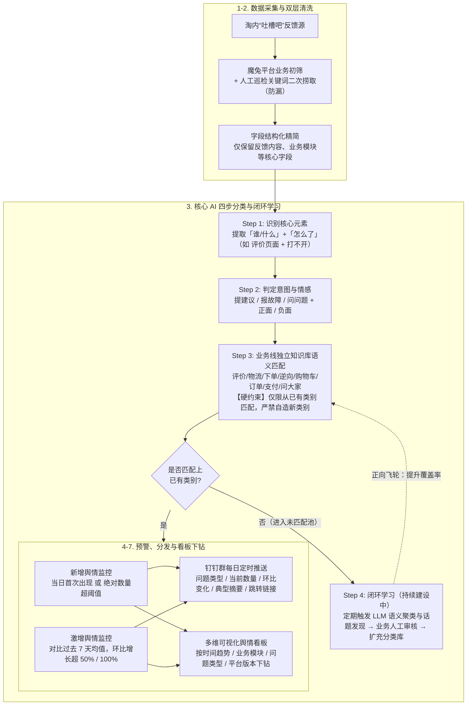

# AI工作流在淘宝交易舆情巡检上的探索与实践

## 1. TL;DR

1. **核心痛点**：淘宝交易域（下单、支付、购物车、订单、评价、物流、逆向、问大家等）每日面临海量用户反馈，传统人工逐条巡检存在**效率低下、高优舆情漏报、早期趋势难察、处理后缺乏复盘闭环**四大痛点。
2. **七步全链路工作流**：「**采集（淘内吐槽吧）$\to$ 清洗（魔兔平台初筛 + 人工巡检关键词二次捞取防漏）$\to$ AI 四步判断 $\to$ 预警（新增/激增）$\to$ 分发（钉钉群定时推送 + 多维看板）$\to$ 归因 $\to$ 复盘**」。
3. **三阶段归类方案演进（核心踩坑）**：从**阶段一“批量投喂自由归类”**（上下文截断、输入输出条数对不上），演进到**阶段二“单条精简投喂自由归类”**（概率性输出导致“不支持暗黑模式”与“无法使用暗黑模式”生成不同标签，聚合统计噪音极大），最终确立**阶段三“人工预置打标分类库 + LLM 强制闭集语义匹配”**。
4. **四步 AI 核心能力与闭环自进化**：「**① 识别核心元素（谁/什么 + 怎么了）$\to$ ② 判定意图与情感（提建议/报故障/问问题 + 正负面）$\to$ ③ 业务线独立知识库闭集匹配（严禁自造标签）$\to$ ④ 未匹配池定期 LLM 语义聚类 + 人工审核入库**」。
5. **双阈值预警机制**：同时监控**新增舆情**（当日首次出现或绝对数量超阈值）与**激增舆情**（对比过去 7 天历史基线均值，环比增长超 50% 或 100%），确保一线研发对早期故障苗头高信任度响应。

## 2. 问题定义与背景

### 2.1 传统人工舆情巡检的四大瓶颈

| 痛点维度 | 具体表现 | AI 工作流升级目标 |
|---|---|---|
| **效率低下** | 各业务线每天安排专人逐条阅读海量反馈，耗时耗力 | 自动化结构化提取与分类匹配 |
| **漏报风险** | 高风险技术故障反馈被淹没在日常咨询洪流中，或被单一初筛规则漏掉 | 魔兔平台业务初筛 + 人工经验关键词二次捞取双保险 |
| **趋势难察** | 人工难以跨天对比长尾问题的微弱抬头趋势 | 新增预警（0 到 1）+ 过去 7 天均值环比激增预警（+50% / +100%） |
| **标签失控（AI 早期坑）** | 让 LLM 开放式生成分类标签会导致同义异词、无法做聚合趋势统计 | 锁定人工梳理的业务问题分类库，强制闭集语义匹配 + 离在线聚类扩库 |

## 3. 知识框架

## 4. 核心内容拆解

### 4.1 采集与清洗：魔兔初筛 + 关键词二次兜底

- **数据源**：统一采集淘内“吐槽吧”用户真实反馈。
- **双层防漏清洗**：单纯依赖魔兔平台的常规业务初筛容易漏掉边界表达，因此叠加了**人工巡检沉淀的高频关键词二次捞取**，再对字段做结构化精简（剔除无关冗余元数据，仅保留反馈正文、所属业务模块等），输入给下游 AI 模块。

### 4.2 归类方案的三阶段演进（为什么必须放弃“自由生成标签”）

| 演进阶段 | 核心做法 | 暴露的致命工程问题 |
|---|---|---|
| **阶段一：批量投喂、自由发挥** | 把各业务的舆情数据批量打包一次性丢给 LLM 直接输出归类结果 | ① **上下文超限**：Token 限制导致尾部舆情被截断或静默丢弃； ② **条数错位**：输出归类条数与输入舆情条数经常对不上，排查成本极高 |
| **阶段二：单条精简投喂、自由归类** | 结构化精简字段后逐条调用 LLM 归类 | **概率性同义标签分裂**：例如“不支持暗黑模式”与“无法使用暗黑模式”被模型打上不同分类名，导致下游按标签聚合统计与环比计算时噪音极大、数据不可用 |
| **阶段三：人工预置打标 + 闭集语义匹配** | 按业务线（评价、物流、下单、逆向、购物车、订单、支付、问大家）梳理历史舆情建标准分类库与示例词，强制 LLM 闭集选类 | **边界可控、结果一致、可解释可迭代**：消灭自造标签噪音，同时将未命中样本送入第四步离线聚类审核扩库 |

### 4.3 四步 AI 判断链路与未知话题自进化闭环

1. **第一步（识别核心元素）**：从口语化吐槽中抽取出结构化的 `「主体（谁/什么）」+「现象（怎么了）」`（例如：`「评价页面」+「打不开」`）。
2. **第二步（判定意图与情感）**：区分用户是在**提建议、报故障还是问问题**，并标注正面/负面情绪极性，辅助过滤非故障噪音。
3. **第三步（知识库闭集匹配）**：各业务线拥有独立分类体系与典型关键词示例；通过硬性规则约束 **LLM 只能从该业务线已有类别中选择最接近的一项，禁止自行发明新类别**。
4. **第四步（未匹配池闭环学习）**：对无法匹配现有类别的反馈不直接丢弃，而是汇入“未匹配舆情池” $\to$ **定期批量触发 LLM 语义聚类与共性话题发现** $\to$ 提交业务人员人工审核确认是否为真实新问题类型 $\to$ 审核通过后写入对应业务线知识库，形成“知识库扩充 $\to$ 匹配率上升 $\to$ 未匹配减少”的正向循环。

### 4.4 预警规则与多端触达

- **新增舆情告警**：某问题类型当日首次出现（从 0 到 1），或当日绝对数量突破预设阈值，第一时间捕捉新发故障苗头。
- **激增舆情告警**：将当日数据与**过去 7 天历史基线均值**持续对比，当增长幅度超过设定比例（如**环比增长 50%、100%**）时触发激增预警。
- **钉钉群推送 + 可视化看板**：每日定时向对应业务线钉钉群推送结构化摘要（问题类型、当前数量、环比变化、典型反馈摘要、快速跳转链接）；看板支持按**时间趋势、业务模块、问题类型、平台版本**多维下钻查看原始明细。

## 5. 数据速查表

| 维度 / 机制 | 原文披露设定与数值 | 语境与作用说明 |
|---|---|---|
| **覆盖交易核心业务线** | **8+ 个子域**（评价、物流、下单、逆向、购物车、订单、支付、问大家等） | 每个业务线维护独立的问题分类体系与典型示例关键词 |
| **数据清洗双通道** | **魔兔平台业务初筛 + 人工巡检关键词二次捞取** | 防止单一规则漏掉高风险反馈 |
| **核心 AI 处理步数** | **4 步**（识别元素 $\to$ 判定意图情感 $\to$ 知识库匹配 $\to$ 闭环学习） | 归因与复盘自动化模块仍在持续建设中 |
| **激增预警历史基线与阈值** | 对比**过去 7 天均值**，环比增长超 **50% / 100%** 触发 | 配合“当日首次出现或绝对量超阈值”的新增舆情监控 |
| **看板下钻维度** | 时间趋势、业务模块、问题类型、**平台版本** | 包含总量概览、环比对比、问题分布、预警列表、原始反馈明细 |

## 6. 踩坑与教训 / 可迁移的设计原则

| 错误做法 | 失败表现或原因 | 原文应对（可迁移的设计原则） |
|---|---|---|
| **把大批量舆情文本一次性塞给大模型做归类（阶段一）** | 触发上下文 Token 截断丢数，且输出条数与输入条数对不上，无法工程化对账 | **精简结构化字段 + 单条/受控粒度处理**，确保输入输出一一对应 |
| **让大模型开放式自由生成问题分类标签（阶段二）** | 同一问题被生成多种近义词标签（如“不支持暗黑模式”vs“无法使用暗黑模式”），下游聚合统计与环比告警完全失真 | **闭集匹配 + 离线开集聚类分离**：在线推理强制在人工标准库中闭集单选；未知新问题走离线定期聚类 + 人工审核入库 |
| **仅依赖单一平台规则初筛舆情数据源** | 边界表述或新型吐槽容易被初筛过滤掉，造成漏报 | 采用**平台初筛 + 人工巡检高频关键词二次捞取**双保险 |
| **试图让 AI 直接替代业务同学做最终定性与决策** | 一线同学因黑箱误报丧失信任，系统沦为实验室玩具 | **AI 辅助定位 + 人掌最终决策权**：推送附带典型原始摘要与一键跳转明细，建立业务信任 |

## 7. 记忆锚点

- **分类演进三阶律**：「**批量投喂会丢数，单条自造标签碎；人工建库闭集选，未中入池聚类审**」。
- **七步工作流口诀**：「**采集（吐槽吧）$\to$ 清洗（魔兔+关键词）$\to$ AI 四步判（元素/意图情感/闭集匹配/聚类学习）$\to$ 预警（新增+7天均值环比50%/100%）$\to$ 分发 $\to$ 归因 $\to$ 复盘**」。

## 8. 复习卡片

淘宝交易舆情巡检的七步完整工作流是什么？目前哪两部分仍在持续建设中？::七步为：采集 → 清洗 → AI判断 → 预警 → 分发 → 归因 → 复盘；其中尾部的“舆情归因”与“复盘反馈”以及第四步“闭环学习”仍在持续完善中。
在数据清洗环节，为什么要结合“魔兔平台初筛”与“关键词二次捞取”？::单纯依赖魔兔平台的常规初筛容易遗漏部分边界反馈，叠加人工巡检积累的相关关键词二次捞取可降低漏报风险。
舆情归类方案经历的三个迭代阶段分别是什么？阶段一和阶段二各因为什么原因失败？::阶段一为批量投喂自由发挥（因 Token 超限截断且输入输出条数对不上失败）；阶段二为单条精简投喂自由归类（因大模型概率性导致同义问题输出不同标签，聚合统计噪音大失败）；阶段三为预置分类库 + 闭集语义匹配。
核心 AI 模块的四个步骤分别是什么？::① 识别核心元素（提取「谁/什么」+「怎么了」）；② 判定意图与情感（提建议/报故障/问问题 + 正负面情绪）；③ 知识库闭集语义匹配（禁止自造新类别）；④ 未匹配池闭环学习（定期 LLM 聚类 + 人工审核入库）。
在线闭集匹配禁止大模型创造新类别后，如何发现线上新出现的问题类型？::将无法匹配现有知识库的反馈放入未匹配舆情池，定期触发大模型做批量语义聚类与话题发现，经业务人员审核确认后将新类别与关键词写入知识库。
系统的“新增舆情监控”和“激增舆情监控”分别如何触发告警？::新增监控在某问题类型当日首次出现或绝对数量超预设阈值时触发；激增监控持续对比当日数据与过去 7 天均值，当环比增长超过设定比例（如 50%、100%）时触发。

## 9. 知识关联

- **本库主题索引**：[Skill设计与治理](../../20_topics/Skill设计与治理.md)、[检索与文档解析](../../20_topics/检索与文档解析.md)、[决策知识结构化](../../20_topics/决策知识结构化.md)、[异常监控与稳定性](../../20_topics/异常监控与稳定性.md)
- **本库关联文章**：[自然语言替代复杂代码+26.3.13](../自然语言替代复杂代码+26.3.13/AI_自然语言替代复杂代码.md)、[购物助手在线评测+26.10.11](../购物助手在线评测+26.10.11/AI_购物助手在线评测.md)
- **候选双链**：[[舆情智能巡检]]、[[闭集语义匹配]]、[[未匹配池聚类自进化]]、[[异动告警基线]]

## 10. 原文参考资料

- **原文信息**：《AI工作流在淘宝交易舆情巡检上的探索与实践》，作者：潇沁（淘天集团-交易业务技术团队），发布日期：2026-03-06。

> [!note]- 校对报告
> - **页码溯源汇总**：
>   - `## 1. TL;DR` & `## 2. 问题定义与背景`：源自 p.1–2（传统人工巡检四大痛点表、采集→清洗→AI判断→预警→分发→归因→复盘七步链路、吐槽吧与魔兔平台+关键词二次捞取）。
>   - `## 4.2 归类三阶段演进` & `## 4.3 四步 AI 能力`：源自 p.3–4、p.6（识别核心元素「评价页面+打不开」、意图与情感、8+ 业务线独立分类库强制闭集匹配、未匹配池定期 LLM 聚类+人工审核入库；阶段一至阶段三演进对比及“不支持暗黑模式 vs 无法使用暗黑模式”案例）。
>   - `## 4.4 预警与分发`：源自 p.5（新增舆情监控、过去 7 天均值环比增长 50%/100% 激增监控、钉钉群每日定时推送五要素、可视化看板四维下钻）。
> - **材料质量说明**：p.2–5 含流程示意图截图，正文文字层已完整覆盖各节点名称与规则说明；无独立完整 Prompt/Skill 文件需拆分。
