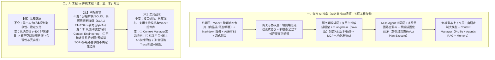

# AI工程vs传统工程 —「道法术」中的变与不变

## 1. TL;DR

1. **核心认知**：AI 工程并非对传统软件工程的推倒重来，而是在传统“高内聚低耦合、高可用、平台化抽象”的确定性工程地基上，为驾驭大模型“概率性、涌现性、高延迟与幻觉”而做的一次精准架构升级。
2. **淘宝 AI 搜索三年演进**：从 2023 年 3 月孵化“淘宝问问”（单体 Agent 验证） $\to$ 2024 年转向“多模态全双工交互 + RAG” $\to$ 2025 年推出“AI 万能搜”与双 11“AI 清单”（形成终端 Weex2 动态卡片、流式/全双工网关、基于 `xLangchain` 与主搜编排框架的 Multi-Agent + Context Engineering 企业级工程体系）。
3. **「道、法、术」变与不变**：
   - **道（认知底层）**：控制复杂性与稳定交付的目标不变；但正确性定义从传统确定性映射 $y=f(x)$ 转向管理概率预期。
   - **法（架构纲领）**：分层解耦与高可用 SLA（如从 `RT < 200ms` 调整为 `首字响应 < 1s`）不变；核心建模从“业务领域模型”转向“上下文工程（Context Engineering）”，并通过**预编排固化 SOP 替代纯动态 ReAct Plan-Execute** 及**多级意图路由漏斗**划定可控的不确定性边界。
   - **术（工具战术）**：复用主搜编排引擎与 Weex2 组件化底盘不变；新增三大 AI 原生武器——统一管理 `Profile + Agentic RAG + Memory` 的 **Context Manager**、**人工标注平台 + 线上 AB 多维评估体系**，以及全链路 **Trace 轨迹可视化**。

## 2. 问题定义与背景

### 2.1 淘宝 AI 搜索的三阶段演进脉络

1. **2023 年（概念验证期）**：启动“淘宝问问”孵化，探索对话式助手、Copilot 与语音助手，采用主流开源框架构建单体 Agent 跑通闭环。
2. **2024 年（多模态与检索增强期）**：技术栈升级为“多模态全双工交互 + RAG（检索增强生成）”。
3. **2025 年（深度推理与混合智能体期）**：推出“AI 万能搜”并在双 11 前上线“AI 清单”，构建分层组件化、Multi-Agent 协同与 Context Engineering 支撑的企业级交付体系。

### 2.2 AI 工程落地的三大现实挑战与破局对策

1. **架构范式尚不成熟**：开源框架方向高频摇摆（例如 LangChain 在三年内经历了 `Chain → Agent → Graph → Agent` 四次方向切换）。
   - **对策**：务实演进、业务先行（MVP 驱动）。流式协议不足时先用“客户端轮询 + 服务端分段缓存”顶上；多模态实时通道先借音视频基础设施快速搭出首版 Demo。
2. **业务需求高度不确定**：一年内多次大版本迭代与实验。
   - **对策**：高配置化与可插拔插件体系，复用主搜业务编排能力，实现 Prompt、Tool、SOP 热更新与细粒度 AB 实验。
3. **大模型固有工程难题**：高延迟、幻觉、上下文过载、输出非确定性与推理成本不可控。
   - **对策**：将“波动性”视为系统设计前提约束，通过上下文工程、异步预加载、熔断降级及“模型-数据-工程”标注评测闭环内建鲁棒性。

## 3. 知识框架

## 4. 核心内容拆解

### 4.1 「道」：从追求绝对正确到管理概率预期

- **不变的使命**：遵循《架构整洁之道》核心准则——以最小的人力成本满足系统构建与长期维护需求；绝不能以“AI 不可控”为借口容忍系统崩溃或放弃用户体验承诺。
- **变化的范式**：传统工程遵循确定性函数映射 $y = f(x)$，Bug 非黑即白；AI 工程运行于概率空间，系统验收标准从单纯的“接口可用、语句流畅”升级为**“合理性、真实性、可解释性”**（流畅但事实错误的幻觉回答危害远大于响应稍慢但准确的结果）。

### 4.2 「法」：用确定性架构将不确定性“关进笼子”

1. **平台化抽象对象的转移（不变的解耦，变化的对象）**：
   - 传统平台抽象业务域实体与状态机，实现 `80%–90%` 功能复用；
   - AI 搜索基于 **xLangchain**（LangChain 的 Java 实现，内置 AB 实验、版本管理与插件机制）将抽象对象转向四大 AI 能力组件：**Agent**（如跑马灯商品筛选 Agent、双 11 清单生成 Agent）、**SOP 协议**（统一调度 Agent 与 Tool）、**Tool**（支持 MCP 协议的本地/远程配置化工具）与 **Memory**（历史回答结构化存储与检索）。
2. **高可用 SLA 指标重构与多级兜底**：
   - 延续限流、熔断、降级与故障转移，将 SLA 衡量标准从传统 `RT < 200ms` 调整为 **`首字响应时间（TTFT） < 1s`**；当大模型超时或严重幻觉时，平滑 Fallback 至小模型或规则策略。
3. **核心建模从“领域模型”转向“上下文工程”**：
   - 关注重心从“如何定义业务实体流转”转向“如何在正确的时间、以正确的结构向模型喂入完成任务所需的最小必要信息”。
4. **收拢不确定性边界的两大实战设计**：
   - **从动态 ReAct Plan-Execute 转向预编排 SOP**：早期由 `Plan Agent` 实时生成完整执行计划再交由 `MainAgent` 执行，导致链路过长、误差逐级放大、高延迟高 Token 消耗且幻觉难追溯；升级后，`意图 Agent` 仅负责路由至特定子 Agent，子 Agent 内部执行人工配置或离线固化的 SOP，以有限灵活性换取高确定性。
   - **入口多级意图路由漏斗**：`安全筛查（直接拦截风险内容） → 一级意图识别（区分闲聊与任务型需求） → 多维细化调度至专用模块`，将大模型的不确定性严格限制在核心必要环节，其余路径由轻量模型或规则保障。

### 4.3 「术」：传统工程底盘与三大 AI 原生武器融合

1. **Context Manager（三类高价值上下文动态协同）**：
   - **用户信息（Profile）**：结合平台内历史交互行为与当前输入提取偏好；
   - **Agentic RAG（知识检索）**：采取「规划 - 执行 - 观察」模式自主决策获取站内知识（行业规则、活动信息）与站外知识（趋势、百科）；
   - **Memory（记忆模块）**：对多轮历史对话做摘要，并对历史曝光商品/内容经模型筛选总结；
   - **按需动态供给**：例如大促场景下，偏好明确时优先注入行为序列，涉及新知识时强化外部检索，多轮对话时注入 Memory 摘要而非原始记录，兼顾低 Token 消耗与低幻觉。
2. **多维评估体系（替代传统 True/False 断言）**：
   - **人工标注层**：自建大模型标注与评测平台（支持多数据源、动态编排标注模板、人效看板），评估意图覆盖、逻辑连贯与体验；
   - **线上 AB 层**：以点击率、转化率、停留时长等业务北极星指标反哺迭代。
3. **全链路 Trace 轨迹可视化（替代单纯代码日志回溯）**：
   - 完整记录 `用户输入 → 意图识别 → 上下文组装 → Agent 决策 → Tool 调用 → 模型生成 → 后处理` 全链路轨迹，支持逐层下钻定位“为何模型在此处幻觉”或“哪个 Tool 返回了异常数据”。

## 5. 数据速查表

| 维度 / 指标 | 原文数值 / 设定 | 语境 / 条件 |
| --- | --- | --- |
| 淘宝 AI 搜索产品演进时间线 | **2023.03 淘宝问问 $\to$ 2024 多模态+RAG $\to$ 2025 AI万能搜/AI清单** | 淘天搜索技术团队实践历程 |
| 开源框架方向切换反例 | **LangChain 3 年换 4 次方向** | `Chain → Agent → Graph → Agent` |
| 传统平台化抽象复用率基准 | **80%～90% 功能复用** | 通过领域模型标准化与业务流程抽象实现 |
| 响应时间 SLA 范式演进 | **从 `响应时间 < 200ms` 变为 `首字响应时间 < 1s`** | 应对大模型高延迟特性的高可用 SLA 调整 |
| AI 工程四大核心抽象组件 | **`Agent` + `SOP协议` + `Tool（支持MCP）` + `Memory`** | 基于 Java 版 `xLangchain` 与主搜编排引擎封装 |
| Context Manager 三大上下文源 | **`Profile（用户信息）` + `Agentic RAG（站内外检索）` + `Memory（对话与曝光摘要）`** | 按场景动态整合、消解冲突并调整注入优先级 |

## 6. 踩坑与教训 / 可迁移的设计原则

| 错误做法 | 失败表现或原因 | 原文应对（可迁移的设计原则） |
| --- | --- | --- |
| **死等流式通信协议或开源框架成熟才开始做产品验证** | 技术栈迭代极快（如 LangChain 三年四变），错过业务窗口期 | **务实演进、MVP 先行**：流式不足时先用“客户端轮询 + 服务端分段缓存”跑通体验，再迭代升级全双工长连接 |
| **在线上高并发搜索链路直接跑纯动态 ReAct Plan-Execute** | 实时生成 Plan 链路过长导致误差逐级放大、Token 与延迟飙升且幻觉无法追溯 | **意图路由 + 预编排固化 SOP**：由意图 Agent 路由至子 Agent，子 Agent 执行人工配置或离线生成的固化 SOP |
| **把所有用户请求（含安全风险与简单闲聊）直接喂给重型推理大模型** | 算力浪费严重且不确定性扩散至全链路 | **入口构建多级意图路由漏斗**：安全拦截 $\to$ 一级闲聊/任务分流 $\to$ 垂类模块调度，配合确定性前后处理与多级 Fallback |
| **多轮对话直接拼接全量历史记录与全量曝光商品** | 上下文过载引发注意力分散、Token 浪费与幻觉 | **构建统一 Context Manager**：对历史对话与历史曝光做模型筛选摘要，按大促/常规场景动态裁切最小必要上下文 |

## 7. 记忆锚点

1. **骨肉融合隐喻**：“**传统工程是确定性骨架（保系统不崩），AI 模型是概率性肌肉（赋系统智能）**”。
2. **不确定性收拢三板斧**：“**入口多级漏斗分流 + 中间预编排固化 SOP + 外围确定性校验与多级 Fallback**”。

## 8. 复习卡片

1. 淘宝搜索团队在 2023—2025 年间经历的三个 AI 产品与架构演进阶段分别是什么？::① 2023 年孵化“淘宝问问”，基于开源框架做单体 Agent 验证；② 2024 年转向“多模态全双工交互 + RAG”；③ 2025 年推出“AI 万能搜”与“AI 清单”，形成分层组件化、Multi-Agent 与 Context Engineering 支撑的企业级体系。
2. 为什么早期 Multi-Agent 采用的 ReAct 式动态 Plan-Execute 范式在线上搜索场景落地受阻？团队如何改造？::动态实时生成完整 Plan 会导致链路过长、误差逐级放大、延迟和 Token 消耗过高且幻觉难定位；团队将其改造为“预编排 SOP 模式”，由意图 Agent 路由至专用子 Agent，子 Agent 内部运行人工配置或离线生成的固化 SOP，用有限灵活性换取高确定性。
3. 在“法（架构设计）”层面，AI 工程的高可用 SLA 与核心建模对象相比传统工程发生了什么变化？::高可用 SLA 从传统的“整体响应时间 `< 200ms`”调整为“首字响应时间（TTFT） `< 1s`”，并增设大模型超时/幻觉向小模型或规则切换的多级 Fallback；核心建模重心从“确定性业务领域模型”转向“向模型精准喂养最小必要信息的上下文工程（Context Engineering）”。
4. 淘宝 AI 搜索的 Context Manager 统一管理哪三类上下文？在大促场景下如何动态调度？::管理用户信息（Profile）、Agentic RAG（规划-执行-观察模式检索站内外知识）和 Memory（历史对话摘要与历史曝光筛选总结）三类上下文；大促中若用户偏好明确则优先注入行为序列，若涉及新知识则强化外部检索，若已多轮对话则注入 Memory 摘要而非原始记录。
5. 为什么传统基于代码日志回溯的调试方式不够应对 AI 系统？全链路 Trace 工具记录了哪些关键环节？::因为 AI 系统的错误多源于上下文缺失或工具调用顺序不当而非代码语法/逻辑异常；全链路 Trace 完整记录“用户输入 → 意图识别 → 上下文组装 → Agent 决策 → Tool 调用 → 模型生成 → 后处理”轨迹，支持逐层下钻定位幻觉与异常数据源。
6. 作者在文末给 AI 工程架构师提出了哪五条核心实践建议？::① 主动理解大模型原理与边界（分辨是 Prompt、上下文长度、数据质量还是模型认知局限）；② 系统目标从“可用性/流畅度”升级为“合理性与真实性”；③ MVP 要快但核心模块（检索、推理链、安全）需留技术纵深；④ 将不确定性视为前提约束并内建工程鲁棒性；⑤ 架构选型面向 AI 原生需求，谨慎照搬传统重型架构。

## 9. 知识关联

- **本库主题关联**：
  - [Agent工程循环](../../20_topics/Agent工程循环.md)：对比动态 ReAct Plan-Execute 与预编排 SOP 范式，通过多级意图路由漏斗与确定性外壳收拢模型不确定性边界。
  - [检索与文档解析](../../20_topics/检索与文档解析.md)：在 Context Manager 中协同调度 Profile、Agentic RAG（站内规则+站外百科）与 Memory 曝光摘要。
  - [AI研发协同](../../20_topics/AI研发协同.md)：从“道、法、术”三层建立传统架构师向 AI 工程转型的认知框架与演进方法论。
  - [Agent评测与反馈](../../20_topics/Agent评测与反馈.md)：构建专业人工标注平台 + 线上 AB 业务指标 + 全链路 Trace 轨迹可视化的评估调试闭环。
- **候选双链**：`[[淘宝AI万能搜]]`、`[[ContextEngineering]]`、`[[预编排SOP]]`、`[[xLangchain]]`、`[[不确定性边界]]`

## 10. 原文参考资料

- **原文标题**：《AI工程vs传统工程 —「道法术」中的变与不变》
- **发布渠道与日期**：微信公众号「大淘宝技术」，2026-01-05
- **作者与团队**：小枫（淘天集团-搜索技术团队）
- **核心提及系统与框架**：淘宝问问、AI 万能搜、AI 清单、`xLangchain`（Java 版）、Weex2、MCP 协议

> [!note]- 校对报告
> - **页码溯源汇总**：
>   - 引言与淘宝 AI 搜索三年演进（淘宝问问 $\to$ AI 万能搜 / AI 清单）及三大挑战与对策：`p.1–3`
>   - 五层 AI 搜索工程体系（终端、网关、服务端、Multi-Agent、大模型）与「道」（确定性 $y=f(x)$ vs 概率性预期管理）：`p.4–5`
>   - 「法」：平台化抽象（`Agent/SOP/Tool/Memory` + `xLangchain`）、高可用 SLA（`<200ms` $\to$ 首字 `<1s`）、从领域模型到上下文工程、预编排 SOP 替代动态 Plan-Execute 及多级意图路由漏斗：`p.6–9`
>   - 「术」：复用主搜编排与 Weex2 底盘、Context Manager 三大模块、人工标注+线上 AB 评估体系、Trace 轨迹可视化及五条架构师建议：`p.10–14`
> - **关键数值一致性核查**：
>   - 2023 年 3 月启动淘宝问问、2025 年初推出 AI 万能搜、LangChain 三年换四次方向、传统平台复用率 `80%~90%`、SLA 从 `< 200ms` 转为首字 `< 1s` 等细节均与原文逐字核对一致。
> - **图像与版面质量说明**：
>   - `p.1–4, 6–9, 11, 13` 含架构演进图、同心圆领域建模图、两种 Multi-Agent 范式对比图及文末总结表图片（位于 PDF 图像层），`p.5` 底部概率空间段落末尾有少量排版截断，核心论点均在正文完整覆盖。
