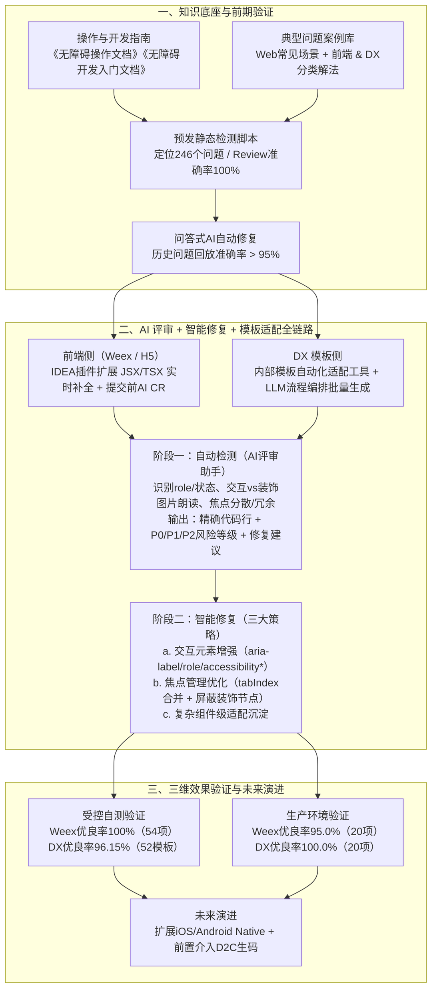

# AI 无障碍 CR 与自动适配实践：从问题洞察到效果验证

## 1. TL;DR

1. **核心痛点**：移动端无障碍推进长期面临“问题发现难、修复成本高、质量不可控”三大瓶颈；统计截至 2024 年 4 月的 **1,504 个**历史无障碍缺陷发现，**焦点管理类（55.1%）**、**文本描述类（30.8%）** 与 **交互识别类（22.8%）** 构成核心痛点，前 6 类问题（文本朗读、焦点分散、控件类型、焦点冗余、选中状态、焦点缺失）合计占比达 **86.0%**。
2. **关键机制**：构建“修复知识库底座 + 预发静态检测脚本 + 问答式 AI 修复 + IDE 智能补全与 DX 模板一键适配”的三环工程链路，将无障碍治理前移至编码与 CR 阶段，实现“写代码即修无障碍”。
3. **修复策略**：围绕交互元素增强（自动补全 `aria-label`、`role`、`accessibility`、`accessibilityText`、`accessibilityRole`）、焦点管理优化（合并关联节点焦点、屏蔽纯装饰节点焦点）与复杂业务组件级语义沉淀三层落地。
4. **量化效果**：前期发布检测器定位 **246 个**问题（人工 Review 准确率 **100%**）；自测环境下 Weex 优良率 **100%（54/54，优秀率 90.74%）**、DX 模板优良率 **96.15%（50/52，优秀率 90.38%）**；生产环境下 Weex 优良率 **95.0%（19/20）**、DX 模板优良率 **100.0%（20/20）**，DX 平台累计服务 **52 名**开发者、**266 次**会话。

## 2. 问题定义与背景

### 2.1 历史缺陷分布与现象剖析

团队对截至 2024 年 4 月沉淀的 **1,504 个**历史无障碍缺陷进行了系统分类，排名前 6 的高频问题依次为：
1. **文本朗读**（缺 `aria-label`、`alt` 或朗读信息残缺，导致屏幕阅读器无法正确播报）
2. **焦点分散**（同一语义单元被拆成多个碎焦点，视障用户滑动路径被显著拉长）
3. **控件类型**（`role` 缺失或错误，用户无法获知元素是否可点击）
4. **焦点冗余**（无交互意义的背景或纯装饰图片抢占焦点）
5. **选中状态**（`state` 未声明，用户无法判断勾选、Tab 激活或禁用态）
6. **焦点缺失**（核心交互控件无法被焦点命中，导致功能完全不可访问）

按大类聚合：
- **焦点管理类问题**（含焦点分散、冗余、缺失、穿透、顺序、陷入、位置、重置、大小）占比高达 **55.1%**；
- **文本描述类问题**占比 **30.8%**，是最大的单一问题类别；
- **交互识别类问题**（控件类型 + 选中状态）占比 **22.8%**；
- **Top 6 问题合计占比 86.0%**，构成了 AI CR 与自动适配的核心打击面。

### 2.2 四大工程根因

1. **开发侧无障碍意识不足**：业务研发对无障碍标准（TalkBack / VoiceOver 规范）与属性最佳实践不熟悉。
2. **测试环节缺乏验证闭环**：缺乏专业自动化检测工具与标准化验收卡点。
3. **工程化支撑薄弱**：缺乏在编码期和发布前自动检测、自动补全的工具链。
4. **自定义组件复杂度高**：交易链路存在大量跨端（Weex / H5 / DX）自定义复杂组件，手工适配成本与回归维护成本极高。

## 3. 知识框架

## 4. 核心内容拆解

### 4.1 知识底座构建与两阶段前期实验

1. **结构化修复知识体系**：
   - 编写《无障碍操作文档》与《无障碍开发入门文档》明确标准；
   - 沉淀《Web 常见场景与处理方案》及《前端 & DX 典型问题分类及解决方式》，作为大模型评审与代码补全的规范约束底座。
2. **前期实验验证**：
   - **发布自动检测器（静态分析脚本）**：在页面预发部署时触发源码静态扫描，截至 2025 年 7 月累计定位问题 **246 个**，人工 Review 确认准确率达 **100%**。
   - **问答式 AI 自动修复工具**：接收检测脚本定位出的问题后由 AI 生成修复代码，在历史缺陷回放测试中修复准确率 **> 95%**，验证了将能力嵌入 IDE 与模板工具链的可行性。

### 4.2 双端工程链路设计（Weex/H5 + DX 模板）

- **前端（Weex / H5）源码侧**：基于 IDEA 插件扩展 Prompt 能力，在编写 JSX/TSX 时实时提示并补全 `aria-label`、`role`、`tabIndex` 等属性；在代码提交/CR 阶段触发无障碍 AI 评审，实现“写代码即修无障碍”。
- **DX 动态模板侧**：针对手淘大量使用的 DX 动态模板，构建基于 LLM 流程编排的模板一键适配工具，在创建或更新模板时直接在模板层统一注入 `role`、`state`、`accessibility`、`accessibilityText`、`accessibilityRole` 等属性，消除业务侧重复改造。

### 4.3 核心两阶段机制：AI 评审 + 智能修复

1. **阶段一：自动检测（无障碍 AI 评审助手）**
   - **触发与范围**：代码提交/CR 阶段，扫描所有新增或修改的 JSX/TSX 文件。
   - **四大定制检测维度**：
     1. 交互元素控件类型（`role`）与选中/禁用状态；
     2. 图片朗读文本区分：**交互性图片**必须具备朗读文本，**纯装饰性图片**必须避免抢占焦点；
     3. 朗读文本完整度；
     4. 焦点分散、焦点冗余等焦点管理缺陷。
   - **结构化输出**：精确定位问题代码行 $\to$ 说明问题原因与风险等级（对照 **P0 / P1 / P2**） $\to$ 输出可直接落地的修复建议供下游补全工具消费。
2. **阶段二：智能修复（三大修复策略）**
   - **策略 a（交互元素增强）**：自动注入 `aria-label`、`role`、`accessibility`、`accessibilityText`、`accessibilityRole`，解决控件类型缺失、选中/禁用状态不明与焦点缺失。
   - **策略 b（焦点管理优化）**：利用 `aria-label`、`role`、`tabIndex` 将碎裂的相关信息节点做焦点合并，同时显式屏蔽纯装饰节点焦点。
   - **策略 c（组件级适配）**：针对交易域高频复杂自定义组件，结合语义与交互模型在组件层一次性沉淀适配逻辑，避免业务页面重复修复。

### 4.4 未来向 Native 与 D2C 的前置演进

- **跨栈扩展至 iOS / Android Native**：补充原生控件语义、系统辅助功能（TalkBack / VoiceOver）及原生导航模式规则与示例工程，打通 Web、DX 与 Native 一体化无障碍开发体验。
- **前置介入 D2C（Design-to-Code）生码**：在设计稿转代码的生产源头直接生成无障碍友好代码，彻底摆脱“先污染、后治理”的被动局面。

## 5. 数据速查表

| 指标 / 维度 | 原文数值 | 语境 / 条件 |
| --- | --- | --- |
| 历史无障碍缺陷统计样本 | **1,504 个** | 截至 2024 年 4 月累计缺陷 |
| 焦点管理类问题占比 | **55.1%** | 含分散/冗余/缺失/穿透/顺序/陷入/位置/重置/大小 |
| 文本描述类问题占比 | **30.8%** | 最大单一缺陷类别（排名第 1 为文本朗读） |
| 交互识别类问题占比 | **22.8%** | 控件类型 + 选中状态 |
| 前 6 类高频问题合计占比 | **86.0%** | 文本朗读、焦点分散、控件类型、焦点冗余、选中状态、焦点缺失 |
| 预发静态检测脚本定位问题数 | **246 个（准确率 100%）** | 截至 2025 年 7 月，页面预发部署时触发源码静态分析 |
| 问答式 AI 修复历史回放准确率 | **> 95%** | 基于检测脚本定位结果生成修复建议代码 |
| Weex 受控自测优良率 | **100%（54/54）** | 2 个交易业务工程、30+ 已适配文件移除属性重测；优 49（90.74%）、良 5（9.26%）、差 0 |
| DX 模板受控自测优良率 | **96.15%（50/52）** | 交易导购等 3 个项目 52 个模板；优 47（90.38%）、良 3（5.77%）、差 2（3.85%） |
| Weex 生产环境优良率 | **95.0%（19/20）** | 生产监控 20 项；优 16（80.0%）、良 3（15.0%）、差 1（5.0%，仅 1 例需人工调优） |
| DX 生产环境优良率 | **100.0%（20/20）** | 生产跟踪 20 个模板；优 16（80.0%）、良 4（20.0%）、差 0 |
| DX 无障碍工具累计使用规模 | **52 人 / 266 次会话** | 统计周期 2024-07-24 至今 |

## 6. 踩坑与教训 / 可迁移的设计原则

| 错误做法 | 失败表现或原因 | 原文应对（可迁移的设计原则） |
| --- | --- | --- |
| **在页面研发上线后靠人工走查修无障碍（先污染后治理）** | 发现滞后、自定义组件多导致返工成本高、质量不可控 | **卡点左移至 IDE 与预发 CR**：通过 IDEA 插件实时补全 + 提交期 AI CR + D2C 生码前置注入，实现“写代码即修无障碍” |
| **对所有图片一刀切添加朗读属性** | 纯装饰性背景图抢占屏幕阅读器焦点，造成严重的焦点冗余与路径拉长 | **语义区分交互图与装饰图**：交互性图片强制要求朗读文本，纯装饰性节点显式屏蔽焦点并合并关联文本节点焦点 |
| **仅在业务页面逐处修补而不沉淀模板与组件** | 同一类 DX 模板或业务组件在不同页面重复暴露相同缺陷 | **源码 + DX 模板 + 组件库三层联动**：在 DX 模板层一键生成无障碍版本，并在公共复杂组件内固化适配逻辑 |
| **无知识底座约束直接让通用大模型改无障碍代码** | 修复属性命名不统一（Web `aria-*` 与 DX `accessibility*` 混用），不符合端内规范 | **先沉淀领域规则库再驱动 AI**：以《无障碍操作/开发文档》与前端/DX 典型问题库作为 Prompt 知识底座，先做 100% 准的静态检测再触发生成 |

## 7. 记忆锚点

1. **缺陷分布口诀**：“**五五焦点三成文，二三交互占八六**”——1,504 个历史缺陷中，焦点管理占 `55.1%`、文本描述占 `30.8%`、交互识别占 `22.8%`（部分问题跨维度统计），Top 6 高频问题合计占 `86.0%`。
2. **工程闭环公式**：$\text{无障碍自动适配} = \text{规范知识库} + \text{CR 静态/AI 检测（P0–P2 分级）} + \text{IDE 补全（Weex/H5）} + \text{LLM 编排批量适配（DX 模板）} \ge 95\%\text{ 生产优良率}$。

## 8. 复习卡片

1. 淘宝基础交易终端团队统计的 1,504 个历史无障碍缺陷中，占比最高的三大类问题及其比例分别是什么？::焦点管理类问题（55.1%）、文本描述类问题（30.8%，最大单一类别）和交互识别类问题（22.8%，含控件类型与选中状态），排名前 6 的细分问题合计占比达 86.0%。
2. 为什么无障碍适配中不能给所有图片都加上朗读属性？AI 评审助手如何区分处理图片节点？::因为纯装饰性图片如果获取焦点会造成“焦点冗余”，拉长视障用户的滑动操作路径；AI 评审会区分语义：交互性图片必须提供朗读文本，而装饰性图片必须显式屏蔽焦点。
3. 针对“焦点分散”和“焦点冗余”这两类高频问题，智能修复阶段采取了什么技术策略？::通过 `aria-label`、`role`、`tabIndex` 等属性将同一业务语义下的零散子元素做焦点合并，并主动屏蔽纯装饰节点的焦点。
4. 该方案在前端（Weex/H5）侧与 DX 动态模板侧的工程接入方式有何不同？::Weex/H5 侧通过扩展 IDEA 插件的 Prompt 能力对 JSX/TSX 做编码期实时属性补全与提交前 CR；DX 侧则通过基于 LLM 流程编排的内部模板工具对 `.dx` 业务模板做批量一键适配。
5. 在直接做 IDE 插件和模板一键适配前，团队通过哪两个前期实验验证了技术可行性？::一是页面预发部署触发的源码静态检测脚本（定位 246 个问题，人工 Review 准确率 100%）；二是基于检测结果生成修复代码的问答式 AI 修复工具（历史回放准确率 >95%）。
6. Weex 与 DX 平台在受控自测环境下的验证方法与优良率分别是多少？::Weex 采用“先移除 30+ 已适配文件的无障碍属性再用工具重适配”的回放法，54 个问题优良率达 100%（优 90.74%）；DX 直接在 3 个项目的 52 个现有模板上适配，优良率达 96.15%（50/52，优 90.38%）。
7. 生产环境下 Weex 与 DX 无障碍自动适配的实测表现如何？::Weex 生产环境 20 项问题中优 80.0%、良 15.0%、差 5.0%（优良率 95.0%，仅 1 例需人工调优）；DX 生产环境 20 个模板中优 80.0%、良 20.0%、差 0%（优良率 100.0%）。
8. 为摆脱“先污染后治理”的被动改造成本，该无障碍工程体系规划了哪两个关键演进方向？::一是向 iOS/Android Native 原生技术栈（TalkBack/VoiceOver）扩展统一检测与补全；二是前置接入 D2C（设计稿生码）环节，在代码生成源头直接产出无障碍友好代码。

## 9. 知识关联

- **本库主题关联**：
  - [AI研发协同](../../20_topics/AI研发协同.md)：将 AI 代码评审（CR）与 IDE 智能补全嵌入研发提交流程，沉淀可复用的领域规范知识库。
  - [跨端开发与性能](../../20_topics/跨端开发与性能.md)：覆盖手淘 Weex、H5 与 DX 动态模板跨端无障碍属性（`aria-*` 与 `accessibility*`）统一治理。
  - [Agent评测与反馈](../../20_topics/Agent评测与反馈.md)：采用“移除已适配属性后重生成对比”的受控基准回放法与优/良/差三级生产环境持续度量。
- **候选双链**：`[[无障碍适配]]`、`[[AICoding]]`、`[[代码评审CR]]`、`[[DX动态模板]]`、`[[Weex]]`

## 10. 原文参考资料

- **原文标题**：《AI 无障碍 CR 与自动适配实践：从问题洞察到效果验证》
- **发布渠道与日期**：微信公众号「大淘宝技术」，2026-01-16
- **作者与团队**：曹西（淘天集团-基础交易终端团队）
- **核心内部规范引用**：《无障碍操作文档》《无障碍开发入门文档》《Web 常见场景与处理方案》《前端 & DX 典型问题分类及解决方式》

> [!note]- 校对报告
> - **页码溯源汇总**：
>   - 痛点背景、历史 1,504 个缺陷统计（Top 6 占 86.0%、焦点管理 55.1%、文本描述 30.8%、交互识别 22.8%）与四大根因：`p.1–2`
>   - 修复知识库、预发静态检测脚本（246 个问题、准确率 100%）与问答式 AI 修复实验（>95%）：`p.3`
>   - 前端 IDEA 插件（JSX/TSX）+ DX 模板一键适配架构、AI 评审（P0/P1/P2）与三大修复策略：`p.4–5`
>   - 受控自测验证（Weex 54 项优良率 100%、DX 52 模板优良率 96.15%）、生产环境验证（Weex 20 项优良率 95.0%、DX 20 项优良率 100.0%）与开发者反馈（52 人 / 266 次会话）：`p.5–7`
>   - 总结展望及向 iOS/Android Native（TalkBack/VoiceOver）与 D2C 生码前置扩展：`p.7–9`
> - **关键数值一致性核查**：
>   - `p.2` 中焦点管理（55.1%）+ 文本描述（30.8%）+ 交互识别（22.8%）之和超过 100%（为 108.7%），系原文按多标签/交叉维度统计的结果，笔记严格保留原文各分项百分比与“前 6 类问题占总问题的 86.0%”表述。
>   - Weex 自测 `49/54 = 90.74%`、`5/54 = 9.26%`；DX 自测 `47/52 = 90.38%`、`3/52 = 5.77%`、`2/52 = 3.85%`，优良率 `(47+3)/52 = 96.15%`，全部与原文表格完全一致。
> - **图像与版面质量说明**：
>   - `p.1, 3, 4, 8` 包含流程图或示意截图（位于 PDF 图像层），核心架构、检测维度及全部验证表格均已在 PDF 文本层完整呈现并核对无误。
