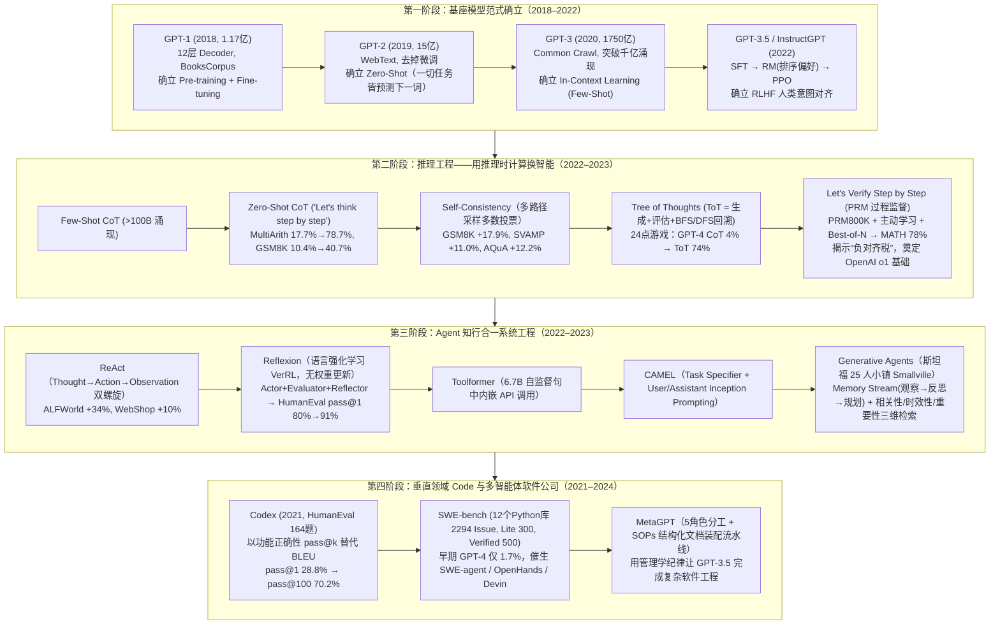

# AI+时代工程师的空间在哪儿——从范式演进看技术机会

## 1. TL;DR

1. **核心命题**：“**模型决定了智能的下限，而工程师与对业务场景的拆解决定了产品体验的上限**。”回顾从 `GPT-1` 到 `Multi-Agent` 的四阶段演进史，每一次跨越都不是单纯傻等基模参数变大，而是工程设计（上下文引导、推理时计算、工具闭环、记忆流、SOP 协作）将 **60–80 分的模型潜能催化出 90–100 分的确定性系统表现**。
2. **第一阶段：基座模型范式确立（2018–2022）**：从 **`GPT-1`**（1.17 亿参数，12 层 Decoder，确立“无监督预训练 + 有监督微调”）、**`GPT-2`**（15 亿参数，WebText，提出“一切 NLP 任务皆为预测下一个词”的 Zero-Shot）、**`GPT-3`**（1750 亿参数，突破千亿涌现 In-Context Learning / Few-Shot，催生 Prompt Engineering），演进到 **`GPT-3.5 / InstructGPT`**（通过 **SFT + RM 排序奖励模型 + PPO** 三阶段 RLHF 实现人类意图对齐）。
3. **第二阶段：推理工程——用推理时计算换智能（Inference-Time Compute）**：从 **`Few-Shot CoT`**（参数 $>100\text{B}$ 涌现多步算术/常识/符号推理）、**`Zero-Shot CoT`**（一句 `"Let's think step by step"` 唤醒 System 2 慢思考，使 `text-davinci-002` 在 MultiArith 上从 **17.7% 飙升至 78.7%**、GSM8K 从 **10.4% 升至 40.7%**）、**`Self-Consistency`**（多路径采样多数投票，GSM8K **+17.9%**），演进到 **`Tree of Thoughts (ToT)`**（生成器+评估器+BFS/DFS 剪枝回溯，24 点游戏成功率从 GPT-4 CoT 的 **4% 跃升至 74%**）与 **`Let's Verify Step by Step (PRM)`**（80 万步级标注 `PRM800K` + 主动学习 + Best-of-N，MATH 达 **78%**，揭示安全可解释与性能双赢的**“负对齐税”**，奠定 OpenAI o1 基础）。
4. **第三阶段：Agent 知行合一系统工程**：**`ReAct`**（`Thought -> Action -> Observation` 交错双螺旋，HotpotQA/FEVER 抗幻觉，ALFWorld 与 WebShop 绝对成功率超模仿/强化学习 **34% 与 10%**）、**`Reflexion`**（无权重更新的“语言强化学习 VerRL”，靠 Actor + Evaluator + Reflector 写反思笔记入长记忆，HumanEval `pass@1` 从 GPT-4 的 **80.0% 跃升至 91.0%**）、**`Toolformer`**（6.7B 小模型自监督学会句中插入 `<API_Call>`）、**`CAMEL`**（Task Specifier + User/Assistant `Inception Prompting` 解决多智能体控制权与数据合成）、**`Generative Agents（斯坦福 25 人 AI 小镇）`**（`Memory Stream` 观察 $\to$ 反思 $\to$ 规划，按**相关性 Relevance + 时效性 Recency + 重要性 Importance** 检索）。
5. **第四阶段：垂直 Code 领域演进**：**`Codex`**（164 题 `HumanEval`，确立以单测通过的**功能正确性 `pass@k`** 替代失效的 `BLEU`，单次 `28.8%` $\to$ 100 次重复采样 `70.2%`）、**`SWE-bench`**（12 个 Python 开源库 2,294 个真实 Issue，Lite 300 / Verified 500，早期 GPT-4 仅 **1.7%**，倒逼 `SWE-agent / OpenHands / Devin` 工程闭环）、**`MetaGPT`**（将人类软件公司 5 大角色与 **SOPs 结构化文档装配流水线**引入多 Agent，让 GPT-3.5 级模型跑通复杂工程）。

## 2. 问题定义与背景

### 2.1 破除“唯基模决定论”：CPU 与计算机系统架构的隐喻

许多应用开发者容易陷入“效果不好只能等下一代大模型发布”的无力感。作者用计算机体系结构给出精准定位：
- **大语言模型（LLM）= 新型 CPU**：具备强大的通用算力与通识，但天生存在**思维跳跃（幻觉）、坐而论道（无手脚）、看过即忘（无持久记忆）、独木难支（长链路跑偏）**四大缺陷。
- **AI 工程师的真正空间 = 构建围绕 CPU 的完整计算机系统**：
  - **逻辑轨道（CoT / ToT / PRM）**：约束思维跳跃；
  - **网卡与外设（ReAct / Toolformer）**：连接外部真实世界；
  - **硬盘与文件系统（Generative Agents Memory Stream / Reflexion）**：沉淀情景与反思记忆；
  - **操作系统与组织管理（CAMEL / MetaGPT SOPs）**：把概率性预测转化为确定性交付。

## 3. 知识框架

## 4. 核心内容拆解

### 4.1 第一阶段：从 `GPT-1` 到 `InstructGPT` 的四次范式跃迁

| 模型里程碑 | 核心论文与年份 | 参数与数据规模 | 范式变革与核心机制 |
|---|---|---|---|
| **`GPT-1`** | *Improving Language Understanding by Generative Pre-Training* (2018) | **1.17 亿**（12 层 Transformer Decoder，`BooksCorpus`） | 终结“一任务一专属架构”，确立 **“无监督预训练 + 有监督微调（Fine-tuning）”** 工业标准 |
| **`GPT-2`** | *Language Models are Unsupervised Multitask Learners* (2019) | **15 亿**（扩大 10 倍，Reddit 高赞 `WebText`） | 去掉微调步骤，提出 **Zero-Shot Learning**（所有 NLP 任务本质都是预测下一个词） |
| **`GPT-3`** | *Language Models are Few-Shot Learners* (2020) | **1750 亿**（扩大 100 倍，`Common Crawl`） | 突破千亿大关出现**能力涌现（Emergence）**；不更新权重，仅靠 **In-Context Learning（Few-Shot）** 模式匹配，催生 Prompt Engineering 与商业 API |
| **`GPT-3.5` (`InstructGPT`)** | *Training language models to follow instructions with human feedback* (2022) | 基于 GPT-3 架构 | 从“文本补全机”转向**“人类意图对齐（Alignment）”**，确立 **RLHF 三阶段法**：① SFT（示范标准回答）$\to$ ② RM 奖励模型（对多候选 $D>A>C>B$ 排序学习偏好）$\to$ ③ PPO 强化学习自我进化 |

### 4.2 第二阶段：推理工程（Inference Engineering）五部曲

1. **`Few-Shot CoT`（Wei et al., 2022）**：在少样本提示中展示“问题 $\to$ 中间推理步骤 $\to$ 答案”，显著提升算术（GSM8K）、常识与符号推理；揭示**复杂推理是模型参数量 $> 100\text{B}$ 后才显现的涌现能力**（小模型用 CoT 甚至可能变差）。
2. **`Zero-Shot CoT`（Kojima et al., 东京大学 & Google, 2022）**：无需手写 Few-Shot 示例，仅在提示词末尾加上一句咒语 **`"Let's think step by step"`**，即可将模型从直觉式快思考（System 1）切换至分析式慢思考（System 2）：在 `InstructGPT (text-davinci-002)` 上将 **MultiArith 准确率从 17.7% 提升至 78.7%**，将 **GSM8K 从 10.4% 提升至 40.7%**（540B PaLM 同样大幅提升），直接启发了后续 `Auto-CoT` 与 `OPRO` 自动提示词优化。
3. **`Self-Consistency`（自洽性，Google, 2022）**：基于**“正确答案殊途同归（形成聚类），错误答案随机发散”**的直觉，用多次采样 + 多数投票（Majority Vote，边缘化具体路径）替代贪婪解码（Greedy Decoding），确立**“用推理阶段计算量换智能（Inference-time Compute）”**范式：在 GSM8K（**+17.9%**）、SVAMP（**+11.0%**）、AQuA（**+12.2%**）、StrategyQA（**+6.4%**）、ARC-challenge（**+3.9%**）上全面刷新 SOTA。
4. **`Tree of Thoughts (ToT)`（Princeton & DeepMind, 2023）**：克服 CoT 自左向右自回归一旦中间步走错就无法回头的局部贪婪缺陷，将推理建模为 **`LLM（生成器 + 启发式评估器）+ 经典搜索算法（BFS/DFS 剪枝与回溯）`** 的四步框架（思想分解 $\to$ 生成 $k$ 个候选分支 $\to$ 状态评估打分 $\to$ 搜索剪枝与回溯）；在**“24 点游戏”中将成功率从 GPT-4 CoT 的 4% 暴力拉升至 74%**。
5. **`Let's Verify Step by Step`（过程监督 PRM，OpenAI, 2023）**：
   - 对比只看最终答案的 **ORM（结果监督，易放过“过程全错但碰巧蒙对答案”的幻觉样本）** 与对每一步打 `+ / - / 0` 标签的 **PRM（过程监督）**；
   - 发布包含 **80 万个步骤级人工标注的 `PRM800K` 数据集**，利用**主动学习（Active Learning）**专挑“貌似合理但答案错误的混淆题（Convincing wrong-answer solutions）”交人工纠偏，配合推理期 **Best-of-N 搜索**，在 MATH 数据集上达到 **78%** 准确率；
   - **核心理论发现——负对齐税（Negative Alignment Tax）**：打破“追求安全与可解释会牺牲性能”的传统偏见，证明教模型按人类逻辑一步步正确思考不仅更安全可解释，而且解题能力更强（直接奠定了 **OpenAI o1** 的技术路线）。

### 4.3 第三阶段：Agent 知行合一与认知记忆架构

1. **`ReAct`（Princeton & Google, 2022）**：将推理（Reasoning，生成/更新计划）与行动（Acting，查外部 API 获取新事实）交错为 **`Thought -> Action -> Observation`** 双螺旋循环；在 HotpotQA 与 FEVER 中借助维基百科 API 克服纯 CoT 幻觉，在交互决策基准 **ALFWorld 和 WebShop 上仅用 1–2 个示例即比模仿学习与强化学习绝对成功率高出 34% 和 10%**。
2. **`Reflexion`（语言强化学习 VerRL，2023）**：**不更新模型权重**，而是由 **Actor（行动）$\to$ Evaluator（编译器/单测评估 Pass/Fail）$\to$ Reflector（分析失败轨迹生成自然语言“自我反思笔记”存入情景记忆缓冲区）** 组成闭环，在下一次尝试（Trial）时将反思笔记读入 Prompt；在 **HumanEval 上将 GPT-4 的 `pass@1` 准确率从 80.0% 提升至 91.0%**。
3. **`Toolformer`（Meta AI, 2023）**：仅用 **6.7B 参数**模型，通过自监督学习（尝试在文本句中插入 `<API_Call>`，若返回结果能降低后续词预测 Loss 则保留）让小模型自主掌握计算器、日历、维基搜索调用。
4. **`CAMEL`（交际智能体，2023）**：针对两个 AI 自由聊天易陷入“互相吹捧、死循环或跑题”的痛点，提出 **`Task Specifier（将人类模糊想法细化为具体任务） + Inception Prompting（初始洗脑引导）`**，严格区分 **`AI User（指令发出者 Instruction Giver）`** 与 **`AI Assistant（指令执行者 Instruction Follower）`**，确立多 Agent 控制权秩序并广泛用于低成本合成垂直领域高质量对话数据。
5. **`Generative Agents`（斯坦福 25 人 AI 小镇 Smallville，2023）**：确立超越简单 RAG 的 Agent 长期记忆标准架构 **`Memory Stream（记忆流）`**：记录全部日常经历（Observation）$\to$ 定期停下来从琐碎记忆提炼高级认知（Reflection）$\to$ 制定并动态调整每日计划（Planning）；检索记忆时综合计算 **相关性（Relevance）+ 时效性（Recency）+ 重要性（Importance）** 三维得分，自发涌现出“情人节派对通知扩散与赴约送礼”的社会动力学行为。

### 4.4 第四阶段：垂直 Code 领域三大里程碑（`Codex` $\to$ `SWE-bench` $\to$ `MetaGPT`）

1. **`Codex`（OpenAI, 2021，GitHub Copilot 底座）**：
   - **评测范式革命**：指出 NLP 传统的文本相似度指标 **`BLEU` 在代码领域完全失效**（代码字面完全不同但功能可完全一致），创建包含 **164 道手写编程题与单元测试的 `HumanEval` 基准**，确立以**功能正确性（Functional Correctness）和 `pass@k`** 为黄金标准。
   - **重复采样（Repeated Sampling）威力**：在 HumanEval 上 GPT-3 解决率为 **0%**、GPT-J 为 **11.4%**，Codex 单次生成（`pass@1`）为 **28.8%**，而对每题重复采样 100 个样本（`pass@100`）解决率飙升至 **70.2%**；同时揭示代码训练能显著增强模型的通用逻辑推理能力。
2. **`SWE-bench`（Princeton & Chicago, 2023 底，AI 程序员的“高考”）**：
   - 从 `scikit-learn, Django, Flask, pandas` 等 **12 个著名 Python 开源库**收集真实 GitHub Issue 与修复 PR，要求在几十万行陌生代码库中定位文件行号、编写 Patch 并同时通过新测试与存量回归测试（Docker 容器真跑）。
   - **家族版本与行业冲击**：包含 **Full（2,294 题）**、**Lite（300 题）** 与 OpenAI 联合人工精选的 **Verified（500 题主流榜单）**；刚发布时最强 **GPT-4 解决率仅 1.7%**，彻底戳破“单次生成即可替代程序员”泡沫，直接催生了 **`SWE-agent`、`OpenHands (OpenDevin)`、`Devin`** 等“搜索定位（文件树/grep）$\to$ 修改 $\to$ 跑测试看报错 $\to$ 自我反思迭代”的 Coding Agent 架构。
3. **`MetaGPT`（2023，SOPs 虚拟软件公司）**：
   - 预设 **5 大核心角色**：`ProductManager`（写 PRD）$\to$ `Architect`（画 UML 图与设计 API/数据结构）$\to$ `ProjectManager`（拆解分配任务）$\to$ `Engineer`（写代码）$\to$ `QA`（运行测试报错）。
   - **结构化文档装配流水线（Assembly Line）**：禁止 Agent 之间用自然语言随意闲聊交接，强制要求**上一个角色输出标准化结构文档（Markdown PRD、UML 图、接口定义）作为下一个角色的输入**，用管理学 SOP 纪律约束大模型幻觉，使 GPT-3.5 级模型也能跑通复杂工程开发。

## 5. 数据速查表

| 阶段 / 经典论文或基准 | 核心量化指标与规模数据 | 关键对比基线与工程意义 |
|---|---|---|
| **`GPT-1` $\to$ `GPT-2` $\to$ `GPT-3`** | 参数量：**1.17 亿 $\to$ 15 亿（10x）$\to$ 1750 亿（100x）** | 突破 1000 亿参数涌现 In-Context Learning 与代码/推理能力 |
| **`Zero-Shot CoT` (`text-davinci-002`)** | MultiArith：**17.7% $\to$ 78.7%**；GSM8K：**10.4% $\to$ 40.7%** | 仅靠一句 `"Let's think step by step"` 唤醒预训练内隐推理能力 |
| **`Self-Consistency`（多数投票）** | GSM8K **+17.9%** / SVAMP **+11.0%** / AQuA **+12.2%** | StrategyQA **+6.4%** / ARC-challenge **+3.9%**；确立推理时计算换智能 |
| **`Tree of Thoughts (ToT)`** | 24 点游戏成功率：**GPT-4 CoT 4% $\to$ ToT 74%** | `LLM（生成+评估）+ BFS/DFS 搜索回溯`，克服自回归单向贪婪缺陷 |
| **`Let's Verify Step by Step (PRM)`** | `PRM800K`（**80 万**步级标注），MATH 准确率达 **78%** | 证明过程监督优于结果监督（ORM），提出“负对齐税”并奠定 o1 基础 |
| **`ReAct`（推理+行动交错）** | ALFWorld 绝对成功率 **+34%**，WebShop **+10%** | 仅用 1–2 个上下文示例即超越模仿学习与强化学习基线 |
| **`Reflexion`（语言强化学习）** | HumanEval `pass@1`：**GPT-4 80.0% $\to$ Reflexion 91.0%** | 无需更新模型权重，靠自然语言反思笔记存入情景记忆实现试错进化 |
| **`Toolformer` & 小镇 `Generative Agents`** | Toolformer：**6.7B 参数**；斯坦福小镇：**25 个 AI Agent** | 小模型自监督内嵌 API 调用；三维记忆检索（相关性+时效性+重要性） |
| **`Codex` & `HumanEval`** | **164 道题**；`pass@1` **28.8%** $\to$ `pass@100` **70.2%** | 对比 GPT-3 **0%**、GPT-J **11.4%**；用单元测试功能正确性替代 BLEU |
| **`SWE-bench` 真实工程基准** | **12 个 Python 库**；Full **2,294 题** / Lite **300** / Verified **500** | 早期 GPT-4 解决率仅 **1.7%**，倒逼 Coding Agent 循环工作流与代码库 RAG |

## 6. 踩坑与教训 / 可迁移的设计原则

| 错误做法 / 认知误区 | 失败表现或原因 | 原文应对（可迁移的设计原则） |
|---|---|---|
| **认为应用效果不好只能干等基模升级，忽视推理与系统层设计** | 哪怕用 GPT-4 直接贪婪解码玩 24 点游戏成功率也只有 4%，刷早期 SWE-bench 只有 1.7% | **用系统工程放大模型潜能**：通过 ToT 搜索回溯（4% $\to$ 74%）、Reflexion 语言反思（80% $\to$ 91%）与 SOP 流程把 80 分模型跑出 95 分体验 |
| **在小于 100B 的小模型上强行照搬复杂长 CoT，或只用单次 Greedy 解码做数学逻辑题** | 小模型用 CoT 甚至比标准提示更差；单次解码极易因一步“马虎”算错全盘皆输 | 小模型优先走 **Toolformer 式工具调用微调**；复杂推理采用 **Self-Consistency 多路径采样多数投票**或 **PRM Best-of-N** |
| **训练复杂推理奖励模型时只看最终答案对不对（ORM 结果监督）** | 模型“推理过程全错但碰巧蒙对答案”的幻觉轨迹被正向强化，无法学会正确逻辑 | 采用 **过程监督（PRM）+ 主动学习挑选高迷惑性错题标注**，在每一步推理上进行细粒度验证 |
| **让多个 Agent 通过自由自然语言聊天协作开发复杂项目** | 像早期两个 ChatGPT 互聊一样迅速陷入互相吹捧、死循环、偏离主题或控制权混乱 | 引入 **CAMEL 式 `Instruction Giver/Follower` 角色锁定**与 **MetaGPT 式 SOPs 结构化文档（PRD/UML/API）流水线交接** |
| **把长周期 Agent 的记忆简单等同于普通静态文档向量检索（纯相似度 RAG）** | 忽略了记忆发生的时间远近与事件本身的重要程度，且缺乏从碎片日常中提炼高层规律的能力 | 构建 **斯坦福小镇式 `Memory Stream`**：结合**观察 $\to$ 定期反思提炼 $\to$ 规划**，检索时融合 **相关性 + 时效性 + 重要性** 三维打分 |

## 7. 记忆锚点

- **AI 工程师系统观**：「**LLM 是新型 CPU（定下限），工程师造主板（CoT/ToT/SOP）、硬盘（Memory Stream）、网卡（ReAct/Tools）与操作系统（定上限）**」。
- **四大阶段核心跃迁数字**：「**Zero-Shot CoT（17.7%$\to$78.7%）、ToT 24 点（4%$\to$74%）、PRM MATH（78%，负对齐税）、Reflexion HumanEval（80%$\to$91%）、Codex 采样（28.8%$\to$70.2%）、SWE-bench 初代 GPT-4（1.7%）**」。

## 8. 复习卡片

从 GPT-1、GPT-2、GPT-3 到 GPT-3.5 (InstructGPT)，每一代确立的核心范式分别是什么？::① GPT-1（1.17 亿）确立“无监督预训练 + 有监督微调”；② GPT-2（15 亿）去掉微调，确立 Zero-Shot（一切 NLP 任务皆为预测下一词）；③ GPT-3（1750 亿）突破千亿产生能力涌现，确立不改权重的 In-Context Learning（Few-Shot）；④ GPT-3.5 确立基于 SFT + RM 排序 + PPO 的三阶段 RLHF 人类意图对齐范式。
Zero-Shot CoT 和 Self-Consistency 各自通过什么极简机制大幅提升了推理准确率？::Zero-Shot CoT 仅需在提示词中加入“Let's think step by step”即可唤醒预训练内隐的 System 2 慢思考（MultiArith 从 17.7% 升至 78.7%）；Self-Consistency 利用“正确答案殊途同归、错误答案随机发散”直觉，通过多次采样+多数投票（Inference-time Compute）在 GSM8K 上提升 17.9%。
Tree of Thoughts (ToT) 解决了 CoT 的什么根本缺陷？它的四个核心步骤是什么？::解决了 CoT 从左到右单向自回归生成一旦中间某步走错就无法回头的局部贪婪缺陷；四步为：① 思想分解（拆为树节点）；② 思想生成（每步生成 k 个候选分支）；③ 状态评估（LLM 充当评估者打分）；④ 搜索与回溯（用 BFS/DFS 剪枝无效分支并回溯，使 24 点游戏从 4% 升至 74%）。
OpenAI《Let's Verify Step by Step》中的过程监督（PRM）相比结果监督（ORM）有何优势？什么是“负对齐税”？::ORM 只看最终答案易纵容“过程全错却蒙对答案”的幻觉，而 PRM（基于 80 万步级标注 PRM800K 与主动学习）对每一步推理打分验证；“负对齐税”指过程监督不仅让模型更安全、可解释，还同时大幅提升了模型解题性能（MATH 达 78%），打破了安全与性能对立的传统认知。
Reflexion 框架提出的“语言强化学习（VerRL）”是如何实现不更新模型权重却让 HumanEval pass@1 从 80% 升至 91% 的？::通过 Actor（生成动作轨迹）→ Evaluator（编译器/测试用例评估成功或失败）→ Reflector（分析失败原因生成自然语言“自我反思笔记”存入长期记忆），在下一轮重试时将反思笔记作为经验教训注入 Prompt 指导改进。
斯坦福 AI 小镇（Generative Agents）的 Memory Stream 包含哪三个认知环节？检索记忆时依据哪三个维度打分？::包含观察与记录（Observation）、定期停下来提炼高级认知的反思（Reflection）、制定并调整每日计划的规划（Planning）三个环节；检索时综合计算相关性（Relevance）、时效性（Recency）和重要性（Importance）三个维度。
为什么 Codex 论文指出 BLEU 指标在代码生成领域失效？SWE-bench 相比 HumanEval 有什么本质升级？::因为两段代码字面文本可以完全不同但功能完全一致，因此 Codex 提出用单元测试验证“功能正确性（pass@k）”并建立 164 题 HumanEval；而 SWE-bench 从孤立函数算法题升级为 12 个真实 Python 开源库的 GitHub Issue 修复（Full 2294 / Lite 300 / Verified 500），要求跨数万行源码定位、写 Patch 并通过 Docker 回归测试。
CAMEL 和 MetaGPT 分别是如何解决多智能体（Multi-Agent）自由聊天容易跑偏和死循环问题的？::CAMEL 通过 Task Specifier 细化任务，并用 Inception Prompting 严格锁定 AI User（指令发出者）与 AI Assistant（指令执行者）的控制权关系；MetaGPT 则引入软件公司的 5 大专业角色（PM/架构师/项目经理/工程师/QA）与标准化作业程序（SOPs），强制要求通过结构化文档（PRD/UML/API）流水线交接工作而非自由闲聊。

## 9. 知识关联

- **本库主题索引**：[Skill设计与治理](../../20_topics/Skill设计与治理.md)、[AI研发协同](../../20_topics/AI研发协同.md)、[模型架构与训练](../../20_topics/模型架构与训练.md)、[Agent工程循环](../../20_topics/Agent工程循环.md)
- **本库关联文章**：[如何设计AIAgent系统+26.1.26](../如何设计AIAgent系统+26.1.26/AI_如何设计AIAgent系统.md)、[AICoding工具提效到范式变革+26.3.2](../AICoding工具提效到范式变革+26.3.2/AI_AICoding工具提效到范式变革.md)、[AICoding团队价值度量+26.3.25](../AICoding团队价值度量+26.3.25/AI_AICoding团队价值度量.md)
- **候选双链**：[[Inference-Time Compute]]、[[Tree of Thoughts]]、[[Process Reward Model]]、[[Reflexion语言强化学习]]、[[SWE-bench]]、[[MetaGPT与SOP]]

## 10. 原文参考资料

- **原文信息**：《AI+时代工程师的空间在哪儿——从范式演进看技术机会》，作者：永霸（淘天集团-基础交易终端团队），发布日期：2026-01-21。
- **文内系统梳理的 16 篇里程碑论文与基准**：
  1. Radford et al. (2018): *Improving Language Understanding by Generative Pre-Training* (`GPT-1`)
  2. Radford et al. (2019): *Language Models are Unsupervised Multitask Learners* (`GPT-2`)
  3. Brown et al. (2020): *Language Models are Few-Shot Learners* (`GPT-3`)
  4. Ouyang et al. (2022): *Training language models to follow instructions with human feedback* (`InstructGPT / RLHF`)
  5. Wei et al. (2022): *Chain-of-Thought Prompting Elicits Reasoning in Large Language Models* (`CoT`)
  6. Kojima et al. (2022): *Large Language Models are Zero-Shot Reasoners* (`Zero-Shot CoT`)
  7. Wang et al. (2022): *Self-Consistency Improves Chain of Thought Reasoning in Language Models* (`Self-Consistency`)
  8. Yao et al. (2023): *Tree of Thoughts: Deliberate Problem Solving with Large Language Models* (`ToT`)
  9. Lightman et al. (2023): *Let's Verify Step by Step* (`PRM / PRM800K`)
  10. Yao et al. (2022): *ReAct: Synergizing Reasoning and Acting in Language Models* (`ReAct`)
  11. Shinn et al. (2023): *Reflexion: Language Agents with Verbal Reinforcement Learning* (`Reflexion`)
  12. Schick et al. (2023): *Toolformer: Language Models Can Teach Themselves to Use Tools* (`Toolformer`)
  13. Li et al. (2023): *CAMEL: Communicative Agents for "Mind" Exploration of Large Scale Language Model Society* (`CAMEL`)
  14. Park et al. (2023): *Generative Agents: Interactive Simulacra of Human Behavior* (`Stanford Smallville`)
  15. Chen et al. (2021): *Evaluating Large Language Models Trained on Code* (`Codex / HumanEval`)
  16. Jimenez et al. (2023) & Hong et al. (2023): `SWE-bench` & *MetaGPT: Meta Programming for A Multi-Agent Collaborative Framework* (`MetaGPT`)

> [!note]- 校对报告
> - **页码溯源汇总**：
>   - `## 1. TL;DR` & `## 4.1 第一阶段`：源自 p.1–7（80 分模型跑出 95 分效果、GPT-1 1.17 亿/12 层、GPT-2 15 亿/WebText、GPT-3 1750 亿/1000 亿涌现、GPT-3.5 SFT+RM+PPO 三阶段）。
>   - `## 4.2 第二阶段（推理工程）`：源自 p.7–16（CoT `>100B` 涌现、Zero-Shot CoT MultiArith `17.7%->78.7%` 与 GSM8K `10.4%->40.7%`、Self-Consistency GSM8K `+17.9%` / SVAMP `+11.0%` / AQuA `+12.2%` / StrategyQA `+6.4%` / ARC `+3.9%`、ToT 24 点 `4%->74%`、PRM `PRM800K` 80 万标注 / MATH `78%` / 负对齐税）。
>   - `## 4.3 第三阶段（Agent 架构）`：源自 p.16–25（ReAct ALFWorld `+34%` / WebShop `+10%`、Reflexion HumanEval `80.0%->91.0%`、Toolformer `6.7B`、CAMEL `Task Specifier` + `Inception Prompting`、斯坦福小镇 25 个 Agent 与相关性/时效性/重要性三维检索）。
>   - `## 4.4 第四阶段（垂直 Code）` & `结语`：源自 p.26–32（Codex 164 题 HumanEval、GPT-3 `0%` / GPT-J `11.4%` / Codex `28.8%` $\to$ 100 次采样 `70.2%`、SWE-bench 12 库 2,294 题 / Lite 300 / Verified 500 / 早期 GPT-4 `1.7%`、MetaGPT 5 角色 SOPs、CPU/主板/硬盘/网卡/OS 结语隐喻）。
> - **材料质量说明**：全文 33 页脉络清晰、全部论文标题与实验数字均在文本层完整提取并逐一核对无误。
