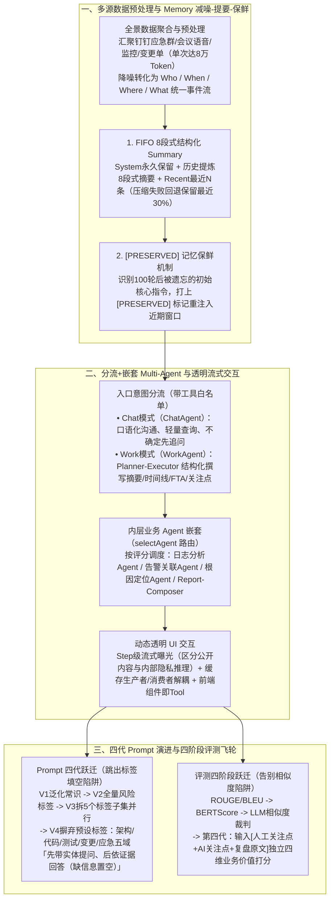

# 别让故障复盘流于形式：用AI挖掘每一次“跌倒”的价值

## 1. TL;DR

1. **核心痛点**：传统故障复盘易流于形式——变更引发故障的责任人不愿深挖根因、长链路中间层各自甩锅不愿串联全局、故障恢复后敷衍了事，且技术支持（TS）受限于架构知识广度难以在 **80%** 的故障下提出超越常规的深度架构关注点，甚至提出真问题也被研发轻视驳回。
2. **智能复盘 Multi-Agent 架构与三大核心机制**：
   - **数据预处理与动态交互**：聚合钉钉应急群聊、会议语音、监控与变更单，降噪转化为 `Who/When/Where/What` 结构化事件流（单次应急消息动辄高达 **8 万 Token**）；前端采用 **Step 级流式曝光控制 + 基于缓存的生产者/消费者消息解耦 + 前端组件封装为 Tool**；
   - **Memory“减噪-提要-保鲜”三步法**：通过 `ConversationBufferSummary` 在超阈值时提炼 **8 段式结构化摘要**（保留 `System + Summary + Recent N`，失败则回退保留最近 **30%** 历史），并通过 `[PRESERVED]` 标记将首轮核心指令周期性重注入近期窗口防止长对话遗忘；
   - **入口分流与嵌套路由**：入口拆分为 **Chat 模式（`ChatAgent` 口语化轻量答疑）** 与 **Work 模式（`WorkAgent` 专业结构化撰写）**，内层通过 `selectAgent` 调度日志分析、告警关联、根因定位等领域子 Agent。
3. **评测与 Prompt 四代演进突破**：
   - **评测四阶段跃迁**：历经 `ROUGE/BLEU`（刷词得高分） $\to$ `BERTScore`（笼统回答如“缓存设计不合理”仍得高分） $\to$ `LLM-as-Judge 相似度打分`（偏袒合理编造）后，转向**第四代“业务价值导向独立打分”**（输入标准关注点 + AI 关注点 + 复盘原文，从洞察深度、逻辑完整性、可执行性、证据支撑四维对人工与 AI 独立打分）；
   - **Prompt 四代重构**：推翻前三代“靠常识泛化生成 $\to$ 全量风险标签库框定 $\to$ 拆 5 个标签子集并行调用”的**标签填空陷阱**，在第四代改为**“两阶段先提问（架构/代码/测试/变更/应急五域带具体实体设问，盯防双活假象与监控盲区）后回答（严格基于原文证据，信息不足强制置空）”**；落地后技术支持关注点采纳率达 **60%+**，非跨多 BU 复杂故障复盘周期从 **2–3 天缩短至 1 天内**，普通用户 **10 秒**即可掌握全局。

## 2. 问题定义与背景

### 2.1 故障复盘流于形式的五大现实阻力

秉持 Blameless（对事不对人，“You can't fix people, but you can fix systems and processes”）与“You built it, you own it”理念，团队剖析出实操中的五大痛点：
1. **变更方隐瞒深层原因**：由自身变更操作引发故障时，撰写人不愿深扒机制缺陷；
2. **长链路中间层各自免责**：调用链长时，中间层认为非自身问题而不愿串联全链路；
3. **事后敷衍心理**：故障恢复后急于翻篇，复盘会上傾向于证明“不是我的问题”；
4. **技术支持（TS）架构深度受限**：在约 **80%** 的故障中难以提出深层架构级关注点；
5. **研发与技术支持信任壁垒**：部分研发先入为主认为技术支持不懂技术，直接驳回有效质疑。

### 2.2 智能复盘 Agent 与通用问答 Agent 的六维差异

| 对比维度 | 通用 Agent（客服/日常问答） | 智能复盘 Agent |
| --- | --- | --- |
| **任务性质** | 单流程、单目标、交互独立 | 长流程、多阶段、强依赖历史排查抉择 |
| **上下文来源** | 用户输入 + 少量工具返回 | 多轮对话 + 多次工具调用 + 应急日志 + 会议记录 |
| **信息体量** | 百～千 Token 级 | 动辄数万 Token（**单次应急群消息可达 8 万 Token**） |
| **记忆粒度** | 提取关键意图/实体即可 | 必须完整保留事件时序、因果链、责任归属等结构化线索 |
| **信息时效与噪音** | 旧信息快速失效；用户表达聚焦、噪音低 | 历史已验证假设需长期保鲜；会议/群聊含极高比例口语重复噪音 |
| **评测标准** | 答案唯一（FAQ）、看重回答速度与字面重合 | 多解开放，看重“挖得深、提得准、改得动（可执行）” |

## 3. 知识框架

## 4. 核心内容拆解

### 4.1 Memory 管理：“减噪 $\to$ 提要（8 段式） $\to$ 保鲜（`[PRESERVED]`）”

面对单次应急消息高达 **8 万 Token** 的长程复盘对话，团队设计了四角色（`User / System / Assistant / Tool`）分层记忆策略：
1. **FIFO 队列 8 段式结构化 Summary（`_execute_fifo_summary`）**：
   - 当历史待摘要消息数 `< 5` 时直接返回；超阈值时剥离出永久保留的 `system_messages` 与末尾 `preserve_recent_count` 条 `recent_messages`，将中间历史送入专用 LLM 提炼为模拟 SRE 思维的 **8 段式项目文档**：
     1. `Primary Request and Intent`（主要请求与意图）
     2. `Key Technical Concepts`（涉及的框架、算法、库）
     3. `Files and Code Sections`（提及或修改的文件与代码片段）
     4. `Errors and fixes`（报错信息与修复方案）
     5. `Problem Solving`（排障思路与决策路径）
     6. `All user messages`（保留用户关键指令与反馈）
     7. `Pending Tasks`（未完成待办清单）
     8. `Current Work`（当前中断时的精确进度）
   - 最终按 `System + Summary + Recent` 重新组装；**优雅降级**：若多次压缩尝试均失败，回退至截断保留**最近 30% 对话历史**。
2. **`[PRESERVED]` 主动保鲜策略**：
   - 针对长队列下模型只对最近 $N$ 条敏感而遗忘开篇核心约束的现象，动态将首轮关键 System/User 指令以 `[PRESERVED]` 前缀复制重注入到最新轮次之前（如第 51 轮前），强制唤醒模型注意力。

### 4.2 评测体系的四阶段演进：为什么放弃相似度指标？

团队构建了“三套自动化 + 一套人工校准（专家不做质检员，只定黄金标准、审高分案例、标典型 Bad Case）”的评测矩阵，并在关注点生成评测上经历了四次迭代：
1. **第一阶段（`ROUGE / BLEU` 词汇重合度）**：AI 靠堆砌高频套话就能拿高分，但实际采纳率极低，仅能用于监控系统是否退化。
2. **第二阶段（`BERTScore` 向量语义相似）**：无法区分“表面相关”与“深度机制匹配”——例如标准答案是*“未设置缓存穿透防护，导致 DB 被打满”*，AI 生成笼统的*“缓存设计不合理”*依然拿到高分。
3. **第三阶段（`LLM-as-Judge` 相似度打分）**：输入“参考关注点 + AI 生成关注点”让大模型打分，发现分数普遍虚高，且对“编造但听起来合理”的幻觉内容打高分。
4. **第四阶段（业务价值导向独立打分，最终方案）**：
   - 将输入改为 **`“人工标准关注点” + “AI 生成关注点” + “复盘文档原文”`**；
   - 让裁判 LLM 对人工关注点与 AI 关注点进行**独立打分**（从而能客观识别出“AI 生成的关注点比人工梳理质量更高”的超越案例），打分严格围绕四个维度：① **洞察深度**（是否触及系统本质）；② **逻辑完整性**（是否有因果链）；③ **可执行性**（改进措施是否具体可落地）；④ **证据支撑**（是否引用具体日志/代码/配置）。

### 4.3 提示词调优四部曲：从“预设标签填空”到“两阶段先问后答”

以核心模块“故障关注点生成”为例，团队复盘了四代 Prompt 的深刻教训：
- **V1（泛化生成）**：只给故障简述和原因让 AI 扮 SRE 专家自由发挥 $\to$ 结果空泛无边界。
- **V2（引入全量风险标签库 + CoT）**：用高可用、可扩展、性能、资源、演化五类标签库框住 AI $\to$ AI 开始**生搬硬套**（无架构问题也强行吹毛求疵），甚至脱离现实质问*“为什么先预警再成为故障？”“为什么要用 5 分钟定位问题？”*。
- **V3（工程化拆分为 5 个独立标签子集并行调用）**：消除了跨领域标签混用，但仍未跳出**“标签填空陷阱”**——标签无法穷举具体业务场景，且限制每路只输出 1 个关注点导致遗漏关键问题。
- **V4（推翻预设标签，回归“先带实体提问、后依证据回答”两阶段本质）**：
  1. **第一阶段（主持复盘会的 20 年 SRE 专家——只提问）**：从**架构、代码、测试、变更、应急**五个领域出发，强制要求每个问题必须包含**具体实体**（服务名、接口、错误码、配置项、变更 ID），对齐 `1-5-10` 应急时效标准（**1 分钟发现、5 分钟定位、10 分钟恢复**），并专门针对“主备/双机/切主”场景追问**“双活假象（同版本同配置共用风险源）”**与**“监控盲区（只监控存活不监控内存/线程内部状态）”**。
  2. **第二阶段（20 年高级架构师——基于证据逐条回答）**：逐条承接第一阶段的问题（严禁折叠遗漏），严格基于复盘原文与应急记录输出【问题分析】（含直接原因、根本原因、防御失效点、雪崩级联路径）与【改进措施】（必须是可执行技术动作，如*“在 Sunfire 增加某某项的预警配置”*而非空喊*“加强培训/人工检查”*）；**硬性防幻觉红线：若原文信息不足以支撑分析，【问题分析】和【改进措施】直接置空，宁可不说、绝不乱编！**

## 5. 数据速查表

| 指标 / 维度 | 原文数值 / 设定 | 语境 / 条件 |
| --- | --- | --- |
| 单次故障应急消息上下文峰值 | **可达 8 万 Token** | 汇聚钉钉应急群聊、会议转写、监控告警与变更单 |
| FIFO Summary 触发门槛与降级比例 | **待摘要历史 `< 5` 条不压缩 / 压缩失败回退保留最近 `30%` 历史** | `_execute_fifo_summary` 8 段式摘要与优雅降级 |
| 应急响应时效黄金标准（`1-5-10`） | **1 分钟发现、5 分钟定位、10 分钟恢复** | 第四版 Prompt 内置的应急时效评估基准 |
| 技术支持（TS）历史痛点与赋能采纳率 | **原 80% 故障难提深层架构点 $\to$ 赋能后关注点采纳率达 `60%+`** | 实现从“信息整合者”向“风险挖掘者”升级 |
| 复杂故障复盘文档完成周期 | **从 2–3 天缩短至 1 天内完成** | 非跨多 BU 的复杂故障端到端复盘耗时 |
| 普通非技术用户掌握故障全局耗时 | **10 秒内掌握全局** | 自动生成一句话摘要 + 可视化故障链路时序图 + FTA 故障树图 |

## 6. 踩坑与教训 / 可迁移的设计原则

| 错误做法 | 失败表现或原因 | 原文应对（可迁移的设计原则） |
| --- | --- | --- |
| **用 `ROUGE/BLEU` 或 `BERTScore` 评估复杂业务分析文档** | 模型堆砌套话或写出一句笼统的“缓存设计不合理”就能骗取高分，与专家真实采纳率严重背离 | **采用“业务价值导向独立打分”**：同时输入原文、人工结果与 AI 结果，从洞察深度、因果链完整性、动作可执行性与证据引用四维独立评分 |
| **让专家充当“AI 质检员”逐篇通读打分所有模型输出** | 每次评审耗费数小时、反馈周期长达 1 周，且不同专家主观标准不一 | **人机协同评测分工**：自动化评测负责高频快筛防退化；专家只定黄金样本标准、审机器筛出的高价值案例与典型 Bad Case |
| **用预设的抽象风险标签库强制大模型做“命题作文填空”（V2/V3 Prompt）** | 模型为了凑齐标签在无架构问题处吹毛求疵，或脱离应急现实提出无法落地的空洞建议 | **改为“五域带实体提问 + 依证据回答（缺信息置空）”两阶段法（V4 Prompt）**：将分类标签后置，强制绑定服务名/配置项等实体，信息不足宁可置空绝不编造 |
| **长对话直接使用普通 FIFO 滑动窗口丢弃早期消息** | 单次应急记录达 8 万 Token，滑窗后模型彻底遗忘开篇的系统规范与首轮核心约束 | **8 段式结构化 Summary + `[PRESERVED]` 关键指令周期性重注入** |

## 7. 记忆锚点

1. **Memory 三步口诀**：“**预处理减噪（Who/When/Where/What） $\to$ 8 段式提要（失败退守 30%） $\to$ `[PRESERVED]` 重注入保鲜**”。
2. **Prompt 与评测双觉醒**：“**评测不看和标准答案有多像，而看洞察深不深；Prompt 不拿风险标签硬填空，而按五域带实体先提问再据实作答（缺证据直接置空）**”。

## 8. 复习卡片

1. 为什么通用 Agent 的轻量级 Memory 方案无法直接用于智能故障复盘 Agent？复盘 Agent 是如何通过“三步法”管理记忆的？::因为复盘任务单次应急群聊与日志可达 8 万 Token，口语噪音极高且必须长期保留完整事件时序与因果链；团队通过三步法管理：① 数据预处理降噪为 `Who/When/Where/What` 事件流；② 超阈值时调用专用 LLM 生成模仿 SRE 思维的 8 段式结构化 Summary（保留 `System + Summary + Recent`，失败则回退保留最近 30% 历史）；③ 使用 `[PRESERVED]` 标签将开篇核心指令重新注入近期上下文防止遗忘。
2. 在意图识别与路由层，为什么要把入口拆分为 `ChatAgent`（Chat 模式）和 `WorkAgent`（Work 模式），并在下层引入 `selectAgent` 嵌套？::为了解决工具混杂、口语沟通与专业报告文风冲突以及大上下文高成本问题：`ChatAgent` 绑定轻量读取与前端交互工具，负责顺滑答疑并在不确定时追问；`WorkAgent` 采用 Planner-Executor 架构与专业语域提示词，并由外层 `selectAgent` 按意图评分动态调度“日志分析/告警关联/根因定位”等独立业务子 Agent。
3. 智能复盘 Agent 在前端交互上做了哪三项架构重构以摆脱通用 Agent 的“黑盒纯文本流”局限？::① Step 级流式执行与曝光控制（显式区分面向用户推送的“可透出内容”与仅供后续推理的“内部隐私内容”）；② 基于缓存的生产者/消费者会话解耦（前端随时从缓存日志重建状态，不怕网络抖动与刷新）；③ 将前端 UI 组件封装为 Tool 供 Agent 按需装配可视化卡片、时序图与 FTA 故障树。
4. 为什么团队在评测关注点生成质量时，先后放弃了 `ROUGE/BLEU`、`BERTScore` 和“LLM 相似度裁判”，最终转向第四阶段方案？::因为 `ROUGE/BLEU` 只看字面重合；`BERTScore` 无法区分笼统回答（“缓存不合理”）与具体机制（“缺缓存穿透防护致 DB 打满”）；LLM 相似度裁判则对编造但通顺的内容打高分。第四阶段改为同时输入“人工关注点 + AI 关注点 + 复盘原文”，从洞察深度、逻辑完整性、可执行性、证据支撑四维对人工与 AI **独立打分**，从而能真实反映业务价值乃至发现 AI 超越人工的案例。
5. 在“关注点生成”提示词的四代演进中，为什么第二、三代引入“风险标签库（甚至拆成 5 个标签子集并行）”仍然失败了？第四代是如何彻底破局的？::因为预设标签库本质上是让 AI 做“填空题”，导致模型为匹配标签而生搬硬套、吹毛求疵，脱离真实业务上下文；第四代彻底摒弃前置标签限制，改为模拟真实复盘会的**“两阶段法”**：第一阶段由 SRE 角色从架构/代码/测试/变更/应急五域提出带具体实体（服务名/接口/配置项）的尖锐问题，第二阶段由架构师角色严格基于原文证据逐条回答并给出可执行技术动作（如“在 Sunfire 增加某配置”），且规定**若原文信息不足则直接置空，严禁猜想编造**。
6. 第四代提问 Prompt 中，当检测到文档出现“主备”、“双机”、“切主”、“无法切换”等词汇时，要求 AI 重点往哪两个深层高可用陷阱追问？::一是追问**“双活假象”**（看似主备双机，实则使用相同版本、相同配置或共享状态/底层 ZK/etcd，导致主备被同一问题同时击穿）；二是追问**“监控盲区”**（健康检查只监控进程存活，未监控内存、线程数等内部假死状态，导致自动切换逻辑未触发）。

## 9. 知识关联

- **本库主题关联**：
  - [异常监控与稳定性](../../20_topics/异常监控与稳定性.md)：构建覆盖事前布防、事中 `1-5-10` 应急协同与事后 FTA 故障树、双活假象深挖的智能复盘数据资产闭环。
  - [Agent工程循环](../../20_topics/Agent工程循环.md)：设计 8 段式 FIFO Summary + `[PRESERVED]` 记忆保鲜、Chat/Work 双模分流与 Step 级缓存解耦流式曝光架构。
  - [Agent评测与反馈](../../20_topics/Agent评测与反馈.md)：完整复盘从 `ROUGE/BLEU`、`BERTScore`、LLM 相似度到“带原文四维业务价值独立打分”的四代评测演进。
  - [Prompt优化](../../20_topics/Prompt优化.md)：揭示前置分类标签库的“生搬硬套填空陷阱”，创立“五域带实体先提问 + 依证据后作答（缺证据置空）”的两阶段抗幻觉范式。
- **候选双链**：`[[智能故障复盘]]`、`[[FTA故障树分析]]`、`[[Memory保鲜机制]]`、`[[LLM-as-Judge评测演进]]`、`[[两阶段提问回答Prompt]]`

## 10. 原文参考资料

- **原文标题**：《别让故障复盘流于形式：用AI挖掘每一次“跌倒”的价值》
- **发布渠道与日期**：微信公众号「大淘宝技术」，2025-11-03
- **作者与团队**：慕彤、羽素、芼芼、浦西、文启、晓与、常璇、长钧、应雪（淘天集团）

> [!note]- 校对报告
> - **页码溯源汇总**：
>   - 故障复盘 Blameless 文化、实操 5 大痛点与智能复盘 6 大核心能力规划：`p.1–4`
>   - Multi-Agent 架构与时序图（`Plan Agent` $\to$ `Task Expert` $\to$ `Report-Composer`）及多源异构数据（`Who/When/Where/What`）预处理：`p.4–7`
>   - Memory 管理机制：通用 Agent vs 智能复盘 Agent 六维对比表（单次应急消息达 8 万 Token）、8 段式 `_execute_fifo_summary` 代码（`<5` 条不压缩，失败回退保留 `30%`）与 `[PRESERVED]` 保鲜策略：`p.8–12`
>   - 意图识别（Chat 模式 `ChatAgent` vs Work 模式 `WorkAgent` + `selectAgent` 领域嵌套）与动态 UI 交互（Step 级流式曝光、缓存生产者/消费者解耦、组件即 Tool）及自适应 RAG：`p.12–17`
>   - 评测体系四阶段演进（`ROUGE/BLEU` $\to$ `BERTScore` $\to$ `LLM-as-Judge` 相似度 $\to$ 第四阶段带原文业务价值四维独立打分）：`p.17–21`
>   - 关注点生成 Prompt 四代调优实录（V1 泛化 $\to$ V2 全量标签 $\to$ V3 拆 5 个标签子集并行 $\to$ V4 两阶段先提问后回答完整 Prompt，含 `1-5-10` 标准与双活假象/监控盲区追问）：`p.21–28`
>   - 三类角色赋能收益（技术支持原 80% 难提架构点 $\to$ 采纳率 `60%+`；复杂故障 `2~3天` $\to$ `1天内`；普通用户 `10秒` 掌握全局 + 时序图/FTA 图）：`p.28–34`
> - **关键数值一致性核查**：
>   - 单次应急消息 `8万` Token、历史消息阈值 `< 5`、降级保留 `30%`、应急标准 `1分钟发现，5分钟定位，10分钟恢复`、技术支持关注点采纳率 `60%+`、复盘耗时 `2~3天提升到1天内`、普通用户阅读 `10秒内` 均与原文完全一致。
> - **图像与版面质量说明**：
>   - `p.2–5, 7–10, 12, 14, 16–17, 19, 24, 29–34` 含全景架构图、时序图、Memory 流程图、各版本评测雷达/柱状图与产品界面截图（位于 PDF 图像层，其中 `p.7` 为纯图像页）；全部四代 Prompt 原文、Python 代码与核心结论均在文本层完整保留。
