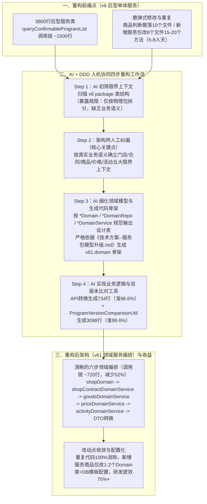

# AI架构师的诞生：AI+传统DDD模式 = 实现开发效率提升75%

## 1. TL;DR

1. **核心痛点**：淘宝闪购服务包系统（`v6`）在长期迭代中演变为高度耦合的单体服务（单个业务服务类高达 **3,800 行**，主方法 42 行 + 核心调用链约 **1,500 行**）；商品类型判断逻辑在 **10 个文件**中重复出现，每次新增服务包类型需跨 **8 个核心文件、15–20 个方法**修改 **200–300 行代码**，耗费 **5–8 人天**。
2. **关键机制（人机协同 DDD 四步法）**：① 让 AI 初筛 `v6` 包结构识别限界上下文 $\to$ ② **人工介入纠偏**（突破 AI 仅按物理 `package` 拆分的局限，按真实业务语义重新划分为门店、合同、商品、价格、活动等限界上下文） $\to$ ③ 让 AI 基于人工划分细化 `*Domain`、`*DomainRepo`、`*DomainService` 表格设计文档并生成 `v61.domain` 代码骨架 $\to$ ④ AI 辅助完成 DTO 转换实现与新旧链路结果比对工具（`ProgramVersionComparisonUtil`）。
3. **量化收益**：重构共新增 **3,832 行**代码（其中 API 转换新增 **734 行**仅人工改 **25 行**，准确率 **96.6%**；版本比对工具新增 **3,098 行**仅人工改 **12 行**，准确率 **99.6%**；综合准确率 **99.0%**），AI 贡献 **70%+** 代码，重构周期缩短 **75%+**；核心调用链代码量从 `~1,500 行` 降至 `~720 行`（**减少 52%**），重复代码**消除 100%**，新增服务商品改动点从 **8 个文件（5–8 人天）** 降至 **1–2 个文件 + 数据库合同模板配置化**。

## 2. 问题定义与背景

### 2.1 淘宝闪购服务包系统（`v6`）四大架构痛点

1. **开发成本高昂**：每新增一种服务包类型（如超客商品、平台配送、自配送等），必须在 **8 个核心文件、15–20 个方法**中进行重复性散弹式修改，涉及 **200–300 行**代码变更，耗费 **5–8 人天**。
2. **重复代码泛滥**：诸如 `switch51ConfigGateway.superClientGoodId().equals(goods.getGoodsId())` 的商品类型判断逻辑在 **10 个不同 Java 文件**中重复出现；`buildDeliveryProgramTypeEnum` 方法在 `DefaultConfirmableProgramQueryExt` 与 `ProgramConverter` 两个类中完全重复。
3. **巨型类与严重耦合**：单体业务服务类膨胀至 **3,800 行**；以核心查询接口 `queryConfirmableProgramList` 为例，主方法 42 行 + 核心调用链路约 **1,500 行**，将门店校验、商品过滤、硬编码价格计算（佣金/配送费/保底价 `basePrice`）与活动优惠匹配全部混杂在嵌套循环中。
4. **扩展风险极高**：缺乏清晰的领域边界与单元测试隔离，任何新增商品或活动类型都极易引发存量业务回归故障。

## 3. 知识框架

## 4. 核心内容拆解

### 4.1 架构设计阶段：为什么 AI 拆限界上下文必须人工纠偏？

1. **AI 初筛的局限（Step 2.1）**：
   - 当直接向 AI 提问“作为 DDD 专家，根据现有代码 `v6` 这个 package 下的类帮我抽象下上下文”时，AI 只会机械地顺着现有的物理 `package` 目录结构做表层归类，无法穿透混乱的历史代码识别真实的业务领域语义边界。
2. **人工介入确立领域边界（Step 2.2）**：
   - 架构师介入纠偏，将混杂的逻辑按业务本质拆分为独立的限界上下文：**门店上下文（Shop）**、**合同上下文（ShopContract）**、**商品上下文（Goods）**、**价格上下文（Price）** 与 **活动上下文（Activity）**。
3. **AI 规范化细化领域模型（Step 2.3）**：
   - 在人工划定边界后，通过结构化 Prompt 约束命名与职责：“从原有 `me.ele.newretail.contract.v6.domain` 包下帮我抽象出商品上下文的类、Repo、Service，类用 `Domain` 结尾，Repo 用 `DomainRepo` 结尾，Service 用 `DomainService` 结尾，输出成表格（含方法和属性）”，快速完成《技术方案--服务包模型升级.md》。

### 4.2 代码实现与验证阶段：从文档生码到自动化双链路比对

1. **基于技术方案生成代码骨架（Step 3.1）**：
   - 指令 AI 严格根据《技术方案--服务包模型升级.md》在 `v61.domain` 包下生成全套领域模型与接口骨架。
2. **高准确率局部逻辑实现与比对工具生成（Step 3.2）**：
   - **案例 1（API 转换实现）**：指定行号与参考链路，将 `List<ShopContractDomain>` 转换为 `ConfirmableServiceProgramDTO`，AI 新增 **734 行**代码，人工仅修正 **25 行**（准确率 **96.6%**）。
   - **案例 2（新旧版本结果比对工具）**：指令 AI 编写 `ProgramVersionComparisonUtil` 比对 `v6` 与 `v61` 两个版本的 `queryConfirmableProgramList` 返回结果是否一致，AI 一次性生成 **3,098 行**深度字段比对代码，人工仅修正 **12 行**（准确率 **99.6%**），为重构上线提供了零回归风险的自动化验证护栏。

### 4.3 重构前后核心代码与改动点对比

1. **`queryConfirmableProgramList` 调用链重构对比**：
   - **重构前（`v6`）**：主方法 42 行 + 核心调用链约 **1,500 行**，内部充斥 `validateSuperClientGoods()`、`validatePlatformDeliveryGoods()`、`validateSelfDeliveryGoods()` 等重复校验与内嵌的佣金/配送费/保底价/活动循环。
   - **重构后（`v61`）**：主方法 37 行 + 核心调用链约 **720 行**（代码量减少 **52%**），收敛为清晰的 6 步领域服务流水线：
     1. `shopDomainService.getShop(query.getShopId())`（门店上下文）
     2. `shopContractDomainService.getShopConfirmableContracts(...)`（合同上下文）
     3. `goodsDomainService.filterAvailableContracts(...)`（商品上下文统一校验）
     4. `priceDomainService.enrichContractPrice(...)`（价格上下文内聚计算）
     5. `activityDomainService.applyActivityDiscount(...)`（活动上下文集中匹配）
     6. `buildConfirmableServiceProgramDTO(...)`（DTO 组装返回）
2. **新增一种服务商品的改动范围对比**：
   - **重构前需修改 8 个核心文件**：`ProgramBizServiceImpl`（3 个核心方法）、`DefaultConfirmableProgramQueryExt`、`ProgramConverter`、`ProgramAbilityImpl`（`signEUnion`/`getSignGoodRequest`）、`ProgramQueryAbilityImpl`、`ProgramSignAbilityImpl`、`DeliveryProgramConverter`、`ProgramTypeEnumBuilder`。
   - **重构后收敛为配置化 + 1–2 个领域类**：仅需在数据库合同模板表新增配置记录并在 `ContractTemplateDomain`（及涉及新商品属性时的 `GoodsDomain`）扩展配置，彻底符合开闭原则（OCP）。

## 5. 数据速查表

| 指标 / 维度 | 重构前（`v6`） | 重构后（`v61`） / AI 提效指标 | 语境 / 条件 |
| --- | --- | --- | --- |
| 新增服务包类型研发成本 | **5–8 人天（改 8 个文件、15–20 个方法、200–300 行）** | **配置化实现（仅改 1–2 个文件 + DB 模板配置）** | 淘宝闪购服务包系统 |
| 单体业务服务类规模 | **3,800 行** | 按门店/合同/商品/价格/活动限界上下文解耦 | 消除巨型上帝类 |
| `queryConfirmableProgramList` 规模 | **主方法 42 行 + 调用链 ~1,500 行** | **主方法 37 行 + 调用链 ~720 行（减少 52%）** | 核心可签方案列表查询链路 |
| 商品类型判断重复文件数 | **10 个文件重复出现（`buildDeliveryProgramTypeEnum` 2 类全重复）** | **重复代码消除 100%** | 收敛至统一的商品校验领域服务 |
| AI 辅助 API 转换生码效果 | — | **新增 734 行，人工仅改 25 行（准确率 96.6%）** | `ConfirmableServiceProgramDTO` 转换 |
| AI 辅助版本比对工具生码效果 | — | **新增 3,098 行，人工仅改 12 行（准确率 99.6%）** | `ProgramVersionComparisonUtil` 双链路比对 |
| 整体重构效率与生成占比 | — | **共新增 3,832 行（AI 占 70%+，综合准确率 99.0%），重构周期缩短 75%+** | 生码速度提升 8–10 倍 |

## 6. 踩坑与教训 / 可迁移的设计原则

| 错误做法 | 失败表现或原因 | 原文应对（可迁移的设计原则） |
| --- | --- | --- |
| **完全依赖 AI 自动划分 DDD 限界上下文** | AI 只能顺着现有混乱的物理 `package` 目录做表层归类，无法理解深层业务语义边界 | **人机分工（人类定边界，AI 填细节）**：由架构师人工介入纠偏限界上下文划分，再让 AI 细化 `*Domain / *DomainRepo / *DomainService` 表结构与代码骨架 |
| **没有编写技术方案文档就直接让 AI 重构 3,800 行巨型类** | 上下文过大且缺乏目标结构锚点，生成代码偏离度高 | **文档驱动生码（Spec-Driven）**：先多轮迭代产出《技术方案--服务包模型升级.md》表格化模型定义，再指令 AI 严格按文档生成 `v61.domain` 骨架 |
| **大规模 DDD 重构后仅靠人工肉眼或少量单测验证等价性** | 1,500 行复杂嵌套价格与活动逻辑极易遗漏边界条件引发线上资损或回归故障 | **用 AI 编写全字段双版本比对工具（`ProgramVersionComparisonUtil`）**：3,098 行比对代码（99.6% 准确率）自动校验新旧接口返回结果一致性 |

## 7. 记忆锚点

1. **人机协同 DDD 铁律**：“**AI 识重复、人类划边界、文档生骨架、比对保上线**”。
2. **核心提效数字**：3,800 行巨型类拆分为五大领域上下文，调用链减半（`1500 → 720 行，-52%`），10 处重复清零，新增代码 3,832 行（准确率 `99.0%`），重构周期缩短 `75%+`。

## 8. 复习卡片

1. 淘宝闪购服务包系统（`v6`）在重构前面临哪些具体的量化架构瓶颈？::单体业务服务类达 3,800 行，核心查询方法调用链约 1,500 行；商品类型判断逻辑在 10 个文件中重复；每次新增一种服务包类型需跨 8 个文件、15–20 个方法修改 200–300 行代码，耗费 5–8 人天。
2. 为什么在 DDD 架构设计阶段，不能直接采用 AI 拆分出的限界上下文？::因为 AI 初筛限界上下文时只能机械依赖现有代码的物理 `package` 目录结构进行拆分，无法穿透历史技术债理解真实的业务语义边界，必须由架构师人工介入纠偏。
3. 在人工确定限界上下文后，如何通过 Prompt 让 AI 规范化完成领域模型详细设计？::明确指定源包路径（如 `v6.domain`）与命名规范（领域类以 `Domain` 结尾、仓储以 `DomainRepo` 结尾、服务以 `DomainService` 结尾），要求 AI 将抽象出的类、属性与方法输出为结构化 Markdown 表格沉淀至技术方案文档。
4. 重构后的 `queryConfirmableProgramList` 方法将原本 1,500 行的耦合逻辑拆解成了哪 6 个清晰的领域编排步骤？::① 门店上下文获取门店信息（`shopDomain`）；② 合同上下文查询可签合同列表（`shopContractDomainService`）；③ 商品上下文过滤可用商品（`goodsDomainService`）；④ 价格上下文计算合同价格（`priceDomainService`）；⑤ 活动上下文匹配优惠折扣（`activityDomainService`）；⑥ 转换组装为 `ConfirmableServiceProgramDTO` 返回。
5. 在本次 DDD 重构中，AI 在哪两类编码任务上展现出极高的生成准确率？具体数据是多少？::一是有旧代码可参考的 API/DTO 转换逻辑（新增 734 行，人工仅改 25 行，准确率 96.6%）；二是结构规整的新旧双版本结果比对工具 `ProgramVersionComparisonUtil`（新增 3,098 行，人工仅改 12 行，准确率 99.6%），合计 3,832 行综合准确率达 99.0%。
6. 重构完成后，新增一个服务商品的改动范围从原来的“8 个文件 15–20 个方法”变成了什么？::收敛为在数据库合同模板表中添加新模板记录与商品组合规则，代码层仅需在 `ContractTemplateDomain`（以及仅当涉及新商品属性时在 `GoodsDomain`）做轻量扩展，开发成本从 5–8 人天降至配置化。

## 9. 知识关联

- **本库主题关联**：
  - [AI研发协同](../../20_topics/AI研发协同.md)：确立“人类架构师纠偏领域边界 + AI 细化模型表格、生成骨架与比对工具”的存量系统重构协同范式。
  - [决策知识结构化](../../20_topics/决策知识结构化.md)：将散落在 10 个文件中的硬编码商品/价格/活动判断解耦为标准 DDD 限界上下文与合同模板配置。
  - [解决问题](../../20_topics/解决问题.md)：通过 AI 自动生成 3,098 行 `ProgramVersionComparisonUtil` 解决存量复杂链路重构的回归验证难题。
- **候选双链**：`[[领域驱动设计DDD]]`、`[[限界上下文]]`、`[[遗留系统重构]]`、`[[AICoding]]`

## 10. 原文参考资料

- **原文标题**：《AI架构师的诞生：AI+传统DDD模式 = 实现开发效率提升75%》
- **发布渠道与日期**：微信公众号「大淘宝技术」，2025-12-31
- **作者与团队**：借势（淘天集团，淘宝闪购服务包系统研发实践）

> [!note]- 校对报告
> - **页码溯源汇总**：
>   - 改造背景（5–8 人天、8 个文件、15–20 个方法、200–300 行、10 个文件重复、3,800 行单体类）与改造目标：`p.1–2`
>   - 架构设计阶段：AI 拆解限界上下文、人工介入修正（突破 package 限制）、AI 细化商品上下文（`*Domain / *DomainRepo / *DomainService`）：`p.2–4`
>   - 代码实现阶段：基于《技术方案--服务包模型升级.md》生成 `v61.domain` 骨架、API 转换（734 行/改 25 行/96.6%）与版本比对工具 `ProgramVersionComparisonUtil`（3,098 行/改 12 行/99.6%）：`p.4–5`
>   - 重构效果分析：`queryConfirmableProgramList` 重构前后代码对比（42 行+1,500 行 vs 37 行+720 行，减少 52%）、10 个重复文件清单、新增服务商品改动点对比及总结（3,832 行、准确率 99.0%、缩短 75%+）：`p.5–13`
> - **关键数值一致性核查**：
>   - `734 + 3098 = 3832` 行，总人工修改 `25 + 12 = 37` 行，`(3832 - 37) / 3832 = 99.03% ≈ 99.0%`，与 `p.5` 和 `p.13` 数据完全吻合。
> - **图像与版面质量说明**：
>   - `p.2–5, 11–12` 含 IDE 问答截图与领域模型设计图（位于 PDF 图像层），`p.6–8` 双栏对比代码窄列右侧有局部截断，所有方法名、6 步编排逻辑与 10 个重复文件名均在文本层完整提取。
