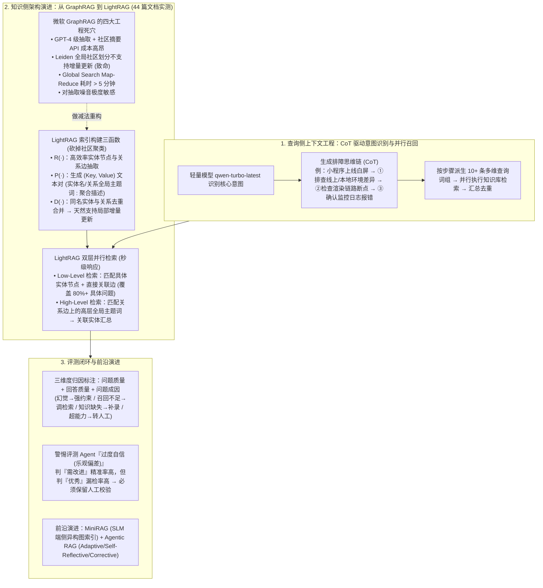

# AI 答疑助手优化实践：从 RAG 到 LightRAG 的全链路升级

## 1. TL;DR

1. **思维链（CoT）驱动的多步查询分解与并行召回**：针对传统 Naive RAG 对口语提问敏感及平面式 Query Rewriting 无法捕捉逻辑递进关系的局限，采用低延迟模型 **`qwen-turbo-latest`** 执行“**识别核心意图 $\rightarrow$ 生成排障思维链步骤 $\rightarrow$ 按步骤派生成十余条多维查询词组 $\rightarrow$ 并行向量检索与去重组装**”，从查询侧实现主动式 Context Engineering。
2. **为什么放弃微软 GraphRAG 转向 LightRAG？**：在 **44 篇**内部模块文档上的实测表明，GraphRAG 虽能通过 Leiden 社区检测与 `Map-Reduce` 社区摘要解决跨文档全局理解，但存在**索引构建成本极高、Leiden 全局社区不支持增量更新（致命缺陷）、Global Search 查询延迟超 5 分钟、对抽取质量高度敏感**四大工程瓶颈。
3. **LightRAG 三大核心函数（$R/P/D$）与双层检索范式**：通过“做减法”砍掉沉重的社区聚类，依托 **$R(\cdot)$ 实体与关系抽取、$P(\cdot)$ 键值对生成（用 `(Key, Value)` 总结替代社区摘要）、$D(\cdot)$ 跨段落去重合并**实现局部增量更新；在线同时触发**低级检索（Low-Level，查具体实体与直接关系）**与**高级检索（High-Level，查关系边上的高层全局主题词）**，将查询延迟从**分钟级压缩至秒级**并完美覆盖 80%+ 具体技术问题。
4. **三维归因评测体系与“评测 Agent 过度自信”洞察**：将粗粒度的“好/坏”二元标签升级为**问题质量、回答质量、问题成因**三维标注以精准分流根因；实证发现 LLM 自动评测存在显著**“乐观偏差（过度自信）”**——其判为“需改进”的样本人工确认精准率极高，但判为“优秀”的样本中仍混有不少实际 Bad Case（召回率低），证明人工校验闸门不可或缺。

## 2. 问题定义与背景

### 2.1 内部研发 AI 答疑助手的三大初期痛点

团队维护的内部开发者 AI 答疑助手（覆盖前端框架、开发平台、工具链、跨端组件，并直连构建/发布/监控平台工具）在初期采用 Naive RAG 时暴露出三大短板：
1. **对提问方式高度敏感**：口语化表达（“发版挂了”）与文档专业术语（“分组发布” vs “灰度”）错位导致召回剧烈波动。
2. **知识碎片化与跨文档断裂**：物理切块（Chunking）切断了“配置 $\rightarrow$ 构建 $\rightarrow$ 部署”的完整因果链，且无法对散落在多篇文档中的同一实体建立显式关联。
3. **评测黑盒化**：缺乏细粒度归因标准，优化依赖直觉。

## 3. 知识框架

## 4. 核心内容拆解

### 4.1 为什么平面 Query Rewriting 不够用？CoT 驱动并行检索架构

传统的查询改写（Query Rewriting）只是在平面语义上做同义词替换（如把“小程序上线白屏、本地正常”改写为“小程序白屏问题排查”），且串行生成 2–3 条查询。团队将其升级为**四步思维链（CoT）并行检索**：
1. **意图识别（`qwen-turbo-latest`）**：选用极低延迟的轻量模型快速锚定用户真实诉求。
2. **生成排障思维过程（核心创新）**：先推导解决问题的逻辑步骤骨架——例如针对“上线白屏”，先推理出：`步骤 1：排查线上与本地环境差异（构建配置/CDN/域名白名单）` $\rightarrow$ `步骤 2：检查渲染链路断点（JS 加载/WebView 兼容性）` $\rightarrow$ `步骤 3：确认监控与日志报错`。
3. **按思维步骤裂变多组查询**：每个逻辑步骤派生多条具体检索词（一次性产出十余条覆盖不同维度的精确查询）。
4. **并行召回与去重组装**：十余条查询并行检索后汇总去重，使喂给主答疑 LLM 的上下文天然具备“解题逻辑递进结构”，践行了 Karpathy 与 Tobi Lütke 所倡导的 **Context Engineering（主动策划推理所需的一切结构化上下文）**。

### 4.2 GraphRAG 的四大工程困境 vs LightRAG 的三函数减法哲学

1. **为什么微软 GraphRAG 在实时答疑场景几乎不可用？**
   - 团队使用 **44 篇**模块文档实测 GraphRAG（基于 Leiden 层次化连通社区检测 + `Local Search` / `Global Search Map-Reduce`）发现四大工程障碍：
     1. **构建成本极高**：44 篇文档的实体关系抽取与多级社区摘要消耗海量高阶 LLM API 调用；
     2. **不支持增量更新（最致命）**：Leiden 社区在全局图上计算，新增一篇文档就会改变社区边界、迫使全图重算社区摘要，无法适应每日更新的答疑库；
     3. **查询延迟高达分钟级**：`Global Search` 遍历社区做 Map-Reduce 聚合单次耗时 **5 分钟以上**，实时问答完全无法接受；
     4. **抽取噪声级联放大**：若弱模型或非规范文档导致实体抽取带噪，Leiden 社区划分随之失真。
2. **LightRAG 的“做减法”核心机制（$R(\cdot) \rightarrow D(\cdot) \rightarrow P(\cdot)$）**：
   - 洞察到私域答疑中 **80% 以上都是具体技术问题**，极少需要耗费巨资预计算全局社区摘要，因此**彻底移除 Leiden 社区发现机制**，改用三个核心函数构建图索引：
     - **$R(\cdot)$（实体与关系抽取）**：提取文本中的实体节点与关系边，弱化繁琐细粒度分类以换取高吞吐覆盖；
     - **$P(\cdot)$（键值对 `(Key, Value)` 生成，核心替代方案）**：为每个实体和关系边生成 `(Key, Value)`——实体的 `Key` 为名称，**关系边的 `Key` 由 LLM 增强生成多个全局性主题关键词**；`Value` 则聚合该实体或关系在原文中的所有描述总结。用轻量的 `(Key, Value)` 完美替代了昂贵的社区摘要；
     - **$D(\cdot)$（去重与合并）**：合并跨文档同名实体与关系边。当**增量添加新文档**时，仅需对新文档跑 $R(\cdot) \rightarrow$ 用 $D(\cdot)$ 与存量图局部合并 $\rightarrow$ 对新增/变更节点和边跑 $P(\cdot)$，**完全不影响存量图其余部分，天然支持高频增量更新**。
3. **双层并行检索范式（Low-Level + High-Level，秒级响应）**：
   - **低级检索（Low-Level Retrieval）**：匹配具体实体节点（如 `"WebView"`、`"离线包"`）并提取节点 `Value` 与直接关联边，路径比 GraphRAG Local Search 更短。
   - **高级检索（High-Level Retrieval）**：直接匹配关系边上的全局主题关键词（如 `"跨端渲染策略"`、`"容器化方案选型"`）再顺藤摸瓜汇总关联实体。
   - 每次查询**同时触发低级与高级检索**合并去重，将响应延迟从 GraphRAG 的**分钟级压降至秒级**。

### 4.3 前沿视野（MiniRAG / Agentic RAG）与评测 Agent“乐观偏差”校准

1. **MiniRAG 与 Agentic RAG 演进方向**：
   - **MiniRAG**：面向端侧小模型（SLMs）提出**异构图索引（Heterogeneous Graph Indexing，同时包含文本片段节点与语义概念节点）**与拓扑增强检索，无需依赖大模型的强语义理解即可实现图增强检索。
   - **Agentic RAG**：将固定检索流水线升级为多轮自主决策，涵盖 **Adaptive RAG**（按问题复杂度动态选策略）、**Self-Reflective RAG**（生成后自评不满意则重检）与 **Corrective RAG**（评估并剔除噪声文档后再生成）。
2. **三维评测标注与评测 Agent 的“过度自信（乐观偏差）”**：
   - 将粗粒度“好/坏”拆解为**问题质量、回答质量、问题成因**三个正交维度，实现精准工程分流：模型幻觉 $\rightarrow$ 强化 XML 行为规范与禁虚构约束；召回不足 $\rightarrow$ 调优 CoT 查询分解与检索策略；知识缺失 $\rightarrow$ 触发轻量知识补录；超出能力边界 $\rightarrow$ 引导转人工或联网搜索兜底。
   - **关键实证发现（乐观偏差）**：用评测 Agent 自动打分时，**它判定为“需改进”的回答，人工复核几乎 100% 确认为真 Bad Case（高精准率）；但被它判定为“优秀”的回答中，人工仍抓出相当比例的错误回答（低召回率）**。原因是模型在知识覆盖不全时意识不到自身无知，容易被流畅表面蒙蔽，因此必须坚持“自动初筛 + 多维细粒度约束 + 人工校准”相结合。

## 5. 数据速查表

| 维度 / 对比项 | 微软 GraphRAG | LightRAG（生产落地） | 工程收益与边界说明 |
| :--- | :--- | :--- | :--- |
| **意图识别模型选型** | — | **`qwen-turbo-latest`** | 极低延迟生成 CoT 排障步骤并派生十余条并行查询 |
| **对比实验语料规模** | **`44 篇`** 内部模块文档 | **`44 篇`** 内部模块文档 | 同一基准下对比构建成本、延迟与问答质量 |
| **索引结构与宏观聚合机制** | 实体关系图 + **Leiden 层次社区摘要** | 实体关系图 + **$P(\cdot)$ `(Key, Value)` 键值对** | 用关系边上的全局主题词 Key 替代高成本社区聚类 |
| **在线查询响应延迟** | Global Search **`> 5 分钟`**（Map-Reduce） | **秒级响应**（Low-Level + High-Level 并行） | 满足实时交互式研发答疑 SLA |
| **日常增量更新能力** | **不支持**（新文档改变全局社区需全量重建） | **天然支持局部增量更新**（$R \rightarrow D \rightarrow P$） | 仅处理新增文档实体与边，API 与 Token 开销极小 |
| **业务问题分布契合度** | 擅长重度全局综述（占比 `< 20%`） | **完美覆盖 `80%+` 具体技术问题** + 兼顾宏观提问 | 在线实时答疑场景最具性价比的图增强方案 |

## 6. 踩坑与教训 / 可迁移的设计原则

1. **用“CoT 解题步骤骨架 $\rightarrow$ 多维并行查询”替代平面的同义词改写**：当用户提问“上线后白屏但本地正常”时，不要只做字面同义扩写；先让轻量模型（`qwen-turbo-latest`）列出排障的 3 个逻辑阶段，再按阶段并行发出十余条检索，能让召回上下文天然对齐工程师的排障思维链。
2. **知识库高频更新的在线系统切忌盲目照搬微软 GraphRAG，优先选 LightRAG**：GraphRAG 的 Leiden 全局社区聚类决定了它天生抗拒增量更新，且 Global Search 的 Map-Reduce 动辄耗时数分钟；通过 LightRAG 的 $R/P/D$ 函数去掉社区层级、在关系边上挂载全局主题 Key，即可兼得图谱跨文档关联与秒级增量更新。
3. **永远不要单凭 LLM-as-a-Judge 的“优秀”高分就跳过人工抽检**：大模型对同类输出存在系统性的“过度自信（乐观偏差）”——它挑出的毛病（判负）往往很准，但它放过的“满分作文”（判正）里经常藏着因知识盲区导致的自信胡说。

## 7. 记忆锚点

- **一套 CoT 查询分解流**：`qwen-turbo-latest` 识意图 $\rightarrow$ 推演排障思维链步骤 $\rightarrow$ 裂变 10+ 条查询词 $\rightarrow$ 并行召回组装。
- **三个 LightRAG 核心算子**：$R(\cdot)$ 实体关系抽取 + $P(\cdot)$ 实体/关系 `(Key, Value)` 键值对生成（替代 Leiden 社区摘要）+ $D(\cdot)$ 去重合并（解锁局部增量更新）。
- **两层并行检索路径**：`Low-Level`（实体节点 + 直接边，解 80%+ 具体问题）+ `High-Level`（关系边全局主题词，解宏观问题），耗时从 **`>5分钟` 降至 `秒级`**。
- **一个评测反直觉定律**：评测 Agent 存在**乐观偏差**——判“差”极准（高 Precision），判“好”易漏（低 Recall），必须配三维归因与人工校验。

## 8. 复习卡片

1. 为什么传统的 Query Rewriting（查询改写）在复杂技术答疑中效果有限？CoT 驱动的并行检索是如何改进的？::传统改写只是平面的同义词替换且串行检索 2–3 条查询，无法理解问题内在的逻辑递进结构；CoT 驱动方案先用 `qwen-turbo-latest` 识别意图并推理出解决问题的思维步骤（如先查环境差异→再查渲染断点→最后查日志），再针对每个步骤并行生成十余条查询词组召回汇总。
2. 团队在 44 篇文档上实测微软 GraphRAG 时，发现了哪四个导致其无法在实时答疑场景落地的致命工程问题？::一是索引构建（实体抽取+社区摘要）API 成本极高；二是基于 Leiden 全局图计算的社区结构不支持增量更新，新文档加入需全量重建；三是 Global Search 需遍历社区做 Map-Reduce 聚合，单次查询耗时达 5 分钟以上；四是对底层实体关系抽取质量高度敏感。
3. LightRAG 的索引构建包含哪三个形式化核心函数（$R, P, D$）？它是如何用“做减法”支持增量更新的？::包含 $R(\cdot)$（实体与关系抽取）、$P(\cdot)$（为每个实体节点和关系边生成 `(Key, Value)` 总结键值对，其中关系边的 Key 为增强生成的全局主题词）和 $D(\cdot)$（跨文档同名实体与关系去重合并）；因为它去掉了全局 Leiden 社区层级，新文档加入时只需局部执行 $R \rightarrow D \rightarrow P$ 合并新增节点与边，无需重建全图。
4. LightRAG 的“双层检索范式（Low-Level 与 High-Level）”是如何协同工作的？::Low-Level 检索聚焦具体实体节点及其直接关联边（解决 80% 以上的具体技术问题）；High-Level 检索匹配关系边上的高层全局主题关键词并顺藤摸瓜汇总关联实体（解决宏观选型与架构问题）；在线查询时两者同时触发、合并去重，实现秒级响应。
5. 什么是 MiniRAG 和 Agentic RAG（含哪三种模式）？::MiniRAG 面向小模型（SLMs）提出包含文本片段节点与语义概念节点的异构图索引，摆脱对大模型强语义理解的依赖；Agentic RAG 让 Agent 自主决策多轮检索，涵盖 Adaptive RAG（按复杂度选策略）、Self-Reflective RAG（生成后自评重检）和 Corrective RAG（剔除噪声文档再生成）。
6. 在使用评测 Agent 自动评估答疑质量时，团队发现了什么“过度自信（乐观偏差）”现象？工程上应如何应对？::评测 Agent 判定为“需改进”的样本人工几乎都会确认为 Bad Case（精准率高），但判定为“优秀”的样本中人工仍会检出相当比例的坏回答（召回率低），因为模型在知识缺失时意识不到自己“不知道”；工程上绝不能完全依赖模型自评，必须结合“问题质量+回答质量+问题成因”三维标注与人工抽样校准。

## 9. 知识关联

- **所属主题**：
  - [检索与文档解析](../../20_topics/检索与文档解析.md)
  - [Agent成本与上下文预算](../../20_topics/Agent成本与上下文预算.md)
  - [Agent评测与反馈](../../20_topics/Agent评测与反馈.md)
  - [问题澄清](../../20_topics/问题澄清.md)
- **本地跃迁**：[原始 PDF](RAW.pdf) · [逐页转写文本](MD.md)
- **候选双链**：[[构建高质量RAG知识库]] · [[RAG全链路技术详解]] · [[Spec+RAG打造懂业务AI程序员]] · [[Codeindex代码语义索引]]

## 10. 原文参考资料

1. **GraphRAG 原始论文**：Darren Edge et al., *From local to global: A graph RAG approach to query-focused summarization*, arXiv:2404.16130, 2024.
2. **LightRAG 原始论文**：Zirui Guo et al., *LightRAG: Simple and fast retrieval-augmented generation*, arXiv:2410.05779, 2024.
3. **前沿演进与行业观点**：Andrej Karpathy & Tobi Lütke (Shopify CEO) 关于 Context Engineering 的论述、MiniRAG（异构图索引）、Adaptive / Self-Reflective / Corrective RAG

> [!note]- 校对报告
> - **页码溯源**：p.1–3（内部开发者 AI 答疑助手 Naive RAG 三大痛点、XML 规范/联网兜底/流式思考透出基础建设、Andrej Karpathy 与 Tobi Lütke 上下文工程定义、平面 Query Rewriting 两大局限）；p.4–5（`qwen-turbo-latest` CoT 驱动四步查询分解与并行召回架构、小程序上线白屏排障案例与前后对比）；p.6–9（传统向量 RAG 三大结构局限、微软 GraphRAG Leiden 社区检测与 Local/Global Search Map-Reduce、44 篇文档 Streamlit 可视化实测与四大致命工程困境：高成本/不支持增量更新/5 分钟以上高延迟/抽取敏感）；p.9–12（LightRAG 做减法哲学、$R(\cdot)$ 实体关系抽取 / $P(\cdot)$ `(Key, Value)` 键值对生成 / $D(\cdot)$ 去重合并三函数、Low-Level + High-Level 双层检索、局部增量更新与秒级响应、80%+ 具体问题覆盖、MiniRAG 异构图索引与 Adaptive/Self-Reflective/Corrective Agentic RAG）；p.12–14（问题质量/回答质量/问题成因三维标注体系、评测 Agent 乐观偏差/过度自信现象分析与总结）。
> - **一致性核验**：作者（凡烟，淘天集团-跨端技术团队）、发布时间（2026-04-10）、全部论文引用、实验文档数（44 篇）、延迟对比（>5 分钟 vs 秒级）均与原文逐字核对一致；正文中无任何内联页码引用。
> - **质量边界**：全文理论与工程验证结合紧密，所有核心函数与架构逻辑均完整提炼。
