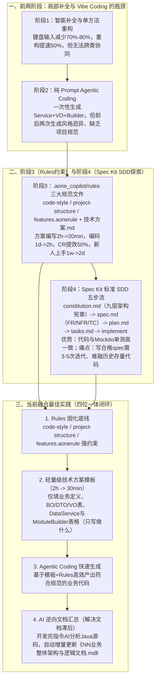

# AI编码实践：从Vibe Coding到SDD

## 1. TL;DR

1. **核心痛点**：淘特导购团队自 2024 年初引入 AI 编程以来，经历了“单方法补全（局限局部） $\to$ 纯 Prompt 驱动的 Agentic Coding（多次生成风格迥异、缺乏项目规范、新手老手 Prompt 质量悬殊） $\to$ Rules 约束 $\to$ SDD（Specification Driven Development，规格驱动开发）”四阶段演进。
2. **SDD 探索与现实局限**：基于 `iflow / qwen + qwen3-coder-plus + Spec Kit` 落地 `constitution.md`（九层架构宪章） $\to$ `spec.md`（含 FR/NFR/TC 测试用例） $\to$ `plan.md` $\to$ `tasks.md` $\to$ 代码与 Mockito 完整单测自动生成；虽实现了“规格即唯一真理源、可测试性内建”，但在存量业务中暴露出**规格编写门槛高（首份合格规格需 3–5 次迭代）、与庞大历史代码库难集成、老员工感觉不如手写快**三大痛点。
3. **当前融合最佳实践（轻量级技术方案模板 + `.aonerule` 强约束 + Agentic Coding + AI 逆向文档汇总）**：弃用重型全套 Spec Kit 流程，改用 **30 分钟**即可填完的轻量级技术方案模板配合 `.aone_copilot/rules/*.aonerule`（代码风格/包结构/组件继承规范）驱动 Agent 生码，并在需求完成后**让 AI 从生成代码逆向汇总更新《业务整体架构与逻辑文档.md》**，兼顾编码速度（1 天 $\to$ 2 小时）、CR 效率（`+50%`）与文档零滞后。

## 2. 问题定义与背景

### 2.1 淘特导购业务的研发挑战与四阶段演进全景

淘特导购系统承载商品推荐、会场投放、活动营销等高频迭代场景。团队从 2024 年初引入内部 `Aone Copilot` 开始，先后探索了四种 AI 编码模式：
1. **阶段一：代码智能补全与单方法改写**（VO 字段映射减少 `70%–80%` 键盘输入，单方法重构如用 `Money.ofFen()` 替代浮点除法提速 `50%`；但局限于单方法，不理解跨类架构）。
2. **阶段二：无约束 Agentic Coding（Vibe Coding）**（用一段 Prompt 让 `Qwen3-coder` 一次性生成 `NnRedPacketDataService` + `NnRedPacketVO` + `NnRedPacketModuleBuilder`；但暴露出**代码延续性差**——同一折扣文案方法第一次用 `discount.getYuan()` 仅 3 行，第二次生成却手写 `BigDecimal.divide(100, 2, RoundingMode.HALF_UP)` 冗长实现，且团队不同成员 Prompt 水平参差不齐）。
3. **阶段三：Rules 约束 + 技术方案模板**（引入 `.aone_copilot/rules/*.aonerule` 固化规范）。
4. **阶段四：SDD（Spec Kit）探索与最终融合实践**（取长补短形成轻量级闭环）。

## 3. 知识框架

## 4. 核心内容拆解

### 4.1 阶段三：`.aone_copilot/rules/` 三层规则文件体系

为解决 Vibe Coding“每次零基础自由发挥”的问题，团队在工程根目录下建立 `.aone_copilot/rules/` 固化三类规则：
1. **`code-style.aonerule`（代码风格规范）**：
   - 命名：类名 `PascalCase`、方法/变量 `camelCase`、常量 `CONSTANT_CASE`；
   - 判空强制标准：集合用 `CollectionUtils.isEmpty()/isNotEmpty()`、字符串用 `StringUtils.isBlank()/isNotBlank()`、对象用 `Objects.isNull()/nonNull()`；
   - 日志标准：统一用 `LogUtil.error("类名, 方法名, 错误描述, 关键参数={}", param, e)`。
2. **`project-structure.aonerule`（包结构与命名规范）**：
   - 明确 `com.alibaba.aladdin.app` 下的 `module/[业务名]`、`domain/module`、`dataservice/impl`、`provider` 目录职责；
   - 强制命名后缀：`[业务名]DataService`、`[业务名]ModuleBuilder`、`[业务名]VO`、`[业务名]BO`。
3. **`features.aonerule`（框架基类与调用契约规范）**：
   - 数据服务必须实现 `DataService<T>` 接口（`execute(InvocationContext context, JSONObject businessReq)`）；
   - 模块构建器必须继承 `BaseModuleBuilder<T>`，实现 `getName()`、`doBuild()`、`bottomTransform()`，并通过 `ContextUtils.<List<FundQueryDTO>>getBizResult(..., 500)` 获取数据结果。

### 4.2 阶段四：基于 Spec Kit 的 SDD（规格驱动开发）深度实测

团队使用 `iflow / qwen + qwen3-coder-plus + Spec Kit` 对“NN 红包模块（`001-nn-redpacket-module`）”进行了为期 3 个月的 SDD 探索：
1. **`.specify/memory/constitution.md`（项目全局宪章）**：
   - 定义 8 大核心原则（模块化服务、阿里 Java 规范、全面测试、单一职责、**九层架构设计：接入层→解决方案层→子解决方案层→模块构建层→数据服务层→外部服务层→领域模型层→基础设施层→通用模块层**、最小依赖、代码风格一致、Speckit 全中文本地化）及“不新建分支、直接在当前分支操作”等工作流约束。
2. **`specs/001-nn-redpacket-module/spec.md`（唯一真理源规格）**：
   - 显式定义功能需求 `FR-1`（调用 `FpProvider.queryUserFundBuyPoolId`，过滤 `payStatus == 2`、未过期且门槛 `<= amountThreshold` 默认 20 元）、`FR-2`（NN 专属红包池 `nnRedPacketPoolIds` 优先，其次按门槛升序）、`FR-3`（构建 VO，空列表返回 `null`）；
   - 显式定义非功能需求 `NFR-1`（查询超时 `500ms`，超时返回空列表不影响其他模块）；
   - **内建测试用例规格（`TC-1` 至 `TC-4`）**：直接驱动生成包含 4 个完整 `@Test` 方法（正常返回 VO 且总金额 `"15.00"`、门槛 25 元超限返回 `null`、Provider 返回 `null`、未登录 `userId=0` 返回 `null`）的 `NnRedPacketModuleBuilderTest`（基于 `MockitoJUnitRunner`）。
3. **SDD 暴露的四大落地痛点与适用边界**：
   - **痛点**：① 规格编写门槛高（新手易写得过细或过糊）；② 生成链路长、返工重；③ **与存量历史代码库集成困难**（存量代码无 spec，新老混杂维护成本反升）；④ 学习成本高（写出第一份合格规格平均需 **3–5 次迭代**，老员工觉得不如直接写代码快）。
   - **适用边界**：适合**全新项目/模块、核心长期维护逻辑、高复杂度多人协作需求**；不适合**简单工具函数/配置修改、快速实验功能、一次性临时需求与存量代码小修小补**。

### 4.3 当前融合最佳实践：Rules + 轻量方案模板 + Agentic + AI 逆向文档汇总

针对存量导购业务特点，团队提炼出四步融合工作流：
1. **保留 `.aonerule` 强约束底盘**；
2. **将重型 `spec.md` 瘦身为 30 分钟轻量级《技术方案模板》**：仅包含“业务定义（1–2 句话）+ 业务领域对象 + 模块 VO 表格 + 数据服务表格 + 模块构建器表格”，只写“做什么”，把实现细节交给 AI；
3. **用 Agentic Coding 快速生成代码并人工收尾**；
4. **首创“AI 逆向文档汇总机制”解决文档过期顽疾**：需求开发完成后，不靠人工改文档，而是指令 AI 分析刚写好的 `NnRedPacketDataService.java`、`NnRedPacketModuleBuilder.java`、`NnRedPacketVO.java`，自动提取核心功能、数据流转图、关键过滤/排序/金额计算代码片段、类路径与 JSON 配置项（如 `"amountThreshold": 2000`），增量更新至全局《NN业务整体架构与逻辑文档.md》。

## 5. 数据速查表

| 阶段 / 指标 | 原文数值 / 对比变化 | 语境 / 条件 |
| --- | --- | --- |
| 阶段 1：代码自动补全与单方法重构 | **对象构建/转换减少 70%–80% 键盘输入；单方法重构提速 50%** | 某次商详项目实测（`Aone Copilot`） |
| 阶段 3：引入 Rules 后技术方案填写耗时 | **从 2 小时降低到 20 分钟（融合版轻量模板稳定在 30 分钟内）** | 相比重型 SDD 规格（2 小时）大幅减负 |
| 阶段 3：引入 Rules 后代码实现耗时 | **从 1 天降低到 2 小时（含人工收尾）** | 淘特导购日常业务模块开发 |
| 阶段 3：Code Review 与新人上手提效 | **CR 效率提升 50%；新人上手时间从 1 周降低到 2 天** | 统一遵循 `.aonerule` 与技术方案共同语言 |
| 阶段 4：SDD 首份合格规格迭代次数 | **平均需要 3–5 次迭代** | 经过 3 个月 `Spec Kit` 实践统计 |
| NN 红包模块核心业务参数 | **超时 `500ms` / 默认门槛上限 `20元（2000分）` / 可用状态 `payStatus == 2`** | `NnRedPacketDataService` & `ModuleBuilder` |

## 6. 踩坑与教训 / 可迁移的设计原则

| 错误做法 | 失败表现或原因 | 原文应对（可迁移的设计原则） |
| --- | --- | --- |
| **无 Rules 约束直接用自然语言 Prompt 做多轮业务需求开发（Vibe Coding）** | 同一项目内相同功能（如分转元格式化）前后生成风格截然不同，团队新手与老手产出质量悬殊 | **在工程仓库固化三层 `.aonerule`（代码风格 + 包结构命名 + 框架基类契约）**：让每次生成都受统一架构规范约束 |
| **在拥有庞大历史代码的存量项目中一刀切强推重型 SDD（Spec Kit）** | 历史代码无 Spec 难以衔接，写一份合格 Spec 需 3–5 轮迭代（耗时 2 小时），老员工抵触情绪大 | **按场景分级选型 + 轻量级模板融合**：全新复杂模块用 SDD；存量迭代用“30 分钟轻量表格模板 + Rules + Agentic Coding” |
| **指望开发者在改完代码后手动同步更新架构文档** | 敏捷迭代下文档必然滞后过期，新人阅读旧文档反而被误导 | **建立“代码 -> AI 逆向汇总 -> 全局架构文档”后置流水线**：每次需求开发完，让 AI 读取最新源码自动增量更新《业务整体架构与逻辑文档.md》 |

## 7. 记忆锚点

1. **四阶段演进链**：$\text{单方法补全（省 70\%–80\% 敲键）} \to \text{Vibe Coding（风格分裂）} \to \text{Rules 约束（编码 1d}\to\text{2h）} \to \text{SDD 探索与融合（轻量模板 + Rules + AI 逆向文档汇总）}$。
2. **存量项目黄金组合**：“**事前 `.aonerule` 定规矩 + 事中 30 分钟轻量表格写需求 + 事后 AI 读源码逆向更文档**”。

## 8. 复习卡片

1. 为什么单纯使用 Agentic Coding（通过详细 Prompt 一次性生成功能代码）在持续迭代中会导致项目腐化？::因为缺乏固化的项目规范与历史记忆，AI 每次都是“零基础”生成，导致同一项目内相似功能的实现风格前后迥异（如金额转换有时用封装类 `Money.getYuan()`，有时手写 `BigDecimal` 除法），且不同开发者编写的 Prompt 质量差异极大。
2. 淘特导购团队在 `.aone_copilot/rules/` 下沉淀了哪三类规则文件？各自约束什么内容？::① `code-style.aonerule`（命名、强制使用 `CollectionUtils`/`StringUtils`/`Objects` 判空、`LogUtil` 日志格式）；② `project-structure.aonerule`（包目录结构与 `*DataService`/`*ModuleBuilder`/`*VO` 命名后缀）；③ `features.aonerule`（强制实现 `DataService<T>` 接口、继承 `BaseModuleBuilder<T>` 及通过 `ContextUtils.getBizResult` 通信）。
3. 引入 Rules 文件与技术方案模板后，团队在开发效率、Code Review 与新人培养上取得了哪些量化提升？::技术方案填写从 2 小时降至 20–30 分钟，代码实现从 1 天降至 2 小时（含人工收尾），Code Review 效率提升 50%，新人上手时间从 1 周缩短至 2 天。
4. 基于 `Spec Kit` 的 SDD（规格驱动开发）包含哪五个核心执行步骤与文件产物？::① `speckit.constitution`（生成全局宪章 `constitution.md`）；② `speckit.specify`（生成含 FR/NFR/TC 的 `spec.md` 与 `requirements.md`）；③ `speckit.plan`（生成 `plan.md`、`data-model.md`、`api-contract.md`）；④ `speckit.tasks`（生成 `task.md`）；⑤ `speckit.implement`（生成业务代码与完整 Mockito 单元测试）。
5. 经过 3 个月实践，为什么团队没有在所有日常需求中全面铺开标准 SDD，而是转向融合模式？::因为标准 SDD 在存量项目中存在四大痛点：① 规格编写门槛高（新手难掌握颗粒度）；② 返工链路长；③ 与缺乏 Spec 的庞大历史存量代码库难以集成；④ 学习成本高（写好首份规格平均需 3–5 次迭代，老员工觉得不如直接写代码快）。
6. 团队最终落地的“融合最佳实践”是如何解决“代码变更后文档容易滞后过期”这一痛点的？::设计了“AI 文档汇总机制”：在每次完成需求代码开发后，直接把新增/修改的 `.java` 源码提交给 AI，指令 AI 提取功能说明、数据流转链路、核心过滤/排序代码片段、类路径与 JSON 配置项，自动增量更新到全局《业务整体架构与逻辑文档.md》中。

## 9. 知识关联

- **本库主题关联**：
  - [AI研发协同](../../20_topics/AI研发协同.md)：完整复盘从代码补全、Vibe Coding、Rules 约束到 Spec Kit SDD 与轻量融合模式的四阶段团队演进与量化收益。
  - [Agent工程循环](../../20_topics/Agent工程循环.md)：对比 `Spec Kit` 正向生成闭环（`constitution -> spec -> plan -> tasks -> implement`）与存量项目“轻量模板正向生码 + AI 逆向汇总文档”双闭环。
  - [Prompt优化](../../20_topics/Prompt优化.md)：通过三层 `.aonerule` 规则文件与结构化 Markdown 表格模板消除开发者个体 Prompt 差异。
- **候选双链**：`[[SDD规格驱动开发]]`、`[[SpecKit]]`、`[[AoneCopilot]]`、`[[Rules工程规范]]`、`[[逆向文档生成]]`

## 10. 原文参考资料

- **原文标题**：《AI编码实践：从Vibe Coding到SDD》
- **发布渠道与日期**：微信公众号「大淘宝技术」，2025-12-15
- **作者与团队**：式遂（淘天集团-淘特用户技术团队）
- **核心提及工具与模型**：Aone Copilot、`iflow`、`Spec Kit`、`Qwen3-coder` / `qwen3 coder plus`

> [!note]- 校对报告
> - **页码溯源汇总**：
>   - 淘特导购业务背景、单方法补全与改写案例（减少 70%–80% 键盘输入、重构提速 50%）及局限：`p.1–3`
>   - Agentic Coding 尝试（`NnRedPacketDataService` / `VO` / `ModuleBuilder` 生成）与暴露的三大问题（风格延续性差、缺乏项目规范、Prompt 因人而异）：`p.3–6`
>   - 引入 `.aone_copilot/rules`（`code-style` / `project-structure` / `features.aonerule`）与技术方案模板及量化效果（2h→20m、1d→2h、CR +50%、新人 1w→2d）：`p.6–10`
>   - SDD（`Spec Kit` + `qwen3 coder plus`）全流程实测：`constitution.md`（九层架构）、`spec.md`（FR/NFR/TC-1~TC-4）、代码与 `MockitoJUnitRunner` 单测生成、四大痛点（3–5 次迭代）与适用边界：`p.10–20`
>   - 融合最佳实践（Rules + 30 分钟轻量技术方案模板 + Agentic Coding + AI 逆向汇总《NN业务整体架构与逻辑文档.md》）：`p.20–25`
> - **关键数值一致性核查**：
>   - `p.10` 写“技术方案填写时间从 2 小时降低到 20 分钟”，`p.21` 写“比 SDD 规格更轻量，编写时间从 2 小时降低到 30 分钟”，两处语境（阶段 3 初版 vs 阶段 6 对比 SDD 规格）均在笔记中完整保留说明。
> - **图像与版面质量说明**：
>   - `p.1–3, 6, 10, 20, 25` 含演进阶段配图（位于 PDF 图像层），`p.26` 为空白尾页；全部 Java 代码、`.aonerule` 规则、Markdown 模板与单测源码均在 PDF 文本层完整呈现。
