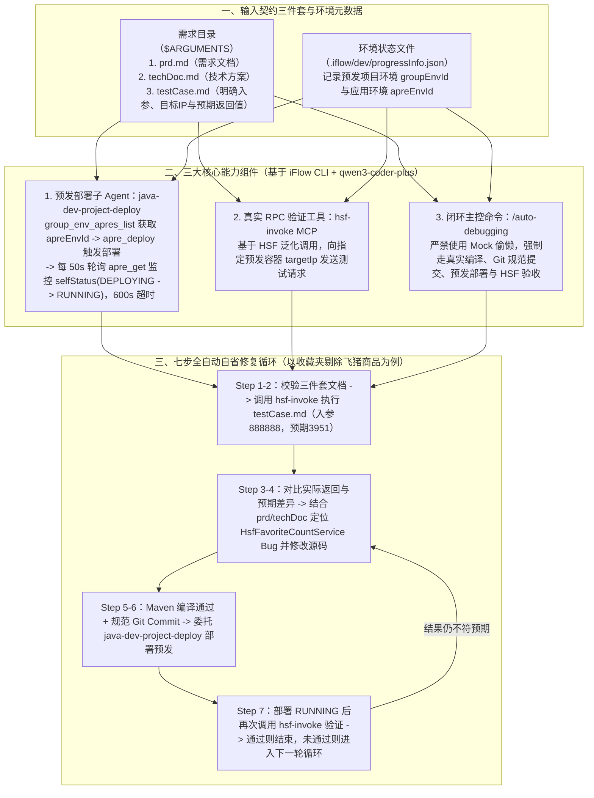

# 让AI打出丝滑连招：编码-部署-自测-改bug

## 1. TL;DR

1. **核心痛点（AI 编程的“最后一公里”缺失）**：当前大多数 AI 辅助编程停留在“写完代码立马跑路”的“极品实习生”阶段，从不自测，迫使开发者陷入“变身代码保姆逐行手改”或“十几个回合对话哄小孩式改 Bug”的泥潭，把生码节省的时间全部填了回去。
2. **测试驱动的闭环自愈工作流（`iFlow CLI` + `qwen3-coder-plus`）**：将合格程序员的日常素养固化为 **`编码 → 部署 → 自测 → 改 Bug → 再自测`** 全自动闭环，核心由三大组件支撑：
   - **预发自动部署子 Agent（`java-dev-project-deploy`）**：读取 `.iflow/dev/progressInfo.json` 中的 `groupEnvId`，调用内部平台 MCP（`group_env_apres_list` $\to$ `apre_deploy` $\to$ 每 **50 秒**轮询一次 `apre_get` 直至 `selfStatus` 从 `DEPLOYING` 变为 `RUNNING`，设 **10 分钟/600 秒**超时保护）；
   - **HSF 泛化调用自测工具（`hsf-invoke` MCP）**：指定 `serviceName`、`methodName`、`paramTypes`、`paramValues` 与预发容器 `targetIp` 发起真实 RPC 调用；
   - **自动化调试主命令（`/auto-debugging`）**：串联 `校验三件套文档（prd.md / techDoc.md / testCase.md） → HSF 自测对比预期结果 → 定位根因修改源码（严禁 Mock 偷懒） → Maven 编译并按规范提交 Git → 调部署 Agent 上预发 → 再次 HSF 回归验证` 直至通过。
3. **实战验证**：在手淘“收藏夹商品个数统计剔除飞猪商品”（预发环境 `groupEnvId: 4355970`，测试入参 `888888`，预期返回 `3951`）需求中，全程零人工干预跑通“首轮 HSF 调用发现返回值不符 $\to$ 自动定位 `HsfFavoriteCountService` 缺陷并修复 $\to$ 自动编译提交并轮询部署预发 $\to$ 二轮 HSF 调用验证通过”的完整自愈闭环。

## 2. 问题定义与背景

### 2.1 为什么说“只写代码不自测的 AI”是“极品实习生”？

在日常业务开发中，即便 PRD 理解、技术方案设计与初始代码生成都很顺利，首版生成代码仍不可避免存在边界遗漏或小 Bug。现有两种人工兜底模式效率极低：
1. **人工二次编辑（代码保姆模式）**：研发人员自己逐行排查、手动改码、手动部署预发测试，生码省下的时间被调试抵消。
2. **多轮对话式修复（哄小孩模式）**：人肉执行测试后把报错贴回对话框，来回拉扯十几个回合，心力交瘁。
- **破局核心**：赋予 AI **明确的验收标准（可执行测试用例）**与**真实的反馈执行环境（预发部署 + RPC 调用工具）**，让 AI 自己跑完“编码 $\to$ 部署 $\to$ 自测 $\to$ 改 Bug $\to$ 再自测”闭环。

## 3. 知识框架



## 4. 核心内容拆解

### 4.1 预发自动部署子 Agent：`java-dev-project-deploy`

为让 AI 具备将改好的代码真正投送到预发环境运行的能力，团队封装了内部研发平台 MCP 工具并定义了专用部署 Agent：
1. **Step 1（环境校验）**：检查 `.iflow/dev/progressInfo.json` 是否存在并提取预发项目环境 ID `groupEnvId`（缺失则提示用户补充）。
2. **Step 2（应用环境映射）**：调用 `group_env_apres_list` 传入 `groupEnvId` 与应用名，提取对应的应用环境 ID `apreEnvId` 并回写至 `progressInfo.json`。
3. **Step 3（触发部署）**：调用 `apre_deploy` 启动预发构建与部署，记录起始时间戳。
4. **Step 4（状态轮询与超时熔断）**：每隔 **50 秒**调用一次 `apre_get` 检查 `selfStatus` 字段：
   - 当状态为 `DEPLOYING` 时继续等待；
   - 当状态变为 **`RUNNING`** 时判定部署成功；
   - 若超过 **10 分钟（600 秒）** 仍未成功，则判定部署超时失败并告警。
5. **Step 5（审计日志）**：无论成功或失败，均将部署时间戳、环境信息、分支版本、结果与耗时追加写入审计日志。

### 4.2 真实接口自测工具：`hsf-invoke` MCP

基于阿里内部 RPC 框架 HSF 的**泛化调用（Generic Invocation）**能力封装了 `hsf-invoke` MCP 工具，无需依赖目标服务的二方客户端 Jar 包即可向指定预发机器发起测试调用：
```json
{
  "serviceName": "com.taobao.mercury.services.FavoriteCountService",
  "methodName": "getFavoriteCount",
  "paramTypes": ["long"],
  "paramValues": [88888888],
  "targetIp": "33.4.XX.XX"
}
```

### 4.3 闭环主控命令 `/auto-debugging` 的七步防偷懒设计

在 `auto-debugging` Prompt 中设计了严格的七步执行契约：
1. **验证文档**：确认 `$ARGUMENTS` 路径下 `prd.md`、`techDoc.md`、`testCase.md` 齐全；
2. **执行自测**：解析 `testCase.md` 调用 `hsf-invoke` 获取真实运行返回值；
3. **根因分析**：对比实际返回值与预期结果，结合需求、技术方案与源码定位 Bug；
4. **源码修复（防作弊铁律）**：修改 Java 源码修复问题，**显式规定“注意不能使用 mock 等方式偷懒，要确保修复代码真实生效”**；
5. **编译与规范提交**：确保本地编译通过后执行 Git 提交，且 Commit Message 必须符合正则规范 `^(feat|fix|refactor)...`；
6. **自动部署预发**：调用 `java-dev-project-deploy` 子 Agent 将最新提交部署至预发容器；
7. **回归验证循环**：待预发部署变为 `RUNNING` 后，再次调用 `hsf-invoke` 验证用例并记录 debug 日志；若仍不符合预期则自动开启下一轮分析-修改-部署-验证循环。

### 4.4 实战验证與未来五大演进方向

- **收藏夹剔除飞猪商品个数实战**：给定需求（收藏夹商品个数统计删除飞猪商品）、技术方案（定位 `HsfFavoriteCountService.getFavoriteCount`）、测试用例（调用 `FavoriteCountService.getFavoriteCount`，目标 IP `33.4.XX.XX`，入参 `long` 型 `888888`，预期返回 `3951`）及预发环境 `groupEnvId: "4355970"`，执行 `/auto-debugging` 后全程无人工干预一次性跑通两轮验证闭环。
- **未来五大演进方向**：① **测试能力升级**（自动生成用例、复杂入参构造、AB 实验加白）；② **Bug 诊断强化**（接入 SLS 日志、EagleEye 诊断日志与实时抓包）；③ **任务拆分能力**（将大需求拆解为边界清晰的原子子任务）；④ **部署提速与构建自愈**（接入**热部署 API** 免漫长全量重启，并通过 MCP 捞取构建/部署失败日志自动修编译错）；⑤ **后置质量门禁**（串联代码评审 Agent 与性能优化 Agent）。

## 5. 数据速查表

| 指标 / 配置项 | 原文数值 / 设定 | 语境 / 条件 |
| --- | --- | --- |
| AI Coding 核心技术栈 | **`iFlow CLI` + `qwen3-coder-plus`** | 配合内部研发平台部署 MCP 与 `hsf-invoke` MCP |
| 预发部署状态轮询间隔 | **每 `50 秒` 轮询一次 `apre_get`** | 监控 `selfStatus` 从 `DEPLOYING` 转为 `RUNNING` |
| 预发部署最大超时阈值 | **`10 分钟（600 秒）`** | 超时未 `RUNNING` 则中断并记录部署失败 |
| 实战验证案例测试参数 | **入参 `888888`（`long`）$\to$ 预期返回 `3951`** | `FavoriteCountService.getFavoriteCount`，`groupEnvId: 4355970` |

## 6. 踩坑与教训 / 可迁移的设计原则

| 错误做法 | 失败表现或原因 | 原文应对（可迁移的设计原则） |
| --- | --- | --- |
| **只让 AI 写完代码就结束，靠人肉部署和十几个回合对话式改 Bug** | 开发者沦为“代码保姆”和“人肉测试机”，AI 生码省下的时间全耗在手工验证与口头传话上 | **给 AI 配齐“部署手”与“测试眼”构建自愈闭环**：通过 `java-dev-project-deploy` + `hsf-invoke` 让 AI 自己部署预发、自己调接口对比预期并迭代改码 |
| **只要求 AI“让测试通过”而不加反作弊约束** | 大模型为了快速通过断言，极易在代码里直接硬编码返回预期值或写 Mock 欺骗测试 | **在 Prompt 中立下反作弊红线 + 真实预发 RPC 验收**：严禁使用 Mock 偷懒，且必须经过本地编译、Git 提交、预发真机部署与远程 HSF 调用验证 |
| **调用异步部署接口后不设轮询间隔与超时上限** | 高频死循环刷爆平台 API，或遇到预发卡死时 Agent 永久挂起 | **標準化轮询协议**：固定每 50 秒轮询一次 `selfStatus`，设置 600 秒硬超时熔断并落盘审计日志 |

## 7. 记忆锚点

1. **丝滑四连招闭环**：$\text{编码（禁 Mock + 规范 Commit）} \to \text{部署（50s 轮询 / 600s 超时）} \to \text{自测（HSF 泛化调用指定 IP）} \to \text{改 Bug 再验证}$。
2. **合格 AI 程序员三要素**：“**明确的验收标准（`testCase.md`）+ 完整的反馈闭环（部署与 RPC 工具）+ 标准化的自省工作流（`/auto-debugging`）**”。

## 8. 复习卡片

1. 为什么作者把当前许多团队使用 AI 编程的方式比作培养了一个“极品实习生”？::因为只让 AI 写完代码就完事，从不要求它部署和自测，导致开发者不得不陷入“人工逐行修改（当代码保姆）”或“十几个回合对话哄小孩式改 Bug”的困境，核心缺失的是自动化的验收与迭代反馈机制。
2. `java-dev-project-deploy` 部署子 Agent 是如何通过四个步驟将本地修改后的代码发布到预发环境的？::① 读取 `.iflow/dev/progressInfo.json` 获取项目环境 ID `groupEnvId`；② 调用 `group_env_apres_list` 获取应用环境 ID `apreEnvId` 并回写；③ 调用 `apre_deploy` 发起预发部署；④ 每隔 50 秒轮询一次 `apre_get` 检查 `selfStatus` 是否从 `DEPLOYING` 变为 `RUNNING`（10 分钟/600 秒超时）。
3. `hsf-invoke` 工具是如何实现对预发环境指定机器的自动化接口测试的？::底层基于 HSF 泛化调用机制封装为 MCP 工具，只需传入接口名 `serviceName`、方法名 `methodName`、参数类型数组 `paramTypes`、参数值数组 `paramValues` 以及预发容器 `targetIp`，即可直接向该预发机器发起 RPC 调用并拿回真实返回值。
4. 在 `/auto-debugging` 的提示词设计中，为什么要特别强调“不能使用 mock 等方式偷懒”？::因为大模型在目标导向驱动下，如果发现测试不通过，极易走捷径通过 Mock 返回值或硬编码预期数字来“骗过”测试；必须显式禁止 Mock 并强制走“源码修改 → 编译提交 → 预发部署 → 远程 HSF 调用”的真实链路。
5. 启动 `/auto-debugging` 自动化调试工作流前，开发者需要在需求目录下准备好哪三份文档？::需要准备好需求文档（`prd.md`）、技术方案文档（`techDoc.md`）和明确定义了接口、入参、目标 IP 与预期返回值的测试用例文档（`testCase.md`）。
6. 针对全量预发部署耗时较长（需每 50 秒轮询）以及复杂线上问题定位难的局限，团队规划了哪些升级方向？::① 接入**热部署 API** 替代全量构建部署以大幅缩短单轮循环等待时间，并捞取构建日志自动修复部署错误；② 接入 SLS 日志、诊断日志与实时抓包强化 Bug 根因定位；③ 引入任务拆分、实验加白及后置代码评审/性能优化 Agent。

## 9. 知识关联

- **本库主题关联**：
  - [Agent工程循环](../../20_topics/Agent工程循环.md)：在 `iFlow CLI` 中通过 `/auto-debugging` 串联编码、Git 提交、预发部署子 Agent 与 HSF 远程调用验证，构建真实环境闭环。
  - [AI研发协同](../../20_topics/AI研发协同.md)：用“PRD + 技术方案 + 可执行测试用例”三件套替代低效的多轮口头对话改 Bug，打通 AI 编程最后一公里。
  - [Agent评测与反馈](../../20_topics/Agent评测与反馈.md)：以预发容器真实 HSF 泛化调用返回值对比 `testCase.md` 预期结果，作为驱动 Agent 自我修复的硬验收信号。
- **候选双链**：`[[测试驱动AI编程]]`、`[[iFlowCLI]]`、`[[HSF泛化调用]]`、`[[自动部署Agent]]`、`[[自愈工程循环]]`

## 10. 原文参考资料

- **原文标题**：《让AI打出丝滑连招：编码-部署-自测-改bug》
- **发布渠道与日期**：微信公众号「大淘宝技术」，2025-11-07
- **作者与团队**：结香（参与开发者：结香、陌琊、长济；淘天集团-用户消息与社交团队）
- **核心提及工具与模型**：`iFlow CLI`、`qwen3-coder-plus`、`java-dev-project-deploy`、`hsf-invoke` MCP、`/auto-debugging`

> [!note]- 校对报告
> - **页码溯源汇总**：
>   - AI 编程“最后一公里”痛点（人工二次编辑“代码保姆”与十几个回合“对话式哄小孩修复”）：`p.1`
>   - 测试驱动闭环工作流架构（`iFlow CLI` + `qwen3-coder-plus`）与 `java-dev-project-deploy` 部署 Agent 完整 Prompt（`group_env_apres_list`、`apre_deploy`、每 50s 轮询 `apre_get`、600s 超时）：`p.2–4`
>   - `hsf-invoke` HSF 泛化调用工具与 `/auto-debugging` 七步提示词（禁 Mock 偷懒、正则 Commit 规范）：`p.4–5`
>   - 收藏夹商品个数统计剔除飞猪商品实战（`groupEnvId: 4355970`、入参 `888888`、预期 `3951`）四步闭环截图与未来五大演进方向：`p.5–10`
> - **关键数值一致性核查**：
>   - 轮询间隔 `50秒`、超时时间 `10分钟（600 seconds）`、测试入参 `888888`（示例模板为 `88888888`）、预期返回 `3951`、`groupEnvId: "4355970"` 均与原文完全一致。
> - **图像与版面质量说明**：
>   - `p.2, 7, 8, 9` 含架构图与 `iFlow CLI` 终端自动执行四阶段截图（位于 PDF 图像层）；全部 Agent Prompt、JSON 参数与总结结论均在文本层完整保留。
