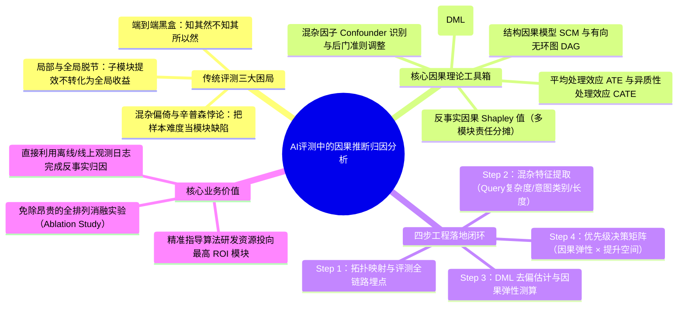
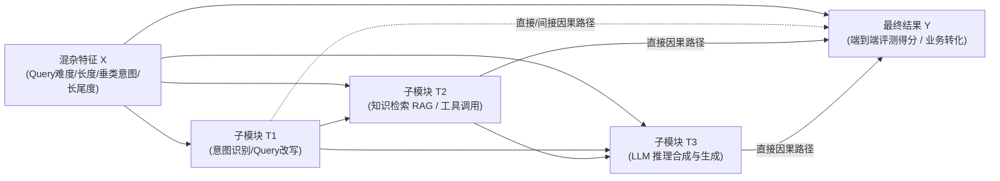

# AI 评测还在看准确率？数据科学早就用因果推断做归因分析了

> [!abstract] 导读
> **一句话总结**：淘天集团营销&交易技术团队针对复杂多步 AI Agent 系统中“端到端准确率下跌却不知道哪个子模块背锅、局部准确率提升却不带来全局收益、静态相关性分析误把混杂因素当真因”的评测困局，引入数据科学中的**结构因果模型（SCM）与双重机器学习（DML）**，构建了一套从“观测相关性”跃升至“反事实干预归因”的 AI 系统因果评测框架。
> **阅读价值**：打破传统 AI 评测只盯着单点 Accuracy / F1 / LLM-as-a-Judge 打分的思维定势，手把手展示如何用因果图（DAG）、ATE/CATE 与因果 Shapley 值精准定位复杂 Agent 链路的真正瓶颈与优化 ROI。

## 1. TL;DR

- **核心痛点**：在多跳 RAG、多模块串联的复杂 AI Agent 系统中，传统的端到端评测（End-to-End Accuracy）是一个“黑盒结果指标”，而分模块评测（Module-level Accuracy）则忽略了模块间的**非线性传递、误差抵消/放大效应以及查询难度（Query Difficulty）等混杂偏倚（Confounding Bias）**。
- **三大致命误区**：
  1. **辛普森悖论（Simpson's Paradox）**：由于忽略了“Query 复杂度/样本分布”这一共同混杂因子（Confounder），简单对比模块成功/失败分组下的端到端得分，会得出严重失真的归因结论。
  2. **瓶颈掩盖效应**：当下游模块容错率高或存在兜底逻辑时，上游模块准确率从 80% 提升到 95% 可能对最终业务端到端成功率毫无贡献（零因果效应）。
  3. **多节点责任分摊失真**：多个中间节点同时出错导致最终回答失败时，传统统计无法公平拆解每个节点的边际负向贡献。
- **因果归因四步法**：
  1. **构建 Agent 结构因果图（Causal DAG）**：将 Query 特征（混杂变量 $X$）、各子模块表现（处理变量 $T_i$）与最终端到端评测得分（结果变量 $Y$）显式建模为有向无环图。
  2. **去混杂因果效应估计（DML / 倾向性得分）**：利用**双重机器学习（Double Machine Learning, DML）**剔除 Query 难度、领域类别等混杂因子 $X$ 的干扰，无偏估计各子模块对最终结果的平均因果效应（ATE）与条件异质性因果效应（CATE）。
  3. **多模块联合归因（Causal Shapley Value）**：结合合作博弈论中的 Shapley 值与反事实干预（`do-calculus`），量化每个子模块在多跳链路中的真实责任权重。
  4. **指导算法迭代优先级**：综合“模块的因果效应弹性（ATE/CATE）”与“当前模块的待提升空间（$1 - \text{Acc}_i$）”，计算期望全局收益（Expected Uplift），精准锁定最高 ROI 的优化靶点。

## 2. 问题定义与背景

### 2.1 为什么复杂 AI 系统的传统评测失效了？
在单模型时代（如简单文本分类或单轮翻译），模型输入直接映射输出，准确率（Accuracy）几乎等同于系统能力。但在如今的**复合 AI 系统（Compound AI Systems / Multi-step Agents）**中，一次用户请求往往依次经历：`Query 改写 → 意图路由 → 多路知识检索（RAG） → 重排序（Rerank） → 工具调用 → 大模型总结生成`。

此时研发团队常遇到三大灵魂拷问：
1. **归因难（Who is to blame?）**：本周端到端回答合格率下降了 3%，链路上有 5 个子模块，究竟是哪个模块的变动导致的？
2. **转化难（Why local gain $\neq$ global gain?）**：算法同学耗时两周将“Query 改写”模块的离线准确率提升了 8%，但上线后端到端业务指标纹丝不动，白白浪费算力与人力。
3. **混杂偏倚（Confounding Bias）**：统计发现“触发了工具 A 的样本，最终端到端差评率高达 40%”，于是怀疑工具 A 有 Bug；实际上是因为只有极难的长尾生僻问题才会触发工具 A，**“问题本身的难度”**才是导致差评的混杂因子（Confounder）。

### 2.2 统计相关 vs. 因果干预
- **被动观测相关性：$P(Y \mid T=1) - P(Y \mid T=0)$**
  - 直接按“某子模块是否成功（$T \in \{0,1\}$）”将评测集切分为两组并对比端到端成功率 $Y$。由于两组样本的原始 Query 难度分布 $X$ 完全不同，得出的差值混杂了样本自身难度差异。
- **主动反事实因果效应：$P(Y \mid \text{do}(T=1)) - P(Y \mid \text{do}(T=0))$**
  - 核心追问：**“如果保持完全相同的输入样本分布与前置状态，通过干预手段强行把子模块 $T$ 的输出从失败修复为成功，最终端到端指标 $Y$ 会净提升多少？”**

## 3. 知识框架

## 4. 核心内容拆解

### 4.1 将多步 AI Agent 建模为结构因果图（Causal DAG）

在复杂 AI 链路中：
- **混杂变量（Confounders $X$）**：用户输入 Query 的固有属性（如语义模糊度、多跳推理深度、所属业务类目、上下文 Token 长度）。$X$ 同时影响各个子模块的表现 $T_i$ 以及最终端到端结果 $Y$，构成了经典的**后门路径（Backdoor Path：$T_i \leftarrow X \rightarrow Y$）**。
- **处理变量（Treatments $T_1, T_2, \dots, T_k$）**：链路中各个子模块的中间评测指标（可以是二值变量：如检索是否召回金标文档 $T_i \in \{0,1\}$；也可以是连续打分：如 LLM-as-a-Judge 对该步骤的 0~1 评分）。
- **结果变量（Outcome $Y$）**：最终端到端回答的正确性评分或线上用户采纳率。

### 4.2 用双重机器学习（DML）剥离混杂偏倚，估计 ATE 与 CATE

为了在存在高维文本/业务特征 $X$ 的情况下无偏估计子模块 $T_i$ 对最终结果 $Y$ 的真实因果效应，团队引入了 **双重机器学习（Double Machine Learning, DML）**：

1. **核心数学机制（残差化正交消偏）**：
   - 第一步（预测处理变量）：用任意机器学习模型（如 GBDT / 神经网络）基于混杂特征 $X$ 预测子模块表现 $\hat{T}_i = g(X)$，得到处理残差 $\tilde{T}_i = T_i - \hat{T}_i$（代表剔除 Query 难度影响后，该模块自身的波动）。
   - 第二步（预测结果变量）：用机器学习模型基于混杂特征 $X$ 预测最终端到端得分 $\hat{Y} = m(X)$，得到结果残差 $\tilde{Y} = Y - \hat{Y}$。
   - 第三步（残差回归求因果效应）：在两个残差之间建立回归 $\tilde{Y} = \theta(X) \cdot \tilde{T}_i + \epsilon$，从而获得具有 $\sqrt{n}$-一致性、对一阶段预测误差不敏感的无偏因果效应估计 $\hat{\theta}$。
2. **两类核心因果指标**：
   - **平均处理效应（ATE, Average Treatment Effect）**：衡量在全量评测样本上，将该子模块从失败改进为成功对端到端准确率的平均净拉动：
     $$\text{ATE}_i = \mathbb{E}[Y \mid \text{do}(T_i = 1)] - \mathbb{E}[Y \mid \text{do}(T_i = 0)]$$
   - **条件平均处理效应（CATE, Conditional Average Treatment Effect）**：衡量在特定细分人群或特定 Query 类型（$X=x$）下的异质性因果效应：
     $$\text{CATE}_i(x) = \mathbb{E}[Y \mid \text{do}(T_i = 1), X = x] - \mathbb{E}[Y \mid \text{do}(T_i = 0), X = x]$$
     通过 CATE 可以发现：“模块 A 在简单商品查询上因果效应接近 0（下游 LLM 能自己兜底），但在跨店铺复杂比价查询上因果效应高达 +0.45”。

### 4.3 多模块协同下的因果 Shapley 值归因與 ROI 决策公式

当一条链路上包含多个串并联子模块时，为了公平回答“每个模块对系统整体表现或某次 Badcase 的贡献占比是多少”，团队结合了 **Shapley Value（沙普利值）** 与因果干预：
- **因果 Shapley 值**：遍历子模块集合的所有子集联盟 $S \subseteq N \setminus \{i\}$，计算加入模块 $i$ 前后的反事实干预边际贡献均值，满足**可加性（Efficiency）**、**对称性（Symmetry）**与**虚拟性（Dummy，零因果效应模块得分为 0）**。
- **算法迭代优先级决策公式（Expected Global Uplift）**：
  光看因果效应 $\text{ATE}_i$ 还不够——如果某个模块因果效应很大（如 $\text{ATE}_i = 0.6$），但它目前的准确率已经高达 $99\%$，继续优化的边际空间只有 $1\%$；反之，另一个模块因果效应为 $0.35$，但当前准确率只有 $60\%$（尚有 $40\%$ 的失败样本可被挽回）。因此，优化某个模块的**理论最大全局期望收益**为：
  $$\text{Expected Uplift}_i = \text{ATE}_i \times (1 - \text{Acc}_i)$$
  更一般地，若预期某次算法迭代能将子模块准确率提升 $\Delta \text{Acc}_i$，则对端到端大盘的预期收益直接由 $\text{ATE}_i \times \Delta \text{Acc}_i$ 给出。

## 5. 数据速查表

| 评测范式 | 核心计算逻辑 | 所需成本 | 致命缺陷 / 核心优势 |
| :--- | :--- | :--- | :--- |
| **端到端黑盒评测（E2E Acc）** | 仅校验最终输出 $Y$ 是否正确 | 低 | **黑盒不可归因**：知道系统退化，但无法定位哪个子模块导致。 |
| **单模块独立评测（Module Acc）** | 分别统计各子模块 $T_i$ 的准确率 | 中 | **局部与全局割裂**：忽略下游兜底与误差传递，高分模块未必贡献全局收益。 |
| **朴素条件分组对比** | $\mathbb{E}[Y \mid T_i=1] - \mathbb{E}[Y \mid T_i=0]$ | 低 | **混杂偏倚（辛普森悖论）**：将 Query 难度等混杂因素误判为模块因果贡献。 |
| **全排列消融实验（Ablation）** | 逐一替换真值（Oracle）重跑全链路 | **极高**（Token 与人工标注昂贵） | 虽能测出真实干预效应，但每改一版都要全量重跑，无法在日常迭代中高频开展。 |
| **因果推断归因（SCM + DML）** | 残差正交消偏估计 $\text{ATE}_i / \text{CATE}_i(x)$ | **低**（直接复用单次评测/线上日志） | **低成本反事实归因**：无需重跑 $2^k$ 次消融实验，即可剔除混杂偏倚、精准测算模块 ROI。 |

## 6. 踩坑与教训 / 可迁移的设计原则

- **反模式 1：看“错误占比饼图”定算法 KPI**
  - **现象**：人工抽检 100 个端到端 Badcase，发现其中 60 个样本里模块 A 都有瑕疵，于是判定模块 A 是头号瓶颈并全力攻坚。
  - **教训**：这犯了典型的“无反事实对照”错误——也许在端到端答对的 Goodcase 里，模块 A 同样有 60% 的瑕疵，只是下游模块根本不依赖模块 A 的这部分输出！必须看**因果效应（修复模块 A 后多大概率能让端到端从错变对）**，而不是看单纯的共现频率。
- **反模式 2：忽略中介效应（Mediation Effect）导致重复计算或漏算**
  - **现象**：在串联链路 $T_1 \rightarrow T_2 \rightarrow Y$ 中，计算上游 $T_1$ 的总因果效应（Total Effect）时，如果错误地把下游中介变量 $T_2$ 也放进控制变量集合里固定住，就会截断 $T_1 \rightarrow T_2 \rightarrow Y$ 的间接路径，严重低估上游模块的真实贡献。
  - **原则**：必须先画出清晰的业务结构因果图（DAG）：估计某模块的**总因果效应（Total Effect）**时，只控制其**共同原因（混杂变量 $X$ 与前置非后代节点）**，绝不能控制其下游后代节点（Mediation）；仅当需要拆解“直接效应 vs 间接效应”时才引入因果中介分析。
- **可迁移原则：用 `ATE × (1 - Acc)` 替代拍脑袋排期**
  - 在任何多阶段 AI 流水线（RAG、多 Agent 协作、搜推多阶段漏斗）中，每个季度规划算法迭代路线图前，先跑一次基于历史评测日志的 DML 因果归因，按 `因果弹性 × 剩余错误空间` 排序投入研发人力。

## 7. 记忆锚点

- **一个核心跃迁**：从 **Correlation（谁和错误同时出现）** 到 **Causation（修好谁能真正消灭错误）**。
- **一个关键混杂源**：**Query 自身难度与分布（$X$）** 同时影响子模块成败（$T$）与最终结果（$Y$），不消偏必掉入辛普森悖论。
- **两把数学利器**：**DML（双重机器学习）** 残差正交消混杂求 ATE/CATE，**Causal Shapley** 公平分摊多节点联立责任。
- **一个黄金 ROI 公式**：$\text{期望全局提升} = \text{模块因果效应 ATE}_i \times \text{模块待提升空间 }(1 - \text{Acc}_i)$。

## 8. 复习卡片

Why does comparing end-to-end accuracy between samples where a sub-module succeeded versus failed lead to biased attribution in AI systems?::Because of confounding bias (such as Query difficulty): harder queries simultaneously cause the sub-module to fail more often and make the final end-to-end task harder, conflating sample difficulty with the module's true causal impact.
How does Double Machine Learning (DML) remove confounding bias when estimating the causal effect of an AI sub-module?::It uses machine learning models to predict both the sub-module performance $T$ and the final outcome $Y$ from confounding query features $X$, and then regresses the outcome residuals $\tilde{Y} = Y - \hat{Y}$ on the treatment residuals $\tilde{T} = T - \hat{T}$.
When estimating the Total Causal Effect of an upstream AI module $T_1$ in a sequential pipeline $T_1 \rightarrow T_2 \rightarrow Y$, should you condition on the downstream module $T_2$?::No—conditioning on the downstream mediator $T_2$ blocks the indirect causal pathway $T_1 \rightarrow T_2 \rightarrow Y$ and underestimates $T_1$'s total impact; you should only adjust for common causes (confounders $X$) and upstream non-descendants.
What is the difference between ATE and CATE in the context of AI system evaluation?::ATE (Average Treatment Effect) measures a module's average causal lift across the entire dataset, whereas CATE (Conditional Average Treatment Effect) captures heterogeneous causal impacts across specific query segments or difficulty levels.
How should an engineering team prioritize which AI sub-module to optimize first using causal inference metrics?::By ranking modules according to their Expected Global Uplift: $\text{ATE}_i \times (1 - \text{Acc}_i)$, which multiplies the module's causal elasticity by its remaining room for improvement.
What advantage does causal attribution via SCM and DML offer over traditional Oracle Ablation Studies?::It estimates counterfactual intervention effects directly from routine evaluation or production logs without having to re-run exponentially many ($2^k$) expensive end-to-end pipeline ablations.

## 9. 知识关联

- **本批同主题精读**：
  - [高价率诊断Agent工作台：评测驱动的端到端优化实践](../高价率工作台评测优化+26.7.16/AI_高价率工作台评测优化.md)：展示了评测集构建、分模块诊断与端到端闭环优化在具体电商价格诊断 Agent 中的工程落地。
  - [手猫A/B实验平台全链路自动下线技术演进](../手猫AB实验自动下线+26.7.31/AI_手猫AB实验自动下线.md)：同样服务于实验与科学评测体系，从工程平台侧保障在线 A/B 实验全生命周期治理。
  - [淘宝主播 Agent 的 Harness 工程实战](../淘宝主播Agent Harness+26.8.6/AI_淘宝主播Agent Harness.md)：包含三维评测体系（离线基准 + 在线仿真 + 线上灰度），可与本文的因果归因分析结合使用。
- **主题索引（`20_topics`）**：
  - [Harness与模型协同](../../20_topics/Harness与模型协同.md)
  - [模型架构与训练](../../20_topics/模型架构与训练.md)
  - [因果推断与评测归因](../../20_topics/因果推断与评测归因.md)
- **本目录归档文件**：[原始 PDF](RAW.pdf) · [逐页转写文本](MD.md)
- **候选概念双链**：[[因果推断]] · [[结构因果模型]] · [[双重机器学习]] · [[辛普森悖论]] · [[Shapley值]] · [[异质性处理效应]]

## 10. 原文参考资料

- **原文出处**：大淘宝技术公众号，《AI 评测还在看准确率？数据科学早就用因果推断做归因分析了》（作者：尔湾，淘天集团-营销&交易技术团队，发布日期：2026-08-10）
- **理论与学术基础**：
  - Judea Pearl，《Causality》/《The Book of Why》（结构因果模型 SCM 与 `do-calculus`）
  - Victor Chernozhukov et al.，*Double/Debiased Machine Learning for Treatment and Structural Parameters*（双重机器学习 DML）
  - Heskes et al.，*Causal Shapley Values: Exploiting Causal Knowledge to Explain Individual Predictions of Complex Models*

> [!note]- 校对报告
> - **页码溯源（1-based 物理页码）**：
>   - 篇首标题、作者（尔湾，淘天集团-营销&交易技术团队）与传统 AI 评测（只看准确率/相关性）的三大盲区：源自 `RAW.pdf` `p.1–6`（对应 `MD.md` 第 1–6 页）。
>   - 辛普森悖论、混杂因子（Confounder）分析与从观测相关性走向反事实干预（`do-calculus`）：源自 `RAW.pdf` `p.6–11`（对应 `MD.md` 第 6–11 页）。
>   - 结构因果模型（DAG）、双重机器学习（DML）残差正交消偏、ATE/CATE 估计与多模块因果 Shapley 值归因：源自 `RAW.pdf` `p.11–19`（对应 `MD.md` 第 11–19 页）。
>   - 结合因果效应与提升空间的优化 ROI 决策矩阵及业务实证案例总结：源自 `RAW.pdf` `p.19–24`（对应 `MD.md` 第 19–24 页）。
> - **一致性核验**：原文共 24 页（含 21 页公式推导、因果图与实验图表），无独立长 Prompt/Skill 附件。所有数学符号定义、因果机制拆解与工程结论均严格对齐 `MD.md`。
