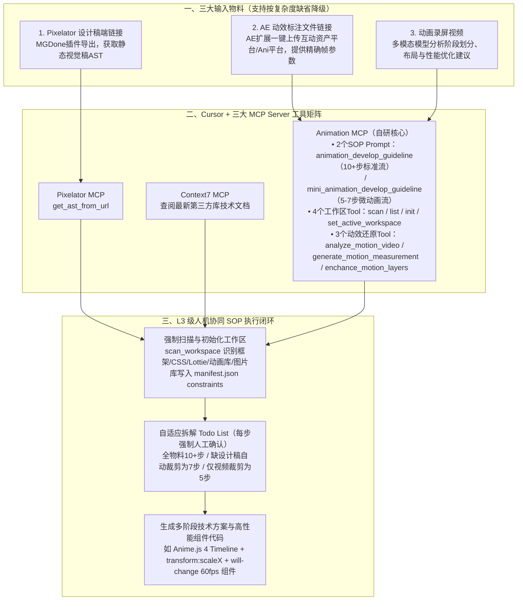

# AI 辅助前端动画开发

## 1. TL;DR

1. **核心痛点**：传统前端动画开发存在“美术手动发包、前端反复看视频肉眼猜参数、沟通成本高、走查反复返工”四大痛点；而早期尝试将工具节点串联成端到端固定工作流（追求 L5 全自动驾驶）因单点出错需从头重跑、LLM 中间劣质输出无法人工干预、绑定固定技术栈难以跨项目复用而宣告失败。
2. **范式转向（从 L5 黑盒工作流转向 L3 级自动驾驶）**：以 **Cursor（AI IDE） + Animation MCP + Pixelator MCP + Context7 MCP** 构建可随时暂停、人工介入校验与调整的交互式协作链路，将复杂动画开发拆解为 **7–16 个**可逐项确认的 Todo 步骤（每完成一个 Todo 强制暂停等待开发者确认）。
3. **三大核心物料与工具链**：结合 **MGDone Pixelator 设计稿链接**（提取视觉稿 AST）、**AE 动效标注文件链接**（由 AE 扩展一键导出并经 `generate_motion_measurement` 提取精确动画参数）与 **动画视频**（由多模态模型 `analyze_motion_video` 拆分动画阶段并生成技术方案）；即使在仅提供一段进度条录屏视频的极限缺省场景下，也能自动生成 5 步 Todo、两阶段 `mermaid` 方案文档及基于 **React 19.1.0 + TailwindCSS 4.1.4 + Anime.js 4.0.2（60fps 硬件加速 `scaleX` + `backgroundPosition`）** 的完整组件代码。

## 2. 问题定义与背景

### 2.1 前端 AI 生码的两大深水区与传统动效研发痛点

1. **D2C（Design to Code）与动效生码的双重挑战**：静态 UI 还原需将设计稿结构化数据映射为前端代码（如 Pixelator、Figma 探索方向）；而动画开发不仅依赖静态样式还原，还强依赖美术通过 After Effects（AE）交付的多形态动效资产与精确时序参数。
2. **传统动画开发的四大低效环节**：
   - 美术导出文件后手动发群，前端手动下载；
   - 前端反复逐帧看视频**猜测动画曲线、时长与位移参数**；
   - 参数不确定需反复找美术确认，沟通成本高；
   - 猜测参数偏差导致设计走查频繁打回返工。
3. **明确能力边界（什么不做 vs 做什么）**：
   - 对于直接交付成品动效文件播放的场景（如 `Lottie`、`SVG`、`Spine`、`PAG`、`WebP`、`APNG`、`GIF`、`Sprite` 序列帧），无需手写动画代码；
   - 本方案聚焦需要前端用代码（CSS / JS 动画库）精确还原的交互与微动效场景，前置联合跨端团队打造了 **AE 扩展一键导出动效标注系统**（上传至互动资产平台并通过 MCP Tool 供 Agent 读取）。

### 2.2 为什么放弃“端到端固定工作流（L5）”转向“Cursor + MCP（L3）”？

团队最初尝试将各工具节点硬编码串联为一条自动生成 React 动画组件的工作流，很快暴露出四大瓶颈：
1. **调试成本极高**：中间任一节点出错必须调整后从头重跑；
2. **缺乏人在环路（HITL）干预**：某节点 LLM 输出劣化时无法中途修正，错误逐级放大；
3. **技术栈僵化**：绑定单一框架，不同项目（React/Vue、Tailwind/CSS Modules、GSAP/Anime.js）难以复用；
4. **最后一公里断层**：产物需手动搬运回业务工程二次改造。

因此作者将定位从“L5 全自动驾驶”调整为**“L3 级自动驾驶（Cursor AI IDE + Animation MCP + 可裁剪 SOP Prompt）”**，让 AI 在项目本地工作区内生成 **7–16 个** Todo 代办项，开发者可在每步暂停替换物料（如替换丑陋的生成 SVG 为真实肥料图片）或追加移动端单位适配指令。

## 3. 知识框架

## 4. 核心内容拆解

### 4.1 Animation MCP 架构与工具清单

自研 `Animation MCP` 联合 `Pixelator MCP` 与 `Context7 MCP` 构建了三层能力：
1. **两套分级 SOP Prompt**：
   - `animation_develop_guideline`（互动动画开发标准工作流）：面向复杂交互动画，要求提供完整三件套物料，生成 **10 步以上**的 Todo List。
   - `mini_animation_develop_guideline`（互动微动画开发工作流）：面向轻量微动效或物料不全场景，自动裁剪缺失物料对应的步骤（无设计稿时生成 **7 步** Todo；仅提供动画视频时生成 **5 步** Todo）。
2. **4 个动画工作区管理 Tool**：
   - `scan_workspace`（强制第一步执行，扫描项目目录结构、UI 框架如 React/Vue/Svelte、CSS 方案如 Tailwind/CSS Modules、Lottie 库版本、JS 动画库如 Anime.js 4/GSAP、图片库如 `@ali/picture` 或 `@ali/hudong-picture`，写入 `manifest.json` 的 `constraints` 字段）；
   - `init_animation_workspace`、`list_workspaces`、`set_active_workspace`。
3. **3 个辅助动效还原 Tool**：
   - `analyze_motion_video`：调用多模态大模型分析动效视频，产出包含动画阶段拆分、DOM/React 布局建议、关键代码与性能优化建议的技术方案文档；
   - `generate_motion_measurement`：从互动资产平台或 Ani 平台提取 AE/Lottie 精确动效标注 JSON 数据；
   - `enchance_motion_layers`：结合 Pixelator 视觉稿 AST 对动效标注图层进行语义化增强。

### 4.2 核心 Prompt 护栏设计

在动画开发 SOP Prompt 中设置了两条铁律：
1. **环境先行约束**：强制先执行 `scan_workspace` 与 `init_animation_workspace`，将项目真实依赖写入 `manifest.json`，杜绝生成与本地项目技术栈冲突的代码。
2. **单步暂停确认机制（Human-in-the-Loop）**：“在完成每一个 Todo 后，都需要让我确认是否继续，这对我非常重要！！！”——确保开发者在发现生成 SVG 粗糙或移动端单位缺失时能立即暂停注入图片或补充约束。

### 4.3 实战案例：仅凭一段视频生成 `ProgressLine` 双阶段流光进度条

当仅提供 Ani 平台录制的进度条动画视频（无设计稿、无标注文件）时，Agent 自动裁剪为 **5 步 Todo** 并完成以下端到端交付：
1. **多模态视频解析与两阶段拆分**：
   - **阶段一（绘制阶段，`00:00 - 00:04`，`4000ms`）**：水平线条从左向右伸展（`transformOrigin: 'left'`，`scaleX` 从 `0` 变到 `1`，缓动函数 `easeInOutQuad` / `cubicBezier(0.42, 0, 0.58, 1)`），同时背景渐变跟随笔尖移动（`backgroundPosition` 从 `'100% 0'` 到 `'50% 0'`）。
   - **阶段二（循环阶段，`00:04 - 结束`，单周期 `2000ms`）**：线条保持满宽（`scaleX: 1`），`200%` 宽度的三色线性渐变背景（`#4F46E5 -> #06B6D4 -> ...`）以 `linear` 缓动从 `'100% 0'` 到 `'-100% 0'` 无限循环滚动（`loop: true`）。
2. **技术选型与性能优化内建**：
   - 选用 **Anime.js 4.0.2（`createScope` + `Timeline`）+ TailwindCSS 4.1.4 + React 19.1.0**（构建工具 Vite 7.1.5，设计宽度 `750px`，目标帧率 `60fps`），避免对简单几何渐变动画杀鸡用牛刀引入重型 Lottie/APNG；
   - **GPU 硬件加速**：使用 `transform: scaleX` 替代改变 `width` 避免触发 Layout 重排，并显式声明 `willChange: 'transform, background-position'`。

## 5. 数据速查表

| 维度 / 指标 | 原文数值 / 配置 | 语境 / 条件 |
| --- | --- | --- |
| AI 辅助定位演进 | **从 L5 全自动固定工作流转向 L3 级人机协同自动驾驶** | 保留开发者在每个 Todo 节点暂停、校验与干预能力 |
| 动画开发拆解 Todo 步数 | **全套标准流 10+ 步（7–16 个代办项）** | 缺省设计稿微动画流 **7 步**；仅视频输入微动画流 **5 步** |
| Animation MCP 工具构成 | **2 个 Prompt + 4 个工作区 Tool + 3 个动效还原 Tool** | 配合 `Pixelator MCP` 与 `Context7 MCP` 协同 |
| `ProgressLine` 阶段一参数 | **时长 `4000ms`（0–4s）** | `scaleX: [0, 1]`，`backgroundPosition: ['100% 0', '50% 0']`，`cubicBezier(0.42, 0, 0.58, 1)` |
| `ProgressLine` 阶段二参数 | **单次循环时长 `2000ms`（`loop: true`）** | `backgroundPosition: ['100% 0', '-100% 0']`，`ease: 'linear'`，`backgroundSize: '200% 100%'` |
| 生成组件目标技术栈与性能指标 | **React 19.1.0 + TailwindCSS 4.1.4 + Anime.js 4.0.2 + Vite 7.1.5** | 设计宽度 `750px`，目标帧率 **`60fps`** |

## 6. 踩坑与教训 / 可迁移的设计原则

| 错误做法 | 失败表现或原因 | 原文应对（可迁移的设计原则） |
| --- | --- | --- |
| **企图用黑盒静态 Workflow 一步到位生成复杂前端动画（L5 模式）** | 中间节点出错需全链路重跑、多模态抽帧偶发偏差无法人工纠偏、绑定单一技术栈无法跨项目复用 | **采用 AI IDE（Cursor）+ MCP 工具集 + 分步确认 SOP（L3 模式）**：将任务拆为 5–16 个 Todo，每步完成后强制暂停等待人工确认 |
| **让前端工程师或纯视觉模型靠肉眼看视频“猜”复杂动画参数** | 关键帧时长、缓动曲线与位移数值失真，美术走查反复打回返工 | **源头结构化导出（AE 扩展 -> 动效标注平台 -> `generate_motion_measurement`）**：用精确 JSON 标注数据约束代码生成 |
| **未扫描本地工程环境就直接让 AI 写动画组件** | AI 随意引入项目中未安装的 UI 框架、CSS 方案或旧版动画库 API | **强制前置执行 `scan_workspace` + Context7 查文档**：先提取 UI/CSS/动画库/图片库版本写入 `manifest.json` 的 `constraints` 字段 |
| **用改变 `width` 属性实现进度条伸展动画** | 每帧触发浏览器 Layout 重排与重绘，移动端低端机掉帧卡顿 | **合成层硬件加速优先**：固定 `width: 100%` + `transformOrigin: 'left'` + `transform: scaleX(0->1)` + `willChange` |

## 7. 记忆锚点

1. **L3 动效协同公式**：$\text{L3 动画交付} = \text{Cursor IDE} + \text{三物料（Pixelator 视觉 AST + AE 动效标注 + 录屏视频）} + \text{Animation MCP（工作区约束 + 分步确认 Todo）}$。
2. **物料自适应降级链**：全套三物料（`10+ 步`标准流） $\to$ 无设计稿（`7 步`微动画流） $\to$ 仅录屏视频（`5 步`微动画流，多模态拆阶段 + Anime.js Timeline）。

## 8. 复习卡片

1. 为什么作者放弃了最初“把多个工具节点串联成一条自动化生成 React 动画组件的工作流（L5）”方案？::因为固定工作流存在四大痛点：① 中间节点出错需从头重跑，调试成本高；② 某节点 LLM 输出劣化时无法人工中途干预；③ 绑定固定技术栈，跨项目复用差；④ 生成结果还需手动搬运回业务工程调整。
2. 在“Cursor + Animation MCP”方案中，输入给 AI 的三大核心物料分别是什么？各起什么作用？::① Pixelator 设计稿端链接（通过 `get_ast_from_url` 获取静态视觉稿 AST）；② 动效标注文件链接（由 AE 扩展导出至资产平台，通过 `generate_motion_measurement` 获取精确帧参数）；③ 动画视频（通过 `analyze_motion_video` 由多模态模型拆分动画阶段并产出技术方案）。
3. `scan_workspace` 工具在初始化动画工作区时会采集项目的哪些关键约束写入 `manifest.json`？::采集 6 类约束：① 项目目录结构；② UI 框架及版本（React/Vue/Svelte 等）；③ CSS 方案（Tailwind/CSS Modules 等）；④ 是否支持 Lottie 及库版本；⑤ JS 动画库及版本（Anime.js 4/GSAP 等）；⑥ 内部图片库及版本（`@ali/picture` 等）。
4. 当需求只是一个简单微动效、缺少 Pixelator 设计稿甚至只有一段动画录屏视频时，Animation MCP 如何自适应处理？::切换到 `mini_animation_develop_guideline` 微动画工作流，Agent 会自动省去获取设计稿 AST 的步骤（无设计稿时生成 7 步 Todo，仅有一个动画视频时生成 5 步 Todo），依然保留视频多模态阶段分析与组件生成。
5. 在“ProgressLine 流光进度条”实战案例中，AI 将动画拆解成了哪两个阶段？为什么选用 Anime.js + CSS 而非 Lottie？::拆解为“阶段一：绘制伸展阶段（0–4s，`scaleX` 从 0 到 1 且背景渐变跟随移动）”和“阶段二：循环流动阶段（4s 后，满宽下 `backgroundPosition` 从 `100% 0` 到 `-100% 0` 每 2s 线性无限循环）”；因为纯几何线条与渐变动画用 Lottie/APNG 属于杀鸡用牛刀，Anime.js 的 `Timeline` 能以极小体积无缝衔接两阶段并精确控制缓动。
6. 为保证移动端达到 60fps 流畅度，`ProgressLine` 组件在 CSS 与渲染层面采取了哪两项关键性能优化？::一是使用 `transform: scaleX(0 -> 1)` 配合 `transform-origin: left` 代替直接修改 `width` 属性，避免触发浏览器重排（Reflow）；二是对动画元素添加 `will-change: transform, background-position` 开启 GPU 硬件加速合成层。

## 9. 知识关联

- **本库主题关联**：
  - [跨端开发与性能](../../20_topics/跨端开发与性能.md)：打通 AE 动效标注、MGDone Pixelator 视觉稿 AST 与高性能移动端 60fps 动画（Anime.js 4 + GPU 硬件加速）代码生成。
  - [AI研发协同](../../20_topics/AI研发协同.md)：确立“L3 级自动驾驶”人机协同定位，通过每完成一个 Todo 强制人工确认的交互式 SOP 替代脆弱的黑盒工作流。
  - [Skill设计与治理](../../20_topics/Skill设计与治理.md)：将动画研发 SOP 封装为 MCP Prompt（标准流与微动画流）与 7 个正交 MCP Tool，支持按输入物料完备度自适应裁剪步骤。
- **候选双链**：`[[AnimationMCP]]`、`[[Pixelator]]`、`[[前端动效开发]]`、`[[AnimeJS]]`、`[[L3级AI协同]]`

## 10. 原文参考资料

- **原文标题**：《AI 辅助前端动画开发》
- **发布渠道与日期**：微信公众号「大淘宝技术」，2025-12-24
- **作者与团队**：齐纪（淘天集团-用户&内容技术团队）
- **核心提及工具与库**：Cursor、Animation MCP、MGDone Pixelator MCP、Context7 MCP、After Effects（AE）、Anime.js `4.0.2`、React `19.1.0`、TailwindCSS `4.1.4`

> [!note]- 校对报告
> - **页码溯源汇总**：
>   - D2C 与动画生码难点、传统动画开发 4 大痛点、AE 动效标注系统及跳过成品动效文件（Lottie/PAG/Spine 等）的边界声明：`p.1–2`
>   - 早期固定工作流（L5）失败的 4 个原因与转向 Cursor + Animation MCP（L3 级自动驾驶，7–16 个 Todo）：`p.3–4`
>   - 动画开发 SOP Prompt 原文、`scan_workspace` 写入 `manifest.json` 的 6 项技术栈约束、三大关键物料与 MCP Tool 列表：`p.4–7`
>   - 标准流程（10+ 步）、无设计稿微动画流程（7 步 + 人工中途替换肥料图片与修正移动端单位）及仅给动画视频流程（5 步生成 `ProgressLine` 方案文档与 React + Anime.js 4 完整代码）：`p.8–19`
> - **关键数值一致性核查**：
>   - Todo 步数（7–16 步、标准流 10+ 步、无设计稿 7 步、仅视频 5 步）、`ProgressLine` 阶段一 `4000ms` / 阶段二 `2000ms`、技术栈版本（React `19.1.0`、TailwindCSS `4.1.4`、Anime.js `4.0.2`、Vite `7.1.5`、`750px`、`60fps`）均与原文代码逐一核对一致。
> - **图像与版面质量说明**：
>   - `p.1–12, 18–19` 含流程图、Cursor 运行截图与视频预览帧（位于 PDF 图像层），`p.4, 13–18` 代码块最右侧有少量字符截断，已结合上下文完整还原。
