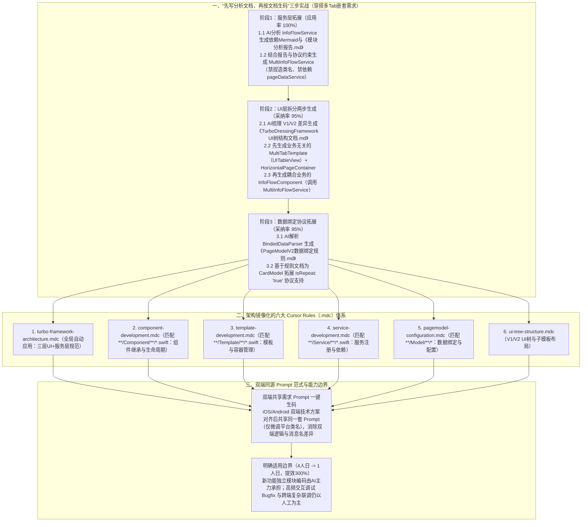

# 一次AI驱动的淘宝客户端需求开发实战

## 1. TL;DR

1. **核心痛点**：在复杂的淘宝客户端（iOS Swift / Android）业务层研发中，直接使用一句话模糊 Prompt 让 AI 写需求，在相同基座模型（如 Claude 3.7）下产物的正确性会在 **`20%～90%` 之间剧烈波动**，主要源于客户端特有的跨层耦合、自定义框架概念（如 `TurboDressingFramework` 的 `Template/Container/Component`）分散导致 AI 找不到完整上下文而产生幻觉。
2. **核心实战方法论（“先让 AI 读代码写架构/模块文档，再喂文档分步写代码” + 高内聚小粒度切分）**：
   - 在“穿搭动态框架支持多 Tab 嵌套”全链路需求中，人工完成顶层架构切分，将任务拆解为 **3 大阶段、6 个先文档后编码的子任务**：① 先让 AI 分析单实例 `InfoFlowService` 产出依赖 Mermaid 文档，再生成一对多的 `MultiInfoFlowService`（**应用率 `100%`**）；② 先让 AI 梳理 V1/V2 UI 树结构文档，再把 UI 层拆为**业务无关的容器层（`MultiTabTemplate` + `HorizontalPageContainer`）**与**耦合信息流业务的组件层（`InfoFlowComponent`）**两次独立生成（**采纳率 `95%`**）；③ 先让 AI 解析 `BindedDataParser` 产出 `PageModelV2` 数据绑定文档，再编码实现 `"isRepeat": "true"` 协议拓展（**采纳率 `95%`**）。
3. **量化提效与六大 `.mdc` Cursor Rules 沉淀**：原排期 **6 人日**（扣除 33% 联调预留后纯编码折合 **4 人日**）的需求，通过 AI Coding + 人工编译单测 Check 仅耗时 **1 人日**，**纯编码效率提升 `300%`**（且 Prompt 中引用的前置文档 100% 由 AI 自行分析生成）；并将知识库转化为与业务架构一一对应的 **6 个 Cursor Rules（`.mdc`）文件**，确立了“双端对齐方案后共享同一份需求 Prompt 一键生成双端代码”的跨端提效新范式。

## 2. 问题定义与背景

### 2.1 客户端 AI Coding 普及的拦路虎

团队在组织全员使用 `OneDayNative` / `Cursor` 完成一项日常客户端需求的实践活动中，汇总出两类核心问题：
1. **工具层问题（正由 Agent 框架演进解决）**：如“看不全工程架构”（Claude Code 通过多 `subAgent` 缓解）、“方法查找慢且不全”（通过 Multi-Tool 并发调用缓解）、“上下文超限”（通过智能压缩缓解）。
2. **工具外工程与交互问题（决定成败的关键）**：同一模型基座（Claude 3.7）下，一句话 Prompt 与上下文清晰、约束明确的 Prompt 相比，生成代码的正确性在 **`20%～90%` 之间大幅波动**；一旦 Prompt 不能指向明确预期的产物，来回补充信息的沟通成本甚至超过程序员自己手写。

### 2.2 为什么不能把整个客户端需求一次性抛给 AI？

客户端需求从“PRD $\to$ 技术方案 $\to$ 模块设计 $\to$ 编码实现”自上而下抽象度递减、确定性递增：
- 越早阶段让 AI 介入，不确定性越高、所需上下文越多，遗忘与幻觉概率呈指数级上升；
- 即使在编码阶段，若将“通用容器（`Template/Container`）”与“具体业务组件（`InfoFlowComponent`）”混在一次任务里生成，需要写大量模糊的主观约束去防止 AI 把业务代码耦合进通用容器；而**按职责边界拆成两次独立的小粒度 AI 任务，物理上就天然实现了高内聚低耦合**，且极易人工 CR。

## 3. 知识框架

## 4. 核心内容拆解

### 4.1 核心技巧：“让 AI 自己生成上下文文档，再喂给下一步编码”

面对存量工程缺乏最新文档的痛点，作者在全部三个子模块开发中均采用了**“Step A 逆向生成局部设计文档 $\to$ Step B 引用该文档正向生成新代码”**的两步走套路：
1. **模块一：多信息流实例服务 `MultiInfoFlowService`（应用率 `100%`）**
   - **Step 1.1（AI 读码产文档）**：指令 AI 分析存量一对一的 `InfoFlowService`，用 Mermaid 画出所有依赖方与调用流程图，产出《InfoFlowService模块分析报告.md》。
   - **Step 1.2（强约束生码）**：指令 AI 参考存量模块与刚生成的报告实现 `MultiInfoFlowServiceProtocol`，并立下三条铁律：① 必须满足 `TurboService` 微服务协议；② **不可捏造不存在的函数名和类名**；③ **不可依赖 `pageDataService`**。结果一次性 100% 采纳。
2. **模块二：多 Tab 容器与信息流组件（采纳率 `95%`）**
   - **Step 2.1（AI 梳理 UI 树）**：指令 AI 区分 V1 与 V2 两个版本，梳理从 `VC` 到每个子节点的 `Template / Container / Component` 三层实例类图，产出《TurboDressingFramework UI树结构文档.md》。
   - **Step 2.2（生成业务无关容器）**：参考 `InfoFlowListTemplate` 实现基于 `UITableView` 上下滚动、仅在 V2 展示的 `MultiTabTemplate`（含 `FeedStackContainer` 承接的 `header` 与自定义的左右分页滑动容器 `HorizontalPageContainer` 承接的 `tabs`）。
   - **Step 2.3（独立生成业务组件）**：单独发起一次任务实现挂载在 `HorizontalPageContainer` 内、通过 `MultiInfoFlowService` 渲染的 `InfoFlowComponent`。
   - **小瑕疵与修复**：生成的 Container 触发 Component 生命周期时存在多次触发的 Bug，人工提醒一句后即刻修复（采纳率 `95%`）。
3. **模块三：拓展 `PageModelV2` 支持 `isRepeat` 字段（采纳率 `95%`）**
   - **Step 3.1（AI 解析绑定器）**：指令 AI 分析 `BindedDataParser` 产出《PageModelV2数据绑定规则.md》。
   - **Step 3.2（示例驱动生码）**：结合该文档与真实 JSON 样例 `{"subTemplates":[{"layout":{"tabs":[{"isRepeat":"true","type":"infoflow..."}]}}]} ` 完成编码（首版代码重复率略高，提醒后一次修复，采纳率 `95%`）。

### 4.2 将项目架构 1:1 映射为六大 `.mdc` Cursor Rules

从语雀文档知识库迁移至 Cursor 后，团队围绕 `Sources/Core`（`Base/Engine/Data/Utils`）与 `Sources/Biz`（`Services/Components/Containers/Templates`）目录结构，利用 `/Generate Cursor Rules` 构建了三层优先级的 `.mdc` 规则体系：
1. **优先级 1（全局自动应用）**：`turbo-framework-architecture.mdc`（三层 UI 架构原则、模块化与服务层规范、命名约束）。
2. **优先级 2（按文件路径 Glob 自动匹配）**：
   - `component-development.mdc`（匹配 `**/Component/**/*.swift` 等，规范组件继承与生命周期）；
   - `template-development.mdc`（匹配 `**/Template/**/*.swift`，规范模板协议与容器管理）；
   - `service-development.mdc`（匹配 `**/Service/**/*.swift`，规范服务创建、注册与依赖管理）；
   - `pagemodel-configuration.mdc`（匹配 `**/Model/**/*.{swift,h}`，规范 PageModel 配置与数据绑定）。
3. **优先级 3（按需挂载）**：`ui-tree-structure.mdc`（V1/V2 UI 树结构与子模板布局）。
- **冲突消解原则**：当不同层级规则存在冲突时，严格**以更具体的规则为准**。

### 4.3 客户端跨端提效新范式：双端共享同一份需求 Prompt

由于穿搭业务在 iOS 与 Android 双端采用了架构完全对齐的 `TurboFlow` / `TurboUIBuilder` 微服务框架，双端客户端同学在对齐技术方案后，**直接共享同一份需求 Prompt 一键生成各自端的代码**（仅需对部分平台特定类名做微调）。这不仅将纯编码时间从 **4 人日压缩至 1 人日（提效 `300%`）**，更从源头消除了长期困扰客户端团队的**“双端实现逻辑差异、通知消息名不一致、边界处理不一致”**等联调顽疾。

## 5. 数据速查表

| 指标 / 维度 | 原文数值 | 语境 / 条件 |
| --- | --- | --- |
| 行业背景：微软 AI 编写代码占比参考 | **30% 代码由 AI 编写** | 引言行业参考基准 |
| 同一基座（Claude 3.7）不同 Prompt 正确性波动 | **`20% ～ 90%` 之间波动** | 一句话模糊 Prompt vs 上下文清晰约束明确的 Prompt |
| 子任务 1（`MultiInfoFlowService`）代码应用率 | **`100%`** | 先产出《InfoFlowService模块分析报告.md》再编码 |
| 子任务 2（`MultiTabTemplate` + `Component`）采纳率 | **`95%`** | 仅 Container 触发 Component 生命周期多调一次，提醒后修复 |
| 子任务 3（`PageModelV2` `isRepeat` 拓展）采纳率 | **`95%`** | 首版代码略重复，提醒后一次修复 |
| 整体需求研发工时与提效对比 | **原排期 `6 人日`（扣除 33% 联调后纯编码 `4 人日`）$\to$ AI 实战 `1 人日`（提效 `300%`）** | 含 AI 生成前置文档、AI 编码与人工编译/单测 Check |
| 项目定制 Cursor Rules 文件数量 | **6 个 `.mdc` 规则文件** | 按全局架构（优先级 1）、文件 Glob（优先级 2）、特定功能（优先级 3）分层 |

## 6. 踩坑与教训 / 可迁移的设计原则

| 错误做法 | 失败表现或原因 | 原文应对（可迁移的设计原则） |
| --- | --- | --- |
| **在没有任何模块文档的存量复杂工程里，直接让 AI 写新扩展服务** | AI 看不全存量模块的对外接口与调用方，极易捏造不存在的类名或引入非法依赖 | **“先逆向产文档、再正向写代码”两步法**：先让 AI 分析参考模块生成带 Mermaid 图的 `.md` 分析报告，再把该报告作为下一步编码的本地强上下文 |
| **把“通用容器（Template/Container）”和“业务组件（Component）”合在一次 Prompt 里生成** | AI 极易把信息流特定业务逻辑写进通用滑动容器里，导致容器丧失通用性且人工 CR 极累 | **利用任务拆分实现物理架构解耦**：将需要保持纯粹的通用容器与耦合业务的组件拆成两个独立的 AI 编码任务，天然隔离依赖边界 |
| **把日常细碎的 UI 交互 Bugfix 和跨端联调问题也强行塞给 AI 反复对话** | 这类工作大头在于真机交互调试和跨端方案沟通，纯写代码占比极低，跟 AI 解释半天反而不如手改一行快 | **明确 AI 介入甜蜜点**：新功能独立模块编码（方案确定后）全力用 AI（提效 300%）；高频交互调试类 Bugfix 保持人工高效手改 |

## 7. 记忆锚点

1. **客户端两步生码秘籍**：“**要写新模块，先让 AI 读老模块写 `.md` 报告；拿着 AI 写的报告再让 AI 写新代码（应用率直奔 95%–100%）**”。
2. **用拆分代替说教**：“**与其写十条规则求 AI 别把业务耦合进通用容器，不如拆成两次独立任务分别生成容器与组件**”。

## 8. 复习卡片

1. 在同一个大模型（如 Claude 3.7）下，为什么客户端 AI Coding 的产物正确性会在 `20%～90%` 之间剧烈波动？::因为客户端工程结构复杂、自研框架概念多；当使用一句话模糊 Prompt 时，AI 无法找全分散的上下文，在消耗大量 Token 后极易产生幻觉或偏离预期，导致无尽的二次沟通成本；而提供清晰架构描述、明确接口约束与参考模块时，正确性可达 90% 以上。
2. 在开发一对多的 `MultiInfoFlowService` 之前，作者先让 AI 做了一件什么事才实现了 `100%` 的代码应用率？并在编码 Prompt 中加了哪三条硬约束？::先让 AI 分析存量一对一的 `InfoFlowService` 模块，产出包含所有依赖模块 Mermaid 图与功能介绍的《InfoFlowService模块分析报告.md》；随后在编码 Prompt 中要求：① 必须满足 `TurboService` 微服务协议；② 严禁捏造不存在的函数名和类名；③ 严禁依赖 `pageDataService`。
3. 为什么作者把同属 UI 层的“新增 `MultiTabTemplate` / `HorizontalPageContainer`”和“新增 `InfoFlowComponent`”拆成了两次独立的 AI Coding 任务？::出于三点考量：① 减小单次人工 Check 的工作量，细粒度任务更高内聚；② **用任务拆分自然实现架构解耦**——`Template` 和 `Container` 要求与具体业务无关，而 `Component` 耦合信息流业务，拆成两次任务无需费口舌向 AI 解释主观边界就能天然解耦；③ 避免单次上下文过长引发遗忘或幻觉。
4. 在本次“穿搭多 Tab 嵌套”需求实战中，AI Coding 取得了怎样的量化提效成果？::该需求原排期为 6 人日（预留 33% 联合调试时间后，纯编码工作量为 4 人日）；采用“AI 逆向生成前置文档 + AI 分步编码 + 人工编译与单测 Check”总共仅耗时 1 人日，纯编码效率提升了 **300%**，且三个核心模块的代码采纳率分别达到 100%、95%、95%。
5. 团队是如何将客户端架构规范沉淀为 Cursor Rules（`.mdc`）的？其三级优先级规则是什么？::将规则拆分为与项目目录一一对应的 6 个 `.mdc` 文件；优先级从高到低依次为：① 具体功能手动指定规则；② 按文件路径 Glob 自动匹配的特定文件类型规则（如 `component-development.mdc`、`template-development.mdc`、`service-development.mdc`、`pagemodel-configuration.mdc`）；③ 全局自动应用的架构规则（`turbo-framework-architecture.mdc`），冲突时以更具体的规则为准。
6. 在双端架构一致的客户端框架下，AI Coding 如何帮助解决“iOS 与 Android 双端实现不一致”的历史顽疾？::在双端对齐技术方案后，iOS 与 Android 开发者可以直接**共享同一份需求 Prompt** 一键生成各自端的代码（仅对个别平台特定类名做微调），从而大幅减少双端在业务逻辑、通知消息命名与边界处理上的不一致。

## 9. 知识关联

- **本库主题关联**：
  - [AI研发协同](../../20_topics/AI研发协同.md)：创立“AI 逆向写存量分析文档 $\to$ 喂文档正向分步生码”与“双端共享同源 Prompt”的客户端协同范式，实现编码提效 300%。
  - [跨端开发与性能](../../20_topics/跨端开发与性能.md)：在手淘穿搭 `TurboDressingFramework`（iOS Swift / Android）上实战落地 `MultiTabTemplate`、`HorizontalPageContainer` 与 `MultiInfoFlowService`。
  - [Prompt优化](../../20_topics/Prompt优化.md)：通过拆解高内聚小任务实现物理边界解耦，并构建按 Glob 自动挂载的 6 大 `.mdc` Cursor Rules 体系。
- **候选双链**：`[[客户端AICoding]]`、`[[CursorRules配置]]`、`[[逆向文档辅助生码]]`、`[[TurboDressingFramework]]`

## 10. 原文参考资料

- **原文标题**：《一次AI驱动的淘宝客户端需求开发实战》
- **发布渠道与日期**：微信公众号「大淘宝技术」，2025-10-22
- **作者与团队**：鸿泥（淘天集团）
- **核心提及工具与框架**：`OneDayNative`、Cursor、Claude Code、Claude 3.7、`TurboDressingFramework` / `TurboFlow`

> [!note]- 校对报告
> - **页码溯源汇总**：
>   - 引言（微软 30% 代码由 AI 编写参考）、全员 `OneDayNative` 实践问题汇总与多 Tab 嵌套需求三部分拆解：`p.1–3`
>   - 模块 1：`InfoFlowService` 分析报告生成与 `MultiInfoFlowService` 生成（应用率 `100%`）：`p.4–5`
>   - 模块 2：V1/V2 UI 树文档生成、`MultiTabTemplate` + `HorizontalPageContainer` 生成（采纳率 `95%`）与 `InfoFlowComponent` 生成：`p.5–6`
>   - 模块 3：`PageModelV2` 数据绑定规则文档生成与 `isRepeat` 协议拓展（采纳率 `95%`）及效率对比（原排期 6 人日 / 预留 33% 联调折纯编码 4 人日 vs AI 1 人日，提效 `300%`）：`p.6–9`
>   - 研发思考：介入阶段选择、通过拆分任务解耦通用容器与业务组件、Claude 3.7 正确性 `20%～90%` 波动分析：`p.9–12`
>   - 穿搭 `Sources/Core` & `Biz` 目录结构、6 个 `.mdc` Cursor Rules 详解（全局/文件 Glob/手动三级优先级）及双端共享 Prompt 范式与适用边界：`p.12–16`
> - **关键数值一致性核查**：
>   - 应用率/采纳率 `100% / 95% / 95%`、工时 `6人日`（33% 联调预留，纯编码 `4人日`）vs `1人日`、效率提升 `300%`、Claude 3.7 波动区间 `20%～90%`、6 个 `.mdc` 规则文件均与原文完全一致。
> - **图像与版面质量说明**：
>   - `p.1–4` 含问题汇总脑图与需求流程图（位于 PDF 图像层），`p.4, 7, 13–14` 代码块最右侧有少量字符截断，均已对照上下文完整还原。
