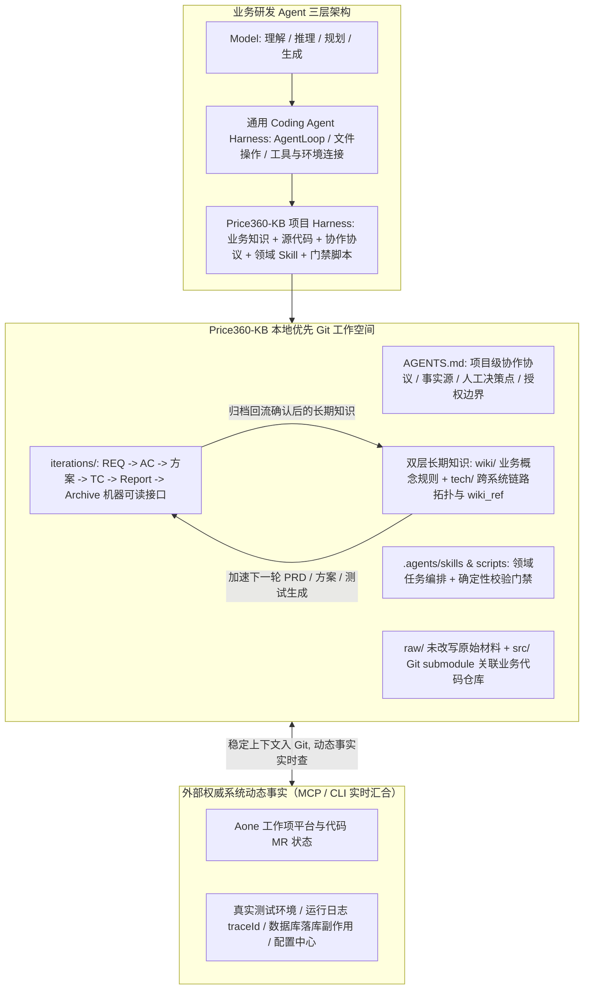

# AI 驱动研发体系的实践和思考

## 1. TL;DR

本文总结了淘天价格力团队历时 4 个月从“AI 辅助编程”升级到“AI 驱动研发体系”的工程实践（内部落地为 **Price360-KB**）。作者指出，业务 AI 研发的核心瓶颈不在模型通用能力而在**领域上下文缺口**，提出公式 **$\text{业务研发 Agent} = \text{Model} + \text{Coding Agent 通用 Harness} + \text{项目 Harness}$**，并践行**“本地优先：Agent + 文件夹 + Git”**理念——将稳定上下文（`wiki/` 业务规则、`tech/` 跨系统技术链路、`src/` 代码子模块、`iterations/` 机器可读迭代协议）统一纳入 Git 工作空间，而将工作项、日志、数据库与环境状态留在外部权威系统通过 CLI/MCP 实时读取。通过将项目 Harness 拆分为 **`AGENTS.md`（协作协议）+ `.agents/skills`（领域能力）+ `.agents/scripts`（确定性门禁脚本）** 三层，团队构建了“每次真实需求迭代自动反哺知识库”的知识飞轮，使工程师角色向对端到端业务交付负责的 **FDE（Forward Deployed Engineer）** 演进。

## 2. 问题定义与背景

### 2.1 三代 AI 研发模式的演进与核心痛点

| 阶段 | 核心工作方式 | 能力公式 / 载体 | 暴露的工程瓶颈 |
| :--- | :--- | :--- | :--- |
| **1. AI 辅助编程** | 人在聊天框粘贴代码片段 + 提示词，人工把业务规则口述给 AI | 纯 Model 对话框 | 局部动作提效；每次新开会话都要重复交代业务背景，知识无法跨会话留存 |
| **2. 通用 Coding Agent** | AI 可操作文件、代码、Git 与外部工具，自主检索修改并提交 | $\text{Agent} = \text{Model} + \text{通用 Harness}$（AgentLoop + 工具 + 环境） | 缺少业务领域知识、研发流程约束与真实交付完成标准；易把“命令执行成功/接口返回 200”误判为“业务交付完成” |
| **3. AI 驱动研发体系** | 产品、开发、测试在同一工作空间提出目标与决策，Agent 串起需求到归档闭环 | $\text{业务研发 Agent} = \text{Model} + \text{通用 Harness} + \text{项目 Harness}$ | 需解决老系统冷启动、知识与代码版本同步、多需求并发污染及异步副作用验证问题 |

### 2.2 为什么真正的瓶颈是“上下文”而非模型能力

当通用高分模型进入真实存量业务系统（如横跨多个前后端与离线数据工程的“高价率运营”系统）时，面临三大信息盲区：
1. **历史设计动机缺失**：不知道某段逻辑历史上为什么这样设计。
2. **业务适用边界模糊**：不知道某条业务规则仅适用于哪些特定场景。
3. **现网活性状态不明**：无法仅凭代码字面区分某段实现是当前生效主链路还是已废弃的旧链路。
若每次都靠人在对话中口头补充，AI 表现将高度受制于单次会话长度与个人表达能力。

## 3. 知识框架



## 4. 核心内容拆解

### 4.1 本地优先（Agent + 文件夹 + Git）与知识飞轮机制

**核心主张**：无需搭建厚重的自定义 Web 平台或等待完美知识库，用“本地文件夹 + Git”承载全部稳定上下文，让每一次真实需求迭代自然成为知识库的建设飞轮。

- **为什么选择“本地优先 + 文件 Wiki”而非外部独立 RAG / 本体平台**：
  - **不同方案的职责区分**：文件 Wiki 解决**知识如何生产、评审与版本化**；RAG 解决如何检索相关片段；本体（Ontology）解决实体关系与领域语义表达。
  - **最短更新路径与同版本评审**：若将外部 RAG 或图谱作为主知识源，代码变更后还需经历同步、切片、萃取、索引发布，极易导致“代码已改、知识库仍停留在旧版本”。采用本地文件 Wiki，**代码、文档、测试和索引可进入同一个 Git MR 一起评审、合并并共享同一版本**，且无需维护独立后台界面（所有操作均通过 Coding Agent 打开文件夹对话完成）。
- **老系统冷启动三步法与迭代知识飞轮**：
  1. **关联存量资产**：通过 `git submodule` 将多个前后端与数据代码仓库挂载到 `src/` 目录，将历史存量文档放入 `raw/` 目录，编写清洗 Skill 从代码和凌乱文档中抽取出初版结构化知识。
  2. **AI 听记访谈补全隐性知识**：针对只存在于核心开发、产品脑海中的逻辑，设计采访提纲并通过钉钉 AI 听记录制访谈，将采访原稿交给 Coding Agent 整理入库。
  3. **迭代即飞轮**：PRD 补充业务定义与验收标准 $\to$ 技术方案记录跨系统链路 $\to$ 开发与测试校验真伪 $\to$ **归档阶段（`archive.md`）将确认后的长期知识回流到 `wiki/` 和 `tech/`**，直接加速下一轮迭代。

### 4.2 Price360-KB 工作空间结构与上下文网络设计

**核心主张**：知识库绝不能做成“把每个类和方法重新解释一遍”的代码复读机（生成快、失效更快），而必须按事实边界分层，仅保存代码无法独立表达的业务规则与跨系统链路。

- **`wiki/` 与 `tech/` 的职责边界**：
  - **`wiki/`（面向产品、运营、测试与 Agent）**：保存业务概念、规则、统计口径、角色职责、业务流程与异常处理。
  - **`tech/`（面向跨系统技术判断）**：保存代码本身无法独立表达的上下文，包括**跨系统上下游链路、接口与数据关系、新旧链路切换状态、废弃标记、运行态拓扑和观测方式**。具体方法内部逻辑一律以 `src/` 代码为准，`tech/` 只指明调用入口及其在全局链路中的位置。
- **目录树结构与文档 Metadata 溯源契约**：

```text
price360-kb/
├── AGENTS.md                  # 项目协作协议与总入口
├── iterations/                # 每个需求的 PRD、方案、测试与归档（prd.md / solution.md / test/* / archive.md）
├── wiki/                      # 面向产品、运营和测试的业务知识
├── tech/                      # 跨系统链路与关键技术上下文（通过 wiki_ref 关联业务知识）
├── raw/                       # 未经改写的原始事实材料（会议记录、存量旧文档）
├── src/                       # 关联的业务代码仓库（Git submodule）
├── olap/                      # 指标、表结构与分析 SQL
├── briefs/                    # 基于事实源生成的专题说明
├── outputs/                   # 可重建的索引和分析结果
└── .agents/
    ├── skills/                # PRD、方案、测试、排障、归档等领域能力
    ├── scripts/               # 工作区、校验、同步和发布门禁脚本
    ├── repositories.json      # 项目关联的代码仓库声明
    └── skill-dependencies.json# 公共 Skill 依赖来源与兼容版本声明
```

- **知识文件四要素（正文 + Metadata + 相对路径链接 + Git 版本）**：
  - 每份知识文档通过 YAML frontmatter 声明 `title`、`category`、`tags`、`status`、`version` 以及强制溯源的 `source` 数组（如指向 `raw/existing_docs/xxx说明.md` 与 `tech/01-链路详解/xxx处理管线.md`），让 Agent 在通读全文前即可判断适用性与事实依据，并通过 `tech` 中的 `wiki_ref` 建立“业务规则 $\leftrightarrow$ 技术链路 $\leftrightarrow$ 源代码”双向反查路径，配合定期健康检查清理重复、冲突、失效链接与无来源结论。

### 4.3 三层项目 Harness、机器可读迭代协议与动态事实核验

**核心主张**：项目 Harness 不是一段越来越长的系统提示词，而是“协议（AGENTS.md）+ 能力（Skills）+ 确定性门禁（Scripts）”的三层解耦体系，且必须用真实环境运行证据替代“接口返回成功”的表面判断。

- **项目 Harness 三层职责分离與公共能力复用**：
  1. **`AGENTS.md`（规则层）**：定义事实源优先级（如会议记录 `raw/` 不能直接当已确认规则，旧文档不能覆盖当前代码）、研发阶段、人工决策点、授权边界与完成条件。
  2. **`.agents/skills`（能力层）**：组织 PRD 撰写、技术方案、测试设计、回放排障与知识归档等可组合领域任务；通用平台/中间件能力通过 `skill-dependencies.json` 声明外部依赖与兼容版本，项目内只保留业务编排。
  3. **`.agents/scripts`（门禁层）**：把不能靠自然语言自觉保证的规则变成确定性脚本（工作区检查、产物格式校验、状态同步、提交推送与发布后回查），使底层模型或 Coding Agent 工具可随时替换而不丢失项目协议。
- **机器可读的阶段门禁协议（`REQ` $\to$ `AC` $\to$ `TC`）**：
  - 每个需求在 `iterations/` 下拥有独立目录，包含 `prd.md`、`solution.md`、`test/design.md`、`test/cases*.md`、`test/report.md`、`archive.md`。
  - 通过结构化 ID 串联覆盖关系：PRD 定义需求 `REQ` 与验收标准 `AC` $\to$ 技术方案映射到实现任务与可观测点 $\to$ 测试用例用 `TC` 绑定覆盖；**阶段严禁自动越过**（PRD 未由人确认不写方案；方案与测试设计未确认不写代码；无真实测试证据不进发布；上游变更时旧下游证据自动失效）。
- **静态资产入 Git vs 动态事实实时查与真实副作用验证**：
  - 配置文件写着某环境不代表代码已部署；接口返回成功也不代表异步消费、内部判断和落库副作用已发生。
  - Price360-KB 强制要求测试先绑定当前分支对应的**真实运行环境**，验证返回值、日志、调用链或数据库落库结果，并将 **`traceId`、执行时间和断言结果**回填到 `test/report.md`；无法取得稳定自动化证据的场景必须显式保留为**人工验证**，严禁包装成自动化通过。
  - 每次线上踩坑直接转化为 Harness 演进：如多需求并行污染目录后新增**工作区隔离**；接口成功但异步未完成新增**可观测性契约**；外部状态提前更新导致不一致后改为**代码合并后回查工作项与协同状态**。

## 5. 数据速查表

| 指标 / 配置项 | 原文数值 / 表达式 | 语境 / 条件 |
| :--- | :--- | :--- |
| 团队转型实践周期 | `4 个月`（2026 年 4 月起） | 受 Karpathy LLM Wiki 启发，从 AI 辅助编程转向 AI 驱动研发体系 |
| 业务研发 Agent 核心公式 | $\text{Model} + \text{Coding Agent 通用 Harness} + \text{项目 Harness}$ | 区分通用文件/工具操作能力与业务领域知识/流程门禁 |
| Price360-KB 顶层目录数 | `10` 个核心项（`AGENTS.md` + `8` 个内容目录 + `.agents/`） | 含 `iterations`、`wiki`、`tech`、`raw`、`src`、`olap`、`briefs`、`outputs` |
| `.agents/` 内部四组件 | `skills/`、`scripts/`、`repositories.json`、`skill-dependencies.json` | 实现领域能力、确定性脚本门禁、多代码仓关联与公共 Skill 依赖解耦 |
| 单次需求迭代标准产物文件 | `6` 类文件（`prd.md`、`solution.md`、`test/design.md`、`test/cases*.md`、`test/report.md`、`archive.md`） | 存放于每个需求独立的 `iterations/` 子目录中，作为阶段接口 |
| 需求到测试追踪标识链 | `REQ`（需求） $\to$ `AC`（验收标准） $\to$ 技术方案任务/可观测点 $\to$ `TC`（测试用例） | 固定格式字段，供 Agent 与脚本自动核查覆盖率与版本有效性 |
| 测试报告强制回填证据字段 | `traceId`、执行时间、断言结果（日志/调用链/数据库结果） | 防止将“接口返回成功”误判为异步链路与落库副作用完成 |

## 6. 踩坑与教训 / 可迁移的设计原则

| 错误做法 | 失败表现或原因 | 原文应对（可迁移的设计原则） |
| :--- | :--- | :--- |
| **让知识库把每个类和每个方法重新解释一遍** | 这类代码说明文档生成极快、失效也极快，最终变成一份与真实代码相互竞争且过期的冗余说明 | **知识库只存“代码之外影响判断的信息”**：具体方法逻辑以 `src/` 代码为准；`wiki/` 存业务概念口径，`tech/` 存跨系统拓扑、新旧链路状态与观测方式 |
| **将外部独立 RAG 或图谱平台作为研发知识的主维护源** | 代码变更后需额外经历同步、切片、萃取与索引发布，拉长更新链路并加剧文档与代码漂移 | **本地文件 Wiki + 同 MR 原子更新**：让代码、文档、测试和索引在同一个 Git MR 中一起评审合并，缩短知识更新路径 |
| **把会议记录（`raw/`）直接当成已确认规则，或把所有规则塞进超长 Prompt** | 模型混淆讨论草稿与现网事实；纯自然语言规则在长链路中容易被模型遗忘或跳过 | **目录事实边界隔离 + 三层 Harness 分工**：按 `raw / wiki / tech / src` 划分事实等级；用 `AGENTS.md` 定协议、Skill 组任务、`.agents/scripts` 执行硬门禁 |
| **把“接口返回成功”或“无法自动验证的场景”包装成测试通过** | 真实业务包含异步消息消费与数据库落库副作用，仅看接口返回会漏掉链路断裂；虚假自动化通过会掩盖发布风险 | **可观测性契约 + 诚实保留人工验证**：强制绑定当前分支真实环境并回填 `traceId`、时间与落库断言；拿不到稳定证据的场景必须标为人工验证 |
| **单靠“AI 代码采纳率”衡量团队 AI 研发效能** | 采纳率受诸多表层因素干扰，无法反映人的设计质量与项目 Harness 完备度 | **用工作项串联全链路 AI Trace 诊断短板**：将 Aone 节点流与 Trace Step 映射，通过识别“跨对话反复补充背景”或“反复纠正同类错误”反向定位项目 Harness 缺口 |

## 7. 记忆锚点

- **架构演进公式**：“$\text{业务研发 Agent} = \text{Model} + \text{通用 Harness} + \text{项目 Harness}$；模型决定通用上限，上下文决定业务能走多远。”
- **本地优先与分工口诀**：“稳定资产进 Git，动态事实实时查；`wiki` 讲业务、`tech` 画链路、代码看 `src`；人做决策与授权，Agent 携证据跑闭环。”

## 8. 复习卡片

在 $\text{业务研发 Agent} = \text{Model} + \text{通用 Harness} + \text{项目 Harness}$ 中，为什么有了通用 Coding Agent 还需要项目 Harness？::因为通用 Coding Agent 只提供 AgentLoop、文件操作和基础工具连接，缺乏业务领域规则、跨系统历史链路、研发阶段约束与交付验收标准，容易要求人反复口述背景或把“命令执行成功”误判为业务交付完成。
为什么 Price360-KB 优先采用基于 Git 的本地文件 Wiki，而不是直接把外部 RAG 平台或本体图谱作为主知识源？::因为外部 RAG 和图谱在代码变更后需要经过同步、切片、萃取和索引发布，更新链路长且易与代码脱节；本地文件 Wiki 允许代码、文档、测试和索引在同一个 Git MR 中原子化评审与合并，确保知识与代码版本严格同步。
Price360-KB 中的 `wiki/` 与 `tech/` 目录各自保存什么内容，为什么规定“知识库不应该复制代码”？::`wiki/` 保存面向产运测的业务概念、口径、流程与异常处理，`tech/` 保存代码无法独立表达的跨系统上下游链路、新旧切换状态与观测方式；若把每个类和方法重新解释一遍，文档会迅速过期并与真实代码竞争，因此具体实现一律以 `src/` 代码为准。
项目 Harness 的三层结构（`AGENTS.md`、`.agents/skills`、`.agents/scripts`）是如何分工协作的？::`AGENTS.md` 作为项目级协议说明“应该怎样做”（定义事实源、阶段门禁与人工授权边界）；`.agents/skills` 负责组织 PRD、方案、测试、排障和归档等特定领域任务；`.agents/scripts` 则用确定性脚本把不能靠语言自觉保证的格式校验、状态同步和发布回查执行到底。
Price360-KB 如何通过机器可读协议防止 Agent 在需求迭代中跳步或使用过期测试证据？::每个需求在 `iterations/` 下通过 `REQ`（需求）、`AC`（验收标准）和 `TC`（测试用例）建立显式关联，严格执行“未确认不进入下一阶段”的门禁，且上游文档发生实质变更时强制更新下游产物并作废旧验证证据。
在测试验证阶段，为什么 Price360-KB 不允许仅凭“接口返回成功”判定通过？::因为复杂业务系统存在异步消费、内部状态判断与数据库落库副作用；系统要求先绑定当前分支对应的真实测试环境，核验日志、调用链或数据库结果，并将 `traceId`、执行时间和断言结果回填到测试报告中，无法自动取证的场景必须如实保留为人工验证。
随着基础模型和通用 Coding Agent 能力不断扩张，项目 Harness 的哪些部分会收缩，哪些核心价值不会消失？::通用文件搜索、代码理解、Git 操作、浏览器调用与多 Agent 编排会被通用底座吸收而收缩；但业务知识及其事实治理、项目规则与决策授权边界、领域专有工具适配以及端到端交付的质量责任不会消失，推动工程师向深入业务现场的 FDE（Forward Deployed Engineer）演进。

## 9. 知识关联

- **本库通用主题**：[AI研发协同](../../20_topics/AI研发协同.md) · [Harness与模型协同](../../20_topics/Harness与模型协同.md) · [Skill设计与治理](../../20_topics/Skill设计与治理.md)
- **本篇原始与转写材料**：[原始 PDF](RAW.pdf) · [逐页转写文本](MD.md)
- **候选双链**：[[Price360-KB项目Harness]] · [[LLM-Wiki与知识飞轮]] · [[本地优先Agent工作空间]] · [[FDE前线部署工程师模式]]

## 10. 原文参考资料

- **原文信息**：《AI 驱动研发体系的实践和思考》，作者：默达（淘天集团-营销&交易技术团队），公众号：大淘宝技术，发布时间：`2026-09-02 01:08`（浙江）。
- **文内提及的方法与概念来源**：
  1. Andrej Karpathy 关于 **LLM Wiki** 的思路启发（2026 年 4 月团队实践起点）。
  2. **FDE（Forward Deployed Engineer，前线部署工程师）** 角色模式与内部 **Price360-KB**、钉钉 AI 听记、Aone 工作项平台（内部仓库未对外开源）。

> [!note]- 校对报告
> 1. **页码溯源汇总**：
>    - `p.1–2`：从 AI 辅助编程、Coding Agent 到项目 Harness 的三阶段演进及核心公式 $\text{业务研发 Agent} = \text{Model} + \text{Coding Agent 通用 Harness} + \text{项目 Harness}$。
>    - `p.2–5`：业务 AI 研发的真正瓶颈（上下文缺口）、“本地优先：Agent + 文件夹 + Git”原则、存量老系统冷启动（`git submodule` 关联 `src/`、`raw/` 清洗 Skill、钉钉 AI 听记访谈）、迭代即知识飞轮、为何优先选择文件 Wiki（对比外部 RAG 与本体论）以及 `wiki/` 与 `tech/` 的职责边界。
>    - `p.5–9`：Price360-KB 完整目录树、知识文档 YAML Metadata 示例（含 `source` 与 `wiki_ref`）、三层 Harness 结构（`AGENTS.md` / `.agents/skills` / `.agents/scripts`）、机器可读迭代协议（`REQ` / `AC` / `TC` 与 6 类迭代文件）、静态资产入 Git vs 动态事实实时查询（回填 `traceId`、执行时间与断言结果）以及人机职责边界与三次实战踩坑演进。
>    - `p.9–11`：横向共性能力与业务项目 Harness 的协同、对“AI 代码采纳率”指标的反思（建议用 Aone 工作项串联 AI Trace 分析跨对话补背景与重复纠错）、Harness 收缩趋势与 FDE 角色转型。
> 2. **勘误与质量边界说明**：
>    - `p.1` 正文第一段存在一处原文笔误（`再此总结下一路实践过来的思考` 中“再此”应为“在此”），笔记已按规范表述整理。
>    - `p.1, p.2, p.4, p.5, p.6, p.9` 包含架构与流程示意图（位于 PDF 图像层），其对应目录树、公式与阶段流转逻辑均已在正文中完整给出。
> 3. **核验结论**：全文满足单 H1、10 大编号章节、正文零内联页码、7 条单行 `::` 复习卡片，目录结构与 Metadata 字段均与原文严格一致。
