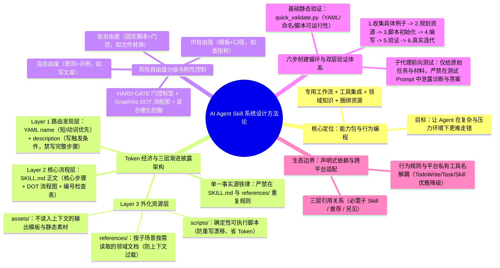
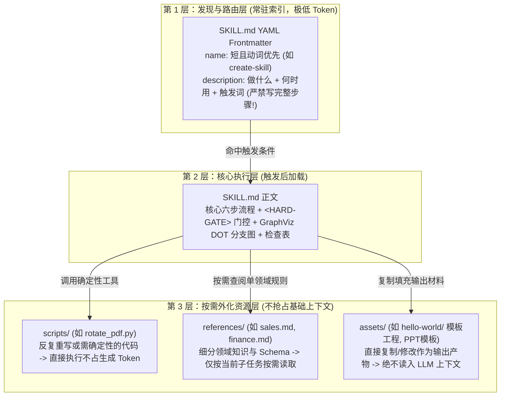

# AI Agent 的 Skill 系统设计

> [!abstract] 导读
> **一句话总结**：淘天集团会员技术团队（作者：苏雄）系统阐述了 **AI Agent Skill 的工程设计方法论**——明确提出**“Skill 是对 Agent 的行为编程（Behavioral Programming），而非写给人看的静态知识库文档”**；围绕公共上下文窗口的 Token 经济性，构建了**“元数据（`name/description` 路由层） $\rightarrow$ 正文（`SKILL.md` 核心流程层） $\rightarrow$ 捆绑资源（`scripts/` 承接确定性、`references/` 承接按需知识、`assets/` 承接输出模板）”**的三层渐进披露架构，并给出按任务脆弱度分级设置自由度、`<HARD-GATE>` 门控、GraphViz DOT 流程图、反合理化（Anti-Rationalization）以及无污染子代理前向测试的完整工程规范。
> **阅读价值**：这是大淘宝本批多篇 Skill 实战文章背后的**总纲级设计哲学与编写指南**，将零散的写 Skill 经验提炼成了高内聚、可验证、跨平台可迁移的软件工程范式。

## 1. TL;DR

- **核心定义**：Skill 是一个自包含的**能力包（Capability Package）**，涵盖**专用工作流、工具集成、领域知识、捆绑资源**四类能力。写 Skill 的本质不是“把说明写清楚”，而是**“预设 Agent 在复杂环境与执行压力下走捷径的失败模式，把正确路径写成更难走错的行为结构”**。
- **第一工程原则（上下文窗口是公共资源 & 三层渐进披露）**：
  1. **第一层：发现与路由层（YAML Frontmatter `name` + `description`）**：`description` 是路由器而非教程！必须写明“做什么 + 何时触发 + 典型触发词/症状”，**严禁在 `description` 里浓缩完整执行步骤**（否则 Agent 会看一眼描述就凭印象瞎跑，直接跳过正文）。
  2. **第二层：核心执行层（`SKILL.md` 正文）**：只放每次执行必读的核心流程、`<HARD-GATE>` 刚性门控、非线性分支的 **GraphViz DOT 流程图**与进度检查表。
  3. **第三层：按需外化资源层（`scripts/` + `references/` + `assets/`）**：`scripts/` 封装确定性代码（消除每次重写的漂移与 Token 消耗）、`references/` 存放按场景按需查阅的细分领域规则（如按销售/财务拆文件）、`assets/` 存放不读入上下文但直接供产物复制使用的模板工程/字体/素材。**铁律：信息只放一个地方，严禁在 `SKILL.md` 和 `references/` 重复同一段规则**。
- **自由度分级与反合理化（Anti-Rationalization）**：
  - 按任务脆弱度分三档：**高自由度**（写技术文章：给原则与示例）、**中自由度**（查内部指标：给 SQL 模板与口径）、**低自由度**（PDF 旋转/格式转换：直接调 `scripts/` + `<HARD-GATE>` 门控锁死）。
  - **防御 Agent“合理化找借口”**：Agent 在压力下会编造看似合理的理由跳过验证步骤；必须在 Skill 中提前预判并明文驳斥这些借口，通过**不泄露答案的子代理前向测试（Forward Testing）**验证真实行为改变。

## 2. 问题定义与背景

### 2.1 为什么把“人类文档”直接当 Skill 喂给 Agent 会频繁失效？
很多开发者写 Skill 时习惯把团队 Wiki 或操作手册原封不动粘贴进 Markdown，结果发现：
1. **该触发时不触发，或者不读正文就乱跑**：把触发条件藏在正文里的 `## When to Use`（Agent 没触发前根本看不到正文），或者反过来把全部步骤塞进 `description` 导致 Agent 偷懒不加载正文。
2. **上下文挤占与规则漂移**：把所有细分业务规则（财务、销售、产品）塞进同一个几千行的巨型文件，挤占宝贵的推理工作区；或者在多个文件复制粘贴同一条规则，后续改了一处忘改另一处，导致 Agent 行为分裂。
3. **执行压力下“走捷径与合理化（Rationalization）”**：当任务变长、上下文不足或遇到报错时，软性的“建议先做 A 再做 B”会被 Agent 自动忽略，Agent 甚至会自己找借口跳过测试步骤直接宣布任务完成。

## 3. 知识框架



## 4. 核心内容拆解

### 4.1 三层渐进披露目录架构与职责边界



| 目录 / 组件 | 核心定位 | 何时加载 / 如何使用 | 常见错误反模式 |
| :--- | :--- | :--- | :--- |
| **`frontmatter` (`name`, `description`)** | **路由器（Router）** | Agent 扫描技能库时始终可见 | 把 `When to Use` 放进正文（触发前看不见）；或在 `description` 里写完整流程（导致 Agent 不读正文就瞎跑）。 |
| **`SKILL.md` 正文** | **主控状态机** | 确认触发该 Skill 后加载 | 写成面面俱到的几千行百科全书；与 `references/` 重复粘贴同一规则导致版本漂移。 |
| **`scripts/`** | **确定性执行器** | 任务需要 100% 确定性或高频复用的逻辑（如 `init_skill.py`, `quick_validate.py`） | 让 Agent 每次临时手写一遍 PDF 旋转或格式解析代码，既费 Token 又易出 Bug。 |
| **`references/`** | **按需查阅字典** | 包含多业务线/多表规则（如 `big-query/references/sales.md`），仅读取当前提问涉及的文件 | 不分文件全部平铺在 `SKILL.md` 中，导致查销售指标时把财务和产品规则全塞进上下文。 |
| **`assets/`** | **输出原材料** | 存放前端工程脚手架、字体、品牌图标、报告模板 | 把静态模板大文件当普通文本读进大模型上下文浪费窗口。 |

### 4.2 按任务风险分级控制：`<HARD-GATE>` 与 GraphViz DOT 流程图

1. **三档自由度匹配任务脆弱度**：
   - **高自由度（High Freedom）**：如撰写技术文章——提供结构原则、语气规则与正反示例即可，保留模型创造力。
   - **中自由度（Medium Freedom）**：如查询公司内部指标——提供标准 SQL 模板与核心字段口径说明，约束关键结构。
   - **低自由度（Low Freedom）**：如旋转 PDF、执行发布门禁、初始化规范目录——必须用 `scripts/` 脚本锁死实现，并配合 `<HARD-GATE>` 剥夺自由发挥空间。
2. **用 `<HARD-GATE>` 替代软弱的“建议”**：
   ```xml
   <HARD-GATE>
   在理解具体使用示例并规划好可复用资源之前，不要创建或编辑该 Skill。
   </HARD-GATE>
   ```
   门控不是礼貌用语问题，而是明确的程序阻断边界。
3. **用内嵌 GraphViz DOT 表达非线性分支与回退**：
   当流程包含条件判断、循环重试或极易被 Agent 提前跳过收尾验证时，纯文字列表容易失效，在 Markdown 中嵌入轻量级 **GraphViz `digraph`（DOT 格式）** 能显著提升大模型对状态流转的遵循度：
   ```dot
   digraph {
       "是否有具体使用例子?" [shape=diamond];
       "收集或生成例子" [shape=box];
       "规划 scripts/references/assets" [shape=box];
       "编写 SKILL.md" [shape=box];
       "运行 quick_validate.py" [shape=box];
       "完成" [shape=doublecircle];
       "是否有具体使用例子?" -> "规划 scripts/references/assets" [label="yes"];
       "是否有具体使用例子?" -> "收集或生成例子" [label="no"];
       "收集或生成例子" -> "规划 scripts/references/assets";
       "规划 scripts/references/assets" -> "编写 SKILL.md";
       "编写 SKILL.md" -> "运行 quick_validate.py";
       "运行 quick_validate.py" -> "完成";
   }
   ```

### 4.3 基于 TDD 思想的 Skill 验证：无污染前向测试与反合理化

1. **六步创建循环（Example-First）**：
   `1. 理解具体使用例子（先收集真实触发句与正反边界，绝不从抽象概念开写） → 2. 规划可复用资源 → 3. 用 scripts/init_skill.py 初始化目录 → 4. 编辑 SKILL.md 与资源 → 5. 验证 Skill → 6. 基于真实使用迭代`。
2. **静态校验 + 无污染子代理前向测试（Forward Testing）**：
   - 先跑 `scripts/quick_validate.py <path/to/skill-folder>` 检查 YAML 合法性、命名规范、脚本可执行性与 `agents/openai.yaml` UI 元数据同步。
   - **前向测试铁律（严禁泄露答案）**：调用子代理（Subagent）实测 Skill 时，要把子代理当成**真实用户评估面**，而非审稿人：
     - ✅ **正确测试指令**：`使用位于 /path/to/skill-x 的 @skill-x 来解决问题 y。`（只给原始任务、原始材料与最少必要上下文，看原始行为轨迹、输出 diff 与日志）。
     - ❌ **错误测试指令（答案污染）**：`审查这个 Skill。我认为它存在问题 A，预期的修复方案是 B。`
3. **生态组合与跨平台优雅降级**：
   - Skill 间通过声明式文本（`**必需子 Skill**` / `**推荐**` / `**另见**`）建立轻量引用，严禁硬编码一次性强制加载大文件。
   - 将稳定的“行为规则”与“平台私有工具名”解耦（如将抽象动作映射到不同宿主环境的 `TodoWrite`、`Task tool`、`Skill tool`），并在平台能力不足时提供优雅降级路径。

## 5. 数据速查表

| 工程维度 | 核心设计准则 / 命令规范 | 解决的典型失效模式 |
| :--- | :--- | :--- |
| **`description` 编写准则** | 只写“做什么 + 何时用 + 触发词/症状”，**不写完整执行流程** | 防止 Agent 读完 `description` 就凭印象跳步执行、不加载 `SKILL.md` 正文 |
| **资源三剑客分工** | `scripts/`（确定性执行）、`references/`（按需领域知识）、`assets/`（输出静态素材） | 防止上下文窗口被非当前分支的知识或静态模板撑爆 |
| **单一事实源原则** | 同一条规则只存一处，严禁在 `SKILL.md` 与 `references/` 双写 | 消除多副本修改不同步引发的 Agent 自行解释与行为漂移 |
| **标准初始化与校验命令** | `scripts/init_skill.py my-skill --path ... --resources scripts,references`<br/>`scripts/quick_validate.py <path/to/skill-folder>` | 消灭手建目录拼写错误、漏字段与不可运行脚本 |
| **审查阻塞（Blocker）标准** | **应阻塞**：触发模糊、资源缺失、脚本报错、缺验证、自由度错配、信息重复<br/>**不应阻塞**：纯文风偏好、不影响执行的标题顺序 | 让团队把评审精力聚焦在真实失败风险而非文字洁癖上 |

## 6. 踩坑与教训 / 可迁移的设计原则

- **反模式 1：把 `description` 写成微缩版教程**
  - **对比**：写 `description: "创建 Skill 时先收集例子，再规划目录，然后运行 init_skill.py，最后 quick_validate.py"` 是典型反模式——大模型一看觉得“我已经知道怎么做了”，干脆跳过加载 `SKILL.md` 正文，导致正文里的 `<HARD-GATE>` 全部失效！
- **反模式 2：在压力场景下高估 Agent 的“道德自律”**
  - 当编译报错或上下文紧张时，Agent 极易产生“这次改动很小，跳过 `quick_validate.py` 应该也没事”的**合理化（Rationalization）冲动**。好的 Skill 必须像 TDD 测试一样，先在高压任务下观测 Agent 找了什么借口违规，再在 `SKILL.md` 中专门针对该借口写下 `<HARD-GATE>` 与反驳条款。
- **可迁移原则：先跑通 3 个具体例子，再动手抽离 `scripts/` 与 `SKILL.md`**
  - 永远不要对着空白文档凭空想象工作流；先把 3 个真实任务从头到尾手跑一遍，凡是重复写了两次的代码立刻抽进 `scripts/`，凡是查阅了两次的字典立刻抽进 `references/`。

## 7. 记忆锚点

- **一句核心定义**：**Skill 不是知识库文档，而是对 Agent 的行为编程（让 Agent 在压力下更难走错）**。
- **三层渐进加载**：**`description` 管路由触发（禁剧透步骤） $\rightarrow$ `SKILL.md` 管核心主干与门控 $\rightarrow$ `scripts/references/assets` 各司其职按需外化**。
- **三大刚性武器**：**`<HARD-GATE>` 阻断跳步 + GraphViz `DOT` 锁死分支 + 无答案泄露的子代理前向测试**。

## 8. 复习卡片

Why should a Skill's YAML `description` include what the Skill does and when to trigger it, but NEVER summarize the complete step-by-step execution workflow?::Because `description` is the routing layer always visible before loading the Skill; if it summarizes the full workflow, the Agent may attempt to execute the task from memory based solely on the short description and skip loading the full `SKILL.md` body and its guardrails.
What are the distinct roles of `scripts/`, `references/`, and `assets/` in a three-tier progressively disclosed Skill directory?::`scripts/` holds deterministic executable code to prevent rewrite drift and save generation tokens; `references/` stores domain-specific docs loaded on-demand only when relevant; `assets/` contains static output templates or media copied/modified into final deliverables without ever being read into the LLM context window.
Why must you never duplicate the same rule in both `SKILL.md` and `references/`?::Because duplicating rules violates the Single Source of Truth principle—when one copy is updated later and the other is forgotten, version drift occurs, causing the Agent to inconsistently interpret conflicting instructions.
How should you match a Skill's degree of freedom to the fragility of the task?::Use high freedom (principles and examples) for creative tasks like writing articles, medium freedom (SQL templates and metric definitions) for structured queries, and low freedom (hardcoded `scripts/` + `<HARD-GATE>` blocks) for fragile, deterministic operations like PDF rotation or deployment checks.
Why is embedding a GraphViz DOT `digraph` often more effective than plain text lists inside `SKILL.md`?::When a workflow involves non-linear branching, loops, fallbacks, or steps prone to premature termination, a structured GraphViz DOT state graph constrains the LLM's execution trajectory much more reliably than prose.
What is the critical rule when running Forward Testing of a Skill using a subagent?::Pass only the raw user task, raw input materials, and minimal context (`Use @skill-x to solve y`) without leaking your diagnosis or expected fix in the prompt; if the subagent only succeeds when told the answer upfront, the Skill itself is defective.

## 9. 知识关联

- **本批同主题精读**：
  - [Copilot 需求交付 Skill 如何实现数据需求24h交付](../数据需求24h交付Skill+26.7.19/AI_数据需求24h交付Skill.md)：本文“渐进式披露（200 行 `SKILL.md` + `references/` 按阶段加载）”与“把复杂任务拆成带人工确认门控的四步工作流”在数据研发领域的完美落地案例。
  - [高价率运营 AI 工作台：约定驱动与 AI 编排的评测优化实践](../高价率工作台评测优化+26.7.16/AI_高价率工作台评测优化.md)：大规模落地了 16 个业务 Skill，并重点验证了本文提到的“触发词重叠导致路由误触”与“必须用 `【强制】` 替代 `建议`”的工程规律。
  - [QoderWork 数科 Skills 建设实践](../QoderWork数科Skills+26.6.26/AI_QoderWork数科Skills.md)：展示了数据科学团队如何按照模块化 Skill 体系封装复杂分析算法与业务诊断流。
  - [【手猫研发提效随笔】七句话搞定一年AB实验下线：CodingAgent的魔法时刻](../手猫AB实验自动下线+26.7.31/AI_手猫AB实验自动下线.md)：展示了日常研发中如何将高频重复脚本快速抽象为 3 个轻量级 Skill。
- **主题索引（`20_topics`）**：
  - [Skill设计与治理](../../20_topics/Skill设计与治理.md)
  - [Harness与模型协同](../../20_topics/Harness与模型协同.md)
  - [AI研发协同](../../20_topics/AI研发协同.md)
- **本目录归档文件**：[原始 PDF](RAW.pdf) · [逐页转写文本](MD.md)
- **候选概念双链**：[[Agent-Skill]] · [[渐进式披露]] · [[行为编程]] · [[上下文工程]] · [[Hard-Gate门控]] · [[前向测试]]

## 10. 原文参考资料

- **原文出处**：大淘宝技术公众号，《AI Agent 的 Skill 系统设计》（作者：苏雄，淘天集团-会员技术团队，发布日期：2026-07-01）

> [!note]- 校对报告
> - **页码溯源（1-based 物理页码）**：
>   - 篇首标题、作者（苏雄，会员技术团队）、Skill 核心定义（四大能力包、行为编程而非静态知识库）与完整行为链路：源自 `RAW.pdf` `p.1–2`（对应 `MD.md` 第 1–2 页）。
>   - 上下文预算原则与三层渐进加载目录结构（`SKILL.md`、`agents/openai.yaml`、`scripts/`、`references/`、`assets/`）、`name`/`description` 发现层设计及单一事实源原则：源自 `RAW.pdf` `p.3–7`（对应 `MD.md` 第 3–7 页）。
>   - 三档自由度匹配、`<HARD-GATE>` 门控、六步创建循环、内嵌 GraphViz DOT 流程图及 `init_skill.py` 初始化命令：源自 `RAW.pdf` `p.7–10`（对应 `MD.md` 第 7–10 页）。
>   - `quick_validate.py` 基础校验、无污染子代理前向测试、反合理化防御、`description` 正反写法对比、三层声明式依赖与跨平台工具名映射解耦及总结：源自 `RAW.pdf` `p.10–17`（对应 `MD.md` 第 10–17 页）。
> - **一致性核验**：原文共 17 页（含 14 页图表与代码框），文中包含 `create-skill` 的 12 行简短示例与 14 行 DOT 图（已在笔记第 4.2 节完整收录），无长篇独立可剥离的外部 Skill 全文。全文零正文内页码引用，所有核心概念与命令均与 `MD.md` 完全一致。
