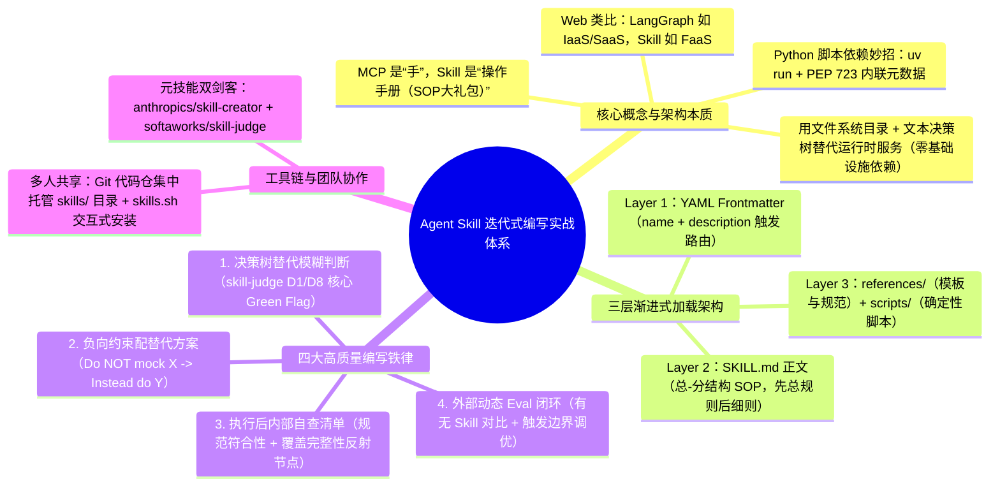
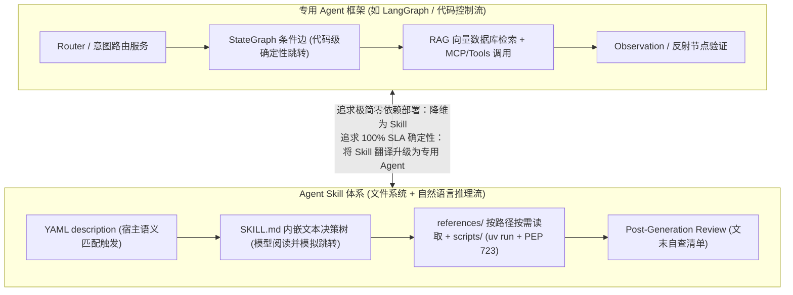

# Agent skill 迭代式编写实战

> [!abstract] 导读
> **一句话总结**：淘天集团物流技术团队（作者：其林）系统总结了 **Agent Skill 从概念定位、适用边界到迭代式编写的实战方法论**——提出**“如果说 MCP 为 Agent 提供了操作工具的‘手’，那么 Skill 就是教 Agent 怎么用工具的‘操作手册’”**；在架构上类比 **FaaS（以文件系统结构 + 文本决策树替代重量级运行时服务，实现零基础设施依赖极简部署）**，并凝练出四大编写铁律：**三层渐进式披露、用显式决策树替代模糊判断、负向约束必须配合法替代方案、建立内部执行后自查（Post-Generation Review）+ 外部对照 Eval 的双重验证闭环**。
> **阅读价值**：清晰划定了“什么时候该写轻量级 Skill、什么时候必须退回 LangGraph 专用 Agent 框架”的架构边界，并给出了可直接照抄的异步消息排障决策树与单测 Mock 负向约束范本。

## 1. TL;DR

- **核心定位与生动类比**：
  - **MCP vs. Skill**：MCP 是给 Agent 装上操作外部系统的“手”，而 **Skill 是“业务 SOP 操作手册”**（涵盖执行流程、领域背景、工具用法、模板素材与异常处理）。
  - **LangGraph（IaaS/SaaS）vs. Skill（FaaS）**：基于 LangChain/LangGraph 开发专用 Agent 需要自建状态图、向量库与路由服务；而 **Skill 本质是用“文件系统目录结构 + 自然语言文本决策树”替代复杂运行时服务**，依托宿主 Agent（Claude Code / Cursor / Qoder / OpenCode）自带的文件读取与 Bash 执行能力实现零依赖部署（Python 第三方依赖可通过 `uv run + PEP 723` 内联声明优雅解决）。
- **四大核心编写实战技巧**：
  1. **三层渐进式披露**：`第 1 层 YAML 元数据（目录概要，极低成本） → 第 2 层 SKILL.md 正文（总-分结构的执行 SOP） → 第 3 层 references/ 与 scripts/（按需加载的参考模板与确定性脚本）`。
  2. **用决策树（Decision Tree）替代模糊判断**：将专家脑中的多分支判断显式写为 `if-else` 树形规则（`skill-judge` 在 D1 知识增量与 D8 实用性维度的核心加分项），让 Agent 顺着树走而非自行猜测。
  3. **负向约束必须配套合法替代方案（Do NOT + Instead）**：只写“禁止 Mock 静态字段”会导致 Agent 自己乱找更糟的歪路；必须同步给出合法替代做法（相当于 Few-Shot 正向引导）。
  4. **内部自查（Post-Generation Review）+ 外部对照 Eval 双重验证**：在 `SKILL.md` 末尾强制插入发散式自查清单（规范符合性 + 覆盖完整性），并在开发期利用 `skill-creator` 与 `skill-judge` 跑「有 Skill vs 无 Skill」的 A/B 对照 Eval 及 `should-trigger / should-not-trigger` 触发率调优。

## 2. 问题定义与背景

### 2.1 什么时候该用 Agent Skill？什么时候不该用？
并非所有场景都适合包装成 Skill。作者结合物流技术团队实践，划定了清晰的适用象限：

| 维度 | ✅ 特别适合使用 Agent Skill 的场景 | ❌ 不适合使用 Agent Skill 的场景（及正确替代方案） |
| :--- | :--- | :--- |
| **自动化程度** | **半自动化重复流程**：高频执行但局部仍依赖主观/语义判断，无法 100% 写死为纯代码 | **100% 确定性流程**：直接写确定性 Python/Java 脚本或定时任务更稳更快 |
| **知识属性** | **强领域专家知识导向**：依赖企业内部黑话、排障经验，通用 LLM 泛化能力无法覆盖 | **通用简单任务**：直接靠基础提示词与 LLM 预训练常识即可完成 |
| **上下文与职责** | **多职责 Agent 上下文受限**：Agent 需处理十几种任务，不希望无关领域知识常驻占用窗口 | **职责高度单一的专用 Agent**：直接把规则写进 System Prompt、脚本做成 MCP Tool 即可 |
| **复杂度与 SLA** | **中等复杂度专业 SOP** | **要求 100% 流程确定性、长连接高频低延迟或逻辑复杂到 Context 爆炸**：必须回到 **LangGraph** 等代码控制流框架定制专用 Agent |

## 3. 知识框架



## 4. 核心内容拆解

### 4.1 专用 Agent 框架（ReAct / LangGraph）与 Agent Skill 的架构映射

作者通过一张精辟的对比映射，揭示了为什么 Skill 是“极简版的专用 Agent”以及两者如何按需转换：



### 4.2 迭代式优化的四大实战技法（附真实代码片段）

#### 1. 用显式“决策树”替代模糊判断（收敛执行路径）
在 `skill-judge` 评估体系中，**针对非显而易见选择的决策树（Decision Trees for non-obvious choices）** 同时是 **D1（Knowledge Delta，知识增量）** 和 **D8（Usability，实用性）** 的核心高分标志（Green Flag）。
以物流**异步消息问题排查 Skill** 为例，不写模糊的“请检查消息是否消费失败”，而是写成严密的分支树：
```markdown
### 结果处理规则
**补全未发出消息：** 若有序事件的前序有日志、后序无日志，在报告表格中补充后序事件行
**消费失败处理：** 判断某 tag 是否失败，标准为 `resultFlag = N` 且该 tag 后续行：
- 若后续 **有** `Y`（重试成功）→ 取 **第一条** 失败行，调用错误详情查询
- 若后续 **无** `Y`（持续失败）→ 取 **每一条** 失败行，调用错误详情查询
```

#### 2. 负向约束必须配合法替代方案（`Do NOT` + `Instead`）
告诉 Agent “不能做什么”时，如果不告诉它“那该怎么做”，Agent 会自己胡乱发明一种更不可控的绕行方案。以**单元测试编写 Skill** 中的 Mock 约束为例：
```markdown
### Mocking Restrictions
**Do NOT mock:**
- `public static` fields (e.g., `@AppSwitch`-annotated configurations) -> modify directly and restore originals post-test
- POJO classes or OneLog objects -> initialize simple POJOs programmatically
- Stateless static methods (e.g., utility methods for conversion/assembly) -> invoke real methods directly
```

#### 3. 执行后自查机制（`Post-Generation Review`，发散校验结果）
如果说决策树解决的是**执行前**的“走哪条路（收敛）”，那么文末自查清单解决的就是**执行后**的“产物是否全面合格（发散）”。通过强制插入反射节点，把 Agent 的“我觉得做完了”变成“我核对过做完了”：
- **规范符合性（没做错）**：文件位置与命名、禁止的 Mock 模式、统一使用 AssertJ 断言、禁止反射测私有成员；
- **覆盖完整性（没遗漏）**：返回值、状态变更、方法调用次数验证，以及将相似用例合并为参数化测试（Parameterized Tests）并覆盖 `null` 边界。

#### 4. 外部动态验证（Eval 机制）的四步闭环
除了运行时的内部自查，开发期还需通过外部 Eval 量化验证 Skill 的真实增益：
1. **构造高保真测试用例**：设计 2–3 个带真实复杂度与业务背景的 Prompt（过于简短的 Prompt 可能连 `description` 都不会触发），同题对比跑 **「有 Skill」vs「无 Skill（或旧版 Skill）」** 的输出差异。
2. **设定断言（Assertions）**：客观产物检查特定字段/命令是否存在，主观产物结合人工评审。
3. **泛化迭代循环（防过拟合）**：`评估 → 修改 → 重跑 → 再评估`。**核心铁律**：切忌只针对当前报错的 2 个 Case 打死补丁，必须从具体反馈中提炼通用规则写入 Skill。
4. **`description` 触发率专项调优**：在正文稳定后，专门构造 `should-trigger` 与 `should-not-trigger` 正反样本集测试路由召回精度，消灭“近似场景误触发”与“该触发却漏触发”。

## 5. 数据速查表

| 关键要素 / 工具 | 具体技术方案 / 地址 | 工程作用与最佳实践 |
| :--- | :--- | :--- |
| **开放标准时间线** | 2025 年 10 月月中旬 Anthropic 发布 Claude Skills $\rightarrow$ 2 个月后成为开放标准 | Cursor、OpenCode、Qoder 等主流工具全面原生兼容 |
| **两大必备元 Skill** | 生成：`https://skills.sh/anthropics/skills/skill-creator`<br/>评估：`https://skills.sh/softaworks/agent-toolkit/skill-judge` | 用 AI 辅助生成标准目录骨架，并按 D1（知识增量）~ D8（实用性）量化打分 |
| **带三方库 Python 脚本执行** | **`uv run` + `PEP 723`（内联脚本元数据声明依赖）** | 无需预先手动维护全局虚拟环境，`scripts/` 单文件即可自包含声明并秒级拉起依赖 |
| **收敛 vs. 发散双护栏** | **前置决策树（收敛选路）** + **后置自查表（发散验货）** | 分别鎖死执行路径确定性与最终交付产物完整性 |
| **当 Skill 撑不住时的退路** | 将文本决策树升级为 LangGraph 条件边、脚本升级为 MCP Tool、自查升级为 Observation 节点 | 实现从轻量 FaaS 级 Skill 向高 SLA 专用 Agent 的平滑演进 |

## 6. 踩坑与教训 / 可迁移的设计原则

- **反模式 1：只写“严禁做 X”的纯负向禁令**
  - **教训**：在单测 Skill 中只写“禁止使用 Mockito Mock 静态开关字段”，结果 Agent 为了让测试跑过，干脆用 Java 反射去暴力篡改 `final` 常量，引发更严重的测试污染。
  - **原则**：每一条 `Do NOT` 后面必须紧跟一条 `Instead, do ...` 的标准替代范式。
- **反模式 2：在外部 Eval 迭代中对测试样本“过拟合修补”**
  - **教训**：每次只看 2–3 个测试 Case 修 Skill，极易把测试 Case 里的特定变量名或特例直接硬编码进 `SKILL.md`，导致换一批真实请求即失效。
  - **原则**：每次修改 `SKILL.md` 时先问自己“这究竟是当前 Case 的偶然现象，还是该业务领域的通用判断分支？”
- **可迁移技巧：在 `scripts/` 中全面拥抱 `uv run` + `PEP 723`**
  - 传统 Skill 的 Python 脚本一旦 `import pandas` 或 `import requests` 就常因宿主环境缺包而报错；在脚本顶部加入 PEP 723 `# /// script` 依赖声明块并用 `uv run` 调用，是实现跨机器“零配置开箱即用”的绝佳工程实践。

## 7. 记忆锚点

- **两个核心比喻**：**MCP 是“手”，Skill 是“操作手册”**；**LangGraph 是 IaaS/SaaS，Skill 是零依赖的 FaaS**。
- **四个编写法宝**：**三层渐进披露 + 决策树替模糊判断（收敛） + 负向约束配替代方案（`Do NOT + Instead`） + 内自查与外 Eval 双验证（发散）**。
- **一个脚本秘籍**：带第三方依赖的 Python 脚本用 **`uv run + PEP 723`**。

## 8. 复习卡片

How does the author contrast the role of MCP with Agent Skills, and how does the FaaS analogy explain Skill architecture?::MCP provides the "hands" for an Agent to operate external tools, while a Skill is the "operating manual (SOP)" teaching the Agent how to use them; like FaaS compared to IaaS/SaaS (LangGraph), Skills replace heavy runtime infrastructure (vector DBs, graph engines) with a zero-dependency filesystem structure and natural-language decision trees executed by the host Agent.
Under what three conditions is a task NOT suitable for packaging as an Agent Skill?::1. Very simple tasks where basic prompts and general LLM knowledge suffice; 2. 100% deterministic workflows (better written directly as standard code/scripts) or workflows requiring 100% SLA/complex stateful transactions where context explodes (better built with LangGraph); 3. Single-purpose agents where rules belong directly in the system prompt.
Why does `skill-judge` treat explicit Decision Trees as a major green flag for D1 (Knowledge Delta) and D8 (Usability)?::Because a Skill's core value is encapsulating non-obvious expert judgment; converting vague prose into an explicit `if-else` decision tree removes reasoning ambiguity so the Agent can deterministically follow the correct branch.
Why must negative constraints ("Do NOT do X") in a Skill always be paired with a valid alternative ("Instead, do Y")?::If you only forbid an action without providing the approved alternative, the Agent will improvise its own workaround under pressure—often producing even worse anti-patterns (e.g., using reflection when told not to mock static fields).
How do Decision Trees and Post-Generation Review checklists complement each other during Skill execution?::Decision trees are convergent (guiding the Agent to pick one correct execution path before/during action), while Post-Generation Review checklists are divergent (forcing the Agent to pause after completion and verify the output across multiple compliance and completeness dimensions).
What are the four steps of external Skill evaluation (`eval`), and how do you optimize triggering accuracy?::1. Design 2–3 realistic complex prompts and run A/B comparisons (With Skill vs. Without Skill); 2. Check objective assertions or human feedback; 3. Iterate by extracting general rules rather than overfitting to the test cases; 4. Tune the YAML `description` separately using `should-trigger` and `should-not-trigger` boundary queries.

## 9. 知识关联

- **本批同主题精读**：
  - [AI Agent 的 Skill 系统设计](../Agent Skill系统设计+26.7.1/AI_Agent Skill系统设计.md)：会员技术团队出品的 Skill 系统设计总纲，与本文（物流技术团队出品）在“渐进式披露、确定性脚本外化、前向测试验证”上高度互补。
  - [复杂业务团队的 AI Coding 交付实践：知识库、RD 流程和质量门禁](../复杂业务AI Coding交付+26.8.4/AI_复杂业务AI Coding交付.md)：同出淘天物流技术团队！本文展示了如何把物流单点排障与单测经验写成高质量 Skill，该文则展示了如何进一步升级为整个物流团队的四层知识库与三道质量门禁。
  - [用 AI Skills 打通中间件迁移：定位服务从 Android 到鸿蒙的完整实践](../AI Skills鸿蒙定位服务迁移+26.6.14/AI_AI Skills鸿蒙定位服务迁移.md)：本文“负向约束配正确替代方案”在跨端二方包迁移中的鲜活实例。
  - [QoderWork 数科 Skills 建设实践](../QoderWork数科Skills+26.6.26/AI_QoderWork数科Skills.md)：同样使用 QoderWork 生态并践行三层/四层渐进披露与测试驱动开发。
- **主题索引（`20_topics`）**：
  - [Skill设计与治理](../../20_topics/Skill设计与治理.md)
  - [Agent评测与反馈](../../20_topics/Agent评测与反馈.md)
  - [AI研发协同](../../20_topics/AI研发协同.md)
  - [Harness与模型协同](../../20_topics/Harness与模型协同.md)
- **本目录归档文件**：[原始 PDF](RAW.pdf) · [逐页转写文本](MD.md)
- **候选概念双链**：[[Agent-Skill]] · [[渐进式披露]] · [[决策树约束]] · [[skill-judge]] · [[PEP-723]] · [[LangGraph]]

## 10. 原文参考资料

- **原文出处**：大淘宝技术公众号，《Agent skill 迭代式编写实战》（作者：其林，淘天集团-物流技术团队，发布日期：2026-06-12）
- **文中推荐工具链接**：
  - `skill-creator`：[https://skills.sh/anthropics/skills/skill-creator](https://skills.sh/anthropics/skills/skill-creator)
  - `skill-judge`：[https://skills.sh/softaworks/agent-toolkit/skill-judge](https://skills.sh/softaworks/agent-toolkit/skill-judge)

> [!note]- 校对报告
> - **页码溯源（1-based 物理页码）**：
>   - 篇首标题、作者（其林，物流技术团队）、Agent Skill 定义（MCP 是手、Skill 是操作手册，2025 年 10 月发布演进）、标准目录结构及 `uv run + pep 723` 提示、适用与不适用场景边界：源自 `RAW.pdf` `p.1–3`（对应 `MD.md` 第 1–3 页）。
>   - 元技能推荐（`skill-creator` / `skill-judge`）、三层渐进式加载架构、决策树替代模糊判断（含异步消息排查规则片段與 `skill-judge` D1/D8 指标）、负向约束配替代方案（含单测 Mocking Restrictions 片段）：源自 `RAW.pdf` `p.3–6`（对应 `MD.md` 第 3–6 页）。
>   - 执行后自查机制（`Post-Generation Review` 规范符合性与覆盖完整性）、外部动态验证 `eval` 四环节及 `skills.sh` 多人协作管理：源自 `RAW.pdf` `p.6–7`（对应 `MD.md` 第 6–7 页）。
>   - 扩展视角（ReAct / LangGraph 与 Skill 的映射关系、IaaS/SaaS vs FaaS 类比及何时退回 LangGraph 定制专用 Agent）与总结：源自 `RAW.pdf` `p.8–11`（对应 `MD.md` 第 8–11 页）。
> - **一致性核验**：原文共 11 页（含 7 页配图与对比表），文中 3 段简短 Markdown 示例片段已在笔记第 4.2 节完整还原，无独立长篇外部 `SKILL.md` 全文需额外剥离。全文零正文内页码引用，所有核心论点与 `MD.md` 完全一致。
