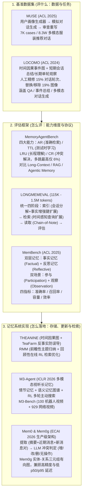

# Agent-Memory 评测全景：基准、评估与记忆系统（理论篇）

## 1. TL;DR

1. **三条演进主线（评什么 → 怎么评 → 怎么落地）**：系统梳理了 Agent 长期记忆的**基准数据集（MUSE、LOCOMO）**、**评估框架（MemoryAgentBench、LONGMEMEVAL、MemBench）**与**代表性记忆系统（THEANINE & TeaFarm、RMM、M3-Agent、Mem0 / Mem0g）**三大维度。
2. **核心评测瓶颈揭示**：现有模型在极长对话问答（LOCOMO 上 `gpt-4-turbo` 仅 **32.4** vs 人类基准 **87.9**）、跨会话动态交互（商业聊天助手与长上下文 LLM 在 LONGMEMEVAL 上**准确率下降 30%–60%**）以及多跳冲突解决（MemoryAgentBench 上最高准确率仅 **6%**）方面存在显著短板。
3. **前沿记忆架构突破**：
   - **THEANINE / RMM**：分别通过“时间与因果关系记忆图 + TeaFarm 反事实防误导基准”以及“前瞻性主题总结 + 回顾性在线强化学习（RL）检索调优”提升长程个性化对话质量。
   - **M3-Agent（ByteDance-Seed，ICLR 2026）**：融合情节记忆与语义记忆图谱并用 RL 训练多轮自主搜索，在 M3-Bench-robot、M3-Bench-web 与 VideoMME-long 上准确率分别提升 **6.7%、7.7% 和 5.3%**。
   - **Mem0 / Mem0g（ECAI 2026）**：通过动态提取与一致性更新操作（添加/更新/删除/无操作）及有向标记图表示，在单跳/多跳/时间/开放域四类任务中全面领先，同时大幅降低 p50/p95 延迟与 Token 消耗。
4. **下一代生产级评测四维准则**：为克服“增益难归因、命中但无用、动态更新缺失、成本缺位”四大痛点，真实业务评测必须同时覆盖**检索正确性、使用有效性、时间维度（跨会话/变化/遗忘）与成本维度（延迟/Token/存储/合规）**。

## 2. 问题定义与背景

### 2.1 为什么短上下文与朴素 RAG 无法胜任 Agent 长期记忆？

当 LLM Agent 从单轮对话走向跨会话、长周期乃至多模态交互时，单纯扩大上下文窗口容易诱发幻觉、时间与因果推理断裂及高昂的 Token 延迟成本；而静态单轮 RAG 仅做片段相似性召回，缺乏对全局叙事演进、新旧事实冲突消解（Knowledge Update / Conflict Resolution）以及从低阶事实提炼高阶偏好的反思能力（Reflective Memory）。

### 2.2 现有 Agent-Memory 研究全景矩阵（截至 2026 年 2 月）

| 类别 | 代表工作 | 机构与发表会议 | 核心定位 |
| :--- | :--- | :--- | :--- |
| **Memory Benchmark** | **MUSE** | Northeastern Univ. (ACL 2025) | 基于真实场景与 VLM 用户画像的服装多模态对话推荐数据集（7K cases / 8.3W 对话） |
| **Memory Benchmark** | **LOCOMO** | UNC Chapel Hill (ACL 2024) | 基于个性化角色与时间因果事件图的超长对话记忆基准（50 对话，平均 300 轮 / 9,000 tokens） |
| **Memory Evaluation** | **MemoryAgentBench** | UC San Diego (arXiv) | 增量多轮交互评估框架，聚焦 AR（准确检索）、TTL（测试时学习）、LRU（长程理解）、CR（冲突解决） |
| **Memory Evaluation** | **LONGMEMEVAL** | UCLA & Tencent (arXiv) | 跨会话长期交互评测（S 版约 115K tokens / M 版 500 会话约 150 万 tokens）与统一索引检索读取框架 |
| **Memory Evaluation** | **MemBench** | Huawei (ACL 2025) | 涵盖事实记忆与反思记忆、参与场景与观察场景的四维指标（准确率/召回率/容量/效率）评估 |
| **Memory System** | **THEANINE & TeaFarm** | Yonsei Univ. (NAACL 2025) | 基于时间与因果关系图的记忆时间线管理 + TeaFarm 反事实抗误导评测基准 |
| **Memory System** | **RMM** | Google (ACL 2025) | 结合前瞻性反思（按主题动态总结）与回顾性反思（在线 RL 迭代优化检索）的个性化记忆管理 |
| **Memory System** | **M3-Agent** | ByteDance-Seed (ICLR 2026) | 实时处理视听流、构建情节/语义图结构记忆并经 RL 优化多轮检索的多模态长期记忆智能体 |
| **Memory System** | **Mem0 / Mem0g** | mem0ai (ECAI 2026) | 生产级可扩展动态记忆架构（摘要+近期消息提取更新）与有向标记图（Mem0g）关系建模 |

## 3. 知识框架

## 4. 核心内容拆解

### 4.1 基准数据集（Memory Benchmark）：MUSE 与 LOCOMO

1. **MUSE（多模态场景化对话推荐基准）**：
   - 通过**用户画像生成器**（结合真实场景与 VLM 生成画像）、**模拟对话生成器**与**对话优化器**构建 7,000 个案例、8.3 万段服装领域多模态对话。
   - 在抽取 200 个对话与 MMCONV、ReDial、INSPIRED、PEARL 对比中，从对话自然性、逻辑连贯性、信息丰富性、产品上下文相关性与图文一致性五个维度展现优势。
2. **LOCOMO（超长对话多模态记忆基准）**：
   - 构建 50 个超长多会话对话（平均 **300 轮、9,000 tokens**；扩展评估集达 10 个对话、每个 **600 轮、26,000 tokens** 并附 200 个单跳/多跳/时间/开放域问题）。
   - **构建与人工质控**：基于个性化角色与因果连接的时间事件图生成，每次会话结束生成总结存为短期记忆，单轮交互作为“观察（Observation）”存为长期记忆；人工标注者**编辑了约 15% 的对话轮次以消除长期不一致，并替换/移除了约 19% 的无关图像**。
   - **关键实测发现**：
     - **问答（QA）**：`gpt-4-turbo` 得分最高（**32.4**），但远低于人类基准（**87.9**）；将对话存为“观察”用 DRAGON 检索有效，但随召回数量增加收益递减。
     - **事件总结**：`gpt-3.5-turbo` 召回率与 F1 最高；长上下文模型常犯五类错误：**信息缺失、幻觉、对话线索误解、说话者归属错误、次要对话误判为重要事件**。
     - **多模态对话生成**：基于 MMDialog 初始化训练 MiniGPT-5（对比 `Base`、`+summary`、`+observation`），引入包含说话者经历的 **`+observation`（观察）** 显著提升了生成文本与图像的个性化契合度。

### 4.2 评估框架（Memory Evaluation）：四大核心能力与统一流水线

1. **MemoryAgentBench（增量多轮交互四维评估）**：
   - 定义四大核心记忆能力：**准确检索（AR）**、**测试时学习（TTL）**、**长程理解（LRU）**、**冲突解决（CR）**，重构现有数据并新增 `EventQA`（测 AR）与 `FactConsolidation`（测 CR）。
   - 横向对比三类代理（Long-Context Agents、RAG Agents、Agentic Memory Agents）发现：**RAG 在准确检索（AR）上最优**（优于 GPT-4o-mini）；**长上下文代理在测试时学习（TTL）与长程理解（LRU）上最佳**；但**所有方法在冲突解决（CR）上均全面溃败，多跳冲突解决最高准确率仅 6%**。
2. **LONGMEMEVAL（跨会话长期交互基准与统一框架）**：
   - 包含 500 个问题，提供 `LONGMEMEVAL-S`（约 **115K tokens**）与 `LONGMEMEVAL-M`（500 个会话，约 **150 万 tokens**）两种配置，覆盖信息提取、多会话推理、时间推理、知识更新与拒绝回答。
   - 现有商业聊天助手与长上下文 LLM 在该基准上**准确率普遍暴跌 30%–60%**。
   - 提出四阶段统一优化方案：**索引阶段**采用**会话分解（Session Decomposition）**与**事实增强的键扩展（Fact-Augmented Key Expansion，提取摘要/关键短语/用户事实/时间戳增强 Key）**；**检索阶段**采用**时间感知的查询扩展（Time-Aware Query Expansion）**；**读取阶段**采用 **Chain-of-Note** 与结构化提示。
3. **MemBench（事实/反思双层与参与/观察双场景评估）**：
   - 弥补以往只测“事实记忆（Factual Memory）”与“参与场景（Participation）”的盲区，引入**反思记忆（Reflective Memory，从具体菜品喜好等低阶偏好归纳口味倾向等高阶行为模式）**与**观察场景（Observation，代理仅被动记录而不发言干扰）**，并同步评估**记忆准确性、召回率、容量与时间效率**。

### 4.3 记忆系统（Memory System）：从时间线图、双反思到多模态与生产级图记忆

1. **THEANINE & TeaFarm（NAACL 2025）**：
   - **THEANINE** 构建融合时间顺序与因果关系的记忆图，提取并精炼记忆时间线。
   - **TeaFarm** 提出无人工干预的**反事实（Counterfactual）防误导基准**：用问题生成器构造含虚假前提的提问（如谎称“Speaker B 没有车”），检验代理能否准确引用历史真实对话予以纠正。
2. **RMM（Reflective Memory Management，Google ACL 2025）**：
   - 结合**前瞻性反思（Prospective Reflection，将对话历史动态归纳为主题级记忆表示以克服固定分块碎片化）**与**回顾性反思（Retrospective Reflection，利用在线强化学习根据 LLM 生成的引用证据动态调优检索器）**。
3. **M3-Agent & M3-Bench（ByteDance-Seed，ICLR 2026）**：
   - 面向实时视觉与听觉流的多模态智能体，将记忆组织为图结构，节点涵盖**情节记忆（Episodic Memory，具体事件观察）**与**语义记忆（Semantic Memory，提炼的一般知识）**，支持增量添加与一致性更新。
   - 摒弃单轮静态 RAG，使用**强化学习（RL）**训练智能体在多轮交互中自主决定搜索工具与多步推理；在自建长视频问答基准 **M3-Bench**（含 `100` 个机器人第一视角视频 `M3-Bench-robot` 与 `929` 个网络视频 `M3-Bench-web`）及 `VideoMME-long` 上，准确率较最强基线分别提升 **6.7%、7.7% 和 5.3%**。
4. **Mem0 & Mem0g（mem0ai，ECAI 2026）**：
   - **Mem0 两阶段流水线**：提取阶段结合**数据库全局对话摘要 + 最近消息窗口 + 当前问答消息对**提取候选记忆；更新阶段通过 LLM 判定候选事实与存量记忆的一致性，执行 `ADD`（添加）、`UPDATE`（更新）、`DELETE`（删除）或 `NOOP`（无操作）。
   - **Mem0g 图结构扩展**：通过实体提取模块与关系三元组生成模块构建**有向标记图（Directed Labeled Graph）**。实测显示：**Mem0 在单跳（Single-Hop）与多跳（Multi-Hop）推理上占优，Mem0g 在时间推理（Temporal）与开放域（Open Domain）任务上表现突出**，且相比全上下文方法大幅降低了 p50/p95 响应延迟与 Token 开销。

## 5. 数据速查表

| 基准 / 系统名称 | 核心规模 / 实验指标 | 关键定量结论 |
| :--- | :--- | :--- |
| **MUSE (ACL 2025)** | `7,000` cases / `8.3 万` 对话 | 抽样 200 对话五维评估超越 MMCONV、ReDial、INSPIRED、PEARL |
| **LOCOMO (ACL 2024)** | 50 对话（均 `300 轮` / `9,000 tokens`） | 人工编辑 `15%` 轮次、替换/移除 `19%` 图像；QA 任务 `gpt-4-turbo` **32.4** vs 人类 **87.9** |
| **MemoryAgentBench** | 覆盖 AR / TTL / LRU / CR 四大能力 | 多跳**冲突解决（CR）最高准确率仅 `6%`**（当前最大短板） |
| **LONGMEMEVAL** | 500 问题（S 版 `115K` / M 版 500 会话 `1.5M tokens`） | 商业聊天助手与长上下文 LLM 在长期交互下**准确率下降 `30%–60%`** |
| **M3-Agent (ICLR 2026)** | M3-Bench：`100` 机器人视频 + `929` 网络视频 | 相比最强基线在 robot / web / VideoMME-long 上分别提升 **`+6.7%`、`+7.7%`、`+5.3%`** |
| **Mem0 / Mem0g (ECAI 2026)** | LOCOMO 扩展集（10 对话 × `600 轮` / `26K tokens`） | Mem0 强于单跳/多跳，Mem0g 强于时间/开放域，显著降低 p50/p95 延迟与 Token 消耗 |

## 6. 踩坑与教训 / 可迁移的设计原则

1. **按任务特性组合 RAG 与长上下文，重点补齐“冲突消解（CR）”短板**：MemoryAgentBench 证明 RAG 擅长局部精准提取（AR），长上下文擅长整体归纳（LRU）与测试时学习（TTL），但两者在多跳新旧信息冲突解决（最高仅 6%）上均极脆弱，必须在写入阶段引入类似 Mem0 的显式 `ADD/UPDATE/DELETE/NOOP` 状态机。
2. **索引键必须包含“事实增强与显式时间戳”**：借鉴 LONGMEMEVAL，切忌直接拿原始对话轮次文本做向量索引键；应在索引期分解会话并提取“摘要 + 关键短语 + 用户事实 + 时间戳事件”扩展 Key，在检索期配合时间范围过滤。
3. **评测长周期记忆系统必须严控四大陷阱**：避免把长上下文或基础 RAG 的增益混同为记忆机制贡献（需严格消融）、避免只看检索命中而脱钩端到端任务有效性、增加动态知识覆写与抗反事实误导（如 TeaFarm）压测、并强制汇报 p50/p95 延迟与 Token 成本。

## 7. 记忆锚点

- **三大研究支柱**：`Memory Benchmark`（MUSE / LOCOMO）+ `Memory Evaluation`（MemoryAgentBench / LONGMEMEVAL / MemBench）+ `Memory System`（THEANINE / RMM / M3-Agent / Mem0）。
- **四项核心记忆能力（MemoryAgentBench）**：`AR`（准确检索）、`TTL`（测试时学习）、`LRU`（长程理解）、`CR`（冲突解决，多跳仅 6%）。
- **四阶段统一优化管线（LONGMEMEVAL）**：索引（会话分解 + 事实增强键扩展）→ 检索（时间感知查询扩展）→ 读取（Chain-of-Note）→ 评估。
- **四维工程评测标准**：检索正确性 + 使用有效性 + 时间维度（跨会话/变化/遗忘）+ 成本维度（p50/p95 延迟/Token/存储/合规）。

## 8. 复习卡片

1. LOCOMO 数据集是如何构建并保障多会话长期一致性的？::基于个性化角色设定与因果连接的时间事件图生成平均 300 轮（9,000 tokens）的长对话，将会话总结存为短期记忆、单轮交互存为长期观察；并由人工标注者编辑了约 15% 的对话轮次、替换或移除了约 19% 的无关图像。
2. 在 LOCOMO 基准测试中，LLM 在问答（QA）和事件总结任务上暴露出哪些典型局限？::QA 任务上最佳模型 gpt-4-turbo（32.4）远低于人类水平（87.9）；事件总结任务上长上下文模型易出现信息缺失、幻觉、对话线索误解、说话者归属错误以及将次要对话误判为重要事件五类错误。
3. MemoryAgentBench 提出了哪四项核心记忆能力？三类代理（长上下文、RAG、Agentic Memory）表现如何？::四项能力为准确检索（AR）、测试时学习（TTL）、长程理解（LRU）和冲突解决（CR）；RAG 在 AR 上最优，长上下文在 TTL 和 LRU 上最优，但所有方法在多跳冲突解决（CR）上最高准确率仅为 6%。
4. LONGMEMEVAL 提出的统一记忆优化框架在“索引、检索、读取”三个阶段分别采用了什么关键技术？::索引阶段采用“会话分解”与“事实增强的键扩展（提取摘要、关键短语、用户事实与时间戳）”；检索阶段采用“时间感知的查询扩展”；读取阶段采用 Chain-of-Note 与结构化提示格式。
5. MemBench 相比以往的记忆评测基准新增了哪两个关键维度？::在记忆内容上从单一的“事实记忆（Factual Memory）”扩展到高阶偏好的“反思记忆（Reflective Memory）”；在交互模式上从“参与场景（Participation）”扩展到被动记录的“观察场景（Observation）”，并同步评估准确率、召回率、容量与效率。
6. Google 提出的 RMM（反思记忆管理）如何结合“前瞻性反思”与“回顾性反思”？::前瞻性反思（Prospective Reflection）将对话历史动态归纳为主题级记忆表示以克服固定分块碎片化；回顾性反思（Retrospective Reflection）利用在线强化学习（RL）根据 LLM 生成的引用证据迭代优化检索机制。
7. 字节跳动 M3-Agent 如何构建多模态长期记忆并在 M3-Bench 上取得突破？::M3-Agent 实时处理视听输入，以图结构存储情节记忆（具体事件）与语义记忆（一般知识），并通过强化学习训练多轮自主搜索决策，在 M3-Bench-robot、M3-Bench-web 和 VideoMME-long 上准确率分别提升 6.7%、7.7% 和 5.3%。
8. Mem0 与 Mem0g 在记忆提取更新机制与适用任务类型上有何区别？::Mem0 结合全局摘要、近期消息与当前问答对提取候选事实，并由 LLM 判定执行添加、更新、删除或无操作，在单跳与多跳推理中表现出色；Mem0g 进一步引入实体-关系三元组有向标记图，在时间推理与开放域任务中更具优势。

## 9. 知识关联

- **所属主题**：
  - [Agent长期记忆](../../20_topics/Agent长期记忆.md)
  - [Agent评测与反馈](../../20_topics/Agent评测与反馈.md)
  - [检索与文档解析](../../20_topics/检索与文档解析.md)
- **本地跃迁**：[原始 PDF](RAW.pdf) · [逐页转写文本](MD.md)
- **候选双链**：[[构建高质量RAG知识库]] · [[智能导购Agent评测实践]] · [[TMIC AI小新DeepAgent演进]] · [[RAG全链路技术详解]]

## 10. 原文参考资料

1. **基准数据集论文**：
   - **MUSE**: *A Multimodal Conversational Recommendation Dataset with Scenario-Grounded User Profiles*, ACL 2025 (Northeastern University)
   - **LOCOMO**: *Evaluating Very Long-Term Conversational Memory of LLM Agents*, ACL 2024 (UNC Chapel Hill)
2. **评估框架论文**：
   - **MemoryAgentBench**: *Evaluating Memory in LLM Agents via Incremental Multi-Turn Interactions*, arXiv (UC San Diego)
   - **LONGMEMEVAL**: *Benchmarking Chat Assistants on Long-Term Interactive Memory*, arXiv (UCLA & Tencent)
   - **MemBench**: *Towards More Comprehensive Evaluation on the Memory of LLM-based Agents*, ACL 2025 (Huawei)
3. **记忆系统论文与开源仓库**：
   - **THEANINE & TeaFarm**: *Towards Lifelong Dialogue Agents via Timeline-based Memory Management*, NAACL 2025 (Yonsei University)
   - **RMM**: *In Prospect and Retrospect: Reflective Memory Management for Long-term Personalized Dialogue Agents*, ACL 2025 (Google)
   - **M3-Agent**: *Seeing, Listening, Remembering, and Reasoning: A Multimodal Agent with Long-Term Memory*, ICLR 2026 (`https://github.com/ByteDance-Seed/m3-agent`)
   - **Mem0 / Mem0g**: *Building Production-Ready AI Agents with Scalable Long-Term Memory*, ECAI 2026 (`https://github.com/mem0ai/mem0`)

> [!note]- 校对报告
> - **页码溯源**：p.1–2（Agent 长期记忆三大演进主线及截至 2026 年 2 月的 9 项代表工作出处与被引统计表）；p.2–13（MUSE 7k cases/8.3w 对话构建与五维评估；LOCOMO 50 对话平均 300 轮/9000 tokens、人工编辑 15% 轮次与 19% 图像、QA 32.4 vs 87.9、事件总结五类错误、MiniGPT-5 `+observation` 实验）；p.13–22（MemoryAgentBench AR/TTL/LRU/CR 四能力与多跳 CR 最高 6% 准确率；LONGMEMEVAL 115K/1.5M tokens、准确率下降 30%–60%、会话分解/事实增强键扩展/时间感知查询扩展/Chain-of-Note；MemBench 事实与反思记忆、参与与观察场景、四维指标）；p.23–32（THEANINE 时间因果图与 TeaFarm 反事实基准；RMM 前瞻性与回顾性 RL 反思；M3-Agent 情节/语义图记忆、M3-Bench 100+929 视频及 `+6.7%/+7.7%/+5.3%` 提升；Mem0 与 Mem0g 有向图记忆、LOCOMO 扩展集 10 对话×600 轮/26000 tokens 单跳/多跳/时间/开放域评估与 p50/p95 延迟定义）；p.32–34（四大共性问题与检索正确性/使用有效性/时间维度/成本维度四维评测总结）。
> - **一致性核验**：作者（阿元，淘天集团-场景智能技术团队）、发布时间（2026-06-03）、所有论文名称、机构、顶会年份与实验数据均逐页核对一致；正文中无任何内联页码引用。
> - **质量边界**：原文中部分详细实验得分表格以图片形式内嵌（如 p.4–7、p.9–10、p.18–19、p.22、p.27、p.30–31），笔记已完整提取正文中明确给出的全部定量指标与核心实验结论。
