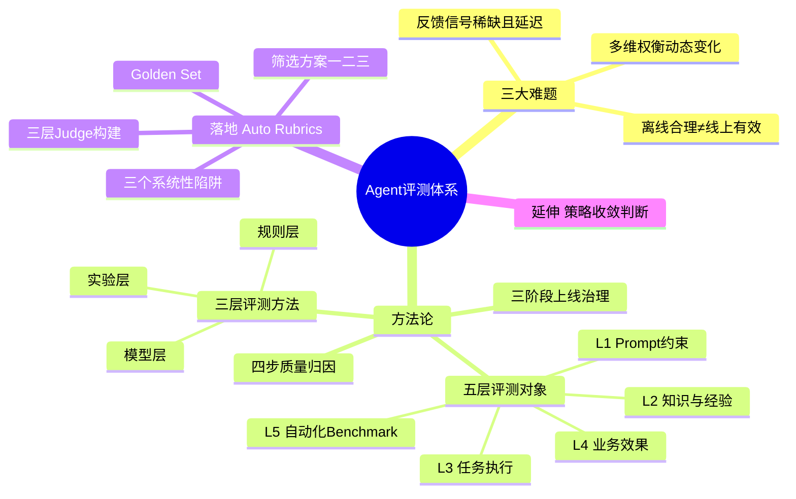
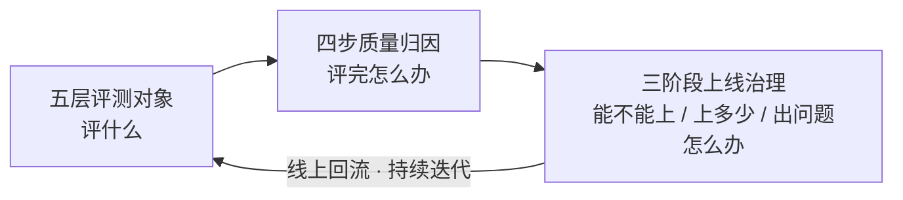
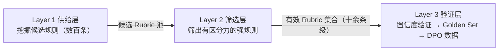
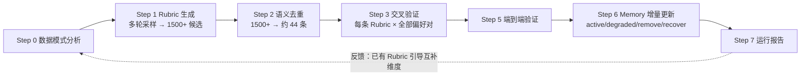
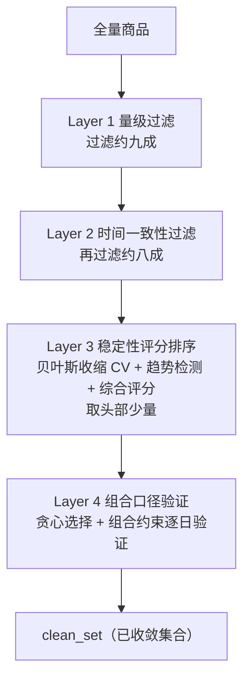

# 让Agent可评、可控、可迭代

## 1. TL;DR

- 策略效果类 Agent 的输出是会进入真实业务执行的**策略配置**，没有标准答案，质量只能靠大盘指标事后验证，评测难点是：反馈稀缺、多维权衡、离线合理≠线上有效。
- 方法论 = **五层**评测对象（评什么）+ **四步**质量归因（评完怎么办）+ **三阶段**上线治理（如何上线）。
- 最难的对齐问题用 **Auto Rubrics** 解：用可解释的 Rubric 替代黑盒 Reward Model，三层架构（供给→筛选→验证）构建业务效果 Judge。
- 核心教训：训练集准确率什么都不说明；一致性≠正确性；**评估器本身也需要被评估**；宁要高精度，不要高覆盖。

---

## 2. 核心概念

- **策略效果类 Agent**：理解上下文 → 生成候选策略 → 解释策略依据，输出为补贴率、广告投放预算、素材优化等策略动作（原图：业务输入→Agent→策略动作→业务效果，线上反馈 / A-B 实验 / 后置归因回流）。
- **偏好对 `<chosen, rejected>`**：同一输入下业务效果更好 / 更差的两条策略输出，把"打分回归"转成"二元偏好判断"。
- **Rubric**：人类可读的自然语言规则，描述"好策略应满足什么条件"，Judge 低分可追溯到具体规则。
- **Auto Rubrics**：由 LLM 从偏好对 / goodcase-badcase 中自动挖掘、验证、沉淀 Rubric 的"生成—评估—迭代"闭环。
- **策略收敛**：某商品的策略已稳定跑出可信正向结果，可固定不再迭代。

### 易混概念对比

| 概念 A | 概念 B | 区别 |
|---|---|---|
| 离线 Judge 高分 | 线上业务有效 | 前者只代表规则/推理/历史经验上说得通，线上还受环境、货盘、周期、流量影响 |
| 一致性 | 正确性 | 一致率高可能只是"稳定地判错"（model B） |
| 训练集准确率 | 泛化准确率 | 同一方法训练 78% / 验证 56%，差 22% |
| Agent 问题 | 结构性问题 | 同一商品在所有实验桶都持续劣化 → 外部环境/数据缺失/大盘异常，不是 Agent 决策 |
| 黑盒 RM | Rubric 评测体系 | 见下方对比表 |
| 规则层 / 模型层 / 实验层 | — | 规则拦硬错误；模型判合理性；实验验业务效果，逐层递进 |

---

## 3. 知识框架



### 总体闭环



### 四步归因闭环


### 三层 Rubric Judge 构建架构



> 注：图中"十余条级"为原图小字，⚠️[图中无法辨认]，仅作示意，以正文数字为准。

### Auto Rubrics Pipeline（按原文编号复现）



> ⚠️[原文疑点] 编号从 Step 3 直接跳到 Step 5，没有 Step 4；正文称"7 个步骤"，实际列出 Step 0–7 共 8 项（缺 4 则为 7 项）。保留原样。反馈回路的起止点在图中较小，⚠️[图中无法辨认]，此处按图示意。

### 稳定性筛选 + CV 贪心（方案三）


### 策略收敛四层漏斗



---

## 4. 关键要点

### 1. 三大难题

| 难题 | 要点 | 数据 |
|---|---|---|
| 反馈信号稀缺且延迟 | A/B 是获取真实偏好的主要途径，但资源有限 | 每天 3 组对照实验，T+1 收集，半个月约 100 条偏好对 |
| 多维权衡 | 差异散布在多个策略参数；"好"的定义随业务阶段变，ROI/GMV/访购率/项目损益/预算安全优先级不固定 | — |
| 离线合理≠线上有效 | 评测不能只靠离线 Judge，要把实验、归因、持续回归纳入 | — |

> [!important] 重点
> 评测一开始就不是"判断对错"，而是判断"在多个可接受策略中，谁更值得上线"。

### 2. 五层评测对象

| 层 | 核心问题 | 关键指标 | 评测方式 |
|---|---|---|---|
| L1 Prompt 约束层 | 提示词中的目标和规则是否清晰、自洽、完整 | Prompt 内在矛盾数 | LLM Prompt 静态审查 |
| L2 知识与经验层 | 上下文中的运营经验及决策依据是否被正确召回和使用 | 上下文召回覆盖率 / 召回正确率 / 内容利用率 / 引用准确度 | Rule：引用情况统计、经验召回回放、引用内容核验；LLM：策略依据一致性评测 |
| L3 任务执行层 | 模型推理和工具使用是否正确 | 输出字段合法性通过率、工具节点执行准确率、工具参数解析正确率、多轮策略稳定性、硬约束指标通过率、决策优先级遵循率、指令遵循与 CoT 一致性 | Rule：输出 schema 校验、工具调用与参数校验、Pass@N 与 Pass^N；LLM：硬约束规则校验、决策质量校验、格式约束与分析事实性 |
| L4 业务效果层 | 输出策略是否真带来可验证的业务增量 | ROI 提升、GMV 提升、访购率持平、预算消耗 | LLM Pointwise/Pairwise 对比、LLM 时间序列趋势预测、A/B 对照实验、DT 后置归因、DT 小流量灰度验证 |
| L5 自动化 Benchmark | 策略版本可持续回归、各版本对比评估和上线准入 | 各评估指标、版本间退化率、bad case 回归 | 自动化回归跑批、策略版本对比、bad case 分析 |

> ⚠️[原文疑点] 表中"DT"缩写原文未展开。

**层间级联**（五层既独立又逐层递进）：

- L1 → L3：约束定义不清，模型行为持续漂移
- L2 → L4：决策依据错误，策略方向必然出现效果偏差
- L3 → L4：执行链路出错，输出直接不可用

> [!warning] 易错
> 只看单层通过率会掩盖级联风险：L1 不稳定则 L2–L5 都不可信；L3 全通过但 L4 不达标，说明评估器可能没对齐业务目标。这是五层相较单点评测的核心优势。

每层失败模式、优化动作、责任方不同：Prompt 问题 → 产品与运营对齐目标优先级；知识供给 → 业务域专家补全经验；执行问题 → 工程修复链路 bug；业务效果 → 实验验证；持续回归 → 自动化基准集。

### 3. 三层评测方法（按"能否被客观验证"划分）

| 层级 | 方法 | 解决的问题 | 为什么用这个方法 |
|---|---|---|---|
| 规则层 | Rule-based Judge | 字段缺失、补贴率越界、预算超限、Schema 不合规 | 有明确对错边界，应 100% 自动化覆盖 |
| 模型层 | LLM-as-a-Judge / Agent-as-a-Judge | 策略调整方向合理性、上下文忠实性、指令遵循、推理质量 | 需要推理判断，规则无法覆盖 |
| 实验层 | A/B 实验 | ROI 提升、GMV 不跌、项目损益为正 | 只有真实业务指标能回答，离线评分替代不了 |

> [!example] 案例（营销策略生成）
> 规则层先发现补贴率超阈值 → 触发重新生成；字段合规后 LLM Judge 发现该商品缺历史效果数据却盲目上调补贴，违反冷启规则 → 被打回；但顶层 A/B 中 LLM Judge 给高分的策略集整体 ROI 仍未达预期 → 暴露评估器对部分业务规则存在**建模盲区**。

> ⚠️[原文疑点] 本节称"规则层/模型层/实验层"，小结处称"规则层/推理层/实验层"，命名不一致，保留原样。

### 4. 评测数据集（核心是"失败模式的覆盖广度"，不只是数据量）

| 批次 | 数据集 | 覆盖目标 / 来源 |
|---|---|---|
| 第一批 基础能力验证（上线前最低门槛，优先建设） | 常规测试集 | 主流程、高频场景 |
| | 回归测试集 | Prompt 变更 / 模型替换后必须重跑的 Case |
| | Bad Case 集 | 线上失败 + 业务专家反馈，已定位问题的沉淀 |
| 第二批 边界与风险探测（第二轮迭代逐步补充） | 线上回流集 | 随第一版实验同步建设，沉淀真实问题 |
| | 对抗样本集 | 高价格商品、冷启商品等边界 |
| | 红队样本集 | 诱导绕过预算约束、忽略补贴上限、越权工具调用 |
| | 安全样本集 | 超预算投放、错误放量、不可信 HistoryBest |
| 第三批 评估器能力验证 | Judge 验证集 | 从测试集选一部分作隐藏测试集，验证评估器自身准确性 |

三条原则：

- **比例由风险决定，而非频率**：高风险样本在 Bad Case 集和安全集中显著提高权重。
- **数据集需要持续保鲜**：Prompt/上下文迭代、业务目标调整会让旧 Case 失效，要更新版本、剔除无效数据。
- **评估器也要做能力验证**：一版 Rubric Judge 准确率 测试集 86% → 验证集 68% → 泛化验证集 55%，逐级衰减，说明过拟合。

### 5. 四步质量归因

1. **分层诊断**：沿格式合规性、事实准确性、推理质量、决策合理性、工具调用、多轮稳定性、业务效果逐一独立评分；总分会掩盖结构性问题。
2. **根因定位**：同样是推理层得分低，根因可能是 Prompt 冲突 / 经验召回不准 / 工具链路异常 / 评估器过拟合；不找根因会越改越偏。
3. **路由优化**：

| 信号特征 | 根因判断 | 优化通道 |
|---|---|---|
| 格式通过率低 | Prompt 约束或 Schema 问题 | 优化 Prompt |
| 事实引用错误 | 上下文召回问题或模型幻觉 | 优化召回逻辑、优化 Prompt、优化 Agent 结构 |
| Pass@N 高但 Pass^N 低 | 能力有但稳定性不足 | DPO/SFT 训练、增强约束 |
| Pairwise 训练高验证低 | Rubric 偏好对过拟合 | 重筛 Rubric、扩充样本 |
| 业务效果差但离线分高 | 评估器未对齐业务目标 | 重校准 Rubric、线上验证 |

4. **回归验证**：Prompt 变更跑回归集；数据优化看训练与验证集 Gap 是否收敛；算法优化看 Pass@N / Pass^N、关键 Judge 结果及线上实验；经验库更新看召回率和业务效果变化。**不闭环的优化，不算完成。**

> ⚠️[图中无法辨认] 方法论总览图中"四步"栏的小字细节（如各步骤子标签）无法辨认，已以正文为准。

### 6. 三阶段上线治理

| 阶段 | 核心动作 | 准入/通过条件 | 熔断/降级红线 |
|---|---|---|---|
| ① 上线前准入 | 变更绑定对应回归：Prompt→指令遵循/Badcase 回归；模型→Benchmark 效果对比；经验库→召回率/引用率；Judge→一致性/位置偏见；工具→Trace 端到端回放 | 1. 规则硬约束 **100%** 通过；2. 关键 LLM Judge 无退化 | **一票否决**：任一指标未达标，直接阻断上线 |
| ② 灰度放量 | 梯度放量与多桶比对：灰度 X% 逐步放量，每阶段观察 N 天；引入对照桶、实验桶、稳定性验证桶 | 业务指标连续 N 天达标：ROI 达标；GMV 不跌；异常率低于安全阈值 | 暂停放量、触发归因：任一桶连续 **2 天** ROI 跌破对照，或异常率超基线 **2 倍** |
| ③ 线上监控与回流 | 四步归因与 case 回流；数据飞流：Badcase 自动写回数据集 | 全量监控稳定运行：线上指标持续处于安全区间 | 触发自动降级/回滚（任一满足）：硬约束违反超基线 **3 倍**；ROI 连续 **3 天**跌破对照；异常商品比例超阈值 |

技术细节：

- **变更绑定回归的边界**：回归范围对齐变更影响域。Prompt 局部小调整只跑受影响指令遵循子集；模型替换是全局变更，必须跑完整 Benchmark；Judge 变更最易被忽视却影响所有结论可信度，需优先验证。范围过窄 → 风险加大，过宽 → 成本加大、流程变慢。
- **灰度分桶逻辑**：对照桶、实验桶、稳定性验证桶并行，目的是区分"策略本身的问题"和"实验环境噪声"。稳定性验证桶跑**上一版本**策略，若它也异常，说明问题来自外部环境（货盘变化、大促扰动），此时触发熔断是误判，应先排除环境因素。
- **归因分流的第一判断**：先问"这是 Agent 问题还是结构性问题"。同一商品在所有实验桶都持续劣化 → 外部环境/数据缺失/大盘异常，别误归因为模型能力不足。

> ⚠️[图中无法辨认] 方法论总览图里"灰度放量"栏的具体放量比例等小字无法辨认；上表以后文表格为准，X% 与 N 天为原文占位符。

### 7. 为什么用 Rubric 而不是黑盒 Reward Model

| 维度 | 传统神经网络 RM | Rubric-based 评测体系 |
|---|---|---|
| 可解释性 | 黑盒打分 | 自然语言规则，可审查可修改 |
| 数据需求 | 大量标注数据训练 | 少量偏好对即可提取 Rubric |
| 迭代速度 | 重新训练模型 | 重跑 Pipeline 即可 |
| 领域迁移 | 重新训练 | 替换业务 prompt 和数据 |
| 调试能力 | 难以定位问题 | 逐条 Rubric 定位哪条判断失误 |
| 增量更新 | 全量重训 | Memory 机制增量演化 |

### 8. LLM-as-Judge 的三个系统性陷阱（元模式：表面指标给你虚假信心，统计验证是戳破的唯一途径）

| 陷阱 | 表面现象 | 真实情况 | 教训 |
|---|---|---|---|
| ① 位置偏差 | 训练集准确率 96% | chosen 总在 A 位、rejected 总在 B 位；LLM 倾向判后出现的违反更严重；按 50/50 做 train-val，验证集仅 **50%**（≈随机）；随机化 A/B 后训练准确率降到 **69.3%** | A/B 位置随机化是最低要求；更严可双向评估（正序+逆序各跑三次取一致） |
| ② 选择过拟合 | 贪心从 330 条选出 9 条，训练准确率 69.3% | Stability Selection（200 次 Bootstrap，每次抽 70%）：**无任何一条选中频率超 80%**，最高约 30–40%；5-Fold CV：训练 78% / 验证 56%，差距 22% | 训练集准确率什么都不说明；交叉验证是最低要求，稳定性筛选更强 |
| ③ 一致性≠正确性 | model B 一致率 80% | 3 轮投票准确率仅 55%、一致时准确率仅 50% → 稳定地判错 | 一致性与正确性要同时看；多轮独立验证 + 一致性过滤 |

三模型 3 轮独立验证（每轮不同 random seed 和 A/B 随机化）：

| 模型 | 3 轮一致率 | 3 轮投票准确率 | 3 轮一致时的准确率 |
|---|---|---|---|
| model A | 16.7% | 50% | 0% |
| model B | 80.0% | 55% | 50% |
| model C | 67.5% | 70% | 100% |

> [!tip] 技巧
> model C 表明：**多轮一致性可作为天然的置信度过滤器**。

> [!warning] 易错
> 稳定地判错比不稳定更危险——看到高一致率别急着认为"可靠"。

### 9. Auto Rubrics Pipeline 要点

- **Step 0 数据模式分析**：先提取客观统计规律（chosen 与 rejected 在各商品上的参数差异分布、分位数范围、显著差异模式）注入生成 Prompt，因为 LLM 直接解读容易忽略数值层面的细微差异。
- **Step 1 生成**：每组偏好对多轮采样（如 8 轮，temperature=0.9）→ 候选 1500+ 条。
- **Step 2 语义去重**：1500+ → 约 44 条。
- **Step 3 交叉验证**：每条 Rubric × 每组偏好对 = 一次 Judge 调用；仅保留通过率超阈值者（原图：通过率 ≥ 50% 保留）。
- **Step 6 Memory**：Rubric 池是动态知识库——新通过加入（active）、已有但未通过降级（degraded）、连续多次未通过移除（remove）、降级后重新通过恢复（recover）；每次运行生成版本快照，可回溯。

> ⚠️[原文疑点] 此处 Pipeline 是"1500+ → 约 44 条"，而后文三层 Judge 方案是"数百条（330）候选"，两处规模口径不同，原文未说明关系。路线二写"3 轮采样"，Pipeline 写"8 轮"，同为 temperature=0.9，原文未解释差异。

### 10. 业务效果 Judge：从"打分"到"比较"

**效果度量原则**：用 A/B 对比"模型策略"与"人工策略"的业务效果差异，关注相对提升幅度而非绝对值（例：大促期间 GMV 天然上涨，与策略无关）。设计原则：评测目标是策略相对基准的**增量贡献**。

| 组别 | 对照组 | 实验A | 实验B |
|---|---|---|---|
| 决策变量 | 人工策略 | 模型策略1 | 模型策略2 |
| 业务指标 | Baseline | +Δ₁ | +Δ₂ |

**为何放弃直接打分**（业务同学按指标变化定义的评分标准：<-3pt→0，-3~-2pt→1，-2~-1pt→2，-1~0→3，0~0.5pt→4，0.5~1pt→5）：

1. 分数存在**天花板**，效果持续高于/低于边界时得分不变，无法区分策略差异。
2. **业务目标变化导致体系失效**（如 GMV 转 ROI，整套标准重定义）。
3. **Judge 与分数无法对齐**：分数依赖线上指标，而 Judge 要在上线前工作。

转化：把分数回归转为二元偏好判断，构建 `<chosen, rejected>` 的 DPO 偏好数据集。

```text
输入：实验结果（策略 A vs 策略 B 的业务指标对比）
输出：(chosen = 业务效果更好的策略输出,
       rejected = 业务效果更差的策略输出)
```

### 11. 三层 Rubric Judge 构建方案

**Layer 1 供给层**（Rubric 质量是整个评测体系的上限）

| | 路线一（对比挖掘） | 路线二（数据统计驱动） |
|---|---|---|
| 做法 | Rule Miner：LLM 扮演"评估专家"，对每对偏好数据从 good_violation / bad_violation 两个方向挖规则，每对产出 5–15 条，再语义去重 | 先提取数据客观统计规律，再让 LLM 生成；每组偏好对 3 轮采样（temperature=0.9）；双路模式下 A 路（偏好对差异提取）+ B 路（数据统计分析提取）并行 |
| 核心假设/动机 | 好差策略的系统性差异就是隐藏的评测规则；挖掘业务专家"心知肚明但从未写下来"的隐性知识 | 路线一完全依赖 LLM 推理，可能"编造"无数据支撑的规则；先让数据说话 |
| 规则风格 | 约束型，偏细粒度业务约束 | 模式型，偏宏观决策模式 |
| 优势 | 挖掘 prompt 未提及的隐性规则 | 从数据的定量统计中提取规则 |
| 风险 | 可能过拟合特定偏好对的局部特征 | 可能遗漏未覆盖的细粒度约束 |

**Layer 2 筛选层**：噪声规则的三种形态——① 过于宽泛（如"步长应与 SKU 偏差程度正相关"，无具体阈值，任何步长都能自圆其说）；② 过拟合局部特征（如"两个核心指标反向变化时以其中某一个为准"，只在特定偏好对成立）；③ 方向反转（good case 违反率反而高于 bad case，描述的是"坏策略的特征"）。

### 12. 三个筛选方案（递进，各解决一个独立问题）

| 方案 | 适用场景 | 解决的问题 | 做法 / 数据 | 局限 |
|---|---|---|---|---|
| 一 双侧违反率验证 | 偏好数据差异较明显 | **方向**：有无区分力、方向是否反转 | 违反率_bad = bad 中违反该规则样本数 / bad 总数；违反率_good 同理。强规则：bad ≥ 70% 且 good ≤ 20%；假规则：good > bad（方向反了，应废弃）；低区分度：两侧违反率差异 < 20%。170+ 条原始规则 → 约 **10** 条强规则 | good/bad 差异不够大时，模型只能靠对 rubric 的内部理解判断，结论容易"漂移" |
| 二 比较评估 + 位置交换一致性 | 规则复杂度高、模型对绝对判断不稳定 | **稳定性**：同条规则不同调用结论不一致 | 问题重构："是否违反规则 X？"→"A 和 B 哪个在规则 X 上违反更严重？"，强制三步推理（分析 A → 分析 B → 对比结论）；模型自我判断一致率 **46% → 84%**；随机化 A/B 位置，对每个（偏好对, rubric）多次调用，按位置一致率和正确率筛选 | 策略输入分布多变时，筛出的强规则泛化性差（换一批数据大幅下降） |
| 三 稳定性筛选 + CV 贪心 | 输入分布多变、规则需跨数据子集有效 | **泛化**：当前数据表现好、换批数据失效 | 稳定性筛选：200 次 Bootstrap × 70% 抽样，统计选中频率，取 Top-K；CV 贪心：从空集起，每步用 5-Fold 验证集准确率评估，选提升最大者，无提升即停 | 原文未写局限 |

> [!tip] 方案三两个目标
> ① 稳定性验证（不同子集都有效）；② 消除数据泄漏（规则必须在从未见过的数据上评估）。图示示例：贪心三步验证准确率 0.651 → 0.683 → 0.700，最终 CV 准确率 70.0%（⚠️图中频率柱数字过小，无法辨认）。

**Layer 3 可信数据集验证**：用完整 Rubrics 集合对每个偏好对独立判断 3 次并随机化 A/B 位置；仅 **3 次结论一致且方向正确**者纳入 Golden Set。排除：方向不一致 → 信号不可靠；方向一致但错误 → 模型判断与标注冲突。结果是**覆盖率低但精确度更高**的偏好对，用于最终 DPO 训练。图示起点为 192 个偏好对，Golden Set Precision = 100%。

### 13. 同一方法论的延伸：最优策略收敛判断

**难点**：① 单日数据不可信（同商品同策略，今天涨 20% 明天跌 15%）；② 样本量差异极大（头部日均成交大，长尾一周可能仅 2 单，少 1 单 = 50% 跌幅）。本质都是数据量不足以支撑可信结论 → 整个流程只做一件事：**层层过滤不可信数据**。

| 层 | 做法 | 过滤比例 |
|---|---|---|
| 1 量级过滤 | 成交量、数据天数、对照组基准低于最低门槛的直接排除（数据太少≠策略不好） | 约九成 |
| 2 时间一致性 | 至少连续多天达标，且绝大多数天数方向一致 | 再过滤约八成 |
| 3 稳定性评分 | 贝叶斯收缩（天数越少越向"行业平均"靠拢，越多越信实际数据）；综合达标天数占比、波动程度、趋势方向三维度打分，取头部少量 | — |
| 4 贪心组合验证 | 从贡献最高的商品开始逐个加入，每加入一个验证组合后**每一天**指标是否仍全部达标，不达标则跳过；类比投资组合分散风险，个体噪声在组合层面相互抵消 | 输出 clean_set |

**与 Rubric 体系的方法论关联**：两者复用同一思路——第一步稳定性筛选（滤掉不稳定的规则/商品）、第二步贪心组合验证（单个不够可信就组合验证）；共同原则 = **高精度优于高覆盖**（Rubric 体系允许部分偏好对无法判断，收敛判断允许大量商品不进 Clean Set）。

### 14. 方法与局限（原文小结）

> [!important] 原文自己承认的边界
> 三层评估体系保证策略不突破效果下限；数据集分层覆盖 + 三阶段渐进放量可降低多维风险，但**没法让离线评分自动对齐多目标权衡**；五层评测前置 + 四步归因把"需线上验证才能发现"的问题数量压到最低。**无法彻底解决**的是：离线评测合理 ≠ 线上业务有效。

---

## 5. 数据速查表

| 指标 | 数值 | 出处 |
|---|---|---|
| 每日对照实验组数 / 反馈周期 | 3 组 / T+1 | 01 业务背景·难点一 |
| 半月积累偏好对 | 约 100 条 | 同上 |
| Rubric Judge 准确率逐级衰减 | 测试集 86% → 验证集 68% → 泛化验证集 55% | 02 数据集三原则 |
| 位置偏差：训练 / 验证准确率 | 96% / 50% | 03 陷阱一 |
| 位置随机化后训练准确率 | 69.3% | 03 陷阱一 |
| 候选 Rubric / 贪心选出 | 330 条 / 9 条 | 03 陷阱二 |
| Stability Selection | 200 次 Bootstrap，每次 70% 偏好对；无一条频率 > 80%，最高约 30–40% | 03 陷阱二 |
| 5-Fold CV 训练 / 验证 | 78% / 56%（差 22%） | 03 陷阱二 |
| model A 一致率 / 投票准确率 / 一致时准确率 | 16.7% / 50% / 0% | 03 陷阱三 |
| model B | 80.0% / 55% / 50% | 03 陷阱三 |
| model C | 67.5% / 70% / 100% | 03 陷阱三 |
| Pipeline 候选 → 去重 | 1500+ → 约 44 条 | 03 Pipeline Step 1–2 |
| Rule Miner 每对产出 | 5–15 条 | 03 第一层路线一 |
| 方案一强规则阈值 | bad 违反率 ≥ 70%，good 违反率 ≤ 20% | 03 方案一 |
| 方案一漏斗 | 170+ 条 → 约 10 条强规则 | 03 方案一 |
| 方案二模型自我判断一致率 | 46% → 84% | 03 方案二 |
| Golden Set 起点 | 192 个偏好对，3 轮独立评估，Precision = 100%（图） | 03 第三层 |
| 熔断：灰度 | 任一桶连续 2 天 ROI 跌破对照，或异常率超基线 2 倍 | 02 三阶段 |
| 回滚：全量 | 硬约束违反超基线 3 倍 / ROI 连续 3 天跌破对照 / 异常商品比例超阈值 | 02 三阶段 |
| 收敛漏斗过滤比例 | 约九成 → 再约八成 | 03 延伸 |

---

## 6. 踩坑与教训

1. **位置偏差让 96% 变成 50%**：Pairwise 评测必须随机化 chosen/rejected 位置。
2. **贪心筛选选择过拟合**：一批样本选出的 Rubric 换批样本就不同，训练准确率不能当泛化证据。
3. **稳定地判错**：只看一致率会误判 model B"很可靠"。
4. **直接打分行不通**：分数有天花板、目标一变全盘重来、Judge 在上线前无法还原线上分数。
5. **单日 / 小样本结论**：长尾商品少 1 单即 −50%，不能据此下结论。
6. **结构性问题误归因**：线上异常先分流"Agent 问题 or 结构性问题"，否则优化动作全打偏；稳定性验证桶也异常时熔断是误判。
7. **Judge 变更最易被忽视**：它影响所有评测结论的可信度，应优先验证。
8. **评估器盲区**：LLM Judge 给高分的策略集整体 ROI 仍未达预期，说明评估器对部分业务规则建模有盲区。
9. **数据集会过期**：Prompt/上下文/业务目标变化后旧 Case 失效。
10. **回归范围拿捏**：估窄 → 风险；估宽 → 成本与流程变慢。

### 可迁移的设计原则

- 按**可验证性**分工：能写规则的写规则，需推理的用校准过的 LLM Judge，要看业务增量的交给实验。
- 评测必须**绑定优化动作**：分层诊断 → 根因 → 路由 → 回归，不闭环不算完成。
- **宁可低覆盖，不要不可信**：Golden Set、Clean Set 都是用覆盖率换精度。
- 用**相对比较**代替绝对打分：评增量贡献，把回归问题化为偏好判断。
- 任何选择过程都要有**无偏泛化估计**（CV、Bootstrap 稳定性），并做位置随机化、多轮独立验证。
- 评估器要有自己的验证集，并持续监控其准确率随数据分布的退化。
- [推断] 稳定性验证桶（跑上一版本策略）相当于用已知基线探测环境噪声，可迁移到其他有外部扰动的线上实验。
- [推断] 风险权重大的样本（超预算、错误放量）应与其业务损失而非出现频率成比例，原文"比例由风险决定"即此意。

---

## 7. 记忆锚点

1. **"五层评什么、四步评完怎么办、三阶段怎么上线"**：层 → 归因 → 治理，一条闭环。
2. **"96 → 50，78 → 56，80% 一致只有 55% 对"**：三个数字对应三个陷阱——位置偏差、选择过拟合、一致≠正确。

---

## 8. 复习卡片

五层评测对象分别是什么？::L1 Prompt 约束层、L2 知识与经验层、L3 任务执行层、L4 业务效果层、L5 自动化 Benchmark。
策略效果类 Agent 的三大评测难题？::反馈信号稀缺且延迟；评估是动态多维权衡；离线评估合理不等于线上有效。
三层评测方法及分工？::规则层（Rule-based Judge）拦硬错误；模型层（LLM/Agent-as-a-Judge）判合理性；实验层（A/B）验业务效果。
为什么 96% 的 Rubric 筛选准确率是假的？::chosen 总放 A 位、rejected 总放 B 位，LLM 有位置偏差；验证集仅 50%，随机化 A/B 后训练准确率降到 69.3%。
Stability Selection 怎么做、结果说明什么？::200 次 Bootstrap，每次抽 70% 偏好对并独立跑贪心，统计选中频率；330 条中无一条超 80%，说明贪心选择严重依赖样本组成。
model B 的教训是什么？::一致率 80% 但投票准确率 55%、一致时准确率 50%，是"稳定地判错"；可靠性要同时看一致性与正确性。
为什么不直接让业务同学打分训练评估模型？::分数有天花板；业务目标变化需重定义；Judge 要在上线前工作却无法还原依赖线上指标的分数。
方案一双侧违反率验证的强规则 / 假规则判据？::强规则：bad 违反率 ≥ 70% 且 good ≤ 20%；假规则：good 违反率 > bad（方向反了）。
灰度为什么设"稳定性验证桶"？::它跑上一版本策略，若也异常，说明问题来自外部环境（货盘、大促），此时触发熔断是误判。
策略收敛判断的四层漏斗？::量级过滤（约九成）→ 时间一致性（再约八成）→ 稳定性评分（贝叶斯收缩）→ 贪心组合口径验证，输出 clean_set。

---
## 9. 知识关联

候选双链（请自行决定哪些已有笔记）：

- [[LLM-as-Judge]]、[[Position Bias]]、[[Pairwise 评测]]
- [[Reward Model]]、[[DPO]]、[[偏好数据构建]]
- [[Rubric 评估]]、[[Bootstrap 与 Stability Selection]]、[[交叉验证]]
- [[A/B 实验与归因]]、[[灰度发布与熔断]]
- [[Pass@k 与 Pass^k]]、[[RAG 评测]]（对应 L2 召回/引用指标）、[[Agent 回归测试]]
- [[贝叶斯收缩]]

---

## 10. 原文参考资料与扩展阅读

> 以下为 `[扩展]`，不属于原文；均为非时效性经典概念，未联网核实具体版本/来源，使用前请自行确认。

- `[扩展]` **Pass@N 与 Pass^N**：常见定义为 Pass@N = N 次尝试中至少一次成功；Pass^N = N 次尝试全部成功。原文只使用这两个指标，未给出定义（对应 L3 与"Pass@N 高但 Pass^N 低 → 能力有但稳定性不足"）。
- `[扩展]` **Stability Selection**：Meinshausen & Bühlmann（2010）提出的基于子采样的变量选择稳定性方法；原文用于 Rubric 筛选。
- `[扩展]` **贝叶斯收缩**：样本少时把估计向先验（整体均值）拉近，样本多时更信实际数据；对应原文 Layer 3 的直觉描述。

---

> [!note]- 校对报告
> **1. 覆盖度**
> - 已覆盖：业务背景三大难题；五层/三层方法/数据集/四步/三阶段（含各表格）；LLM-as-Judge 三陷阱（含三模型表）；Auto Rubrics Pipeline；业务效果 Judge 三层架构（含路线一/二、方案一/二/三、Golden Set）；与 RM 对比；策略收敛四层漏斗及方法论关联；结语（并入 TL;DR 与教训）。
> - 未收录：团队介绍、拓展阅读链接、公众号元信息（与知识无关）。
> - 精简未逐字复述：案例文字仅保留要点；方法论总览图与方案三示意图中的小字（如各步骤子标签、选中频率柱状数字）无法辨认，已标 ⚠️。
> - 读者背景：原提示中读者背景为未填的占位符，本笔记按"LLM 应用工程师"通用口径撰写，未针对特定经验定制。
>
> **2. 一致性抽查（笔记 vs 原文）**
> 1. 位置偏差：96% → 验证 50% → 随机化后 69.3% ✔
> 2. 选择过拟合：330 条 → 9 条；200 次 Bootstrap × 70%；无一条 > 80%；CV 78% / 56%（差 22%）✔
> 3. 评估器衰减 86% → 68% → 55% ✔
> 4. 三模型：A 16.7%/50%/0%；B 80.0%/55%/50%；C 67.5%/70%/100% ✔
> 5. 熔断红线：灰度"连续 2 天 / 2 倍"，回滚"3 倍 / 连续 3 天"✔
>
> **3. [推断] 与 ⚠️ 汇总**
> - `[推断]` 稳定性验证桶可迁移为"环境噪声探针"（可迁移原则）。
> - `[推断]` "比例由风险决定"的业务损失解读（可迁移原则）。
> - ⚠️[原文疑点] Pipeline 编号跳过 Step 4；正文称"7 个步骤"，实列 Step 0–7。
> - ⚠️[原文疑点] "模型层" vs 小结"推理层"命名不一致。
> - ⚠️[原文疑点] Pipeline 候选规模（1500+ → 约 44）与三层方案候选规模（数百 / 330）口径不同，且 8 轮 vs 3 轮采样原文未解释。
> - ⚠️[原文疑点] 贪心阶段训练准确率 69.3% 与 CV 对比中的训练 78% 来自不同筛选方式（"贪心+投票" vs "区分度加权贪心"），原文未明说是否同一实验，请勿直接比较。
> - ⚠️[原文疑点] "DT"缩写未展开；评分表上限止于 0.5–1pt，>1pt 未定义（原文以此论证"天花板"）。
> - ⚠️[图中无法辨认] 方法论总览图小字、Auto Rubrics 反馈回路起止点、方案三频率柱数字、Layer 3 之后"十余条级"标注。
> - 日期取自文章发布时间 2026-09-17（非生成日期）。
