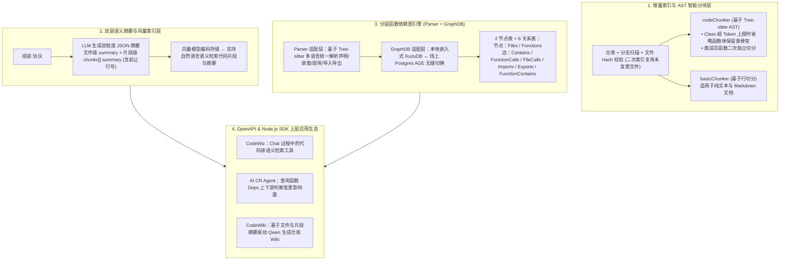

# Codeindex · 让大模型更好地理解你的代码

## 1. TL;DR

1. **核心定位与双形态供给**：针对大型多分支代码仓库无法全量塞入大模型上下文及缺乏调用链感知的痛点，**Codeindex** 提供基于文件哈希比对的**增量代码语义索引、文件与代码片段双粒度语义摘要生成、以及跨语言函数上下游依赖图（Deps）构建**能力，同时提供本地 **Node.js SDK** 与远端 **OpenAPI** 两种接入形态。
2. **AST 感知语法切分（`codeChunker`）与双层摘要**：利用 **Tree-sitter** 生成 AST 按语法结构切分；当单个 `Class` 代码超出 Chunk Token 上限时，**自动省略内部函数体以保持 Class 整体骨架完整，并对内部成员函数做二次独立 Chunk 拆分**（纯文本与 Markdown 则走按行切分的 `basicChunker`）；随后通过 `<document path="..."><code start_line="..." end_line="...">` XML 协议让大模型一次性产出文件级与片段级结构化 JSON 摘要。
3. **分层函数依赖图与双图数据库适配（KuzuDB / Postgres AGE）**：上层 **Parser 适配层**基于 Tree-sitter 提取文件声明函数、嵌套函数、内部/外部调用关系；下层 **GraphDB 适配层**屏蔽本地嵌入式图数据库 **KuzuDB** 与线上 **Postgres AGE 插件**的存储差异，统一建模 **2 类节点表（`Files`、`Functions`）与 6 类关系表（`Contains`、`FunctionCalls`、`FileCalls`、`Imports`、`Exports`、`FunctionContains`）**。
4. **三大生产落地场景**：已赋能 **CodeWiz**（对话式代码库语义检索）、**AI CR Agent**（通过函数上下游依赖图判断代码变更影响面）与 **CodeWiki**（前置生成代码片段与全文语义摘要辅助 Qwen 大模型精准输出仓库 Wiki 文档结构）。

## 2. 问题定义与背景

### 2.1 大模型理解大型业务代码库的三大障碍

1. **仓库体量超出上下文窗口**：动辄数十万行的大型工程无法直接塞入 Prompt，单纯靠字面正则搜索难以召回语义相关的实现。
2. **多仓库多分支高频变动**：每次全量重建向量索引耗时漫长且算力昂贵，必须支持基于文件 Hash 的增量更新与实时索引进度查询。
3. **缺失跨文件函数调用拓扑**：在智能代码审查（AI CR）等场景中，仅看当前 Diff 文件无法获知修改某个函数是否会破坏上游调用方或依赖的下游函数。

## 3. 知识框架

## 4. 核心内容拆解

### 4.1 基于 Tree-sitter 的 `codeChunker` 与双层语义摘要生成

1. **如何避免大类（Large Class）切分丢失结构上下文？**
   - `codeChunker` 使用 **Tree-sitter** 将源码解析为抽象语法树（AST）：当遇到一个体积庞大的 `Class` 超过预设 Chunk Token 上限时，不会粗暴地从中间截断类定义，而是**先将内部函数体省略以生成一个完整保留类签名与成員结构的骨架 Chunk，再对 Class 内部的各个函数成员单独执行二次 Chunk 拆分**。
   - 对于非代码的纯文本与 Markdown 文件，则交由轻量级的 `basicChunker` 按行与 Token 上限切分。
2. **XML 批次封装与双层 JSON 摘要输出**：
   - 将同一文件内拆分出的多个代码片段封装为 `<document path="lib/utils.js"><code start_line="0" end_line="2">...</code></document>` 格式发送给大模型；
   - 大模型一次性返回包含**文件维度总摘要（`summary`、`path`）**与**代码片段级摘要数组（`chunks: [{ start_line, end_line, summary }]`）**的 JSON 结构，结合文本向量模型建立语义索引，并支持长耗时任务下的**实时索引进度查询**。

### 4.2 函数依赖图（Function Dependency Graph）的双层解耦与图存储模型

为同时支撑本地 CLI/SDK 轻量运行与云端 OpenAPI 高并发服务，函数依赖图模块采用“**Parser 适配层 + GraphDB 适配层**”架构：
1. **Parser 适配层**：通过扩展多语言 Tree-sitter 规则，统一提取 4 类核心语法事实——文件声明了哪些函数、函数内部是否包含嵌套声明函数、函数内部调用了哪些函数、被调函数源自内部声明还是外部文件 `import`。
2. **GraphDB 适配层（KuzuDB 与 Postgres AGE 同构表设计）**：
   - 本地 SDK 采用嵌入式图数据库 **KuzuDB**，云端服务采用 **Postgres（搭载 AGE 图扩展插件）**；
   - 两者共享完全一致的 **2 张节点表 + 6 张关系边表**：

| 表类型 | 表名称 | 起点 $\rightarrow$ 终点 | 核心语义说明 |
| :--- | :--- | :--- | :--- |
| **节点表** | `Files` | — | 存储代码库中每个文件的基本元数据 |
| **节点表** | `Functions` | — | 存储代码中定义的每个函数实体信息 |
| **关系表** | `Contains` | `Files -> Functions` | 文件包含顶层声明函数的关系 |
| **关系表** | `FunctionCalls` | `Functions -> Functions` | 函数与函数之间的直接调用关系 |
| **关系表** | `FileCalls` | `Files -> Functions` | 文件顶层作用域直接调用某函数的关系 |
| **关系表** | `Imports` | `Files -> Files` | 文件与文件之间的导入依赖关系 |
| **关系表** | `Exports` | `Files -> Functions` | 文件对外导出特定函数的关系 |
| **关系表** | `FunctionContains` | `Functions -> Functions` | 函数内部定义子函数（嵌套函数）的包含关系 |

## 5. 数据速查表

| 模块 / 维度 | 具体技术选型 / 数量 | 工程作用 |
| :--- | :--- | :--- |
| **服务交付形态** | **Node.js SDK + OpenAPI**（基于 SDK 封装） | 支持本地轻量嵌入与云端托管按仓库/分支增量建索引 |
| **AST 解析与分块器** | **Tree-sitter (`codeChunker`)** + `basicChunker` | 大类自动省略函数体保骨架 + 成员函数二次独立切分 |
| **图数据库双引擎** | 本地 **KuzuDB**（嵌入式）+ 线上 **Postgres AGE** | 通过 GraphDB 适配层无缝切换本地与云端图存储介质 |
| **图数据 Schema 规模** | **`2` 张节点表 + `6` 张关系表** | 完整刻画文件、顶层函数、嵌套函数与跨文件导入导出的多跳调用链 |
| **核心赋能应用** | **CodeWiz / AI CR Agent / CodeWiki (Qwen)** | 分别支撑对话式搜码、PR 变更上下游影响分析、自动生成仓库 Wiki |

## 6. 踩坑与教训 / 可迁移的设计原则

1. **切分面向对象代码时必须采取“类骨架保留 + 成员方法二次拆分”**：如果按固定行数生切大型 Class，后面的成员方法 Chunk 会完全丢失所属类名与成员变量上下文；用 Tree-sitter 先抽空方法体保留完整 Class 签名，再单独索引各个方法，能大幅提升大模型对类职责的理解。
2. **用“嵌入式 KuzuDB + 服务端 Postgres AGE”统一适配层兼顾本地 SDK 与云端服务**：代码图谱工具既需要在开发者本机零配置运行（KuzuDB 免独立服务进程），又需要在云端平台集中服务（Postgres AGE 易运维），在适配层统一 2 节点 6 边的图模型即可一套逻辑两端运行。

## 7. 记忆锚点

- **六大核心 API 能力**：建立增量索引（基于文件 Hash）、查询索引进度、语义化检索、查询文件摘要、查询函数声明、查询函数上下游 `Deps`。
- **两类分块器**：`codeChunker`（Tree-sitter AST，大类省函数体保骨架 + 成员二次拆分）+ `basicChunker`（纯文本/Markdown 按行拆分）。
- **两节点六关系图模型**：`Files` & `Functions`；`Contains`、`FunctionCalls`、`FileCalls`、`Imports`、`Exports`、`FunctionContains`（底层 `KuzuDB` / `Postgres AGE`）。
- **三大落地应用**：`CodeWiz`（检索）+ `AI CR Agent`（依赖影响分析）+ `CodeWiki`（基于双层摘要与 Qwen 生成文档）。

## 8. 复习卡片

1. Codeindex 是如何利用 Tree-sitter 的 `codeChunker` 处理超大 Class 代码分块的？::当 Class 内代码超出 Chunk Token 上限时，`codeChunker` 会先省略内部的函数体以保持 Class 整体结构骨架完整，然后再对 Class 内部的函数成员进行二次处理、单独拆分为独立的 Chunk。
2. Codeindex 在生成代码语义摘要时，向大模型发送什么格式的输入，并返回什么结构的输出？::输入采用 `<document path="..."><code start_line="..." end_line="...">...</code></document>` 的 XML 标签结构；输出为包含文件维度总摘要（`summary`、`path`）以及内部各个代码片段摘要（`start_line`、`end_line`、`summary`）的 JSON 数组。
3. Codeindex 的函数依赖图模块为什么采用“Parser 适配层 + GraphDB 适配层”架构？底层分别使用了什么图数据库？::Parser 适配层基于 Tree-sitter 统一屏蔽不同编程语言的语法差异；GraphDB 适配层屏蔽本地 SDK 与线上 OpenAPI 的存储差异，本地采用嵌入式图数据库 KuzuDB，线上采用 Postgres 的 AGE 图插件。
4. Codeindex 在图数据库中定义了哪 2 张节点表和哪 6 张关系表来表达完整的代码依赖？::节点表为 `Files`（文件）和 `Functions`（函数）；关系表为 `Contains`（文件包含函数）、`FunctionCalls`（函数调用函数）、`FileCalls`（文件直接调用函数）、`Imports`（文件导入文件）、`Exports`（文件导出函数）和 `FunctionContains`（函数内部定义嵌套函数）。
5. Codeindex 是如何分别赋能 CodeWiz、AI CR Agent 和 CodeWiki 三个应用场景的？::为 CodeWiz 提供对话过程中的代码片段语义检索；为 AI CR Agent 提供被修改函数的上下游依赖（Deps）信息以评估变更是否破坏存量功能；为 CodeWiki 前置提供文件路径、代码片段与全文语义摘要，辅助 Qwen 大模型生成准确的仓库 Wiki 结构。

## 9. 知识关联

- **所属主题**：
  - [检索与文档解析](../../20_topics/检索与文档解析.md)
  - [AI研发协同](../../20_topics/AI研发协同.md)
  - [决策知识结构化](../../20_topics/决策知识结构化.md)
- **本地跃迁**：[原始 PDF](RAW.pdf) · [逐页转写文本](MD.md)
- **候选双链**：[[Spec+RAG打造懂业务AI程序员]] · [[AI答疑助手LightRAG升级]] · [[AIGUI流式输出与渲染实践]] · [[天猫新品AI编码实战指南下]]

## 10. 原文参考资料

1. **核心解析与图存储引擎**：Tree-sitter（增量 AST 解析器）、KuzuDB（嵌入式图数据库）、PostgreSQL + Apache AGE（图数据库扩展插件）
2. **内部上层应用**：CodeWiz、AI CR Agent、CodeWiki（基于 Qwen 大模型）

> [!note]- 校对报告
> - **页码溯源**：p.1–2（大型代码仓库上下文与依赖理解三大痛点、Codeindex 六大核心能力、Node.js SDK 与 OpenAPI 架构）；p.3–4（`codeChunker` Tree-sitter AST 大类省略函数体保骨架与成员二次拆分、`basicChunker`、`<document><code start_line end_line>` 输入与文件+片段双层 JSON 摘要输出）；p.4–6（Parser 适配层 + GraphDB 适配层、KuzuDB 与 Postgres AGE、2 张节点表 `Files`/`Functions` 与 6 张关系表 `Contains`/`FunctionCalls`/`FileCalls`/`Imports`/`Exports`/`FunctionContains`）；p.6–7（CodeWiz、AI CR Agent、CodeWiki 三大应用落地与总结）。
> - **一致性核验**：作者（崇野，淘天集团-跨端技术团队）、发布时间（2026-04-20）、所有表名、标签格式与架构组件均与原文逐字核对一致；正文中无任何内联页码引用。
> - **质量边界**：全文短小精悍（8 页），全部代码示例与图数据库表结构均完整收录。
