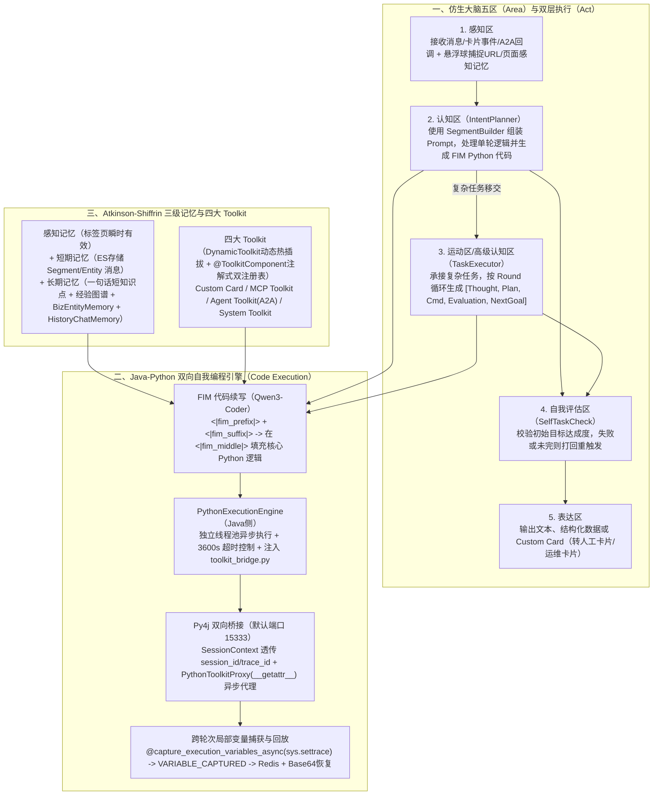

# 从代码生成到自主决策：打造一个Coding驱动的“自我编程”Agent

## 1. TL;DR

1. **核心痛点**：在重度工具调用的内部 DevOps 场景中，Agent 1.0/2.0 采用传统的“LLM 返回 JSON + 固定文本前缀”模式陷入“提成功率就慢、提速度就丢灵活性”的死循环，且一旦首节点走错便“一条路走到黑”无法自纠；同时前两版缺乏结构化设计导致出现 **900 多行**杂乱无章的巨型 Prompt。
2. **核心范式创新（Code-as-Action + FIM 续写）**：受 GitHub Copilot Agent 启发，将每个工具箱（Toolkit）映射为 Python `Class`、工具映射为成员函数，让大模型基于 **FIM（Fill-in-the-Middle，`<|fim_prefix|> ... <|fim_suffix|> ... <|fim_middle|>`）** 格式直接编写包含分支、循环、原生数值/字符串/时间运算与自我控制逻辑的 Python 代码来驱动 Agent。
3. **类脑五区架构与跨语言执行引擎**：将 Agent 划分为**感知区、认知区（`IntentPlanner` 单轮）、运动区（`TaskExecutor` 多轮复杂循环）、表达区、自我评估区（`SelfTaskCheck`）**五大功能区；底层通过 **Java `PythonExecutionEngine`（线程池+默认 3600s 超时） + `Py4j` 单例桥接（固定端口 `15333`） + `PythonToolkitProxy` 异步动态代理 + `sys.settrace` 局部变量捕获回放（存入 Redis + Base64 跨轮传递）** 实现 Java 与 Python 双向泛化调用。
4. **三级记忆与模型混部**：设计**环境感知记忆（标签页级瞬时捕捉）、短期记忆（ES 存储的 Session 级 `Segment`/`Entity` 消息）、长期记忆（短知识点 + 人工审核&大模型投票经验图谱 + `BizEntityMemory` + `HistoryChatMemory`）**；配合 `Qwen3-Turbo`（翻译/提取）与 `Qwen3-Coder`（思考/代码生成）混部，本次迭代中 **50%–60%** 无修改代码（《代码驱动》模块近 **80%**）由 AI 编写。

## 2. 问题定义与背景

### 2.1 传统 JSON 工具调用（Agent 1.0 / 2.0）的四大死结

在构建面向阿里内部 DevOps 平台的“1.5 线”AI 研发助手（目标具备 1–3 年初级程序员排障与操作能力）过程中，早期基于 `JSON + 固定文本前缀` 的工具调用暴露出四大瓶颈：
1. **格式与内容质量背离**：强约束 JSON 格式虽能解析，但内部参数质量与复杂推理能力下降；JSON 格式自身在长输出下也偶发破损。
2. **Token 膨胀与性能劣化**：多轮频繁调用 MCP 与子 Agent 导致上下文急剧膨胀。
3. **缺乏原生控制流与纠错能力**：传统 JSON 每次只能呆板指定“下一个工具”，一旦起始节点选错便一条路走到黑；而 Python 代码天然具备 `if/else` 分支、`for/while` 循环及原生字符串/数字/时间确定性计算。
4. **900+ 行巨型 Prompt 腐化**：前两版未对 Prompt 与 Context 做模块化设计，演变成一个 **900 多行**难以维护的超级大 Prompt。

## 3. 知识框架

## 4. 核心内容拆解

### 4.1 仿生五区架构（Area）与 Segment 上下文工程

1. **五大功能区（Area）职责切分**：
   - **感知区**：接收用户消息、卡片点击事件、子 Agent 异步返回，并完成主语言解析、模糊化解析、场景分析、问题增强、页面环境与附件解析。
   - **认知区（`IntentPlanner`）**：通过 `SegmentBuilder`（模板模式 + Builder 模式，彻底重构早期的 900 行巨型 Prompt）路由至 `ThoughtPromptBuilder`、`CmdPromptBuilder` 等，仅执行**一轮逻辑**；若判断为复杂多步任务，则移交运动区。
   - **运动区 / 高级认知区（`TaskExecutor`）**：发起多轮内部循环，每轮生成独立的 `Round N Segments: [User, Context, ThoughtN, PlanN, CmdN, EvaluationN, NextGoalN]`，逐轮评估进度并动态制定下一轮子目标（或判断无法完成时主动放弃）。
   - **自我评估区（`SelfTaskCheck`）**：在 `IntentPlanner` 或 `TaskExecutor` 结束时校验初始目标是否真正达成，未达成则重新触发回来源区。
   - **表达区**：区分纯文本（少总结）、数据问答（依据历史 Segment 回答）与复杂表单/运维操作（直接下发 **Custom Card**，如转人工卡片、运维卡片）。
2. **基于 FIM（Fill-in-the-Middle）的代码生成约束**：
   - 引用 OpenAI FIM 论文（`arXiv:2207.14255`），在 Prompt 中给定包含函数定义与前置上下文的 `<|fim_prefix|>` 以及包含返回值与异常处理的 `<|fim_suffix|>`，强制模型仅在 `<|fim_middle|>` 处续写连接前后文的 Python 业务逻辑。
   - 工具箱在 System Prompt 中直接以 **Python `class` 签名 + Docstring** 呈现（如 `class example_toolkit:`、`class normandy_toolkit:`），贴合代码大模型的预训练分布。

### 4.2 Java-Python 双向执行引擎与跨轮变量持久化

1. **Java 侧 `PythonExecutionEngine` 与 `PythonScriptExecutor`**：
   - 采用“线程池 + 异步执行 + `ExecutionMonitor` 监控”架构，每个脚本分配独立 `execId` 与隔离上下文，默认设置 **3,600 秒**超时防止死循环，并预留禁止非法 `import` 或 `os` 文件系统篡改的安全扫描接口。
2. **Python 侧 `Toolkit Bridge` 与 `Py4j` 泛化回调**：
   - 全局维护单例 `Py4j Gateway Server`（固定端口 **`15333`**，支持连接池自动重试）；
   - 执行前将 `session_id`、`trace_id` 注入 `SessionContext`；
   - 通过 `PythonToolkitProxy` 重写 `__getattr__` 返回异步闭包 `async_operation_method`，使 LLM 生成的 Python 代码能直接用 `result = await example_toolkit.get_project_info(project_id="123")` 无缝回调 Java 端的 `ToolkitMapper` 与 `AgentToolkitManager`。
3. **基于 `sys.settrace` 的跨轮次局部变量捕获与 Redis/Base64 回放**：
   - 为解决“第二轮对话生成的 Python 代码如何直接引用第一轮算出的临时变量 `a = 1`”这一难题，设计了 `@capture_execution_variables_async()` 装饰器：
   - 利用 `sys.settrace(tracer)` 监听函数 `return` 事件，抓取 `frame.f_locals` 中所有非下划线开头的局部变量，校验 JSON 可序列化后打印 `VARIABLE_CAPTURED:{key}={json}`；
   - Java 端解析捕获到的变量并存入 **Redis**；下一轮执行前从 Redis 取出并通过 **Base64 编码**传回 Python 内存恢复，实现跨轮次代码的无缝状态续接。

### 4.3 三级记忆体系（Atkinson-Shiffrin 模型落地）

1. **环境感知记忆（标签页维度，瞬时有效）**：
   - 通过前端悬浮球实时捕捉用户当前所在页面 DOM 与 URL；一旦用户切换抽屉或弹窗即自然失效。在答疑场景下相当于给 Agent 装上“眼睛”，免去用户手打“我在哪个页面报错”的交代成本。
2. **短期记忆（会话维度，基于 Elasticsearch 实现）**：
   - 继承统一基类 `ShortTerm3MemoryMessage`（含 `uuid`、`sessionId`、`tags`、`timestamp`、`sortValue`），派生出 **`SegmentMemoryMessage`**（记录 `InferenceSegment`、`execId` 及支持执行链追溯的 `parentExecId`）与 **`Entity3MemoryMessage`**（记录工具调用结果与环境快照）。
3. **长期记忆（跨会话持久化，向量库 + 知识图谱演进）**：
   - **一句话短知识点 vs 文档知识库**：将不够格写成重文档但至关重要的领域概念沉淀为“短知识点”直接拼入思考 Prompt（例如：“**重新部署是流水线的概念，重启是诺曼底的运维概念**”）。
   - **代码执行经验闭环（`收集 -> 加工 -> 存储 -> 检索`）**：每轮执行细节经“人工审核 + 大模型投票”后存入经验图谱，下次生成代码前检索相似案例拼入 Prompt。
   - **业务实体记忆（`BizEntityMemory`）与历史会话记忆（`HistoryChatMemory`）**：按 `userId` 过滤并对 `keys` 做全文+向量融合检索。

### 4.4 双轨工具注册表（动态热插拔 + 声明式注解）

为兼顾灵活性与工程规范，设计了两套互不干扰的并行注册体系，由 `ToolkitMapper` 统一屏蔽差异：
- **接口驱动动态注册（`DynamicToolkitRegistry`）**：实现 `DynamicToolkit` 接口（自描述 `getMethodPython()`、`getMethods()` 等），支持运行时动态热插拔（如动态挂载 MCP Server 或 A2A 子 Agent）。
- **注解式声明注册（`AnnotationToolkitRegistry`）**：使用 `@ToolkitComponent(python = "system_toolkit")` 与 `@ToolkitOperation(python = "send_message")` 声明固定系统工具，享受编译期检查与 Spring Bean 无缝集成。

## 5. 数据速查表

| 指标 / 组件 | 原文数值 / 设定 | 语境 / 条件 |
| --- | --- | --- |
| 早期未模块化 Prompt 膨胀规模 | **900 多行** | Agent 1.0/2.0 缺乏结构化组装导致的巨型杂乱 Prompt |
| 本次迭代 AI 自身编写代码占比 | **整体 50%–60% 无修改代码由 AI 编写（《代码驱动》环节近 80%）** | 团队狗粮自用 AI 辅助研发 |
| 混合模型部署策略 | **`Qwen3-Turbo`（翻译/提取）+ `Qwen3-Coder`（思考/生码）+ `Qwen/DeepSeek`（通用）** | 基于 Spring Boot + Spring AI Alibaba 接入 |
| Python 脚本默认执行超时时间 | **3,600 秒** | `PythonExecutionEngine` 线程池异步防死循环保护 |
| Py4j 单例 Gateway 默认端口 | **`15333` 端口** | Java 与 Python 双向通信固定桥接端口 |
| Agent 目标能力定位 | **“1.5 线”答疑与运维助手** | 对标具备 1–3 年经验的初级程序员排障与操作能力 |

## 6. 踩坑与教训 / 可迁移的设计原则

| 错误做法 | 失败表现或原因 | 原文应对（可迁移的设计原则） |
| --- | --- | --- |
| **在重工具调用的复杂逻辑中死磕 JSON 格式返回** | JSON 每次只能调单步、缺乏分支循环与原生计算，一旦首步走错便一条路走到黑 | **用 Python 代码生成（Code-as-Action）+ FIM 续写替代 JSON**：把 Toolkit 暴露为 Python Class，让模型写代码完成条件分支、循环与确定性运算 |
| **将角色、规则、记忆、工具塞进同一个 900 行的字符串模板** | 局部修改牵一发而动全身，Bad Case 调优时极易顾此失彼 | **先用 Mock 跑通粗粒度 Prompt，再用模板模式 + Builder 模式拆分为 `SegmentBuilder`**：按 `Segment` 动态按需拼装 |
| **Python 脚本执行中混用位置参数与命名参数，且跨轮次丢失临时变量** | 跨语言泛化调用频繁报参数错位异常，多轮对话无法复用上一轮算出的中间变量 | **统一规范为命名参数 + `@capture_execution_variables_async`（`sys.settrace`）**：捕获 `f_locals` 存入 Redis 并经 Base64 在下一轮自动回放 |
| **把一句简单的业务概念区分硬塞进重型 RAG 文档库** | 向量检索容易漏召回，导致 Agent 混淆相似运维动作（如“重新部署”与“重启”） | **区分“文档知识库”与“一句话短知识点”**：将核心概念边界直接作为短知识点注入思考 Prompt |

## 7. 记忆锚点

1. **自我编程核心链路**：“**Toolkit 变 Python 类 $\to$ FIM 填中间代码 $\to$ Py4j(`15333`)异步回调 Java $\to$ `settrace` 抓变量存 Redis 跨轮回放**”。
2. **类脑五区口诀**：“**感知收事件，认知跑单轮（`IntentPlanner`），运动跑多轮（`TaskExecutor`），自评做验收（`SelfTaskCheck`），表达发卡片**”。

## 8. 复习卡片

1. 为什么在重度工具调用的 DevOps 场景下，作者团队从 Agent 1.0/2.0 的“返回 JSON 调用工具”转向了“生成 Python 代码（自我编程）”？::因为 JSON 调用在速度、灵活性与成功率之间陷入死循环，且缺乏原生分支/循环控制流，一旦首节点走错就一条路走到黑；而生成 Python 代码不仅能利用原生字符串/数值/时间运算保证确定性，还能在单次执行中编写复杂控制流与自我评估逻辑。
2. 该 Agent 如何使用 FIM（Fill-in-the-Middle）机制约束大模型生成安全的执行代码？::在 Prompt 中预先给定包含函数定义与前置上下文变量恢复的 `<|fim_prefix|>`，以及包含返回值封装与异常处理的 `<|fim_suffix|>`，强制 `Qwen3-Coder` 仅在 `<|fim_middle|>` 处续写核心连接逻辑，严禁篡改前后缀。
3. 类脑五区架构中的“认知区（`IntentPlanner`）”与“运动区（`TaskExecutor`）”是如何分工协作的？::认知区的 `IntentPlanner` 仅负责处理单轮简单逻辑；当识别到复杂任务时将其移交给运动区的 `TaskExecutor`，由运动区开启多轮循环，每轮生成 `[Thought, Plan, Cmd, Evaluation, NextGoal]` 段落并评估进度，完成后再交由自我评估区 `SelfTaskCheck` 终审。
4. Java 后端与 Python 脚本之间是如何通过 `Py4j` 实现透明的异步工具调用的？::Java 启动固定在 `15333` 端口的单例 `Py4j Gateway Server` 并在执行前将 `session_id/trace_id` 写入 `SessionContext`；Python 侧通过 `PythonToolkitProxy` 重写 `__getattr__` 拦截方法调用并转发给 `call_toolkit_async`，使 Python 代码能像调用本地异步方法一样回调 Java 的 `ToolkitMapper`。
5. 第二轮对话生成的 Python 代码是如何直接访问第一轮 Python 脚本执行时产生的局部变量（如 `a = 1`）的？::通过 `@capture_execution_variables_async` 装饰器挂载 `sys.settrace`，在函数 `return` 事件时抓取 `frame.f_locals` 中的可序列化局部变量并输出 `VARIABLE_CAPTURED` 标记；Java 解析后存入 Redis，下一轮执行前从 Redis 取出并通过 Base64 编码注入 Python 内存还原。
6. 长期记忆中的“短知识点”与传统“文档知识库”有什么区别？请举文中实例说明。::当某个业务概念写成独立文档太重、但又必须在思考阶段明确指引 Agent 时，采用一句话“短知识点”直接注入 Prompt；例如“重新部署是流水线的概念，重启是诺曼底的运维概念”。
7. 系统为什么同时设计了 `DynamicToolkit`（接口式）与 `@ToolkitComponent`（注解式）两套工具包注册机制？::接口式 `DynamicToolkit` 支持运行时动态注册、卸载与元数据自描述，适合需要热插拔的外部 MCP 服务与 A2A 子 Agent；注解式 `@ToolkitComponent` 支持编译期检查并与 Spring Bean 无缝集成，适合结构固定的系统内置工具包。

## 9. 知识关联

- **本库主题关联**：
  - [Agent工程循环](../../20_topics/Agent工程循环.md)：构建仿生五区（感知/认知/运动/自评/表达）与 Java-Python（Py4j + `sys.settrace` + Redis）双向自我编程执行引擎。
  - [Prompt优化](../../20_topics/Prompt优化.md)：用 `SegmentBuilder` 模块化组装重构 900 行巨型 Prompt，并引入 FIM（`<|fim_middle|>`）格式约束代码续写。
  - [Skill设计与治理](../../20_topics/Skill设计与治理.md)：将 MCP Server、A2A 子 Agent 与系统工具统一抽象为 Python Class 签名，并设计动态接口 + 声明式注解双注册表。
- **候选双链**：`[[CodeAsAction]]`、`[[FIM代码续写]]`、`[[Py4j桥接]]`、`[[分层记忆系统]]`、`[[DevOps智能体]]`

## 10. 原文参考资料

- **原文标题**：《从代码生成到自主决策：打造一个Coding驱动的“自我编程”Agent》
- **发布渠道与日期**：微信公众号「大淘宝技术」，2025-12-22
- **作者与团队**：残风（淘天集团）
- **原文引用论文**：
  - Bavarian et al. (OpenAI), *《Efficient Training of Language Models to Fill in the Middle》*: `https://arxiv.org/abs/2207.14255`
  - Zhao et al., *《ExpeL: LLM Agents Are Experiential Learners》*
  - Xiong et al., *《How Memory Management Impacts LLM Agents: An Empirical Study of Experience-Following Behavior》*
  - *《Get Experience from Practice: LLM Agents with Record & Replay》*

> [!note]- 校对报告
> - **页码溯源汇总**：
>   - 前言、系统架构（Spring Boot + Spring AI Alibaba、`Qwen3-Turbo`/`Qwen3-Coder` 混部、Py4j、MCP、A2A）与自我编程核心理念（50%–60% 乃至 80% 代码由 AI 编写）：`p.1–4`
>   - 仿生大脑五区架构（感知区、认知区 `IntentPlanner`、运动区 `TaskExecutor`、表达区、自我评估区 `SelfTaskCheck`）：`p.5–11`
>   - Context Engineering（`SegmentBuilder`、FIM `<|fim_prefix|>/<|fim_suffix|>/<|fim_middle|>` 格式与 System/User Prompt 示例）：`p.11–17`
>   - Atkinson-Shiffrin 三级记忆（标签页感知记忆、ES 短期记忆 `SegmentMemoryMessage`/`Entity3MemoryMessage`、长期记忆短知识点/经验图谱/`BizEntityMemory`/`HistoryChatMemory`）：`p.18–24`
>   - 代码驱动引擎（`PythonExecutionEngine` 3,600s 超时、`Py4j` `15333` 端口、`PythonToolkitProxy`、`@capture_execution_variables_async` `sys.settrace` + Redis + Base64 回放）：`p.24–30`
>   - 四大 Toolkit（Custom Card/MCP/Agent A2A/System）、双注册表（`DynamicToolkit` + `@ToolkitComponent`）与三点工程反思（告别 900 行巨型 Prompt）：`p.30–37`
> - **关键数值一致性核查**：
>   - AI 编写代码占比 `50-60%`（代码驱动环节 `80%`）、超时时间 `3600秒`、Py4j 端口 `15333`、早期巨型 Prompt `900多行`、定位 `1.5线`（1–3 年初级程序员）均与原文逐字核对一致。
> - **图像与版面质量说明**：
>   - `p.1–3, 5–6, 8, 10–12, 20, 22–24, 30–31, 34` 含架构图与流程图（位于 PDF 图像层，其中 `p.10` 为纯图像页），`p.15–16, 28–29` 部分代码长行右侧有轻微截断，全部核心源码与架构设计均已在正文完整还原。
