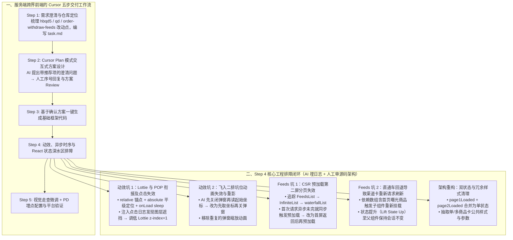

# 【AI Coding】借助cursor实现业务需求全栈交付实践

## 1. TL;DR

1. **核心背景**：服务端研发人员借助 **Cursor（Plan 模式 + Agent 生码）** 跨界独立完成淘宝“红包签到页—单品返子玩法”前端需求的全栈交付，涉及 `hbqd5`（老版主页）、`qd`（新版主页）、`order-withdraw-feeds`（子玩法）三个前端工程。
2. **五步标准全栈工作流**：「**Step 1 需求澄清与跨仓修改范围拆解（编写 `task.md`）$\to$ Step 2 Cursor Plan 模式生成执行计划并多轮问答确认 Review（输出 `solution.md`）$\to$ Step 3 按方案一键生成基础框架 $\to$ Step 4 自测调优样式/动效/异步时序与状态 Bug $\to$ Step 5 视觉验收与埋点验证**」。
3. **两大动效衔接实战排障**：① **Lottie 前置动画与 POP 弹窗过渡**——外层 `itemsPop` 设 `position: relative` 作锚点、动画设 `position: absolute` 平级定位，用动画回调 + `onLoad sleep` 控制显隐；排查点击 POP 无跳转时，通过让 AI 注入控制台日志发现 Lottie 层遮挡，将 Lottie `z-index` 设为 `1` 并调高 POP 组件层级解决；② **关闭弹窗缩放飞入二排坑位**——修复 AI“先销毁关闭弹窗再读取 DOM 起始坐标导致坐标丢失”及“弹窗缩放与飞入动画重复叠加”两个典型时序 Bug。
4. **三大 Feeds 插卡与去重深水区排障**：① **CSR 预加载失效**——深入 `FeedsList -> InfiniteList -> waterfallList` 源码发现 CSR 预发环境下首次请求与预加载同步触发而接口异步返回导致预加载失败，改为等首次请求结束后再触发预加载；② **直通车回退导致插卡重刷**——因依赖数组包含首页曝光商品列表导致子组件重挂载丢失状态，通过**将渠道卡片 Feeds 状态与数据状态提升（Lift State Up）至父组件**保持会话稳定；③ **状态与组件收敛**——将冗余的 `page1Loaded + page2Loaded` 双状态简化为单状态，并将按 `bizType` 硬写多套 CSS 的单/多商品卡抽象为可复用公共组件。

## 2. 问题定义与背景

### 2.1 业务需求与跨仓库改造边界

本次需求旨在强化红包签到首页对“单品返子玩法”的引导，服务端同学需跨三个前端仓库完成交付：

| 改造模块 | 涉及前端仓库 | 核心功能与技术要求 |
|---|---|---|
| **1. 首页单品返商品 POP 弹窗** | `hbqd5`（仅老版本主页） | 回调服务端记录疲劳度；播放前置 Lottie 动画并在动画结束位置无缝衔接 POP 弹窗顶部；点击或关闭时缩放飞入二排单品返坑位 |
| **2. 首页 Feeds 单品返商品插卡** | `hbqd5`（老版）、`qd`（新版）、`order-withdraw-feeds` | 复用首页渠道插卡能力，同时支持**单商品卡片**与**多商品卡片**两种视觉样式 |
| **3. 首页 Feeds 与渠道插卡双向去重** | `hbqd5`、`qd`、`order-withdraw-feeds` | 服务端执行去重，但前端请求首页 Feeds 时须携带渠道卡已曝光商品，请求渠道卡时须携带首页 Feeds 已曝光商品 |

## 3. 知识框架

## 4. 核心内容拆解

### 4.1 Plan 模式先行：用 `task.md` 与选择题交互对齐方案

1. **编写结构化 `task.md`**：在对前端工程结构陌生时，先结合 PRD 与设计稿提炼改动点，并让 Cursor 辅助总结 `hbqd5`、`qd`、`order-withdraw-feeds` 三仓代码结构。
2. **Cursor Plan 模式的“带推荐项问答”**：引用 `task.md` 启动 Plan 模式后，Cursor 会针对不确定的技术细节主动列出待确认问题，并为每个问题预设选项及推荐答案（开发者只需按序号回复或补充说明），经多轮 Review 无误后再进入 Step 3 生码，避免一上来就盲目写错大方向。

### 4.2 弹窗动效实现与两类典型 UI 时序排障

1. **Lottie 前置动画与静态 POP 弹窗的无缝衔接**：
   - **视觉定位**：最外层容器 `itemsPop` 设置 `position: relative` 提供定位锚点；Lottie 动画组件与 POP 主体平级，动画设置 `position: absolute` 使其结束帧刚好对齐 POP 弹窗顶部。
   - **显隐过渡**：通过 Lottie 动画组件回调配合 `onLoad` 中的 `sleep` 延时，在动画播放完成瞬间将 POP 弹窗置为可见。
   - **点击无跳转排障（日志驱动调试法）**：动效跑通后发现点击 POP 无法跳转。让 Cursor 在点击链路各节点注入 `console.log` 日志，观察控制台输出确认点击事件被拦截——原来是平级绝对定位的 Lottie 容器透明遮挡了 POP；将 Lottie 的 `z-index` 设为 `1` 并调高 POP 交互组件的 `z-index` 后立即恢复。
2. **关闭弹窗“缩放飞入二排坑位”的 AI 逻辑 Bug**：
   - **Bug 1（坐标获取时序反了）**：AI 初版代码**先执行了关闭弹窗（DOM 卸载/隐藏），再去获取飞入动画的起始坐标**，导致拿不到起始位置、动画不生效。
   - **Bug 2（双重动画叠加）**：AI 同时写了弹窗自带缩放关闭与飞入二排两段冲突动画。通过让 AI 修正为“先读取起始与目标坑位坐标 $\to$ 触发复用飞入动画组件 $\to$ 结束销毁”解决。

### 4.3 Feeds 双向去重与 React 状态管理深水区排障

1. **CSR 链路下第二屏分页预加载失效（AI 罢工后的人工源码级突破）**：
   - **异常现象**：签到首页配置了请求第一屏分页时自动预加载第二屏分页，但在预发环境（CSR 客户端渲染链路）下，必须等用户手动滑完第二屏分页才会加载单品返现插卡（而 SSR 链路下正常）。
   - **排查过程**：让 Cursor 反复修改状态判断仅修好了重复请求，未能解决预加载失效甚至陷入死循环。作者亲自顺着组件树向下深挖源码：`FeedsList` $\to$ `hudong-common-feeds` 中的 `InfiniteList` $\to$ `coinhub-react-infinite-list` 中的 `waterfallList`，再结合 Cursor 分析初始化逻辑，最终定位根因：**组件初始化时“首次请求”与“预加载请求”是同步连续触发的，但底层 Feeds 接口是异步返回的；在 CSR 预发环境接口耗时较长时，预加载触发时首屏尚未返回导致预加载失效**。改为**等待首次请求异步完成回调后再触发预加载**即彻底修复。
2. **直通车点击回退导致渠道插卡商品被刷新**：
   - **根因**：单品返渠道插卡作为主页 Feeds 的子组件，原本只需在会话内请求一次；但由于双向去重要求其依赖数组（dependency array）包含“首页已曝光商品列表”，当用户点击排在渠道卡前面的商品进入直通车再回退时，曝光商品列表变化导致子组件卸载重挂载、状态丢失重发请求。
   - **解法**：**将渠道卡片的 Feeds 请求状态与缓存数据提升（Lift State Up）到父组件中维护**，并遵循“请求失败只清标识允许重试、不清空已有数据；仅收到 `updateFeedsData` 事件才清空数据”的原则。
3. **用服务端工程经验反哺前端代码重构**：
   - **状态化简**：Cursor 为处理主 Feeds 与渠道卡的去重时序，最初冗余定义了 `page1Loaded` 和 `page2Loaded` 两个布尔状态；人工审阅触发时机后指导 AI 合并为单个状态（中间一度改出 Bug 紧急回撤，微调后跑通）。
   - **样式与组件抽离**：AI 初版按不同 `bizType` 硬写了多套重复 CSS 渲染单品卡与多品卡；作者运用服务端模块化思维，指令 Cursor 抽离公共样式文件与通用参数配置，显著提升可维护性。

## 5. 数据速查表

| 维度 / 阶段 | 原文涉及工程与组件 | 关键问题与技术设定 |
|---|---|---|
| **改造涉及的 3 个前端仓库** | `hbqd5`（老版主页）、`qd`（新版主页）、`order-withdraw-feeds`（子玩法） | POP 弹窗仅在老版主页；Feeds 插卡与双向去重覆盖新老版本 |
| **Lottie 与 POP 定位层级** | 外层 `itemsPop`: `position: relative` Lottie 动画: `position: absolute`, `z-index: 1` | 调高 POP 内部组件 `z-index` 防止透明动画层拦截点击事件 |
| **Feeds 组件三层调用链** | `FeedsList` $\to$ `hudong-common-feeds/InfiniteList` $\to$ `coinhub-react-infinite-list/waterfallList` | 定位 CSR 预发环境下同步触发预加载而异步接口未返回导致的失效 Bug |
| **React 状态与组件优化** | ① 渠道卡数据状态提升至父组件； ② `page1Loaded + page2Loaded` 合并为单状态； ③ 抽离单/多商品卡公共 CSS | 解决直通车回退重刷问题，消除 AI 面条式重复样式代码 |

## 6. 踩坑与教训 / 可迁移的设计原则

| 错误做法 | 失败表现或原因 | 原文应对（可迁移的设计原则） |
|---|---|---|
| **拿到需求直接让 AI 写代码，跳过方案对齐** | 跨多个仓库和老代码库时，AI 对未明确边界做错误假设，返工巨大 | **Step 1 写 `task.md` + Step 2 用 Cursor Plan 模式做选择题式方案 Review**，确认后再生成基础框架 |
| **执行退场飞入动画时先卸载/隐藏弹窗再读 DOM 位置** | 弹窗隐藏后无法获取真实起始坐标，导致飞入动画静默失效 | 严格把控 UI 生命周期时序：**先读取起始与终点 DOM 坐标 $\to$ 播放飞入过渡动画 $\to$ 动画结束回调中销毁弹窗** |
| **遇到点击无响应或状态异常时只凭猜测让 AI 盲改** | AI 反复乱改样式或条件分支，越改越乱 | **日志驱动排障法**：描述问题让 AI 在关键分支注入 `console.log`，把浏览器控制台真实输出贴回给 AI 精准定位（如发现 `z-index` 遮挡） |
| **跨 npm 包的底层异步时序 Bug 完全指望 AI 自动修好** | 涉及 `FeedsList -> InfiniteList -> waterfallList` 多层封装与 CSR/SSR 差异时，AI 只会在表层打转甚至“罢工” | **人工下钻底层源码定位调用链 + 局部喂给 AI 确认**：找到“同步触发预加载 vs 异步接口返回”的根因后再指导修复 |
| **把子组件一次性数据请求状态放在受高频变动 props 影响的内部** | 首页曝光列表变动导致直通车回退时子组件重新挂载、插卡商品被刷新 | **状态提升（Lift State Up）**：将需跨回退保持的渠道卡请求状态与数据提升至父组件，并用服务端抽象经验指导 AI 合并冗余状态与公共 CSS |

## 7. 记忆锚点

- **全栈五步法**：「**`task.md` 定边界 $\to$ Plan 模式做选择 $\to$ 一键生框架 $\to$ 埋日志+提状态修深坑 $\to$ 视觉埋点双验收**」。
- **排障黄金心得**：「**表层交互失灵让 AI 加日志看控制台（查 `z-index` / 坐标时序）；底层组件罢工靠人顺源码树揪异步时序**」。

## 8. 复习卡片

服务端研发借助 Cursor 交付前端需求的标准五步流程是什么？::① 明确需求点与修改范围，编写 task.md；② 用 Cursor Plan 模式生成执行计划，通过预设选项问答迭代并 Review 方案；③ 按方案一键生成基础框架代码；④ 本地自测调优样式、动效与状态交互 Bug；⑤ 视觉走查验收与埋点平台验证。
在实现 Lottie 前置动画与 POP 弹窗无缝衔接时，如何解决定位对齐与点击无跳转两个问题？::外层 itemsPop 设 position: relative 作锚点，Lottie 动画与 POP 平级并设 position: absolute 对齐顶部，配合回调与 onLoad sleep 控制显隐；点击无跳转是因为 Lottie 层遮挡，通过让 AI 加点击日志定位后，将 Lottie 的 z-index 设为 1 并调高 POP 组件层级解决。
AI 在实现“关闭弹窗缩放飞入二排坑位”动画时犯了哪两个典型逻辑错误？::① 时序颠倒：先关闭了弹窗再去读取起始 DOM 位置，导致拿不到起始坐标动画失效；② 动画重复：同时触发了弹窗自身缩放与飞入二排两套动画。
为什么签到首页在 CSR 预发环境下会出现“第二屏分页预加载失效，必须滑完第二屏分页才出插卡”的问题？::顺着 FeedsList -> InfiniteList -> waterfallList 源码排查发现，组件初始化时首次请求与预加载是同步连续执行的，但 Feeds 接口是异步返回的；CSR 下受接口耗时影响导致预加载触发时首屏未返回而失败，改为等首次请求结束后再触发预加载即修复。
为什么从直通车详情页回退到首页时，单品返渠道插卡的商品会被重新请求刷新？如何解决？::因为渠道插卡作为子组件，其依赖数组包含了首页已曝光商品列表，点击前方商品回退时曝光列表变化导致子组件重新挂载、状态丢失；通过将渠道卡片的请求状态与数据提升（Lift State Up）到父组件中维护解决。
作者总结的“AI Coding 问题排查最实用心得”是什么？服务端经验在前端重构中起到了什么作用？::排障心得是“描述问题 → 让 AI 增加日志埋点 → 把控制台真实输出丢给 AI 分析”；服务端模块化与状态机经验可指导 AI 将冗余双状态（page1Loaded/page2Loaded）合并为单状态，并将按 bizType 复制的 CSS 抽取为可复用公共组件。

## 9. 知识关联

- **本库主题索引**：[AI研发协同](../../20_topics/AI研发协同.md)、[跨端开发与性能](../../20_topics/跨端开发与性能.md)
- **本库关联文章**：[AICoding前端实践复盘+26.3.18](../AICoding前端实践复盘+26.3.18/AI_AICoding前端实践复盘.md)、[淘宝跨端动效解决方案+26.4.15](../淘宝跨端动效解决方案+26.4.15/AI_淘宝跨端动效解决方案.md)
- **候选双链**：[[Cursor Plan模式]]、[[Lottie动效衔接]]、[[React状态提升]]、[[CSR与SSR预加载时序]]

## 10. 原文参考资料

- **原文信息**：《【AI Coding】借助cursor实现业务需求全栈交付实践》，作者：凌由（淘天集团-用户互动团队），发布日期：2026-02-06。
- **文内提及工具与组件包**：`Cursor`（Plan 模式）、`D2C` 插件、`Lottie`、`hudong-common-feeds`（`InfiniteList`）、`coinhub-react-infinite-list`（`waterfallList`）。

> [!note]- 校对报告
> - **页码溯源汇总**：
>   - `## 1. TL;DR` & `## 2. 问题定义与背景`：源自 p.1–5（红包签到单品返子玩法需求、POP 弹窗与单/多商品 Feeds 插卡、`hbqd5 / qd / order-withdraw-feeds` 三工程、`task.md` 与 Cursor Plan 模式交互 Review）。
>   - `## 4.2 弹窗动效实现与排障`：源自 p.6–12（Lottie 与 POP 衔接、`itemsPop` `position: relative` 与 `position: absolute`、`onLoad sleep`、先关弹窗再取坐标 Bug、飞入动画重复 Bug、注入点击日志排查 `z-index: 1` 遮挡）。
>   - `## 4.3 Feeds 插卡去重与状态优化`：源自 p.12–27（双向曝光去重、CSR vs SSR 预加载失效、`FeedsList -> InfiniteList -> waterfallList` 源码追踪、直通车回退重挂载与状态提升至父组件、`page1Loaded/page2Loaded` 双状态合并单状态及紧急撤回小插曲、按 `biztype` 抽取公共组件样式、视觉与埋点验收）。
> - **材料质量说明**：全文 29 页均含 IDE 截图或流程图，正文已将所有排障推理链条、CSS 属性与组件调用关系完整文字化还原；无独立长篇 Prompt/Skill 文件需拆分。
