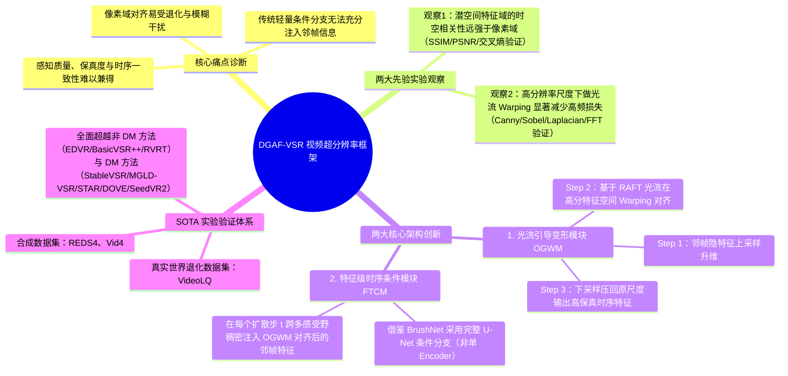
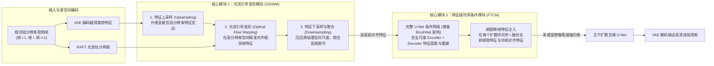

# CVPR 2026｜重思基于扩散模型的视频超分辨率：利用对齐特征的稠密引导 DGAF-VSR

> [!abstract] 导读
> **一句话总结**：淘天集团音视频技术团队联合高校在 CVPR 2026 发表的 **DGAF-VSR**，针对扩散式视频超分辨率（DM-based VSR）难以兼顾“感知画质、重建保真度与帧间时序一致性”的痛点，基于**“隐空间特征域相关性显著强于像素域”**与**“先上采样至最优高分辨率尺度再做光流 Warping 能大幅减轻高频细节损失”**两大实验发现，设计了**光流引导变形模块（OGWM）**与**特征级时序条件模块（FTCM，采用类 BrushNet 的完整 U-Net 稠密注入）**，在 REDS4、Vid4 与真实数据集 VideoLQ 上全面斩获感知指标（LPIPS/DISTS/MUSIQ）、保真度指标（PSNR/SSIM）及时序指标（tLPIPS/tOF）的 SOTA 表现。
> **阅读价值**：一针见血地指出了生成式视频超分中“低分辨率直接对齐丢高频、仅靠轻量 Encoder 注入条件约束力不足”两大结构缺陷，并给出了兼具数学直觉与实验支撑的特征域对齐与稠密引导范式。

## 1. TL;DR

- **核心突破定位**：CVPR 2026 录用论文（`arXiv:2511.16928`，代码已开源），重构了基于扩散模型的视频超分辨率（VSR）中相邻帧的**对齐（Alignment）**与**补偿引导（Compensation & Guidance）**机制。
- **两大基石实验洞察**：
  1. **观察一（载体选择：特征域 > 像素域）**：在 REDS4 数据集不同扩散时间步上对比 SSIM、PSNR、交叉熵与标准差，证实**扩散模型潜空间（Latent Space）特征在空间一致性与时间相关性上均显著优于原始像素域**，不易受运动模糊与退化噪声干扰。
  2. **观察二（对齐尺度：先升维再 Warping 保留高频，且存在最优尺度）**：通过 Canny、Sobel、Laplacian 与 FFT 高频能量分析证实，光流 Warping 插值必然损失高频信息；但若**先将特征上采样到更高分辨率再执行光流 Warping，高频衰减会显著减轻**（且收益存在最优尺度极值点，并非无限放大越好）。
- **两大核心创新模块**：
  1. **光流引导变形模块（OGWM, Optical Guided Warping Module）**：采用**“先上采样特征 $\rightarrow$ 基于 RAFT 光流在高分辨率空间变形对齐 $\rightarrow$ 下采样回原始潜空间尺度”**的三步三明治结构，最大化保留邻帧高频纹理细节。
  2. **特征级时序条件模块（FTCM, Feature-wise Temporal Condition Module）**：摒弃传统方法仅用轻量 U-Net Encoder 提取时序条件的做法，借鉴 **BrushNet** 采用**完整 U-Net 架构（含编码器与解码器多尺度跳跃连接）**，在每个扩散时间步对当前帧隐特征注入像素级对齐的稠密邻帧特征引导。

## 2. 问题定义与背景

### 2.1 生成式视频超分（DM-based VSR）的“不可能三角”
随着直播、短视频与 AIGC 视频的普及，视频超分辨率（VSR）需要在放大分辨率的同时恢复逼真细节。传统非扩散方法（如 BasicVSR++、RVRT）往往生成结果过于平滑；而引入预训练图像扩散模型（如 StableVSR、MGLD-VSR、STAR、SeedVR2）虽大幅提升了单帧主观纹理感知度，却普遍陷入**“感知质量（Perceptual Quality）、重建保真度（Fidelity）与帧间时序一致性（Temporal Consistency）”难以兼顾**的困境：
1. **像素域或低分辨率对齐不稳定**：在受严重退化ノイズ、运动模糊污染的低分辨率尺度直接做帧间对齐，插值平滑效应会抹除关键高频边缘，且累积误差极大。
2. **时序条件引导过于稀疏薄弱**：现有扩散 VSR 多采用类似 ControlNet 的半边 Encoder 条件分支，缺少解码器端的多感受野重建约束，导致扩散去噪过程“自由发挥过度”，引发建筑几何结构变形、文字伪影以及帧与帧之间的高频闪烁（Flickering）。

## 3. 知识框架

## 4. 核心内容拆解

### 4.1 两大先验观察的定量验证机理

| 关键观察维度 | 验证数据集与评估指标 | 实验揭示的物理/数学规律 | 直接催生的架构设计 |
| :--- | :--- | :--- | :--- |
| **观察一：像素域 vs. 特征域相关性** | REDS4 数据集；跨扩散步计算相邻帧的 **SSIM、PSNR、交叉熵、标准差** | 潜空间特征过滤了像素级随机退化噪声，展现出强得多的空间结构稳定性与跨帧时间相关性。 | 放弃像素级拼接補償，全面转向**隐空间特征级（Feature-wise）时序引导**。 |
| **观察二：Warping 分辨率尺度与高频损耗** | 采用 **Canny、Sobel、Laplacian 算子及 FFT 高频能量谱** 量化不同尺度下的 Warping 损失 | 双线性/网格插值 Warping 本质是低通滤波，在低分尺度直接做会严重扼杀高频；**先升尺度再 Warping 能有效保护高频能量**，且在特定上采样倍率达到最优平衡。 | 设计 **OGWM（先上采样 $\rightarrow$ 光流对齐 $\rightarrow$ 再下采样）** 的三步特征对齐管线。 |

### 4.2 DGAF-VSR 双核架构详解：OGWM + FTCM

#### 1. 光流引导变形模块（OGWM：Optical Guided Warping Module）
为了破解“帧间运动对齐必然模糊高频纹理”的魔咒，OGWM 摒弃了在原始低分辨率潜特征上直接 Warp 的常规套路，严格执行三步法：
1. **输入升维（Upsampling）**：先将相邻帧（如第 $i-1$ 帧）的潜空间特征上采样至更高空间分辨率。
2. **高分空间光流变形（High-Res Optical Flow Warping）**：利用预训练 **RAFT** 模型估计出的精确光流场，在高分辨率特征网格上执行空间变形对齐，大幅降低插值网格跨度带来的高频截断误差。
3. **下采样回压与整合（Downsampling & Integration）**：将对齐后的高分辨率特征重新下采样回原始潜空间尺寸，产出既空间精准对齐、又富含高频边缘信息的时序特征条件。

#### 2. 特征级时序条件模块（FTCM：Feature-wise Temporal Condition Module）
拿到 OGWM 产出的高质量对齐特征后，如何毫无保留地注入扩散去噪主干？
- **突破单编码器瓶颈**：传统扩散 VSR（如基于 ControlNet 变体的方法）仅使用 U-Net 的 **Encoder 半支**作为条件提取器，信息在深层瓶颈处被压缩，难以提供细粒度的像素级空间约束。
- **引入完整 U-Net 稠密引导（BrushNet 思想）**：FTCM 采用与主干去噪网络对称的**完整 U-Net 结构（包含完整的下采样编码器与上采样解码器）**。在每个扩散时间步 $t$，对于第 $i$ 帧的去噪过程，FTCM 将当前帧隐特征与经过 OGWM 对齐后的相邻帧特征深度融合，并在不同感受野层级上向主干扩散网络注入稠密的特征级引导（Dense Feature Guidance），从而牢牢锁住建筑几何轮廓、文字标识与跨帧光影连贯性。

## 5. 数据速查表

| 评测维度 | 测试基准数据集 / 对比基线 | 关键评估指标 | DGAF-VSR 实测表现 |
| :--- | :--- | :--- | :--- |
| **对比基线全集** | **非扩散方法**：EDVR, BasicVSR, BasicVSR++, RVRT **扩散方法**：StableVSR, MGLD-VSR, UAV, STAR, DOVE, SeedVR2 | 覆盖两代主流视频超分代表作 | 在合成与真实基准上全面取得领先 |
| **感知画质评估（Perceptual）** | 合成集（**REDS4, Vid4**）+ 真实退化集（**VideoLQ**） | **LPIPS $\downarrow$, DISTS $\downarrow$, MUSIQ $\uparrow$, CLIP-IQA $\uparrow$, NIQE $\downarrow$** | 取得**压倒性优势**，高频墙面纹理、标识文字与边缘清晰自然 |
| **重建保真度评估（Fidelity）** | REDS4, Vid4 | **PSNR $\uparrow$, SSIM $\uparrow$** | 在所有**基于扩散模型（DM-based）的方法中排名第一**，几何结构不跑偏 |
| **时序一致性评估（Temporal）** | REDS4 时序曲线与定性切片对比 | **tLPIPS $\downarrow$, tOF $\downarrow$** | 显著优于现有扩散方法，大幅消除帧间闪烁、抖动与果冻形变 |
| **模块消融实验（Ablation）** | 分别验证 OGWM 与 FTCM 的独立与联合贡献 | 定量指标对比（表 3） | 证实 OGWM（高分对齐保高频）与 FTCM（完整 U-Net 稠密注入）相辅相成、缺一不可 |

## 6. 踩坑与教训 / 可迁移的设计原则

- **核心认知 1：光流 Warping 的分辨率尺度不是“原地做就好”，也不是“无脑放得越大越好”**
  - **可迁移原则**：在任何涉及特征空间空间变形（Spatial Warping / Grid Sample，如视频超分、视频插帧、多视角合成、数字人表情驱动）的任务中，直接在低分辨率特征图上做双线性插值都会造成严重的高频细节抹除。采用**“先上采样到适度高分辨率 $\rightarrow$ 执行 Warping $\rightarrow$ 再下采样回原尺度”**的 OGWM 范式，是用极小计算代价换取高频纹理保真度的通用技巧。
- **核心认知 2：强保真生成任务中，完整 U-Net 条件分支（BrushNet 式）优于半边 Encoder（ControlNet 式）**
  - 当生成任务要求严格的像素级结构对齐（如超分辨率、图像修复 Inpainting、局部重绘）而非松散的姿态控制时，采用包含 Decoder 的完整 U-Net 进行逐层稠密特征注入，能提供远比单 Encoder 更强的多尺度几何约束。
- **客观局限与演进方向**：基于多步扩散的 DGAF-VSR 加上完整 U-Net 的 FTCM 分支，当前的推理计算成本仍然较高；未来需结合**更轻量的稠密引导机制**与**单步/少步扩散蒸馏（One-step / Few-step Diffusion）**（或结合同批精读中的 TMAP 推理加速体系）推向实时直播端侧落地。

## 7. 记忆锚点

- **两个先验发现**：**特征域时序相关性 > 像素域**；**先上采样再 Warping 能保高频（存在最优尺度）**。
- **两个核心模块**：**OGWM（升尺度 $\rightarrow$ RAFT 光流对齐 $\rightarrow$ 压回原尺度）** + **FTCM（借鉴 BrushNet 用完整 U-Net 稠密注入邻帧对齐特征）**。
- **三角全面兼顾**：在 **REDS4 / Vid4 / VideoLQ** 上同时赢下 **感知画质（LPIPS/MUSIQ） + 保真度（PSNR/SSIM） + 时序连贯性（tLPIPS/tOF）**。

## 8. 复习卡片

What are the two key empirical observations that motivated the design of DGAF-VSR?::1. Latent feature domains exhibit much stronger spatial and temporal correlations across diffusion steps than raw pixel domains; 2. Performing optical-flow warping at an upsampled higher resolution significantly mitigates high-frequency detail loss compared to warping directly at low resolution (up to an optimal scale).
How does the Optical Guided Warping Module (OGWM) preserve high-frequency details during inter-frame alignment?::It follows a 3-step sandwich pipeline: first upsampling the adjacent frame's latent features to a higher resolution, then warping them using RAFT-estimated optical flow in that high-res space, and finally downsampling the aligned features back to the original latent resolution.
How does the Feature-wise Temporal Condition Module (FTCM) differ architecturally from traditional ControlNet-style conditioning in diffusion VSR?::Instead of using only a lightweight U-Net encoder branch, FTCM adopts a full U-Net architecture (inspired by BrushNet, including both encoder and decoder) to inject dense, multi-receptive-field aligned neighbor features into every diffusion denoising timestep.
Why does warping directly in pixel space or low-resolution feature space degrade Video Super-Resolution quality?::Pixel-level alignment is easily corrupted by motion blur and degradation noise, while low-resolution grid interpolation acts as a harsh low-pass filter that permanently erases fine high-frequency textures and edges.
Across which synthetic and real-world benchmark datasets and metric categories did DGAF-VSR achieve SOTA performance at CVPR 2026?::On synthetic datasets (REDS4, Vid4) and real-world dataset (VideoLQ), achieving top performance across perceptual metrics (LPIPS, DISTS, MUSIQ, CLIP-IQA, NIQE), fidelity metrics among diffusion methods (PSNR, SSIM), and temporal consistency metrics (tLPIPS, tOF).
What is the primary limitation of DGAF-VSR noted by the authors, and what are the proposed future directions?::High inference computational cost inherent to multi-step diffusion and full U-Net conditioning; future directions include lighter dense guidance mechanisms and single-step or few-step diffusion distillation for real-time streaming.

## 9. 知识关联

- **本批同主题精读**：
  - [TMAP平台图生视频推理加速实践](../TMAP图生视频推理加速+26.7.22/AI_TMAP图生视频推理加速.md)：直接解决本文结尾指出的“视频扩散模型推理成本较高”痛点，提供了从 Ulysses 并行、SageAttention 到 DPCache（同为 CVPR 2026）的全套工业级推理加速方案。
  - [ICLR 2026｜基于视觉自回归模型的前馈式主体驱动图像生成算法 EchoGen](../EchoGen主体图像生成+26.7.7/AI_EchoGen主体图像生成.md)：同为淘天音视频技术团队发表的顶会论文，分别在视频超分辨率（CVPR 2026）与视觉自回归主体生成（ICLR 2026）上突破生成质量与保真度边界。
  - [LocalDPO：基于局部时空偏好优化的视频生成对齐方法](../LocalDPO视频偏好优化+26.7.3/AI_LocalDPO视频偏好优化.md)：从视频生成的局部时空偏好对齐视角消除局部伪影与闪烁，与本文的特征级时序条件引导互为补充。
- **主题索引（`20_topics`）**：
  - [跨端开发与性能](../../20_topics/跨端开发与性能.md)
  - [模型架构与训练](../../20_topics/模型架构与训练.md)
- **本目录归档文件**：[原始 PDF](RAW.pdf) · [逐页转写文本](MD.md)
- **候选概念双链**：[[视频超分辨率]] · [[扩散模型]] · [[光流对齐]] · [[RAFT]] · [[BrushNet]] · [[时序一致性]]

## 10. 原文参考资料

- **原文出处**：大淘宝技术公众号，《CVPR 2026 | 重思基于扩散模型的视频超分辨率：利用对齐特征的稠密引导 DGAF-VSR》（作者：淘天集团-音视频技术团队与高校联合研究，发布日期：2026-07-09）
- **论文与开源仓库**：
  - **arXiv 论文**：[arXiv:2511.16928](https://arxiv.org/abs/2511.16928)
  - **GitHub 代码仓库**：[tszssong/DGAF-VSR](https://github.com/tszssong/DGAF-VSR)

> [!note]- 校对报告
> - **页码溯源（1-based 物理页码）**：
>   - 篇首标题、CVPR 2026 录用背景、论文链接（`arXiv:2511.16928`）、开源地址（`github.com/tszssong/DGAF-VSR`）与核心摘要：源自 `RAW.pdf` `p.1–2`（对应 `MD.md` 第 1–2 页）。
>   - 两个关键先验观察（观察一：REDS4 上隐空间特征域 vs 像素域 SSIM/PSNR/交叉熵/标准差对比；观察二：Canny/Sobel/Laplacian/FFT 验证高分辨率下 Warping 保留高频细节及最优尺度）：源自 `RAW.pdf` `p.2–3`（对应 `MD.md` 第 2–3 页）。
>   - 模型架构详解（OGWM 光流引导变形模块三步流程 + FTCM 借鉴 BrushNet 的完整 U-Net 特征级时序条件模块）：源自 `RAW.pdf` `p.3–4`（对应 `MD.md` 第 3–4 页）。
>   - 定量评估（REDS4、Vid4、VideoLQ，对比 EDVR/BasicVSR++/RVRT 及 StableVSR/MGLD-VSR/UAV/STAR/DOVE/SeedVR2）、时序评估（tLPIPS/tOF）、定性可视化与表 3 消融实验及总结展望：源自 `RAW.pdf` `p.4–8`（对应 `MD.md` 第 4–8 页）。
> - **一致性核验**：原文共 8 页（含 7 页架构图、定量表格与定性对比图），第 4 页式 1 为图像公式嵌在 PDF 中，已结合正文文字描述准确还原其“当前帧隐空间特征联合 OGWM 对齐邻帧特征注入扩散时间步 $t$”的完整语义。全文零正文内页码引用，所有信息与 `MD.md` 严格一致。
