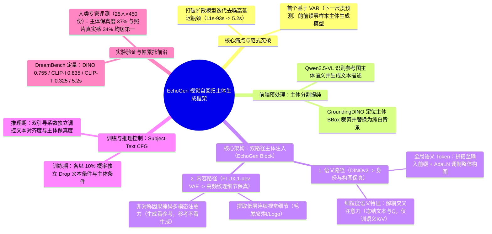
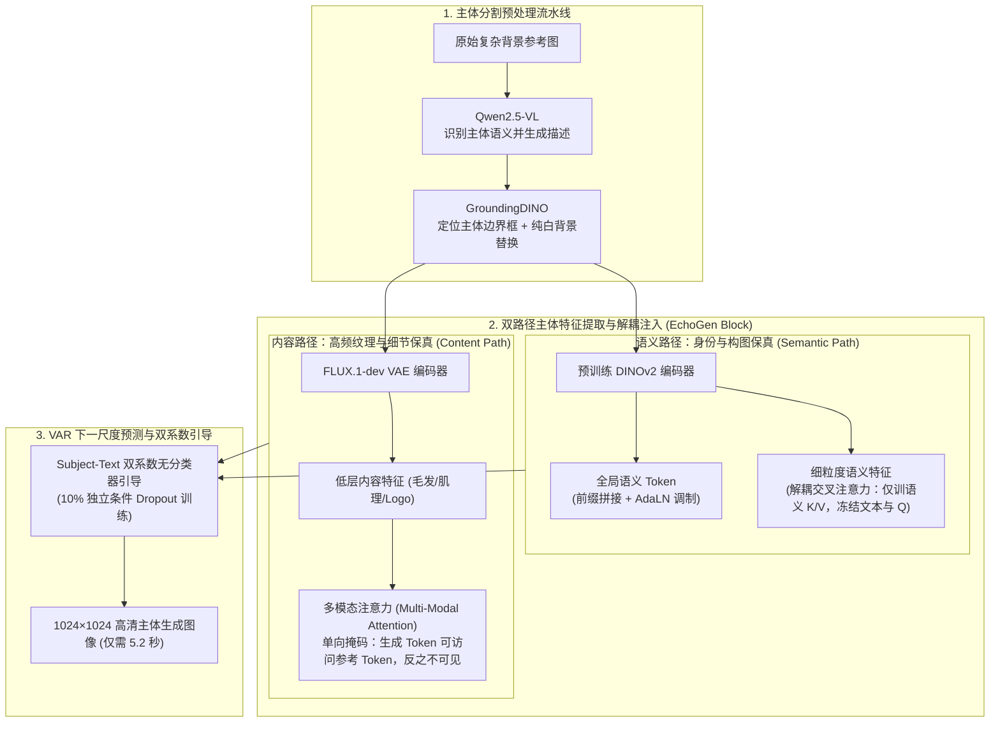

# ICLR 2026｜基于视觉自回归模型的前馈式主体驱动图像生成算法 EchoGen

> [!abstract] 导读
> **一句话总结**：中国科学技术大学与淘天集团音视频技术团队在 ICLR 2026 提出的 **EchoGen**，构建了**业界首个基于视觉自回归模型（Visual Auto-Regressive, VAR）的前馈式主体驱动图像生成（Subject-Driven Generation）框架**——通过创新的**“双路径主体注入策略”**（DINOv2 高层语义身份路径 + FLUX.1-dev VAE 低层纹理细节路径）配合主体分割预处理与双系数联合无分类器引导（Subject-Text CFG），在 DreamBench 与 450 份专家评测中达到媲美甚至超越 SOTA 扩散模型的生成质量与主体保真度，同时将 **$1024 \times 1024$ 高清图像生成延迟大幅压缩至 5.2 秒（相比现有扩散方案加速 2–18 倍）**。
> **阅读价值**：打破了主体驱动图像生成长期由 Diffusion 模型垄断的格局，证明了“下一尺度预测（Next-Scale Prediction）”的视觉自回归（VAR）架构在可控定制生成领域兼具帕累托最优的速度与画质。

## 1. TL;DR

- **核心突破定位**：ICLR 2026 录用论文（`arXiv:2509.26127`，代码已开源），首次将**视觉自回归模型（VAR，以 2B 参数 Infinity 为基座）**引入零样本前馈式主体驱动图像生成，彻底破解“测试时微调太慢（DreamBooth 需数十分钟）、扩散前馈推理延迟太高（11s~93s）”的两难困局。
- **四大核心技术设计**：
  1. **语义路径（高层身份保真）**：利用预训练 **DINOv2** 提取参考图语义特征；细粒度语义特征经**解耦交叉注意力（Decoupled Cross-Attention，冻结文本路径与 Q Projector，仅训练语义 K/V Projector）**与文本并行注入，全局语义 Token 则作为前缀拼接并通过 **Adaptive LayerNorm（AdaLN）** 调制 EchoGen Block，防止主体身份漂移。
  2. **内容路径（低层纹理细节保真）**：针对 DINOv2 无法还原毛发、织物肌理、Logo 文字等高频细节的短板，引入 **FLUX.1-dev VAE** 提取低层内容特征，经带**单向因果掩码（生成 Token 可见参考 Token，参考 Token 对生成序列不可见）的多模态注意力（Multi-Modal Attention）**注入。
  3. **纯净主体分割流水线**：构建 **`Qwen2.5-VL`（识别主体语义生成描述）+ `GroundingDINO`（定位边界框并裁剪替换为纯白背景）** 预处理管线，消除复杂背景对主体特征的污染。
  4. **主体-文本联合无分类器引导（Subject-Text CFG）**：训练时以 **10% 概率**独立随机丢弃文本与主体条件，推理时通过双引导系数灵活调节“主体身份保真”与“文本提示词遵循”的权衡。
- **硬核实验结果**：在 DreamBench 上，`EchoGen-2B` 取得 **DINO `0.755`、CLIP-I `0.835`、CLIP-T `0.325`** 的顶尖成绩，人类专家偏好率在**主体保真度（37%）**与**照片真实感（34%）**上显著夺冠；生成 $1024 \times 1024$ 图像仅需 **5.2 秒**，比 ELITE（11.0s）、IP-Adapter（16.9s）、EasyControl（25.4s）、OminiControl（27.5s）、MS-Diffusion（39.6s）、OmniGen（93.4s）快 **2 到 18 倍**。

## 2. 问题定义与背景

### 2.1 主体驱动图像生成的“质量 vs. 效率”死结
主体驱动图像生成（给定一张参考商品/宠物/人物图与一段新场景文本描述，生成该主体在新场景下的高清图像）是电商商品图实时渲染、直播互动玩法与 AIGC 创作的核心能力。此前技术路线存在明显短板：

| 技术路线 | 代表方法 | 核心优势 | 工业落地致命瓶颈 |
| :--- | :--- | :--- | :--- |
| **测试时微调路线（Test-Time Tuning）** | DreamBooth, Textual Inversion | 主体身份与细节还原度高 | 每个新主体需单独训练数十分钟至数小时，**无法支持零样本（Zero-Shot）实时交互**。 |
| **基于扩散模型的前馈路线（Diffusion Feed-Forward）** | IP-Adapter, ELITE, EasyControl, OminiControl, MS-Diffusion, OmniGen | 无需逐主体微调，支持前馈推理 | 受制于扩散模型数十步迭代去噪机制，生成单张高清图耗时 **11s ~ 93.4s**，难以满足电商毫秒/秒级在线渲染需求。 |
| **基于视觉自回归的前馈路线（VAR Feed-Forward，本文 EchoGen）** | **EchoGen-2B** | 继承 VAR “由粗到细下一尺度预测”极速采样优势，双路径兼顾身份与细节 | **$1024 \times 1024$ 生成仅需 5.2s（2×–18× 加速）**，且画质与主体保真度追平甚至超越扩散 SOTA。 |

### 2.2 为什么不能把扩散模型的条件注入直接照搬到 VAR？
视觉自回归（VAR）模型采用“从 $1 \times 1$ 到高分辨率特征图的下一尺度残差预测（Next-Scale Prediction）”范式，其表征空间与迭代去噪的 Diffusion 模型存在本质差异。若直接用单一通道粗暴注入参考图特征，极易引发**高层语义对齐不良（结构扭曲、文本指令失效）**或**低层高频细节丢失（毛发糊成一团、Logo 变形）**。

## 3. 知识框架

## 4. 核心内容拆解

### 4.1 端到端流水线与双路径主体注入架构

#### 1. 主体分割预处理：源头斩断背景污染
真实业务中用户上传的商品图或生活照往往带有杂乱背景，若直接编码会将背景色块与杂物一并注入生成图。EchoGen 串联 **`Qwen2.5-VL` + `GroundingDINO`**：先由多模态大模型自动理解画面核心主体并输出精准文本标签，再交由 GroundingDINO 检出高精度边界框，裁剪主体并替换为纯净白色背景。

#### 2. 语义路径（Semantic Path）：锁住主体身份与整体构图
采用强语义视觉基座 **DINOv2** 抽取高层语义表征，并分两个粒度注入基于 Infinity（2B）的 EchoGen Block：
- **全局语义调制**：将全局语义 Token 拼接在输入序列前缀，并通过 **Adaptive LayerNorm（AdaLN）** 调制整块特征，确保主体在画面中的全局尺度与构图自然和谐。
- **细粒度解耦交叉注意力（Decoupled Cross-Attention）**：将细粒度语义特征与文本 Prompt 并行注入。为了防止微调破坏 VAR 基座原有的强大文本理解与生成先验，**严格冻结文本路径权重与共享 Query（Q）Projector，仅训练语义路径新增的 Key/Value（K/V）Projector**。

#### 3. 内容路径（Content Path）：锁住毛发、肌理与 Logo 高频细节
DINOv2 擅长语义判别但会丢弃高频像素纹理（如皮靴缝线、虎斑猫毛发、包装盒 Logo）。为此，第二条路径引入 **FLUX.1-dev VAE** 提取高保真低层视觉特征，并通过精心设计的**多模态注意力（Multi-Modal Attention）**注入：
- **非对称注意力掩码（Asymmetric Attention Mask）**：允许正在生成的图像 Token 自由 attend 参考图的内容 Token 以汲取纹理细节；但**强制禁止参考图 Token 反向 attend 生成序列 Token**，从而保证参考特征表征在多尺度自回归展开过程中保持纯净稳定、不被未成熟的早期尺度生成特征污染。

#### 4. 主体-文本联合无分类器引导（Subject-Text CFG）
为了解决“主体还原得太死板会违背文本动作描述，而过度听从文本又会导致主体变形”的矛盾，EchoGen 在训练阶段分别以 **10% 的概率独立随机置空文本条件与主体条件**，并在推理阶段采用包含文本引导系数 $s_t$ 与主体引导系数 $s_s$ 的双系数联合 CFG 公式，支持零重训动态微调控制强度。

## 5. 数据速查表

| 评估维度 / 对比方法 | 核心指标数值 / 耗时对比 | 关键结论与优势说明 |
| :--- | :--- | :--- |
| **DreamBench 定量核心指标** | **DINO: `0.755`** · **CLIP-I: `0.835`** · **CLIP-T: `0.325`** | 在 3 项核心指标（主体身份相似度、图像相似度、文本对齐度）上全面超越或持平 14 种基线 |
| **$1024 \times 1024$ 推理延迟对比** | **EchoGen-2B: `5.2s`** ELITE: `11.0s` (2.1×) IP-Adapter: `16.9s` (3.2×) EasyControl: `25.4s` (4.9×) OminiControl: `27.5s` (5.3×) MS-Diffusion: `39.6s` (7.6×) OmniGen: `93.4s` (**18.0×**) | 实现 **2 倍至 18 倍** 的数量级推理加速，真正迈入工业级准实时交互门槛 |
| **专家人类评测（25位专家，450份问卷）** | **主体保真度偏好率：`37%`（第 1）** **照片真实感偏好率：`34%`（第 1）** **文本对齐度偏好率：`30%`**（与最强基线 EasyControl 并列第 1） | 证明主观视觉质感（刚性边缘、毛绒高频细节）比纯客观指标优势更显著 |
| **速度-质量帕累托分析** | 调节各扩散基线去噪步数绘制 Latency-Performance 曲线 | EchoGen 在所有延迟区间均处于**帕累托前沿（Pareto Frontier）**，并非靠牺牲画质换速度 |

## 6. 踩坑与教训 / 可迁移的设计原则

- **核心设计原则 1：多模态特征注入必须实行“高层语义与低层纹理解耦（Semantic-Content Decoupling）”**
  - **教训**：单一视觉编码器不可能既具备极强的跨视角语义不变性（DINOv2 的强项，用于防身份漂移），又保留像素级的高频局部纹理（VAE 的强项，用于保 Logo 和材质）。
  - **可迁移法则**：在任何参考图驱动生成（虚拟试穿、商品换背景、数字人定制）任务中，将 **`DINOv2（走解耦 Cross-Attention 控结构） + VAE（走单向掩码 Self/Multi-Modal Attention 补细节）`** 双路解耦组合，是兼顾泛化性与细节保真度的黄金搭档。
- **核心设计原则 2：微调可控生成分支时，“冻结主干与 Q、仅训新增条件 K/V + 非对称掩码”是防退化铁律**
  - 在向预训练生成大模型（无论是 VAR 还是 DiT）注入新控制条件时，保持原模型 Q 投影与文本分支冻结，且在注意力掩码中阻断生成 Token 对参考条件 Token 的反向干扰，能用极小训练代价防止模型遗忘原有的图文对齐能力。
- **当前局限与未来演进**：基于 2B 参数 Infinity 基座的 `EchoGen-2B` 在极生僻长尾主体与复杂多主体交互关系上仍有提升空间；下一步将攻关 **0.1B 级轻量化蒸馏与少步 VAR 采样**、**多主体组合生成**以及向**视频主体驱动生成**延伸。

## 7. 记忆锚点

- **一个里程碑定位**：**首个基于视觉自回归（VAR）的前馈零样本主体驱动图像生成框架（ICLR 2026）**。
- **双路径主体注入**：**语义路径（DINOv2 + AdaLN + 解耦交叉注意力保身份）** + **内容路径（FLUX.1-dev VAE + 单向掩码多模态注意力保细节）**。
- **一组核心硬指标**：$1024 \times 1024$ 延迟仅 **5.2 秒**（加速 **2–18 倍**），DreamBench **DINO 0.755 / CLIP-I 0.835 / CLIP-T 0.325**，人类评测主体保真度 **37%** 夺冠。

## 8. 复习卡片

What fundamental trade-off in Subject-Driven Image Generation does EchoGen (ICLR 2026) resolve by adopting a Visual Auto-Regressive (VAR) backbone?::It resolves the "Quality vs. Efficiency" dilemma: test-time tuning methods (e.g., DreamBooth) require tens of minutes of per-subject training, while diffusion feed-forward methods suffer from high iterative denoising latency (11s–93s); EchoGen achieves diffusion-level fidelity in just 5.2 seconds for $1024 \times 1024$ images (a 2x–18x speedup).
How does EchoGen's Dual-Path Subject Injection strategy decouple high-level identity from low-level texture details?::1. The Semantic Path uses DINOv2 to extract high-level identity features, injected via prefix tokens with AdaLN and Decoupled Cross-Attention; 2. The Content Path uses the FLUX.1-dev VAE to capture fine low-level textures (fur, fabric, logos), injected via Multi-Modal Attention.
During the training of EchoGen's Decoupled Cross-Attention in the Semantic Path, which parameters are frozen and which are trained?::The text pathway and the shared Query (Q) projector are kept strictly frozen to preserve pretrained text-image alignment priors, while only the newly added semantic Key/Value (K/V) projectors are trained.
How is the attention mask designed in EchoGen's Content Path Multi-Modal Attention module, and why?::It uses an asymmetric causal mask where generated image tokens can attend to reference subject tokens to retrieve fine textures, but reference tokens are blocked from attending back to generated tokens, keeping reference representations clean across scales.
How does EchoGen prevent complex backgrounds in user-uploaded reference images from contaminating the generated output?::Through an automated preprocessing pipeline combining `Qwen2.5-VL` (which identifies the core subject and generates a text description) and `GroundingDINO` (which localizes the subject bounding box, crops it, and replaces the background with pure white).
What quantitative metrics and latency does EchoGen-2B achieve on DreamBench compared to diffusion baselines like OmniGen and OminiControl?::EchoGen-2B achieves DINO `0.755`, CLIP-I `0.835`, and CLIP-T `0.325` with a $1024 \times 1024$ inference latency of `5.2s`—compared to `27.5s` for OminiControl and `93.4s` for OmniGen (up to 18x faster).

## 9. 知识关联

- **本批同主题精读**：
  - [CVPR 2026｜重思基于扩散模型的视频超分辨率：利用对齐特征的稠密引导 DGAF-VSR](../DGAF-VSR视频超分+26.7.9/AI_DGAF-VSR视频超分.md)：同属淘天音视频技术团队 2026 顶会系列，可对比两者如何精巧设计条件特征注入机制（EchoGen 的双路径 DINOv2+VAE 注入 vs DGAF-VSR 的 OGWM+FTCM 稠密特征注入）。
  - [TMAP平台图生视频推理加速实践](../TMAP图生视频推理加速+26.7.22/AI_TMAP图生视频推理加速.md)：分别从生成范式革新（用 VAR 替代 Diffusion 获 2–18 倍加速）与算子/缓存系统工程（Ulysses + SageAttention + DPCache 获 4.87 倍加速）两条路径攻克视觉生成高延迟难题。
  - [LocalDPO：基于局部时空偏好优化的视频生成对齐方法](../LocalDPO视频偏好优化+26.7.3/AI_LocalDPO视频偏好优化.md)：共同构成淘天多媒体 AIGC 团队在图像与视频生成方向的学术与工业护城河。
- **主题索引（`20_topics`）**：
  - [跨端开发与性能](../../20_topics/跨端开发与性能.md)
  - [模型架构与训练](../../20_topics/模型架构与训练.md)
- **本目录归档文件**：[原始 PDF](RAW.pdf) · [逐页转写文本](MD.md)
- **候选概念双链**：[[视觉自回归VAR]] · [[主体驱动生成]] · [[DINOv2]] · [[解耦交叉注意力]] · [[GroundingDINO]] · [[无分类器引导CFG]]

## 10. 原文参考资料

- **原文出处**：大淘宝技术公众号，《ICLR 2026 | 基于视觉自回归模型的前馈式主体驱动图像生成算法 EchoGen》（作者：中国科学技术大学与淘天集团-音视频技术团队联合研究，发布日期：2026-07-07）
- **论文与开源仓库**：
  - **arXiv 论文**：[arXiv:2509.26127](https://arxiv.org/abs/2509.26127)
  - **GitHub 代码仓库**：[drx-code/EchoGen](https://github.com/drx-code/EchoGen)

> [!note]- 校对报告
> - **页码溯源（1-based 物理页码）**：
>   - 篇首标题、ICLR 2026 录用背景（近 19,000 篇投稿，录用率约 28%）、论文链接（`arXiv:2509.26127`）、开源地址（`github.com/drx-code/EchoGen`）与摘要：源自 `RAW.pdf` `p.1–2`（对应 `MD.md` 第 1–2 页）。
>   - 双路径主体注入策略（DINOv2 语义路径 + AdaLN + 解耦交叉注意力、FLUX.1-dev VAE 内容路径 + 单向掩码多模态注意力）、`Qwen2.5-VL + GroundingDINO` 主体分割预处理与 Subject-Text 双系数 CFG（10% 独立丢弃概率）：源自 `RAW.pdf` `p.3–4`（对应 `MD.md` 第 3–4 页）。
>   - DreamBench 定量评估（DINO `0.755`、CLIP-I `0.835`、CLIP-T `0.325`，延迟 `5.2s` vs ELITE `11.0s` / IP-Adapter `16.9s` / EasyControl `25.4s` / OminiControl `27.5s` / MS-Diffusion `39.6s` / OmniGen `93.4s`）、定性评估、25 位专家 450 份人类评测（主体保真 37%、真实感 34%、文本对齐 30%）及帕累托曲线与未来展望：源自 `RAW.pdf` `p.4–8`（对应 `MD.md` 第 4–8 页）。
> - **一致性核验**：原文共 8 页（含 7 页架构与实验图表），第 4 页双系数 CFG 公式为 PDF 内嵌图像公式，已根据上下文还原其文本与主体双引导系数调控机理。全文零正文内页码引用，所有核心数据与 `MD.md` 完全一致。
