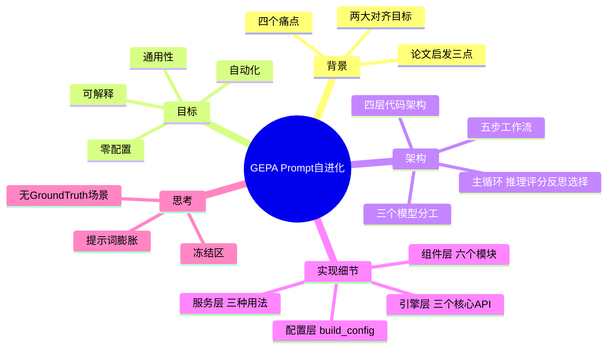
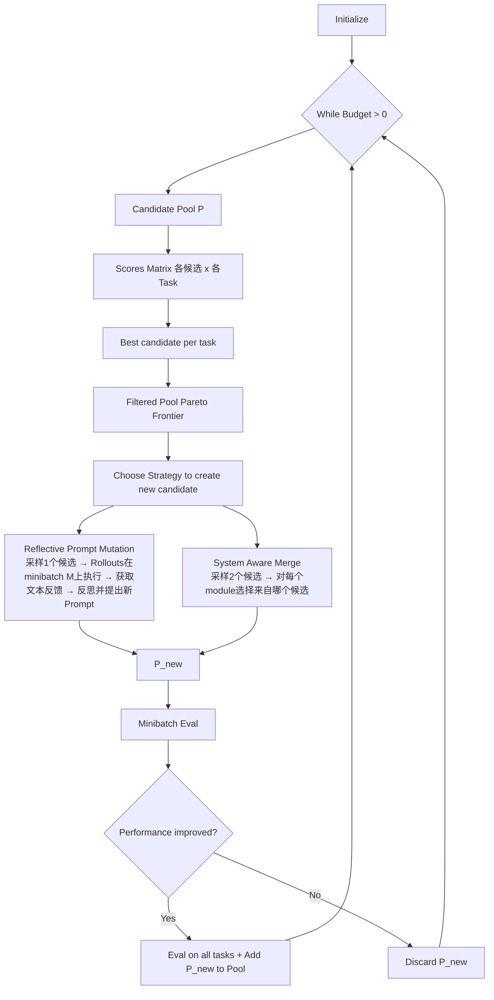
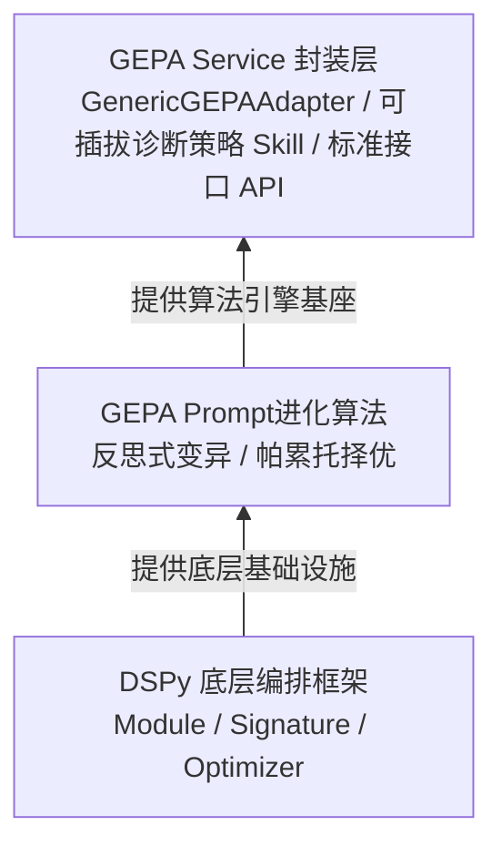
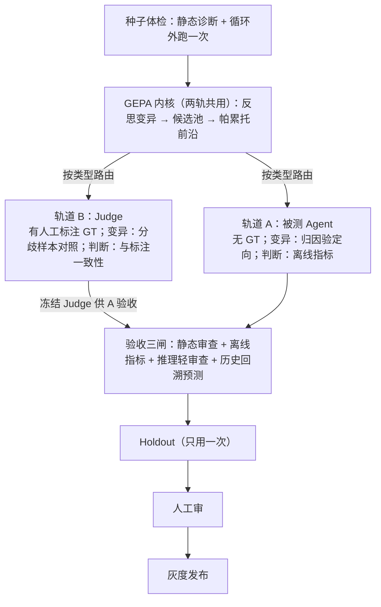

> [!note] 说明
> 「读者背景」在模板中为占位符，本笔记默认读者为**有 RAG / LangGraph 经验的 LLM 应用工程师**，基础概念一笔带过。无标记 = 原文；`[推断]` = 由原文推出但原文未明说。

# agent优化之GEPA：一种提示词自进化的优化方案

## 1. TL;DR

- 痛点：Prompt 优化靠人工经验，**盲目性高、难复制、缺权衡机制**。
- 方案：基于 **GEPA**（Genetic-Pareto, Reflective Prompt Evolution）搭一套 Prompt 自进化系统，构建「推理 → 评分 → 反思 → 选择」闭环。
- 关键机制：**反思式变异**（LLM 分析 Badcase、归因到 Prompt 具体规则、生成候选）+ **帕累托前沿**择优（避免单点优化引发指标对抗性退化）。
- 工程化：任务无关架构 + 零配置（Inspector 自动推断），做成 CLI / HTTP API / Claude Code Skill 三种入口。
- 作者的后续思考：**冻结区**防 reward hacking、**提示词膨胀**控制、**无 Ground Truth** 场景的扩展。

## 2. 核心概念

### 一句话定义

- **GEPA**：反思式 Prompt 进化算法，ICLR 2026 收录论文《GEPA: Reflective Prompt Evolution Can Outperform Reinforcement Learning》提出，隶属 DSPy 生态。
- **反思式变异（Reflective Mutation）**：LLM 自动分析 Badcase → 归因至 Prompt 具体规则 → 生成候选变体。
- **帕累托前沿（Pareto Frontier）**：不只留「综合分最高」的候选，而是保留在各指标/任务上不被支配的所有候选。
- **LLM Judge 对齐**：让评估器的判断标准不偏移，分两个目标（见下表）。

### 解决什么痛点

| 现状痛点（1.1） | 含义 |
|---|---|
| **盲目性高** | 人工改 Prompt 无数据支撑，靠直觉试错，无法量化验证 |
| **伪自动化** | 如用更强模型做静态扫描，本质是浅层迭代，缺乏深度的「反思-修正」（Self-Reflection） |
| **难以复制** | 调优经验沉淀在个人，无标准化流程，无法推广到多个业务场景 |
| **无权衡机制** | 缺什么补什么，补完往往一边好一边坏；无法在对抗指标间显式保留权衡面 |

### 易混概念对比：两大对齐目标（1.2）

| 对齐目标 | 对齐对象 | 目的 |
|---|---|---|
| 评估器 ↔ 人工标注 | LLM Judge 输出 vs 人工标注 Ground Truth | 保证离线评测具备基本的准确性底座 |
| 评估器 ↔ 线上业务效果 | LLM Judge 判断 vs 线上指标（CTR、转化率等） | 保证离线高分的 Prompt 上线后不会「翻车」 |

> [!important] 重点
> 沿用人工经验范式做对齐会陷入四种困境：启发式盲调收敛效率极低；静态扫描无法弥合深层语义错位；单点修补易引发多目标对抗性退化；专家经验难以跨域复用。

### 易混概念对比：三个模型的角色（3.1）

| 模型 | 默认 | 职责 |
|---|---|---|
| 任务模型 | 可选 · 温度=0.0 | 用当前 prompt 执行任务（分类/评分/聚类），追求快速、确定性输出 |
| Judge 模型 | 可与任务模型相同或独立 | 分析错误样本：错误定位 / Prompt 归因 / 改进建议；独立模型可提供更客观的第三方视角 |
| 反思模型 | 可选 · 温度=0.7 | 接收所有反馈，生成改进后的 prompt 候选；建议比任务模型更强，鼓励创造性变异 |

## 3. 知识框架



### 论文原型：GEPA 迭代进化与帕累托采样（图1）



> ⚠️[图中无法辨认] 图1中「Obtain text feedbacks using ·」处的下标符号（疑为反馈函数）看不清，未转录。

### 本方案架构（图2，作者称为「构想」）



### 主循环与停止条件（图3）


停止条件（三选）：① 达到最大评估预算（`max_metric_calls`，默认 400 次）；② 连续 N 轮无提升（`NoImprovementStopper`，默认 5 轮）；③ 得分达到阈值（`ScoreThresholdStopper`）。

> ⚠️[原文疑点] 正文称主循环为「推理 → 评分 → 反思 → 选择」四环节，但详细说明和图3的编号是 ①种子提示词 ②LLM推理 ③评分器 ④反思与变异，「选择」未单独编号、「种子提示词」未出现在四环节表述中，两处口径不一致，原样保留。

## 4. 关键要点

### 主循环各环节（3.1）

| 环节 | 职责 | 实现细节 |
|---|---|---|
| ① 种子提示词 | 提供起点 | 用户初始 prompt，或 Inspector 生成的 `suggested_system_prompt`；支持文件加载或内联文本 |
| ② LLM 推理 | 用当前 prompt 执行任务 | `system_prompt + user_message` → `raw_response[]`；温度 0.0 保证可复现；支持批量并发 |
| ③ 评分器 | 量化输出质量 | 先解析器提取结构化结果（JSON 字段 / 正则），再按任务类型选评分函数 |
| ④ 反思与变异 | 分析错误并生成改进 prompt | a) 错误归因：Judge 做三维分析→结构化反馈；b) Prompt 变异：反思模型吃「输入+输出+分数+反馈」→候选，经 Pareto 前沿保留多目标最优 |

> [!important] 重点
> 评分函数示例：二分类用 Precision / Recall / F1；评分类用 Cohen's Kappa / Spearman / MAE；聚类用配对 F1 / 兰德系数（ARI）。

> [!tip] Pareto 前沿选择（原文举例）
> 同时优化多个指标（如精确率和召回率）时，GEPA 保留前沿上的**所有**候选（原文例：4 个候选中的 A、B、D），而不是只选综合分最高者——不同业务场景可能需要不同权衡策略。
> ⚠️[原文疑点] 原文该例子缺少 4 个候选的得分图/表，A、B、D 为何在前沿无法核对。

### 论文给出的三点启发（1.3）

1. 用「数据驱动闭环」替代「经验盲调」：优化交给算法基于实测数据反馈自动归因与生成变体。
2. 用「帕累托择优」弥补「无权衡机制」：无需始终选最优的单一候选做变异，以避免局部最优；从各任务最优候选集中筛选采样确保多样性。
3. 从「学术原型」到「业务引擎」：原生框架缺乏对复杂业务流的支持，须建任务无关的适配层，把诊断先验与通用接口沉淀为标准流水线，「每个场景都要写代码」变「填配置就能用」。

### 目标（2.1）与覆盖场景（2.2）

核心目标：**给 AI 一条提示词和一份标注数据，它还你一条更好的提示词。** 四点：自动化 / 通用性（任务无关）/ 零配置 / 可解释（每轮有明确错误归因和改进方向）。

| 任务类型 | 场景举例 | 输出形式 | 对齐目标 |
|---|---|---|---|
| 二分类 | 内容安全审核 | pass / block | 人工标注 |
| 二分类 | 客服意图识别 | 正确 / 错误 | 人工标注 |
| 多分类 | 主题分类 | 服饰 / 数码 / 食品 / ... | 人工标注 |
| 评分 | 策略有效性评分 | 1-5 分 | 人工标注 |
| 规则判定 | Rubric Judge（多维检查清单） | 每条规则 pass / fail → 汇总裁决通过率 | 人工标注 |
| 聚类 | 相似商品聚合 | 同类商品簇 ID | 人工标注 |
| 对比 | Pairwise Judge | chosen / rejected | 人工标注 |

> ⚠️[原文疑点] 2.1 列的任务类型是「二分类、多分类、评分、对比、聚类」（无规则判定）；2.2 表多了「规则判定」；4.1.2 的预设表只有 5 类（无规则判定）。

### 从 n 套 Adapter 到配置驱动（3.2）

- 最初每个业务场景单独写 Adapter（数据加载、输出解析、评分函数、反馈生成全定制），n 个场景 n 套代码，无法复用。
- 2.0 版本：GEPA Service 把共性逻辑抽象为 n 种任务类型，**配置驱动**，不再为每个场景写 Adapter。

### 五步工作流（图4 / 5.2）


### 四层代码架构（3.3）

| 层 | 回答的问题 | 关键文件 |
|---|---|---|
| 配置层 | 「这个任务该怎么跑」；Pydantic 定义配置，`build_config()` 自动对齐输出 schema、答案提取方式、评分方式 | `config.py`、`config_factory.py` |
| 引擎层 | 「怎么把任务跑起来」；暴露 `run_optimize` / `run_evaluate` / `validate_config` | `engine.py`、`adapter.py`、`run.py` |
| 组件层 | 「具体怎么做每一步」；可插拔，通过 Protocol 扩展 | `parsers` `scorers` `feedback` `llm` `evaluate` `inspector` |
| 服务层 | 「怎么让用户用上」；CLI / HTTP API / Claude Code Skill | `api.py`、`jobs.py`、`progress.py` |

```text
gepa-service/
├── SKILL.md                 # Skill 定义
├── README.md
├── CLAUDE.md                # Claude Code 项目指引
├── requirements.txt
├── .claude/skills/gepa/SKILL.md → symlink → ../../SKILL.md
└── scripts/
    ├── __init__.py          # 公开 API 导出
    ├── __main__.py          # CLI 入口（python -m scripts）
    ├── config.py / config_factory.py             # 配置层
    ├── engine.py / adapter.py / run.py           # 引擎层
    ├── data.py / inspector.py / llm.py / parsers.py
    │   scorers.py / evaluate.py / feedback.py / protocols.py   # 组件层
    └── progress.py / jobs.py / api.py            # 服务层
```

> ⚠️[图中无法辨认] 原文代码块中 `engine.py`、`adapter.py`、`llm.py`、`scorers.py`、`evaluate.py` 的行尾注释被截断，此处省略注释。

### 配置层（4.1）

`TaskConfig` 为顶层，聚合 9 个子配置：`ModelConfig`（任务/反思/Judge 模型、API 端点）、`DataConfig`（路径、格式、标注字段、切分策略）、`PromptConfig`（system_prompt、user_template）、`InputConfig`（文本/多模态、图片字段）、`OutputConfig`（schema、答案提取方式）、`ScoringConfig`（方法名、参数、批次/样本模式）、`FeedbackConfig`（Judge prompt、截断长度）、`OptimizationConfig`（最大调用次数、停止条件、反思批量大小）、`EvaluationConfig`（指标类型）。

> [!important] 重点：三者隐式耦合
> 输出 schema 字段类型、答案提取方式、评分函数必须互相匹配。`build_config()` 按任务类型套预设，一次性对齐，而不是让用户逐项填。

| 任务类型 | Schema 主字段 | 提取方式 | 优化评分（GEPA 目标） | 对齐指标（输出 vs 标注） |
|---|---|---|---|---|
| 二分类 binary | `result: bool` | json_field / bool | exact_match | Precision / Recall / F1 / Accuracy + 混淆矩阵 |
| 多分类 multiclass | `result: str`（enum） | json_field / str | exact_match | Accuracy + 各类别 P / R / F1 |
| 评分 scoring | `result: float` | json_field / float | numerical_closeness | MAE / RMSE / Spearman 秩相关 / 加权 Kappa（QWK） |
| 对比 comparison | `result: str`（a / b） | json_field / str | comparison | Accuracy + 分侧准确率 + 位置偏差分数 |
| 聚类 clustering | `result: str`（簇 ID） | json_field / str | pair_f1 | 兰德系数（ARI）/ Cohen's Kappa + 配对 P / R / F1 |

### 引擎层（4.2）

| API | 功能 | 返回 |
|---|---|---|
| `run_optimize(config, run_dir)` | 执行完整 prompt 优化循环 | `OptimizeResult`（best_prompt、best_score、迭代次数等） |
| `run_evaluate(config, prompt, split)` | 评估指定 prompt 在某数据切片上的表现 | `EvalResult`（metrics、per_sample 详情） |
| `validate_config(config)` | 只校验配置有效性，不跑优化 | `(valid, error_message)` |

`run_optimize` 内部编排：准备数据（train/val/holdout）→ 组装适配器 → 构建反思模型 → 设置停止条件（连续无提升 / 达到目标分数）→ GEPA 主循环 → 保存最优 prompt → **在 holdout 上复评泛化能力**。

`GenericGEPAAdapter` 把一次「候选评估」翻译成四步：

1. **批量推理**：候选 prompt（自动拼上输出格式指令）+ 用户消息 → 任务模型
2. **解析输出**：json_field / regex / full_text / 自定义
3. **批次评分**：批次级分数 = GEPA 的优化目标
4. **生成反思轨迹（仅反思轮）**：逐样本打分，满分样本给一句确认，错误样本交 LLM Judge 深度归因

反思轨迹整理成四元组：**输入、模型原始输出、样本分数、反馈文本**，这是反思模型改写 prompt 的全部依据。

`run.py` 三个构建函数：`prepare_data(config)`（加载→校验→分层切分→模板格式化→返回 train/val/holdout）、`build_adapter(config)`（构建 LLMClient + 组装 Adapter）、`build_reflection_lm(config)`（反思模型 callable，温度 0.7，支持 DashScope 特殊参数）。

### 组件层（4.3）

- **data.py**：加载（json/jsonl/csv）→ 按任务类型严格校验标注 → 分层切分（**train 50% / val 30% / holdout 20%**）→ 模板格式化 → 转 GEPA 的 `DataInst`。按标签分层（二分类按 true/false、多分类按类别、连续值先分位数分桶再分层）；严格校验以便跑之前发现数据问题。
- **inspector.py（零配置推断）**：先做字段画像（数据类型、唯一值数量、是否二值/分类/长文本/URL、平均长度、缺失率），再并行推断三件事——**哪个字段是标注、什么任务、哪些字段是输入**——最后给置信度评估；产物 `DatasetProfile`（任务类型、字段划分、建议模板、建议种子提示词、枚举值/分数范围）。
- **llm.py**：基于 `litellm` 统一多 Provider（按 api_base 自动识别 DashScope / OpenAI / Anthropic / Moonshot / 智谱）；批量并发；指数退避重试 2s → 4s → 8s，最多 3 次；单请求失败不拖垮整批；每次调用带结构化 `success` / `error`，不静默吞异常。
- **parsers.py**：先清洗，再按配置用 json_field / regex / full_text / 自定义提取；配置了 `OutputSchema` 时校验字段类型、enum 范围、数值上下界；`build_format_instruction()` 从 schema 反向生成输出格式说明并追加到 system_prompt 末尾，让「要求的格式」和「校验的格式」同源。
- **scorers.py / evaluate.py**：评分分两级（见下）。
- **feedback.py**：双层反馈（见下）。
- **protocols.py**：用 Protocol + ABC 给四个环节留扩展位——`DataPreparer`、`OutputParser`、`Scorer`、`FeedbackGenerator`；在 config 里写类路径即可动态注入，不改引擎代码。

> [!important] 评分两级
> - **样本级**（给反思轨迹，回答「这一条错在哪」）：`exact_match`、`contains`、`numerical_closeness`（按误差线性/平方惩罚）、`weighted_binary`（FP / FN 不对称惩罚）。
> - **批次级**（给 GEPA 当优化目标，回答「这个候选整体好不好」）：`f1_score` 做平衡优化；`precision_recall` 做**约束优化**——精确率达标时直接返回召回率，未达标则乘以 `(precision/target)²` 惩罚，表达「精确率不低于 80% 的前提下最大化召回」。
> `[推断]` 「未达标则乘以」的对象应是召回率，原文未明说。

> [!tip] 反馈引擎的关键：第 2 问
> 规则层：模板快速给出事实性反馈（正确 / 解析失败 / 答错，附模型输出与正确答案）。深度层：只对错误样本调 Judge，做三问归因（分析要求 200 字以内）：
> 1. 错误定位：agent 在哪个推理步骤出了问题？
> 2. **Prompt 归因：当前 prompt 的哪条规则导致或未能阻止这个错误？**
> 3. 改进建议：prompt 应如何调整？
> 第 2 问把「模型答错了」翻译成「prompt 的哪一条规则有问题」，让反思模型拿到带归因的诊断而非一堆错误样本，从而把盲目搜索变成定向改写。

### 服务层（4.4）

- 三种入口：**CLI**（本地调试）、**HTTP API**（平台集成，FastAPI）、**Claude Code / Qoder Skill**（对话式）。
- API 围绕「任务」组织：提交、列表、查状态、看进度、取结果、取消；另有一次性评估、配置校验、数据上传、健康检查。
- `jobs.py` 状态全落文件系统，每任务一个 `runs/jobs/{job_id}/` 目录，含五个文件：

| 文件 | 内容 |
|---|---|
| `config.json` | 任务配置 |
| `job_state.json` | 运行状态（pending / running / completed / failed / cancelled） |
| `progress.jsonl` | 实时进度事件 |
| `best_prompt.txt` | 优化出的最优提示词 |
| `result.json` | 完整 GEPA 结果 |

- 状态外部化三个好处：可后台线程运行、可通过取消令牌中断、可随时回查追溯历史。
- `progress.py` 写 JSONL 追加流，Skill 侧 `tail` 即可实时汇报进度。

### 命令速查与配置

### 安装

```bash
# 1. 安装依赖
pip install -r requirements.txt -i xxx
# 2. 配置 API Key
export DASHSCOPE_API_KEY="your-key-here"  # 或 OPENAI_API_KEY
```

### 输入准备（5.2.1）

| 字段类型 | 说明 | 示例 |
|---|---|---|
| 输入字段 | 模型需分析的文本/数值内容 | `title`、`content` |
| 答案字段 | 正确标注（**必须每条都有**） | `answer`、`label`、`result` |
| 图片字段（可选） | 图片 URL；字段名含 `image` / `img` / `url` 时自动识别 | `imageUrl`、`skuImage` |

- 数据集命名最好与提示词中的变量名对应。
- 用户至少准备 `raw/` 下两个文件：数据集 + 提示词；解析后输出三类文件：jsonl 数据集（`data/`）、规范化提示词（`prompts/`）、运行配置（`config/`）。
- 初始（种子）提示词：已有在用 prompt 时从它开始比从零开始更快；没有则由 inspector 按数据集自动生成。
- 提示词两部分：`system_prompt`（角色、规则、输出格式约束，`prompts/system_prompt.txt`）、`user_template`（数据注入模板，用 `{fieldName}` 占位，`prompts/user_template.txt`）。

> ⚠️[原文疑点] 提示词组成表的两列表头都写「组成」，原样保留。

交互式输入（Skill 触发后逐步收集）：

| 信息 | 说明 | 默认行为 |
|---|---|---|
| 数据集路径（必须） | JSONL/JSON/CSV 路径，例 `tasks/my_task/data/dataset.jsonl` | — |
| 任务目标（必须） | 一句话说明模型要做什么 | — |
| 现有提示词（建议） | 已有 system prompt 文件路径 | 由 inspector 自动生成种子提示词 |
| 评判偏好（建议） | 误判和漏判哪个更严重；优化准确率或召回率 | 使用 F1 平衡评分 |
| 模型名称（可选） | 推理/反思模型，如 `qwen3.6-flash` | 可替换 |
| 输入字段（可选） | inspector 自动检测 | 可手动指定 |
| 是否包含图片（可选） | inspector 自动检测 | 支持图文多模态 |

> ⚠️[原文疑点] ① 图6截图写「默认 qwen3.5-flash」，5.2.1 表写「如 qwen3.6-flash」，版本号不一致。② 本表「评判偏好」默认为「F1 平衡评分」，而 5.3 速查表「无特别偏好」对应「精确匹配」，默认行为口径不一致。

### 评判偏好速查表（5.3）

| 任务 | 用户表述 | 评分方式 | 参数 |
|---|---|---|---|
| 分类 | 「不要误判」/「准确率重要」 | 加权二分类 | `{"fp_penalty": 0.0, "fn_penalty": 0.5}` |
| 分类 | 「不要漏」/「召回率重要」 | 加权二分类 | `{"fp_penalty": 0.5, "fn_penalty": 0.0}` |
| 分类 | 「F1 平衡」 | F1 分数 | `{}` |
| 分类 | 「精确率到 80% 以上再说召回」 | 精确率-召回率 | `{"precision_target": 0.8}` |
| 分类 | 无特别偏好 | 精确匹配 | `{}` |
| 评分 | 「平均误差要小」 | 数值接近度 | `{"penalty": "linear"}` |
| 评分 | 「大错不能犯」 | 数值接近度 | `{"penalty": "quadratic"}` |
| 对比 | 「准确率要高」 | 精确匹配 | `{}` |
| 对比 | 「不能有位置偏差」 | 对比评估 | `{"check_bias": true}` |
| 聚类 | 「一致性要高」 | Cohen's Kappa，ARI | `{}` |
| 聚类 | 「不能过度合并」 | 配对精确率 | `{"focus": "precision"}` |
| 聚类 | 「不能漏合并」 | 配对召回率 | `{"focus": "recall"}` |

> [!warning] 易错：fp_penalty / fn_penalty 的语义
> 「不要误判」（避免 FP）对应的却是 `fp_penalty: 0.0, fn_penalty: 0.5`，字面上与「惩罚 FP」相反。⚠️[原文疑点] 参数语义原文未说明。`[推断]` 数值可能是「犯该类错误时保留的得分」（越低越严厉），图7后续建议「fn_penalty 已为 0」也与此读法相容，但需查实现确认。

### 产出目录（5.2.2）

```text
runs/job_20260727_195205/
├── best_prompt.txt              # 最优提示词（纯文本）
├── optimize_result.json         # 完整优化结果
├── result.json                  # GEPA 引擎原始结果
├── candidates.json              # 所有候选提示词及评估详情
├── candidate_tree.html          # 候选树可视化（浏览器打开）
├── progress.jsonl               # 进度日志（每行一个事件）
├── run_log.txt / run_log.json   # 运行日志
├── run_log_stderr.txt           # 错误输出日志
├── gepa_state.bin               # GEPA 引擎状态二进制快照
└── generated_best_outputs_valset/   # 最优提示词在验证集上的逐条输出
    ├── task_0/iter_0_prog_0.json    # 第 0 条数据的模型输出
    └── ...                          # 每条验证集数据一个目录
```

## 5. 数据速查表（案例：图7 优化结果报告）

| 指标 | 数值 | 出处 |
|---|---|---|
| 验证集得分（初始 → 优化后） | 0.8500 → 0.9333，变化 +8.3% | 图7 |
| 候选数 / LLM 调用 | 3 个 / 145 次 | 图7 |
| 验证集（30 条）准确率 / 精确率 / 召回率 / F1 | 93.33% / 100%（无误判） / 66.67%（4 TP, 2 FN） / 80% | 图7 |
| 验证集混淆矩阵 | TP=4, FP=0, TN=24, FN=2 | 图7 |
| 测试集（21 条 holdout）准确率 / 精确率 / 召回率 / F1 | 80.95% / 66.67% / 40% / 50% | 图7 |
| 测试集混淆矩阵 | TP=2, FP=1, TN=15, FN=3 | 图7 |
| 数据规模 | 当前仅用 100 条子集，完整数据 3918 条 | 图7 |
| 预算 | 默认 400 次调用，本次仅用 145 次 | 图7 / 图3 |
| 优化耗时 | 后台约 15-30 分钟 | 5.2 |

优化后提示词的主要变化（图7，部分可读）：

1. 新增 **JSON 安全原则**——第 5 条准则，要求 `analysis` 字段内禁止使用未转义双引号，改用中文引号或单引号，防止 JSON 解析失败
2. ⚠️[图中无法辨认]（被遮挡）
3. 补充类目示例（后文被遮挡，仅可见「等维度」）
4. 区分…（被遮挡）
5. 简化输出规范——输出格式更紧凑，增加具体示例

后续建议（图7）：测试集召回率仅 40%，说明模型仍漏判（后文被遮挡）。可考虑：**扩大数据量**（用完整 3918 条）；**增加优化预算**（提高 `max_metric_calls`）；**调整评分权重**（`fn_penalty` 已为 0，可尝试增大 `fp_penalty` 容忍更…，⚠️[图中无法辨认] 句尾被截断）。

> [!warning] 易错：别只看验证集
> 验证集 F1 80% → 测试集 F1 50%，召回率 66.67% → 40%。`[推断]` 样本量很小（验证 30、测试 21），泛化差距可能同时来自过拟合与小样本方差；这也是流程要在 holdout 上复评的原因。
> `[推断]` 「+8.3%」= 0.9333 − 0.8500 ≈ 8.3 个百分点（绝对值），非相对提升。`[推断]` 验证集得分 0.9333 与准确率 93.33% 相同，提示本次优化目标很可能是 exact_match 而非 F1。
> ⚠️[原文疑点] 按 50/30/20 切分，100 条应得 holdout 20 条，图7却是 21 条。

## 6. 踩坑与教训（第 6 章：未来展望与思考）

### 6.1 冻结区：不是所有内容都该被改

- GEPA 默认整段 prompt 交给反思模型重写，**硬性约束、工具调用协议、输出 Schema 都可能被改**。
- 反直觉风险：**删掉一条约束往往能提分**——约束限制行为空间，去掉后模型少犯一类「做多了」的错；有人工标注兜底时尚能发现，纯规则评分下本质是奖励黑客（reward hacking）。
- 正确防御：**从结构上禁止改动，而非事后扣分补救**。

| 区 | 内容 | 参与变异 |
|---|---|---|
| 冻结区 | 硬性约束、工具调用协议、输出 Schema | 否 |
| 可变区 | 判断优先级、决策倾向、异常处理、表达方式 | 是 |

实现：GEPA 支持多 component 结构，让选择器只返回可变区，冻结段不会进入反思上下文。

### 6.2 提示词膨胀：目标是「更准，且不更长」

- 反思模型天然倾向不断补充说明；十几轮迭代后 prompt 从几百字膨胀到几千字，每轮分数仍在涨，**没有任何信号提示出问题**。
- 隐性代价：关键约束被淹没（注意力被稀释）；推理成本线性上涨（token 翻倍，延迟和费用同步翻倍）；人无法接管（长到读不懂，无法回滚/调试）。
- 抑制：把**长度作为帕累托第三个目标**（而非加权惩罚，避免与主目标抵消），并设硬上限门禁。

### 6.3 无 Ground Truth 场景（作者设想，未验证）

- 背景：原定位是 judge align（靠人工标注），但真正值得优化的往往是**被评测 agent 自己的 prompt**——部分 agent 做策略生成，没有正确答案，只有事后业务效果。
- **变异方向**：原生 GEPA 自由探索偏随机；接上离线评测指标/线上业务效果汇总的归因分析作文本梯度，再补一层 prompt 结构缺陷诊断，把「业务上错在哪」翻译成「哪一段该改」，即**定向变异**。
- **对错判据**：① 用已有离线评测指标当 judge，把候选跑出的结果算成分数，构造对抗双目标（该做的没做 / 不该做的做了）；② 历史策略回溯预测——把候选决策溯源到历史相似场景，对比同类最优历史的业务指标。
- 回溯预测**只用于排序与否决，不回流反思**，否则「改得越少 → 匹配越多 → 分越高」会把搜索拖向保守。

图8 双通道 GEPA 优化框架设想（图像分辨率低，仅转录可辨认部分）：



> ⚠️[图中无法辨认] 轨道 B 与轨道 A 的「前沿」栏（疑为「误判 fail/pass」「不漏/不溢」）及验收三闸的具体构成看不清，上图相应处为低置信转录。

### 可迁移的设计原则

- **把「模型答错了」翻译成「prompt 哪条规则有问题」**，再交给反思模型：诊断带归因，才能定向改写。
- **多目标用前沿保留权衡面**，不要压成单一加权分；长度也可以是一个目标。
- **结构上冻结不可动的部分**，而不是事后靠扣分防篡改。
- **配置驱动 + 预设联动**：把互相耦合的配置（schema / 提取 / 评分）一次性对齐，避免手填出错。
- **状态外部化**（文件系统 + JSONL 追加流），任务可后台跑、可取消、可追溯。
- **留出集只用一次**：用 holdout 复评泛化；回溯类信号只做排序/否决，不回流到变异。

## 7. 记忆锚点

- **「推理 → 评分 → 反思 → 选择」** 闭环，第 2 问「Prompt 归因」是把盲搜变定向的关键。
- **「冻结区 + 可变区」「更准，且不更长」**：改 prompt 的两条护栏——别删约束、别越写越长。

## 8. 复习卡片

GEPA 全称及核心两机制是什么？::Genetic-Pareto, Reflective Prompt Evolution；反思式变异 + 帕累托前沿择优。
为什么保留 Pareto 前沿而非只选综合分最高的候选？::避免陷入局部最优、保留多样性与权衡面；不同业务场景可能需要不同权衡策略。
反馈引擎「三问归因」是什么，哪一问最关键？::错误定位 / Prompt 归因 / 改进建议；第 2 问（Prompt 归因）最关键，把答错翻译成 prompt 的哪条规则有问题。
反思轨迹的四元组是什么？::输入、模型原始输出、样本分数、反馈文本。
precision_recall 评分如何表达「精确率不低于 80% 前提下最大化召回」？::精确率达标时返回召回率；未达标则乘以 (precision/target)² 惩罚（precision_target=0.8）。
默认数据切分比例及分层依据？::train 50% / val 30% / holdout 20%；按标签分层（连续值先分位数分桶）。
为什么需要冻结区？冻结哪些？::删约束常能提分，在纯规则评分下等于 reward hacking；冻结硬性约束、工具调用协议、输出 Schema，只让判断优先级、决策倾向、异常处理、表达方式参与变异。
提示词膨胀的三个隐性代价与抑制手段？::关键约束被淹没、推理成本线性上涨、人无法接管；抑制：长度作为帕累托第三目标 + 硬上限门禁。
无 GT 场景下回溯预测为何不能回流反思？::否则「改得越少 → 匹配越多 → 分越高」会把搜索拖向保守。

## 9. 知识关联

候选 [[双链]]（由你决定哪些已有笔记）：[[DSPy]]、[[GEPA论文]]、[[LLM-as-a-Judge]]、[[Pareto前沿与多目标优化]]、[[Reward Hacking]]、[[Prompt工程]]、[[Cohen's Kappa与QWK]]、[[Adjusted Rand Index]]、[[LangGraph]]、[[RAG评测]]、[[位置偏差（Pairwise Judge）]]

## 10. 原文参考资料

1. AGRAWAL L A, TAN S, SOYLU D, 等. GEPA: Reflective Prompt Evolution Can Outperform Reinforcement Learning. arXiv:2507.19457, 2025. https://arxiv.org/abs/2507.19457
2. KHATTAB O, SINGHVI A, MAHESHWARI P, 等. DSPy: Compiling Declarative Language Model Calls into Self-Improving Pipelines. arXiv:2310.03714, 2023. https://arxiv.org/abs/2310.03714

> ⚠️[原文疑点] 正文把 DSPy 展开为「Declarative Self-improving Python」，而参考文献 [2] 标题为「Compiling Declarative Language Model Calls into Self-Improving Pipelines」，两处表述不一致，原样保留。

> [!note]- 校对报告
> **1. 覆盖度**
> - 已覆盖：摘要、第 1–6 章全部正文、图1–图5、图7、图8、全部表格与代码块、参考文献。
> - 未覆盖/弱覆盖：图6（与 Skill 的交互截图）仅以「交互式输入」表格形式吸收；图8分辨率低，仅部分转录；第 8 章团队介绍、拓展阅读链接、阅读量/评论等页面元信息按「非学习内容」省略；图7中被遮挡的文字无法恢复。
> - 无「扩展阅读」：未加入外部知识，故未设该章节。
> - 文件名日期取自文章发布日期 2026-09-15（非生成日期）。
>
> **2. 一致性抽查（对照 PDF 文本）**
> 1. 停止条件默认值：`max_metric_calls` 400 次、`NoImprovementStopper` 5 轮 ✔
> 2. 切分比例 train 50% / val 30% / holdout 20% ✔
> 3. 验证集得分 0.8500 → 0.9333、+8.3%；候选 3 个、145 次调用 ✔
> 4. 验证集混淆矩阵 TP=4/FP=0/TN=24/FN=2，测试集 TP=2/FP=1/TN=15/FN=3；各指标百分比已用混淆矩阵复算，与原文一致 ✔
> 5. 重试退避 2s → 4s → 8s、最多 3 次；任务目录文件数 5 ✔
>
> **3. [推断] 与 ⚠️ 汇总**
> - [推断]：`precision_recall` 乘以的对象为召回率；`fp_penalty/fn_penalty` 数值可能为「犯错时保留的得分」；「+8.3%」为绝对百分点；验证集得分等于准确率，提示优化目标可能为 exact_match；验证→测试集 F1 下降（80%→50%）的成因（过拟合与小样本方差）。
> - ⚠️[原文疑点]：① 主循环「四环节」与图3编号口径不一致；② Pareto 举例（A、B、D）缺少候选得分图；③ 任务类型数量在 2.1 / 2.2 / 4.1.2 不一致（规则判定）；④ 评判偏好默认值：F1 平衡（5.2.1）vs 精确匹配（5.3）；⑤ 默认模型 qwen3.5-flash（图6）vs qwen3.6-flash（5.2.1）；⑥ holdout 100 条按 20% 应为 20 条，图7为 21 条；⑦ fp/fn_penalty 语义不明；⑧ 提示词组成表两列表头同为「组成」；⑨ DSPy 全称表述与参考文献 [2] 标题不一致。
> - ⚠️[图中无法辨认]：图1下标符号；代码架构块行尾注释被截断；图7中被遮挡的优化点 2/3/4、召回率说明与后续建议句尾；图8「前沿」栏与验收三闸细节。
