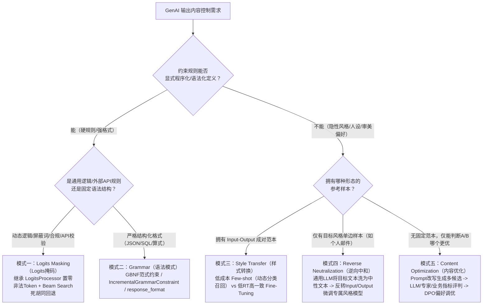

# GenAI输出内容控制的5种设计模式

## 1. TL;DR

1. **核心痛点**：在企业级 GenAI 应用中，如何约束大模型的输出样式、数据格式、品牌合规词与人设风格是高频工程难题；传统的“生成后用规则集校验打回重试”或“由 LangGraph 额外调用一次 LLM 修复格式”属于典型反模式（Antipattern），会显著推高调用成本与服务响应耗时（RT）。
2. **五种设计模式矩阵**：按“规则是否可显式程序化定义”与“样本形态”，系统梳理出五种输出控制设计模式——**Logits 掩码模式（Logits Masking）**、**语法模式（Grammar / GBNF）**、**样式转换模式（Style Transfer）**、**逆向中和模式（Reverse Neutralization）** 与 **内容优化模式（Content Optimization）**。
3. **关键选型边界**：结构化格式与硬规则优先采用推理期 Token 级干预（`LogitsProcessor` + Beam Search 回溯，或 `IncrementalGrammarConstraint` / `response_format`）；难以显式写规则但有成对样本时用 Style Transfer（Few-shot / Fine-Tuning）；仅有目标风格单边样本（如个人历史邮件）时用 Reverse Neutralization（通用 LLM 逆向生成中性文本构建反向训练集）；无法定义 A/B 差异因子时用 Content Optimization（Prompt 同义改写 + LLM-as-judge/专家/线上反馈构建 Chosen/Rejected 偏好对做 DPO 强化）。

## 2. 问题定义与背景

### 2.1 LLM Token 生成机制与束搜索（Beam Search）基础

- **Token-by-Token 概率采样**：LLM 每步输出候选詞表上的原始推荐分值（**Logits**），经 `Softmax` 归一化为加和等于 `1` 的概率分布，再结合 `Temperature` 与 Sampling 策略选出下一个 Token。
- **束搜索（Beam Search）权衡确定性与多样性**：通过维护束宽 `beam_width`（如 `num_beams=10`）条候选队列，每步从 `beam_width * beam_width` 个扩展分支中按新增 Tokens 的 Logits 累加和降序修剪，仅保留 Top `beam_width` 个分支直至遇到 `<EOS>` 或达到长度上限。

### 2.2 传统输出控制的两大反模式（Antipatterns）

1. **事后规则校验打回重生成**：等模型完整输出后再用 Rule Set 校验，不合规则打回重新调用模型，导致不可控的额外 Token 成本与高延迟（RT）。
2. **仅靠 Prompt 祈祷格式正确或额外调一次模型修格式**：小模型对复杂 JSON/SQL 指令遵循率低，即便头部闭源模型也仅是概率遵循；而像早期 LangGraph 那样在格式解析失败后追加一次 LLM 调用做格式修正，同样带来双倍调用损耗。

## 3. 知识框架

## 4. 核心内容拆解

### 4.1 模式一：Logits Masking（Logits 掩码模式）

- **适用场景**：
  1. **品牌一致性**：介绍 A 商品时强制使用“运动、舒适”，屏蔽竞品 B 的主打词“优雅、大方”；
  2. **账单/单据准确性**：限定账单编码与金额仅在固定位置输出一次，严禁在正文中重复出现引发前后金額不一致；
  3. **商业合规性**：引用 A 公司案例时禁止同时提及竞争对手 B 公司；
  4. **风格指南**：特定标点或术语禁忌。
- **工作机制（五步闭环）**：
  1. 编写可程序化执行的规则集（Rule Set）；
  2. 在每步生成候选续写词元（Continuations）时，将违反规则的 Token 的 **Logits 置零**，从概率分布中彻底剔除；
  3. 若存在合法续写路径则继续推进；
  4. 若当前状态无合法续写或已被标记为**“死胡同”（Dead End）**，则利用束搜索向前回退一步（**Backtrack**）尝试其他前序分支；
  5. 达到最大重试/回退次数仍无解时，显式返回拒绝响应。
- **代码落地**：在 HuggingFace `transformers` 中继承 `transformers.generation.logits_process.LogitsProcessor` 并复写 `__call__` 方法，配合 `pipeline(..., num_beams=10, logits_processor=[CustomProcessor()])` 执行。

### 4.2 模式二：Grammar（语法模式）

- **核心原理**：可看作内置了 **GBNF（Grammar-Based Normal Form，基于语法的范式）** 解析器的特殊 Logits Masking，在每步采样时按产生式语法树调整 Logits 权重（例如限定时间戳 `timestamp_literal` 或限定数学表达式 `root ::= (expr "=" ws term "\n")+`）。
- **落地方式与局限**：
  - **私有/开源模型**：使用 `transformers_cfg` 中的 `IncrementalGrammarConstraint` 与 `GrammarConstrainedLogitsProcessor`；
  - **商用/公共 API**：使用 OpenAI 兼容接口的 `response_format={"type": "json_object"}` 或传入自定义 Python 数据类（底层自动转译为 Grammar 约束）。
  - **与 Logits Masking 的权衡**：当约束仅涉及非格式的业务逻辑、需要调试友好（BNF 调试困难）、需接入规则引擎动态切换或需在校验时**调用外部 API** 时，优先选 **Logits Masking**。

### 4.3 模式三：Style Transfer（样式转换模式）

- **适用前提**：难以写出显式判定规则，但能提供 `Input -> Output` 的成对范本。
- **Few-shot vs Fine-Tuning 权衡**：
  - **Few-shot**：零训练成本、接入最快；受限于① 模型参数规模（越大效果越好）、② 上下文窗口上限（可通过**对用户 Query 分类 + 动态召回相关 Few-shot 示例**平衡效果与长度）、③ 推理延迟（长 Context 拖慢 RT）。
  - **Fine-Tuning**：能深度学习庞大术语映射表与口语细节，且推理期无需拼接长示例、**RT 显著更优**；代价是数据准备、训练与独立部署成本。

### 4.4 模式四：Reverse Neutralization（逆向中和模式）

- **解决的核心痛点**：想让模型模仿个人专属人设写邮件或文章，手里只有**历史个人风格产物（Target Output）**，既写不出规则，也没有对应的“普通风格原文（Input）”来构建成对样本，且历史文本覆盖主题有限。
- **三步训练与两步推理**：
  1. **逆向合成中性输入**：将个人历史邮件输入通用 LLM，执行提示词 `Neutralize the tone and style from the following email to make it professional...` 生成中性商务版邮件；
  2. **反转构建训练集**：以“生成的中性邮件”为 Input、“原始个人历史邮件”为 Output，构建成对训练样本；
  3. **微调专属转换器**：基于该样本集微调开源模型；
  4. **两阶段推理**：线上先用通用 GenAI 模型回答问题生成信息完整的中性结果，再送入微调后的风格模型转为个人风格输出。
- **关键防坑点**：必须调试中性风格基准（如对比“初中一年级水平”与“英国商务标准”哪种与原文信息差异最小），防止在中和与转换过程中丢失核心事实或词不达意。

### 4.5 模式五：Content Optimization（内容优化模式）

- **解决的核心痛点**：营销文案、教材编写等场景无法像传统 A/B 实验那样显式定义差异因子（Factor），但人工或指标能直观判断两个候选结果哪个更好。
- **四步偏好强化闭环**：
  1. **Step 1（Prompt 同义改写扩充多样性）**：在保持原意前提下对原始 Prompt 做同义替换、补充解释或示例，触发模型生成具有差异性的两个候选结果；
  2. **Step 2（优劣评判）**：评判哪个结果更优（无需解释原因）；
  3. **Step 3（构建偏好对）**：封装为 `(Prompt, Chosen, Rejected)` 偏好样本集；
  4. **Step 4（Preference Tuning）**：执行 **DPO（Direct Preference Optimization）** 等偏好对齐训练。
- **三种主流评判方式对比**：
  - **LLM-as-judge（更大参数权威模型）**：吞吐量大、成本低，但评判标准为黑盒，未必完全契合业务场景；
  - **专家标注**：客观高难问题准确性高，但成本高昂且主观题易带入个人偏好；
  - **基于线上反馈/业务指标（点赞点踩、后续互动率/转化率）**：最契合真实业务目标，但依赖后置交互链路埋点与数据回收闭环。

## 5. 数据速查表

| 设计模式 | 干预阶段 | 是否需显式规则 | 数据样本要求 | 典型工具 / 接口示例 |
| --- | --- | --- | --- | --- |
| **Logits Masking（Logits掩码）** | 推理采样阶段（Token 级） | **必须（可编程规则）** | 无需训练样本 | `transformers.LogitsProcessor` + `num_beams=10` |
| **Grammar（语法模式）** | 推理采样阶段（Token 级） | **必须（GBNF 语法）** | 无需训练样本 | `IncrementalGrammarConstraint` / `response_format={"type": "json_object"}` |
| **Style Transfer（样式转换）** | 上下文注入或训练期 | 无需显式规则 | 需 `Input-Output` 成对样本 | Few-shot（含 Query 分类动态召回）或 Fine-Tuning |
| **Reverse Neutralization（逆向中和）** | 两阶段生成（通用生成+微调转换） | 无需显式规则 | **仅需目标风格 Output 单边样本** | 通用 LLM 逆向生成中性版 $\to$ 反转微调开源模型 |
| **Content Optimization（内容优化）** | 训练对齐阶段（偏好强化） | 无需定义 A/B 差异因子 | 需 `(Prompt, Chosen, Rejected)` 对 | Prompt 改写 + LLM-as-judge/专家/业务指标 + **DPO** |

## 6. 踩坑与教训 / 可迁移的设计原则

| 错误做法 | 失败表现或原因 | 原文应对（可迁移的设计原则） |
| --- | --- | --- |
| **生成完整回答后再用正则/规则校验，不合格就重新调用 LLM** | 触发多次无效大模型调用，Token 成本成倍增加且服务 RT 严重恶化 | **将事后校验前移为推理期 Logits 置零**：在 Sampling/Beam Search 阶段直接屏蔽非法续写 Token 并遇到死胡同时单步回溯 |
| **在解析失败后用第二个 LLM 节点专门修补 JSON 格式** | 如早期 LangGraph 默认做法，每次格式瑕疵都多付一次模型调用延迟 | **使用原生 Grammar / GBNF 或 `response_format` 强约束采样空间**，从源头保证 100% 语法合法 |
| **Few-shot 盲目塞入几十个示例以求覆盖所有风格细节** | 撑爆 Context 窗口导致模型注意力退化，且首字与整体推理速度显著下降 | **Query 分类动态按需召回 Few-shot 示例**；若涉及庞大术语映射表或对 RT 极度敏感，果断转为 Fine-Tuning |
| **逆向中和时随便写一句“转成普通话”生成中间态** | 中性化过程丢失原邮件关键业务信息，导致微调出的模型学会“丢信息” | **对比测试多种中性风格锚点**（如对比初中水平 vs 英国商务标准），筛选与原文信息完整度差异最小的中性 Prompt 并人工抽检训练集 |

## 7. 记忆锚点

1. **五模式选型口诀**：“**硬规则掩码，强格式语法；成对样本做转换，单边样本逆中和，无因优选上 DPO**”。
2. **确定性递减链**：$\text{Grammar / Logits Masking（硬确定性）} > \text{Fine-Tuning / Reverse Neutralization / DPO（权重内化）} > \text{Few-shot / Prompt（软概率引导）}$。

## 8. 复习卡片

1. Logits Masking 模式为什么常常需要配合束搜索（Beam Search）一起使用？::因为当每步将违反规则的候选 Token 的 Logits 置零后，当前贪心路径可能走进“死胡同”（Dead End，即后续无任何合法 Token 可选）；配合维护多条候选分支的 Beam Search 可以在遇到死胡同时回退一步（Backtrack）切换至其他合法分支。
2. 同样是在推理采样阶段干预 Logits，什么场景下应该选 Logits Masking 而不是 Grammar（GBNF）模式？::① 约束是动态业务逻辑而非固定语法结构；② 希望避免编写和调试晦涩的 BNF 语法；③ 规则需要由规则引擎按场景动态选取；④ 校验过程需要实时调用外部 API。
3. Style Transfer（样式转换）模式中，Few-shot 方案遇到长上下文与高延迟瓶颈时有哪些工程优化手段？::一是对用户 Query 做意图分类，仅动态检索召回与当前问题最相关的少量 Few-shot 示例；二是切换参数量更小的模型；三是将示例内化为 Fine-Tuning 微调权重以彻底消除长 Context 开销。
4. Reverse Neutralization（逆向中和）模式解决了 Style Transfer 的什么数据痛点？其训练数据是如何构造的？::解决了“只有目标人设风格的历史产物（Output），没有对应的普通风格原文（Input）”的单边数据痛点；它先用通用 LLM 将个人历史文本改写为“中性商务风格”，再将“中性文本”作为 Input、“原始个人文本”作为 Output 反转构造成对微调数据集。
5. 在实施 Reverse Neutralization 模式时，最关键的质量风险是什么？如何规避？::最关键的风险是通用 LLM 在生成“中性中间态”时丢失关键信息或扭曲原意；规避方法是对比测试多种中性风格定义（如英国商务标准 vs 初中一年级水平），选择信息保留最完整的提示词，并对合成数据进行人工筛选且覆盖足够丰富的主题。
6. Content Optimization（内容优化）模式与传统互联网 A/B 实验的本质区别是什么？::传统 A/B 实验必须先显式定义产生 A、B 样本的差异因子与规则；而 Content Optimization 无需显式定义差异因子，只需通过同义改写 Prompt 生成多候选后标出“更喜欢哪个（Chosen vs Rejected）”，由模型通过 DPO 等偏好调优自行从数据中学习偏好特征。
7. Content Optimization 模式中评判两个生成结果优劣的三种主流方式各有什么优缺点？::① 权威大模型（LLM-as-judge）：适合海量标注，但评判逻辑黑盒未必贴合场景；② 专家标注：客观高难问题准，但成本高且主观题易带个人偏见；③ 线上用户反馈/业务指标（如互动率）：最契合真实业务场景，但依赖后置产品交互设计与指标回收链路。

## 9. 知识关联

- **本库主题关联**：
  - [Prompt优化](../../20_topics/Prompt优化.md)：系统对比 Prompt 指令、Few-shot 动态示例召回与推理期约束的边界及反模式。
  - [模型架构与训练](../../20_topics/模型架构与训练.md)：涵盖 Beam Search + LogitsProcessor、GBNF 语法约束解码、逆向中和 SFT 数据合成与 DPO 偏好对齐。
  - [Agent评测与反馈](../../20_topics/Agent评测与反馈.md)：在 Content Optimization 中结合 LLM-as-judge、专家标注与线上用户互动率指标构建闭环反馈。
- **候选双链**：`[[LogitsMasking]]`、`[[GBNF语法约束]]`、`[[ReverseNeutralization]]`、`[[DPO偏好对齐]]`、`[[生成式AI设计模式]]`

## 10. 原文参考资料

- **原文标题**：《GenAI输出内容控制的5种设计模式》
- **发布渠道与日期**：微信公众号「大淘宝技术」，2026-01-07
- **作者与团队**：Mario（淘天集团-直播技术团队）
- **原文引用书籍与工具**：
  - O'Reilly *《Generative AI Design Patterns》*: `https://learning.oreilly.com/library/view/generative-ai-design/9798341622654/`
  - HuggingFace `transformers` (`LogitsProcessor`) & `transformers_cfg` (`IncrementalGrammarConstraint`, `GrammarConstrainedLogitsProcessor`)

> [!note]- 校对报告
> - **页码溯源汇总**：
>   - 引言、五种模式概览与模式一 Logits Masking（Logits/Beam Search 原理、4 类场景、反模式、5 步流程与代码）：`p.1–4`
>   - 模式二 Grammar（GBNF 时间戳与算式语法、`IncrementalGrammarConstraint`、`response_format` 及与 Logits Masking 的 5 点对比）：`p.4–7`
>   - 模式三 Style Transfer（适用前提、Few-shot vs Fine-Tuning 优劣与三大考量点）：`p.8–9`
>   - 模式四 Reverse Neutralization（单边个人邮件痛点、三步训练法、两步推理流程与中性风格选择注意事项）：`p.9–12`
>   - 模式五 Content Optimization（对比传统 A/B 实验、Prompt 改写 + DPO 流程与三类评估方式）及五模式总结对比总表：`p.12–16`
> - **关键数值与代码一致性核查**：
>   - `p.4, 6, 7` 中的 Python 示例代码（`Phi` 模型加载、`num_beams=10`、`GrammarConstrainedLogitsProcessor`、`DeepSeek-R1-671B` 的 `json_object` 调用）与 `p.14–15` 总结总表全部核对一致。
> - **图像与版面质量说明**：
>   - `p.1–5, 8–13, 15` 含五种模式的流程示意图与反模式架构图（位于 PDF 图像层），`p.4, 6` 代码块最右侧有少量字符裁切，已根据标准 `transformers` / `transformers_cfg` 接口签名在笔记中完整还原。
