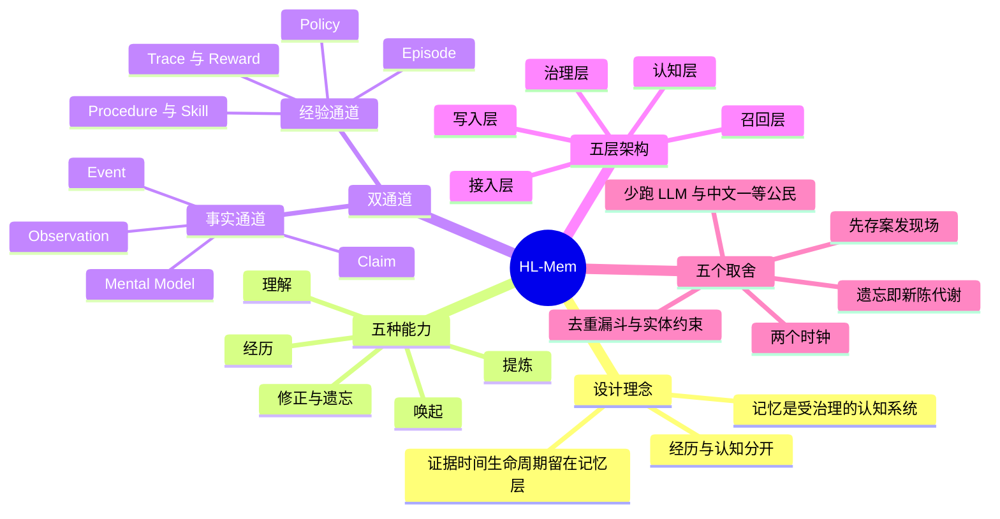
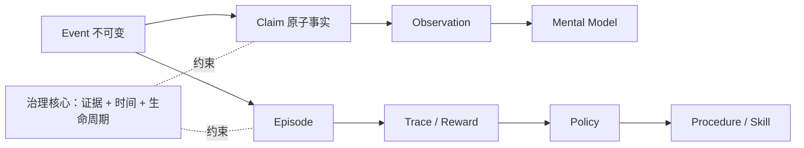
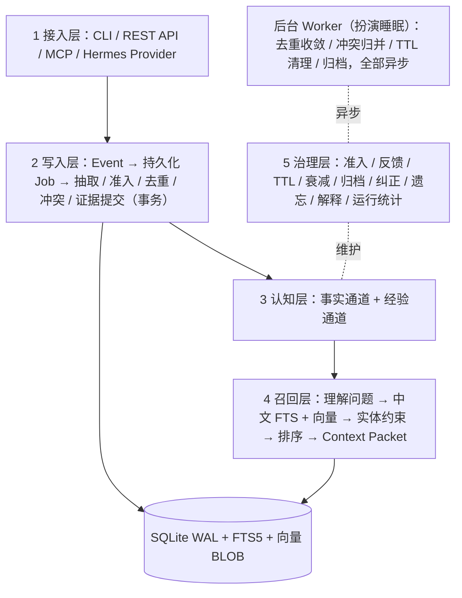
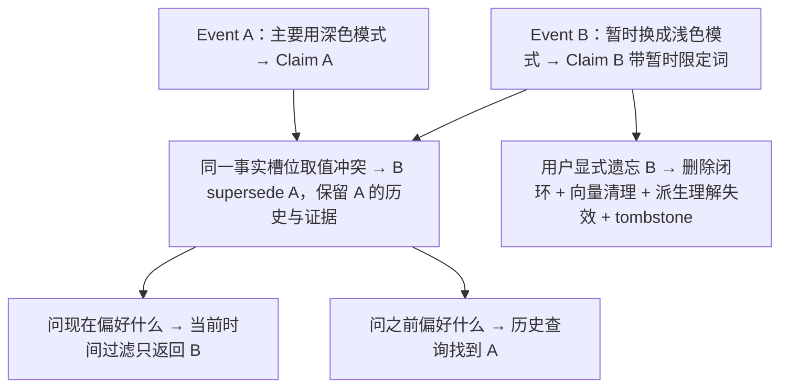
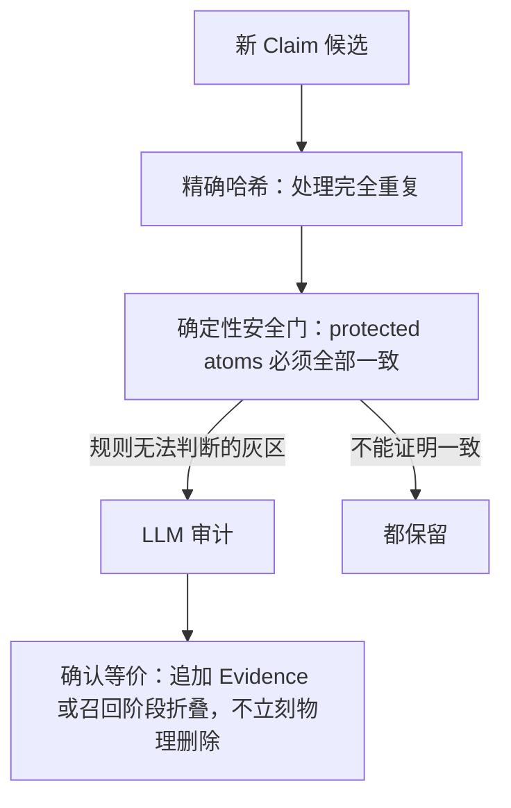

# 让 Agent 像人一样记忆：HL-Mem 的设计与取舍

> [!note] 阅读前提
> 读者背景按"有 RAG / LangGraph 经验的 LLM 应用工程师"处理（你的模板里这一项未填，我按示例值假设）。RAG、向量检索等基础概念一笔带过。对应版本：HL-Mem **v1.1** 系列。

## 1. TL;DR

- 要解决的问题：LLM 会话一关就归零；长上下文和 RAG 都不能处理记忆会**重复、矛盾、过期、被要求删除**的问题。
- 核心结论：记忆系统的本质是**在检索之上加一层治理**——去重、冲突消解、生命周期、可追溯。
- HL-Mem 的做法：不可变 **Event** + 可更新 **Claim** + 证据链 + 双时间模型 + 后台 Worker；经验另走一条独立通道。
- 工程取向：默认只依赖 **SQLite 单文件 + 一个后台 Worker**，高成本、高不确定性能力（建图、Reranker）必须显式开启。
- 设计姿态：宁可多留一条重复记忆，也不错误合并；认知模型可以向前走，默认依赖和运行成本必须收得住。

---

## 2. 核心概念

### 一句话定义

| 概念 | 一句话定义 | 解决的痛点 |
|---|---|---|
| **Event** | 不可变的原始事件（一轮对话、一次工具结果、一次操作） | 系统理解错了，仍能还原"它当时听到了什么" |
| **Claim** | 从 Event 提取的最小事实单元（主体 / 谓词 / 值 / 时间 / 重要性） | 可比较、可更新、可泛化 |
| **Evidence Link** | 把 Claim 指回原始 Event | 模型生成的文字本身不能充当事实来源 |
| **Observation / Mental Model** | 基于多条 Claim 的更高层理解 | 底层事实失效时，派生理解被标记为需重算 |
| **Episode** | 围绕同一目标的一组 Event 组成的任务级经验 | 回答"这次要做什么、发生了什么、结果怎样" |
| **Trace / Reward** | 执行轨迹 / 结果反馈 | 成功、失败、代价都有可复盘信号 |
| **Policy** | 经验中形成的选择策略 | "什么情况下优先采用哪种做法" |
| **Procedure / Skill** | 稳定有效做法沉淀成的可重复步骤或能力 | 后续任务直接复用 |
| **supersede** | 新 Claim 替代旧 Claim，旧的退出当前召回但保留历史 | 改口不删历史 |
| **valid time** | 这件事在现实中什么时候为真 | 回答"我 4 月实际在哪" |
| **recorded time** | 系统什么时候知道并记录了它 | 回答"你 4 月时以为我在哪" |
| **protected atoms** | 去重时必须全部一致的关键原子：主体、数字、版本、日期、路径、极性、引语、姓名、实体 | 防止"允许删除 / 不允许删除"被误合并 |
| **tombstone 账本** | 显式遗忘后的删除记录 | 阻止备份恢复或历史重放让旧记忆复活 |
| **Context Packet** | 召回的最终产物，带 Token 预算 | 对应人类的"线索联想" |
| **AdmissionPolicy** | 写入时的准入规则（确定性判断） | 对应海马体的选择性编码 |

### 易混概念对比

| 对比项 | A | B | 区别 |
|---|---|---|---|
| 长上下文 vs 长期记忆 | 解决"这一次请求能带多少材料" | 解决"跨越多次交互后，什么值得留下、怎样更新、何时再想起来" | 不是同一个问题 |
| RAG vs 记忆 | 数据是静态文档 | 数据是活的：会重复、矛盾、过期、被删除 | 记忆 = 检索 + 治理 |
| verbatim vs gist | 逐字痕迹，几小时衰减殆尽 | 要义痕迹，长期保留 | HL-Mem：要义用来思考，原文用来举证 |
| UPDATE vs supersede | 直接覆盖旧值 | 新 Claim 替代旧 Claim，保留历史与证据 | "旧值不再有效"≠"旧值从未存在" |
| 语义相似 vs 实体约束 | 回答"像不像" | 回答"是不是在说这个对象" | 前者排序，后者隔离 |
| 事实通道 vs 经验通道 | 被新证据**纠正** | 被反馈**强化或淘汰** | 一条维护认知，一条积累经验 |
| 衰减 vs 归档 vs 显式遗忘 | 只影响"多容易被想起" | 退出普通召回、清理向量，证据仍在 | 显式遗忘：物理删除闭环 |

---

## 3. 知识框架

### 双通道结构

### 五层架构

> [!note] 图的来源
> 原文有一张"整体架构"图，加载失败未能看到；上图依据正文"五层"文字重建，组件关系为 [推断]。

### 一条记忆的生命周期（深色 / 浅色模式例子）

### 去重漏斗

---

## 4. 关键要点

### 为什么长上下文和 RAG 都不够

- 装得下不等于用得好：LongMemEval（ICLR 2025）系统性测过长上下文 LLM 在持续交互记忆任务上的精度衰减。
- 衰减表现为三类：lost in the middle、新旧信息互相干扰（深色和浅色两个版本等权摆在模型面前）、跨会话聚合失败。
- 真实长期记忆无界：几个月的 Agent 历史是百万级 token，任何窗口装不下，检索是必选项。
- RAG 缺的是治理：去重、冲突消解、生命周期、可追溯。

> [!important] 一个记忆系统必须能回答的四个问题（检索都不负责回答）
> 哪句话是原始证据？哪个偏好**现在**有效？追问"之前呢"能否还原历史？新信息为什么替代旧信息，能否解释？

### 可持续个人 Agent 的五种能力

1. **经历**：保留原始事件，不只留模型总结。
2. **提炼**：把对话拆成可判断、可更新的原子事实。
3. **理解**：从多条事实形成观察、关系、更稳定的心智模型。
4. **唤起**：按当前问题、主体、时间和上下文预算找回合适记忆。
5. **修正与遗忘**：新证据可替代旧认知；低价值记忆衰减、归档；显式遗忘真正退出正常召回。

### 人类记忆 → 工程设计映射

| 认知科学现象 | 要点 | HL-Mem 对应设计 |
|---|---|---|
| 双痕迹（fuzzy-trace theory） | 逐字痕迹几小时衰减，要义痕迹长留 | LLM 提取结构化 Claim，原始对话作为不可变 Event 归档 |
| 海马体是挑剔的编辑 | 选择性编码发生在写入时 | AdmissionPolicy：先过确定性判断（有无信息量、能否被未来引用、是否一次性操作噪声） |
| 遗忘是免疫系统 | 遗忘是主动的信息治理；超忆症患者痛苦大于便利 | TTL、衰减、归档、显式遗忘 |
| 再巩固与双重时间感 | 旧版本留痕但不再被引用；"事情何时发生"与"我何时知道"是两条时间轴 | supersede 链 + valid / recorded time |
| 睡眠中的整理工 | 白天快速记录，夜里归并、抽象、清理 | 后台 Worker 异步维护，不阻塞白天读写 |
| 源记忆错误 | 人会记得事实却记错出处 | 每条 Claim 挂完整证据链，`recall` 每条结果可追溯到原话 |

> [!tip] 作者对"像人一样"的限定
> 只是工程抽象：复现的是人的记忆**行为**，不做神经系统仿真。

### 写入链路要点

- 事实型输入先成为不可变 Event，再经**可持久化 Job** 进入抽取 → 准入 → 去重 → 冲突 → 证据提交。
- 行动型 Event 可直接组织成 Episode / Trace，不必等事实抽取完成。
- 关键状态按事务提交，失败可重试，不会提前发布"已经记住"的成功状态。
- 同一 Session 的 Event 形成有界窗口：默认最多 **5 条**、最长等待 **120 秒**，然后一次结构化抽取；超长内容才继续分块。
- 显式写入的结构化记忆可绕过 LLM 抽取。

### 来源准入（v1.1）

- Event 携带 `origin_class` 与 `session_kind`：用户直接表达、外部网页、cron 任务、heartbeat、subagent 会话都可保存，但不再默认拥有同样的事实权威。
- `provenance.mode = "enforce"` 时，在调用模型**之前**拦住不适合自动形成 Claim 的来源。
- 作用：把提示词注入、外部噪声、系统自说自话挡在长期认知之外。

### 召回链路

1. 先理解问题所指的主体、实体和时间。
2. 融合中文 FTS5 与向量候选（RRF 融合）。
3. 高置信实体约束隔离同名或相似对象：`entity_constraint_mode = "enforce"`（默认）。
4. 新近度、重要性、反馈效用参与排序；Reranker 按需开启。
5. 组装成有 Token 预算的 Context Packet。

> [!warning] 易错：相似度高 ≠ 同一件事
> "部署 v1.2" vs "部署 v1.3"只差一个字符；"允许删除" vs "不允许删除"高度相似，对执行任务可能是完全相反的指令。所以去重不能只靠 cosine threshold。

### 遗忘三层（一层比一层彻底）

| 层 | 机制 | 对事实的影响 |
|---|---|---|
| 自然衰减 | 按 scope 与 importance 计算 TTL；长期未使用的 Claim 激活度（activation）按半衰期衰减；访问和正向反馈延长有效生命 | 只影响"多容易被想起"，**不改写**事实置信度 |
| 归档 archived | 退出普通召回、清理向量 | 事实和证据仍留在历史中，可查证 |
| 显式遗忘 Forget | 沿依赖关系物理删除：清理记忆对象与向量，派生理解失效；tombstone 防复活 | 彻底 |

- 遗忘的目的是**记忆质量控制**和保护检索带宽，不是画漂亮的遗忘曲线。
- 一键级联的显式遗忘在裸 RAG 里难补齐，在被遗忘权与本地隐私场景里是硬需求。

### 成本与中文

- 去重、冲突、维护以确定性规则优先；**关系发现默认关闭**，主链路不为建图再请求一次实体 / 边关系 LLM。
- 默认召回：中文 FTS5 + Embedding + RRF；Reranker 按需开启。
- 底层：SQLite WAL + FTS5 + 向量 BLOB；小规模直接精确扫描向量，数据变大时可选 `sqlite-vec`。
- 模型层：百炼 / DashScope、智谱、OpenAI-compatible 接口；外部 Provider 插件须经显式 allowlist，未启用时不会被导入。
- 预算：`hl-mem ops report` 汇总调用量、Token、费用、延迟、失败率；发送前保守预留预算，完成后按实际使用结算，无法可靠定价时 **fail-closed**。
- 中文：中文无天然分词，通用 FTS 对中文近乎失效；用 **Jieba** 领域词典预分词做全文索引；原文不翻译，提取语义中英双语对齐。

### 命令 / 配置速查

| 项 | 作用 | 场景 |
|---|---|---|
| `hl-mem explain claim <id>` | 展开结论、原始证据、来源坐标、演化关系 | 排查某条记忆为何形成 |
| `hl-mem ops report` | 汇总调用量 / Token / 费用 / 延迟 / 失败率 | 观测模型调用成本 |
| `provenance.mode = "enforce"` | 调用模型前拦截不适合形成 Claim 的来源 | 防注入与外部噪声 |
| `entity_constraint_mode = "enforce"`（默认） | 隔离其他实体的相似记忆 | 召回时防串实体 |
| `pip install hl-mem` | 安装 | Apache-2.0 |

---

### 方法对比表

| 路线 | 适用场景 | 优先解决的问题 | 局限 / 默认代价 |
|---|---|---|---|
| **Mem0** | — 原文未述 | 低门槛个性化记忆（轻量提取式记忆） | — 原文未述 |
| **Zep / Graphiti** | — 原文未述 | 关系推理（时间知识图谱） | 原文就"图谱"泛论：成本随实体、候选关系、更新频率组合式膨胀；错误关系沿多跳检索连锁污染 [推断：此论述针对图谱路线，未直接点名 Zep] |
| **Letta / MemGPT** | — 原文未述 | 有状态 Agent（记忆融进 Agent Runtime） | [推断] 记忆与 Runtime 耦合，迁移成本更高（原文说"独立于 Runtime 可降低迁移成本"） |
| **HL-Mem** | 本地个人 Agent、桌面助手、中文知识与偏好记忆；需追问来源、事实修正、历史回放、用户遗忘；希望记忆独立于 Runtime 的团队 | 把四件事绑在同一条默认路径：证据可追溯、历史可回放、按生命周期退出、不依赖某个 Runtime，且中文检索走默认路径 | 非不可信多租户的完整 RBAC / 托管平台（namespace 仅逻辑分区）；非默认开启的大规模图推理；类脑能力（Observation / Mental Model / Policy / Procedure）按真实使用证据逐步开放 |

> [!note] 说明
> 原文有一张竞品对比图，加载失败未能看到；竞品行只保留正文能支撑的内容。

### HL-Mem 的差异化定位

- 组合：完整记忆治理 × 证据与时间可解释 × 运行时独立 × 中文可用。
- 难点不在任何一项单独成立，而在**四项走同一条默认路径**。
- 理由：Agent 框架快速变化，记忆却是最需要长期保存的数据。

---

## 5. 数据速查表

| 指标 | 数值 | 出处 |
|---|---|---|
| 抽取窗口（同一 Session） | 最多 5 条 / 最长 120 秒 | 取舍五 |
| 高置信实体案例进入 Top-5 | 15 个全部 | v1.1 冻结门禁 |
| 跨实体错误 Top-1 | 15 个 → 0 | v1.1 冻结门禁 |
| 发布门禁检查项 | 三千余项 | 跑出来的效果 |
| LongMemEval 准确率 | 86%（仅跑 50 题） | 正文；结果表图未加载 |
| 与全上下文 / Native RAG 的差距 | 相差 3 题和 2 题 | 正文，⚠️ 见下 |
| 外部 Benchmark | 三套（LongMemEval、MemDaily、PerLTQA）+ 中文 E2E | 正文 + 附录 |
| H.M. 手术年份 / 当时年龄 | 1953 年 / 27 岁；术后又活五十多年 | 故事 + 尾声 |
| "心理学现在" | 约 3 秒；一天清醒约两万个瞬间 | Kahneman（2010） |
| 许可证 | Apache-2.0 | 正文 / 附录 |

> [!warning] LongMemEval 的两个对照
> 原文说"全上下文"与"Native RAG"作为对照，HL-Mem "最终只相差 3 题和 2 题"。⚠️[原文疑点] 哪个差 3、哪个差 2，以及 HL-Mem 是高于还是低于对照，原文未明说；表格图未加载，无法核对。作者强调的是：这说明治理**没有换来不可接受的信息损失**。

### 评测的三层口径

| 层 | 回答的问题 |
|---|---|
| 发布门禁 | 工程实现是否稳定 |
| 确定性基线 | 关键召回行为能否重复（低成本召回回归） |
| 真实模型 Benchmark | 整条链路最终表现 |

- MemDaily、PerLTQA、中文 E2E 主要验证**短程**的提取—召回—问答链路。
- 改口、双时间、显式遗忘等长期治理能力，**目前主要由确定性门禁覆盖**。
- LongMemEval 只跑 50 题的原因：每题要摄入几十轮历史会话，再完成抽取、Embedding、去重、召回、reader、judge，Prompt 一改就要整轮重跑。
- 成本观：结构化记忆把抽取成本放在写入阶段，之后每轮只携带必要事实和证据——**一次整理、多次复用**（holdout50 实验图未加载，具体数值 ⚠️[图中无法辨认]）。

---

## 6. 踩坑与教训

> [!warning] 易错清单
> - **只做向量检索**：新旧两个偏好都会被召回，旧偏好甚至可能排前面。
> - **去重只设 cosine threshold**：高相似但语义相反的指令会被错误合并，且错误合并可能永久改写事实。
> - **直接 UPDATE 覆盖**：丢失历史与审计，答不了"当时系统知道什么"。
> - **单时间戳**：迟到数据、事后纠正类问题必然答错。
> - **把"删除 API"当遗忘**：没回答"什么先忘、何时忘、重新用到会不会更耐久、派生结论怎么办"。
> - **把世界事实和做事经验揉成一张表**：解释不了为什么相信一件事，也解释不了为什么选择一种做法。
> - **默认建图**：成本组合膨胀，一条错误关系会沿多跳检索和派生推理连锁污染。
> - **什么都不忘**：旧偏好、一次性计划、无关细节会填满检索带宽。

### 作者的偏差选择

> [!important] 保守偏差
> **多留一条重复记忆通常只是浪费一点空间，错误合并却可能永久改写事实。**

---

### 可迁移的设计原则

1. **经历与解读分离**：原始记录不可改写，派生结论可重算、可纠正。
2. **来源决定权威**：来源（用户直述 vs 外部网页 vs cron / heartbeat / subagent）在调用模型前就做准入。
3. **确定性规则先于 LLM**：能证明的先用规则（哈希、protected atoms），只有灰区才交给 LLM。
4. **高风险写入默认关闭**：关系写入需显式开启与审核，正式边保留来源闭环。
5. **复杂度关进明确边界**：在线召回不等待维护任务；基础数据面不依赖外部向量库或图数据库。
6. **预算与失败要可观测**：发送前预留、完成后结算、无法定价时 fail-closed。
7. **用户数据控制权落到存储与恢复链路**：不只停在"以后不召回"。
8. **边界换小故障半径**：高成本、高不确定性能力显式开启；证据、时间、生命周期、数据主权留在默认主链路。
9. **[推断]** 提升召回质量不一定要换更大的模型，先把对象边界（实体约束）设计清楚——原文以 15 → 0 的结果支撑此论点。
10. **[推断]** 下一轮功能由真实 Agent 工作流里反复失败的点驱动，而不是先加功能（原文："先看真实 Agent 工作流里哪里反复失败，再决定加什么"）。

---

## 7. 记忆锚点

> [!tip] 锚点 1：三句口诀
> **要义管理解，原文管举证，来源决定权威。**（Claim 用来思考，Event 用来举证）

> [!tip] 锚点 2：两个时钟 + 一个偏差
> 杭州 / 北京例子：3 月说"在杭州"，8 月才说"5 月就搬去北京了"。问"4 月时你以为我在哪"→ 杭州（recorded 视角）；问"我 4 月实际在哪"→ 北京（valid 视角）。偏差：**宁可多留，不可错并**。

---

## 8. 复习卡片

长上下文和长期记忆分别解决什么问题？::长上下文解决"这一次请求能带多少材料"；长期记忆解决"跨越多次交互后，什么值得留下、怎样更新、何时再想起来"。
RAG 为什么不够做记忆？::RAG 的数据是静态文档，记忆的数据会重复、矛盾、过期、被要求删除；记忆 = 检索 + 去重 / 冲突消解 / 生命周期 / 可追溯。
Event 与 Claim 的关系？::Event 是不可变的原始事件；Claim 是系统对 Event 的解读（最小事实单元），可被纠正，Evidence Link 指回 Event。
valid time 与 recorded time 的区别？::valid time = 事实在现实中何时为真；recorded time = 系统何时知道并记录了它。
为什么用 supersede 而不是 UPDATE？::旧 Claim 退出当前召回但保留在历史与审计里；"旧值不再有效"和"旧值从未存在"是两回事。
HL-Mem 的去重漏斗是哪三步？::精确哈希处理完全重复 → 确定性安全门检查 protected atoms（必须全部一致）→ 仅灰区交 LLM 审计；确认等价后优先追加 Evidence 或召回折叠，不立刻物理删除。
实体约束的效果数据？::v1.1 冻结门禁中 15 个高置信实体案例全部进入 Top-5，跨实体错误 Top-1 从 15 降到 0。
遗忘的三层是什么？::自然衰减（只影响易被想起程度）→ 归档（退出普通召回、保留证据）→ 显式遗忘（物理删除闭环 + 派生理解失效 + tombstone 防复活）。
为什么默认不建图？::图谱成本随实体、候选关系、更新频率组合式膨胀，且错误关系会沿多跳检索和派生推理连锁污染；所以关系发现默认关闭，需显式开启和审核。
事实通道与经验通道的区别？::共享 Event 起点，演化规则不同：事实会被新证据纠正；经验会被反馈强化或淘汰。

---

## 9. 知识关联

候选双链（由你决定哪些已有笔记）：

- [[RAG]]、[[向量检索]]、[[Embedding]]、[[RRF 混合检索]]
- [[LongMemEval]]、[[Lost in the Middle]]、[[Agent 评测体系]]
- [[Mem0]]、[[Zep 与 Graphiti]]、[[Letta 与 MemGPT]]、[[知识图谱]]
- [[MCP]]、[[LangGraph]]、[[Agent Runtime]]
- [[SQLite FTS5]]、[[中文分词 Jieba]]
- [[认知科学与记忆]]、[[双时间模型]]、[[被遗忘权]]

---

## 10. 原文参考资料与扩展阅读

> 以下为外部知识，不属于原文。均为稳定概念，未涉及版本 / API 时效。

- **[扩展]** 双时间模型在数据库领域称 bitemporal，对应"有效时间 / 事务时间"两条时间轴，可对照 SQL:2011 的时态表概念。
- **[扩展]** RRF（Reciprocal Rank Fusion）把多路检索的排名按 `1/(k + rank)` 求和融合，常见 k 取 60；原文只提到"Embedding 与 RRF"，未给公式。

---

> [!note]- 校对报告
> **1. 覆盖度**
> - 已覆盖：摘要、H.M. 故事、深色 / 浅色问题、长上下文 vs 记忆、五种能力、六条认知科学映射、事实 / 经验双通道、五层架构、生命周期与双时间、五个设计取舍、竞品对比、效果与评测口径、适用边界、尾声、附录参考。
> - 未覆盖 / 有意省略：团队介绍、拓展阅读导航、留言区（非学习内容）；附录的完整文献列表只吸收了正文用到的部分。
> - ⚠️ **原文有 8 处图片在 PDF 中显示为加载占位符，未能看到内容**：摘要下方图、"整体架构"图、"一条记忆"流程图、"相似度 0.99"一节后的图、"让 LLM 少跑几趟"一节后的图、竞品对比图、"跑出来的效果"结果表、holdout50 成本—效果图。其中架构 / 流程 / 漏斗图的 Mermaid 为按正文文字重建；竞品对比、结果表、成本图的数值未能获得。
> - 章节标题在 PDF 中无编号。原文交叉引用"第二节（赛道玩家）/ 第三节（fuzzy-trace）/ 第六节（杭州北京例子）/ 第七节（遗忘）"，按顺序对应为：长上下文（2）、人类记忆（3）、一条记忆的一生（6）、五个取舍（7）——[推断] 此编号方式自洽。
>
> **2. 一致性（抽查 5 个关键数字，均与原文文字一致）**
>
> | 数字 | 笔记 | 原文 |
> |---|---|---|
> | 抽取窗口 | 最多 5 条 / 120 秒 | 默认最多 5 条、最长等待 120 秒 |
> | 实体约束 | 15 个全部 Top-5；Top-1 错误 15 → 0 | 同 |
> | 发布门禁 | 三千余项 | 三千余项 |
> | LongMemEval | 86% / 50 题 / 差 3 题和 2 题 | 同（对应关系见下） |
> | H.M. | 1953 年 / 27 岁 / 五十多年 | 同 |
>
> **3. [推断] 与 ⚠️ 汇总**
> - [推断] 五层架构 Mermaid 中的组件连线（原文架构图未加载）。
> - [推断] 竞品"局限"栏中 Zep / Graphiti 与 Letta 两行；原文对竞品只写了"优先解决什么"。
> - [推断] 设计原则第 9、10 条。
> - [推断] 章节编号与交叉引用的对应。
> - ⚠️[原文疑点] LongMemEval "相差 3 题和 2 题"：哪个对应全上下文、哪个对应 Native RAG，以及 HL-Mem 高于还是低于对照，原文未明说。
> - ⚠️[原文疑点] 评测入口路径：正文写 `evaluation/results/README.md`，附录写 `evaluation/README.md`，两处不一致，已如实保留。
> - ⚠️[原文疑点] "不必同时增加三套外部基础设施"：原文未说明是哪三套（正文只明确提到外部向量库和图数据库）。
> - ⚠️[原文疑点] Observation / Mental Model / Policy / Procedure 在架构中被列为认知层组件，但"适合 / 边界"一节又说它们"按真实使用证据逐步开放"，当前是否默认可用原文未明说。
> - ⚠️[原文疑点] "高置信实体"的判定标准、半衰期长度、TTL 数值均未给出。
> - ⚠️[图中无法辨认] holdout50 成本—效果图、竞品对比图、结果表的具体数值。
> - 附录列出但正文未展开的同类系统：Hindsight Memory API、MemOS，未写入笔记正文。
> - 文件名日期取自文章发布日期（2026年9月11日）。
