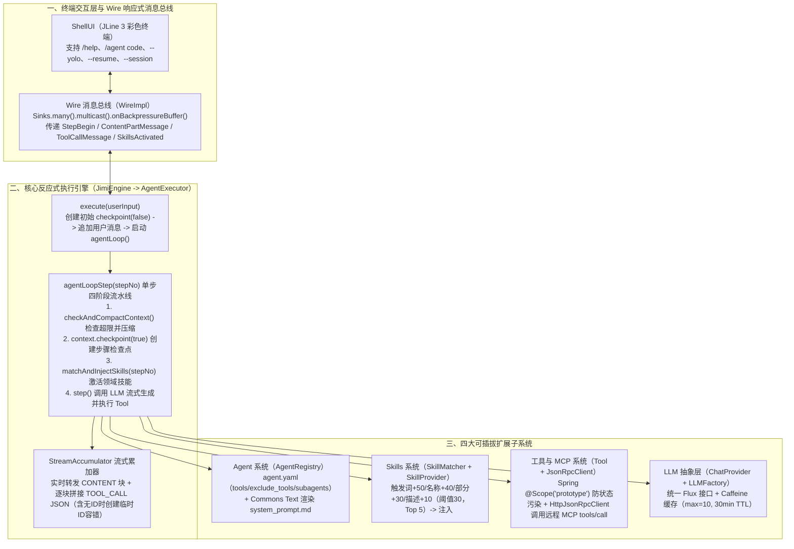

# Jimi：打造Java程序员专属的开源ClaudeCode

## 1. TL;DR

1. **核心痛点**：蚂蚁对最受欢迎的 **135 个** AI 开源项目统计显示，主流 AI Coding Agent（如 Claude Code、Cursor 工具链）高度集中于 Python 与 TypeScript 生态，导致 Java 企业级研发面临**技术栈割裂、难以深度集成 Spring Boot / Maven 工程、私有化安全定制门槛高**等痛点。
2. **纯 Java 响应式架构（`Jimi` 开源项目）**：基于 **Spring Boot 3.2.5 + Project Reactor（`Mono` / `Flux`） + Caffeine 缓存 + JLine 3 + Jackson + Apache Commons Text** 构建八大核心功能域，通过委托模式将 `JimiEngine`（装配协调）与 `AgentExecutor`（反应式主循环心脏）解耦。
3. **四大核心技术机制**：
   - **反应式主循环与检查点**：`agentLoopStep(stepNo)` 单步串联 `checkAndCompactContext() -> context.checkpoint(true) -> matchAndInjectSkills(stepNo) -> step()`，并通过 `StreamAccumulator` 处理流式 Chunk（首創**临时 ID 策略**容错 LLM 先发 `arguments` 后发 `id` 的异常时序）；
   - **配置化 Multi-Agent 与 Prototype Tool**：采用 `agent.yaml + system_prompt.md`（经 `StringSubstitutor` 注入 `${JIMI_NOW}`、`${JIMI_WORK_DIR}`）定义专业 SubAgent（如 `review`、`test`）；工具实现泛型 `Tool
` 接口并以 `@Scope("prototype")` 隔离状态；
   - **加权计分 Skills 动态激活**：`SkillMatcher` 基于关键词对 `skill.yaml` 计算得分（触发词匹配 `+50`、名称 `+40`、部分匹配 `+30`、描述 `+10`，上限 `100`，默认阈值 `30`、最多激活 `5` 个），由 `SkillProvider` 格式化为 `<system type="skills">` 消息按需注入；
   - **Wire 响应式消息总线与 MCP 集成**：基于 `Sinks.many().multicast().onBackpressureBuffer()` 解耦核心引擎与 `ShellUI`，并通过 `HttpJsonRpcClient`（WebClient）支持标准 MCP `tools/call` 协议。

## 2. 问题定义与背景

### 2.1 Java 生态在 AI Coding 浪潮中的四大痛点

1. **技术栈割裂**：主流开源 Coding Agent 多以 Python 或 TypeScript 编写，Java 工程师难以直接在现有工程内二次开发或嵌入调试。
2. **企业级框架集成诉求**：存量企业后端依赖 Spring Boot、Maven 与微服务治理体系，亟需原生 Java 生态的 Agent 基座。
3. **私有化部署与安全可控**：企业对源码外发高度敏感，需要可本地化部署、支持敏感操作审批（以及 `--yolo` 自动批准开关）的自主可控方案。
4. **领域知识按需扩展**：若将所有代码规范硬编码进 System Prompt 会造成严重 Token 浪费与维护僵化，亟需动态按需激活的 Skills 机制。

### 2.2 Jimi 的八大核心功能域划分

| 功能域 | 核心模块 | 主要职责 | 核心设计亮点 |
| --- | --- | --- | --- |
| **核心引擎** | `JimiEngine` / `AgentExecutor` | 任务执行与主循环调度 | 委托模式解耦装配与循环，单一职责 |
| **Agent 系统** | `AgentRegistry` / `AgentSpecLoader` | Agent 管理、加载与委托 | `agent.yaml` + Markdown 模板渲染 |
| **工具系统** | `ToolRegistry` / `ToolRegistryFactory` | 工具注册、参数校验与执行 | Spring `@Scope("prototype")` 插件化 |
| **LLM 集成** | `LLMFactory` / `ChatProvider` | 多模型流式接入与实例管理 | Caffeine 缓存（容量 10，30min 过期） |
| **Skills 系统** | `SkillMatcher` / `SkillProvider` | 领域知识智能匹配与注入 | 关键词加权计分（阈值 30，上限 5 个） |
| **消息总线** | `Wire` / `WireMessage` | 引擎与 UI 跨组件异步通信 | Reactor `Sinks.Many` 多播响应式事件流 |
| **会话管理** | `Session` / `Context` / `Compaction` | 上下文持久化与历史压缩 | 逐步 Checkpoint 回滚机制 + 智能压缩 |
| **UI 交互** | `ShellUI` / `OutputFormatter` | 命令行交互、高亮与可视化 | 基于 `JLine 3` 订阅 `Wire` 实时渲染 |

## 3. 知识框架

## 4. 核心内容拆解

### 4.1 `AgentExecutor` 反应式主循环与流式容错设计

1. **委托模式解耦引擎职责**：
   - 早期版本将执行循环、工具调用、上下文管理全部堆在 `JimiEngine` 中导致难以测试；重构后 `JimiEngine` 仅负责组件装配，将核心调度委托给 `AgentExecutor`。
2. **`agentLoopStep(int stepNo)` 的四步响应式编排（基于 Project Reactor `Mono`）**：
   - 首先校验 `stepNo > maxSteps`，超限则抛出 `MaxStepsReachedException`；随后通过 `wire.send(new StepBegin(...))` 通知 UI；
   - 在 `Mono.defer` 中依次串联：① `checkAndCompactContext()`（Token 超限时智能压缩历史消息） $\to$ ② `context.checkpoint(true)`（创建步骤级检查点支持异常回滚） $\to$ ③ `matchAndInjectSkills(stepNo)`（匹配并注入技能包） $\to$ ④ `step()`（调用 LLM 并执行工具：若返回 `finished == true` 即纯文本无工具调用则结束循环，否则递归进入 `agentLoopStep(stepNo + 1)`）。
3. **`StreamAccumulator` 流式累加与乱序容错**：
   - 处理 `ChatCompletionChunk` 的三类状态：`CONTENT`（追加至 `contentBuilder` 并实时通过 `wire` 推送 `ContentPartMessage` 实现零延迟打字机效果）、`TOOL_CALL`（逐块累积函数名与 JSON 参数）、`DONE`（记录 `usage` Token 统计）。
   - **临时 ID 容错策略**：针对部分 LLM 流式返回 Tool Call 时**先发送 `arguments` 分片、后发送 `id`** 的异常时序，当收到参数但尚无 ID 时自动生成临时 ID 兜底，确保流式参数分片零丢失。

### 4.2 配置化 Agent、原型作用域 Tool 与 MCP 协议集成

1. **`agent.yaml` + `system_prompt.md` 模板化构建**：
   - 在 `agent.yaml` 中声明可委托的 `subagents`（如 `review`、`test`）、白名单 `tools`（如 `read_file`、`write_to_file`、`str_replace_file`、`patch_file`、`bash`、`glob`、`grep`、`think`）、黑名单 `exclude_tools`（如 `fetch_url`、`set_todo_list`）及自定义参数 `system_prompt_args`；
   - `AgentRegistry` 利用 Apache Commons Text 的 `StringSubstitutor` 将内置变量（`${JIMI_NOW}`、`${JIMI_WORK_DIR}`）与自定义变量（如 `${JAVA_VERSION}`、`${CODING_STYLE}`）渲染进 `system_prompt.md`。
2. **泛型 `Tool
` 接口与 `@Scope("prototype")` 状态隔离**：
   - 每个工具声明 `@Component` 与 `@Scope("prototype")`（每次获取时创建新实例，彻底杜绝并发调用下的成员变量状态污染），通过 Jackson `@JsonProperty` 与 `@JsonPropertyDescription` 自动生成 Function Calling JSON Schema（如 `ReadFile.Params` 的 `path`、`startLine`、`endLine`），并可通过 `Flux.merge` 并发执行多个工具调用。
3. **标准 MCP 客户端集成（`JsonRpcClient`）**：
   - 定义 `initialize()`、`listTools()`、`callTool(toolName, arguments)` 标准接口；`HttpJsonRpcClient` 基于响应式 `WebClient` 构造 `method = "tools/call"` 的 JSON-RPC 请求，支持通过 JSON 配置无缝接入 PostgreSQL、Git、GitHub 等外部 MCP Server。

### 4.3 Skills 动态知识注入系统（告别冗长 System Prompt）

1. **`skill.yaml` 声明式定义**：包含 `name`、`description`、`scope`（如 `global`）、`triggers` 触发词列表与 Markdown 格式的 `content`（如 Java 代码审查清单）。
2. **`SkillMatcher` 加权计分算法与缓存**：
   - 对用户输入文本提取关键词（结果缓存在 `matchCache` 中），遍历候选 Skills 按以下规则累加得分（上限 **100 分**）：
     - 触发词精确匹配：**`+50 分`**
     - 名称匹配：**`+40 分`**
     - 触发词部分匹配：**`+30 分`**
     - 关键词在描述中出现：**`+10 分`**
   - 过滤掉低于阈值（默认 `score-threshold: 30`）的项，按得分降序截取 Top N（默认 `max-matched-skills: 5`）。
3. **`SkillProvider` 去重注入**：过滤掉 `context.getActiveSkills()` 中已激活的技能，将新匹配的技能封装进 `<system type="skills">...</system>` 系统消息追加至 `Context`，并通过 `Wire` 广播 `SkillsActivated` 事件在终端提示用户。

## 5. 数据速查表

| 指标 / 配置项 | 原文数值 / 设定 | 语境 / 条件 |
| --- | --- | --- |
| 行业背景统计样本 | **135 个最受欢迎 AI 开源项目** | 蚂蚁统计报告（凸显 Java 在 AI 开源生态中的缺位） |
| 核心框架与依赖版本 | **Spring Boot `3.2.5` + Project Reactor + Caffeine + JLine 3** | JDK 17+ 纯 Java 响应式技术栈 |
| 核心功能域划分数量 | **8 个核心功能域** | 核心引擎、Agent、工具、LLM、Skills、消息总线、会话、UI |
| `LLMFactory` Caffeine 缓存配置 | **`maximumSize(10)`，`expireAfterAccess(30, MINUTES)`** | 开启 `recordStats()`，优先读取 `{PROVIDER_TYPE}_API_KEY` 环境变量 |
| `SkillMatcher` 计分权重与上限 | **精确触发词 `+50` / 名称 `+40` / 部分触发词 `+30` / 描述 `+10`（上限 `100`）** | `Math.min(score, 100)` |
| Skills 自动匹配默认配置 | **`score-threshold: 30`，`max-matched-skills: 5`** | `application.yml` 中 `jimi.skill.matching` 默认参数 |

## 6. 踩坑与教训 / 可迁移的设计原则

| 错误做法 | 失败表现或原因 | 原文应对（可迁移的设计原则） |
| --- | --- | --- |
| **把主循环调度、工具执行、上下文管理全塞进同一个 `Engine` 类** | 职责耦合严重，单测难以 Mock，新增扩展牵一发而动全身 | **委托模式解耦（`JimiEngine` -> `AgentExecutor`）**：`JimiEngine` 仅负责装配，由 `AgentExecutor` 专注反应式主循环调度 |
| **在流式解析 Tool Call 时假设 LLM 一定先发 `id` 再发 `arguments`** | 部分模型流式 Chunk 会先发参数后发 ID，导致参数分片因找不到对应 ID 而丢失 | **在 `StreamAccumulator` 中引入“临时 ID 策略”**：收到无 ID 参数分片时先创建临时 ID 缓冲，待正式 ID 到达后对齐合并 |
| **将有状态的 `Tool` 注册为 Spring 默认的单例（Singleton）Bean** | 多工具并发执行（`Flux.merge`）或多轮调用时发生内部状态互相污染 | **强制声明 `@Scope("prototype")` 原型作用域**：每次从容器获取工具时均创建全新实例 |
| **把所有领域规范与 Checklist 全量硬编码进全局 System Prompt** | 无关知识长期霸占 Token 窗口，且修改知识必须重新打包部署 | **构建基于触发词计分的 Skills 动态注入机制**：匹配得分 $\ge 30$ 的 Top 5 技能并去重注入 `<system type="skills">` |

## 7. 记忆锚点

1. **单步循环四拍子（`agentLoopStep`）**：“**一查压缩（`Compact`）、二打快照（`Checkpoint`）、三配技能（`Skills`）、四跑模型（`Step`）**”。
2. **七大设计模式映射**：“**引擎委托（Delegate）、LLM/工具工厂（Factory）、多模型策略（Strategy）、工具/Agent 注册表（Registry）、Wire 观察者（Observer）、AbstractTool 模板方法（Template）、Prototype 工具原型（Prototype）**”。

## 8. 复习卡片

1. `Jimi` 的核心执行循环 `agentLoopStep(int stepNo)` 在每一步中依次执行哪四个核心动作？::① `checkAndCompactContext()` 检查上下文是否超限并按需触发智能压缩；② `context.checkpoint(true)` 创建步骤级检查点以支持回滚；③ `matchAndInjectSkills(stepNo)` 动态匹配并注入领域技能包；④ `step()` 调用 LLM 流式响应并执行工具（若无工具调用则结束循环，否则递归进入 `stepNo + 1`）。
2. 在处理 LLM 流式返回的 `ChatCompletionChunk` 时，`StreamAccumulator` 如何解决工具调用参数分片乱序问题？::针对部分模型在流式返回 `TOOL_CALL` 时可能先发送 `arguments` 参数片段、后发送 `id` 的异常时序，`StreamAccumulator` 采用“临时 ID 策略”，在收到参数但尚无 ID 时创建临时 ID 暂存数据，确保流式参数不丢失。
3. `Jimi` 的 Agent 配置化设计是如何实现“修改 Agent 行为与工具权限无需改 Java 代码”的？::通过 `agent.yaml` 定义可委托的 `subagents`、可用 `tools`、排除的 `exclude_tools`（从标准工具集中剔除）及模板参数 `system_prompt_args`；加载时由 `AgentRegistry` 调用 Apache Commons Text 的 `StringSubstitutor` 将内置变量（如 `${JIMI_NOW}`、`${JIMI_WORK_DIR}`）与自定义参数渲染进 `system_prompt.md`。
4. 为什么 `Jimi` 中的所有工具类（如 `ReadFile`）在标注 `@Component` 时还要显式加上 `@Scope("prototype")`？::因为 `Jimi` 支持通过 `Flux.merge` 并发执行多个工具调用；使用 `prototype` 原型作用域能保证每次获取工具时都创建全新实例，彻底避免单例 Bean 下的状态污染。
5. `SkillMatcher` 是如何根据用户输入计算每個 `SkillSpec` 的匹配得分的？默认激活阈值与数量上限是多少？::提取输入关键词后按四档计分：触发词精确匹配 `+50` 分、名称匹配 `+40` 分、触发词部分匹配 `+30` 分、关键词出现在描述中 `+10` 分（总分上限 `100` 分）；默认过滤得分 `>= 30` 分的技能，按得分降序最多取前 `5` 个，并由 `SkillProvider` 过滤掉当前会话已激活过的技能后注入 `<system type="skills">`。
6. `Wire` 消息总线在 `Jimi` 架构中起什么作用？底层基于什么组件实现？::`Wire` 采用观察者（发布-订阅）模式彻底解耦底层的 `AgentExecutor` 与顶层的 `ShellUI`；底层基于 Project Reactor 的 `Sinks.many().multicast().onBackpressureBuffer()` 实现，负责多播传递 `StepBegin`、`ContentPartMessage`、`ToolCallMessage` 与 `SkillsActivated` 事件。
7. `LLMFactory` 如何管理多模型实例与 API Key 安全性？::内部使用 Caffeine 缓存（`maximumSize(10)`，30 分钟未访问自动过期并开启 `recordStats()`）避免重复创建 LLM 实例；解析 API Key 时优先读取 `{PROVIDER_TYPE}_API_KEY` 环境变量覆盖配置文件，降低密钥硬编码泄露风险。

## 9. 知识关联

- **本库主题关联**：
  - [Agent工程循环](../../20_topics/Agent工程循环.md)：基于 Spring Boot 3 + Project Reactor 构建纯 Java 响应式 Agent 主循环（含 Checkpoint 回滚、上下文压缩与 Wire 事件总线）。
  - [Skill设计与治理](../../20_topics/Skill设计与治理.md)：设计基于 `skill.yaml` 触发词加权计分（`+50/+40/+30/+10`）、Caffeine 缓存与会话级去重的 Skills 按需动态注入系统。
  - [AI研发协同](../../20_topics/AI研发协同.md)：通过 `agent.yaml` 配置化定义 Code / Review / Test 多子 Agent 协作与标准 MCP JSON-RPC 工具集成。
- **候选双链**：`[[Jimi]]`、`[[ClaudeCode]]`、`[[ProjectReactor]]`、`[[SkillMatcher]]`、`[[Wire消息总线]]`

## 10. 原文参考资料

- **原文标题**：《Jimi：打造Java程序员专属的开源ClaudeCode》
- **发布渠道与日期**：微信公众号「大淘宝技术」，2025-12-10
- **作者与团队**：山泽（淘天集团-淘特用户技术团队）
- **开源仓库链接**：
  - `Jimi` GitHub 仓库：`https://github.com/Leavesfly/Jimi`

> [!note]- 校对报告
> - **页码溯源汇总**：
>   - 引言（蚂蚁 135 个 AI 开源项目统计）、Java 开发者四大痛点、Jimi 核心价值与八大核心功能域总表：`p.1–3`
>   - 核心引擎（`JimiEngine` 与 `AgentExecutor` 委托解耦、`execute` 与 `agentLoopStep` 响应式代码、`StreamAccumulator` 流式累加与临时 ID 容错）：`p.3–7`
>   - Agent 系统（`agent.yaml` + `system_prompt.md`、`AgentRegistry` 基于 `StringSubstitutor` 模板渲染）：`p.7–10`
>   - 工具系统（`Tool
` 接口、`ReadFile` `@Scope("prototype")` 实现）与 LLM 集成（`ChatProvider` 接口、`LLMFactory` Caffeine `maximumSize(10)` / 30 分钟缓存与环境变量解析）：`p.10–14`
>   - Skills 系统（`skill.yaml`、`SkillMatcher` `+50/+40/+30/+10` 计分与 `SkillProvider` `<system type="skills">` 注入）：`p.14–19`
>   - MCP 协议集成（`JsonRpcClient` / `HttpJsonRpcClient`）与 `Wire` 消息总线（`WireImpl` `Sinks.many().multicast()`、4 类消息与 `ShellUI` 订阅）：`p.19–23`
>   - CLI 使用技巧（`--yolo`、`--resume`、`score-threshold: 30`、`max-matched-skills: 5`）、自定义扩展、七大设计模式总结与演进路线图：`p.23–30`
> - **关键数值一致性核查**：
>   - `135` 个 AI 开源项目、Spring Boot `3.2.5`、8 个核心功能域、Caffeine `maximumSize(10)` 与 `30` 分钟过期、Skills 计分（`+50/+40/+30/+10`，上限 `100`，阈值 `30`，最多 `5` 个）均与原文代码完全一致。
> - **图像与版面质量说明**：
>   - `p.1, 2, 4, 7, 10, 11, 15, 19, 21` 含分层架构图与模块交互图（位于 PDF 图像层），`p.5, 9, 12, 17–18` 部分 Java 代码长行最右侧有几个字符截断，均已对照上下文语法完整还原。
