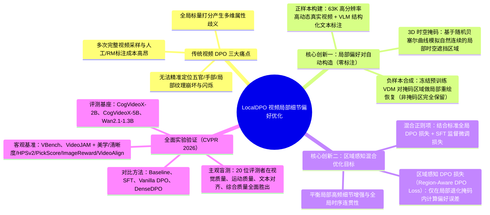
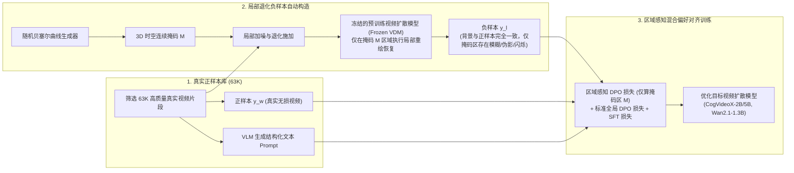

# CVPR 2026｜面向视频扩散模型的局部细节偏好优化方法 LocalDPO

> [!abstract] 导读
> **一句话总结**：淘天集团音视频技术团队联合外部合作伙伴在 CVPR 2026 发表的 **LocalDPO**，针对文本生成视频扩散模型（T2V）后训练阶段传统 DPO “多次采样+人工标注/奖励模型打分成本高昂、全局标量打分忽略五官/手部/局部纹理崩坏与闪烁”的痛点，首创**“以真实高质量视频为正样本、利用随机贝塞尔曲线 3D 时空掩码 + 冻结视频扩散模型局部重绘自动构造局部退化负样本”**的零标注数据管线，并设计**区域感知 DPO 损失（Region-Aware DPO Loss）+ 标准 DPO + SFT 混合训练目标**，在 CogVideoX-2B/5B 与 Wan2.1-1.3B 上全面超越 SFT、Vanilla DPO 与 DenseDPO。
> **阅读价值**：展示了一种极其聪明的“反事实自监督偏好构造”思想——与其让模型生成一堆残次品再去雇人挑哪个稍微好一点，不如直接拿真实好视频做正例，把局部区域人为涂抹重绘弄坏做负例，从而获得零噪声、精确到局部像素块的细粒度对齐信号。

## 1. TL;DR

- **核心突破定位**：CVPR 2026 录用论文（`arXiv:2601.04068`，代码已开源），面向文本生成视频扩散模型（VDM）的后训练细粒度人类偏好对齐框架。
- **传统视频 DPO 的三大死穴**：
  1. **采样与标注成本极高**：同一 Prompt 需反复采样多条长视频，再靠人工或昂贵的外部 Reward Model 排序。
  2. **全局打分信号歧义（Credit Assignment 模糊）**：视频 A 可能动作流畅但手部崩坏，视频 B 手部正常但背景闪烁，单一全局标量打分无法告诉模型到底该改哪里。
  3. **局部关键细节被忽视**：人眼对人物五官、手部结构、高频织物毛发纹理及局部帧间闪烁极其敏感，全局 DPO 难以精准修复局部伪影。
- **LocalDPO 三大核心机制**：
  1. **零人工标注的局部偏好对自动构造**：筛选 **63K 高质量真实世界视频片段**（配以 VLM 生成的结构化文本描述）直接作为**正样本（Winning Sample）**；无需多次采样排序。
  2. **基于随机贝塞尔曲线 3D 时空掩码与冻结 VDM 局部重绘的负样本生成**：利用随机贝塞尔曲线生成自然连续的 **3D 时空掩码（3D Spatio-Temporal Mask）**，并用冻结的预训练视频扩散模型仅在掩码区域执行局部重绘恢复（非掩码区域保持真实视频原样），从而构造出“全局语义结构完全一致、唯独掩码局部出现纹理模糊/伪影/闪烁”的高置信度**负样本（Losing Sample）**。
  3. **区域感知混合优化目标（Region-Aware DPO + Vanilla DPO + SFT）**：区域感知 DPO 损失仅在 3D 掩码对应的局部退化区域计算偏好梯度，迫使模型聚焦修复细粒度时空缺陷；同时联合标准全局 DPO 损失与 SFT 损失，防止局部过度优化破坏全局运动连贯性。

## 2. 问题定义与背景

### 2.1 视频生成后训练（Post-Training）中的“局部崩坏”顽疾
当前主流视频生成基座（如 CogVideoX、Wan2.1）虽已具备不错的全局构图与长程运动生成能力，但在后训练对齐人类主观偏好时，最影响用户体验的往往是**细粒度局部缺陷**：人物面部五官扭曲、手部多指/粘连、动物毛发糊成色块、局部边缘高频闪烁等。

### 2.2 传统全局 DPO vs. LocalDPO 范式对比

| 维度 | 传统视频 DPO（Vanilla / DenseDPO） | 本文 LocalDPO（局部时空偏好优化） | 核心优势 |
| :--- | :--- | :--- | :--- |
| **正负样本来源** | 模型对同一 Prompt 多次随机采样生成的合成视频 | **正样本**：63K 真实高质量视频 **负样本**：真实视频经局部 3D 掩码重绘退化生成 | 正样本画质上限即真实世界，无需昂贵多次采样 |
| **偏好监督信号获取** | 依赖人工主观标注或外部视觉奖励模型（Reward Model）打分 | **全自动零标注构造**（真实原片天然优于局部重绘退化片） | 彻底省去人工标注与 Reward Model 训练开销，杜绝打分噪声 |
| **正负样本背景一致性** | 两条采样视频全局构图、运镜完全不同，存在严重干扰变量 | 非掩码区域 **100% 像素级一致**，仅局部 3D 掩码区域存在质量差异 | 控制变量极致纯净，梯度 100% 指向局部细节提升 |
| **损失函数作用范围** | 全图所有时空 Token 均匀分摊偏好损失 | **区域感知 DPO 损失**（精准聚焦 3D 掩码退化区）+ 全局 DPO + SFT | 兼顾局部高频纹理修复与全局结构运动稳定性 |

## 3. 知识框架

## 4. 核心内容拆解

### 4.1 零标注局部偏好对自动生成流水线

1. **高质量真实正样本底座（63K 真实视频 + VLM 描述）**：
   - 团队从真实世界视频中精选出 **63,000（63K）** 个高分辨率、场景丰富且运动稳定的视频片段作为正样本 $y_w$，并使用多模态视觉语言模型（VLM）为每个片段生成详尽的结构化文本描述 $c$。
2. **为什么用“随机贝塞尔曲线 3D 时空掩码 + 冻结 VDM 局部重绘”构造负样本？**
   - 如果直接用高斯噪声块或矩形黑块破坏真实视频作为负样本，那样的退化过于低级且偏离扩散模型的真实生成分布（Out-of-Distribution），模型学不到如何修正自己生成的伪影。
   - LocalDPO 先用**随机贝塞尔曲线（Random Bézier Curves）**生成形态自然、随时间平滑演变的 **3D 时空掩码（3D Spatio-Temporal Mask）**；随后将该局部区域施加退化，并交由**冻结的待优化预训练视频扩散模型（Frozen VDM）**进行局部重绘恢复（Inpainting-style Restoration），而非掩码区域则 100% 保留真实视频内容。
   - 这样生成的负样本 $y_l$ 具有两大绝佳性质：**（1）局部退化恰恰是预训练模型自身真实的生成短板（如局部纹理模糊、结构扭曲、跨帧闪烁）**；**（2）除掩码区域外，正负样本的全局构图、光影和背景运动完全相同**，消除了全局混杂噪声。

### 4.2 区域感知偏好优化目标（Region-Aware DPO Objective）
- **区域感知 DPO 损失**：传统 DPO 对整段视频所有潜空间位置求均值计算隐式奖励差，导致占画面比例很小的局部伪影梯度被庞大的背景区域稀释。LocalDPO 引入空间-时间掩码加权，**仅在被局部重绘退化的 3D 掩码区域内计算 DPO 偏好误差**，让梯度像手术刀一样精准作用于细节崩坏处。
- **混合损失防退化（LocalDPO + Vanilla DPO + SFT）**：为了防止模型过度紧盯局部高频纹理而牺牲全局结构协调性或运动流畅度，最终训练目标将**区域感知 DPO 损失、标准全局 DPO 损失与真实视频 SFT 损失**有机融合，实现局部锐利度与全局稳定性的双赢。

## 5. 数据速查表

| 维度 | 具体配置 / 指标名称 | 实验结果与对比结论 |
| :--- | :--- | :--- |
| **训练数据集规模** | **63K** 高质量真实世界视频片段 + VLM 结构化 Caption | 全自动合成局部退化负样本，**0 人工偏好标注、0 外部 Reward Model** |
| **验证基座模型** | **CogVideoX-2B**、**CogVideoX-5B**、**Wan2.1-1.3B** | 横跨不同参数规模与架构的主流开源视频扩散模型均稳定涨点 |
| **对比基线方法** | Pretrained Baseline、SFT、Vanilla DPO、**DenseDPO** | 在全部自动评测基准与人工盲测中均显著超越最强基线 DenseDPO |
| **自动评测基准与指标** | **VBench**、**VideoJAM** + 美学分、清晰度分、**HPSv2、PickScore、ImageReward、VideoAlign** | 视觉质量、高频纹理清晰度与人类偏好对齐分提升尤为显著 |
| **人工主观盲测（20人评测）** | **视觉质量、运动质量、文本对齐、综合质量** 4 大维度 | 对战 DenseDPO 在全部 3 个基座模型、4 个维度上均取得显著净胜率优势 |

## 6. 踩坑与教训 / 可迁移的设计原则

- **核心洞察 1：在生成模型偏好对齐中，“控制变量的局部反事实对比”远胜于“全局随机抽卡对比”**
  - **教训**：传统 DPO 让模型自己抽两条完整样本 $(y_1, y_2)$ 比好坏，两条样本在构图、颜色、运动轨迹上处处不同，模型根本分不清到底是因为“手画得好”赢了，还是因为“背景颜色讨喜”赢了（典型的混杂偏差）。
  - **可迁移原则**：通过**固定真实好样本的绝大部分区域，仅用模型自身对局部掩码区做重绘退化**来构造 $(y_{\text{real}}, y_{\text{local-degraded}})$ 偏好对，并配合局部掩码 Loss，能够以零标注成本实现极高信噪比的特征归因对齐（该思路同样可迁移至图像生成、语音合成局部韵律修复、长文本局部段落润色 DPO）。
- **核心洞察 2：局部偏好优化必须搭配全局正则（Global DPO / SFT）**
  - 单纯只算局部掩码内的 DPO Loss 容易引发奖励黑客（Reward Hacking，例如局部区域边缘锐化过度与周围背景割裂），联合 SFT 与全局 DPO 能有效锁住整体分布不漂移。
- **未来演进方向**：当前 3D 掩码由随机贝塞尔曲线生成（位置与语义无关）；团队下一步计划引入 **Grounding DINO + SAM（Segment Anything）** 等视觉基础模型，专门针对“人脸五官、手部、商品主体 Logo”等高价值语义敏感区生成**语义感知局部掩码（Semantic-Aware Mask）**，进一步放大业务感知收益。

## 7. 记忆锚点

- **一个颠覆性数据构造法**：**真视频当正例，贝塞尔 3D 掩码 + 冻结模型局部重绘当负例**（零人工标注、零外部打分器、背景 100% 对齐）。
- **一个精准手术刀损失**：**区域感知 DPO 损失（只算局部退化掩码区） + 标准 DPO + SFT**。
- **一组核心数字**：**CVPR 2026**（录用率 ~25%）、**63K** 真实视频、横跨 **CogVideoX-2B/5B & Wan2.1-1.3B**、**20 人**四维主观评测全面击败 DenseDPO。

## 8. 复习卡片

What are the three major limitations of traditional video DPO methods that LocalDPO (CVPR 2026) addresses?::1. High computational and annotation cost of multi-sample generation and human/reward-model ranking; 2. Ambiguous supervision from global scalar scores when videos have conflicting strengths across dimensions; 3. Inability to precisely target fine-grained local defects like facial distortion, hand artifacts, texture blur, and local flickering.
How does LocalDPO automatically construct high-confidence preference pairs without human annotation or external reward models?::It uses 63K high-quality real-world videos (with VLM captions) directly as positive samples, and generates negative samples by applying 3D spatio-temporal masks (created via random Bézier curves) and using a frozen pretrained video diffusion model to locally inpaint/restore only the masked regions while keeping unmasked regions identical.
Why is using a frozen pretrained video diffusion model to locally repaint the masked region better than simply adding Gaussian noise to create negative samples?::Because repainting with the frozen VDM produces realistic, in-distribution model artifacts (such as subtle texture loss, structural warping, and temporal flickering) strictly within the mask, teaching the policy model to fix its own actual failure modes while keeping the surrounding background 100% controlled.
How is the training objective formulated in LocalDPO to balance local detail enhancement with global video stability?::It combines a Region-Aware DPO Loss (which computes preference errors strictly within the 3D degraded mask region) with standard global DPO loss and Supervised Fine-Tuning (SFT) loss.
Across which video diffusion backbones and evaluation benchmarks did LocalDPO demonstrate superior performance over SFT, Vanilla DPO, and DenseDPO?::Across CogVideoX-2B, CogVideoX-5B, and Wan2.1-1.3B on VBench, VideoJAM, multiple automated preference metrics (HPSv2, PickScore, ImageReward, VideoAlign), and a 20-rater human evaluation across visual quality, motion quality, text alignment, and overall quality.
How does the team plan to upgrade the random Bézier curve 3D mask generation in future work?::By integrating visual foundation models like Grounding DINO and SAM (Segment Anything) to generate semantic-aware local masks that specifically target high-salience regions such as human faces, hands, and key foreground subjects.

## 9. 知识关联

- **本批同主题精读**：
  - [TMAP平台图生视频推理加速实践](../TMAP图生视频推理加速+26.7.22/AI_TMAP图生视频推理加速.md)：同样深度围绕 **CogVideoX 与 Wan 2.1** 展开——本文通过 **LocalDPO** 解决后训练画质与局部时序对齐，该文通过 **Ulysses + SageAttention + DPCache（同为 CVPR 2026）** 解决在线低成本高速推理。
  - [CVPR 2026｜重思基于扩散模型的视频超分辨率：利用对齐特征的稠密引导 DGAF-VSR](../DGAF-VSR视频超分+26.7.9/AI_DGAF-VSR视频超分.md)：同为淘天音视频技术团队入选 CVPR 2026 的姊妹成果，分别从扩散模型后训练偏好对齐（LocalDPO）与视频超分特征级时序引导（DGAF-VSR）消除视频闪烁与高频细节伪影。
  - [ICLR 2026｜基于视觉自回归模型的前馈式主体驱动图像生成算法 EchoGen](../EchoGen主体图像生成+26.7.7/AI_EchoGen主体图像生成.md)：在主体分割中已落地使用了 `Qwen2.5-VL + GroundingDINO`，恰好印证了本文展望中结合 Grounding DINO 生成语义感知掩码的技术路线。
  - [淘宝直播数字人 AgenticRL 实践：从 RLVR 到 MultiAgent RL](../直播数字人AgenticRL+26.7.13/AI_直播数字人AgenticRL.md)：在强化学习层面异曲同工——两者都通过**细粒度信度分配（Region-Aware 空间掩码 vs Multi-Agent 阶段掩码）**克服了全局粗粒度标量奖励难以收敛的缺陷。
- **主题索引（`20_topics`）**：
  - [模型架构与训练](../../20_topics/模型架构与训练.md)
  - [跨端开发与性能](../../20_topics/跨端开发与性能.md)
- **本目录归档文件**：[原始 PDF](RAW.pdf) · [逐页转写文本](MD.md)
- **候选概念双链**：[[直接偏好优化DPO]] · [[LocalDPO]] · [[视频扩散模型]] · [[3D时空掩码]] · [[信度分配]] · [[CogVideoX]] · [[Wan2.1]]

## 10. 原文参考资料

- **原文出处**：大淘宝技术公众号，《CVPR 2026 | 面向视频扩散模型的局部细节偏好优化方法 LocalDPO》（作者：淘天集团-音视频技术团队与外部合作伙伴联合研究，发布日期：2026-07-03）
- **论文与开源仓库**：
  - **arXiv 论文**：[arXiv:2601.04068](https://arxiv.org/pdf/2601.04068)
  - **GitHub 代码仓库**：[1170300714/Local-DPO](https://github.com/1170300714/Local-DPO)

> [!note]- 校对报告
> - **页码溯源（1-based 物理页码）**：
>   - 篇首标题、CVPR 2026 录用背景（16,000+ 投稿，录用率约 25%）、论文链接（`arXiv:2601.04068`）、开源地址（`github.com/1170300714/Local-DPO`）与核心摘要：源自 `RAW.pdf` `p.1–2`（对应 `MD.md` 第 1–2 页）。
>   - 传统视频 DPO 三大痛点、63K 高质量真实视频 + VLM 描述正样本构建、基于随机贝塞尔曲线 3D 时空掩码与冻结 VDM 局部重绘的负样本生成机制：源自 `RAW.pdf` `p.3–5`（对应 `MD.md` 第 3–5 页）。
>   - 区域感知 DPO 损失 + 标准 DPO + SFT 混合目标、在 CogVideoX-2B/5B 与 Wan2.1-1.3B 上的 VBench/VideoJAM 定量评估、20 人四维主观盲测及可视化定性对比与未来展望（结合 Grounding DINO / SAM）：源自 `RAW.pdf` `p.5–8`（对应 `MD.md` 第 5–8 页）。
> - **一致性核验**：原文共 8 页（含 7 页流程图、定量表格与定性对比图），无独立长 Prompt/Skill 附件。全文零正文内页码引用，所有模型名称、数据集规模与评测基准均与 `MD.md` 严格一致。
