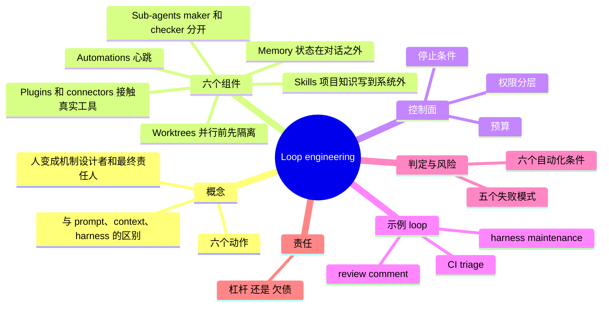
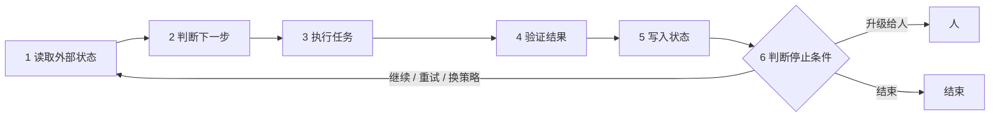
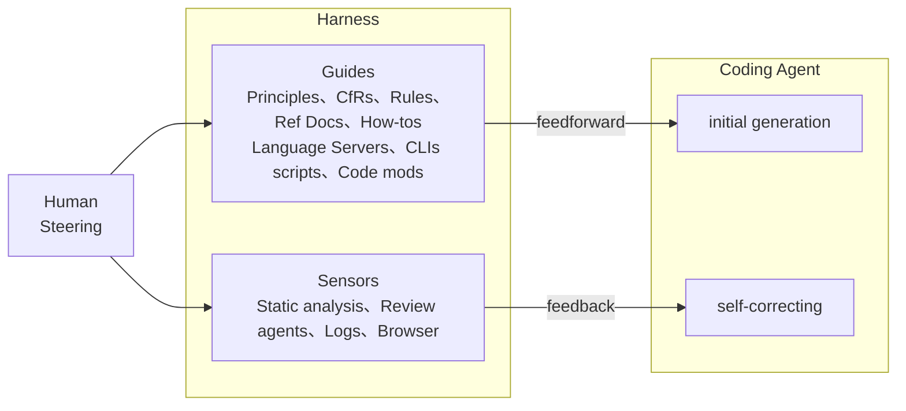
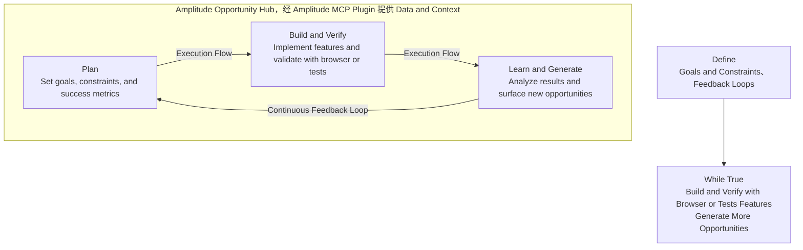
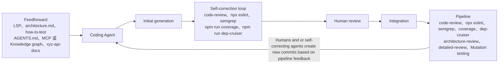

# Loop engineering：把 agent 放进工程循环

> [!note] 读者假设
> 提示词里读者背景是未填的占位符，本笔记按"有 RAG / LangGraph 经验的 LLM 应用工程师"处理：agent、prompt、MCP 等基础概念一笔带过，篇幅放在方法、取舍和易错点。

## 1. TL;DR

- 要解决的问题：agent 能自己读代码、改代码、跑测试、开 PR 之后，工程师的工作重心往哪移。
- 核心主张：不再逐轮提示 agent，而是设计一个能"读状态 → 判断 → 执行 → 验证 → 写状态 → 判断停止"的小系统，人从每轮的操作者变成**循环机制的设计者和最后的责任人**。
- 支撑系统的六个组件：Automations、Worktrees、Skills、Plugins/connectors、Sub-agents、Memory。
- 重点不在自动化程度，而在**控制面**：任务入口、判断标准、权限边界、记忆方式、验证机制、停止条件。
- 验收标准：这个 loop 是让你更理解系统（杠杆），还是让你更少读代码、判断、担责（更快地欠债）。

> [!important] 重点
> Loop engineering 只有在把状态、验证、权限和停止条件都写进工程流程时，才和"让 agent 多跑几轮"不一样；否则只是给自动化换个名字。

---

## 2. 核心概念

### 一句话定义

**Loop engineering**：设计一个按固定节奏发现任务、选择下一步、调用 agent、检查结果、记录状态并决定是否继续的工程系统，而不是亲自推动每一轮对话。

### 解决什么痛点

- 过去的用法是人一直握着方向盘：写 prompt、贴报错、看 diff、继续追问。
- 单次对话不适合承载复杂工程工作；agent 一旦跨多轮处理真实任务，状态、反馈和责任边界就绕不开。
- 风险点：这种变化很容易变成另一种"自动化幻觉"。
- 圈内怀疑：HN 和 Reddit 上有人问"是不是又一个 buzzword"，作者认为这种怀疑不是坏事。

### 易混概念对比

**四层"工程"的关注点**

| 层 | 关心什么 |
|---|---|
| **prompt engineering** | 一句话怎么写 |
| **context engineering** | 给模型什么材料 |
| **harness engineering** | 工具、权限和运行环境 |
| **loop engineering** | 上述这些东西如何持续运转 |

**Harness vs Loop**

| | Harness | Loop |
|---|---|---|
| 角色 | 控制件 | 调度和闭环 |
| 回答的问题 | 一个 agent 在什么环境里运行 | agent 什么时候被唤醒、拿什么上下文、做哪类事、由谁检查、状态放在哪 |
| 单独存在的后果 | 只有控制件、没有循环 → 还是一次性工具 | 只有调度、没有控制件 → 定时犯错 |

**Guides vs Sensors**（Birgitta Böckeler 对 harness 的拆分）

| | Guides | Sensors |
|---|---|---|
| 时机 | 事前 | 事后 |
| 对应 | **feedforward** | **feedback** |
| 内容 | 规则、架构约束、技能文档、上下文 | 测试、lint、日志、浏览器、review agent、安全扫描 |
| 作用 | 喂给 agent | 让 agent 自我修正 |

**Automation vs Hooks**

| | Automation | Hooks |
|---|---|---|
| 定位 | 心跳，负责把 loop 唤醒 | 生命周期事件上的确定性控制，更像护栏 |
| 决定做什么任务 | 不负责定义判断标准 | 不决定做什么任务 |
| 能力 | 按计划运行、反复检查某事 | 编辑后格式化代码、工具调用前阻断敏感文件修改、需要输入时发通知、重新注入上下文 |

**MCP / Connector / Plugin 三层**

| 层 | 是什么 |
|---|---|
| **MCP** | 工具和上下文接入协议 |
| **Connector** | 面向某个外部系统的具体连接（GitHub、Linear、Slack、Sentry、Figma） |
| **Plugin** | 某些产品里的分发打包机制，可把 skills、app integrations、MCP servers、配置和素材一起交给团队安装 |

> [!warning] 易错
> Plugin 只是分发和启用入口，不等于权限、审计和审批已经设计好；三层混写会让团队以为装了一个包就有了完整控制面。

**两种"记忆"载体**

| | Codex memories | repo 文档 / `AGENTS.md` / skill |
|---|---|---|
| 适合放 | 稳定偏好、项目约定、常见坑点 | 强约束 |
| 理由 | — | 团队规则应可 review、可版本化、可共享 |

**loop ≠ while true**：它不是 `while true`，也不是把一个 prompt 定时重放。

---

## 3. 知识框架



### 工程 loop 的六个动作



---

## 4. 关键要点

### 一、六个动作（工程 loop 至少具备）

1. **读取外部状态**：CI、issue、PR、日志、用户反馈、代码 diff。
2. **判断下一步**：哪些问题值得处理，哪些应该忽略，哪些需要人判断。
3. **执行任务**：让 agent 查代码、改代码、写测试或更新文档。
4. **验证结果**：运行测试、复现路径、浏览器检查、代码审查或安全扫描。
5. **写入状态**：把结论、失败原因、已尝试方案和下一步写到对话之外。
6. **判断停止条件**：继续、重试、换策略、升级给人，或者结束。

> [!important] 重点
> 少了第 5 步，它只是一次会话；少了第 6 步，它就是烧 token 的定时器。

### 二、六个组件

#### 4.1 Automations：心跳，不是大脑

- Codex 的 automations 可按计划在项目上运行，结果进入 Triage inbox；没有发现时可自动归档，还能结合 skills 把重复任务变成可维护的工作流。
- Claude Code 的 scheduled tasks 和 `/loop` 适合在一个 session 内反复检查某件事（部署是否完成、PR 是否有新评论、CI 是否变绿）。
- 最容易犯的错：把 automation 当成智能本身，它只负责按时唤醒。
- automation prompt 里最好同时写 feedforward 和 feedback。**Feedforward** 是 agent 开始前必须知道的约束（只看哪个 PR、不能碰哪些目录、什么风险必须停）；**Feedback** 是做完后必须接受的传感器（跑哪个测试、看哪个日志、贴哪个浏览器录制、让哪个 reviewer 读 diff）。

> [!tip] 技巧
> 好的 automation prompt 像操作规程，而不是愿望清单。

好的写法：

```text
读取最近 24 小时失败的 CI。
只处理和当前 PR 相关的失败。
如果失败来自依赖下载或外部服务超时，记录为 infra-flake，不改代码。
如果失败能稳定复现，创建最小修复。
每轮最多修改 3 个文件。
测试通过后写入 loop-state.md。
遇到权限、数据迁移或安全相关变更，停止并交给人。
```

坏的写法（把判断权交给模型猜）：

```text
每天帮我检查项目，有问题就修一下。
```

> [!warning] 易错
> 没有 feedforward，agent 会到处试；没有 feedback，它会把"我觉得可以"当成完成。

#### 4.2 Worktrees：并行之前先隔离

- 多个 agent 同时工作时，第一类失败不是推理失败，而是文件冲突。
- Git worktree 给每个任务一个独立 checkout；Codex app 与 Claude Code 都支持用 worktree 隔离并行任务/session。
- worktree 只解决机械冲突，不解决 **review 带宽**。
- 例：每天让 8 个 agent 各开一个 PR，但你只能认真读两个 diff，系统吞吐没有提升，只是瓶颈从"写代码"挪到"理解代码"。
- 这种瓶颈不一定马上报错：PR 很小、测试也可能是绿的，但你的心智模型已经落后。

> [!important] 重点
> 设计原则：并行只用于低耦合任务，合并仍然按人的理解能力限流。

#### 4.3 Skills：把项目知识写到系统外面

- 没有 skills 的 loop 每次醒来都像新来的同事：重新猜测试命令、重新理解目录结构、重新发现团队不喜欢哪种写法。
- Skill 的价值不是让 prompt 更漂亮，而是把稳定知识移出对话上下文。
- Codex 官方把 skill 定义为可复用工作流的编写格式；一个 `SKILL.md` 可以带 scripts、references 和 assets；Claude Code 采用相近机制。
- 适合写进 skill 的内容：
  - 如何运行单元测试、端到端测试、lint 和类型检查
  - 哪些目录不能碰
  - 哪些改动必须加迁移脚本
  - PR 描述必须包含什么
  - 遇到 flaky test 如何分类
  - 哪些历史事故不能重演
- 好 skill 小而明确，例如 `triage-ci`、`fix-flaky-test`、`review-pr`、`frontend-qa`、`security-check`；描述要直白，因为 agent 是根据描述决定是否加载它的。
- skills 省的不只是 token，还有误判：项目约定没写下来时，agent 会用开源世界的常见模式补空白，项目越特殊越危险。

> [!tip] 技巧
> 别把所有东西塞进一个大 skill。

#### 4.4 Plugins 和 connectors：让 loop 接触真实工具

- 真实工程状态分散在 GitHub、Linear、Slack、Sentry、数据库、staging API、浏览器和 CI 系统里，只看文件系统的 loop 很快不够用。
- 这一步把 loop 从"给出建议"变成"参与流程"，示例流程：

```text
发现 CI 失败
读取失败日志
定位相关 commit
在 worktree 里修复
运行测试
打开 PR
关联 Linear ticket
通知 Slack
把结果写回状态文件
```

- 能力变强后，权限设计要跟着变严：能读日志 ≠ 能改生产数据库；能开 PR ≠ 能自动 merge。
- 作者建议按风险分层：

| 层级 | 允许的动作 |
|---|---|
| **observe** | 只读，允许总结和分类 |
| **propose** | 允许生成 patch 或 PR，但不允许合并 |
| **act with approval** | 可执行外部动作，但关键步骤需要人批准 |
| **autonomous** | 只给低风险、可回滚、验证强的任务 |

> [!important] 重点
> 大多数团队不应一开始就追求 autonomous；先把 observe 和 propose 做扎实，收益已经很明显。

#### 4.5 Sub-agents：maker 和 checker 分开

- 经验：写的人和查的人要分开；写代码的 agent 刚花了几轮说服自己路线成立，很容易继续相信自己的结果，不适合做唯一裁判。
- Codex subagents 文档提到：子 agent 适合把探索、测试和日志分析这类嘈杂工作移出主线程，避免 **context pollution** 和 **context rot**。

| 角色 | 职责 |
|---|---|
| explorer | 只读代码，定位问题和相关文件 |
| implementer | 做最小修改 |
| verifier | 复现问题、跑测试、检查验收条件 |
| reviewer | 读 diff，找边界条件、回归风险和过度修改 |
| security reviewer | 只处理权限、数据暴露、注入、依赖和密钥风险 |

- 不是每个任务都需要五个 agent：sub-agents 会增加 token 成本和协调成本，适合用在两类地方——检查环节，以及可并行的读多写少任务。
- 任务很小时，一个 implementer 加一个 verifier 通常够了。

#### 4.6 Memory：状态必须在对话之外

- 长期 loop 不能靠聊天记录活着：上下文会压缩，线程会中断，模型会忘，agent 还会重复尝试同一条死路。
- 外部状态层是 loop 能不能接着跑的前提，不是锦上添花。
- 最简形式是一个文件 `loop-state.md`，里面记录：当前目标、已处理事项、已尝试方案、失败原因、已通过验证、需要人工判断的问题、下一轮入口。
- 也可以是 Linear board、GitHub labels、数据库表、PR comment 或 Codex memories。

> [!important] 重点
> 模型可以忘，系统状态不能忘。

### 三、示例 loop 模板

**CI triage loop**（从低风险 loop 开始，不要从"全自动工程团队"开始）

```text
每天 9:00 运行。
读取过去 24 小时失败的 CI。
按失败类型分类：真实回归、flaky、infra、未知。
只处理真实回归中影响当前 PR 的失败。
每次最多修一个问题。
必须先写复现步骤，再改代码。
修复后运行对应测试。
测试通过则开 PR 或更新当前 PR。
测试不通过则记录失败原因。
涉及迁移、安全、权限、账务、生产配置时停止。
```

**review comment loop**

```text
定期读取 PR 上未解决的 review comments。
把评论分成机械修改、需要判断、无法处理三类。
机械修改直接提交 patch。
需要判断的评论整理成问题列表。
无法处理的评论说明原因。
每次修改后运行最小相关测试。
```

**harness maintenance loop**

```text
每周读取最近合并的 agent PR 和 review comments。
找出重复出现的失败模式：误改公共 API、漏跑迁移、测试只覆盖 happy path、过度重构。
能用确定性工具拦住的，优先补 lint、类型检查、架构规则或测试夹具。
只能靠语义判断的，更新 review skill 或 verifier prompt。
每次只改一个 harness 控制件。
记录这个控制件拦住了什么问题，以及有没有带来误报。
```

- harness maintenance loop 不直接交付功能，但让后面的功能 loop 更稳；比起"让 agent 写更多代码"，更该先问"怎样让 agent 少犯同一种错"。
- [推断] "确定性工具"对应 Fowler 图中的 Computational 传感器，"语义判断"对应 Inferential 传感器（见下文图 1/图 3）。

**目标写成可验证条件**（7.1 示例）

```text
让 checkout.spec.ts 中的 3 个失败用例通过，不能修改测试断言，不能改支付网关 mock
```

**对照：甩给 AI vs 做 loop engineering**（§8）

```text
# 甩给 AI
帮我把项目维护好。

# 做 loop engineering
每个工作日上午检查当前 PR 的 CI。
只处理可稳定复现的测试失败。
先定位失败用例和相关 diff。
修改范围不得超过失败相关模块。
运行对应测试。
把命令、结果和下一步写入 loop-state.md。
如果连续两次失败原因相同，停止并交给我。
```

前者是在购买安慰感，后者才是在设计系统。

### 四、判断一个 loop 是否值得自动化（原文"五个条件 + 现在再加一个"）

1. **输入是否稳定**：CI、issue、review comments、日志可以；模糊战略问题不适合。
2. **输出是否可 review**：PR、报告、状态文件、ticket 更新可以；隐式修改不行。
3. **验证是否明确**：测试、复现步骤、schema 校验、浏览器路径可以；"看起来更好"不够。
4. **权限是否可控**：默认只读或提案，逐步放开执行权限。
5. **失败是否可恢复**：失败最多产生一个待审 patch，而不是破坏共享环境。
6. **产物能不能沉淀**（后加的条件）：一次性对话失败只留聊天记录；好的 loop 失败应留下更好的 fixture、更明确的 rule、更小的 skill、更稳的脚本，或可复用的 workflow，否则只是在反复购买同一份现场发挥。

> [!tip] 技巧
> 不满足这些条件时，不要急着自动化，先把流程写清楚。

### 五、结论与取舍

- Loop engineering 更接近工程流程设计：节奏、上下文、工具、权限、验证、记忆、停止条件；不是新包装的 prompt 技巧。
- 它可能成为 coding agent 的主要使用方式，原因不是 agent 已可靠到无人管理，而是单次对话不适合承载复杂工程工作。
- 直接提示 agent 仍然有用，很多任务就该在一轮对话里解决，不要为显得先进把所有事都做成 loop。
- 适合做 loop 的任务：重复发生、边界清楚、验证明确、风险可控。
- 工程师仍要决定：什么值得自动化、哪些权限可放开、哪些状态必须落盘、哪些 diff 必须人工读；停止条件不能留给模型临场发挥，写不清停止条件的任务通常不该无人值守运行。

---

### 架构图 / 流程图复现

### 图 1　Harness engineering overview（来源：Fowler 网站 Böckeler 文章）



- 图例区分 **Inferential**（星形图标，推理型）与 **Computational**（齿轮图标，计算型）。
- 按图标读取：Principles、CfRs、Rules、Ref Docs、How-tos、Review agents 为 Inferential；Language Servers、CLIs/scripts、Code mods、Static analysis、Logs、Browser 为 Computational。
- ⚠️[原文疑点] 图中的缩写 "CfRs" 正文未展开，此处不猜。
- 人（Human）通过 Steering 同时作用于 Guides 与 Sensors。

### 图 2　Ralph Loop（来源：Amplitude 博客 What I Learned Pointing a Ralph Loop at My Product for a Week）



- Plan 与 Build and Verify 两处均为 Claude Code 终端界面；Build and Verify 一侧可见 "Verify in browser""All tests passing""Ship to staging"。
- 图例：Execution Flow（实线箭头）、Continuous Feedback Loop（弧形箭头）、Data & Context via Amplitude MCP Plugin（虚线）。
- 中间 Hub 内的 "Map & Context" 与 "Opportunities (Beta)" 面板：⚠️[图中无法辨认] 面板内的小字内容。
- 正文补充的做法：每轮先构建下一个 opportunity，再用浏览器点通新功能，生成新的机会队列；让 agent 给自己产出的功能埋点，下一轮看到哪些路径被用过、哪里卡住；每个 PR 附一个浏览器录制的 GIF 作验证证据；后期只允许少数低风险机会类型自动合并，涉及用户数据的改动仍保留人工判断。

### 图 3　Change lifecycle 中的 Feedforward 与 Feedback（来源同图 1）



- 纵轴为 Time；图例同样区分 Inferential 与 Computational。
- 按色块读取：反馈侧中 code-review、architecture-review、detailed-review 为 Inferential；eslint、semgrep、coverage、dep-cruiser、Mutation testing 为 Computational。
- ⚠️[图中无法辨认] Feedforward 侧个别块（如 LSP）的 Inferential / Computational 归类不确定，此处不下结论。

---

### 方法对比表

| 方法 / 案例 | 适用场景 | 解决的问题 | 局限 |
|---|---|---|---|
| CI triage loop | 重复发生、输入稳定的 CI 失败 | 边界清楚、输入稳定、输出可 review、失败可解释 | 原文称"不性感"；每次最多修一个问题，只处理真实回归中影响当前 PR 的失败 |
| review comment loop | PR 上未解决的 review comments | 目标和判断没交给模型自由发挥，比"帮我优化项目"可靠 | 需判断的评论只整理成问题列表；无法处理的只说明原因 |
| harness maintenance loop | 每周复盘最近合并的 agent PR 与 review comments | 让后面的功能 loop 更稳，让 agent 少犯同一种错 | 不直接交付功能；每次只改一个控制件 |
| Ralph loop（Amplitude） | 产品数据驱动的功能迭代 | 把产品数据、机会生成、浏览器验证和 coding agent 接成闭环 | 原文称"更激进"；后期仅少数低风险机会类型自动合并，用户数据相关仍人工判断 |
| agent improvement loop（OpenAI Cookbook） | 改进 agent 或 harness | 真实 traces 作输入证据，人工/模型反馈负责诊断，eval 变成可复用验收，handoff artifact 写下下一轮改什么，再交给 Codex 修改 | 原文未述 |
| AI Workflow Store（论文 [6]） | 针对 on-the-fly agent loop 的弱点 | on-the-fly 方式易跳过迭代设计、严格测试、对抗评估、分阶段发布；方案是把可靠流程沉淀成可复用、受约束的 workflow | 原文未述 |
| EurekAgent（论文 [7]） | 把权限、artifact、预算、human-in-the-loop 当作行为约束 | 这些约束会直接改变 agent 做事的方式 | 原文未述 |

---

## 5. 数据速查表

| 指标 | 数值 | 出处（原文章节） |
|---|---|---|
| 工程 loop 至少具备的动作数 | 6 | §2 |
| 系统组件数 | 6 | §4 |
| 权限层级数 | 4（observe / propose / act with approval / autonomous） | §4.4 |
| 推荐的 sub-agent 角色数 | 5；小任务 1 implementer + 1 verifier | §4.5 |
| Memory 建议记录项数 | 7 | §4.6 |
| 自动化判定条件数 | 5 个，后加 1 个，共 6 | §6 |
| 并行瓶颈示例 | 8 个 agent 各开 1 个 PR，只能认真读 2 个 diff | §4.2 |
| automation prompt 示例限制 | 最近 24 小时失败的 CI；每轮最多修改 3 个文件 | §4.1 |
| CI triage loop 参数 | 每天 9:00；过去 24 小时；每次最多修 1 个问题；4 类失败类型 | §5 |
| harness maintenance loop 参数 | 每周；每次只改 1 个控制件 | §5 |
| 可验证目标示例 | checkout.spec.ts 中 3 个失败用例 | §7.1 |
| 验证结果至少记录项 | 命令、退出码、失败用例、是否满足停止条件（4 项） | §7.2 |
| 预算项 | 每轮最多几次尝试；每天最多开几个 PR；sub-agents 启用范围；多久没进展必须停止；何时必须交给人（5 项，原文均未给具体数值） | §7.5 |
| 停止条件示例 | 连续两次失败原因相同 → 停止并交给人 | §8 |

---

## 6. 踩坑与教训

| 失败模式 | 表现 | 对策 |
|---|---|---|
| 7.1 目标函数太粗 | "提升质量""优化体验""让项目更好"会被 agent 翻译成重构、改文案、加测试、删重复代码——看似合理却未必解决问题 | 目标写成可验证条件 |
| 7.2 验证被 agent 自己吞掉 | 日志很长时 agent 总结成"测试通过大部分，只剩少量无关问题" | 这句话在 loop 里直接判失败；验证结果必须结构化 |
| 7.3 状态文件没人读 | 只写不读，等于没人看的日报 | 下一轮 prompt 显式要求先读状态文件，并据此决定是否继续 |
| 7.4 并行制造理解债 | 并行 agent 让人产生"产能翻倍"错觉；只看 summary 不读 diff，债积累很快 | 合并后"你是否还理解系统"才是要回答的问题；合并按人的理解能力限流 |
| 7.5 成本没有上限 | 无上限的 loop 最后一定会被成本、噪音或误操作叫停 | 每个 loop 设预算（见数据速查表） |

> [!warning] 易错
> 其他零散教训：把 automation 当智能本身；plugin 等同于完整控制面；用写代码的 agent 当唯一裁判；把所有东西塞进一个大 skill；一开始就追求 autonomous；为显得先进把所有事都做成 loop。

---

### 可迁移的设计原则

1. 判断权不交给模型猜：目标、判断标准、停止条件由人写死。
2. 状态必须在对话之外，且下一轮必须读它。
3. 写的人和查的人分开（maker / checker）。
4. 并行只用于低耦合任务，合并按人的理解能力限流。
5. 权限按风险分层，默认只读或提案，逐步放开。
6. 每个 loop 有预算和"多久没进展必须停"的出口。
7. 验证必须可结构化、可复现，"看起来更好"不算验证。
8. 从低风险、边界清楚的 loop 起步；失败产物要能沉淀为 fixture、rule、skill、脚本或 workflow。
9. 强约束放在可 review、可版本化、可共享的位置（repo 文档、`AGENTS.md`、skill），而不是只放 agent 的个人 memory。
10. [推断] 对 CI triage loop（只开/更新 PR、未提自动合并）大致落在 observe + propose 层级。

---

## 7. 记忆锚点

1. **"缺 5 = 一次会话，缺 6 = 烧 token 的定时器"**：写入状态 + 判断停止，缺一不可。
2. **"心跳不是大脑"**：automation 只负责唤醒，判断标准要人写；再加一句"模型可以忘，系统状态不能忘"。

---

## 8. 复习卡片

工程 loop 至少包含哪六个动作？::读取外部状态 → 判断下一步 → 执行任务 → 验证结果 → 写入状态 → 判断停止条件。
少了第 5 步或第 6 步，loop 分别退化成什么？::少了"写入状态"只是一次会话；少了"判断停止条件"就是烧 token 的定时器。
harness 与 loop 如何分工？::harness 是控制件（guides 事前 + sensors 事后），解决 agent 在什么环境里运行；loop 是调度和闭环，解决何时唤醒、拿什么上下文、做哪类事、由谁检查、状态放哪。只有调度 = 定时犯错，只有控制件 = 一次性工具。
automation prompt 为什么要同时写 feedforward 和 feedback？::没有 feedforward，agent 会到处试；没有 feedback，它会把"我觉得可以"当成完成。
worktree 解决什么、不解决什么？::解决并行 agent 的文件冲突（机械冲突）；不解决 review 带宽，瓶颈会从"写代码"挪到"理解代码"。
MCP、Connector、Plugin 的区别？::MCP 是工具与上下文的接入协议；Connector 是面向某个外部系统的具体连接；Plugin 是分发打包机制，不等于权限、审计、审批已设计好。
四级权限分别是什么？::observe（只读）→ propose（可生成 patch/PR，不可合并）→ act with approval（关键步骤需批准）→ autonomous（仅低风险、可回滚、验证强的任务）。
为什么 maker 和 checker 要分开？小任务怎么配？::写代码的 agent 刚说服自己路线成立，易继续相信自己的结果，不宜做唯一裁判；小任务一个 implementer 加一个 verifier 通常够用。
判断 loop 值不值得自动化的条件有哪些？::输入稳定、输出可 review、验证明确、权限可控、失败可恢复，外加"产物能沉淀"。
验收一个 loop 的朴素标准是什么？::它是让你更理解系统（杠杆），还是让你更少读代码、更少判断、更少承担责任（更快地欠债）。

---

## 9. 知识关联

候选双链（由你决定哪些对应已有笔记）：

- [[Prompt engineering]]、[[Context engineering]]、[[Harness engineering]]：四层"工程"对比的上下游。
- [[Agent 记忆]]：对应 4.6 的外部状态层。
- [[MCP]]、[[Skills]]、[[Subagents]]、[[Git worktree]]：六个组件中的具体技术点。
- [[Human-in-the-loop]]、[[Agent 权限与护栏]]：权限分层、hooks、停止条件。
- [[Agent 评测]]：eval 作为可复用验收、验证结构化。
- [[LangGraph]]：[推断] 状态落盘、停止条件与人工介入的编排与此话题相邻；原文未提及 LangGraph。

## 10. 原文参考资料

- [1] Addy Osmani《Loop Engineering》：https://addyosmani.com/blog/loop-engineering/
- [2][3][10] Böckeler《Harness engineering for coding agent users》：https://martinfowler.com/articles/harness-engineering.html
- [4][5] Amplitude Ralph loop 实验 / What I Learned Pointing a Ralph Loop at My Product for a Week：https://amplitude.com/blog/ralph-loop
- [6] 《Engineering Robustness into Personal Agents with the AI Workflow Store》：https://arxiv.org/abs/2605.10907
- [7] 《EurekAgent》：https://arxiv.org/abs/2606.13662
- [8] scheduled tasks：https://code.claude.com/docs/en/scheduled-tasks
- [9] Hooks：https://code.claude.com/docs/en/hooks-guide

---

> [!note]- 校对报告
>
> **1. 覆盖度**
> - 已覆盖：01 摘要、02 概念界定、03 研究背景与相关工作、04 六个组件（4.1–4.6）、05 方法示例、06 自动化判定标准、07 风险分析（7.1–7.5）、08 工程责任、09 结论、10 附录；图 1、图 2、图 3 均已用文字 + Mermaid 复现。
> - 有意略去：11 团队介绍、"拓展阅读"、公众号页脚（阅读量、原创数、留言区）以及文章顶部的纯蓝色横幅图（无信息）。
> - 未写 `[扩展]` 内容，因此无"扩展阅读"小节。
> - 图 2 中间 Hub 面板的小字未转录。
>
> **2. 一致性抽查（5 项）**
>
> | 抽查项 | 笔记 | 原文 | 结果 |
> |---|---|---|---|
> | 工程 loop 动作数 | 6 | §2 "至少有六个动作" | 一致 |
> | automation prompt 限制 | 最近 24 小时；每轮最多修改 3 个文件 | §4.1 代码块 | 一致 |
> | 并行瓶颈示例 | 8 个 agent / 8 个 PR / 认真读 2 个 diff | §4.2 | 一致 |
> | 可验证目标示例 | checkout.spec.ts 中 3 个失败用例 | §7.1 | 一致 |
> | CI triage loop | 每天 9:00；过去 24 小时；每次最多修一个问题 | §5 | 一致 |
>
> **3. [推断] 与 ⚠️ 汇总**
> - [推断] harness maintenance loop 中"确定性工具 / 语义判断"对应 Computational / Inferential 传感器（三、示例 loop 模板）。
> - [推断] CI triage loop 大致落在 observe + propose 层级（可迁移的设计原则 #10）。
> - [推断] LangGraph 与本话题相邻（知识关联）。
> - ⚠️[原文疑点] 图 1 中缩写 "CfRs" 正文未展开。
> - ⚠️[图中无法辨认] 图 2 Hub 面板小字；图 3 Feedforward 侧个别块（如 LSP）的类型归类。
> - ⚠️[原文疑点] 附录 [2][3][10] 为同一 URL；[4][5] 为同一 URL，且 [4] 仅写"Ralph loop 实验"、[5] 为文章标题，正文引用 [4]、图注引用 [5]。
> - ⚠️[原文疑点] 正文提到 OpenAI Cookbook 的 agent improvement loop，以及 Codex app / Claude Code 的功能清单，附录均无对应链接，无法据此核对。
> - ⚠️[原文疑点] §6 先说"五个条件"，随后"再加一个"，笔记按"5 + 1"呈现；§7.5 的预算项原文未给具体数值。
> - 排版提示：PDF 中 skill 名 `fix-flaky-test` 因换行断开，笔记按其还原；`9:00`、`24 小时` 等为原文数字，未改写。
> - 日期取自文章头部发布时间（2026年9月20日 23:02），非生成日期。
