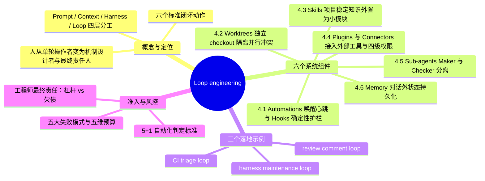
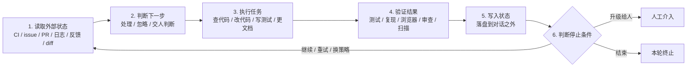
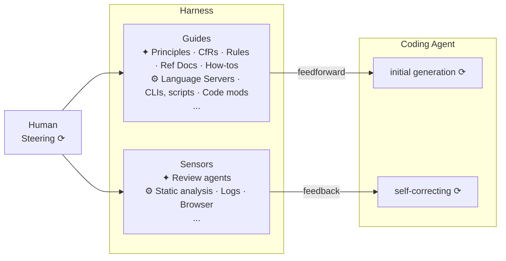
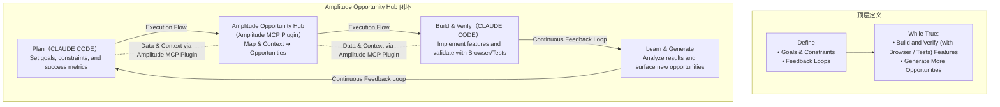
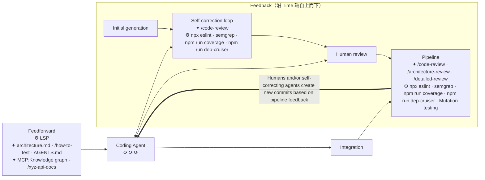

# Loop engineering：把 agent 放进工程循环

## TL;DR

- **解决的问题**：当 **coding agent** 能够自己读代码、改代码、跑测试、开 **PR** 后，单次对话已不适合承载复杂跨轮工程工作，工程师的工作重心需转向循环机制设计。（p.1、p.12）
- **核心机制**：不再逐轮提示 agent，而是构建包含“读取外部状态 → 判断下一步 → 执行任务 → 验证结果 → 写入状态 → 判断停止条件”六个动作的自动化闭环系统。（p.1–2）
- **系统支撑**：通过 **Automations**（唤醒心跳）、**Worktrees**（并行隔离）、**Skills**（外置项目知识）、**Plugins / connectors**（接入外部工具）、**Sub-agents**（读写与审查分离）和 **Memory**（对话外持久化状态）六大组件协同运转。（p.1、p.4–8）
- **设计重心**：Loop engineering 的核心不在全自动程度，而在任务入口、判断标准、四级风险权限、记忆方式、验证机制、预算与停止条件组成的**控制面**。（p.4、p.7–11）
- **验收标准**：判断一个 loop 是工程杠杆还是技术欠债，取决于它是让工程师更理解系统，还是让人更少读代码、更少判断、更少承担责任。（p.1、p.12）

> [!important] 重点
> 只有把状态、验证、权限和停止条件都写进工程流程，Loop engineering 才和普通的“让 agent 多跑几轮”不一样；否则只是给自动化换个名字。（p.1）

## 核心概念

### 一句话定义与解决痛点

- **一句话定义**：**Loop engineering** 是设计一个按固定节奏发现任务、选择下一步、调用 agent、检查结果、将状态记录到对话之外并决定是否继续的工程系统，让人从每一轮的操作者转变为循环机制的设计者与最终责任人。（p.1–2）
- **解决痛点**：传统单轮交互需人工不断写 **prompt**、贴报错、看 **diff**，而跨多轮任务面临上下文压缩、线程中断、重复尝试死路、自我裁判偏差、并行文件冲突与成本失控等工程瓶颈。（p.1–2、p.5–8、p.10–11）
- **核心边界**：这里的 loop 不是 `while true`，也不是把同一个 prompt 定时重放，否则易沦为“自动化幻觉”。（p.1–2）

### 易混概念对比表

**四层 Engineering 的职责对比**（p.2–3）

| 概念 | 关注的核心问题 | 工程定位 | 出处 |
| --- | --- | --- | --- |
| **prompt engineering** | 一句话怎么写 | 单次指令表达 | p.2 |
| **context engineering** | 给模型什么材料 | 模型输入上下文供给 | p.2 |
| **harness engineering** | 工具、权限和运行环境 | 单个 agent 在什么环境与控制件下运行 | p.2 |
| **loop engineering** | 上述要素如何持续运转 | agent 何时被唤醒、拿什么上下文、做哪类事、由谁检查、状态放哪里 | p.2–3 |

**Harness 与 Loop 的分工对比**（p.2）

| 维度 | Harness | Loop | 出处 |
| --- | --- | --- | --- |
| **系统角色** | 控制件（位于底层） | 调度与闭环（位于 **agent harness** 之上） | p.2 |
| **缺失另一方的后果** | 只有控制件、没有循环 → 仍是一次性工具 | 只有调度、没有控制件 → 变成定时犯错 | p.2 |

**Guides（Feedforward）与 Sensors（Feedback）对比**（Birgitta Böckeler 划分，p.2、p.4）

| 维度 | Guides / `feedforward` | Sensors / `feedback` | 出处 |
| --- | --- | --- | --- |
| **控制时机** | 事前（开始前必须知道的约束） | 事后（做完后必须接受的传感器检验） | p.2、p.4 |
| **包含内容** | 规则、架构约束、技能文档、上下文（只看哪个 PR、禁碰哪些目录、什么风险必停） | 测试、**lint**、日志、浏览器、**review agent**、安全扫描、粘贴浏览器录制、指定 reviewer 读 diff | p.2、p.4 |
| **缺失后果** | 没有 `feedforward`，agent 会到处乱试 | 没有 `feedback`，agent 会把“我觉得可以”当成完成 | p.4 |

**Automations 与 Hooks 对比**（p.4）

| 维度 | Automations | Hooks | 出处 |
| --- | --- | --- | --- |
| **核心定位** | 系统的心跳，负责按时唤醒 loop | 生命周期事件上的确定性控制，充当执行护栏 | p.4 |
| **典型机制** | 按计划在项目上运行并进入 **Triage inbox**，或在单 session 内反复检查部署/PR/CI | 编辑后格式化代码、工具调用前阻断敏感文件修改、需输入时发通知、重新注入上下文 | p.4 |
| **职责边界** | 不负责定义判断标准，不是智能本身 | 不决定做什么任务，只限制执行中不能越过的边界 | p.4 |

**MCP、Connector 与 Plugin 三层对比**（p.6）

| 层级 | 定义与职责 | 关键边界 | 出处 |
| --- | --- | --- | --- |
| **MCP** | 工具和上下文接入协议 | 仅提供协议层标准 | p.6 |
| **Connector** | 面向特定外部系统的具体连接（如 GitHub、Linear、Slack、Sentry、Figma） | 负责连通具体外部服务 | p.6 |
| **Plugin** | 产品中的分发打包机制（打包 `skills`、`app integrations`、`MCP servers`、配置和素材） | 只是分发和启用入口，不等于权限、审计和审批已设计好 | p.6 |

**外部记忆与规则载体对比**（p.8）

| 载体 | 适合存放的内容 | 取舍原因 | 出处 |
| --- | --- | --- | --- |
| **`loop-state.md` / Linear board / GitHub labels / 数据库表 / PR comment** | 当前目标、已处理事项、已尝试方案、失败原因、已通过验证、待人工判断问题、下一轮入口 | 将跨轮动态状态保存在对话之外，防止上下文压缩或线程中断导致失忆 | p.8 |
| **Codex memories** | 稳定偏好、项目约定、常见坑点 | 适合经验沉淀，但不宜单独承载团队强约束 | p.8 |
| **repo 文档 / `AGENTS.md` / `skill`** | 团队强约束与项目操作规范 | 团队规则应当可 review、可版本化、可共享 | p.8 |

## 知识框架



### 工程 Loop 六步闭环流程图



## 关键要点

### 一、工程 Loop 的六个必要动作与产品背景（p.2–4）

- **六个必要动作**：工程 loop 至少包含读取外部状态、判断下一步、执行任务、验证结果、写入状态（到对话之外）、判断停止条件六个步骤。（p.2）

> [!important] 重点
> 少了第 5 步（写入状态），它只是一次会话；少了第 6 步（判断停止条件），它就是烧 token 的定时器。（p.2）

- **Codex app 与 Claude Code 的能力收敛**：Codex app 已提供 `automations`、`worktrees`、`skills`、`plugins`、`MCP`、`subagents`、`memories` 与 `Goal mode`，Claude Code 也提供 `scheduled tasks`、`/loop`、`goals`、`hooks`、`skills`、`subagents`、`worktrees` 与 `MCP`。（p.3）
- **工具不等价性**：尽管两款工具形态接近，但权限、持久化、审计和执行环境的差异决定了能否放入生产流程。（p.3）

### 二、六个核心组件的机制与取舍（p.4–8）

- **4.1 Automations（心跳）与 Hooks（护栏）**：
  - Codex 的 `automations` 按计划运行并将结果送入 Triage inbox（无发现可自动归档），Claude Code 的 `scheduled tasks` 和 `/loop` 适合在单 session 内反复检查部署、PR 评论或 CI 状态。（p.4）
  - **Hooks** 负责在编辑后格式化代码、工具调用前阻断敏感文件修改、需输入时发通知或重新注入上下文。（p.4）

> [!tip] 技巧
> 一个好的 automation prompt 应该同时包含 `feedforward` 与 `feedback`，写得像操作规程，而不是把判断权交给模型猜的愿望清单。（p.4–5）

- **Automation Prompt 正反例对照**（p.5）：

```text
# 好的写法（操作规程）
1 读取最近 24 小时失败的 CI。
2 只处理和当前 PR 相关的失败。
3 如果失败来自依赖下载或外部服务超时，记录为 infra-flake，不改代码。
4 如果失败能稳定复现，创建最小修复。
5 每轮最多修改 3 个文件。
6 测试通过后写入 loop-state.md。
7 遇到权限、数据迁移或安全相关变更，停止并交给人。

# 坏的写法（愿望清单，把判断权交给模型猜）
1 每天帮我检查项目，有问题就修一下。
```

- **4.2 Worktrees（并行之前先隔离）**：
  - 多个 agent 并行时的第一类失败是文件冲突而非推理失败，`Git worktree` 通过给每个任务独立 `checkout` 解决机械冲突。（p.5–6）
  - `worktree` 不解决 **review 带宽**：若每天让 `8` 个 agent 各开 `1` 个 PR，而人只能认真读 `2` 个 diff，瓶颈只是从“写代码”移到了“理解代码”，导致人的心智模型落后。（p.6）

> [!important] 重点
> Worktree 设计原则：并行只用于低耦合任务，代码合并仍然按人的理解能力限流。（p.6）

- **4.3 Skills（把项目知识写到系统外面）**：
  - **Skill** 将稳定知识移出对话上下文，一个 `SKILL.md` 可附带 `scripts`、`references` 和 `assets`。（p.6）
  - 适合写进 skill 的 6 类内容：如何运行单元测试/端到端测试/lint/类型检查、哪些目录不能碰、哪些改动必须加迁移脚本、PR 描述必含内容、遇到 **flaky test** 如何分类、哪些历史事故不能重演。（p.6）
  - 好 skill 应当小而明确（如 `triage-ci`、`fix-flaky-test`、`review-pr`、`frontend-qa`、`security-check`），描述必须直白以便 agent 决定是否加载。（p.6）
  - 项目约定未写明时，agent 会用开源世界的常见模式补空白；项目越特殊，这种补空白越危险，因此 skills 既省 token 又省误判。（p.6）
- **4.4 Plugins 和 Connectors（接触真实工具与四级权限）**：
  - 接入 GitHub、Linear、Slack、Sentry、数据库、staging API、浏览器和 CI 后，loop 从“给出建议”变成“参与流程”。（p.6–7）
  - **跨工具参与流程的 9 步序列**（p.7）：

```text
1 发现 CI 失败
2 读取失败日志
3 定位相关 commit
4 在 worktree 里修复
5 运行测试
6 打开 PR
7 关联 Linear ticket
8 通知 Slack
9 把结果写回状态文件
```

  - **按风险划分的四级权限**（p.7）：
    - **`observe`**：只读，允许总结和分类。
    - **`propose`**：允许生成 `patch` 或 `PR`，但不允许合并。
    - **`act with approval`**：可执行外部动作，但关键步骤需要人批准。
    - **`autonomous`**：只给低风险、可回滚、验证强的任务。

> [!warning] 易错
> Plugin 不等于完整控制面，且大多数团队不应一开始就追求 `autonomous`，先把 `observe` 和 `propose` 做扎实收益已很明显。（p.6–7）

- **4.5 Sub-agents（Maker 和 Checker 分开）**：
  - 写代码的 agent 刚花了几轮说服自己路线成立，不适合做唯一裁判；子 agent 还能把探索、测试和日志分析移出主线程，避免 **context pollution** 和 **context rot**。（p.7）
  - **五类子 Agent 角色分工**（p.7）：
    - **`explorer`**：只读代码，定位问题和相关文件。
    - **`implementer`**：做最小修改。
    - **`verifier`**：复现问题、跑测试、检查验收条件。
    - **`reviewer`**：读 diff，找边界条件、回归风险和过度修改。
    - **`security reviewer`**：只处理权限、数据暴露、注入、依赖和密钥风险。
  - 子 agent 会增加 token 成本和协调成本，适合用于**检查环节**与**可并行的读多写少任务**；小任务用 `1` 个 `implementer` 加 `1` 个 `verifier` 通常够了。（p.8）
- **4.6 Memory（状态必须在对话之外）**：
  - 上下文会压缩、线程会中断、模型会忘，外部状态层是 loop 能否接着跑的前提。（p.8）
  - 最简状态文件 `loop-state.md` 记录 7 项内容：当前目标、已处理事项、已尝试方案、失败原因、已通过验证、需要人工判断的问题、下一轮入口。（p.8）

### 三、三个可落地的工程 Loop 规程与自动化准入标准（p.8–12）

- 🔥 **规程 1：`CI triage loop`**（从低风险 loop 起步，p.8–9）：

```text
1 每天 9:00 运行。
2 读取过去 24 小时失败的 CI。
3 按失败类型分类：真实回归、flaky、infra、未知。
4 只处理真实回归中影响当前 PR 的失败。
5 每次最多修一个问题。
6 必须先写复现步骤，再改代码。
7 修复后运行对应测试。
8 测试通过则开 PR 或更新当前 PR。
9 测试不通过则记录失败原因。
10 涉及迁移、安全、权限、账务、生产配置时停止。
```

- 🔥 **规程 2：`review comment loop`**（目标和判断不交给模型自由发挥，p.9）：

```text
1 定期读取 PR 上未解决的 review comments。
2 把评论分成机械修改、需要判断、无法处理三类。
3 机械修改直接提交 patch。
4 需要判断的评论整理成问题列表。
5 无法处理的评论说明原因。
6 每次修改后运行最小相关测试。
```

- 🔥 **规程 3：`harness maintenance loop`**（让后续功能 loop 少犯同一种错，p.9）：

```text
1 每周读取最近合并的 agent PR 和 review comments。
2 找出重复出现的失败模式：误改公共 API、漏跑迁移、测试只覆盖 happy path、过度重构。
3 能用确定性工具拦住的，优先补 lint、类型检查、架构规则或测试夹具。
4 只能靠语义判断的，更新 review skill 或 verifier prompt。
5 每次只改一个 harness 控制件。
6 记录这个控制件拦住了什么问题，以及有没有带来误报。
```

- `[推断]` `harness maintenance loop` 中“确定性工具”与“语义判断”的区分，分别对应图 1 / 图 3 中的 `Computational` 与 `Inferential` 控制件。（p.2、p.5、p.9）
- **可验证的目标函数写法示例**（p.10）：

```text
1 让 checkout.spec.ts 中的 3 个失败用例通过，不能修改测试断言，不能改支付网关 mock
```

- **“甩给 AI”（购买安慰感）vs “做 loop engineering”（设计系统）对照**（p.11–12）：

```text
# 甩给 AI
1 帮我把项目维护好。

# 做 loop engineering
1 每个工作日上午检查当前 PR 的 CI。
2 只处理可稳定复现的测试失败。
3 先定位失败用例和相关 diff。
4 修改范围不得超过失败相关模块。
5 运行对应测试。
6 把命令、结果和下一步写入 loop-state.md。
7 如果连续两次失败原因相同，停止并交给我。
```

- **判断 loop 是否值得自动化的“5 + 1”条件**（不满足时先把流程写清楚，不要急着自动化，p.10）：
  1. **输入是否稳定**：CI、issue、review comments、日志可以；模糊战略问题不适合。
  2. **输出是否可 review**：PR、报告、状态文件、ticket 更新可以；隐式修改不行。
  3. **验证是否明确**：测试、复现步骤、schema 校验、浏览器路径可以；“看起来更好”不够。
  4. **权限是否可控**：默认只读或提案，逐步放开执行权限。
  5. **失败是否可恢复**：失败最多产生一个待审 patch，而不是破坏共享环境。
  6. **产物能不能沉淀**（追加条件）：失败后应能留下更好的 `fixture`、更明确的 `rule`、更小的 `skill`、更稳的脚本或可复用 `workflow`，否则只是在反复购买同一份现场发挥。

## 架构图与流程图复现

### 图 1：Harness engineering overview（p.2，来源：Martin Fowler 网站 Böckeler 文章 [2][3]）



- **组件关系说明**：`Human` 通过 `Steering` 同时调控事前 `Guides` 与事后 `Sensors`；`Guides` 通过 `feedforward` 输入给 `Coding Agent` 的 `initial generation`，`Sensors` 通过 `feedback` 作用于 `self-correcting`。（p.2，图 1）
- **图例分类**：星形（`✦`）代表 **Inferential**（推理型：Principles、CfRs、Rules、Ref Docs、How-tos、Review agents），齿轮（`⚙`）代表 **Computational**（计算型：Language Servers、CLIs, scripts、Code mods、Static analysis、Logs、Browser）。（p.2，图 1）
- ⚠️[原文疑点] 图 1 中缩写 `CfRs` 在正文中未展开说明，按原图保留。

### 图 2：Ralph Loop（p.3，来源：Amplitude 博客 [4][5]）



- **组件关系说明**：每轮由 `Plan` 结合 `Amplitude Opportunity Hub`（通过 `Amplitude MCP Plugin` 提供数据与上下文）生成机会，交由 `Build & Verify` 实现并用浏览器/测试验证，再经 `Learn & Generate` 分析埋点数据生成下一轮机会队列。（p.3，图 2）
- ⚠️[图中无法辨认] 图 2 中央 `Map & Context` 与 `Opportunities` 面板内部的小字放大后仍模糊，此处不猜。
- ⚠️[原文疑点] 正文 p.2 写“这里的 loop 不是 while true”，而图 2 顶栏引用原图带有 `While True:` 字样，两处原貌并列保留。

### 图 3：Change lifecycle（p.5，来源：同图 1 [10]）



- **组件关系说明**：沿纵向 `Time` 轴，左侧 `Feedforward` 向 `Coding Agent` 注入规则与工具，右侧依次经历 `Initial generation`、`Self-correction loop`、`Human review` 与 `Integration` 后的 `Pipeline`，最终根据流水线反馈由人或自修正 agent 创建新 commit 形成闭环。（p.5，图 3）

## 方法对比表

| 方法 / 案例名称 | 适用场景 | 解决的问题 | 局限与边界 | 出处 |
| --- | --- | --- | --- | --- |
| **`CI triage loop`** | 过去 24 小时失败的 CI 分诊与修复 | 将 CI 失败按真实回归、flaky、infra、未知分类，并对影响当前 PR 的真实回归先写复现再做最小修复 | 原文称“不性感”；每次最多修 1 个问题，涉及迁移、安全、权限、账务、生产配置时必须停止 | p.8–9 |
| **`review comment loop`** | PR 上未解决的 review comments 处理 | 将评论分为机械修改、需要判断、无法处理三类分别处置，避免让模型自由发挥 | 需要判断的评论仅整理成问题列表，无法处理的仅说明原因，每次修改后需跑最小相关测试 | p.9 |
| **`harness maintenance loop`** | 每周复盘最近合并的 agent PR 和 review comments | 针对重复失败模式补充确定性工具（lint/类型检查/架构规则/测试夹具）或语义检查（review skill/verifier prompt），让后续功能 loop 更稳 | 不直接交付业务功能；每次只改 1 个 harness 控制件，需记录拦截问题及误报情况 | p.9 |
| **OpenAI Cookbook `agent improvement loop`** | 持续改进 agent 或 harness | 用真实 traces 作输入证据、人工与模型反馈负责诊断、eval 作可复用验收、handoff artifact 记录下轮修改并交 Codex 执行 | 重点在于串联反馈、验证、状态与权限边界，而非单纯“让 AI 改 AI” | p.3 |
| **Amplitude `Ralph loop`** | 产品数据驱动的功能迭代与验证 | 串联产品数据、机会生成、自动埋点、浏览器验证（每个 PR 附浏览器录制 GIF）与 coding agent | 原文称“更激进”；后期仅允许少数低风险机会类型自动合并，涉及用户数据的改动仍保留人工判断 | p.3 |
| **`AI Workflow Store`（论文 [6]）** | 克服 on-the-fly agent loop 临场合成计划与串工具的脆弱性 | 将可靠软件工程流程沉淀成可复用、受约束的 workflow，防止跳过迭代设计、严格测试、对抗评估和分阶段发布 | 原文未详述具体实现局限 | p.4 |
| **`EurekAgent`（论文 [7]）** | 工程级 agent 行为约束与治理 | 通过权限、artifact、预算和 human-in-the-loop 直接改变 agent 做事方式，实现可复用、可审计、可限制 | 原文未详述具体实现局限 | p.4 |

## 数据速查表

| 指标 | 数值 | 出处 |
| --- | --- | --- |
| 工程 loop 最少动作数 | `6` 个（读状态、判断、执行、验证、写状态、判停止） | p.2 |
| 支撑系统的核心组件数 | `6` 个（Automations、Worktrees、Skills、Plugins/connectors、Sub-agents、Memory） | p.1、p.4–8 |
| Automation prompt 示例：CI 回看时间窗 | 最近 `24` 小时 | p.5 |
| Automation prompt 示例：单轮修改文件上限 | 最多修改 `3` 个文件 | p.5 |
| Worktree 并行与 review 带宽反例 | 每天 `8` 个 agent 各开 `1` 个 PR vs 人只能认真读 `2` 个 diff | p.6 |
| 外部工具串联流程示例步数 | `9` 步（发现失败 → 读日志 → 定位 commit → worktree 修复 → 跑测试 → 开 PR → 关联 Linear → 通知 Slack → 写状态） | p.7 |
| 风险权限分层数 | `4` 层（`observe` / `propose` / `act with approval` / `autonomous`） | p.7 |
| Sub-agents 推荐角色数 | 标准 `5` 个角色；小任务 `1` 个 `implementer` + `1` 个 `verifier` | p.7–8 |
| `loop-state.md` 記錄字段数 | `7` 项（当前目标、已处理事项、已尝试方案、失败原因、已通过验证、需人工判断问题、下一轮入口） | p.8 |
| `CI triage loop` 运行参数 | 每天 `9:00` 运行；读取过去 `24` 小时失败 CI；分 `4` 类；每次最多修 `1` 个问题 | p.9 |
| `review comment loop` 评论分类数 | `3` 类（机械修改、需要判断、无法处理） | p.9 |
| `harness maintenance loop` 频率与修改上限 | 每周运行；每次只改 `1` 个 harness 控制件 | p.9 |
| 自动化判定条件数 | `5` 个筛选条件 + 后加 `1` 个沉淀条件（共 `6` 个） | p.10 |
| 可验证目标函数示例 | 让 `checkout.spec.ts` 中的 `3` 个失败用例通过 | p.10 |
| 结构化验证至少记录项数 | `4` 项（命令、退出码、失败用例、是否满足停止条件） | p.10 |
| Loop 成本预算维度数 | `5` 项（每轮最多尝试次数、每天最多开 PR 数、sub-agents 启用范围、多久无进展必停、何时必交给人；⚠️原文未给具体数值） | p.11 |
| 工程责任示例：同因停止阈值 | 连续 `2` 次失败原因相同，停止并交给人 | p.12 |

## 踩坑与教训

| 失败模式 | 表现与原因 | 原文应对方案 | 出处 |
| --- | --- | --- | --- |
| **7.1 目标函数太粗** | “提升质量”“优化体验”“让项目更好”会被 agent 翻译成重构、改文案、加测试、删重复代码，看似合理却未解决真实问题 | 将目标写成带负向约束的可验证条件（如指定通过 `checkout.spec.ts` 的 3 个失败用例，禁改测试断言与支付网关 mock） | p.10 |
| **7.2 验证被 agent 自己吞掉** | 日志很长时 agent 总结为“测试通过大部分，只剩少量无关问题” | 在 loop 中对此表述直接判失败；验证结果必须结构化（记录命令、退出码、失败用例和是否满足停止条件） | p.10 |
| **7.3 状态文件没人读** | 只写状态文件而不读，变成一份没人看的日报，agent 继续重复走死路 | 下一轮 prompt 必须显式要求先读状态文件，并根据状态决定是否继续 | p.11 |
| **7.4 并行制造理解债** | 并行 agent 制造“产能翻倍”错觉，人只看 summary 不读 diff，对合并后系统的心智模型迅速落后 | 并行只用于低耦合任务，合并按人的理解能力限流，关键 diff 必须人工阅读 | p.6、p.11 |
| **7.5 成本没有上限** | token 成本是架构问题，无上限的 loop 最终必被账单、噪音或误操作叫停 | 为每个 loop 设定重试次数、每日 PR 数、sub-agents 范围、无进展超时与升级人工五项预算 | p.11 |

> [!warning] 易错
> 其他高频误区：把 automation 当成智能本身（p.4）；把所有项目知识塞进一个大 skill（p.6）；以为装了 plugin 就有了权限与审计控制面（p.6）；让写代码的 agent 做唯一裁判（p.7）；为了显得先进把一轮对话能解决的事都做成 loop（p.12）。

## 可迁移的设计原则

1. **判断权与停止条件前置固化**：任务入口、过滤规则、修改范围上限与停止条件必须由人写死在规程中，写不清停止条件的任务不该无人值守运行。（p.4–5、p.11–12）
2. **读写分离（Maker / Checker 分开）**：执行修改的 `implementer` 与负责验证审查的 `verifier` / `reviewer` 必须分开，嘈杂探索交由只读子 agent 隔离。（p.7–8）
3. **合并吞吐按人类理解能力限流**：并行只用于低耦合任务，代码合并速度受制于工程师认真阅读 diff 的带宽。（p.6、p.11）
4. **权限按风险渐进放开**：默认从只读（`observe`）和提案（`propose`）做起，仅对低风险、可回滚、验证强的任务开放 `autonomous`。（p.7、p.10）
5. **确定性控制优先于语义提示**：复盘重复失败模式时，能用 lint、类型检查、架构规则或测试夹具拦住的优先用确定性工具，其次才更新 skill 或 prompt。（p.9）
6. **强约束版本化、动态状态外置化**：动态执行进度写入对话外的 `loop-state.md` 且下轮必读；团队强约束放入 repo 文档、`AGENTS.md` 或 `skill` 以支持 review、版本化和共享。（p.8、p.11）
7. **失败产物必须可沉淀**：好的 loop 即使失败也应留下更好的 fixture、rule、skill、脚本或可复用 workflow，避免反复购买同一份现场发挥。（p.10）
8. `[推断]` 原文的 `CI triage loop` 只开或更新 PR 且遇高风险即停，对应四级权限中的 `observe` + `propose` 阶段。（p.7、p.9）

## 记忆锚点

1. **闭环生死线**：“少了第 5 步（写状态），它只是一次会话；少了第 6 步（判停止），它就是烧 token 的定时器。”（p.2）
2. **状态与唤醒铁律**：“Automation 是心跳不是大脑；模型可以忘，系统状态不能忘。”（p.4、p.8）

## 复习卡片

工程 loop 至少包含哪六个动作？少了第 5 步或第 6 步分别退化成什么？::六个动作：1. 读取外部状态 → 2. 判断下一步 → 3. 执行任务 → 4. 验证结果 → 5. 写入状态 → 6. 判断停止条件。少了第 5 步只是一次会话；少了第 6 步就是烧 token 的定时器。（p.2）
Prompt、Context、Harness、Loop 四层 engineering 分别关心什么？::Prompt 关心一句话怎么写；Context 关心给模型什么材料；Harness 关心工具、权限和运行环境（事前 Guides + 事后 Sensors）；Loop 关心这些要素如何按节奏被唤醒、检查、记录状态并持续运转。（p.2–3）
为什么 Automation prompt 里必须同时写 feedforward 和 feedback？::Automation 只负责按时唤醒（心跳），不负责定义判断标准。没有 feedforward（事前约束），agent 会到处试；没有 feedback（事后传感器），它会把“我觉得可以”当成完成。（p.4）
Git worktree 解决了什么问题，又解决不了什么瓶颈？::Worktree 给每个任务独立 checkout，解决多 agent 并行时的文件机械冲突；但它不解决人类的 review 带宽，盲目并行只会把瓶颈从“写代码”挪到“理解代码”，导致心智模型落后并积累理解债。（p.5–6、p.11）
为什么项目约定要写进小而明确的 Skill 或 `AGENTS.md`，而不是只靠对话上下文或个人 memory？::对话上下文会压缩中断，未写明约定时 agent 会用开源常见模式补空白（项目越特殊越危险）；强约束放进 repo 文档、`AGENTS.md` 或 `SKILL.md` 才能可 review、可版本化、可共享，既省 token 又防误判。（p.6、p.8）
MCP、Connector、Plugin 三者有什么区别？::MCP 是工具与上下文接入协议；Connector 是面向 GitHub、Linear、Slack 等外部系统的具体连接；Plugin 是打包分发机制，只是启用入口，不等于权限、审计和审批已设计好。（p.6）
外部工具权限按风险分为哪四层？团队起步应选哪层？::分为 `observe`（只读总结分类）、`propose`（可生成 patch/PR 但不许合并）、`act with approval`（外部动作关键步骤需人批准）、`autonomous`（仅低风险、可回滚、验证强的任务）。大多数团队应先把 `observe` 和 `propose` 做扎实。（p.7）
为什么 maker 和 checker 要分开？小任务如何配置 sub-agents？::写代码的 agent 刚花几轮说服自己路线成立，易继续相信自己的结果，不能做唯一裁判；且子 agent 可隔离探索、测试和日志分析以避免 context pollution 和 context rot。小任务用 1 个 `implementer` + 1 个 `verifier` 通常够用。（p.7–8）
`harness maintenance loop` 如何针对重复失败模式选择控制件？::每周复盘已合并的 agent PR 和评论，能用确定性工具拦住的优先补 lint、类型检查、架构规则或测试夹具；只能靠语义判断的才更新 review skill 或 verifier prompt，且每次只改 1 个控制件并记录拦截效果与误报。（p.9）
判断一个 loop 是否值得自动化的“5+1”条件是什么？::1. 输入稳定；2. 输出可 review；3. 验证明确（结构化记录命令、退出码、失败用例和停止条件）；4. 权限可控；5. 失败可恢复；外加第 6 条：产物能沉淀（留下更好的 fixture、rule、skill、脚本或 workflow）。（p.10）

## 知识关联

- **本库候选主题双链**：
  - [[Agent工程循环]]：对应六步闭环动作、六大组件、5+1 准入条件与五大失败模式。
  - [[Harness与模型协同]]：对应 Guides/feedforward 与 Sensors/feedback、确定性控制与语义判断分工。
  - [[Agent任务恢复]]：对应 `loop-state.md` 跨轮状态恢复、失败回滚边界与连续两次同因失败停机交人。
  - [[Agent长期记忆]]：对应对话外状态持久化、Codex memories 与版本化 `AGENTS.md` / `SKILL.md` 分层。
  - [[Agent评测与反馈]]：对应结构化验证防“吞掉失败”、Ralph loop 埋点与 GIF 验收证据。
  - [[Agent成本与上下文预算]]：对应 sub-agents 隔离防 context pollution / context rot 与五维成本预算。
  - [[AI研发协同]]：对应 Worktree 并行隔离、人类 review 带宽限流与四级权限控制。
  - [[LangGraph]]：`[推断]` 原文未提及 LangGraph，但其外部状态持久化、条件边停止判定与 `act with approval` 人工审批节点与 LangGraph 状态图编排直接对应。
- **原文附录参考资料（p.12–13）**：
  - `[1]` Addy Osmani《Loop Engineering》：`https://addyosmani.com/blog/loop-engineering/`
  - `[2][3][10]` Birgitta Böckeler《Harness engineering for coding agent users》：`https://martinfowler.com/articles/harness-engineering.html`
  - `[4][5]` Amplitude《Ralph loop 实验 / What I Learned Pointing a Ralph Loop at My Product for a Week》：`https://amplitude.com/blog/ralph-loop`
  - `[6]` 《Engineering Robustness into Personal Agents with the AI Workflow Store》：`https://arxiv.org/abs/2605.10907`
  - `[7]` 《EurekAgent》：`https://arxiv.org/abs/2606.13662`
  - `[8]` Claude Code `scheduled tasks`：`https://code.claude.com/docs/en/scheduled-tasks`
  - `[9]` Claude Code `Hooks`：`https://code.claude.com/docs/en/hooks-guide`

> [!note]- 校对报告
>
> **1. 覆盖度**
> - **已覆盖章节**：`01 摘要`（p.1）、`02 概念界定`（p.2–3）、`03 研究背景与相关工作`（p.3–4）、`04 系统构成：六个组件`（`4.1–4.6`，p.4–8）、`05 方法示例`（p.8–9）、`06 自动化判定标准`（p.10）、`07 风险分析`（`7.1–7.5`，p.10–11）、`08 工程责任`（p.11–12）、`09 结论`（p.12）、`10 附录`（p.12–13）；全文三张技术图（图 1、图 2、图 3）均已用文字 + Mermaid 复现结构与组件关系。
> - **有意省略内容**：`11 团队介绍`（p.13，仅提取作者苏雄与团队归属至 frontmatter）、底部“拓展阅读”栏目入口、p.1 顶部纯色装饰块及 p.14 阅读量（5585）与留言区；未添加外部 `[扩展]` 内容，故省略“扩展阅读”模块。
>
> **2. 一致性（抽查 5 个关键数字）**
>
> | 抽查项 | 笔记数值 | 原文数值与位置 | 结果 |
> | --- | --- | --- | --- |
> | 工程 loop 最少动作数 | `6` 个动作（缺第 `5` 步为一次会话，缺第 `6` 步为烧 token 定时器） | p.2 §02“一个能工作的工程 loop 至少有六个动作……少了第 5 步……少了第 6 步……” | 一致 |
> | Automation prompt 示例限制 | 最近 `24` 小时失败的 CI；每轮最多修改 `3` 个文件 | p.5 §4.1 代码块第 1、5 行 | 一致 |
> | Worktree 并行与 review 带宽示例 | 每天 `8` 个 agent 各开 `1` 个 PR，只能认真读 `2` 个 diff | p.6 §4.2 第二段 | 一致 |
> | `CI triage loop` 与 `harness maintenance loop` 参数 | 每天 `9:00`、过去 `24` 小时、每次最多修 `1` 个问题；每周、每次只改 `1` 个控制件 | p.9 §05 两个代码块 | 一致 |
> | 可验证目标函数与同因停止阈值 | `checkout.spec.ts` 中 `3` 个失败用例；连续 `2` 次失败原因相同则停止 | p.10 §7.1 代码块；p.12 §08 代码块第 7 行 | 一致 |
>
> **3. 所有 `[推断]` 与 `⚠️` 项汇总**
> - `[推断]` `harness maintenance loop` 中“确定性工具”与“语义判断”分别对应图 1 / 图 3 的 `Computational` 与 `Inferential` 控制件（关键要点 §三）。
> - `[推断]` `CI triage loop` 落在四级权限中的 `observe` + `propose` 阶段（可迁移的设计原则 #8）。
> - `[推断]` `LangGraph` 状态图编排与本文状态落盘、条件边及人工审批节点对应（知识关联）。
> - `⚠️[原文疑点]` 图 1（p.2）中缩写 `CfRs` 原文未展开全称。
> - `⚠️[原文疑点]` 正文 p.2 写“这里的 loop 不是 while true”，而 p.3 图 2 引用原图顶栏带有 `While True:` 标签，笔记已并列保留。
> - `⚠️[原文疑点]` §06（p.10）先写“我会用五个条件筛选”，随后写“现在我会再加一个条件”，笔记按“5 + 1（共 6 个）”如实呈现；§7.5（p.11）列出 5 项预算维度但原文未给具体数值。
> - `⚠️[原文疑点]` 附录（p.12–13）中 `[2][3][10]` 为同一 URL，`[4][5]` 为同一 URL，均按原文编号保留。
> - `⚠️[图中无法辨认]` 图 2（p.3）中央 `Map & Context` 与 `Opportunities` 面板内部极小字模糊，未作猜测转录。
