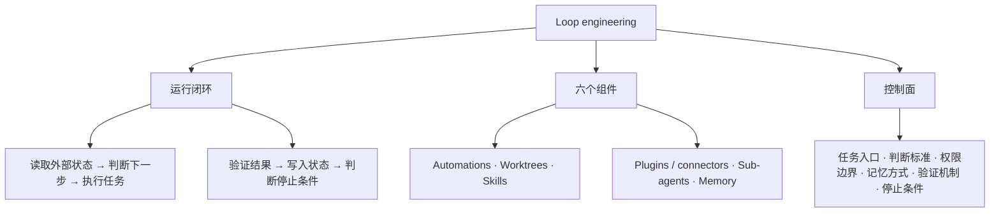
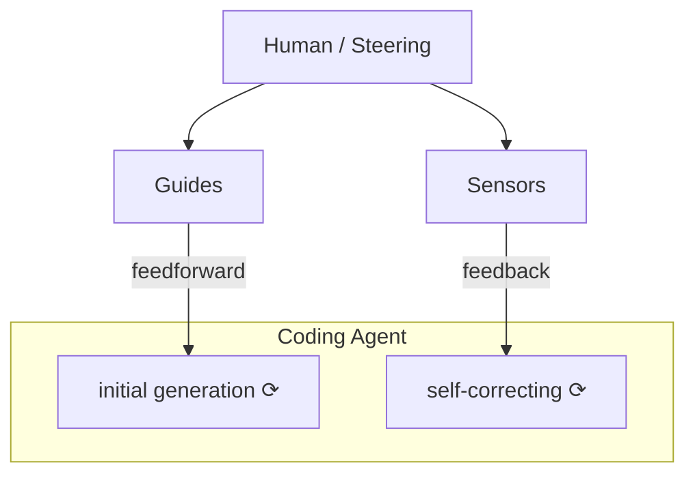
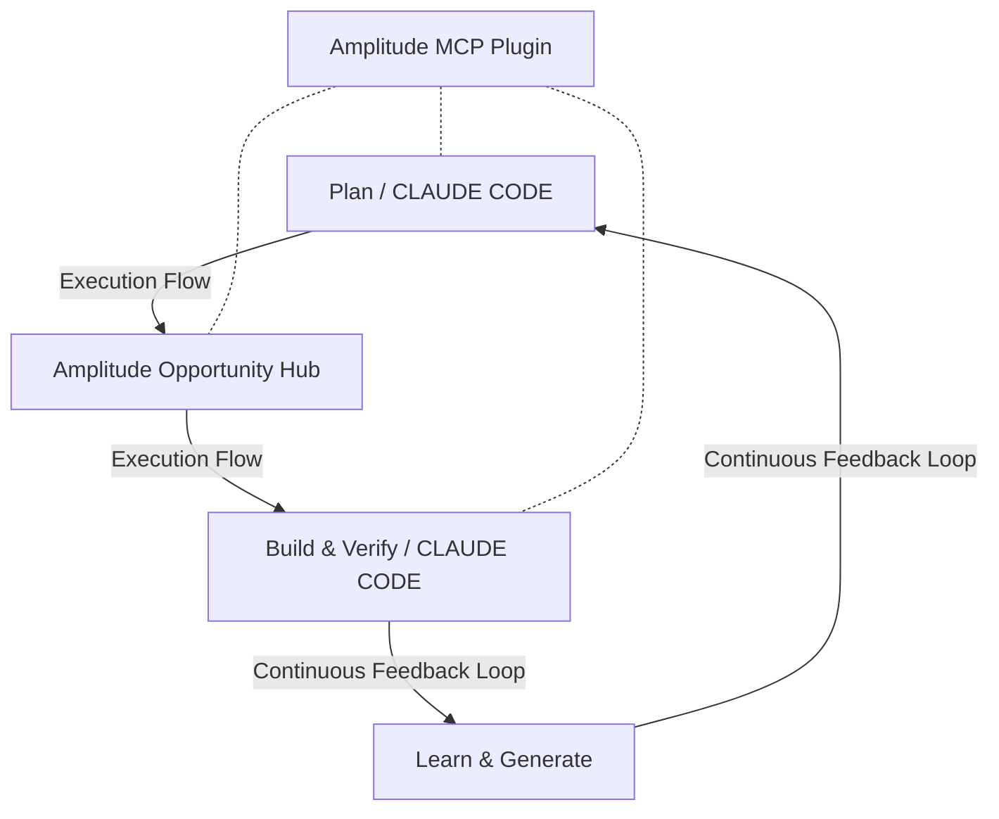
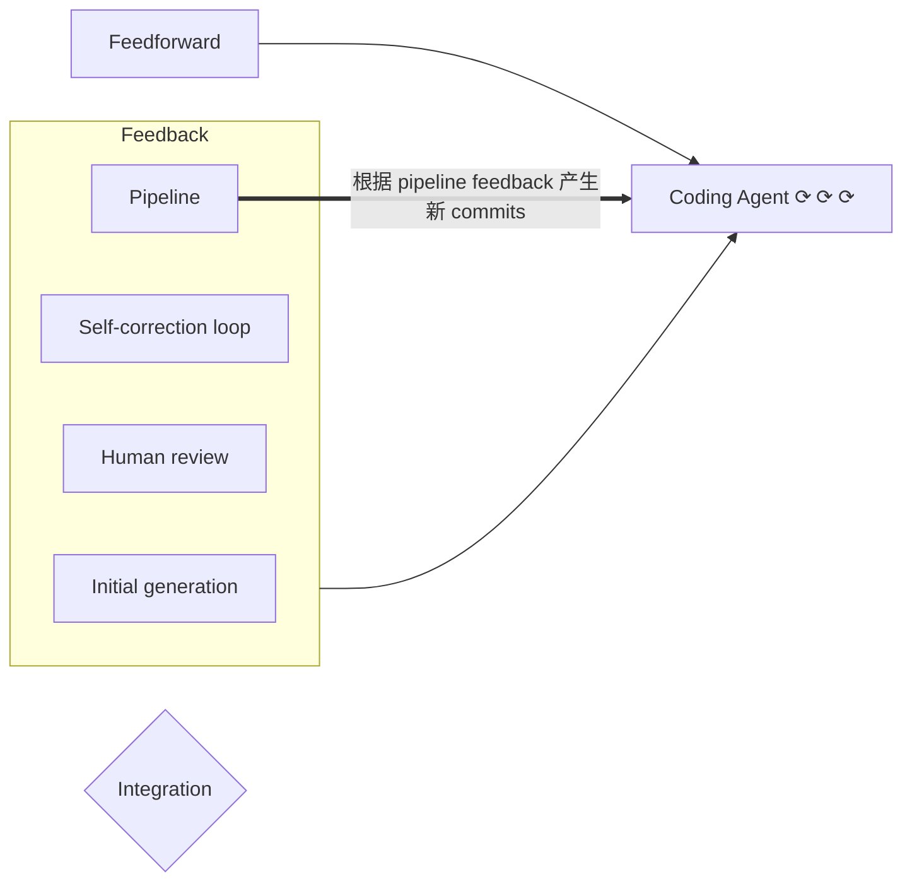

# Loop engineering

来源定位：下文 `p.N` 均指 `RAW.pdf` 的 PDF 页序，发布日期取自 p.1，作者信息取自 p.13。

## TL;DR

- **Loop engineering** 把 **coding agent** 的多轮工作组织为读取状态、判断任务、执行、验证、记录状态和判断停止条件的工程闭环。（p.1–2）
- 可靠运行依赖状态、验证、权限与停止条件共同进入流程，工程师负责设计循环并承担最终责任。（p.1–4、11–12）
- 优先选择重复发生、边界清楚、验证明确、风险可控的任务，并让输出可审查、失败可恢复、经验可沉淀。（p.10、12）
- 自动化与并行仍受审查带宽、成本和人工判断约束，很多任务在一轮对话中解决即可。（p.6、11–12）

## 核心概念

### 四种 engineering 各自管什么

| 概念 | 一句话定义 | 对应痛点 | 出处 |
| --- | --- | --- | --- |
| **Prompt engineering** | 设计如何表述给模型的一句话。 | 任务表达。 | p.2 |
| **Context engineering** | 决定给模型哪些材料。 | 上下文供给。 | p.2 |
| **Harness engineering** | 设计 agent 的工具、权限、运行环境及事前、事后控制件。 | 单个 agent 怎样受约束地运行。 | p.2 |
| Loop engineering | 设计 agent 何时被唤醒、处理什么、由谁验证以及状态如何延续。 | 多轮工程工作怎样持续运转。 | p.1–3 |

### 事前约束与事后反馈

| 原文术语 | 在循环中的作用 | 原文举例 | 出处 |
| --- | --- | --- | --- |
| **Guides / feedforward** | 在行动前提供规则、约束和上下文。 | 指定 **PR**、禁止修改的目录、必须停止的风险。 | p.2、4 |
| **Sensors / feedback** | 用行动后的证据检查结果并促使修正。 | 测试、**lint**、日志、浏览器验证、review agent、安全扫描。 | p.2、4 |

> [!important] 重点
> **Automation prompt** 要同时规定行动前的边界和完成后的验收证据，完成标准不能依赖 agent 的主观总结。（p.4、10）

## 知识框架

下图按原文的动作、组件与控制面整理，箭头表示概念分解，节点中的动作按原文顺序排列。（p.2、4–8）



## 关键要点

### 闭环至少包含六个动作

| 动作 | 必须回答的问题 | 原文内容 | 出处 |
| --- | --- | --- | --- |
| 1. 读取外部状态 | 现在发生了什么？ | **CI**、**issue**、PR、日志、用户反馈、代码 **diff**。 | p.2 |
| 2. 判断下一步 | 什么值得处理？ | 区分处理、忽略和需要人判断的问题。 | p.2 |
| 3. 执行任务 | agent 本轮做什么？ | 查代码、改代码、写测试或更新文档。 | p.2 |
| 4. 验证结果 | 结果凭什么成立？ | 测试、复现路径、浏览器检查、代码审查或安全扫描。 | p.2 |
| 5. 写入状态 | 下一轮凭什么接续？ | 在对话外保存结论、失败原因、已尝试方案和下一步。 | p.2 |
| 6. 判断停止条件 | 继续还是退出？ | 继续、重试、换策略、升级给人或结束。 | p.2 |

### 六个组件：职责、取舍与易错点

| 原文组件 | 解决的问题 | 关键取舍 | 出处 |
| --- | --- | --- | --- |
| **Automations** | 按计划唤醒任务。 | 判断标准必须另行定义。 | p.4 |
| **Worktrees** | 为并行任务提供独立 **checkout**，避免文件相互干扰。 | 只适合低耦合并行，合并速度仍受人的理解能力限制。 | p.5–6 |
| **Skills** | 把稳定的项目知识和可复用流程移出对话。 | 保持小而明确，并用直白描述帮助 agent 选择加载。 | p.6 |
| **Plugins 和 connectors** | 接触外部系统中的真实工程状态。 | 接入工具后仍须设计权限、审计和审批。 | p.6–7 |
| **Sub-agents** | 分开执行、检查以及读多写少的探索工作。 | 多 agent 增加 token 和协调成本，小任务通常只需 **implementer** 加 **verifier**。 | p.7–8 |
| **Memory** | 保存跨轮次可接续的外部状态。 | 稳定偏好与团队强约束应选择不同的存放位置。 | p.8 |

- **Hooks** 在生命周期事件上执行确定性控制，可用于编辑后格式化、阻断敏感文件修改、通知或重新注入上下文。（p.4）
- Skill 可由 **`SKILL.md`** 配合 `scripts`、`references` 和 `assets` 组成，并承载测试命令、禁改目录、迁移要求、PR 描述、**flaky test** 分类及历史事故经验。（p.6）
- 原文给出的 skill 示例是 `triage-ci`、`fix-flaky-test`、`review-pr`、`frontend-qa` 和 `security-check`。（p.6）

### MCP、Connector、Plugin 不要混用

| 术语            | 原文定义           | 边界                                             | 出处  |
| ------------- | -------------- | ---------------------------------------------- | --- |
| **MCP**       | 工具和上下文接入协议。    | 协议层。                                           | p.6 |
| **Connector** | 面向某个外部系统的具体连接。 | 例如 GitHub、Linear、Slack、Sentry 或 Figma 的连接。     | p.6 |
| **Plugin**    | 某些产品中的分发打包机制。  | 可打包 skills、app integrations、MCP servers、配置和素材。 | p.6 |

> [!warning] 易错
> 安装 Plugin 后，权限、审计和审批仍需单独设计；读日志与改生产数据库、开 PR 与自动合并，分别属于不同的权限边界。（p.6–7）

### 权限按风险分层

| 原文级别 | 允许的动作 | 原文边界 | 出处 |
| --- | --- | --- | --- |
| **observe** | 只读、总结、分类。 | 只读。 | p.7 |
| **propose** | 生成 **patch** 或 PR。 | 不允许合并。 | p.7 |
| **act with approval** | 执行外部动作。 | 关键步骤需人批准。 | p.7 |
| **autonomous** | 自主执行。 | 仅用于低风险、可回滚、验证强的任务。 | p.7 |

- 原文建议大多数团队先做好 observe 和 propose，再逐步放开执行权限。（p.7、10）

### maker 与 checker 分开

原文将写入修改与检查结果分为 **maker** 和 **checker** 两类职责。（p.7）

| 原文角色 | 职责 | 出处 |
| --- | --- | --- |
| **explorer** | 只读代码，定位问题和相关文件。 | p.7 |
| **implementer** | 做最小修改。 | p.7 |
| **verifier** | 复现问题、跑测试、检查验收条件。 | p.7 |
| **reviewer** | 检查 diff 的边界条件、回归风险和过度修改。 | p.7 |
| **security reviewer** | 检查权限、数据暴露、注入、依赖和密钥风险。 | p.7 |

- 写代码的 agent 不应成为唯一裁判，sub-agents 尤其适合检查环节和可并行的读多写少任务。（p.7–8）
- 将探索、测试和日志分析移出主线程，可减少原文所说的 **context pollution** 与 **context rot**。（p.7）

### 状态、验收与预算必须写实

- **`loop-state.md`** 可记录当前目标、已处理事项、已尝试方案、失败原因、已通过验证、需要人工判断的问题和下一轮入口。（p.8）
- 下一轮 prompt 必须先读取状态文件，并据此决定是否继续。（p.11）
- Linear board、GitHub labels、数据库表、PR comment 或 Codex memories 也可承载外部状态。（p.8）
- Codex memories 适合稳定偏好、项目约定和常见坑点，强约束优先放入 repo 文档、**`AGENTS.md`** 或 skill，以便审查、版本化和共享。（p.8）
- 验证记录至少包含命令、退出码、失败用例和是否满足停止条件。（p.10）
- 预算应约束每轮尝试次数、每日 PR 数量、sub-agents 启用范围、无进展停止时长及交给人的时机。（p.11）

### 自动化准入：五项筛选，再追加可沉淀性

原文先列“五个条件”，随后追加产物能否沉淀，以下保留这一层次。（p.10）

| 原文层次 | 判定标准 | 可接受的形式或边界 | 出处 |
| --- | --- | --- | --- |
| 1 | 输入稳定 | CI、issue、review comments、日志；模糊战略问题不适合。 | p.10 |
| 2 | 输出可 review | PR、报告、状态文件或 ticket 更新，避免隐式修改。 | p.10 |
| 3 | 验证明确 | 测试、复现步骤、schema 校验或浏览器路径。 | p.10 |
| 4 | 权限可控 | 默认只读或提案，逐步放开执行权限。 | p.10 |
| 5 | 失败可恢复 | 失败最多产生一个待审 patch，不破坏共享环境。 | p.10 |
| 追加 | 产物可沉淀 | 将经验留下为 fixture、rule、skill、脚本或可复用 workflow。 | p.10 |

## 方法对比与操作要点

### 三种可落地的 loop

| 方法 | 适用场景 | 解决的问题 | 原文给出的局限与边界 | 出处 |
| --- | --- | --- | --- | --- |
| **CI triage loop** | 失败 CI 的分类与当前 PR 的回归处理。 | 把输入、修复、测试和失败记录接成流程。 | 只处理影响当前 PR 的真实回归，每次最多修一个问题，触及指定高风险改动即停。 | p.8–9 |
| **review comment loop** | PR 上未解决的 review comments。 | 将评论分类后分别修改、提问或解释原因。 | 机械修改才直接提交 patch，修改后运行最小相关测试。 | p.9 |
| **harness maintenance loop** | 已合并的 agent PR 和 review comments 中反复出现的问题。 | 更新控制件，减少同一种错误反复发生。 | 每次只改一个控制件，并记录拦截效果及误报。 | p.9 |

### CI triage：先复现，再修复

1. 每天 `9:00` 读取过去 `24 小时` 的失败 CI，并分为真实回归、**flaky**、**infra**、未知。（p.9）
2. 🔥 仅选择影响当前 PR 的真实回归，每次最多修一个问题，并在修改前写出复现步骤。（p.9）
3. 修复后运行对应测试，通过则开 PR 或更新当前 PR，失败则记录原因。（p.9）
4. 🔥 涉及迁移、安全、权限、账务、生产配置时停止。（p.9）

原文在不同位置给了不同的操作规程，下面保留各自语境，避免把它们合成一套默认配置。

| 示例 | 额外边界 | 出处 |
| --- | --- | --- |
| Automation prompt 示例 | 读取最近 `24 小时` 的失败 CI，只处理当前 PR 相关失败，每轮最多修改 `3 个文件`。 | p.5 |
| Automation prompt 示例 | 依赖下载或外部服务超时记为 **`infra-flake`**，不改代码；可稳定复现时才做最小修复。 | p.5 |
| Automation prompt 示例 | 测试通过后写 `loop-state.md`，遇到权限、数据迁移或安全变更则停止并交给人。 | p.5 |
| 工程责任示例 | 每个工作日上午检查当前 PR 的 CI，只处理可稳定复现的测试失败，先定位失败用例和相关 diff，改动不超过失败相关模块。 | p.12 |
| 工程责任示例 | 运行对应测试，将命令、结果和下一步写入 `loop-state.md`，连续两次失败原因相同就停止并交给人。 | p.12 |

### Review comment：按处理性质分流

| 评论类别 | 下一步 | 出处 |
| --- | --- | --- |
| 机械修改 | 直接提交 patch。 | p.9 |
| 需要判断 | 整理为问题列表。 | p.9 |
| 无法处理 | 说明原因。 | p.9 |

- 定期读取未解决的评论，并在每次修改后运行最小相关测试。（p.9）

### Harness maintenance：优先补确定性控制

1. 每周读取最近合并的 agent PR 和 review comments，查找误改公共 API、漏跑迁移、只测 **happy path**、过度重构等重复失败模式。（p.9）
2. 能确定性拦截的优先补 lint、类型检查、架构规则或测试夹具，需要语义判断的更新 review skill 或 verifier prompt。（p.9）
3. 每次只改一个 harness 控制件，并记录拦住的问题及是否带来误报。（p.9）

> [!tip] 技巧
> Harness maintenance loop 的产物是更可靠的控制件；原文把它作为提升后续功能 loop 稳定性的独立工作。（p.9）

### 目标要能验收

原文用以下目标示例限定待修问题与不能改变的条件，代码块是任务描述。（p.10）

```text
让 checkout.spec.ts 中的 3 个失败用例通过，不能修改测试断言，不能改支付网关 mock
```

## 三张图的结构复现

### 图 1：Harness engineering overview

原图由 Human / Steering、Guides、Sensors 和 Coding Agent 构成，Human 分别参与 Guides 与 Sensors 的调整，二者分别向 agent 提供 feedforward 和 feedback。（p.2，图 1）



| 图中分组与分类 | 原图标签 | 出处 |
| --- | --- | --- |
| Guides / Inferential | `Principles`、`CfRs`、`Rules`、`Ref Docs`、`How-tos`。 | p.2，图 1 |
| Guides / Computational | `Language Servers`、`CLIs, scripts`、`Code mods`。 | p.2，图 1 |
| Sensors / Inferential | `Review agents`。 | p.2，图 1 |
| Sensors / Computational | `Static analysis`、`Logs`、`Browser`。 | p.2，图 1 |
| 两组中的省略项 | 均以 `...` 标示，未标分类图标。 | p.2，图 1 |
| 图例 | `Inferential` 与 `Computational` 分别以星形和齿轮符号标识。 | p.2，图 1 |

### 图 2：Ralph Loop

原图顶部单独画出 `Define → While True:`，定义 Goals & Constraints 和 Feedback Loops 后，循环构建与验证功能并生成更多机会。（p.3，图 2）



- Hub 中分为 `Map & Context` 与 `Opportunities`，连接计划端和构建验证端。（p.3，图 2）
- Plan 设置目标、约束与成功指标，Build & Verify 实现功能并用浏览器或测试验证，Learn & Generate 分析结果并提出新机会。（p.3，图 2）
- 图例区分 `Execution Flow`、`Continuous Feedback Loop` 与 `Data & Context via Amplitude MCP Plugin`，Mermaid 边标签沿用前两项图例，无方向虚线表示 Plugin 与计划端、Hub、构建端的数据及上下文连接。（p.3，图 2）
- 原文案例让 agent 为产出功能埋点，使后续轮次看到使用路径和卡点，并为每个 PR 附浏览器录制的 GIF 作为验证证据。（p.3）
- 后期仅少数低风险机会类型允许自动合并，涉及用户数据的改动仍保留人工判断。（p.3）

> [!warning] 易错
> ⚠️[原文疑点] p.2 写“这里的 loop 不是 while true”，p.3 图 2 顶部却使用 `While True:` 标签；笔记同时保留两处表述，原文未专门解释这处字面差异。

### 图 3：Change lifecycle

原图时间轴向下，feedforward 与 feedback 分别从左右两侧朝向 Coding Agent，右侧阶段带自上而下排列，底部 Pipeline 的粗箭头回到 agent。（p.5，图 3）



- Integration 在原图中叠于 Coding Agent 底部，未单独画出进出箭头，阶段带与并列工具之间也未画串行连接，因此 Mermaid 不补连线。（p.5，图 3）

| 位置 | 原图中的控制件或动作 | 出处 |
| --- | --- | --- |
| Feedforward | `LSP`、`architecture.md`、`/how-to-test`、`AGENTS.md`、`MCP:Knowledge graph`、`/xyz-api-docs`。 | p.5，图 3 |
| Self-correction loop | `/code-review`、`npx eslint`、`semgrep`、`npm run coverage`、`npm run dep-cruiser`。 | p.5，图 3 |
| Human review | 人工 review 图标。 | p.5，图 3 |
| Pipeline | `/code-review`、`npx eslint`、`semgrep`、`npm run coverage`、`npm run dep-cruiser`、`/architecture-review`、`/detailed-review`、`Mutation testing`。 | p.5，图 3 |
| 回流 | Humans and/or self-correcting agents 根据 pipeline feedback 创建新的 commits。 | p.5，图 3 |
| Inferential（粉红） | `architecture.md`、`/how-to-test`、`AGENTS.md`、`MCP:Knowledge graph`、`/xyz-api-docs`、`/code-review`、`/architecture-review`、`/detailed-review`。 | p.5，图 3 |
| Computational（蓝绿色） | `LSP`、`npx eslint`、`semgrep`、`npm run coverage`、`npm run dep-cruiser`、`Mutation testing`。 | p.5，图 3 |

> [!warning] 易错
> 图 3 的路径、命令和脚本名是原图示例，原文没有提供对应仓库配置；笔记仅保留标签，不把它们写成可直接执行的配置模板。（p.5，图 3）

## 相关工作与案例依据

以下仅归纳原文在发布时的陈述，产品功能清单不作为当前版本核验结果。

| 原文对象 | 保留的关键事实 | 出处 |
| --- | --- | --- |
| Codex app | 原文列出 automations、worktrees、skills、plugins、MCP、subagents、memories 与 Goal mode。 | p.3 |
| Claude Code | 原文列出 scheduled tasks、`/loop`、goals、hooks、skills、subagents、worktrees 与 MCP。 | p.3 |
| 运行方式 | Codex automations 的结果进入 Triage inbox，可在没有发现时自动归档；原文将 Claude Code scheduled tasks 与 `/loop` 描述为 session 内的重复检查方式。 | p.4 |
| OpenAI Cookbook 的 agent improvement loop | 真实 **traces** 提供证据，人工和模型反馈诊断，**eval** 形成可复用验收，**handoff artifact** 记录下一轮改动，再交给 Codex 修改 agent 或 harness。 | p.3 |
| **Engineering Robustness into Personal Agents with the AI Workflow Store** | 原文强调将易跳过迭代设计、严格测试、对抗评估和分阶段发布的临场 agent 流程，沉淀为可复用、受约束的 workflow。 | p.4 |
| **EurekAgent** | 原文强调权限、artifact、预算与 human-in-the-loop 会直接影响 agent 的工作方式。 | p.4 |

- 原文明确 Codex 与 Claude Code 不能视为完全等价，权限、持久化、审计和执行环境差异会影响生产流程适用性。（p.3）
- 外部工具接入示例依次经过 CI 失败发现、日志读取、commit 定位、worktree 修复、测试、打开 PR、关联 Linear ticket、通知 Slack 和状态写回。（p.7）

## 数据速查表

以下数字属于原文的结构说明、场景假设或操作示例，引用时保留所属语境。

| 指标／约束 | 原文数值 | 所属语境 | 出处 |
| --- | --- | --- | --- |
| 工程 loop 动作 | 至少六个动作 | 第 5 步写入状态，第 6 步判断停止条件。 | p.2 |
| CI 回看窗口 | 最近 `24 小时`／过去 `24 小时` | 分别出现在 automation prompt 与 CI triage 示例。 | p.5、9 |
| 单轮修改范围 | 最多修改 `3 个文件` | Automation prompt 示例。 | p.5 |
| 并行与审查能力 | 每天 `8 个 agent` 各开一个 PR；只能认真读两个 diff | 说明 review 带宽瓶颈的假设。 | p.6 |
| 小任务分工 | 一个 implementer 加一个 verifier | 小任务的通常配置示例。 | p.8 |
| CI triage 运行时间 | 每天 `9:00` | 原文没有指定时区。 | p.9 |
| CI triage 单轮问题数 | 每次最多修一个问题 | 仅限影响当前 PR 的真实回归。 | p.9 |
| Harness 维护频率与范围 | 每周；每次只改一个 harness 控制件 | Harness maintenance loop。 | p.9 |
| 自动化筛选层次 | 五个条件，再加一个条件 | 追加项是产物能否沉淀。 | p.10 |
| 待修用例数 | `3 个失败用例` | `checkout.spec.ts` 验收目标示例。 | p.10 |
| 同因停止条件 | 连续两次失败原因相同 | 工程责任示例。 | p.12 |

## 踩坑与教训

| 原文失败模式 | 错在哪里 | 原文给出的应对 | 出处 |
| --- | --- | --- | --- |
| 7.1 目标函数太粗 | “提升质量”等目标让模型自行选择动作。 | 指定可验证结果，并约束不能修改的部分。 | p.10 |
| 7.2 验证被 agent 自己吞掉 | “大部分通过，少量无关问题”掩盖真实失败。 | 在 loop 中按失败处理，并记录结构化验证证据。 | p.10 |
| 7.3 状态文件没人读 | 已记录的结果不能影响下一轮。 | 下一轮先读状态，再判断是否继续。 | p.11 |
| 7.4 并行制造理解债 | 只读 summary、不读 diff，系统理解落后于合并进度。 | 低耦合任务才并行，合并按理解能力限流。 | p.6、11 |
| 7.5 成本没有上限 | 尝试、PR、协调与无进展持续消耗资源。 | 明确预算以及交给人的条件。 | p.11 |

### 可迁移的设计原则

- 将输入、产物、验收、权限和失败恢复方式写清楚之后，再决定是否自动化。（p.10）
- 用可复用的确定性控制或语义检查吸收重复失败，并记录控制件的误报。（p.9–10）
- 保留人工对权限、状态落盘、关键 diff 和停止条件的判断责任。（p.11–12）
- 用是否加深工程师对系统的理解来检验 loop 的价值。（p.12）

## 记忆锚点

> [!important] 重点
> **第 5 步写状态，第 6 步定停止。** 原文用这两步区分可持续工程 loop、单次会话与无止境消耗 token 的重复运行。（p.2）

> [!tip] 技巧
> **“模型可以忘，系统状态不能忘。”** 下一轮要先读外部状态，再决定是否继续。（p.8、11）

## 复习卡片

工程 loop 至少有哪些动作？::读取外部状态、判断下一步、执行任务、验证结果、写入状态、判断停止条件。（p.2）

Harness engineering 与 Loop engineering 如何分工？::Harness 提供运行环境与控制件，Loop 负责唤醒、上下文、任务选择、验证安排和跨轮状态。（p.2–3）

Automation 与 Hooks 的职责有什么差别？::Automation 按计划唤醒任务，Hooks 在生命周期事件上执行确定性控制。（p.4）

Worktree 为什么不能保证并行吞吐提升？::它隔离 checkout 和文件冲突，但人工 review 带宽与理解能力仍限制合并吞吐。（p.5–6）

MCP、Connector、Plugin 分别是什么？::MCP 是接入协议，Connector 是具体外部系统连接，Plugin 是分发打包机制。（p.6）

原文权限分成哪几层？::observe、propose、act with approval、autonomous；自主执行仅用于低风险、可回滚、验证强的任务。（p.7）

为什么不能让 implementer 成为唯一裁判？::执行者容易继续相信自己的方案，应独立验证；小任务通常用一个 implementer 加一个 verifier。（p.7–8）

写了 loop-state.md 还缺哪个必要动作？::下一轮 prompt 显式先读状态，并根据状态决定是否继续。（p.8、11）

Harness maintenance 如何在确定性工具与语义判断之间选择？::能确定性拦截的优先补 lint、类型检查、架构规则或测试夹具，需要语义判断的更新 review skill 或 verifier prompt。（p.9）

原文怎样避免同一种失败无限重试？::预先规定预算与停止条件，工程责任示例在连续两次失败原因相同时停止并交给人。（p.11–12）

## 知识关联

候选双链仅作为关联入口，由你决定是否链接已有笔记。

- [[Context engineering]] · [[Harness engineering]] · [[Prompt engineering]]（p.2）
- [[Git worktree]] · [[Agent Skills]] · [[MCP]]（p.5–6）
- [[Agent权限设计]] · [[多Agent协作]] · [[Agent外部状态]]（p.7–8）
- [[CI故障分诊]] · [[Agent评测]] · [[工程自动化]]（p.3、9–10）

## 原文参考来源

以下链接来自原文附录，保留同一来源在原文中的多个引用编号。（p.12–13）

| 原文编号 | 来源 |
| --- | --- |
| [1] | [Loop Engineering](https://addyosmani.com/blog/loop-engineering/) |
| [2]、[3]、[10] | [Harness engineering for coding agent users](https://martinfowler.com/articles/harness-engineering.html) |
| [4]、[5] | [What I Learned Pointing a Ralph Loop at My Product for a Week](https://amplitude.com/blog/ralph-loop) |
| [6] | [Engineering Robustness into Personal Agents with the AI Workflow Store](https://arxiv.org/abs/2605.10907) |
| [7] | [EurekAgent](https://arxiv.org/abs/2606.13662) |
| [8] | [scheduled tasks](https://code.claude.com/docs/en/scheduled-tasks) |
| [9] | [Hooks](https://code.claude.com/docs/en/hooks-guide) |

## 校对报告

> [!note]- 校对报告
>
> **覆盖度**
>
> - 已阅读全部 14 页正文与图像，覆盖原文 01–09 的核心章节，10“附录”保留来源索引，11“团队介绍”保留作者与团队归属。
> - 图 1、图 2、图 3 均用文字、标签表和 Mermaid 复现主要组件与关系，Mermaid 不保留原图装饰和屏幕布局。
> - 图 2 的示例地图数值、机会卡片及终端小字未逐字纳入复习正文；团队业务清单、推广入口、阅读数与留言界面亦未纳入。
> - 事实清单按正文页序、数字与阈值、术语、原文操作规程、图中标签和连线建立，笔记事实均附对应 PDF 页码。
>
> **一致性：抽查 5 个关键数字**
>
> | 抽查项 | 笔记保留值 | 原文定位 | 结果 |
> | --- | --- | --- | --- |
> | CI 回看窗口 | 最近／过去 `24 小时` | p.5、9 | 一致，保留两个示例语境。 |
> | Automation 单轮文件数 | 最多修改 `3 个文件` | p.5 | 一致，未当作通用阈值。 |
> | CI triage 触发时间 | 每天 `9:00` | p.9 | 一致，未补时区。 |
> | Harness 维护修改量 | 每次只改一个 harness 控制件 | p.9 | 一致。 |
> | 同因停止条件 | 连续两次失败原因相同 | p.12 | 一致，限定为该示例。 |
>
> **日期与原文排版**
>
> - 发布日期为 p.1 的 `2026年9月20日`，文件名日期 `26·09·20` 与 frontmatter 的 `2026-09-20` 一致。
> - 章节图像编号 01–11、子节 4.1–4.6 与 7.1–7.5 连续，未将文本提取遗漏的图片编号误判为跳号。
> - p.10 的“五个条件”与随后“再加一个条件”分别保留，未改成原文直接列出了六项。
> - p.6 的 `fix-flaky-tes` 与下一行 `t` 合并为 `fix-flaky-test`；图中的明确换行标签按同一词或命令拼接。
> - p.10 目标示例保留到可见的 `mock` 为止，未追加标点或约束，也未据此认定内容被截断。
> - 原文参考编号 [2]／[3]／[10] 与 [4]／[5] 各自对应相同链接，重复编号关系已保留。
> - 图 1 的 `CfRs` 文字可辨认，但原文未展开其含义，笔记保留原词。
>
> **[推断] 与 ⚠️ 项汇总**
>
> - 未引入额外的 `[推断]` 结论或 `[扩展]` 知识；关联词、栏目与 Mermaid 属于对原文的组织和结构复现。
> - ⚠️[原文疑点] p.2 的“不是 while true”与 p.3 图 2 的 `While True:` 标签存在字面差异，已并列保留，未自行统一。
> - ⚠️[图中无法辨认] p.1 标题下蓝紫色矩形未见可辨认文字，未补写其内容。
> - 图 3 标签仅作为原图示例保留，未替原文补齐仓库配置或可执行环境。
> - 三张主体图的主要标签与箭头可辨认，已核对 feedforward／feedback 方向及 Plugin 无方向连接，未给 Integration 或阶段带追加原图没有的箭头。
> - 未发现可确认的前后数字冲突或正文缺页。
