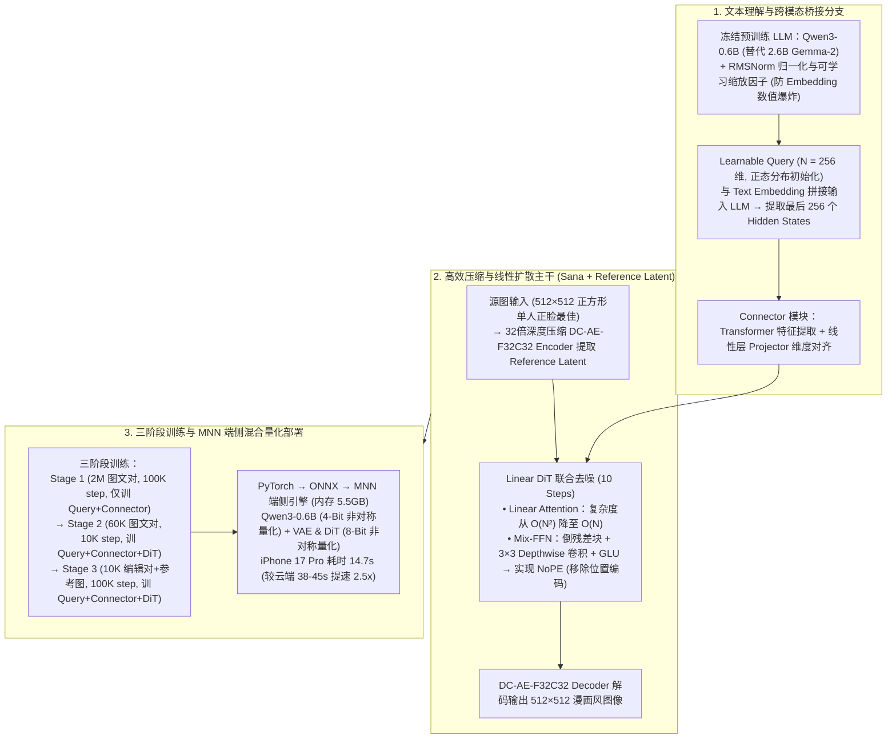

# MNN-Sana-Edit-V2：端侧运行的图像漫画风编辑大模型

## 1. TL;DR

1. **全本地端侧图像编辑架构**：由淘宝 Meta 技术团队联合杭州电子科技大学研发，融合 **Sana** 高效扩散架构与 **MetaQuery** 跨模态桥接思想，在手机端完全本地运行 `512×512` 图像漫画风编辑（零云端上传保护隐私），在 **iPhone 17 Pro（A19 Pro）上仅耗时 `14.7 秒`**（较 OpenAI 云端吉卜力风格生成的 `38s–45s` **提速 2.5 倍**），已上线 iOS/Android 端 MNN Chat App 并全面开源。
2. **四大核心网络组件创新**：
   - **冻结 `Qwen3-0.6B` + RMSNorm 稳定化**：替代 Sana 原版的 Gemma-2（2.6B），体积缩减且中文理解更强；通过增加 **RMSNorm 层 + 可学习小缩放因子**解决 Decoder-only LLM Embedding 数值过大引发的训练爆炸。
   - **`N = 256` 维 Learnable Query + Connector（Transformer + 线性 Projector）**：正态分布初始化的可学习 Query 与 Text Embedding 一同送入冻结的 `Qwen3-0.6B`，提取最后 256 个 Hidden States 对齐至 DiT 空间。
   - **32 倍深度压缩自编码器（`DC-AE-F32C32`）+ Reference Latent**：相比传统 8 倍 AE 大幅缩减 Latent Token 数，并将源图 VAE Latent 与高斯噪声联合送入 DiT 去噪以保持人物结构一致。
   - **Linear DiT（$O(N)$ 线性注意力）+ Mix-FFN（实现 NoPE 无位置编码）**：用倒残差块 + `3×3` Depthwise 卷积 + GLU 构成 Mix-FFN 捕捉局部特征，彻底移除显式位置编码（No Positional Encoding）。
3. **三阶段渐进式训练策略**：**Stage 1**（`2M` 图文对训 `100K` Step，仅训 Learnable Query + Connector）$\rightarrow$ **Stage 2**（内部 `60K` 图文对训 `10K` Step，联合训 Query + Connector + DiT）$\rightarrow$ **Stage 3**（内部 `10K` 图像编辑对训 `100K` Step，引入 Reference Image Latent 微调编辑能力）。
4. **MNN 混合比特非对称量化部署**：经 `PyTorch → ONNX → MNN` 转换，对 **`Qwen3-0.6B` 采用 4-Bit 非对称量化**，对 **VAE Encoder/Decoder 与 DiT 采用 8-Bit 非对称量化**（推理仅需 `10 Steps`，内存占用约 `5.5 GB`）。

## 2. 问题定义与背景

### 2.1 云端图像编辑的隐私与延迟痛点

将用户自拍或相册照片上传至云端大模型进行风格化编辑（如漫画风、吉卜力风转换），一方面存在敏感人像隐私泄露顾虑与高昂的云端 GPU 算力成本，另一方面受限于网络传输与排队，OpenAI 云端生成往往需要 **38–45 秒**。然而要在算力与内存受限的智能手机端跑通包含多模态理解与扩散生成的完整图像编辑链路，必须同时攻克**文本编码器瘦身、Latent Token 压缩、Attention 复杂度降阶与端侧混合量化**四大难题。

## 3. 知识框架

## 4. 核心内容拆解

### 4.1 网络架构四大关键技术

1. **Learnable Query（`N = 256`）与 Connector 跨模态桥接**：
   - 借鉴 *MetaQuery* 思想，初始化 `256` 个服从正态分布的可学习查询向量（Learnable Query），与文本 Prompt 的 Embedding 拼接后输入保持参数冻结（Freeze）的 `Qwen3-0.6B`；
   - 取 LLM 输出序列的**最后 256 个 Hidden States** 作为视觉生成条件，送入由 **Transformer 块（提取特征）+ 线性层 Projector（对齐通道维度）** 组成的 Connector 模块注入 DiT。
2. **为什么用 `Qwen3-0.6B` 替代 `Gemma-2 (2.6B)`？如何解决训练崩溃？**
   - `Qwen3-0.6B` 参数量不到 Gemma-2 的四分之一，端侧内存极友好且中文语义理解更强。
   - **数值爆炸根因与修复**：传统生图模型使用的 T5 编码器 Embedding 层数值较小，而 `Qwen3` 等 Decoder-only LLM 的 Embedding 层权重数值较大，直接接入会导致梯度与激活值爆炸；通过引入 **RMSNorm 层对文本 Embedding 归一化，并乘上小的可学习缩放因子（Learnable Scale Factor）**，彻底保证了训练收敛稳定性。
3. **32 倍压缩自编码器（`DC-AE-F32C32`）与 Reference Latent**：
   - 传统 VAE 空间下采样倍数为 $8\times$，而本方案采用 **32 倍深度压缩自编码器（`DC-AE-F32C32`）**，将 Latent Token 数量削减至原来的 $\frac{1}{16}$，大幅降低端侧算力开销。
   - 编辑时通过 VAE Encoder 提取原始图像的 **Reference Latent**，与高斯噪声一并输入 DiT 联合去噪，在转换为漫画风格的同时精准保持原图人物面部结构与构图。
4. **Linear DiT（$O(N)$）与 Mix-FFN（NoPE 无位置编码设计）**：
   - 将 DiT 中所有 $O(N^2)$ 标准自注意力替换为 **$O(N)$ 线性注意力（Linear Attention）**，生图质量无损而计算量骤降；
   - 在前馈网络中引入 **Mix-FFN（由倒残差块 Inverted Residual Block + `3×3` Depthwise 深度卷积 + Gated Linear Unit 组成）**，利用 `3×3` 深度卷积隐式捕获局部空间位置关系，从而直接移除显式位置编码，实现 **NoPE（No Positional Encoding）**。

### 4.2 三阶段训练范式与 MNN 端侧混合量化部署

1. **三阶段训练配置**：

| 训练阶段 | 任务目标 | 训练数据集规模 | 训练步数 | 放开训练的模块（其余冻结） |
| :--- | :--- | :--- | :--- | :--- |
| **Stage 1：预训练对齐** | 桥接冻结 LLM 与文生图空间 | `2M`（200 万）图文对 | `100K Steps` | 仅训练 `Learnable Query + Connector` |
| **Stage 2：文生图微调** | 提升基础图像生成画质 | 内部 `60K`（6 万）图文对 | `10K Steps` | 训练 `Learnable Query + Connector + DiT` |
| **Stage 3：图像编辑微调** | 引入参考图实现漫画风结构保持编辑 | 内部 `10K`（1 万）编辑对 | `100K Steps` | 训练 `Learnable Query + Connector + DiT`（输入含 Reference Latent） |

2. **MNN 端侧转换、4/8-Bit 混合量化与最优超参**：
   - **转换链路**：`PyTorch 权重 → ONNX → MNN 格式`。
   - **差异化混合比特量化**：对参数量集中但对微小数值扰动容忍度较高的 **`Qwen3-0.6B` 采用 4-Bit 非对称量化**；对直接影响像素重建画质的 **VAE Encoder/Decoder 与 DiT 采用 8-Bit 非对称量化**。
   - **最优推理超参**：去噪步数固定为 **`10 Steps`**（少于 10 步画质受损，多于 10 步耗时增加但画质无明显提升）、固定内置编辑 Prompt、输入建议为**正方形单人正脸图像**、输出分辨率固定为 **`512×512`**，运行内存占用约 **`5.5 GB`**（支持 iOS A16 及以上、Android 骁龙 8 及以上芯片）。

## 5. 数据速查表

| 测试设备 / 对比方案 | 操作系统 | 芯片型号 | 512×512 编辑总耗时 | 对比说明 |
| :--- | :--- | :--- | :--- | :--- |
| **iPhone 17 Pro**（2025.09） | iOS | **A19 Pro** | **`14.7 秒`** | **较云端方案提速 `2.5 倍`** |
| **iPhone 16 Pro**（2024.10） | iOS | A18 Pro | **`18 秒`** | 全本地端侧运行 |
| **iPhone 15 Pro**（2023.09） | iOS | A17 Pro | **`20 秒`** | 全本地端侧运行 |
| **一加 13**（2024.10） | Android | Snapdragon 8 Elite | **`45 秒`** | 全本地端侧运行 |
| **Xiaomi 12 Pro**（2021.12） | Android | Snapdragon 8 Gen 1 | **`62 秒`** | 老款旗舰兼容基线 |
| **OpenAI 云端吉卜力风格生成** | 云端 API | 云端 GPU | `38s – 45s` | 存在网络传输与云端排队延迟 |

## 6. 踩坑与教训 / 可迁移的设计原则

1. **将 Decoder-only LLM 接入扩散模型做文本编码器时，必须加 `RMSNorm + 可学习缩放因子`**：切勿直接把 Qwen/Llama 的最后一层隐藏态裸喂给原本适配 T5 的扩散模型，因为 Decoder-only 模型的 Embedding 范数过大，直接训练必然出现梯度数值爆炸。
2. **端侧多模态生成模型应采用“LLM 4-Bit + 视觉 VAE/DiT 8-Bit”的非对称混合量化**：语言编码器负责语义条件提取，4-Bit 量化即可无损保真并大幅省内存；而 DiT 与 VAE 涉及连续像素空间回归，保留 8-Bit 非对称量化能有效避免色偏与伪影。
3. **利用 `3×3` Depthwise 卷积（Mix-FFN）替代显式位置编码（NoPE）并结合 32 倍 DC-AE**：在端侧算力受限下，`DC-AE-F32C32` 先把空间 Token 数砍掉一个数量级，再配合 $O(N)$ Linear Attention 与 10 步采样，是在手机端压进 15 秒以内的关键组合拳。

## 7. 记忆锚点

- **一套跨模态桥接架构**：冻结 `Qwen3-0.6B`（配 RMSNorm + 可学习缩放）+ `256` 维 Learnable Query + `Connector`（Transformer + 线性 Projector）。
- **两项 Sana 高效算子**：`DC-AE-F32C32`（32 倍空间压缩 vs 传统 8 倍）+ `Linear DiT`（$O(N)$ 线性注意力 + `Mix-FFN` 倒残差 `3×3` 深度卷积实现 `NoPE`）。
- **三阶段训练配比**：`Stage 1`（2M/100K step，训桥接）$\rightarrow$ `Stage 2`（60K/10K step，训文生图）$\rightarrow$ `Stage 3`（10K/100K step，加 Reference Latent 训编辑）。
- **四组端侧部署指标**：LLM `4-Bit` + VAE/DiT `8-Bit` 非对称量化、`10 Steps`、`5.5 GB` 内存、iPhone 17 Pro **`14.7s`**（提速 `2.5x`）。

## 8. 复习卡片

1. MNN-Sana-Edit-V2 是如何通过 Learnable Query 和 Connector 将冻结的 `Qwen3-0.6B` 与图像生成 DiT 桥接起来的？::使用 256 个正态分布初始化的可学习参数（Learnable Query）与文本 Embedding 一同输入冻结的 `Qwen3-0.6B`，取输出的最后 256 个 Hidden States 作为生成条件，再经包含 Transformer 和线性层 Projector 的 Connector 模块对齐至 DiT 输入空间。
2. 为什么直接使用 `Qwen3-0.6B` 等 Decoder-only LLM 的文本嵌入训练生图网络会导致训练不稳定？如何解决？::因为传统生图模型采用的 T5 编码器 Embedding 层数值较小，而 Decoder-only LLM 的 Embedding 层权重数值较大，直接沿用会导致数值爆炸；通过增加 RMSNorm 层归一化文本 Embedding 并引入小的可学习缩放因子即可稳定训练。
3. MNN-Sana-Edit-V2 中的 `DC-AE-F32C32`、Linear DiT 和 `Mix-FFN` 分别起到了什么作用？::`DC-AE-F32C32` 提供 32 倍深度压缩（传统为 8 倍），大幅减少 Latent Token 数量；Linear DiT 将注意力复杂度从 $O(N^2)$ 降至 $O(N)$；`Mix-FFN`（倒残差块 + `3×3` 深度卷积 + GLU）捕捉局部空间信息，从而移除显式位置编码实现 NoPE。
4. MNN-Sana-Edit-V2 的三阶段训练策略在数据量、步数和可训练参数上是如何划分的？::Stage 1 用 2M 图文对训练 100K 步，仅训 Learnable Query 和 Connector；Stage 2 用 60K 图文对训练 10K 步，联合训练 Query、Connector 和 DiT；Stage 3 引入源图 Reference Latent，用 10K 图像编辑对训练 100K 步（可训练参数同 Stage 2）。
5. 在 MNN 端侧部署中，模型转换链路与各组件的量化精度是如何配置的？在 iPhone 17 Pro 上表现如何？::转换链路为 `PyTorch → ONNX → MNN`；对 `Qwen3-0.6B` 采用 4-Bit 非对称量化，对 VAE Encoder/Decoder 和 DiT 采用 8-Bit 非对称量化；在 10 步采样、512×512 分辨率下内存占用约 5.5GB，iPhone 17 Pro 仅需 14.7 秒（比云端方案快 2.5 倍）。

## 9. 知识关联

- **所属主题**：
  - [大模型推理与算子优化](../../20_topics/大模型推理与算子优化.md)
  - [模型架构与训练](../../20_topics/模型架构与训练.md)
  - [模型与开发工具发布](../../20_topics/模型与开发工具发布.md)
  - [跨端开发与性能](../../20_topics/跨端开发与性能.md)
- **本地跃迁**：[原始 PDF](RAW.pdf) · [逐页转写文本](MD.md)
- **候选双链**：[[TaoAvatar 3D数字人应用]] · [[TLiveOmni直播多模态大模型]] · [[淘宝跨端体验优化AI演进]]

## 10. 原文参考资料

1. **核心学术论文**：
   - *SANA: Efficient High-Resolution Image Synthesis with Linear Diffusion Transformers*
   - *Transfer between Modalities with MetaQueries*
2. **开源代码、文档与模型权重**：
   - **MNN 源码仓库**：`https://github.com/alibaba/MNN`
   - **Sana 端侧部署文档**：`https://github.com/alibaba/MNN/blob/master/apps/sana/README.md`
   - **HuggingFace 权重**：`https://huggingface.co/taobao-mnn/MNN-Sana-Edit-V2`
   - **ModelScope 权重**：`https://modelscope.cn/models/MNN/MNN-Sana-Edit-V2`
   - **MNN Chat App**：iOS App Store (`id6748348797`) / Google Play (`com.alibaba.mnnllm.android.release`)

> [!note]- 校对报告
> - **页码溯源**：p.1–2（淘宝 Meta 团队联合杭电研发背景、iPhone 17 Pro 15 秒内完成 512×512 漫画风转换提速 2.5 倍、MNN Chat iOS/Android 下载链接）；p.2–5（6 大系统组件：`Qwen3-0.6B`、`N=256` Learnable Query、Transformer+Projector Connector、`DC-AE-F32C32` 32 倍压缩、Linear DiT $O(N)$ 与 `Mix-FFN` 倒残差+3×3 深度卷积+GLU 实现 NoPE、RMSNorm+可学习缩放因子防爆炸、Reference Latent）；p.5–7（Stage 1 2M/100K、Stage 2 60K/10K、Stage 3 10K/100K 三阶段训练；PyTorch→ONNX→MNN 转换、LLM 4Bit + 其余 8Bit 非对称量化；iPhone 17/16/15 Pro 与一加 13/小米 12 Pro 真机耗时表、5.5G 内存、10 步采样等最优超参与开源地址）。
> - **一致性核验**：作者（蔚山，淘天集团-Meta技术团队）、发布时间（2026-04-22）、全部网络参数、训练步数与真机测试秒数均逐页核对一致；正文中无任何内联页码引用。
> - **质量边界**：全文参数与开源链接完整清晰，已全量收录。
