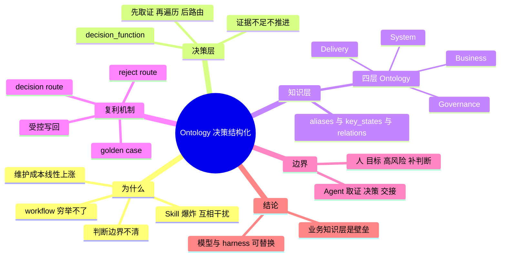
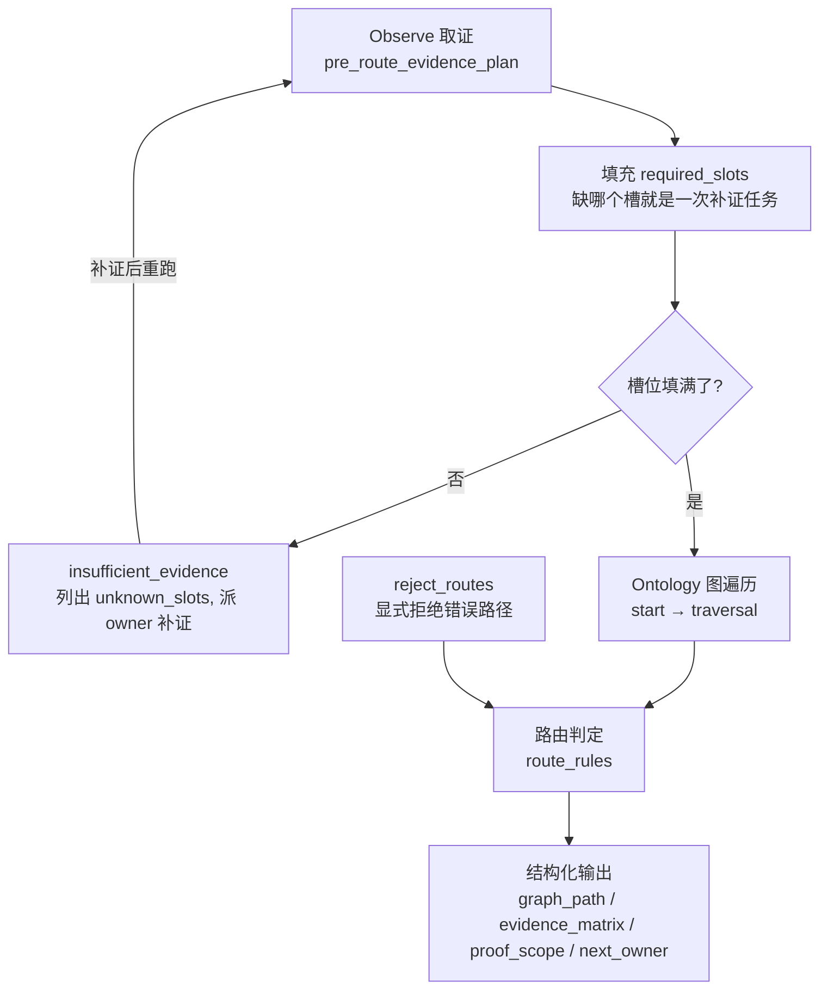
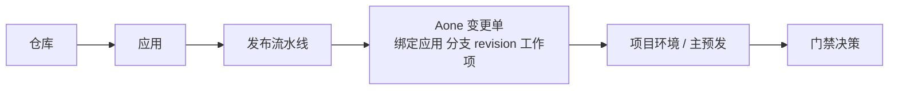

# 改变世界前先认识世界：Ontology 决策结构化实践

> [!note] 读者背景假设
> 你的提示词里读者背景是未填写的占位符，这里暂按「有 RAG / LangGraph 经验的 LLM 应用工程师」处理，基础概念一笔带过。

## 1. TL;DR

- 商家财务团队用 **Ontology（四层业务世界模型）+ decision_function（可执行的专家判断）** 实现 Agent「工作全托管」，3 个月内完成 120+ 需求 / 工作项。
- 不预设 workflow、不打包 Skill；Agent 每步按「先取证、再决策、后行动」的闭环运行，workflow 由决策动态长出来。
- 知识以碎片（decision route / reject route / golden case）每天回写，决策可组合，产生复利。
- 作者结论：模型和 harness 会不断被替换，结构化的业务知识才是决定 Agent 能否稳定产出高质量决策的壁垒。

---

## 2. 核心概念

### 一句话定义

| 概念 | 一句话定义 | 解决的痛点 |
|---|---|---|
| **工作全托管** | 不止需求上线，还含数据订正、工单处理、业务接入、业务运维；凡需人投入精力的事项都由 Agent 团队接手 | 流程自动化 ≠ 业务自迭代 |
| **需求全托管链路** | 从需求开发到上线，人只提需求 + 批 CF/CR 单，其余由 Agent 推进，含安全生产验证、正式发布 | — |
| **decision_function** | 把「专家怎么判断」沉淀成「槽位 + 图遍历 + 路由规则」的可执行程序 | Agent 靠概率直觉判断，无法审计、无法复现 |
| **Ontology（本文语境）** | 可被 Agent 执行和审计的业务世界模型，不是自然语言知识库 | 知识库只有结论没过程、非结构化、写完即腐化 |
| **proof_scope** | 结论证明到了什么范围，结论不得超过它 | 结论越界 |
| **碎片化存储** | 不预打包 Skill，把经验拆成 decision route / reject route / golden case 写回知识库 | Skill 爆炸、互相干扰、维护成本线性上涨 |

### 易混概念对比

| 对比项 | 传统 workflow | Skill | decision_function + Ontology |
|---|---|---|---|
| 第一性原理 | 流程节点 | 打包的场景手册 | 决策（文中：流程节点不应是第一性原理） |
| 流程来源 | 人先设计，Agent 按流程执行 | 自然语言 / 脚本描述 | Agent 先补证决策，再动态长出流程 |
| 新知识位置 | 流程里 | Skill 里很少有新知识（文中） | 碎片里 |

| 内容 | 自然语言知识库 | Ontology 结构化知识 |
|---|---|---|
| 业务对象 | 混在描述里 | Object |
| 关键属性 | 靠文本理解 | Property |
| 对象关系 | 靠上下文推断 | Relation |
| 判断规则 | 混在经验里 | Logic / Decision |
| 证据要求 | 经常缺失 | Evidence / required_slots |
| 可执行动作 | 和判断混在一起 | Action / Workflow / Skill |
| 错误路径 | 往往不记录 | reject_routes |
| 证明范围 | 很少显式说明 | proof_scope |

> [!warning] 易错：reject_routes 与 rejected_routes
> 原文字段表里决策**输入侧**是 `reject_routes`（明确哪些路径必须拒绝），`output` 里**输出侧**是 `rejected_routes`。`[推断]` 前者是规则，后者是本次执行实际被排除的路径；原文未明说区别。

---

## 3. 知识框架



### decision_function 执行闭环



> [!note] 图中输出只列了 4 项
> 图中「结构化输出」只列 graph_path、evidence_matrix、proof_scope、next_owner；正文字段表里 output 共 7 项（另有 filled_slots / unknown_slots / rejected_routes）。

### 发布链路（Delivery Ontology 的对象边顺序）



---

## 4. 关键要点

### 1. 全托管 = 每步被结构化决策约束

- Agent 每轮要回答六个问题，每个都对应结构化产物：

| 问题 | 结构化产物 |
|---|---|
| 当前任务属于什么业务对象和业务线？ | domain / bizLine / object |
| 需要补哪些证据才能判断？ | required_slots / evidence_matrix |
| 哪些路径看似合理但不能走？ | rejected_routes |
| 现在可以执行什么动作？ | action / workflow / skill |
| 结果证明到了什么范围？ | proof_scope |
| 下一步交给谁？ | next_owner |

- 五步：Observe → Decide → Act → Verify → Next，每步都有产物，可审计、可复现，才能被托管。
- 无需预先选择工作流，所有流程和阶段由决策函数动态长出来。

### 2. workflow 迭代史与各形态局限

| 形态 | 优点 | 问题 |
|---|---|---|
| 手工拖拽 workflow（如 Dify，AI 几乎只做 NL2Parameter） | 稳定、可视化、容易控制 | 泛化差，场景稍变就要重新编排 |
| 自然语言 Skill | 灵活，覆盖长尾能力强 | 判断边界不清，证据不足时容易继续推进 |
| 内置脚本 Skill | 可执行性强，稳定性提升 | 脚本解决「怎么做」，不天然解决「该不该做」 |
| 预设场景 workflow（如 coco 设计的需求发布流程） | 高频场景快、稳定 | 无法穷举所有真实工作场景 |

> [!important] 重点
> 真实工作是一张动态变化的图而非一条线：工单看似页面问题，取证后可能是账单对象、发票状态、离线回流或权限配置问题。真正该结构化的是决策（何时进开发 / 补证 / 拒绝 / 交 QA / 发布 / 停下等审批）。

### 3. decision 的核心字段

| 字段 | 作用 |
|---|---|
| decision_question | 这个决策要回答的问题 |
| trigger | 什么场景触发 |
| start | 从哪个 ontology 对象开始图遍历 |
| required_slots | 必须填的证据槽，缺了就证据不足，不能推进 |
| optional_slots | 辅助判断和消歧 |
| pre_route_evidence_plan | 路由前先取证的步骤 |
| traversal | 沿 ontology 图遍历 object / relation / logic，派生结论 |
| route_rules | 按槽值决定路由，命中后给出原因 |
| reject_routes | 明确哪些路径必须拒绝，避免被关键词误导 |
| output | 输出 graph_path / filled_slots / unknown_slots / rejected_routes / evidence_matrix / proof_scope / next_owner |

- 原则：证据不足不推进，结论不超过 proof_scope。
- 在 Agent Room 中要求先走 `ontology:context + decision_function`。
- start 要起始对象、traversal 要关系边、required_slots 要证据来源，所以决策函数必须依赖知识库。

### 4. 金字塔原理 ↔ decision_function（原文图示映射）

| 金字塔原理 | decision 字段 |
|---|---|
| 结论先行 | decision_question（要回答的结论问题） |
| 以上统下 | required_slots（必要证据，缺了不能下结论） |
| 归类分组 | route_rules（分支互斥且完备） |
| 逻辑递进 | reject_routes（显式排除错误路径） |

- 人靠训练内化，Agent 靠显式编码：每轮同一套标准，可审计、可复现。

### 5. Ontology 的由来与相对 Palantir 的改动

- Palantir 把 Ontology 定义为组织的 Operational Layer：架在数据集和模型之上的业务语义层，把表 / 字段 / 外键重组为对象、属性、关系、动作。
- 诞生动因：FDE 在客户现场的方案，若不抽象成通用业务本体，换客户就带不走。
- 带来三个转向：表驱动 → 对象驱动；指标汇总 → 对象状态；单点分析 → 关系追踪。
- 本团队多做两件事：
  - 在业务对象之上加 **Delivery** 和 **Governance** 两层。
  - 把「判断」以 decision_function 挂到对象上，使 Ontology 能驱动 Agent 取证、决策、交接。
- 一句话对比：Palantir 让企业和 AI 共用一套业务语言；本团队要这套语言可执行、可审计。

稳定知识的拆分链：

```text
Object / Property / Relation / State
        -> Metric / Evidence
        -> Logic / Decision
        -> Action / Workflow
        -> Audit / Feedback
```

### 6. 四层 Ontology

| 层级 | 解决的问题 | 示例 |
|---|---|---|
| Business | 业务世界有哪些对象、属性、关系和判断 | 发票、账单、开票申请、进项票、销项票、给买家开票 |
| System | 业务对象落在哪些系统、服务、表、配置和链路里 | 在线表、离线表、服务接口、配置项、消息链路 |
| Delivery | 一个变更如何安全交付 | 代码、应用、本地验证、预发发布、正式发布、二方包、CR、回滚 |
| Governance | Agent 如何读取上下文、执行决策、交接、审计和自迭代 | context_pack、decision_function、proof_scope、handoff、golden case |

### 7. 各层案例

**Business：发票**
- 定义为 `core_business_object`，解决「同一个词、不同含义」；给买家开票、销项票、进项票三条业务线共享同一个发票凭证对象，差异来自发票流向、参与方角色和申请来源。
- 挂三类内容：
  - `aliases`：invoice、einvoice、蓝票、红票、invoiceCode……，任一词都定位到同一对象。
  - `key_states`：created、issued、valid、invalid、blue、red、matched……，对着状态查，不靠猜。
  - `relations`：开票申请 results_in 发票、发票 contains 明细行、发票 has 流向、发票 issued_through 服务商。
- 接到「买家下载不到发票」工单：先定位对象，再沿边查状态和关系。

**System：业务对象落在哪**
- 发票的可信源登记了在线表（einvoice、einvoice_seller、einvoice_apply……）、离线表、后端代码（OutputInvoiceController、InvoiceManager……）和文档。
- 离线表是在线表在 ODPS / MaxCompute 侧的镜像和加工结果，来源是同步任务和 DataWorks 节点。
- Agent 写离线 SQL 的顺序：
  1. 看在线表 DDL 拿字段和类型
  2. 看后端代码（DO、mapper）确认字段语义和枚举取值
  3. 对照离线表的同步来源、分区和聚合粒度
  4. 才动手写
- 系统层是决策函数取证时的证据源，不是给人读的说明文档。

> [!warning] 易错
> 在线和离线对不上时，先列字段、时间范围、过滤条件的差异，不直接宣布哪边错。

**Delivery：发布门禁**
- 对象：代码仓库、应用、发布流水线、Aone 变更单、合并请求、代码评审门禁、项目环境、主预发环境、本地验证门禁、真实预发流程证据；它们不属于任何一条业务线，但所有变更都要经过。
- 仓库与应用是不同维度：应用是 Aone / O2 / VOID 平台上的可发布单元；一个仓库可能绑多个应用，也可能是没有发布流水线的工具 / 文档仓库。
- 发布判断第一步永远是确认绑定关系（`a1 app view` 的 codeConfigs、仓库绑定信息），它决定仓库的「发布面」：

| 条件 | 发布面 |
|---|---|
| 绑了应用且有流水线 | 走 CR / 流水线预发链路 |
| 前端是 O2 / VOID 应用 | 走 VOID publish |
| 配置类变更 | 走 Switch / Diamond 推送 |
| 没应用也没流水线 | 才允许 MR-only 交付 |

- 典型门禁：`release_execution_gate_decision`。其 decision_question：涉及预发、APRE、O2、CR、pipeline、Switch/Diamond 或二方包发布时，如何先判定仓库发布面，再决定是否必须交给发布 Agent 执行。
- 该决策需填二十多个 required_slots（如仓库是否绑定应用、有无发布流水线、契约是否变更、二方包是否已发远端、下游 fresh compile 是否通过、主预发是否部署到本轮 revision……），填不满判 `insufficient_evidence`，不推进。
- 图谱里边关系：`gates_production`、`requires`、`verified_by` 是门禁判定关系。
- 流程 = 对象之间边的顺序，Agent 不需要背流程。

### 7.5 「AI 听得懂人话」：别名与隐含约束

- 同事对话被压缩成「业务黑话」+「隐含上下文」，旧 AI 在「搜关键词跳无关文档 / 读完不知下一步」两种失败里循环。
- **黑话**：项目代号（如混沌、章鱼）作为对象的 `aliases` 挂在对象节点上，Agent 做一步别名解析即可定位，再读属性、关系和 `source_of_truth`。
- **隐含上下文**：例句「上游消费券表数据又出错了，你重跑下账单吧」，括号里补全的四项都是挂在对象上的约束：

| 隐含项 | 对应的知识库约束 |
|---|---|
| 账单类型 | `bill_type` 取值枚举 |
| 表类型 | `offline_table` 的形态 |
| 时间范围 | 月账单时间窗口如何计算 |
| 动作顺序 | 先重跑离线表到本项目空间，再发起账单重跑任务（重跑账单的前置动作） |

- Agent 处理路径：定位「消费券账单」对象 → 沿关系边找离线表来源和账单重跑动作 → 对着 `decision_function` 的 `required_slots` 检查哪些槽被隐含、需补 → 两个动作按顺序执行。
- 链路缺任一环（黑话没进 aliases / 关系没建全 / 缺 required_slots）就退回旧样子。
- 作者结论：「AI 听得懂人话」不是模型能力问题，而是知识库结构化程度问题。

### 8. 为什么不把一切做成 Skill

- 一个真能用的 Skill 至少五样：触发场景描述、完整判断链、执行动作、注意点与兜底、验证方式（几百行的闭环小手册）。
- 拆开看是 ontology 碎片的固定打包：

| Skill 组成 | 对应的 ontology 碎片 |
|---|---|
| 触发场景 | decision 的 `trigger` |
| 判断链 | `required_slots` + `route_rules` + `reject_routes` |
| 涉及对象和证据 | object / relation / source_of_truth |
| 执行动作 | action / workflow |
| 验证方式 | `proof_scope` + golden case |

- 全做成 Skill 的问题：
  1. 可能产生几百个 Skill，一个任务同时命中两三个是常态，判断互相打架。
  2. 每个 Skill 都要写完整逻辑链和动作；一条规则变了，要改所有包含它的 Skill，维护成本随场景数线性上涨。
  3. 打包内容越多，越难用证据槽约束，证据不足时容易继续推进。
- 解法：每天把需求 / 工单 / 踩坑拆成三类碎片写回——**decision route**（什么证据下做什么判断）、**reject route**（哪条路看似对、实际走不通）、**golden case**（带完整证据的真实案例，用于回归）。
- 执行时由 decision_function 当场组装；碎片可复用、可组合、可独立演进，一条规则修订只改一处。

### 9. 受控写回流程


> [!warning] 易错
> 未验证的猜测、一次性日志、临时判断，一律不进 ontology。

- 复利来自决策可组合：图足够密后，新任务路径上大多数判断点都命中已有 decision_function；人只需介入少数几类——定目标、批高风险动作、证据不足时补判断。

### 10. 人与 Agent 的边界

| 人 | Agent |
|---|---|
| 定目标、业务语义、验收口径 | 从知识库和实时证据恢复上下文 |
| 批 CF/CR、生产写、金额等高风险动作 | 运行 decision_function 输出可审计判断 |
| 证据不足、权限阻断时补关键判断 | 调用被允许的 Skill 和工具 |
| 评审新决策路由和知识库演进 | 用新鲜证据验证结果 |
| — | 按 next_owner 交接或闭环 |

- 全托管不是取消人，而是把人的注意力从重复推进转移到目标、边界和风险确认。
- 它是「结构化组织系统」：业务知识被建模，专家判断被函数化，工具执行被门禁约束，真实结果被证据回写。

### 11. 模型 / harness 与业务知识层

- 作者称同一套知识库和决策函数在 qoder 系列、codex、claude code 上跑过真实需求，模型换过 opus、gpt5.5、glm5.2、qwen 3.8，输出稳定性没变。
- 论点：模型层决定怎么推理，harness 决定怎么编排，「红冲工单要取哪些证据、哪条路绝对不能走、预发门禁之后交给谁」这类判断只在 ontology 和 decision_function 里；越往垂直深水区，胜负越取决于这一层。
- 策略：不押注哪个模型 / harness，每条 decision route、reject route、golden case 持续有效。

## 5. 数据速查表

| 指标 | 数值 | 出处 |
|---|---|---|
| 周期 | 3 个月 | 前言 |
| 完成任务量 | 120+ 需求 / 工作项（摘要：120 多项任务） | 摘要、前言、07 节 |
| 知识图谱规模 | 770 nodes；edges 为 1840/2540（首张图为 1839/2540）⚠️[原文疑点] | 图谱截图 |
| 预发门禁 required_slots | 二十多个 | 05 节 Delivery |
| Ontology 层数 | 4 层 | 05 节 |
| 执行闭环步骤 | 5 步（Observe / Decide / Act / Verify / Next） | 02 节 |
| 一个好 Skill 的必备要素 | 5 样 | 07 节 |
| 测试过的模型 | opus、gpt5.5、glm5.2、qwen 3.8 | 09 节 |

## 6. 踩坑与教训

- 靠关键词搜索「碰运气」：知识库只记结论不记过程，下次遇到相似问题人和 Agent 都无从借鉴。
- 文档写完就腐化，没人知道哪一段还有效。
- 自然语言 Skill 判断边界不清，证据不足时容易继续推进。
- Skill 打包后：互相干扰、规则变更需多处改、维护成本线性上涨。
- 被关键词误导：用 `reject_routes` 显式拒绝。
- 在线 / 离线数据对不上：先列差异，不直接宣布哪边错。
- 仓库不一定有发布面：发布判断前先确认仓库—应用绑定。

### 可迁移的设计原则

- 把「决策」而不是「流程节点」作为系统第一性原理。（原文）
- 缺证据就生成补证任务，而不是让模型猜；结论不超过 proof_scope。（原文）
- 知识拆成 对象 / 属性 / 关系 / 判断 / 证据要求 / 动作 / 错误路径 / 证明范围，各自独立存放。（原文）
- 业务黑话进 aliases，隐含约束挂在对象属性上，而不是写翻译手册。（原文）
- 知识回写必须经过 validate + 案例回归 + 评审。（原文）
- `[推断]` 判断逻辑与执行编排解耦：判断资产（决策 / 拒绝路径 / 案例）与具体模型、编排框架无关，迁移时只替换执行层。

---

## 7. 记忆锚点

1. **「先取证，再遍历，后路由」**：证据不足 → 补证重跑，结论不超过 proof_scope。
2. **三种碎片 = 路 / 反路 / 案例**：decision route（该走哪）、reject route（别走哪）、golden case（走过的证明）。

---

## 8. 复习卡片

什么是 decision_function？::把「专家怎么判断」沉淀成「槽位 + 图遍历 + 路由规则」的可执行程序，Agent 必须先取证填槽再决策。

全托管每一步的闭环顺序是什么？::Observe → Decide → Act → Verify → Next，每步都有结构化产物。

required_slots 缺失时怎么办？::判 `insufficient_evidence`，列出 unknown_slots 并派 owner 补证，补证后重跑，不推进。

四层 Ontology 分别是什么？::Business、System、Delivery、Governance；后两层是相对 Palantir 额外增加的。

为什么不把工作都做成 Skill？::会产生几百个互相干扰的 Skill；规则变更需多处修改，维护成本随场景数线性上涨；打包越多越难用证据槽约束。

写回知识库的三类碎片是什么？::decision route、reject route、golden case。

知识写回的受控流程？::读已有约束 → 取证 → 执行既有 decision_function → 识别缺口 → 生成 learning proposal → ontology:validate + 案例回归 → 评审 → 才视为长期知识。

发布面判断的第一步是什么？::确认仓库与应用的绑定关系（`a1 app view` 的 codeConfigs、仓库绑定信息）。

「AI 听得懂人话」靠什么实现？::aliases 解析黑话 + 对象关系 + decision_function 的 required_slots 检出隐含槽；不是模型能力问题。

作者认为哪层是 Agent 在垂直场景的壁垒？::业务知识层（ontology + decision_function），模型层和 harness 层都会被快速替换。

---

## 9. 知识关联

候选双链（由你决定哪些对应已有笔记）：

- [[Agent 编排与 workflow]]
- [[LangGraph]]
- [[Skill 设计]]
- [[RAG 知识库]]
- [[知识图谱]]
- [[Ontology]]
- [[Palantir Ontology]]
- [[Agent 评测与回归测试]]
- [[金字塔原理]]
- [[Agent 治理与人机协同]]
- [[MCP 与工具调用]]

---

## 10. 原文参考资料

- 原文提及 Palantir Ontology（Operational Layer）、Dify、LangGraph、Claude Code、Codex、Qoder 等工具与概念，未附外部参考文献链接。

> [!note]- 校对报告
> **1. 覆盖度**
> - 已覆盖：摘要、01 前言、02 全托管、03 workflow 迭代、04 金字塔原理与 decision 字段、05 Ontology（由来、四层、Business / System / Delivery 案例、结构化对比表）、06 AI 听得懂人话、07 时间的复利（Skill 对比、碎片化、受控写回）、08 人与 Agent 边界、09 模型与 harness、全部配图的主要结构。
> - 有意省略：10 团队介绍、拓展阅读、阅读量 / 留言等页面元信息；三张知识图谱截图（发票、HSF、预发门禁）中的节点级细节（小字不可辨，仅采用正文已述内容）；图谱左侧 KEY HUBS 的节点计数。
> - 未使用 `[扩展]` 内容，故无「扩展阅读」。
>
> **2. 一致性抽查（5 项）**
> - 「120+ 需求 / 工作项」：前言、07 节、摘要「120 多项」一致 ✓
> - 「二十多个 required_slots」：与 05 节 Delivery 原文一致 ✓
> - 「四层 Ontology」及四层名称：与表格一致 ✓
> - 「五步：Observe / Decide / Act / Verify / Next」：与 02 节一致 ✓
> - 「模型：opus、gpt5.5、glm5.2、qwen 3.8」：与 09 节原文一致（未联网核实这些模型名，按原文保留）✓
>
> **3. [推断] 与 ⚠️ 汇总**
> - `[推断]` reject_routes（规则输入）与 rejected_routes（输出）的区别。
> - `[推断]` 「判断逻辑与执行编排解耦」的迁移原则。
> - ⚠️[原文疑点] 图谱截图边数：首张图显示 1839/2540，其余截图显示 1840/2540，原文未解释。
> - ⚠️[原文疑点] 署名：页头为「供给技术团队 / 大淘宝技术」，文末作者介绍为「汀叶，淘天集团-商家与开放平台团队」，正文自称「商家财务团队」，三处团队名称不一致，未统一。
> - ⚠️[原文疑点] 09 节「输出稳定性没变」仅为作者陈述，原文未给出任何量化指标或对比数据；120+ 完成量也无成功率、人工介入比例等数据。
> - 作者未论述该方案的局限（如建模与写回治理的前期成本），本笔记也未补写。
> - 日期取自文章页头发布时间 2026年9月27日，非生成日期。
