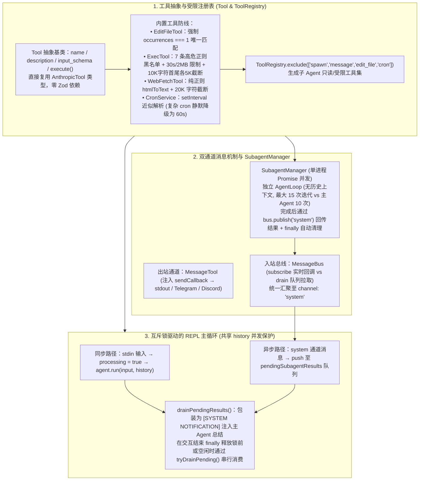

# 800 行代码实现 Open Claw 的 Tool、消息总线、子Agent管理架构

## 1. TL;DR

1. **薄抽象与零框架依赖设计哲学**：不依赖 LangChain 或 Zod 等重型中间层，直接基于 `@anthropic-ai/sdk` 在单进程 Node.js（TypeScript）中用约 **800 行代码**完整实现 OpenClaw 的四大核心运行时模块——**工具系统（`Tool` & `ToolRegistry`）、入站消息总线（`MessageBus`）、后台子 Agent 管理器（`SubagentManager`）与互斥锁驱动的 `REPL` 主循环**。
2. **工具安全防线与权限最小化隔离（`exclude()`）**：
   - `EditFileTool` 强制要求 `old_text` **唯一精确匹配**（出现 0 次或 `> 1` 次均拒绝修改，防止 LLM 误改多处代码）；
   - `ExecTool` 构筑**三层防护**：高危命令正则黑名单（拦截 `rm -rf /`、Fork Bomb、写裸设备等）+ 资源限制（**30 秒超时、2MB maxBuffer**）+ **首尾各保留 5,000 字符**的 `10,000` 字符截断；
   - `ToolRegistry.exclude(["spawn", "message", "edit_file", "cron"])` 为子 Agent 生成不可变受限工具集，严防递归派生与越权外发消息。
3. **出入站解耦的双通道消息机制**：出站走 `MessageTool`（通过注入 `sendCallback` 对接终端 stdout 或 Telegram/Discord Bot），入站走 `MessageBus`（支持常驻实时回调 `subscribe` 与轮询清空 `drain` 两种互斥消费模式，子 Agent 完成通知与 `CronService` 定时触发统一汇聚至 `"system"` 通道）。
4. **单进程 Promise 子 Agent 与布尔互斥锁并发控制**：每个子 Agent 作为独立无历史上下文的 Promise（最大迭代 **15 次**，主 Agent **10 次**）共享 Node.js 事件循环，执行完毕后发布至 `"system"` 通道；REPL 主循环通过 **`processing` 布尔互斥锁 + `pendingSubagentResults` 暂存队列**，确保用户输入与异步子 Agent 回传结果串行消费并安全写入共享 `history` 数组。

## 2. 问题定义与背景

### 2.1 为什么放弃重型 Agent 框架而选择“800 行薄抽象”？

在构建具备工具调用、异步子任务并发与定时触发能力的 Agent 系统时，引入多层封装的通用框架往往导致控制流隐式黑盒化、API 行为调试困难。通过直接贴近 Anthropic Claude 原生 Function Calling Schema，采用显式控制流与薄抽象构建最小可运行内核，不仅使系统边界与运行轨迹一目了然，也为后续叠加持久化、Memory 与多端 Bot 接入提供了高确定性的底座。

## 3. 知识框架

## 4. 核心内容拆解

### 4.1 Tool 抽象、安全防线与 `exclude()` 权限收敛

1. **零转换 Schema 与刻意取舍**：
   - `Tool` 抽象类的 `input_schema` 直接取自 `@anthropic-ai/sdk` 的 `AnthropicTool["input_schema"]`，运行时用普通对象定义而非引入 Zod，换取零额外依赖与 SDK 原生对齐（代价是缺乏运行时强校验，依赖 `execute` 内 `as` 断言与执行期报错兜底）。
2. **核心内置工具的工程细节**：
   - **`EditFileTool`（唯一匹配防误改）**：通过 `content.split(oldText).length - 1` 计算匹配次数；若为 `0` 报错未找到，若 **`> 1` 则拒绝替换并警告提供更长上下文**，杜绝 LLM 给出的短片段意外篡改多处代码。
   - **`ExecTool`（三层安全护栏）**：
     1. **第一层（正则黑名单）**：拦截 `rm -rf /`、`rm -rf ~`、`mkfs`、`dd if=`、Fork Bomb `:(){ :|:& };:`、重定向写裸设备 `> /dev/sda`、`chmod -R 777 /` 等 7 类高危模式；
     2. **第二层（进程资源限制）**：默认 **30 秒超时**自动 Kill 进程、**`2MB` `maxBuffer`**；
     3. **第三层（首尾保真截断）**：输出超过 **10,000 字符**时，**截取前 5,000 字符 + 截断提示 + 后 5,000 字符**（因为命令输出的末尾往往包含最关键的报错堆栈与统计摘要）。
   - **`WebSearchTool` & `WebFetchTool`**：封装 Brave Search API（默认 5 条，上限 10 条）；网页抓取采用纯正则 `htmlToText` 剥离 `<script>/<style>` 与标签（不引 `cheerio`/`jsdom`），超 **20,000 字符**截断。
   - **`CronTool` & `CronService`**：基于 `setInterval` 支持 `every_seconds` 与简化版 5 段 `cron_expr`（仅解析 `*/N` 分钟、`0 */N` 小时、每分/每时/每天；遇到“每周三 14:30”等 `setInterval` 无法表达的复杂表达式时，**静默降级为每分钟 `60,000ms` 执行一次**）。
3. **`ToolRegistry.exclude()` 子 Agent 权限隔离**：
   - 通过 `tools.exclude(["spawn", "message", "edit_file", "cron"])` 返回全新的受限注册表实例：剥夺 `spawn` 防止无限递归派生子 Agent；剥夺 `message` 防止子 Agent 绕过主 Agent 直接向用户刷屏；剥夺 `edit_file` 与 `cron` 限制子 Agent 产生外部写副作用。

### 4.2 双通道消息解耦（`MessageTool` vs `MessageBus`）与 `SubagentManager`

1. **出站与入站严格分离**：
   - **出站（`MessageTool`）**：Agent $\rightarrow$ 外部世界，仅调用构造注入的 `sendCallback({ channel, chatId, content })`；切换终端 REPL 与 Telegram/Discord Bot 时只需替换该回调函数，Agent 内核零改动。
   - **入站（`MessageBus`）**：外部/子系统 $\rightarrow$ 主 Agent，消息体包含 `channel`、`senderId`、`chatId`（格式 `originChannel:originChatId`）、`content`。路由遵循**“有订阅者走 `subscribe` 实时回调，无订阅者入 `queue` 供 `drain` 拉取”**的互斥单一路径原则。
2. **`SubagentManager` 单进程异步模型**：
   - 不开多进程或 Worker Threads，每个子 Agent 是共享同一个 Node.js 事件循环的 `Promise`。
   - `spawn()` 生成自增 ID（`subagent-1`）并立即返回该 ID 与当前并发运行数，主 Agent 无需阻塞等待；
   - `runSubagent` 实例化独立的 `AgentLoop`，**`buildMessages` 仅传入当前 `userMessage`（零历史上下文，从零开始专注单点任务）**，最大 ReAct 迭代设为 **15 次**（高于主 Agent 的 **10 次**）；
   - 无论成功或异常，最终均通过 `bus.publish({ channel: "system", senderId: "subagent", ... })` 将结果投递至 `"system"` 通道，并在 `promise.finally()` 中从 `runningTasks` Map 移除自身。

### 4.3 REPL 主循环并发控制：布尔互斥锁 + 暂存队列

由于主 Agent 的对话历史数组 `history` 是共享可变状态，若用户终端输入与后台子 Agent 完成通知同时触发 `agent.run(..., history)`，会导致消息交错与状态损坏。系统通过极简的**布尔互斥锁 `processing` + 暂存队列 `pendingSubagentResults`** 解决竞态：
1. 订阅 `"system"` 通道时，所有到达的子 Agent 结果与定时任务消息一律先 `push` 进 `pendingSubagentResults`，随后调用 `tryDrainPending()`。
2. 若当前主循环正忙（`processing === true`，例如正在处理用户提问），`tryDrainPending()` 直接返回；而在用户提问处理的 `finally` 块释放 `processing = false` 之前，**主动调用 `drainPendingResults()` 将期间积压的子 Agent 结果全部包装为 `[SYSTEM NOTIFICATION - Subagent Result]` 注入主 Agent 总结输出**，既保证了 `history` 的严格串行访问，又确保后台子任务结果绝不无限滞后。

## 5. 数据速查表

| 模块 / 配置参数 | 设定数值 / 规则 | 工程考量说明 |
| :--- | :--- | :--- |
| **整体核心代码量** | 约 **`800 行` TypeScript** | 涵盖 Tool、MessageBus、SubagentManager、REPL 四大模块，零框架依赖 |
| **`EditFileTool` 替换安全条件** | `occurrences === 1` | 出现 0 次或 `> 1` 次均报错拒绝，防止模糊片段误改多处代码 |
| **`ExecTool` 超时与缓冲上限** | **`30 秒`** 超时，**`2 MB`** `maxBuffer` | 超时自动 Kill 进程；另配 7 条高危命令正则黑名单 |
| **`ExecTool` / `WebFetchTool` 截断** | Exec **`10,000` 字符（首尾各 `5,000`）** / Web **`20,000` 字符** | Exec 保留尾部 5,000 字符以确保关键错误堆栈与汇总不丢失 |
| **主 / 子 Agent 最大迭代轮次** | 主 Agent **`10 次`** / 子 Agent **`15 次`** | 子 Agent 独立 ReAct 循环、零历史上下文，专注执行多步子任务 |
| **子 Agent 排除工具列表** | `["spawn", "message", "edit_file", "cron"]` | 防止递归派生、直接打扰用户、并发改文件与乱建定时任务 |

## 6. 踩坑与教训 / 可迁移的设计原则

1. **命令行工具输出截断必须“保头保尾（Head + Tail）”而非“只留头部”**：编译器、测试框架和 Shell 脚本的报错根因与汇总统计几乎全部打印在标准输出的最后几百行；采用“前 5,000 + 后 5,000 字符”截断比单纯 `slice(0, 10000)` 有效得多。
2. **为子 Agent 分配工具集必须采用“显式黑名单剔除（`exclude`）”**：子 Agent 若持有 `spawn` 极易陷入指数级递归派生风暴，若持有 `message` 会绕过主 Agent 协调直接向终端乱发半成品消息；通过 `exclude(["spawn", "message", "edit_file", "cron"])` 从架构层锁死权限边界。
3. **单进程异步多 Agent 汇报必须串行化访问主会话 `history`**：当后台子 Agent 跑完通过事件总线回调主 Agent 时，切忌直接并发调用 `agent.run(history)`；使用布尔互斥锁配合暂存队列（在主对话轮次结束前集中 `drain` 消化系统通知）是最稳健的无竞态模式。

## 7. 记忆锚点

- **四大核心模块（800 行 TS）**：`Tool & ToolRegistry` + `MessageBus` + `SubagentManager` + `REPL 主循环`。
- **三层 `ExecTool` 护栏**：7 条高危正则黑名单 + `30s / 2MB` 进程限制 + `10,000` 字符首尾各 `5,000` 截断。
- **四个子 Agent 禁用工具**：`spawn`（防递归）、`message`（防越权外发）、`edit_file`（防写冲突）、`cron`（防乱建定时器）。
- **一套无锁竞态模式**：Node.js 单线程 `processing` 布尔互斥锁 + `pendingSubagentResults` 队列 + `[SYSTEM NOTIFICATION]` 汇总注入。

## 8. 复习卡片

1. 为什么这套 OpenClaw 最小实现选择直接基于 `@anthropic-ai/sdk` 而不引入 LangChain 或 Zod？::因为中间层越薄，控制流越显式，调试时无需穿透复杂的框架抽象层且能精确控制 API 行为；直接使用 SDK 原生 `input_schema` 类型实现了零额外依赖（代价是放弃了运行时 Schema 强校验）。
2. `EditFileTool` 和 `ExecTool` 分别设计了什么机制来防范大模型操作失误或安全风险？::`EditFileTool` 强制校验目标文本在文件中必须唯一出现（`occurrences === 1`），防止模糊替换改坏多处；`ExecTool` 设有危险命令正则黑名单、30 秒超时与 2MB 缓冲限制、以及超过 10,000 字符时保留首尾各 5,000 字符的截断策略（确保末尾报错信息不丢失）。
3. `MessageTool` 与 `MessageBus` 在职责方向上有何区别？`MessageBus` 支持哪两种消费模式？::`MessageTool` 负责出站（Agent 通过注入的 `sendCallback` 向外部终端或聊天软件发消息），`MessageBus` 负责入站（子 Agent 或定时器向主 Agent 投递消息）；`MessageBus` 支持 `subscribe`（有订阅者时触发实时回调）与 `drain`（无订阅者时入队供轮询清空）两种互斥模式。
4. `SubagentManager` 是如何管理后台子 Agent 的上下文与工具权限的？::每个子 Agent 是共享单进程事件循环的独立 `Promise` 与 `AgentLoop`（最大迭代 15 次），不携带任何历史对话上下文；其工具集通过 `tools.exclude(["spawn", "message", "edit_file", "cron"])` 剔除了派生、外发消息、改文件与定时工具。
5. REPL 主循环如何解决“用户终端输入”与“后台子 Agent 异步返回结果”并发修改共享 `history` 数组的冲突？::采用 `processing` 布尔互斥锁与 `pendingSubagentResults` 暂存队列；当主 Agent 正忙时，子 Agent 发往 `"system"` 通道的结果先入队暂存，待当前用户对话轮次执行完毕（在释放锁前）或空闲时，再串行取出包装为 `[SYSTEM NOTIFICATION]` 交由主 Agent 总结并追加至 `history`。
6. 该精简实现中的 `CronService`、正则黑名单和单布尔锁在生产扩展时各有什么已知局限？::`CronService` 基于 `setInterval` 无法表达特定星期/时刻语义，复杂表达式会静默降级为每分钟执行；`ExecTool` 正则黑名单可能被变量展开或管道绕过，生产需容器沙箱；单 `processing` 锁仅适用单用户 REPL，多用户 Bot 需按 `chatId` 隔离独立的 `history` 与队列锁。

## 9. 知识关联

- **所属主题**：
  - [Agent工程循环](../../20_topics/Agent工程循环.md)
  - [Harness与模型协同](../../20_topics/Harness与模型协同.md)
  - [桌面Agent与工作流](../../20_topics/桌面Agent与工作流.md)
- **本地跃迁**：[原始 PDF](RAW.pdf) · [逐页转写文本](MD.md)
- **候选双链**：[[浏览器自动化GUI到OpenCLI]] · [[TMIC AI小新DeepAgent演进]] · [[场景营销前端AI Coding方案]]

## 10. 原文参考资料

1. **核心依赖与外部 API**：`@anthropic-ai/sdk`（Anthropic Claude Function Calling API）、Brave Search API、Node.js `readline/promises` & `node:fs/promises`
2. **架构参考原型**：OpenClaw 个人智能体架构（Tool Layer / MessageBus / SubagentManager / REPL Loop）

> [!note]- 校对报告
> - **页码溯源**：p.1–3（薄抽象设计观点、TypeScript 单进程四大模块、Tool 抽象类与零 Zod 取舍、ToolRegistry 及 `exclude()` 设计）；p.3–6（内置工具详解：`ReadFileTool`/`WriteFileTool`、`EditFileTool` 唯一匹配校验、`ExecTool` 7 条高危正则黑名单+30s/2MB+10000 字符首尾各 5000 截断、`WebSearchTool` 5/10 条、`WebFetchTool` 正则 `htmlToText` 20000 字符截断、`MessageTool` `sendCallback`、`CronService` `setInterval` 60000ms 降级妥协）；p.6–8（`MessageBus` `subscribe` vs `drain` 路由规则、`SubagentManager` Promise 并发、排除 `spawn/message/edit_file/cron`、无历史上下文、子 15 次 vs 主 10 次迭代、`bus.publish("system")` 与 `SpawnTool`）；p.9–13（REPL 6 步初始化、`processing` 布尔互斥锁 + `pendingSubagentResults` 暂存队列、`[SYSTEM NOTIFICATION]` 汇总、同步/异步双主线全景图及 6 项设计局限总结）。
> - **一致性核验**：作者（苏雄，淘天集团-会员技术团队）、发布时间（2026-04-24）、所有代码片段、常量阈值与设计权衡均与原文逐页核对一致；正文中无任何内联页码引用。
> - **质量边界**：全文代码与架构图完全位于 PDF 文本层内，无任何信息缺失。
