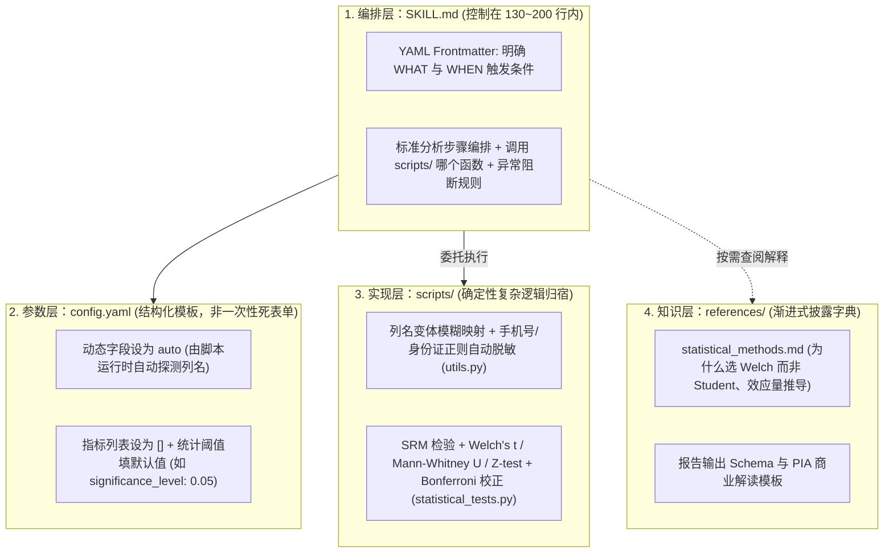

# QoderWork Skills 开发实践：从传统数科到 AI 数科的转型探索-我的Skills进阶之旅

> [!abstract] 导读
> **一句话总结**：淘天集团直播技术团队数据科学家（作者：自遂）结合自身从传统手工跑数、Idealab RAG 对话助手向 **QoderWork Skills** 转型的实战历程，提出了面向数据科学的 **Skill 四层分离工程架构（`SKILL.md` 编排层 + `config.yaml` 参数模板层 + `scripts/` 确定性实现层 + `references/` 渐进式知识层）**，深度拆解了社区标杆 Skill（`Follow Builders`、`Frontend Slides`）的设计巧思，并展示了自研 **`user-insight-report`（用户洞察报告，含自动脱敏、RFM 分层与 PIA 框架）** 与 **`ab-experiment-analysis`（AB 实验分析，含 SRM 强制阻断校验、统计检验自动路由与 Bonferroni 多重校正）** 的完整落地闭环。
> **阅读价值**：为数据科学与商业分析团队提供了一套“如何把统计方法论、业务口径与产运报告美学封装为高确定性 Agent Skill”的手把手教程。

## 1. TL;DR

- **核心公式**：**`Skill = 领域知识 + 标准流程 + 输出模板 + 避坑指南`**。Skill 解决的不是“让大模型更聪明”，而是**“把一段可复用、可验证、有边界的数据科学分析流程封装成稳定可控的能力单元”**。
- **数科 Skill 四层分离工程架构**：
  1. **编排层（`SKILL.md`，建议 <200 行）**：扮演“编排者而非执行者”，只写触发条件、步骤编排、脚本函数委托与异常判定标准，**严禁嵌入大段 Python 实现代码**。
  2. **参数层（`config.yaml`）**：遵循**“是结构化模板而非填好的死表单”**原则，业务动态字段用 `auto`（交由脚本自动检测）或 `[]` 占位，仅对通用统计参数（如显著性水平 `significance_level: 0.05`）填默认值。
  3. **实现层（`scripts/`）**：承接大模型临场发挥不可靠的确定性复杂逻辑（如覆盖几十种列名变体的字段自动映射、正则表达式敏感信息脱敏、精确统计假设检验计算）。
  4. **知识层（`references/`）**：实现**渐进式披露**（如在 `SKILL.md` 只写决策规则“连续指标用 Welch's t-test，非正态退回 Mann-Whitney U”，将背后的数学推导与效应量公式放入 `references/statistical_methods.md` 供追问时按需查阅）。
- **两大自研数科标杆 Skill**：
  - **`user-insight-report`**：6 大分析模块按字段存在性动态组合 + 手机号/身份证正则自动脱敏 + RFM 自动分层 + **PIA 洞察框架（Pattern 现象 $\rightarrow$ Interpretation 解读 $\rightarrow$ Action 建议，强制回答 "So What"）** + 统一淘宝橙视觉配色。
  - **`ab-experiment-analysis`**：**SRM（样本比例不匹配）强制前置校验（异常直接阻断告警）** + 按指标类型（连续/比率）与分布自动选择 `Welch's t-test / Mann-Whitney U / Z-test` + 多指标自动 **Bonferroni 校正** + 综合 `p值 + 效应量 + 效应方向` 的推全决策矩阵。

## 2. 问题定义与背景

### 2.1 传统数据科学日常工作的三大低附加值内耗
1. **重复编写同质化分析代码**：每次做新场景的用户画像洞察，都要重新写一遍数据清洗、分位数统计与可视化绘图脚本。
2. **手工跑实验检验易漏关键防线**：在未接通自动化看板的专项实验分析中，人工跑检验极易遗漏 **SRM（Sample Ratio Mismatch，分流比例失衡）校验**或**多重假设检验校正（Peeking / Multiple Testing Problem）**，导致得出假阳性错误结论。
3. **产运视角与数科语言脱节**：数据科学家习惯输出 `p = 0.023, t = 2.41`，而产品与运营真正关心的是“实验组 GMV 净提升 8%，建议推全”；每次把统计结果翻译排版为产运可读报告耗费大量时间。

### 2.2 从 Idealab RAG 对话助手到 QoderWork Skills 的范式跃迁
作者早期在 Idealab AI Studio 通过 `Prompt Engineering + 知识库 RAG` 构建了对话型用户理解助手，虽然验证了结构化注入领域知识的价值，但缺乏**本地代码执行确定性、标准目录工程化管理与跨平台复用能力**；转向通用 **Agent Skills（兼容 QoderWork / Qoder CLI / Claude Code / Codex）** 后，真正实现了“流程编排 + 确定性 Python 脚本 + 结构化报告 Schema”的工程闭环。

## 3. 知识框架

```mermaid
mindmap
  root((QoderWork 数科 Skills 工程体系))
    1. Skill 生态盘点与元技能
      日常 Skill：browser-use / follow-builders / frontend-slides
      数科工作 Skill：数据问答 / 找ODPS表与问数 / 找FBI报表与解读 / 指标异常巡检
      元 Skill（先搜后造）：find-skills / skill-creator / Tool Advisor
    2. 四层分离工程架构
      第1层 编排层 (SKILL.md <200行)：WHAT/WHEN 触发 + 步骤编排 + 异常判定（禁放长代码）
      第2层 参数层 (config.yaml)：模板而非死表单（auto 自动检测占位 + [] 动态列表 + 默认值标注）
      第3层 实现层 (scripts/)：确定性统计检验、几十种列名变体映射、正则脱敏、固定配色绘图
      第4层 知识层 (references/)：统计原理解释与方法论渐进式披露
    3. 优秀开源 Skill 拆解借鉴
      Follow Builders：无 config.yaml 对话初始化 + GitHub Actions 中心化定时抓推文生成 JSON Feed
      Frontend Slides：NON-NEGOTIABLE 4次冗余强调 + 显式反模式清单防模式坍缩 + 单次 AskUserQuestion 问完
    4. 自研数科双子星实战
      user-insight-report：6模块按需组合 + 手机号/身份证脱敏 + RFM分层 + PIA (Pattern->Interpretation->Action)
      ab-experiment-analysis：SRM强制阻断校验 + Welch/Mann-Whitney/Z-test自动路由 + Bonferroni校正 + 推全矩阵
```

## 4. 核心内容拆解

### 4.1 数科 Skill 四层分离架构详解



1. **为什么 `config.yaml` 必须是“模板（Template）”而非“表单（Form）”？**
   - **新手踩坑**：最初把某次“双11大促实验”的具体实验名、表名、指标名写死在 `config.yaml` 里，结果下次做“直播红包实验”或“搜索排序实验”时完全无法复用。
   - **正确范式**：将具体业务字段设为 `auto` 占位符或空数组 `[]`，配合 `scripts/` 中覆盖几十种常见命名变体（如 `user_id / uid / buyer_id`、`treat / group / exp_tag`）的自动探测函数，在运行时自动识别映射，并清晰注释 `[必填] / [自动检测] / [默认值]`。
2. **从社区标杆 `Follow Builders` 与 `Frontend Slides` 学到的五大高阶技巧**：
   - **`NON-NEGOTIABLE` 四重冗余强调法**（来自 `Frontend Slides`）：为对抗大模型在长上下文中的注意力衰减，对核心铁律（如 `Viewport Fitting: Never cram, never scroll`）在文件开头、规则展开、脚本引用与收尾兜底处用不同表述重复强调 4 次。
   - **显式“反模式清单（Anti-Patterns）”对抗模式坍缩**：大模型生成前端或图表时极易落入高频平庸套路（如滥用 Inter/Roboto 字体、白底紫渐变）；必须在 Skill 中显式列出禁止使用的配色与布局。
   - **“一次性问完（Single `AskUserQuestion` Call）”减少多轮流失**：在 Phase 1 收集用户需求偏好时，强制要求 AI 将所有待确认问题合并为一次表单式提问，避免多轮拉锯导致上下文漂移。
   - **`Gotchas`（踩坑警告）前置到 `SKILL.md`**：将导出与部署的隐患（如警告含内部业务数据的 HTML 幻灯片严禁触发 Vercel 外网部署脚本以防数据泄露）直接写在 `SKILL.md` 决策点前，而非藏在脚本注释里。
   - **中心化数据预处理解耦**（来自 `Follow Builders`）：通过云端定时流水线预先抓好结构化 `feed-*.json`，让本地 Skill 只需轻量拉取并专注 AI 摘要编排，免去每个用户配置复杂 API Key 的门槛。

### 4.2 两大自研核心数科 Skill 深度拆解

| 维度 | 技能 1：用户洞察报告（`user-insight-report`） | 技能 2：AB 实验分析（`ab-experiment-analysis`） |
| :--- | :--- | :--- |
| **核心痛点** | 产运频繁询问“某场景下是什么样的用户？”，手工跑画像与写解读耗时耗力 | 实验检验流程不标准，易漏 SRM 分流检验或多重比较校正导致错误推全 |
| **`SKILL.md` 篇幅** | 约 **170 行**（精简聚焦编排） | 约 **133 行**（高内聚标准流程） |
| **自动化数据预处理** | `utils.py` 内置正则表达式自动识别并**脱敏手机号、身份证号**等敏感字段；按数据列存在性动态激活 **6 个分析模块**（含 **RFM 自动分层**） | 自动识别实验分组列与多维指标列（覆盖数十种列名变体） |
| **核心算法与统计防线** | 统一淘宝橙视觉配色方案，图表与表格风格高度一致 | 1. **SRM（样本比例不匹配）强制前置校验**：分流比例异常时立即阻断告警；<br/>2. **检验方法自动路由**：根据连续/比率类型及正态性、样本量自动选择 **Welch's t-test、Mann-Whitney U 或 Z-test**；<br/>3. **多重比较校正**：多指标分析自动执行 **Bonferroni 校正** 并提示 Peeking Problem |
| **商业价值转化（产运友好）** | 强制遵循 **PIA 洞察框架**：每条洞察必须包含 **`Pattern（数据现象） → Interpretation（业务解读） → Action（可落地行动建议，回答 So What）`** | **综合结论判定矩阵**：拒绝唯 $p$ 值论，综合 **$p$ 值 + 效应量（Effect Size） + 效应方向** 自动生成业务语言推全建议 |

## 5. 数据速查表

| 工程要素 | 推荐标准 / 关键数值 | 工程设计目的 |
| :--- | :--- | :--- |
| **`SKILL.md` 黄金篇幅** | 严格控制在 **200 行以内**（最多不超过 500 行；实测两个核心 Skill 分别为 **170 行** 与 **133 行**） | 防止信息过载稀释注意力，迫使作者将实现下沉至 `scripts/`、原理下沉至 `references/` |
| **测试验证工作量占比** | 用模拟数据端到端跑通并反复调优占整个 Skill 开发周期的 **70%–80%** | 坚持测试驱动开发（TDD），在真实/模拟脏数据上封堵边界 Bug |
| **元技能（Meta-Skills）三件套** | `find-skills`（先检索防重复造轮子）、`skill-creator`（对话生成标准骨架）、`Tool Advisor`（推荐最优工具组合） | 降低从 0 到 1 编写规范 Skill 的启动成本 |
| **直播数科高频工作 Skill 矩阵** | 数据问答分析、找 ODPS 表与直接问数、找 FBI 报表与报表解读、指标巡检诊断 | 覆盖从底表检索、取数、异动归因到定期巡检的完整数科链路 |

## 6. 踩坑与教训 / 可迁移的设计原则

- **核心原则 1：“给代码不如给流程，给自由不如给 Schema”**
  - **教训**：大模型天生会写 Python/Pandas 代码，但它不懂商业分析的严谨防线（比如不做 SRM 校验就直接看 $p$ 值下结论，或者只罗列枯燥统计值而不写业务建议）。
  - **迁移法则**：`SKILL.md` 的核心任务是锁死**专业分析 SOP 与输出报告 Schema**；没有明确输出 Schema 的 Skill 必然退化为普通的闲聊背景板。
- **核心原则 2：用双语视角（产运语言 + 数科统计语言）设计输出模板**
  - 在报告顶部用产运一目了然的 **PIA 框架（现象 $\rightarrow$ 解读 $\rightarrow$ 建议，“GMV +8% 建议推全”）** 给出结论，将供数科同行交叉复核的 $p$ 值、Welch's $t$ 统计量、Bonferroni 校正阈值放在折叠区或附录表格中。
- **核心原则 3：严守数据安全与隐私红线**
  - 在处理含用户明细的数据集时，必须在 `scripts/utils.py` 入口处强制执行手机号、身份证等 PII 敏感字段正则脱敏；在使用 `frontend-slides` 等外部开源 Skill 生成汇报材料时，**严禁开启一键部署至外部公网（如 Vercel）的功能**，直接删除外部部署脚本以防内部商业数据泄露。

## 7. 记忆锚点

- **一个四层工程公式**：**`SKILL.md`（<200行管编排） + `config.yaml`（`auto` 模板非死表单） + `scripts/`（确定性检验与脱敏） + `references/`（统计原理渐进披露）**。
- **两个自研数科神器**：
  - **用户洞察（`user-insight-report`）**：自动脱敏 + RFM 分层 + **PIA 框架（Pattern $\rightarrow$ Interpretation $\rightarrow$ Action，必答 So What）**。
  - **AB 实验（`ab-experiment-analysis`）**：**SRM 强制前置阻断** + **Welch / Mann-Whitney / Z-test 自动路由** + **Bonferroni 多重校正**。

## 8. 复习卡片

What are the four layers of the QoderWork Data Science Skill architecture, and what is the specific responsibility of each layer?::1. Orchestration Layer (`SKILL.md`, <200 lines: triggers, step workflow, script delegation, exception rules); 2. Parameter Layer (`config.yaml`: reusable template using `auto` and `[]` placeholders rather than hardcoded form values); 3. Implementation Layer (`scripts/`: deterministic Python code for column mapping, regex PII masking, and statistical tests); 4. Knowledge Layer (`references/`: detailed mathematical explanations loaded via progressive disclosure).
Why should `config.yaml` in a Data Science Skill be designed as a "template" rather than a "filled form"?::Hardcoding specific experiment names or column names turns `config.yaml` into a one-off form that breaks on the next task; using `auto` placeholders paired with fuzzy column-detection scripts in `scripts/` allows the same Skill to generalize across different datasets and business experiments.
What design techniques did the author learn from dissecting the `Frontend Slides` open-source Skill?::1. Repeating critical rules 4 times with `"NON-NEGOTIABLE"` tags to counter attention decay; 2. Explicitly listing Anti-Patterns (banned fonts/colors) to prevent mode collapse; 3. Batching all clarifying questions into a single `AskUserQuestion` call; 4. Front-loading `Gotchas` (and stripping external deployment scripts like Vercel to prevent enterprise data leaks) directly into `SKILL.md`.
How does the `user-insight-report` Skill ensure its output is actionable for non-technical product and operations teams?::By enforcing the PIA framework—requiring every insight to include Pattern (data phenomenon) -> Interpretation (business meaning) -> Action (concrete recommendation answering "So What")—alongside regex PII masking, automated RFM segmentation, and unified Taobao-orange styling.
What statistical guardrails are built into `scripts/statistical_tests.py` inside the `ab-experiment-analysis` Skill?::1. Mandatory Sample Ratio Mismatch (SRM) check that halts and alerts on traffic split anomalies; 2. Automatic routing between Welch's t-test, Mann-Whitney U, and Z-test based on metric type (continuous vs. ratio), normality, and sample size; 3. Automatic Bonferroni correction for multiple comparisons; 4. A decision matrix combining p-value, effect size, and direction.
According to the author's practical experience, what percentage of total Skill development effort is spent on testing and iterating with simulated data?::70% to 80% of the total development work is spent running end-to-end tests on simulated datasets to uncover edge cases and refine the workflow.

## 9. 知识关联

- **本批同主题精读**：
  - [AI Agent 的 Skill 系统设计](../Agent Skill系统设计+26.7.1/AI_Agent Skill系统设计.md)：提供了通用 Agent Skill 的顶层设计原则（Token 经济、三层加载、自由度分级），与本文的四层数科 Skill 架构完全契合。
  - [Copilot 需求交付 Skill 如何实现数据需求24h交付](../数据需求24h交付Skill+26.7.19/AI_数据需求24h交付Skill.md)：同出淘天直播数据技术体系！该文聚焦**数据工程侧（ODPS SQL 需求澄清与数仓建模 `copilot_req2sql`）**，本文聚焦**数据科学侧（取数后的统计检验 `ab-experiment-analysis` 与商业洞察 `user-insight-report`）**，合起来正好构成直播数据团队的完整 AI 闭环。
  - [AI 评测还在看准确率？数据科学早就用因果推断做归因分析了](../AI评测因果推断归因+26.8.10/AI_AI评测因果推断归因.md)：展现了数据科学方法论（从 A/B 实验显著性检验到观测数据因果推断 DML）在 AI 时代的广泛应用。
  - [【手猫研发提效随笔】七句话搞定一年AB实验下线：CodingAgent的魔法时刻](../手猫AB实验自动下线+26.7.31/AI_手猫AB实验自动下线.md)：本文负责 A/B 实验推全前的**科学统计检验判定**，该文负责实验推全后的**存量代码自动化下线清理**。
- **主题索引（`20_topics`）**：
  - [Skill设计与治理](../../20_topics/Skill设计与治理.md)
  - [AI研发协同](../../20_topics/AI研发协同.md)
  - [因果推断与评测归因](../../20_topics/因果推断与评测归因.md)
- **本目录归档文件**：[原始 PDF](RAW.pdf) · [逐页转写文本](MD.md)
- **候选概念双链**：[[QoderWork]] · [[Agent-Skill]] · [[渐进式披露]] · [[SRM检验]] · [[Welch-t检验]] · [[Bonferroni校正]] · [[RFM分层]]

## 10. 原文参考资料

- **原文出处**：大淘宝技术公众号，《QoderWork Skills 开发实践：从传统数科到 AI 数科的转型探索-我的Skills进阶之旅》（作者：自遂，淘天集团-直播技术团队，发布日期：2026-06-26）

> [!note]- 校对报告
> - **页码溯源（1-based 物理页码）**：
>   - 篇首标题、作者（自遂，直播技术团队）、适用平台说明、日常/工作/元 Skill 清单及数科转型背景：源自 `RAW.pdf` `p.1–3`（对应 `MD.md` 第 1–3 页）。
>   - 四层分离工程架构（`SKILL.md` 编排层控制在 200 行内，实测 170 行与 133 行；`config.yaml` 模板化 `auto` 设计；`scripts/` 列名变体映射；`references/` 统计原理渐进披露）：源自 `RAW.pdf` `p.3–6`（对应 `MD.md` 第 3–6 页）。
>   - 开源标杆 Skill 拆解（`Follow Builders` 的中心化 GitHub Actions Feed 与无 `config.yaml` 设计、`Frontend Slides` 的 `NON-NEGOTIABLE` 四重强调、反模式清单、单次提问与删除 Vercel 部署防泄密）：源自 `RAW.pdf` `p.6–10`（对应 `MD.md` 第 6–10 页）。
>   - 自研 `user-insight-report`（6 模块按需组合、正则脱敏、RFM 分层、PIA 框架）与 `ab-experiment-analysis`（SRM 强制校验、Welch's t / Mann-Whitney U / Z-test 自动选择、Bonferroni 校正、结论矩阵）及 70%–80% 测试占比总结：源自 `RAW.pdf` `p.10–18`（对应 `MD.md` 第 10–18 页）。
> - **一致性核验**：原文共 18 页（含 12 页目录结构与代码截图），无完整独立的 `SKILL.md` 全文可剥离。全文零正文内页码引用，全部技术细节与 `MD.md` 严格一致。
