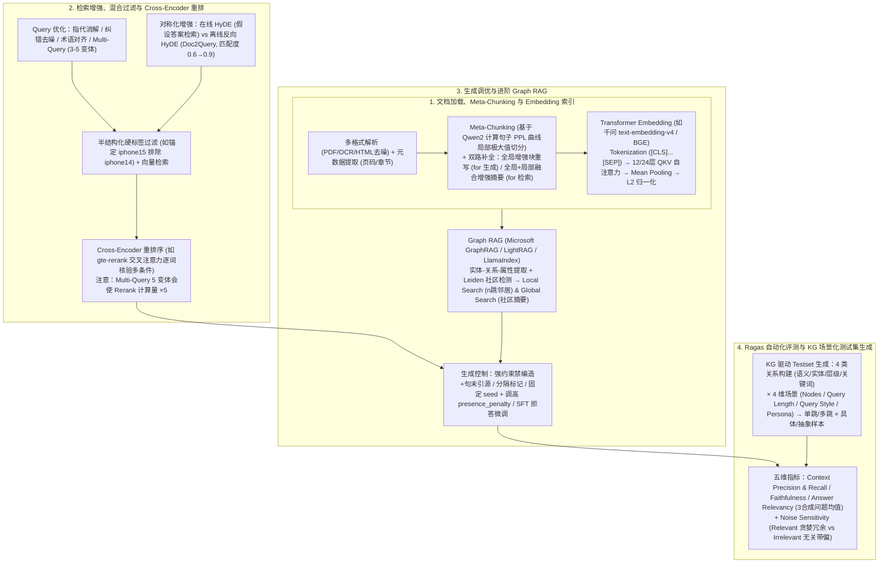

# RAG 全链路技术详解

## 1. TL;DR

1. **RAG 工程化全链路闭环**：针对品牌行业 AI 运营战役中“知识库构建不规范、检索召回不准、缺乏量化评测”三大痛点，系统拆解从**文档加载 $\rightarrow$ 智能切分（Meta-Chunking）$\rightarrow$ Embedding 索引构建 $\rightarrow$ 检索增强与重排序 $\rightarrow$ 生成调优与 SFT $\rightarrow$ Graph RAG $\rightarrow$ Ragas 自动化评测与测试集合成**的端到端技术体系。
2. **基于困惑度（PPL）的 Meta-Chunking 与双路径语义补全**：利用轻量化大模型（如 Qwen2）计算句子序列的条件困惑度（Perplexity）曲线，捕捉 **PPL 局部极大值**作为逻辑断层切分边界；随后通过**全局增强文本块重写（面向生成质量）**与**融合全局补充摘要 + 局部摘要的一句话增强摘要（面向检索命中）**消弭分块语义鸿沟。
3. **正反向 HyDE（Doc2Query）、标签过滤与 Cross-Encoder 重排**：对比在线生成的 **HyDE**（假设文档嵌入，将非对称“问题-文档”匹配转为对称“文档-文档”匹配）与**离线零延迟的反向 HyDE（Doc2Query，为每个 chunk 预生成 3–5 个虚构问题建索引，使匹配度从 `0.6` 跃升至 `0.9`）**；配合硬标签过滤（如区分 `iPhone 15 Pro Max` 与 `iPhone 14`）及 `gte-rerank` 等 Cross-Encoder 交叉注意力精排（警惕 Multi-Query 导致重排算力乘 5 倍）。
4. **Graph RAG 与 Ragas 五维评测 + 知识图谱场景化造数**：结合 **Leiden 社区检测算法**实现 Graph RAG 局部（$n$ 跳邻居）与全局（社区摘要）检索；在 Ragas 中除 `Context Precision/Recall`、`Faithfulness`、`Answer Relevancy`（默认反向生成 3 个合成问题算余弦均值）外，重点引入**噪声敏感度（`Noise Sensitivity`：Relevant 贪婪搬运 vs Irrelevant 被带偏）**，并基于四类关系构建器与 `Nodes × Query Length × Query Style × Persona` 自动合成单跳/多跳评测集。

## 2. 问题定义与背景

### 2.1 企业级 Agent 落地 RAG 的三大共性短板

在天猫品牌行业 AI 运营实战中，工程团队普遍面临：
1. **知识库入口与切分粗糙**：多源异构文档（PDF/扫描件/HTML/Excel）清洗缺失，机械定长切分切断上下文逻辑，导致跨句前提与指代丢失。
2. **非对称检索与多条件失焦**：用户简短口语提问与专业长文档存在表征鸿沟（非对称检索），且单纯稠密向量难以同时满足“华为 + 2000 元以下 + 续航好”等多维硬约束。
3. **缺乏科学评测与高质量测试集**：缺少自动化量化指标与覆盖单跳/多跳、具体/抽象查询的合成评测集，调优停留在体感盲调。

## 3. 知识框架

## 4. 核心内容拆解

### 4.1 基于困惑度（PPL）的 Meta-Chunking 与语义补全

论文 *Meta-Chunking: Learning Text Segmentation and Semantic Completion via Logical Perception* 提出用语言模型困惑度感知逻辑边界：
1. **PPL 局部极大值切分**：
   - 将长文档按标点切分为句子序列 $(x_1, x_2, \dots, x_n)$；
   - 使用轻量级大模型（如 **Qwen2**）逐句计算给定前文条件下的句子困惑度 $\text{PPL}(x_i \mid x_{<i})$，形成随文本流动的 PPL 曲线；
   - **低 PPL** 代表上下文通顺连贯，**PPL 突然飙升的局部极大值（Local Maximum）** 代表逻辑发生转折或断层，据此切分为独立文档块（Chunk/Trunk）。
2. **消弭分块语义鸿沟的双路径补全**：
   - **面向生成质量的“全局增强文本块重写（Globally Augmented Text Chunk Rewriting）”**：先用 Embedding 召回相近块，再由 LLM 诊断当前块缺失的前提、背景或结论，对候选缺失信息打分筛选后融合成语义自包含的新文本块。
   - **面向检索命中的“上下文感知摘要生成（Context-Aware Summary Generation）”**：结合全文生成补偿话语背景的“补充摘要”，再与当前块的“局部摘要（Local Summary）”融合精炼为**一句话增强摘要（Enhanced Summary Sentence）**。

### 4.2 Transformer Embedding 内部机制与正反向 HyDE

1. **Embedding 六步映射机理（以“苹果手机很好用”与 `text-embedding-v4` / `BGE` 为例）**：
   - **分词与特殊 Token**：首尾添加 `[CLS]` 与 `[SEP]` 并查词表转为 ID（如 `[101, 512, 678, 321, 102]`）；
   - **初始查表与位置编码**：映射为高维向量（如 `1536` 维）并叠加 Positional Encoding；
   - **多层 Self-Attention 语境消歧**：经 12 或 24 层 $Q, K, V$ 交互，“苹果”的向量吸收 50%“手机”特征（如 $\vec{v}_{\text{新苹果}} = 100\% V_{\text{苹果}} + 50\% V_{\text{手机}} + 10\% V_{\text{好用}}$），抑制“水果/红色”语义并放大“电子产品/科技”语义；
   - **池化（Pooling）与 L2 归一化**：采用 **Mean Pooling**（BGE 等主流模型首选，比 `[CLS]` 或 Max Pooling 更平稳表征全句）合并 Token 向量，再经 **L2 归一化（模长置为 1）** 使向量点积直接等价于余弦相似度，大幅加速 ANN 检索。
2. **Query 改写、HyDE 与反向 HyDE（Doc2Query）对比**：
   - **Query 改写与 Multi-Query**：完成多轮指代消解（“它的价格” $\rightarrow$ “华为 Mate 60 Pro 的价格”）、口语转术语（“肚子疼” $\rightarrow$ “腹痛治疗建议”），或从不同视角生成 **3–5 个查询变体**广撒网提升召回。
   - **在线 HyDE vs 离线反向 HyDE（Doc2Query）**：
     - **HyDE**：让 LLM 先编造一段包含专业词汇（如“酵母发酵、二氧化碳、面筋网络”）的假设性回答，将非对称的“短问句-长文档”匹配转化为对称的“文档-文档”匹配；但会增加在线推理 RT。
     - **反向 HyDE（Doc2Query）**：在**离线索引阶段**让 LLM 为每段规章/文档块预生成 **3–5 个虚构用户问题**（如针对“非一线城市住宿补贴 350 元、15 个工作日内提交增值税专票”生成“出差去二线城市住酒店一天报销多少？”等问题）并与原块关联建索引。在线匹配时，用户问“报销上周去西安出差的房费怎么办”与虚构问题口吻高度一致，**向量匹配度可从 `0.6` 大幅跃升至 `0.9`，且零在线额外 RT 开销**。
3. **硬标签过滤与 Cross-Encoder 重排序（Rerank）**：
   - **提取硬标签**：将非结构化文本转为半结构化，用 `iphone15` 等精准标签过滤掉语义极似但型号不符的 `iPhone 14` 噪声。
   - **Cross-Encoder 交叉注意力精排（如 `gte-rerank`）**：将 Query 与候选文档拼接送入 Transformer，逐 Token 核验是否同时满足“华为 + 2000 元以下 + 续航好”等多重约束；但需注意**若开启 Multi-Query 生成 5 个变体，Rerank 计算量会直接放大 5 倍**。

### 4.3 生成阶段调优与进阶 Graph RAG

1. **生成阶段防幻觉与调参/SFT 策略**：
   - **Prompt 结构化约束**：显式禁止使用外部陈旧训练知识、强制要求句末标注引用来源、用清晰分隔符隔离指令与检索切片、按问题类型路由不同回答模板。
   - **解码参数控制**：固定 `seed` 保证复现性；调高 `presence_penalty` 抑制车轱辘话重复；事实问答调低 `temperature` / `top_p`；合理设置 `max_tokens` 防截断。
   - **SFT 指令微调**：当 Prompt 调优见顶时，构造“问题 - 参考资料 - 标准答案/拒答”语料做 SFT，专项训练模型**严格依据资料作答并在证据不足时主动拒答**。
2. **Graph RAG（知识图谱增强检索）**：
   - **离线构图与社区聚类**：从文本块提取实体（Entity）、关系（Relationship）与属性（Property），利用 **Leiden 图社区检测算法**（如 Microsoft GraphRAG）聚合紧密关联实体并由 LLM 预生成各层级**社区摘要（Community Summary）**。
   - **双模在线检索**：针对具体实体多跳推理采用 **Local Search**（定位实体并扩展 $n$ 跳邻居节点）；针对宏观跨篇总结采用 **Global Search**（直接检索并汇总多个社区摘要）。代表框架包括 **Microsoft GraphRAG、LlamaIndex、LightRAG**。

### 4.4 Ragas 自动化评测与基于 KG 的测试集合成

1. **Ragas 五大核心指标（新增噪声敏感度深度拆解）**：
   - **检索维度**：`Context Precision`（相关块是否排在顶部）、`Context Recall`（将参考答案 `reference` 拆解为事实点 Claims，计算可溯源至召回上下文的比例，免去高昂的人工参考上下文标注）。
   - **生成维度**：`Faithfulness`（生成答案中所有 Claims 能被召回上下文支撑的比例，$[0, 1]$）、`Answer Relevancy`（由生成答案默认反向合成 **3 个问题**，计算其与原 Query Embedding 余弦相似度的均值）。
   - **噪声敏感度（`Noise Sensitivity`，取值 $[0, 1]$，越低越好）**：
     - **相关上下文噪声敏感度（`Relevant`）**：文档相关但包含参考答案不需要的冗余背景细节；得分高说明模型过于“贪婪”，把无关紧要的旁枝末节全搬进了回答。
     - **不相关上下文噪声敏感度（`Irrelevant`）**：检索回完全不相干的干扰文档；得分高说明模型抗干扰差、极易被无关文档“带偏”编造答案。
2. **基于知识图谱与四维场景（Scenario）的评测集自动生成**：
   - 为解决多跳问题（Multi-Hop Query，如“A 影响 B、B 发明 C $\rightarrow$ 谁影响了 C 的发明者”）跨块生成难题，Ragas 先对文档切片运行提取器（LLM 提取器 + `NERExtractor`/`KeyphraseExtractor` 规则提取器），再通过**四类关系构建器（语义余弦相似度关联、共享命名实体关联、相邻/主子层级结构关联、高频关键短语关联）**构建文档块知识图谱。
   - 随后通过 `QuerySynthesizer`（`_generate_scenarios` 查图选节点 + `_generate_sample` 调 LLM 出题）按 **`Nodes（图节点）× Query Length（短/中/长）× Query Style（Web search / Chat）× Persona（如高级工程师/初级工程师）`** 组合生成覆盖 **`Single-Hop / Multi-Hop` $\times$ `Specific（具体事实）/ Abstract（抽象演进）`** 四象限的高质量评测集。

## 5. 数据速查表

| 技术环节 / 模块 | 核心参数 / 量化效果 | 工程解释与应用场景 |
| :--- | :--- | :--- |
| **Embedding 演进架构** | `1536` 维（示例），`12` 或 `24` 层 Transformer | 如千问 `text-embedding-v4`、BGE，采用 **Mean Pooling + L2 归一化** |
| **Multi-Query 扩展与重排代价** | 每次生成 **`3–5 个`** 查询变体 | 提升召回率，但若生成 5 个变体，下游 **Cross-Encoder 重排计算量直接 $\times 5$** |
| **反向 HyDE (Doc2Query) 收益** | 每个 chunk 离线生成 **`3–5 个`** 虚构问题 | 差旅报销案例中向量匹配度从 **`0.6` 跃升至 `0.9`**，且**零在线额外延迟** |
| **Answer Relevancy 默认采样数** | 从回答反向合成 **`3 个`** 问题 | 计算合成问题与原 Query 的 Embedding 余弦相似度平均值 |
| **Noise Sensitivity 评分区间** | **`[0, 1]`（数值越低性能越好）** | 细分为 `Relevant`（防贪婪冗余搬运）与 `Irrelevant`（防无关噪声带偏） |

## 6. 踩坑与教训 / 可迁移的设计原则

1. **对在线延迟敏感的生产系统，优先用“离线反向 HyDE（Doc2Query）”替代在线 HyDE**：在线让大模型先写一段假答案会凭空增加数百毫秒至数秒的首字延迟；而在离线入库时为每个 Chunk 预生成 3–5 个用户口吻的潜在提问并建立索引，既能把口语提问匹配度从 0.6 拉升到 0.9，又完全不增加在线检索 RT。
2. **开启 Multi-Query 时必须核算下游 Cross-Encoder Rerank 的算力膨胀**：Multi-Query 每扩写 5 个变体，送入 `gte-rerank` 等交叉编码器的候选文档对数量就会乘以 5；务必在送入 Reranker 前先做跨路去重与 RRF 初筛截断。
3. **监控 Ragas 必须同时看 `Faithfulness` 与 `Noise Sensitivity (Relevant / Irrelevant)`**：有些模型表面上完全忠实于检索上下文（Faithfulness 极高），但实际上是因为把召回文档里与问题无关的冗余背景甚至错召回文档全盘抄入答案（Noise Sensitivity 极差）。

## 7. 记忆锚点

- **一套逻辑感知切分**：**Meta-Chunking**（用 Qwen2 算句子 PPL 曲线局部极大值切分 + 全局增强重写/一句话增强摘要双补全）。
- **一对正反向检索增强**：在线 **HyDE**（编假答案搜真文档）vs 离线 **反向 HyDE / Doc2Query**（为文档块预生 3–5 个虚构问题，匹配度 `0.6 → 0.9`，零在线延迟）。
- **两类 Graph RAG 检索**：**Leiden 社区检测**构图 $\rightarrow$ `Local Search`（实体 $n$ 跳邻居）+ `Global Search`（跨社区摘要汇总）。
- **五项 Ragas 指标与四象限造数**：`Context Precision`、`Context Recall`、`Faithfulness`、`Answer Relevancy`、**`Noise Sensitivity (Relevant/Irrelevant)`**；基于 4 类关系构图合成 `Single/Multi-Hop × Specific/Abstract` 测试集。

## 8. 复习卡片

1. Meta-Chunking 是如何利用困惑度（PPL）确定文档切分边界并做语义补全的？::它用轻量化大模型（如 Qwen2）计算每个句子在给定前文下的困惑度（PPL）曲线，将 PPL 突然飙升的局部极大值（逻辑脱节处）作为切分边界；随后通过“全局增强文本块重写（面向生成）”和“融合全局补充摘要与局部摘要的一句话增强摘要（面向检索）”补全跨块上下文。
2. 现代 Transformer Embedding 模型（如 BGE、text-embedding-v4）为什么普遍采用 Mean Pooling 并做 L2 归一化？::Mean Pooling 将经过 12/24 层自注意力语境消歧后的所有 Token 向量取平均，比单取 `[CLS]` 更平稳地代表全句语义；L2 归一化将向量模长变为 1，使向量点积直接等于余弦相似度，大幅加快向量库检索速度。
3. 反向 HyDE（Doc2Query）与正向 HyDE 有何区别？它在工程上有什么突出优势？::正向 HyDE 在用户提问时实时调 LLM 编造假答案再去检索，会增加在线 RT；反向 HyDE 在离线索引阶段针对每个文档块预生成 3–5 个虚构问题并建立关联索引，将“问题-陈述文档”匹配转为“问题-虚构问题”匹配（匹配度可从 0.6 升至 0.9），且完全不增加在线调用延迟。
4. 为什么向量检索之后需要 Cross-Encoder 重排序（如 `gte-rerank`）？它与 Multi-Query 结合时有什么隐患？::向量检索预计算的文档向量只能表征平均语义，难以同时校验多重硬条件（如“华为+2000元以下+续航好”）；Cross-Encoder 将 Query 与候选文档拼接通过交叉注意力逐词核验匹配度，但若上游 Multi-Query 生成 5 个查询变体，会使重排序计算量直接放大 5 倍。
5. Graph RAG 如何通过两阶段架构解决传统 RAG 无法回答的“多跳推理”与“宏观全局总结”问题？::离线阶段从文本块提取实体、关系、属性构建知识图谱，并用 Leiden 算法聚类社区及生成社区摘要；在线阶段通过 Local Search（定位实体并提取 $n$ 跳邻居）解决多跳推理，通过 Global Search（汇总预先生成的社区摘要）回答宏观主题问题。
6. Ragas 评估框架中的“噪声敏感度（Noise Sensitivity）”衡量什么？其两个子维度分别考察模型什么能力？::衡量系统因检索文档中的干扰信息而产生错误回答的频率（0–1 越低越好）；`Noise Sensitivity - Relevant` 考察模型面对相关文档中的额外冗余细节时是否会“贪婪”照搬，`Noise Sensitivity - Irrelevant` 考察模型面对完全不相关的错召回文档时是否容易被“带偏”。
7. Ragas 是如何自动合成多跳查询（Multi-Hop Query）评测集的？::先用 LLM 或规则提取器（NER/Keyphrase）从切片中提取信息，通过语义相似度、共享实体、层级结构、关键短语四类 Relationship Builder 构建切片知识图谱；再由 `QuerySynthesizer` 在图中寻找关联节点并结合查询长度、查询风格与用户人设（Persona）生成四象限测试样本。

## 9. 知识关联

- **所属主题**：
  - [检索与文档解析](../../20_topics/检索与文档解析.md)
  - [Agent评测与反馈](../../20_topics/Agent评测与反馈.md)
  - [决策知识结构化](../../20_topics/决策知识结构化.md)
- **本地跃迁**：[原始 PDF](RAW.pdf) · [逐页转写文本](MD.md)
- **候选双链**：[[构建高质量RAG知识库]] · [[AI答疑助手LightRAG升级]] · [[Spec+RAG打造懂业务AI程序员]] · [[智能导购Agent评测实践]]

## 10. 原文参考资料

1. **核心论文与算法**：*Meta-Chunking: Learning Text Segmentation and Semantic Completion via Logical Perception*、HyDE、Doc2Query、Leiden 社区检测算法
2. **代表性框架与模型**：千问 `text-embedding-v4`、BGE、`gte-rerank`、Microsoft GraphRAG、LlamaIndex、LightRAG
3. **评测文档与课程**：
   - **Ragas 官方文档**：`https://docs.ragas.io/en/latest/getstarted/`
   - **阿里云大模型 ACP 认证教程**：`https://github.com/AlibabaCloudDocs/aliyun_acp_learning/tree/main/%E5%A4%A7%E6%A8%A1%E5%9E%8BACP%E8%AE%A4%E8%AF%81%E6%95%99%E7%A8%8B`

> [!note]- 校对报告
> - **页码溯源**：p.1–3（天猫品牌行业架构 RAG 实战背景、多格式文档加载与元数据提取）；p.3–5（Meta-Chunking 原理：基于 Qwen2 计算句子 PPL 曲线局部极大值切分、全局增强文本块重写与全局+局部融合的一句话增强摘要）；p.5–7（Transformer Embedding 映射全过程：“苹果手机很好用” `[CLS]...[SEP]` 1536 维查表、QKV 100%/50%/10% 权重融合、12/24 层深化、CLS/Mean/Max Pooling 与 L2 归一化）；p.7–10（Query 改写四任务、Multi-Query 3–5 变体、在线 HyDE 面团发酵案例、离线反向 HyDE/Doc2Query 差旅 350 元报销案例匹配度 0.6→0.9、iPhone 15 硬标签过滤、Cross-Encoder `gte-rerank` 原理及 Multi-Query 5 倍算力开销）；p.11–13（生成阶段 6 类问题、Prompt 分隔与句末引用、seed/`presence_penalty`/`temperature`/`max_tokens` 调参与 SFT 拒答微调；Graph RAG Leiden 社区检测与 Local/Global Search）；p.13–19（Ragas 评估框架：`Context Precision/Recall`、`Faithfulness`、`Answer Relevancy` 3 合成问题余弦均值、`Noise Sensitivity` Relevant/Irrelevant 拆解；Single/Multi-Hop × Specific/Abstract 四类查询、4 类 Relationship Builder 构建 KG 及 `EntityQuerySynthesizer` 代码实操）。
> - **一致性核验**：作者（驰海，淘天集团-天猫品牌行业架构团队）、发布日期（2026-05-18）、所有技术示例、公式逻辑与代码片段均与原文逐页核对一致；正文中无任何内联页码引用。
> - **质量边界**：p.7 常用 Embedding 模型对比表在原文中为截图且附注“部分数据来自大模型，仅供参考”，笔记正文中已聚焦提炼核心原理与工程选型准则。
