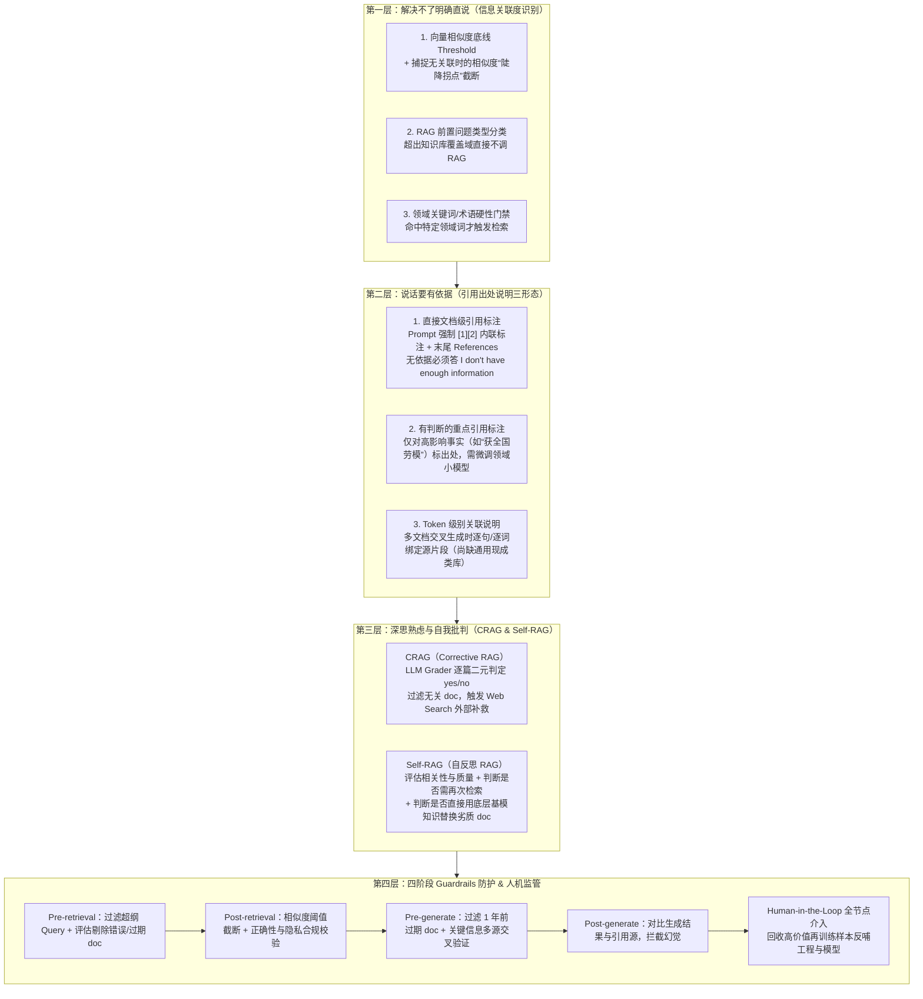

# 设计模式Trustworthy Generation：提升RAG信赖度

## 1. TL;DR

1. **核心目标**：提出 **Trustworthy Generation（可信生成）** 设计模式，系统性提升 RAG 生成内容的**真实性（准确、无幻觉、无偏见）**与**完整度（全面、不遗漏关键信息）**。
2. **RAG 失信四大根源**：① **检索错误**（高向量相似度 $\neq$ 高内容相关性 `high similarity != high relevant`，以及漏召回）；② **内容可靠性问题**（知识库存在偏见、过期或自相矛盾）；③ **前置推理错误**（Query 扩写或 Step-back 抽象跑偏带歪检索方向）；④ **模型幻觉**（问题复杂、召回繁杂时模型自导自演加戏）。
3. **四层递进解决方案**：① **信息关联度识别**（设相似度底线阈值 + 捕捉无关联时向量相似度“陡降点”截断 + 前置问题分类 + 严格领域关键词触发）；② **引用出处说明**（直接 Chunk 级 `[1][2]` 标注 / 领域微调小模型做有判断的重点事实标注 / Token 级多源关联归因）；③ **自我批判与反思**（`CRAG` 评估过滤低质无关文档并触发 Web Search 补救 + `Self-RAG` 动态决定是否重检索或直接用基模内化知识替代文档）；④ **四阶段 Guardrails 防护 + Human-in-the-Loop 样本回收**。
4. **工程代价与三大轻量替代方案**：全套模式会显著增加架构复杂度、LLM 调用延迟与开销，且严苛过滤存在**误杀有用信息**的风险；若受限于成本，可改用 **① 独立双知识库交叉验证、② 增强检索与推理过程透明性概述、③ 返回结果附带引用来源与“置信分”** 三种折中路径。

## 2. 问题定义与背景

### 2.1 为什么“精心维护的知识库 + RAG”反而可能助长幻觉

工程实践中常有一个隐含错误前提：认为知识库里的内容都是精心录入的绝对真理。然而在 `Retrieve + Generate`（本质是 Context Engineering 内容补充）全链路中，四类问题会导致最终生成失信：

| 失信根源 | 细分表现与底层机制 |
|---|---|
| **1. 检索错误** | **a. 准确率不足**：基于语义向量余弦相似度召回 top-$k$，但 **`high similarity != high relevant`**（词面或句式相似但业务无关）； **b. 召回率不足**：关键证据未能进入 top-$k$ |
| **2. 内容可靠性缺陷** | 召回文档虽然相关，但包含**过期政策（如 1 年前旧规）、主观偏见或不同文档间前后冲突** |
| **3. 前置推理偏差** | 检索前的 `Query Expansion`（扩写）或 `Step-back Prompting`（退一步抽象）偏离原意，导致检索方向南辕北辙 |
| **4. 生成阶段幻觉** | 面对复杂问题与多篇长文档拼接上下文，LLM 在组合编排时发生逻辑嫁接错误或自行脑补事实 |

## 3. 知识框架

## 4. 核心内容拆解

### 4.1 第一层：信息关联度识别（拒答与截断机制）

提升 RAG 信赖度的第一步是做到 **“有强关联才返回，无足够关联明确不返回”**：
1. **相似度底线 Threshold + 陡降拐点截断**：传统 top-$k$ 无论分数多低都会凑满 $k$ 条返回。一方面应结合评测设定绝对底线 `threshold`（且随知识库扩充定期重校准）；另一方面利用**向量相似度陡降特性**——当候选文档从“有关联”过渡到“无关联”时，相似度分数会出现明显断崖式下跌，直接在陡降点处截断后续候选。
2. **前置问题类型分类**：在进入检索前先做意图分类，不在知识库覆盖域内的问题直接旁路。
3. **领域关键词硬约束**：仅当 Query 命中特定领域术语时才放行触发 RAG。

### 4.2 第二层：引用出处说明的三种颗粒度

| 引用方式 | 实现机制与代表范式 | 优势与工程代价 |
|---|---|---|
| **1. 直接来源引用（Chunk/Doc 级）** | 在 Prompt 中注入 `SOURCES` 并施加强指令：① 仅使用给定源；② 用 `[1], [2]` 为所有事实打内联引用；③ 源中无答案必须输出 `"I don't have enough information"`；④ 末尾附 `References` 列表 | 实现最简单、零额外模型训练成本；但粗粒度引用仍难杜绝跨文档拼装时的逻辑错位 |
| **2. 有判断的引用说明** | 区分一般背景与关键论断（如“王二 1990 年生于农民家庭，2015 年被评为全国劳模”，仅对影响重大的“全国劳模”强制标出处） | 避免满篇标号干扰阅读；但需针对特定领域**微调小模型**识别哪些事实需引用，存在额外训练维护成本 |
| **3. Token 级别关联说明** | 针对复杂问题融合多篇文档生成段落时，建立生成 Token 序列到多个源文档片段的细粒度映射 | 能暴露多源编排引发的事实与逻辑偏差；但**当前业界尚无成熟通用的开箱即用类库** |

### 4.3 第三层：自我批判（CRAG）与自我反思（Self-RAG）

1. **CRAG（Corrective Retrieval-Augmented Generation）**：
   - **核心职责**：a. 评估召回文档的信息正确性，过滤低质文档并关联其他知识库或外部搜索（Web Search）补充；b. 评估召回文档与 Query 的关联性，裁剪无关内容。
   - **LangChain / LangGraph 标准实现**：定义 Pydantic 模型 `GradeDocuments(binary_score: str)`（取值 `'yes'` 或 `'no'`），使用 `ChatOpenAI(model="gpt-4o-mini", temperature=0).with_structured_output(GradeDocuments)` 构建 `retrieval_grader`；在 `grade_documents(state)` 节点遍历 `state["documents"]`，得分为 `'yes'` 则保留入 `filtered_docs`，一旦出现 `'no'` 则将 `web_search` 置为 `"Yes"` 触发外部搜索补救。
2. **Self-RAG（带自我反思的 RAG）三大职能**：
   - **a. 质量与相关性过滤**：剔除低质或无关文档；
   - **b. 动态重检索判断**：判断当前证据是否足够，是否需要追加检索（类似 Agentic RAG，但 Agentic RAG 面向涵盖文档、接口、搜索的泛化全能知识源）；
   - **c. 基模知识择优替换**：评估召回文档内容是否还不如底层 LLM 自身内化知识可靠，若基模更优则直接用底层 LLM 问答替换该文档内容（充分吃透基模升级红利）。

### 4.4 第四层：四阶段 Guardrails 防护、人机监管与折中替代方案

1. **围绕 Retrieve 与 Generate 的四阶段 Guardrails**：
   - **Pre-retrieval**：拦截超纲 Query；对知识库文档做前置正确性评估，清理错误或过期文档。
   - **Post-retrieval**：过滤低于相似度阈值的文档；执行正确性验证与**隐私合规性校验**。
   - **Pre-generate**：过滤过期信息（如剔除 **1 年前**的旧文档）；对关键事实强制要求**多个独立引用来源交叉验证**。
   - **Post-generate**：对生成初稿做事实核查与反思，拦截相对引用源的幻觉改写。
2. **Human-in-the-Loop（人机协同监督）**：专家可在检索、打分、生成的任一环节介入，核心目的不仅是当次纠偏，更是**回收高价值再训练样本**反哺模型与阈值调优。
3. **考量权衡与三种轻量替代方案**：
   - **局限性**：多轮 LLM Grader/反思显著拉高 RT 与 Token 成本；且打分器自身并非 100% 准确，过滤过严会**误杀有效信息**。
   - **不采用重度模式时的三种替代路径**：
     1. **独立双知识库交叉验证**：维护两个组织方式与维护链路相互独立的知识库，每次 Query 同时检索双库并交叉比对结果。
     2. **过程透明化**：向用户同步展示检索到的信息概述及得出结论的推理思考链，用可解释性换取信赖度。
     3. **引用来源 + 置信分（Confidence Score）**：在返回引用出处的同时附带量化置信分，把采信决策权透明地交给用户。

## 5. 数据速查表

| 模块 / 机制 | 原文设定与代码参数 | 语境与功能说明 |
|---|---|---|
| **RAG 失信四大根源** | 检索错误（准确率/召回率）、内容可靠性、前置推理错误、模型幻觉 | 核心认知：`high similarity != high relevant` |
| **CRAG 文档评分器配置** | `model="gpt-4o-mini"`, `temperature=0`, `binary_score: 'yes' \| 'no'` | 使用 `with_structured_output(GradeDocuments)`；遇 `'no'` 置 `web_search = "Yes"` |
| **Guardrails 阶段划分** | **4 个阶段**：`Pre-retrieval`、`Post-retrieval`、`Pre-generate`、`Post-generate` | `Pre-generate` 含过滤 **1 年前**过期文档与多源交叉验证 |
| **三种引用说明形态** | ① 直接文档引用 `[1][2]`；② 有判断引用（需微调领域小模型）；③ Token 级关联引用 | Token 级关联目前尚无现成通用开源类库 |
| **三种轻量替代方案** | ① 双独立知识库交叉验证；② 检索与思考过程透明化；③ 引用出处附带置信分 | 规避重度反思带来的高延迟与严格过滤误杀风险 |

## 6. 踩坑与教训 / 可迁移的设计原则

| 错误做法 | 失败表现或原因 | 原文应对（可迁移的设计原则） |
|---|---|---|
| **盲目相信向量检索 top-$k$，把所有召回片段一股脑塞给 LLM** | 向量高相似度不等于业务高相关性，无关片段混入长上下文反而诱发模型自导自演产生幻觉 | **底线阈值 + 相似度陡降拐点截断 + 前置意图/关键词门禁**，无足够相关证据时明确拒答 |
| **默认知识库录入的内容永远比底层大模型自身知识更准确** | 知识库可能存在 1 年前的过期规则、录入错误或局部偏见，盲目强制遵循会导致“垃圾进、垃圾出” | 引入 **CRAG / Self-RAG 批判反思**与 `Pre-generate` 时效过滤，必要时调用 Web Search 补救或直接采用基模知识 |
| **将相似度阈值 `threshold` 设为静态常量长期不管，或把过滤门禁调得过严** | 知识库扩容后分布漂移导致阈值失效；多级 LLM 打分器串联过严会误杀关键长尾证据 | 阈值须随知识库演进**定期评测重校准**；高敏场景可改用“双独立知识库交叉验证”或“展示引用+置信分”替代一刀切过滤 |
| **投入大量专家人力做 Human-in-the-Loop 线上纠偏却只改当次结果** | 纯人工盯盘成本不可持续，系统无法产生复利 | 将 Human Feedback 的核心目标定为**回收再训练与评测样本**，驱动小模型 Grader 与检索链路迭代 |

## 7. 记忆锚点

- **可信 RAG 四重境界**：「**没把握闭嘴（阈值+陡降截断），说话带出处（三级引用），检索加批判（CRAG/Self-RAG），四段上护栏（Pre/Post Retrieve & Generate）**」。
- **轻量折中三招**：「**嫌重怕误杀？双库交叉验、过程透明化、出处带置信分**」。

## 8. 复习卡片

RAG 系统生成内容信赖度不足（缺乏真实性与完整度）的四大根源是什么？::① 检索错误（高向量相似度不等于高内容相关性，或漏召回）；② 内容可靠性问题（知识库文档过期、有偏见或相互冲突）；③ 前置推理错误（Query 扩写或 Step-back 抽象偏离原意）；④ 模型幻觉（复杂问题与繁杂文档下自导自演）。
在识别信息关联度时，除了设置固定相似度底线 threshold，还可以利用向量相似度的什么分布特性？::当候选信息从“有关联”变为“无关联”时，向量相似度分值会出现陡然下降（断崖拐点），可识别该陡降点并截断其后的全部候选片段。
引用出处说明有哪三种实现方式？各自有什么优缺点？::① 直接来源引用（用 [1][2] 标注 doc 并在末尾列 References，简单但难防多源拼装逻辑错位）；② 有判断的引用（仅对“获全国劳模”等高影响事实标出处，体验好但需微调领域小模型）；③ Token 级关联说明（解决多文档融合事实归属，但目前缺乏成熟通用类库）。
CRAG（Corrective RAG）与 Self-RAG 的核心机制有何异同？::两者都对召回文档做质量与相关性批判过滤；CRAG 在发现文档不相关（Grader 打分 no）时会触发外部 Web Search 补充证据；Self-RAG 则进一步评估是否需再次检索，并判断能否直接用底层基模自身知识替换低质文档内容。
围绕 Retrieve 和 Generate 划分的四阶段 Guardrails 各自负责什么检查？::① Pre-retrieval：拦截超纲 Query 并清理错误/过期文档；② Post-retrieval：过滤低于阈值文档并做正确性与隐私合规校验；③ Pre-generate：剔除过期信息（如 1 年前文档）并对关键信息做多源交叉验证；④ Post-generate：对比生成结果与引用源检查幻觉。
实施 Trustworthy Generation 模式有哪两个主要工程代价？如果不采用重度过滤，有哪三种轻量替代方案？::两大代价是增加系统延迟/调用成本，以及打分器误杀有用信息；三种替代方案是：① 增加独立维护的第二知识库做双库交叉验证；② 透明展示检索概述与推理思考过程；③ 附带引用来源的同时展示“置信分”交由用户判断。

## 9. 知识关联

- **本库主题索引**：[检索与文档解析](../../20_topics/检索与文档解析.md)、[Skill设计与治理](../../20_topics/Skill设计与治理.md)、[Agent评测与反馈](../../20_topics/Agent评测与反馈.md)、[Prompt优化](../../20_topics/Prompt优化.md)
- **本库关联文章**：[构建高质量RAG知识库+26.6.10](../构建高质量RAG知识库+26.6.10/AI_构建高质量RAG知识库.md)、[RAG全链路技术详解+26.5.18](../RAG全链路技术详解+26.5.18/AI_RAG全链路技术详解.md)、[AI答疑助手LightRAG升级+26.4.10](../AI答疑助手LightRAG升级+26.4.10/AI_AI答疑助手LightRAG升级.md)
- **候选双链**：[[Corrective RAG]]、[[Self-RAG]]、[[RAG Guardrails]]、[[向量相似度陡降截断]]

## 10. 原文参考资料

- **原文信息**：《设计模式Trustworthy Generation：提升RAG信赖度》，作者：Mario（淘天集团-直播技术团队），发布日期：2026-02-09。
- **文内引用参考资料**：
  - O'Reilly 图书：[Generative AI Design Patterns (9798341622654)](https://learning.oreilly.com/library/view/generative-ai-design/9798341622654/)
  - LangGraph 官方教程：[LangGraph CRAG Tutorial](https://langchain-ai.github.io/langgraph/tutorials/rag/langgraph_crag/#create-index)

> [!note]- 校对报告
> - **页码溯源汇总**：
>   - `## 1. TL;DR` & `## 2. 问题定义与背景`：源自 p.1–2（真实性与完整度定义、四大根源、`high similarity != high relevant`、四层解决思路）。
>   - `## 4.1 信息关联度识别` & `## 4.2 引用出处说明`：源自 p.2–4（相似度 threshold + 陡降点截断、问题分类、领域关键词；直接来源引用 Prompt 模板、王二 1990-03-03 / 2015 全国劳模案例、Token 级关联说明）。
>   - `## 4.3 CRAG 与 Self-RAG`：源自 p.4–7（CRAG 两个职责、`grade_documents` 与 `GradeDocuments` / `gpt-4o-mini` 代码实现、Self-RAG 三个职能与 Agentic RAG 对比）。
>   - `## 4.4 Guardrails、Human Feedback 与替代方案`：源自 p.7–9（Pre/Post-retrieval 与 Pre/Post-generate 四阶段、过滤 1 年前 doc、Human-in-the-Loop 样本回收、误杀权衡与双知识库交叉验证/过程透明/置信分三种替代方案）。
> - **材料质量说明**：p.3–5、p.7–8 含示意图，其核心流程与代码实现均已在正文文本层完整给出；p.6 代码块末尾 3 行右侧略有截断，已在笔记中按上下文准确还原。
