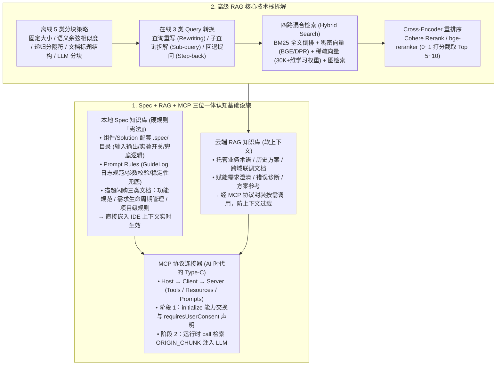

# 告别“伪智能”代码：用 Spec + RAG 打造真正懂你的AI程序员

## 1. TL;DR

1. **“能写 $\neq$ 写得对”的破局双轮（Spec 硬规则 + RAG 软上下文 + MCP 标准接口）**：针对高频迭代、强业务耦合场景下 Vibe Coding 易产生幻觉、遗漏边界与违背工程惯例的问题，构建 **本地 Spec 知识库（提供机器可读的契约“宪法”硬规则，常驻 IDE 上下文）+ 云端 RAG 知识库（动态检索非结构化业务术语、历史方案与跨域经验软上下文）+ MCP 协议（“AI 时代的 Type-C 接口”按需封装调用）** 三位一体架构。
2. **猫超导购 C 端 Spec 体系落地**：在工程内为所有 `Solution` 与通用组件配套 **`.spec/` 目录**（明确定义输入输出、实验开关、兜底逻辑），将通用 Rules（如日志规范 `GuideLog`、参数校验模板、稳定性兜底策略）嵌入 Prompt Rules，并将猫超闪购文档体系划分为**功能规范（主流程/解决方案/通用组件/描述性规范）、需求生命周期管理、项目级规则**三大类。
3. **高级 RAG 全链路技术梳理**：离线覆盖清洗、**五类分块策略对比**（固定大小 / 语义余弦相似度 / 递归分隔符 / 文档层级结构 / LLM 分块）、元数据增强与向量化；在线融合**三类查询转换**（查询重写 Query Rewriting / 子查询拆解 Sub-query Decomposition / 回退提问 Step-back Prompting）、**四路混合检索**（BM25 全文 + 稠密向量 + `30K+` 维稀疏向量 + 图检索）及 **Cross-Encoder 重排序**（如 `Cohere Rerank`、`bge-reranker` 取 `Top 5~10`）。
4. **MCP 两阶段握手协议与渐进式部署实战**：完整解析 MCP 的 `Host - Client - Server`（暴露 `Tools / Resources / Prompts`）架构及**阶段一能力交换（`initialize` 握手返回 Schema 与 `requiresUserConsent` 权限声明）$\rightarrow$ 阶段二运行时调用（`call` 执行与上下文回注）**；通过“一句话生成本地 MCP 服务”试点封装 RAG 检索 API（`ORIGIN_CHUNK`），并在需求澄清、错误诊断与方案参考场景完成闭环验证。

## 2. 问题定义与背景

### 2.1 Vibe Coding vs Spec Coding 的企业级分野

| 对比维度 | Vibe Coding（直觉式编码） | Spec Coding（规范驱动开发 SDD） |
| :--- | :--- | :--- |
| **核心依据** | 依赖开发者或 LLM 对“大致感觉”的主观理解 | 严格遵循书面化、结构化的规范文档（AI 的“宪法”） |
| **生成逻辑** | “我觉得应该这样写”——基于统计模式与风格模仿 | “规则要求必须这样写”——基于契约约束与条件满足 |
| **可靠性与审计** | 易产生幻觉、遗漏边界条件，结果不可预测 | 行为可预期、可验证、可审计 |
| **全周期维护成本** | 初期快、后期高：需求变更或缺陷修复需反复试错 | 初期需投入、后期低：只需更新 Spec，AI 自动适配新规则 |
| **适用场景** | 快速原型、个人项目、探索性编码 | 企业级核心开发、安全关键系统、强合规与高耦合场景 |

### 2.2 为什么单靠 Spec 还不够，必须引入 RAG + MCP？

本地 `.spec/` 目录非常适合承载接口定义、代码流程、扩展点契约等**强确定性硬规则**；但真实业务中还存在海量**非结构化/半结构化知识**（如业务专属术语、历史技术方案、跨团队联调背景）。若将这些静态文档全量塞入 IDE 上下文，会导致窗口迅速膨胀不堪重负；通过 **RAG** 按需检索片段，再用 **MCP 协议**将其封装为即插即用的标准工具，才能实现“硬规则常驻兜底 + 软上下文按需挂载”。

## 3. 知识框架

## 4. 核心内容拆解

### 4.1 RAG 五类分块（Chunking）、三类查询转换与四路混合检索对比

1. **五种文档分块策略的优劣权衡**：
   - **固定大小分块（Fixed-size）**：实现最简单、块大小均一，但极易在句子中间切断语义（需配 `overlap` 缓解）。
   - **语义分块（Semantic）**：按句子/段落算 Embedding 余弦相似度，在相似度骤降处切分，语义连贯但**相似度阈值难以跨文档统一调优**。
   - **递归分块（Recursive）**：自上而下按天然分隔符（标题 $\rightarrow$ 换行 $\rightarrow$ 句号）递归切分至满足长度上限，兼顾完整句子与效率。
   - **基于文档结构分块（Document Structure-based）**：严格按技术文档/说明书的章节标题划界，逻辑内聚度最高，但对无结构纯文本日志无效且块长方差大。
   - **基于 LLM 分块（LLM-based）**：用 Prompt 引导 LLM 重构切分，边界最合理但**全篇调用 LLM 推理成本最高且受窗口限制**。
2. **三种查询转换（Query Transformation）范式**：
   - **查询重写（Query Rewriting）**：将宽泛提问具体化（如 `"怎么学Python？"` $\rightarrow$ `"零基础初学者如何系统学习Python编程语言？推荐的学习路径和资源有哪些？"`）。
   - **子查询拆解（Sub-query Decomposition）**：将复合多意图问题拆为独立单意图子查询分别检索再综合（如将“买新能源车考虑因素+补贴+充电桩”拆为参数配置、国家和地方补贴政策、家用充电桩安装流程 3 个子问题）。
   - **回退提问（Step-back Prompting）**：当原问题过于聚焦局部表象时，先“后退一步”提问更高层的通用原理以获取支撑背景（如从 `"为什么我的手机电池掉电特别快？"` 回退提问 `"影响智能手机电池续航的主要因素有哪些？"`）。
3. **四路混合检索（Hybrid Search）与 Cross-Encoder 重排序**：

| 检索方法 | 核心原理 | 突出优势 | 局限与适用场景 |
| :--- | :--- | :--- | :--- |
| **1. 全文检索** | 倒排索引 + `BM25` 词频打分 | 延迟极低、工程成熟、可解释性强 | 无语义泛化能力；适合含明确人名、专有术语或错误码的查询 |
| **2. 稠密向量检索** | `Sentence-BERT`/`DPR`/`BGE` 编码低维稠密向量 | 强大的跨表述语义理解能力 | 计算与存储开销较大、可解释性弱；适合开放域与多样化口语问答 |
| **3. 稀疏向量检索** | 用语言模型预测词项重要性，生成 **`30K+` 维（绝大多数为 0）**的稀疏向量，复用倒排索引 | 兼顾关键词精确性与上下文语义权重 | 依赖训练数据与词表覆盖；适合混合检索增强 |
| **4. 图检索** | 实体为节点、关系为边，通过图遍历或 GNN 寻路 | 支持复杂多跳逻辑推理，结构可追溯 | 构建成本高、难处理纯非结构化文本；适合强逻辑多跳问答 |

   - 初筛合并 `Top-K` 后，通过 **`Cohere Rerank` 或 `bge-reranker` 等 Cross-Encoder** 将 `Query + 候选文档` 拼接打分（输出 $[0, 1]$ 分数，如 `0.9` 高度相关、`0.2` 无关），最终仅截取 **`Top-N`（如 $N = 5\sim 10$）** 送入 LLM。

### 4.2 MCP 协议两阶段通信机制与猫超导购落地实践

1. **MCP（AI 时代的 Type-C 接口）核心三角色与三能力**：
   - **三角色**：`Host`（如 Claude Desktop / IDE）$\rightarrow$ `MCP Client` $\rightarrow$ `MCP Server`。
   - **Server 暴露三类原语**：`Tools`（可执行函数，如 `get_weather` 或知识库检索）、`Resources`（文档/数据库记录/配置）、`Prompts`（可复用提示词模板）。
   - **两阶段标准握手与调用流**：
     - **阶段一（能力交换 `initialize`）**：Client 发送客户端版本与 `capabilities`；Server 返回 `tools / resources / prompts` 的 JSON Schema 及 **`requiresUserConsent`（是否需弹窗征求用户同意授权）**，Client 将工具注册进当前会话可用集。
     - **阶段二（运行时调用 `call`）**：LLM 产出 `tool_name` 与 `arguments` $\rightarrow$ Client 检查 `requiresUserConsent` 授权后发送 `"method": "call"` $\rightarrow$ Server 执行并返回结构化结果注入 LLM 上下文。
2. **猫超导购 C 端 Spec + RAG + MCP 协同工作流**：
   - **本地 Spec 常驻强约束**：在猫超闪购与导购工程中，每个 `Solution` 与通用组件均建有 `.spec/` 目录（声明出入参、实验开关、兜底逻辑），并将 `GuideLog` 日志规范等固化为系统级 Prompt Rules；文档按**功能规范（主流程/解决方案/通用组件/描述性规范）、需求生命周期管理、项目级规则**三层组织，生成代码前由 Agent 自动加载无需走网络检索。
   - **云端 RAG 经 MCP 按需注入**：绑定知识库 `repositoryId` 与 `X-AK`，配置 `retrievalCounts: 3, retrievalType: "ORIGIN_CHUNK"`，通过“本地试点（一句话生成本地 MCP 服务）$\rightarrow$ 云端迁移”策略接入 Agent 平台，在**需求澄清、错误诊断、方案参考**三大场景动态补齐业务上下文。

## 5. 数据速查表

| 模块 / 参数项 | 设定数值 / 分类规模 | 工程说明 |
| :--- | :--- | :--- |
| **RAG 分块与查询转换方法数** | **5 类分块** + **3 类查询转换** | 含回退提问（Step-back Prompting）与子查询拆解 |
| **稀疏向量检索维度** | **`30K+` 维**（词表大小，绝大多数为 0） | 结合学习到的上下文词项语义权重与传统倒排索引效率 |
| **Cross-Encoder 精排保留数** | **`Top-N`（`N = 5 ~ 10`）** | 输出 `[0, 1]` 相关性得分（如 `0.9` 强相关，`0.2` 无关） |
| **猫超闪购 Spec 文档分类** | **3 大类**（其中功能规范细分为 **4 子类**） | 主流程、解决方案、通用组件、描述性规范 + 需求生命周期 + 项目级规则 |
| **RAG API 检索配置示例** | `maxMatchingThreshold: 1.0`, **`retrievalCounts: 3`** | `retrievalType: "ORIGIN_CHUNK"`，通过 `X-AK` 与 `repositoryId` 调用 |

## 6. 踩坑与教训 / 可迁移的设计原则

1. **严格区分“常驻 IDE 的硬规则（Spec）”与“走 MCP 按需查的软上下文（RAG）”**：接口签名、`GuideLog` 日志规范、实验开关与异常兜底属于每次写代码都必须 100% 遵守的“宪法”，应放在本地 `.spec/` 目录直接注入上下文；而浩瀚的业务历史文档与跨域术语若全塞进窗口会引发注意力稀释，必须放进 RAG 通过 MCP 按需拉取。
2. **当用户提问过于具体琐碎导致检索不到原理文档时，启用“回退提问（Step-back Prompting）”**：一线研发常拿着具体的报错表象提问，直接搜表象往往漏召底层架构设计文档；先让模型“后退一步”生成高一层的原理性问题检索背景知识，能显著提升排障质量。
3. **建立 Spec 的“代码变更感知自动保鲜机制”**：Spec 驱动开发最大的长期隐患是“规范滞后于代码演进”，后续必须通过感知 Git 代码变更自动触发 `.spec/` 同步校验。

## 7. 记忆锚点

- **一套三位一体公式**：`Spec（本地硬规则宪法） + RAG（云端动态软上下文） + MCP（Type-C 标准化按需调用接口）`。
- **三种查询转换技巧**：查询重写（Query Rewriting）+ 子查询拆解（Sub-query Decomposition）+ 回退提问（Step-back Prompting）。
- **四路混合检索矩阵**：全文检索（BM25）+ 稠密向量检索（BGE/DPR）+ 稀疏向量检索（30K+ 维学习权重）+ 图检索（配 Cross-Encoder 精排取 Top 5–10）。
- **两个 MCP 运行阶段**：阶段一 `initialize` 能力交换（含 `requiresUserConsent` 权限声明）$\rightarrow$ 阶段二 `call` 运行时工具调用。

## 8. 复习卡片

1. 在 AI Coding 知识体系中，本地 Spec 知识库与云端 RAG 知识库各自的定位、适用场景与集成方式有什么区别？::本地 Spec 知识库提供强约束、机器可读的“硬规则契约”（如接口定义、`.spec/` 输入输出、实验开关、`GuideLog` 日志规范与兜底逻辑），直接嵌入 IDE 上下文实时生效；云端 RAG 知识库提供非结构化/半结构化的“软上下文”（如业务术语、历史方案、跨域经验），通过 MCP 协议封装为标准工具按需调用以避免上下文膨胀。
2. 什么是查询转换中的“回退提问（Step-back Prompting）”？它适合解决什么检索问题？::当用户的原始问题过度聚焦于具体表象或细节（如“为什么我的手机电池掉电特别快？”）时，先“后退一步”提出一个更高层次、更通用的背景原理问题（如“影响智能手机电池续航的主要因素有哪些？”），从而召回支撑性的底层原理文档。
3. 现代 RAG 混合检索（Hybrid Search）通常集成哪四类检索方式？其中“稀疏向量检索”是如何工作的？::集成全文检索（BM25）、稠密向量检索、稀疏向量检索和图检索四类；稀疏向量检索使用上下文感知的语言模型为每个词项预测重要性权重，生成维度等于词表大小（如 30K+）但绝大多数维度为 0 的高维稀疏向量，既能复用传统倒排索引的高效性，又具备学习到的语义权重。
4. MCP 协议包含哪三个核心角色？MCP Server 可以向大模型暴露哪三类核心能力？::包含主机（Host）、客户端（MCP Client）和服务器（MCP Server）三个角色；MCP Server 可暴露工具（Tools，可执行函数）、资源（Resources，文档/数据库记录/配置）和提示（Prompts，可复用提示词模板）三类能力。
5. MCP 协议的“两阶段通信流程”是如何完成能力发现与安全调用的？::阶段一为“能力交换”，Client 发送 `initialize` 请求，Server 返回自身支持的 Tools/Resources/Prompts 清单及参数 Schema、是否需要用户确认（`requiresUserConsent`）等元数据；阶段二为“运行时调用”，LLM 决定调用工具后，Client 根据 `requiresUserConsent` 完成可选的弹窗授权确认，再发送 `call` 请求执行并将结果回注给 LLM。
6. 猫超导购团队在工程中是如何组织本地 Spec 文档体系的？::为所有 Solution 与通用组件配套 `.spec/` 目录（定义输入输出、实验开关、兜底逻辑），将 `GuideLog` 等通用 Rules 嵌入 Prompt Rules，并将猫超闪购系统文档划分为功能规范（含主流程、解决方案、通用组件、描述性规范）、需求生命周期管理和项目级规则三大类。

## 9. 知识关联

- **所属主题**：
  - [AI研发协同](../../20_topics/AI研发协同.md)
  - [检索与文档解析](../../20_topics/检索与文档解析.md)
  - [Harness与模型协同](../../20_topics/Harness与模型协同.md)
  - [决策知识结构化](../../20_topics/决策知识结构化.md)
- **本地跃迁**：[原始 PDF](RAW.pdf) · [逐页转写文本](MD.md)
- **候选双链**：[[淘系交易Spec范式编程]] · [[RAG全链路技术详解]] · [[构建高质量RAG知识库]] · [[企业购面向Skills编程]]

## 10. 原文参考资料

1. **核心协议与模型组件**：Model Context Protocol (MCP)、Sentence-BERT / DPR / BGE、Cohere Rerank / `bge-reranker`
2. **内部工程实践**：天猫超市导购与闪购 C 端工程（`.spec/` 规范目录、`GuideLog` 日志规范）

> [!note]- 校对报告
> - **页码溯源**：p.1–4（Spec 硬规则 + RAG 软上下文双轮认知基础设施、Spec Coding vs Vibe Coding 五维对比表、传统 LLM vs RAG 七维对比表）；p.4–12（RAG 离线五步与在线五步流程、固定大小/语义/递归/文档结构/LLM 五类分块优缺点、文本与多模态 Embedding、查询重写/子查询拆解/回退提问 Step-back Prompting 三类查询转换、全文/稠密向量/30K+稀疏向量/图检索四路混合检索对比表、Cross-Encoder 重排序 Top 5~10 流程）；p.12–17（MCP Type-C 类比、Host/Client/Server 与 Tools/Resources/Prompts 架构、阶段一 `initialize` 能力交换与 `requiresUserConsent`、阶段二 `call` 运行时调用完整 JSON 报文）；p.17–23（猫超导购 `.spec/` 目录、`GuideLog`、闪购三类文档体系、RAG 知识库 `ORIGIN_CHUNK` `retrievalCounts: 3` API 调用与本地→云端渐进式 MCP 部署及未来规划）。
> - **一致性核验**：作者（翔旭，淘天集团-导购&商详团队）、发布时间（2026-04-08）、全部对比表格、JSON 协议示例与 curl 命令参数均与原文逐页核对一致；正文中无任何内联页码引用。
> - **质量边界**：全文理论体系与猫超导购工程落地完整结合，无任何信息遗漏。
